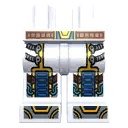

# Loot matrix 262

[Item database](../README.md) | [Methodology](../Methodology.md)

## Sources and mapped locations

| Kind | Source | Location evidence | Conditions |
| --- | --- | --- | --- |
| Package | [Rank 1 Space Ranger Kit Package (LOT 8027)](../sources/object-8027.md) | No matched local placement found | Static association, not a live-spawn guarantee |

## Item candidates

Default vendor-stock probabilities are shown only when this matrix has a registered vendor. Loot probabilities use the generic algorithm, not a guarantee of actual use by every script/activity.

| Item | Modeled loot chance / expected count | Default vendor stock |
| --- | --- | --- |
| { .lu-ti width="24" loading="lazy" } [Space Ranger Helmet 1 (LOT 7442)](../7442.md) | 100%; mean 1 | Not associated with a vendor |
| { .lu-ti width="24" loading="lazy" } [Space Ranger Armor 1 (LOT 7466)](../7466.md) | 100%; mean 1 | Not associated with a vendor |
| { .lu-ti width="24" loading="lazy" } [Space Ranger Pants 1 (LOT 7490)](../7490.md) | 100%; mean 1 | Not associated with a vendor |
| { .lu-ti width="24" loading="lazy" } [Space Ranger Zipgun 1 (LOT 7514)](../7514.md) | 100%; mean 1 | Not associated with a vendor |
| { .lu-ti width="24" loading="lazy" } [Rank 1 Space Ranger Book (LOT 11924)](../11924.md) | 100%; mean 1 | Not associated with a vendor |

## Raw matrix entries

| Row | Loot table | Rarity table | Trigger | Min | Max | Flag | Gate |
| --- | --- | --- | --- | --- | --- | --- | --- |
| 613 | 141 | 22 | 1 | 1 | 1 |  |  |
| 615 | 142 | 22 | 1 | 1 | 1 |  |  |
| 616 | 143 | 22 | 1 | 1 | 1 |  |  |
| 617 | 144 | 22 | 1 | 1 | 1 |  |  |
| 4392 | 777 | 22 | 1 | 1 | 1 |  |  |

[LootMatrix](../../../db/LootMatrix.md), [LootTable](../../../db/LootTable.md), [RarityTable](../../../db/RarityTable.md).
