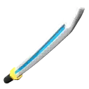

# Loot matrix 266

[Item database](../README.md) | [Methodology](../Methodology.md)

## Sources and mapped locations

| Kind | Source | Location evidence | Conditions |
| --- | --- | --- | --- |
| Package | [Rank 1 Samurai Kit Package (LOT 8028)](../sources/object-8028.md) | No matched local placement found | Static association, not a live-spawn guarantee |

## Item candidates

Default vendor-stock probabilities are shown only when this matrix has a registered vendor. Loot probabilities use the generic algorithm, not a guarantee of actual use by every script/activity.

| Item | Modeled loot chance / expected count | Default vendor stock |
| --- | --- | --- |
| { .lu-ti width="24" loading="lazy" } [Rank 1 Samurai Book (LOT 89)](../89.md) | 100%; mean 1 | Not associated with a vendor |
| { .lu-ti width="24" loading="lazy" } [Samurai Helm 1 (LOT 7445)](../7445.md) | 100%; mean 1 | Not associated with a vendor |
| { .lu-ti width="24" loading="lazy" } [Samurai Breastplate 1 (LOT 7469)](../7469.md) | 100%; mean 1 | Not associated with a vendor |
| { .lu-ti width="24" loading="lazy" } [Samurai Leggings 1 (LOT 7493)](../7493.md) | 100%; mean 1 | Not associated with a vendor |
| { .lu-ti width="24" loading="lazy" } [Samurai Katana 1 (LOT 7517)](../7517.md) | 100%; mean 1 | Not associated with a vendor |

## Raw matrix entries

| Row | Loot table | Rarity table | Trigger | Min | Max | Flag | Gate |
| --- | --- | --- | --- | --- | --- | --- | --- |
| 618 | 149 | 22 | 1 | 1 | 1 |  |  |
| 619 | 150 | 22 | 1 | 1 | 1 |  |  |
| 620 | 151 | 22 | 1 | 1 | 1 |  |  |
| 621 | 152 | 22 | 1 | 1 | 1 |  |  |
| 1434 | 373 | 22 | 1 | 1 | 1 |  |  |

[LootMatrix](../../../db/LootMatrix.md), [LootTable](../../../db/LootTable.md), [RarityTable](../../../db/RarityTable.md).
