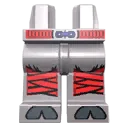

# Loot matrix 268

[Item database](../README.md) | [Methodology](../Methodology.md)

## Sources and mapped locations

| Kind | Source | Location evidence | Conditions |
| --- | --- | --- | --- |
| Package | [Rank 1 Shinobi Kit Package (LOT 8030)](../sources/object-8030.md) | No matched local placement found | Static association, not a live-spawn guarantee |

## Item candidates

Default vendor-stock probabilities are shown only when this matrix has a registered vendor. Loot probabilities use the generic algorithm, not a guarantee of actual use by every script/activity.

| Item | Modeled loot chance / expected count | Default vendor stock |
| --- | --- | --- |
| { .lu-ti width="24" loading="lazy" } [Shinobi Hood 1 (LOT 7451)](../7451.md) | 100%; mean 1 | Not associated with a vendor |
| { .lu-ti width="24" loading="lazy" } [Shinobi Gi 1 (LOT 7475)](../7475.md) | 100%; mean 1 | Not associated with a vendor |
| { .lu-ti width="24" loading="lazy" } [Shinobi Leggings 1 (LOT 7499)](../7499.md) | 100%; mean 1 | Not associated with a vendor |
| { .lu-ti width="24" loading="lazy" } [Shinobi Katana 1 (LOT 7523)](../7523.md) | 100%; mean 1 | Not associated with a vendor |
| { .lu-ti width="24" loading="lazy" } [Rank 1 Shinobi Book (LOT 11922)](../11922.md) | 100%; mean 1 | Not associated with a vendor |

## Raw matrix entries

| Row | Loot table | Rarity table | Trigger | Min | Max | Flag | Gate |
| --- | --- | --- | --- | --- | --- | --- | --- |
| 630 | 157 | 22 | 1 | 1 | 1 |  |  |
| 631 | 158 | 22 | 1 | 1 | 1 |  |  |
| 632 | 159 | 22 | 1 | 1 | 1 |  |  |
| 633 | 160 | 22 | 1 | 1 | 1 |  |  |
| 4393 | 778 | 22 | 1 | 1 | 1 |  |  |

[LootMatrix](../../../db/LootMatrix.md), [LootTable](../../../db/LootTable.md), [RarityTable](../../../db/RarityTable.md).
