# Loot matrix 275

[Item database](../README.md) | [Methodology](../Methodology.md)

## Sources and mapped locations

| Kind | Source | Location evidence | Conditions |
| --- | --- | --- | --- |
| Vendor | [Ludwig Clutchburn - Racing Vendor (LOT 6739)](../sources/object-6739.md) | [Nimbus Station (1200)](../locations/zone-1200.md) | Default inventory; vendorInvOverride can replace it |
| Vendor | [GF - Pirate Beach (LOT 6793)](../sources/object-6793.md) | No default-stock placement found | Default inventory; vendorInvOverride can replace it |

**Generic loot probability unavailable:** at least one entry has maxToDrop < minToDrop. Vendor code treats a zero endpoint as “include the full table”; the generic loot code does not define that interpretation. No drop percentage is fabricated for this matrix.

## Item candidates

Default vendor-stock probabilities are shown only when this matrix has a registered vendor. Loot probabilities use the generic algorithm, not a guarantee of actual use by every script/activity.

| Item | Modeled loot chance / expected count | Default vendor stock |
| --- | --- | --- |
| { .lu-ti width="24" loading="lazy" } [Green Imaginite (LOT 3039)](../3039.md) | Undefined for generic loot: reversed count range | 100% |
| { .lu-ti width="24" loading="lazy" } [Red Racing Helmet (LOT 7730)](../7730.md) | Undefined for generic loot: reversed count range | 100% |
| 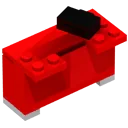{ .lu-ti width="24" loading="lazy" } [Workbench with Toolbox Model (LOT 7766)](../7766.md) | Undefined for generic loot: reversed count range | 100% |
| 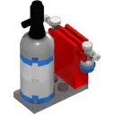{ .lu-ti width="24" loading="lazy" } [Welder Model (LOT 7767)](../7767.md) | Undefined for generic loot: reversed count range | 100% |
| { .lu-ti width="24" loading="lazy" } [Fire Extinguisher Model (LOT 7768)](../7768.md) | Undefined for generic loot: reversed count range | 100% |
| 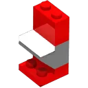{ .lu-ti width="24" loading="lazy" } [Computer Model (LOT 7769)](../7769.md) | Undefined for generic loot: reversed count range | 100% |
| { .lu-ti width="24" loading="lazy" } [Blue Racing Helmet (LOT 7992)](../7992.md) | Undefined for generic loot: reversed count range | 100% |
| { .lu-ti width="24" loading="lazy" } [Green Racing Helmet (LOT 8037)](../8037.md) | Undefined for generic loot: reversed count range | 100% |
| { .lu-ti width="24" loading="lazy" } [White Racing Helmet (LOT 8038)](../8038.md) | Undefined for generic loot: reversed count range | 100% |
| { .lu-ti width="24" loading="lazy" } [Yellow Racing Helmet (LOT 8039)](../8039.md) | Undefined for generic loot: reversed count range | 100% |
| { .lu-ti width="24" loading="lazy" } [Car Chassis (LOT 8129)](../8129.md) | Undefined for generic loot: reversed count range | 100% |
| { .lu-ti width="24" loading="lazy" } [Steel Rim Wheels (LOT 8130)](../8130.md) | Undefined for generic loot: reversed count range | 100% |
| 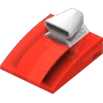{ .lu-ti width="24" loading="lazy" } [Hyperstarter Engine Panel (LOT 8131)](../8131.md) | Undefined for generic loot: reversed count range | 100% |
| 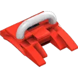{ .lu-ti width="24" loading="lazy" } [Chase Cutter Rear Panel 2 (LOT 8132)](../8132.md) | Undefined for generic loot: reversed count range | 100% |
| { .lu-ti width="24" loading="lazy" } [Chase Cutter Front Bumper 1 (LOT 8134)](../8134.md) | Undefined for generic loot: reversed count range | 100% |
| 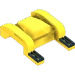{ .lu-ti width="24" loading="lazy" } [Thrust Bucket Rear Panel (LOT 8234)](../8234.md) | Undefined for generic loot: reversed count range | 100% |
| { .lu-ti width="24" loading="lazy" } [Chase Cutter Side Panels 1 (LOT 8235)](../8235.md) | Undefined for generic loot: reversed count range | 100% |
| 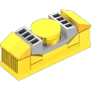{ .lu-ti width="24" loading="lazy" } [Paragon Warp Front Bumper 1 (LOT 8236)](../8236.md) | Undefined for generic loot: reversed count range | 100% |
| 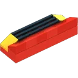{ .lu-ti width="24" loading="lazy" } [Hyperstarter Front Bumper (LOT 9318)](../9318.md) | Undefined for generic loot: reversed count range | 100% |
| 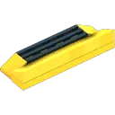{ .lu-ti width="24" loading="lazy" } [Hyperstarter Front Bumper (LOT 9319)](../9319.md) | Undefined for generic loot: reversed count range | 100% |
| 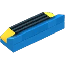{ .lu-ti width="24" loading="lazy" } [Hyperstarter Front Bumper (LOT 9320)](../9320.md) | Undefined for generic loot: reversed count range | 100% |
| 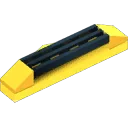{ .lu-ti width="24" loading="lazy" } [Chase Cutter Front Bumper 1 (LOT 9321)](../9321.md) | Undefined for generic loot: reversed count range | 100% |
| 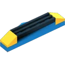{ .lu-ti width="24" loading="lazy" } [Chase Cutter Front Bumper 1 (LOT 9322)](../9322.md) | Undefined for generic loot: reversed count range | 100% |
| 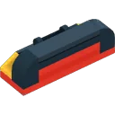{ .lu-ti width="24" loading="lazy" } [Chase Cutter Front Bumper 2 (LOT 9323)](../9323.md) | Undefined for generic loot: reversed count range | 100% |
| 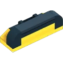{ .lu-ti width="24" loading="lazy" } [Chase Cutter Front Bumper 2 (LOT 9324)](../9324.md) | Undefined for generic loot: reversed count range | 100% |
| 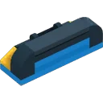{ .lu-ti width="24" loading="lazy" } [Chase Cutter Front Bumper 2 (LOT 9325)](../9325.md) | Undefined for generic loot: reversed count range | 100% |
| 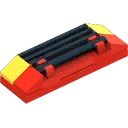{ .lu-ti width="24" loading="lazy" } [Chase Cutter Front Bumper 3 (LOT 9326)](../9326.md) | Undefined for generic loot: reversed count range | 100% |
| 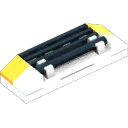{ .lu-ti width="24" loading="lazy" } [Chase Cutter Front Bumper 3 (LOT 9327)](../9327.md) | Undefined for generic loot: reversed count range | 100% |
| 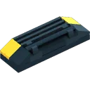{ .lu-ti width="24" loading="lazy" } [Chase Cutter Front Bumper 3 (LOT 9328)](../9328.md) | Undefined for generic loot: reversed count range | 100% |
| { .lu-ti width="24" loading="lazy" } [Hyperstarter Engine Panel (LOT 9329)](../9329.md) | Undefined for generic loot: reversed count range | 100% |
| { .lu-ti width="24" loading="lazy" } [Hyperstarter Engine Panel (LOT 9330)](../9330.md) | Undefined for generic loot: reversed count range | 100% |
| 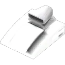{ .lu-ti width="24" loading="lazy" } [Hyperstarter Engine Panel (LOT 9331)](../9331.md) | Undefined for generic loot: reversed count range | 100% |
| { .lu-ti width="24" loading="lazy" } [Chase Cutter Engine Panel 1 (LOT 9333)](../9333.md) | Undefined for generic loot: reversed count range | 100% |
| 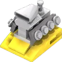{ .lu-ti width="24" loading="lazy" } [Chase Cutter Engine Panel 1 (LOT 9334)](../9334.md) | Undefined for generic loot: reversed count range | 100% |
| { .lu-ti width="24" loading="lazy" } [Chase Cutter Engine Panel 1 (LOT 9335)](../9335.md) | Undefined for generic loot: reversed count range | 100% |
| 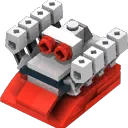{ .lu-ti width="24" loading="lazy" } [Chase Cutter Engine Panel 2 (LOT 9336)](../9336.md) | Undefined for generic loot: reversed count range | 100% |
| { .lu-ti width="24" loading="lazy" } [Chase Cutter Engine Panel 2 (LOT 9337)](../9337.md) | Undefined for generic loot: reversed count range | 100% |
| { .lu-ti width="24" loading="lazy" } [Chase Cutter Engine Panel 2 (LOT 9338)](../9338.md) | Undefined for generic loot: reversed count range | 100% |
| 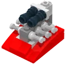{ .lu-ti width="24" loading="lazy" } [Chase Cutter Engine Panel 3 (LOT 9341)](../9341.md) | Undefined for generic loot: reversed count range | 100% |
| { .lu-ti width="24" loading="lazy" } [Hyperstarter Side Panels (LOT 9343)](../9343.md) | Undefined for generic loot: reversed count range | 100% |
| { .lu-ti width="24" loading="lazy" } [Hyperstarter Side Panels (LOT 9344)](../9344.md) | Undefined for generic loot: reversed count range | 100% |
| { .lu-ti width="24" loading="lazy" } [Hyperstarter Side Panels (LOT 9345)](../9345.md) | Undefined for generic loot: reversed count range | 100% |
| { .lu-ti width="24" loading="lazy" } [Hyperstarter Side Panels (LOT 9346)](../9346.md) | Undefined for generic loot: reversed count range | 100% |
| { .lu-ti width="24" loading="lazy" } [Chase Cutter Side Panels 1 (LOT 9348)](../9348.md) | Undefined for generic loot: reversed count range | 100% |
| { .lu-ti width="24" loading="lazy" } [Chase Cutter Side Panels 1 (LOT 9349)](../9349.md) | Undefined for generic loot: reversed count range | 100% |
| 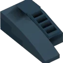{ .lu-ti width="24" loading="lazy" } [Chase Cutter Side Panels 2 (LOT 9352)](../9352.md) | Undefined for generic loot: reversed count range | 100% |
| 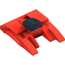{ .lu-ti width="24" loading="lazy" } [Hyperstarter Rear Panel (LOT 9353)](../9353.md) | Undefined for generic loot: reversed count range | 100% |
| 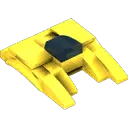{ .lu-ti width="24" loading="lazy" } [Hyperstarter Rear Panel (LOT 9354)](../9354.md) | Undefined for generic loot: reversed count range | 100% |
| 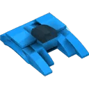{ .lu-ti width="24" loading="lazy" } [Hyperstarter Rear Panel (LOT 9355)](../9355.md) | Undefined for generic loot: reversed count range | 100% |
| 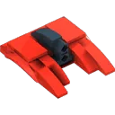{ .lu-ti width="24" loading="lazy" } [Chase Cutter Rear Panel 1 (LOT 9356)](../9356.md) | Undefined for generic loot: reversed count range | 100% |
| 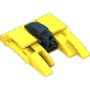{ .lu-ti width="24" loading="lazy" } [Chase Cutter Rear Panel 1 (LOT 9357)](../9357.md) | Undefined for generic loot: reversed count range | 100% |
| 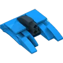{ .lu-ti width="24" loading="lazy" } [Chase Cutter Rear Panel 1 (LOT 9358)](../9358.md) | Undefined for generic loot: reversed count range | 100% |
| 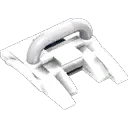{ .lu-ti width="24" loading="lazy" } [Chase Cutter Rear Panel 2 (LOT 9359)](../9359.md) | Undefined for generic loot: reversed count range | 100% |
| 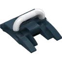{ .lu-ti width="24" loading="lazy" } [Chase Cutter Rear Panel 2 (LOT 9360)](../9360.md) | Undefined for generic loot: reversed count range | 100% |
| { .lu-ti width="24" loading="lazy" } [Hyperstarter Rear Bumper (LOT 9363)](../9363.md) | Undefined for generic loot: reversed count range | 100% |
| { .lu-ti width="24" loading="lazy" } [Hyperstarter Rear Bumper (LOT 9364)](../9364.md) | Undefined for generic loot: reversed count range | 100% |
| 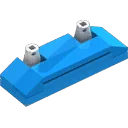{ .lu-ti width="24" loading="lazy" } [Hyperstarter Rear Bumper (LOT 9365)](../9365.md) | Undefined for generic loot: reversed count range | 100% |
| 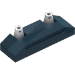{ .lu-ti width="24" loading="lazy" } [Hyperstarter Rear Bumper (LOT 9367)](../9367.md) | Undefined for generic loot: reversed count range | 100% |
| 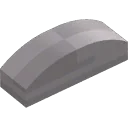{ .lu-ti width="24" loading="lazy" } [Thrust Bucket Front Bumper 1 (LOT 9373)](../9373.md) | Undefined for generic loot: reversed count range | 100% |
| 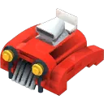{ .lu-ti width="24" loading="lazy" } [Thrust Bucket Engine Panel 1 (LOT 9377)](../9377.md) | Undefined for generic loot: reversed count range | 100% |
| 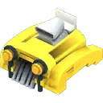{ .lu-ti width="24" loading="lazy" } [Thrust Bucket Engine Panel 1 (LOT 9378)](../9378.md) | Undefined for generic loot: reversed count range | 100% |
| 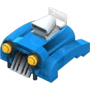{ .lu-ti width="24" loading="lazy" } [Thrust Bucket Engine Panel 1 (LOT 9379)](../9379.md) | Undefined for generic loot: reversed count range | 100% |
| 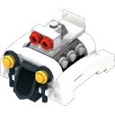{ .lu-ti width="24" loading="lazy" } [Bolt Ox Engine Panel 1 (LOT 9381)](../9381.md) | Undefined for generic loot: reversed count range | 100% |
| 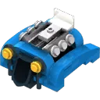{ .lu-ti width="24" loading="lazy" } [Bolt Ox Engine Panel 2 (LOT 9384)](../9384.md) | Undefined for generic loot: reversed count range | 100% |
| { .lu-ti width="24" loading="lazy" } [Thrust Bucket Side Panels (LOT 9386)](../9386.md) | Undefined for generic loot: reversed count range | 100% |
| { .lu-ti width="24" loading="lazy" } [Thrust Bucket Side Panels (LOT 9387)](../9387.md) | Undefined for generic loot: reversed count range | 100% |
| { .lu-ti width="24" loading="lazy" } [Thrust Bucket Side Panels (LOT 9388)](../9388.md) | Undefined for generic loot: reversed count range | 100% |
| 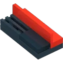{ .lu-ti width="24" loading="lazy" } [Bolt Ox Side Panels 1 (LOT 9391)](../9391.md) | Undefined for generic loot: reversed count range | 100% |
| { .lu-ti width="24" loading="lazy" } [Bolt Ox Side Panels 1 (LOT 9392)](../9392.md) | Undefined for generic loot: reversed count range | 100% |
| 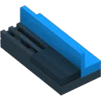{ .lu-ti width="24" loading="lazy" } [Bolt Ox Side Panels 1 (LOT 9393)](../9393.md) | Undefined for generic loot: reversed count range | 100% |
| 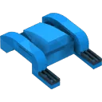{ .lu-ti width="24" loading="lazy" } [Thrust Bucket Rear Panel (LOT 9396)](../9396.md) | Undefined for generic loot: reversed count range | 100% |
| 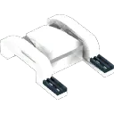{ .lu-ti width="24" loading="lazy" } [Thrust Bucket Rear Panel (LOT 9397)](../9397.md) | Undefined for generic loot: reversed count range | 100% |
| 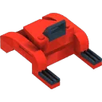{ .lu-ti width="24" loading="lazy" } [Bolt Ox Rear Panel (LOT 9398)](../9398.md) | Undefined for generic loot: reversed count range | 100% |
| 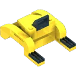{ .lu-ti width="24" loading="lazy" } [Bolt Ox Rear Panel (LOT 9399)](../9399.md) | Undefined for generic loot: reversed count range | 100% |
| 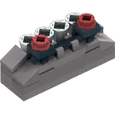{ .lu-ti width="24" loading="lazy" } [Bolt Ox Rear Bumper 2 (LOT 9403)](../9403.md) | Undefined for generic loot: reversed count range | 100% |
| 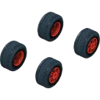{ .lu-ti width="24" loading="lazy" } [Red Rim Wheels (LOT 9450)](../9450.md) | Undefined for generic loot: reversed count range | 100% |
| 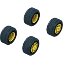{ .lu-ti width="24" loading="lazy" } [Yellow Rim Wheels (LOT 9451)](../9451.md) | Undefined for generic loot: reversed count range | 100% |

## Raw matrix entries

| Row | Loot table | Rarity table | Trigger | Min | Max | Flag | Gate |
| --- | --- | --- | --- | --- | --- | --- | --- |
| 651 | 181 | 4 | 1 | 1 | 0 |  |  |

[LootMatrix](../../../db/LootMatrix.md), [LootTable](../../../db/LootTable.md), [RarityTable](../../../db/RarityTable.md).
