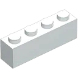
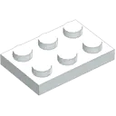
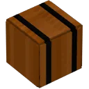
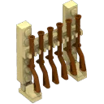
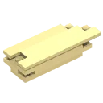
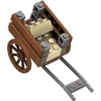
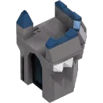
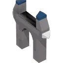
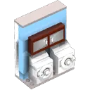
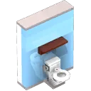

# Loot matrix 29

[Item database](../README.md) | [Methodology](../Methodology.md)

## Sources and mapped locations

| Kind | Source | Location evidence | Conditions |
| --- | --- | --- | --- |
| Drop | [VO - Imaginite (LOT 174)](../sources/object-174.md) | No matched local placement found | DestructibleComponent 224; static component precedence; Static association, not a live-spawn guarantee |
| Drop | [VO - Gargoyle (LOT 1639)](../sources/object-1639.md) | No matched local placement found | DestructibleComponent 803; static component precedence; Static association, not a live-spawn guarantee |
| Drop | [GF - Entangled Chest (LOT 1873)](../sources/object-1873.md) | No matched local placement found | DestructibleComponent 796; static component precedence; Static association, not a live-spawn guarantee |
| Drop | [Test - Smashable (LOT 1926)](../sources/object-1926.md) | No matched local placement found | DestructibleComponent 88; static component precedence; Static association, not a live-spawn guarantee |
| Drop | [GF - BBQ Grill (LOT 2018)](../sources/object-2018.md) | No matched local placement found | DestructibleComponent 795; static component precedence; Static association, not a live-spawn guarantee |
| Drop | [AG - Smashable Beehive (LOT 2184)](../sources/object-2184.md) | No matched local placement found | DestructibleComponent 783; static component precedence; Static association, not a live-spawn guarantee |
| Drop | [AG - Cam Bot (LOT 2188)](../sources/object-2188.md) | No matched local placement found | DestructibleComponent 115; static component precedence; Static association, not a live-spawn guarantee |
| Drop | [Spawner - Silver 1 Coin (LOT 2217)](../sources/object-2217.md) | No matched local placement found | DestructibleComponent 222; static component precedence; Static association, not a live-spawn guarantee |
| Drop | [GC Smashable - Large Crate 01 (LOT 2671)](../sources/object-2671.md) | No matched local placement found | DestructibleComponent 170; static component precedence; Static association, not a live-spawn guarantee |
| Drop | [GC Small Wall (LOT 2695)](../sources/object-2695.md) | No matched local placement found | DestructibleComponent 125; static component precedence; Static association, not a live-spawn guarantee |
| Drop | [GC Smashable - Railing (LOT 2719)](../sources/object-2719.md) | No matched local placement found | DestructibleComponent 836; static component precedence; Static association, not a live-spawn guarantee |
| Drop | [GC Smashable - Large Crate 02 (LOT 2720)](../sources/object-2720.md) | No matched local placement found | DestructibleComponent 146; static component precedence; Static association, not a live-spawn guarantee |
| Drop | [Infinity - Martian Torso (LOT 2849)](../sources/object-2849.md) | No matched local placement found | DestructibleComponent 799; static component precedence; Static association, not a live-spawn guarantee |
| Drop | [GC Smashable - Large Crate 03 (LOT 2879)](../sources/object-2879.md) | No matched local placement found | DestructibleComponent 150; static component precedence; Static association, not a live-spawn guarantee |
| Drop | [GC Smashable - Large Crate 04 (LOT 2880)](../sources/object-2880.md) | No matched local placement found | DestructibleComponent 154; static component precedence; Static association, not a live-spawn guarantee |
| Drop | [GC Smashable - Barrel (LOT 2882)](../sources/object-2882.md) | No matched local placement found | DestructibleComponent 834; static component precedence; Static association, not a live-spawn guarantee |
| Drop | [GC Smashable - Cone (LOT 2883)](../sources/object-2883.md) | No matched local placement found | DestructibleComponent 84; static component precedence; Static association, not a live-spawn guarantee |
| Drop | [Big Door Piece (LOT 2889)](../sources/object-2889.md) | No matched local placement found | DestructibleComponent 217; static component precedence; Static association, not a live-spawn guarantee |
| Drop | [AG - Fence (LOT 3370)](../sources/object-3370.md) | [Avant Gardens (1100)](../locations/zone-1100.md) | DestructibleComponent 271; static component precedence; Static association, not a live-spawn guarantee |
| Drop | [AG - Tiny Crate (LOT 3371)](../sources/object-3371.md) | No matched local placement found | DestructibleComponent 272; static component precedence; Static association, not a live-spawn guarantee |
| Drop | [AG - Small Crate (LOT 3372)](../sources/object-3372.md) | No matched local placement found | DestructibleComponent 273; static component precedence; Static association, not a live-spawn guarantee |
| Drop | [AG - Medium Crate (LOT 3373)](../sources/object-3373.md) | No matched local placement found | DestructibleComponent 274; static component precedence; Static association, not a live-spawn guarantee |
| Drop | [AG - Rock Garden 1 (LOT 3396)](../sources/object-3396.md) | [Avant Grove (1151)](../locations/zone-1151.md) | DestructibleComponent 279; static component precedence; Static association, not a live-spawn guarantee |
| Drop | [AG - Rock Garden 2 (LOT 3397)](../sources/object-3397.md) | No matched local placement found | DestructibleComponent 825; static component precedence; Static association, not a live-spawn guarantee |
| Drop | [AG - Rock Garden 3 (LOT 3398)](../sources/object-3398.md) | No matched local placement found | DestructibleComponent 826; static component precedence; Static association, not a live-spawn guarantee |
| Drop | [AG - Hazmat Barricade (LOT 3718)](../sources/object-3718.md) | [Avant Gardens (1100)](../locations/zone-1100.md) | DestructibleComponent 814; static component precedence; Static association, not a live-spawn guarantee |
| Drop | [AG - Dirt Drop Object (LOT 3804)](../sources/object-3804.md) | [Portabello (1604)](../locations/zone-1604.md) | DestructibleComponent 786; static component precedence; Static association, not a live-spawn guarantee |
| Drop | [AG - Robotanist Corrupted (LOT 4019)](../sources/object-4019.md) | No matched local placement found | DestructibleComponent 491; static component precedence; Static association, not a live-spawn guarantee |
| Drop | [AG - Smashable fence for mosaic bricks (LOT 4033)](../sources/object-4033.md) | No matched local placement found | DestructibleComponent 346; static component precedence; Static association, not a live-spawn guarantee |
| Drop | [Classic Rocket Smashable TEST (LOT 4750)](../sources/object-4750.md) | No matched local placement found | DestructibleComponent 424; static component precedence; Static association, not a live-spawn guarantee |
| Drop | [AG - Picnic Basket (LOT 4885)](../sources/object-4885.md) | No matched local placement found | DestructibleComponent 455; static component precedence; Static association, not a live-spawn guarantee |
| Drop | [AG - Boom Box (LOT 4887)](../sources/object-4887.md) | No matched local placement found | DestructibleComponent 456; static component precedence; Static association, not a live-spawn guarantee |
| Drop | [AG - Umbrella (LOT 4888)](../sources/object-4888.md) | No matched local placement found | DestructibleComponent 457; static component precedence; Static association, not a live-spawn guarantee |
| Drop | [AG - Baby Stroller (LOT 4889)](../sources/object-4889.md) | No matched local placement found | DestructibleComponent 458; static component precedence; Static association, not a live-spawn guarantee |
| Drop | [asdf (LOT 4892)](../sources/object-4892.md) | No matched local placement found | DestructibleComponent 450; static component precedence; Static association, not a live-spawn guarantee |
| Drop | [AG - Monument Wall Smashable (LOT 4893)](../sources/object-4893.md) | [Avant Gardens (1100)](../locations/zone-1100.md) | DestructibleComponent 529; static component precedence; Static association, not a live-spawn guarantee |
| Drop | [AG - QB Robotanist (LOT 4928)](../sources/object-4928.md) | No matched local placement found | DestructibleComponent 347; static component precedence; Static association, not a live-spawn guarantee |
| Drop | [AG - Wagon (LOT 4952)](../sources/object-4952.md) | No matched local placement found | DestructibleComponent 465; static component precedence; Static association, not a live-spawn guarantee |
| Drop | [Unnamed LOT 4954 (LOT 4954)](../sources/object-4954.md) | No matched local placement found | DestructibleComponent 467; static component precedence; Static association, not a live-spawn guarantee |
| Drop | [AG - Binoculars on Path (LOT 5026)](../sources/object-5026.md) | No matched local placement found | DestructibleComponent 488; static component precedence; Static association, not a live-spawn guarantee |
| Drop | [AG - Hazmat Barricade Striped (LOT 5656)](../sources/object-5656.md) | No matched local placement found | DestructibleComponent 813; static component precedence; Static association, not a live-spawn guarantee |
| Drop | [AG - Concert Monitor (LOT 5724)](../sources/object-5724.md) | No matched local placement found | DestructibleComponent 490; static component precedence; Static association, not a live-spawn guarantee |
| Drop | [AG - Hazmat Barricade Green (LOT 5885)](../sources/object-5885.md) | [Avant Gardens (1100)](../locations/zone-1100.md) | DestructibleComponent 815; static component precedence; Static association, not a live-spawn guarantee |
| Drop | [AG - Hazmat Barricade Orange (LOT 5886)](../sources/object-5886.md) | [Avant Gardens (1100)](../locations/zone-1100.md) | DestructibleComponent 644; static component precedence; Static association, not a live-spawn guarantee |
| Drop | [GF - Dirt Clod Moving Platform (LOT 5999)](../sources/object-5999.md) | No matched local placement found | DestructibleComponent 500; static component precedence; Static association, not a live-spawn guarantee |
| Drop | [Broken Paradox Mech (LOT 6299)](../sources/object-6299.md) | [Avant Gardens (1100)](../locations/zone-1100.md) | DestructibleComponent 541; static component precedence; Static association, not a live-spawn guarantee |
| Drop | [AG - Umbrella (LOT 6411)](../sources/object-6411.md) | No matched local placement found | DestructibleComponent 531; static component precedence; Static association, not a live-spawn guarantee |
| Drop | [AG - Hedgehog Barrier (LOT 6415)](../sources/object-6415.md) | [Avant Gardens (1100)](../locations/zone-1100.md) | DestructibleComponent 534; static component precedence; Static association, not a live-spawn guarantee |
| Drop | [Spider Cave Wall (LOT 6463)](../sources/object-6463.md) | No matched local placement found | DestructibleComponent 542; static component precedence; Static association, not a live-spawn guarantee |
| Drop | [AG - Smashable Engine (LOT 6480)](../sources/object-6480.md) | No matched local placement found | DestructibleComponent 576; static component precedence; Static association, not a live-spawn guarantee |
| Drop | [QB Spider Wall (LOT 6483)](../sources/object-6483.md) | No matched local placement found | DestructibleComponent 542; static component precedence; Static association, not a live-spawn guarantee |
| Drop | [Spider Cave Den QB Platform (LOT 6539)](../sources/object-6539.md) | No matched local placement found | DestructibleComponent 581; static component precedence; Static association, not a live-spawn guarantee |
| Drop | [Defender Wall QB (LOT 6570)](../sources/object-6570.md) | No matched local placement found | DestructibleComponent 542; static component precedence; Static association, not a live-spawn guarantee |
| Drop | [Test Race Smashable (LOT 6661)](../sources/object-6661.md) | No matched local placement found | DestructibleComponent 610; static component precedence; Static association, not a live-spawn guarantee |
| Drop | [Gauntlet Pillar (LOT 6710)](../sources/object-6710.md) | No matched local placement found | DestructibleComponent 622; static component precedence; Static association, not a live-spawn guarantee |
| Drop | [Gauntlet Gate (LOT 6712)](../sources/object-6712.md) | No matched local placement found | DestructibleComponent 621; static component precedence; Static association, not a live-spawn guarantee |
| Drop | [2 LP Crate (LOT 7026)](../sources/object-7026.md) | No matched local placement found | DestructibleComponent 666; static component precedence; Static association, not a live-spawn guarantee |
| Drop | [3 LP Crate (LOT 7027)](../sources/object-7027.md) | No matched local placement found | DestructibleComponent 667; static component precedence; Static association, not a live-spawn guarantee |
| Drop | [4 LP Crate (LOT 7028)](../sources/object-7028.md) | No matched local placement found | DestructibleComponent 668; static component precedence; Static association, not a live-spawn guarantee |
| Drop | [5 LP Crate (LOT 7029)](../sources/object-7029.md) | No matched local placement found | DestructibleComponent 669; static component precedence; Static association, not a live-spawn guarantee |
| Drop | [6 LP Crate (LOT 7030)](../sources/object-7030.md) | No matched local placement found | DestructibleComponent 670; static component precedence; Static association, not a live-spawn guarantee |
| Drop | [7 LP Crate (LOT 7031)](../sources/object-7031.md) | No matched local placement found | DestructibleComponent 671; static component precedence; Static association, not a live-spawn guarantee |
| Drop | [8 LP Crate (LOT 7032)](../sources/object-7032.md) | No matched local placement found | DestructibleComponent 672; static component precedence; Static association, not a live-spawn guarantee |
| Drop | [9 LP Crate (LOT 7033)](../sources/object-7033.md) | No matched local placement found | DestructibleComponent 673; static component precedence; Static association, not a live-spawn guarantee |
| Drop | [10 LP Crate (LOT 7034)](../sources/object-7034.md) | No matched local placement found | DestructibleComponent 674; static component precedence; Static association, not a live-spawn guarantee |
| Drop | [Spider Cave Maelstrom Crystal (LOT 7054)](../sources/object-7054.md) | No matched local placement found | DestructibleComponent 676; static component precedence; Static association, not a live-spawn guarantee |
| Drop | [Spider Cave QB No FX Sentinel Module (LOT 7064)](../sources/object-7064.md) | No matched local placement found | DestructibleComponent 542; static component precedence; Static association, not a live-spawn guarantee |
| Drop | [Spider Cave QB Exploding Barrel (LOT 7072)](../sources/object-7072.md) | No matched local placement found | DestructibleComponent 677; static component precedence; Static association, not a live-spawn guarantee |
| Drop | [Spider Cave Falling Rock (LOT 7073)](../sources/object-7073.md) | No matched local placement found | DestructibleComponent 676; static component precedence; Static association, not a live-spawn guarantee |
| Drop | [Spider Cave Sentinel Module No FX (LOT 7308)](../sources/object-7308.md) | No matched local placement found | DestructibleComponent 838; static component precedence; Static association, not a live-spawn guarantee |
| Drop | [Spider Cave - Paradox Pipe Smashable (LOT 7354)](../sources/object-7354.md) | No matched local placement found | DestructibleComponent 840; static component precedence; Static association, not a live-spawn guarantee |
| Drop | [TEST SMASHABLE (LOT 7674)](../sources/object-7674.md) | No matched local placement found | DestructibleComponent 713; static component precedence; Static association, not a live-spawn guarantee |
| Drop | [Gem Projectile Rank 3 (LOT 7854)](../sources/object-7854.md) | No matched local placement found | DestructibleComponent 756; static component precedence; Static association, not a live-spawn guarantee |
| Drop | [Mob Spawner (LOT 9823)](../sources/object-9823.md) | No matched local placement found | DestructibleComponent 534; static component precedence; Static association, not a live-spawn guarantee |
| Drop | [AG - Double Trash Can (LOT 9899)](../sources/object-9899.md) | No matched local placement found | DestructibleComponent 980; static component precedence; Static association, not a live-spawn guarantee |
| Drop | [Darkling Spawner (LOT 10118)](../sources/object-10118.md) | [Avant Grove (1151)](../locations/zone-1151.md) | DestructibleComponent 989; static component precedence; Static association, not a live-spawn guarantee |
| Drop | [FV Darkling Spawner (LOT 11023)](../sources/object-11023.md) | [Raven Bluff (1450)](../locations/zone-1450.md) | DestructibleComponent 1584; static component precedence; Static association, not a live-spawn guarantee |
| Drop | [NS Darkling Spawner (LOT 11031)](../sources/object-11031.md) | [Nimbus Rock (1250)](../locations/zone-1250.md); [Nimbus Isle (1251)](../locations/zone-1251.md) | DestructibleComponent 1585; static component precedence; Static association, not a live-spawn guarantee |
| Drop | [GF Darkling Spawner (LOT 11109)](../sources/object-11109.md) | [Chantey Shanty (1350)](../locations/zone-1350.md) | DestructibleComponent 1586; static component precedence; Static association, not a live-spawn guarantee |
| Drop | [AM - Skeleton Growlspeaker (LOT 12174)](../sources/object-12174.md) | [Crux Prime (1800)](../locations/zone-1800.md) | DestructibleComponent 1665; static component precedence; Static association, not a live-spawn guarantee |
| Drop | [AM - Shield Generator QB (LOT 12287)](../sources/object-12287.md) | [Crux Prime (1800)](../locations/zone-1800.md) | DestructibleComponent 1684; static component precedence; Static association, not a live-spawn guarantee |
| Drop | [WH - Winter Fan Smashable (LOT 12532)](../sources/object-12532.md) | No matched local placement found | DestructibleComponent 1738; static component precedence; Static association, not a live-spawn guarantee |
| Drop | [Unnamed LOT 13092 (LOT 13092)](../sources/object-13092.md) | No matched local placement found | DestructibleComponent 424; static component precedence; Static association, not a live-spawn guarantee |
| Drop | [Unnamed LOT 13121 (LOT 13121)](../sources/object-13121.md) | No matched local placement found | DestructibleComponent 1820; static component precedence; Static association, not a live-spawn guarantee |
| Drop | [AM - Permanent sheild generator (LOT 13170)](../sources/object-13170.md) | [Crux Prime (1800)](../locations/zone-1800.md) | DestructibleComponent 1684; static component precedence; Static association, not a live-spawn guarantee |
| Drop | [Proto&#95;Bridge (LOT 13305)](../sources/object-13305.md) | No matched local placement found | DestructibleComponent 1826; static component precedence; Static association, not a live-spawn guarantee |
| Drop | [FT -Spider Boss Rock Smashable (LOT 16284)](../sources/object-16284.md) | [Spider Queen Battle (1102)](../locations/zone-1102.md); [Block Yard (1150)](../locations/zone-1150.md) | DestructibleComponent 2138; static component precedence; Static association, not a live-spawn guarantee |
| Drop | [AG Mech Rebuild (LOT 14670)](../sources/object-14670.md) | [Avant Gardens (1100)](../locations/zone-1100.md) | Requires scene is&#95;smashable; see individual placements.; Static association, not a live-spawn guarantee |
| Drop | [NS - Drum QB (LOT 4042)](../sources/object-4042.md) | [Nimbus Station (1200)](../locations/zone-1200.md) | Requires scene is&#95;smashable; see individual placements.; Static association, not a live-spawn guarantee |

## Item candidates

Default vendor-stock probabilities are shown only when this matrix has a registered vendor. Loot probabilities use the generic algorithm, not a guarantee of actual use by every script/activity.

| Item | Modeled loot chance / expected count | Default vendor stock |
| --- | --- | --- |
| { .lu-ti width="24" loading="lazy" } [Brick 2x4 (LOT 29)](../29.md) | 1.81818182%; mean 0.018181818 | Not associated with a vendor |
| { .lu-ti width="24" loading="lazy" } [Brick 2x3 (LOT 30)](../30.md) | 1.81818182%; mean 0.018181818 | Not associated with a vendor |
| { .lu-ti width="24" loading="lazy" } [Brick 2x2 (LOT 31)](../31.md) | 1.81818182%; mean 0.018181818 | Not associated with a vendor |
| { .lu-ti width="24" loading="lazy" } [Brick 1x2 (LOT 32)](../32.md) | 1.81818182%; mean 0.018181818 | Not associated with a vendor |
| { .lu-ti width="24" loading="lazy" } [Brick 1x1 (LOT 33)](../33.md) | 1.81818182%; mean 0.018181818 | Not associated with a vendor |
| { .lu-ti width="24" loading="lazy" } [Brick 2x8 (LOT 35)](../35.md) | 1.81818182%; mean 0.018181818 | Not associated with a vendor |
| { .lu-ti width="24" loading="lazy" } [Brick 1x8 (LOT 36)](../36.md) | 1.81818182%; mean 0.018181818 | Not associated with a vendor |
| { .lu-ti width="24" loading="lazy" } [Brick 1x6 (LOT 37)](../37.md) | 1.81818182%; mean 0.018181818 | Not associated with a vendor |
| { .lu-ti width="24" loading="lazy" } [Brick 1x4 (LOT 38)](../38.md) | 1.81818182%; mean 0.018181818 | Not associated with a vendor |
| { .lu-ti width="24" loading="lazy" } [Plate 2x4 (LOT 39)](../39.md) | 1.81818182%; mean 0.018181818 | Not associated with a vendor |
| { .lu-ti width="24" loading="lazy" } [Plate 2x3 (LOT 40)](../40.md) | 1.81818182%; mean 0.018181818 | Not associated with a vendor |
| { .lu-ti width="24" loading="lazy" } [Plate 1x2 (LOT 41)](../41.md) | 1.81818182%; mean 0.018181818 | Not associated with a vendor |
| { .lu-ti width="24" loading="lazy" } [Plate 1x1 (LOT 42)](../42.md) | 1.81818182%; mean 0.018181818 | Not associated with a vendor |
| { .lu-ti width="24" loading="lazy" } [Plate 1x8 (LOT 58)](../58.md) | 1.81818182%; mean 0.018181818 | Not associated with a vendor |
| { .lu-ti width="24" loading="lazy" } [Brick 1x3 (LOT 59)](../59.md) | 1.81818182%; mean 0.018181818 | Not associated with a vendor |
| { .lu-ti width="24" loading="lazy" } [Plate 1x3 (LOT 60)](../60.md) | 1.81818182%; mean 0.018181818 | Not associated with a vendor |
| { .lu-ti width="24" loading="lazy" } [Plate 1x6 (LOT 62)](../62.md) | 1.81818182%; mean 0.018181818 | Not associated with a vendor |
| { .lu-ti width="24" loading="lazy" } [Plate 1x4 (LOT 66)](../66.md) | 1.81818182%; mean 0.018181818 | Not associated with a vendor |
| { .lu-ti width="24" loading="lazy" } [Brick 1x1 with 4 Studs (LOT 76)](../76.md) | 0.25%; mean 0.0025 | Not associated with a vendor |
| { .lu-ti width="24" loading="lazy" } [Brick 2x6 (LOT 98)](../98.md) | 1.81818182%; mean 0.018181818 | Not associated with a vendor |
| { .lu-ti width="24" loading="lazy" } [Washing Machine Brick (LOT 109)](../109.md) | 0.25%; mean 0.0025 | Not associated with a vendor |
| { .lu-ti width="24" loading="lazy" } [Slope Brick 45° 1x2 Inverted (LOT 111)](../111.md) | 0.25%; mean 0.0025 | Not associated with a vendor |
| { .lu-ti width="24" loading="lazy" } [Plate 1x2 with Single Stud (LOT 143)](../143.md) | 0.25%; mean 0.0025 | Not associated with a vendor |
| { .lu-ti width="24" loading="lazy" } [Plate 2x6 (LOT 144)](../144.md) | 1.81818182%; mean 0.018181818 | Not associated with a vendor |
| Life Powerup 1 point (LOT 177; not an item registration) | 100%; mean 1.5 | Not associated with a vendor |
| { .lu-ti width="24" loading="lazy" } [Plate 2x2 Round (LOT 178)](../178.md) | 0.25%; mean 0.0025 | Not associated with a vendor |
| { .lu-ti width="24" loading="lazy" } [Brick 1x1 with 2 Studs (LOT 711)](../711.md) | 0.25%; mean 0.0025 | Not associated with a vendor |
| { .lu-ti width="24" loading="lazy" } [Plate 1x1 with Tooth (LOT 726)](../726.md) | 0.25%; mean 0.0025 | Not associated with a vendor |
| { .lu-ti width="24" loading="lazy" } [Plate 2x2 (LOT 865)](../865.md) | 1.81818182%; mean 0.018181818 | Not associated with a vendor |
| { .lu-ti width="24" loading="lazy" } [Plate 2x8 (LOT 869)](../869.md) | 1.81818182%; mean 0.018181818 | Not associated with a vendor |
| Imagination Powerup 1 point (LOT 935; not an item registration) | 100%; mean 2.5 | Not associated with a vendor |
| { .lu-ti width="24" loading="lazy" } [Healing Banana (LOT 1966)](../1966.md) | 0.09868421%; mean 0.00098684211 | Not associated with a vendor |
| { .lu-ti width="24" loading="lazy" } [Notion Potion (LOT 2198)](../2198.md) | 0.09868421%; mean 0.00098684211 | Not associated with a vendor |
| { .lu-ti width="24" loading="lazy" } [Quicksicle (LOT 2620)](../2620.md) | 0.09868421%; mean 0.00098684211 | Not associated with a vendor |
| { .lu-ti width="24" loading="lazy" } [Armor Polish (LOT 2993)](../2993.md) | 0.09868421%; mean 0.00098684211 | Not associated with a vendor |
| { .lu-ti width="24" loading="lazy" } [Healing Cherry (LOT 2994)](../2994.md) | 0.09868421%; mean 0.00098684211 | Not associated with a vendor |
| { .lu-ti width="24" loading="lazy" } [Armor Shine (LOT 2996)](../2996.md) | 0.09868421%; mean 0.00098684211 | Not associated with a vendor |
| { .lu-ti width="24" loading="lazy" } [Strong Notion Potion (LOT 2998)](../2998.md) | 0.09868421%; mean 0.00098684211 | Not associated with a vendor |
| { .lu-ti width="24" loading="lazy" } [BBQ Blast Hot Dog (LOT 3011)](../3011.md) | 0.09868421%; mean 0.00098684211 | Not associated with a vendor |
| { .lu-ti width="24" loading="lazy" } [Green Imaginite (LOT 3039)](../3039.md) | 0.09868421%; mean 0.00098684211 | Not associated with a vendor |
| { .lu-ti width="24" loading="lazy" } [Red Imaginite (LOT 3040)](../3040.md) | 0.15625%; mean 0.0015625 | Not associated with a vendor |
| { .lu-ti width="24" loading="lazy" } [Amber Gem (LOT 3100)](../3100.md) | 0.09868421%; mean 0.00098684211 | Not associated with a vendor |
| { .lu-ti width="24" loading="lazy" } [Hiccup Tablets (LOT 5832)](../5832.md) | 0.09868421%; mean 0.00098684211 | Not associated with a vendor |
| { .lu-ti width="24" loading="lazy" } [Brick Booster Pack (LOT 5834)](../5834.md) | 0.09868421%; mean 0.00098684211 | Not associated with a vendor |
| { .lu-ti width="24" loading="lazy" } [Super Brick Booster Pack (LOT 5835)](../5835.md) | 0.15625%; mean 0.0015625 | Not associated with a vendor |
| { .lu-ti width="24" loading="lazy" } [Picnic Basket (LOT 5836)](../5836.md) | 0.09868421%; mean 0.00098684211 | Not associated with a vendor |
| { .lu-ti width="24" loading="lazy" } [Super Picnic Basket (LOT 5837)](../5837.md) | 0.15625%; mean 0.0015625 | Not associated with a vendor |
| { .lu-ti width="24" loading="lazy" } [Tiny Mushroom Model (LOT 6027)](../6027.md) | 0.1171875%; mean 0.001171875 | Not associated with a vendor |
| { .lu-ti width="24" loading="lazy" } [Small Mushroom Model (LOT 6028)](../6028.md) | 0.1171875%; mean 0.001171875 | Not associated with a vendor |
| { .lu-ti width="24" loading="lazy" } [Medium Mushroom Model (LOT 6029)](../6029.md) | 0.1171875%; mean 0.001171875 | Not associated with a vendor |
| { .lu-ti width="24" loading="lazy" } [Large Mushroom Model (LOT 6030)](../6030.md) | 0.1171875%; mean 0.001171875 | Not associated with a vendor |
| { .lu-ti width="24" loading="lazy" } [Tiny Crate Model (LOT 6031)](../6031.md) | 0.01923077%; mean 0.00019230769 | Not associated with a vendor |
| { .lu-ti width="24" loading="lazy" } [Small Crate Model (LOT 6032)](../6032.md) | 0.01923077%; mean 0.00019230769 | Not associated with a vendor |
| { .lu-ti width="24" loading="lazy" } [Medium Crate Model (LOT 6033)](../6033.md) | 0.02%; mean 0.0002 | Not associated with a vendor |
| { .lu-ti width="24" loading="lazy" } [Large Crate Model (LOT 6034)](../6034.md) | 0.02%; mean 0.0002 | Not associated with a vendor |
| { .lu-ti width="24" loading="lazy" } [Wooden Barrel Model (LOT 6035)](../6035.md) | 0.1171875%; mean 0.001171875 | Not associated with a vendor |
| { .lu-ti width="24" loading="lazy" } [Tent Model (LOT 6036)](../6036.md) | 0.02%; mean 0.0002 | Not associated with a vendor |
| { .lu-ti width="24" loading="lazy" } [Desk Model (LOT 6037)](../6037.md) | 0.01923077%; mean 0.00019230769 | Not associated with a vendor |
| { .lu-ti width="24" loading="lazy" } [Water Cooler Model (LOT 6039)](../6039.md) | 0.1171875%; mean 0.001171875 | Not associated with a vendor |
| { .lu-ti width="24" loading="lazy" } [Small Table Model (LOT 6044)](../6044.md) | 0.1171875%; mean 0.001171875 | Not associated with a vendor |
| { .lu-ti width="24" loading="lazy" } [Weapon Rack Model (LOT 6056)](../6056.md) | 0.01923077%; mean 0.00019230769 | Not associated with a vendor |
| { .lu-ti width="24" loading="lazy" } [Hut Model (LOT 6060)](../6060.md) | 0.01923077%; mean 0.00019230769 | Not associated with a vendor |
| { .lu-ti width="24" loading="lazy" } [Coffee Table Model (LOT 6064)](../6064.md) | 0.1171875%; mean 0.001171875 | Not associated with a vendor |
| { .lu-ti width="24" loading="lazy" } [Cart Model (LOT 6065)](../6065.md) | 0.1171875%; mean 0.001171875 | Not associated with a vendor |
| { .lu-ti width="24" loading="lazy" } [Fence Model (LOT 6071)](../6071.md) | 0.1171875%; mean 0.001171875 | Not associated with a vendor |
| { .lu-ti width="24" loading="lazy" } [Wood Pile Model (LOT 6072)](../6072.md) | 0.1171875%; mean 0.001171875 | Not associated with a vendor |
| { .lu-ti width="24" loading="lazy" } [Thirst Quencher (LOT 6201)](../6201.md) | 0.09868421%; mean 0.00098684211 | Not associated with a vendor |
| { .lu-ti width="24" loading="lazy" } [Nexus Force Healing Kit (LOT 6207)](../6207.md) | 0.09868421%; mean 0.00098684211 | Not associated with a vendor |
| Armor Powerup 1 point (LOT 6431; not an item registration) | 100%; mean 1 | Not associated with a vendor |
| { .lu-ti width="24" loading="lazy" } [Box of Cups Model (LOT 6778)](../6778.md) | 0.1171875%; mean 0.001171875 | Not associated with a vendor |
| { .lu-ti width="24" loading="lazy" } [Light Blue Gem (LOT 6865)](../6865.md) | 0.15625%; mean 0.0015625 | Not associated with a vendor |
| { .lu-ti width="24" loading="lazy" } [Pink Gem (LOT 6866)](../6866.md) | 0.09868421%; mean 0.00098684211 | Not associated with a vendor |
| { .lu-ti width="24" loading="lazy" } [Flash Bang (LOT 6884)](../6884.md) | 0.09868421%; mean 0.00098684211 | Not associated with a vendor |
| { .lu-ti width="24" loading="lazy" } [Candle Holder Model (LOT 7122)](../7122.md) | 0.1171875%; mean 0.001171875 | Not associated with a vendor |
| { .lu-ti width="24" loading="lazy" } [Dock Model (LOT 7123)](../7123.md) | 0.01923077%; mean 0.00019230769 | Not associated with a vendor |
| { .lu-ti width="24" loading="lazy" } [Cabinet Model (LOT 7134)](../7134.md) | 0.01923077%; mean 0.00019230769 | Not associated with a vendor |
| { .lu-ti width="24" loading="lazy" } [Antique Chair Model (LOT 7135)](../7135.md) | 0.1171875%; mean 0.001171875 | Not associated with a vendor |
| { .lu-ti width="24" loading="lazy" } [Double Trash Can Model (LOT 7759)](../7759.md) | 0.1171875%; mean 0.001171875 | Not associated with a vendor |
| { .lu-ti width="24" loading="lazy" } [Trash Can Model (LOT 7761)](../7761.md) | 0.1171875%; mean 0.001171875 | Not associated with a vendor |
| { .lu-ti width="24" loading="lazy" } [Bench Model (LOT 7770)](../7770.md) | 0.1171875%; mean 0.001171875 | Not associated with a vendor |
| { .lu-ti width="24" loading="lazy" } [Firecracker (LOT 7778)](../7778.md) | 0.09868421%; mean 0.00098684211 | Not associated with a vendor |
| { .lu-ti width="24" loading="lazy" } [Goblet Box Model (LOT 8055)](../8055.md) | 0.1171875%; mean 0.001171875 | Not associated with a vendor |
| { .lu-ti width="24" loading="lazy" } [Console Model (LOT 8068)](../8068.md) | 0.1171875%; mean 0.001171875 | Not associated with a vendor |
| { .lu-ti width="24" loading="lazy" } [Yellow Barricade Model (LOT 8069)](../8069.md) | 0.1171875%; mean 0.001171875 | Not associated with a vendor |
| { .lu-ti width="24" loading="lazy" } [Barricade Model (LOT 8073)](../8073.md) | 0.1171875%; mean 0.001171875 | Not associated with a vendor |
| { .lu-ti width="24" loading="lazy" } [Birdhouse Model (LOT 8077)](../8077.md) | 0.1171875%; mean 0.001171875 | Not associated with a vendor |
| { .lu-ti width="24" loading="lazy" } [Cloud Burst (LOT 8366)](../8366.md) | 0.09868421%; mean 0.00098684211 | Not associated with a vendor |
| { .lu-ti width="24" loading="lazy" } [Brick 1x1 with 1 Stud on Side (LOT 9201)](../9201.md) | 0.25%; mean 0.0025 | Not associated with a vendor |
| { .lu-ti width="24" loading="lazy" } [Television Model (LOT 9488)](../9488.md) | 0.01923077%; mean 0.00019230769 | Not associated with a vendor |
| { .lu-ti width="24" loading="lazy" } [Troll Cart Model (LOT 9490)](../9490.md) | 0.1171875%; mean 0.001171875 | Not associated with a vendor |
| { .lu-ti width="24" loading="lazy" } [Castle Weapon Rack Model (LOT 9493)](../9493.md) | 0.1171875%; mean 0.001171875 | Not associated with a vendor |
| { .lu-ti width="24" loading="lazy" } [Medieval Wagon Model (LOT 9591)](../9591.md) | 0.01923077%; mean 0.00019230769 | Not associated with a vendor |
| { .lu-ti width="24" loading="lazy" } [Medieval Vendor Model (LOT 9596)](../9596.md) | 0.01923077%; mean 0.00019230769 | Not associated with a vendor |
| { .lu-ti width="24" loading="lazy" } [Medieval Village Stable Model (LOT 9648)](../9648.md) | 0.00714286%; mean 0.000071428571 | Not associated with a vendor |
| { .lu-ti width="24" loading="lazy" } [Medieval Village Forge Model (LOT 9649)](../9649.md) | 0.00714286%; mean 0.000071428571 | Not associated with a vendor |
| { .lu-ti width="24" loading="lazy" } [Medieval Village Inn Model (LOT 9650)](../9650.md) | 0.00714286%; mean 0.000071428571 | Not associated with a vendor |
| { .lu-ti width="24" loading="lazy" } [Medieval Village House Model (LOT 9651)](../9651.md) | 0.00714286%; mean 0.000071428571 | Not associated with a vendor |
| { .lu-ti width="24" loading="lazy" } [Castle Arbalest Model (LOT 9652)](../9652.md) | 0.01923077%; mean 0.00019230769 | Not associated with a vendor |
| { .lu-ti width="24" loading="lazy" } [Castle Barrel Gun Model (LOT 9653)](../9653.md) | 0.01923077%; mean 0.00019230769 | Not associated with a vendor |
| { .lu-ti width="24" loading="lazy" } [Castle Catapult Model (LOT 9654)](../9654.md) | 0.01923077%; mean 0.00019230769 | Not associated with a vendor |
| { .lu-ti width="24" loading="lazy" } [Castle Inner Corner Model (LOT 9656)](../9656.md) | 0.00714286%; mean 0.000071428571 | Not associated with a vendor |
| { .lu-ti width="24" loading="lazy" } [Castle Outside Corner Model (LOT 9657)](../9657.md) | 0.00714286%; mean 0.000071428571 | Not associated with a vendor |
| { .lu-ti width="24" loading="lazy" } [Castle Small Corner Model (LOT 9658)](../9658.md) | 0.02%; mean 0.0002 | Not associated with a vendor |
| { .lu-ti width="24" loading="lazy" } [Castle Crossing Model (LOT 9659)](../9659.md) | 0.02%; mean 0.0002 | Not associated with a vendor |
| { .lu-ti width="24" loading="lazy" } [Castle Gate Model (LOT 9660)](../9660.md) | 0.00714286%; mean 0.000071428571 | Not associated with a vendor |
| { .lu-ti width="24" loading="lazy" } [Castle Outhouse Model (LOT 9661)](../9661.md) | 0.02%; mean 0.0002 | Not associated with a vendor |
| { .lu-ti width="24" loading="lazy" } [Castle Ramp Model (LOT 9662)](../9662.md) | 0.00714286%; mean 0.000071428571 | Not associated with a vendor |
| { .lu-ti width="24" loading="lazy" } [Castle Staircase Model (LOT 9663)](../9663.md) | 0.02%; mean 0.0002 | Not associated with a vendor |
| { .lu-ti width="24" loading="lazy" } [Castle Tower Model (LOT 9664)](../9664.md) | 0.00714286%; mean 0.000071428571 | Not associated with a vendor |
| { .lu-ti width="24" loading="lazy" } [Castle Wall Bridge Model (LOT 9665)](../9665.md) | 0.00714286%; mean 0.000071428571 | Not associated with a vendor |
| { .lu-ti width="24" loading="lazy" } [Castle Wall End Model (LOT 9666)](../9666.md) | 0.02%; mean 0.0002 | Not associated with a vendor |
| { .lu-ti width="24" loading="lazy" } [Castle Small Wall Model 1 (LOT 9667)](../9667.md) | 0.01923077%; mean 0.00019230769 | Not associated with a vendor |
| { .lu-ti width="24" loading="lazy" } [Castle Small Wall Model 2 (LOT 9668)](../9668.md) | 0.01923077%; mean 0.00019230769 | Not associated with a vendor |
| { .lu-ti width="24" loading="lazy" } [Castle Small Wall Model 3 (LOT 9669)](../9669.md) | 0.01923077%; mean 0.00019230769 | Not associated with a vendor |
| { .lu-ti width="24" loading="lazy" } [Castle Small Wall Model 4 (LOT 9670)](../9670.md) | 0.01923077%; mean 0.00019230769 | Not associated with a vendor |
| { .lu-ti width="24" loading="lazy" } [Castle Straight Wall Model (LOT 9671)](../9671.md) | 0.02%; mean 0.0002 | Not associated with a vendor |
| { .lu-ti width="24" loading="lazy" } [Castle Medium Straight Wall Model (LOT 9672)](../9672.md) | 0.02%; mean 0.0002 | Not associated with a vendor |
| { .lu-ti width="24" loading="lazy" } [Castle Medium Spikes Wall Model (LOT 9673)](../9673.md) | 0.02%; mean 0.0002 | Not associated with a vendor |
| { .lu-ti width="24" loading="lazy" } [Castle T-Wall Model (LOT 9674)](../9674.md) | 0.00714286%; mean 0.000071428571 | Not associated with a vendor |
| { .lu-ti width="24" loading="lazy" } [Castle Tower Wall With No Top Model (LOT 9675)](../9675.md) | 0.00714286%; mean 0.000071428571 | Not associated with a vendor |
| { .lu-ti width="24" loading="lazy" } [Castle Tower Wall With Top Model (LOT 9676)](../9676.md) | 0.00714286%; mean 0.000071428571 | Not associated with a vendor |
| { .lu-ti width="24" loading="lazy" } [Castle Widening Wall Model (LOT 9677)](../9677.md) | 0.00714286%; mean 0.000071428571 | Not associated with a vendor |
| { .lu-ti width="24" loading="lazy" } [Castle Wall With Stairs Model (LOT 9678)](../9678.md) | 0.02%; mean 0.0002 | Not associated with a vendor |
| { .lu-ti width="24" loading="lazy" } [House Bathtub Model 1 (LOT 10328)](../10328.md) | 0.01923077%; mean 0.00019230769 | Not associated with a vendor |
| { .lu-ti width="24" loading="lazy" } [House Bathtub Model 2 (LOT 10329)](../10329.md) | 0.01923077%; mean 0.00019230769 | Not associated with a vendor |
| { .lu-ti width="24" loading="lazy" } [House Closed Door Model 1 (LOT 10330)](../10330.md) | 0.1171875%; mean 0.001171875 | Not associated with a vendor |
| { .lu-ti width="24" loading="lazy" } [House Open Door Model 1 (LOT 10331)](../10331.md) | 0.1171875%; mean 0.001171875 | Not associated with a vendor |
| { .lu-ti width="24" loading="lazy" } [House Closed Door Model 2 (LOT 10332)](../10332.md) | 0.01923077%; mean 0.00019230769 | Not associated with a vendor |
| { .lu-ti width="24" loading="lazy" } [House Open Door Model 2 (LOT 10333)](../10333.md) | 0.01923077%; mean 0.00019230769 | Not associated with a vendor |
| { .lu-ti width="24" loading="lazy" } [House Closed Door Model 3 (LOT 10334)](../10334.md) | 0.1171875%; mean 0.001171875 | Not associated with a vendor |
| { .lu-ti width="24" loading="lazy" } [House Open Door Model 3 (LOT 10335)](../10335.md) | 0.1171875%; mean 0.001171875 | Not associated with a vendor |
| { .lu-ti width="24" loading="lazy" } [House Kitchen Model 1 (LOT 10336)](../10336.md) | 0.02%; mean 0.0002 | Not associated with a vendor |
| { .lu-ti width="24" loading="lazy" } [House Kitchen Model 2 (LOT 10337)](../10337.md) | 0.01923077%; mean 0.00019230769 | Not associated with a vendor |
| { .lu-ti width="24" loading="lazy" } [House Kitchen Model 3 (LOT 10338)](../10338.md) | 0.01923077%; mean 0.00019230769 | Not associated with a vendor |
| { .lu-ti width="24" loading="lazy" } [House Laundry Model 1 (LOT 10339)](../10339.md) | 0.01923077%; mean 0.00019230769 | Not associated with a vendor |
| { .lu-ti width="24" loading="lazy" } [House Laundry Model 2 (LOT 10340)](../10340.md) | 0.01923077%; mean 0.00019230769 | Not associated with a vendor |
| { .lu-ti width="24" loading="lazy" } [House Library Model 1 (LOT 10341)](../10341.md) | 0.02%; mean 0.0002 | Not associated with a vendor |
| { .lu-ti width="24" loading="lazy" } [House Library Model 2 (LOT 10342)](../10342.md) | 0.01923077%; mean 0.00019230769 | Not associated with a vendor |
| { .lu-ti width="24" loading="lazy" } [House Library Model 3 (LOT 10343)](../10343.md) | 0.01923077%; mean 0.00019230769 | Not associated with a vendor |
| { .lu-ti width="24" loading="lazy" } [House Library Model 4 (LOT 10344)](../10344.md) | 0.01923077%; mean 0.00019230769 | Not associated with a vendor |
| { .lu-ti width="24" loading="lazy" } [House Toilet Model 2 (LOT 10345)](../10345.md) | 0.01923077%; mean 0.00019230769 | Not associated with a vendor |
| { .lu-ti width="24" loading="lazy" } [House Vanity Model 1 (LOT 10346)](../10346.md) | 0.01923077%; mean 0.00019230769 | Not associated with a vendor |
| { .lu-ti width="24" loading="lazy" } [House Vanity Model 2 (LOT 10347)](../10347.md) | 0.01923077%; mean 0.00019230769 | Not associated with a vendor |
| { .lu-ti width="24" loading="lazy" } [House Vanity Model 3 (LOT 10348)](../10348.md) | 0.02%; mean 0.0002 | Not associated with a vendor |
| { .lu-ti width="24" loading="lazy" } [House Vanity Model 4 (LOT 10349)](../10349.md) | 0.01923077%; mean 0.00019230769 | Not associated with a vendor |
| { .lu-ti width="24" loading="lazy" } [House Wall Arch Model (LOT 10350)](../10350.md) | 0.1171875%; mean 0.001171875 | Not associated with a vendor |
| { .lu-ti width="24" loading="lazy" } [House Wall Art Model 1 (LOT 10351)](../10351.md) | 0.01923077%; mean 0.00019230769 | Not associated with a vendor |
| { .lu-ti width="24" loading="lazy" } [House Wall Art Model 2 (LOT 10352)](../10352.md) | 0.01923077%; mean 0.00019230769 | Not associated with a vendor |
| { .lu-ti width="24" loading="lazy" } [House Wall Blank Model 1 (LOT 10353)](../10353.md) | 0.1171875%; mean 0.001171875 | Not associated with a vendor |
| { .lu-ti width="24" loading="lazy" } [House Wall Blank Model 2 (LOT 10354)](../10354.md) | 0.1171875%; mean 0.001171875 | Not associated with a vendor |
| { .lu-ti width="24" loading="lazy" } [House Wall Blank Model 3 (LOT 10355)](../10355.md) | 0.1171875%; mean 0.001171875 | Not associated with a vendor |
| { .lu-ti width="24" loading="lazy" } [House Wall Corner Model 1 (LOT 10356)](../10356.md) | 0.01923077%; mean 0.00019230769 | Not associated with a vendor |
| { .lu-ti width="24" loading="lazy" } [House Wall Corner Model 2 (LOT 10357)](../10357.md) | 0.01923077%; mean 0.00019230769 | Not associated with a vendor |
| { .lu-ti width="24" loading="lazy" } [House Wall Corner Model 3 (LOT 10358)](../10358.md) | 0.01923077%; mean 0.00019230769 | Not associated with a vendor |
| { .lu-ti width="24" loading="lazy" } [House Wall Fireplace Model 1 (LOT 10359)](../10359.md) | 0.02%; mean 0.0002 | Not associated with a vendor |
| { .lu-ti width="24" loading="lazy" } [House Window Model 1 (LOT 10360)](../10360.md) | 0.01923077%; mean 0.00019230769 | Not associated with a vendor |
| { .lu-ti width="24" loading="lazy" } [House Window Model 2 (LOT 10361)](../10361.md) | 0.01923077%; mean 0.00019230769 | Not associated with a vendor |
| { .lu-ti width="24" loading="lazy" } [House Window Model 3 (LOT 10362)](../10362.md) | 0.02%; mean 0.0002 | Not associated with a vendor |
| { .lu-ti width="24" loading="lazy" } [House Window Model 4 (LOT 10363)](../10363.md) | 0.02%; mean 0.0002 | Not associated with a vendor |
| { .lu-ti width="24" loading="lazy" } [House Window Model 5 (LOT 10364)](../10364.md) | 0.02%; mean 0.0002 | Not associated with a vendor |
| { .lu-ti width="24" loading="lazy" } [House Window Model 6 (LOT 10365)](../10365.md) | 0.02%; mean 0.0002 | Not associated with a vendor |
| { .lu-ti width="24" loading="lazy" } [Faction Token Proxy (LOT 13763)](../13763.md) | 2%; mean 0.02 | Not associated with a vendor |

## Raw matrix entries

| Row | Loot table | Rarity table | Trigger | Min | Max | Flag | Gate |
| --- | --- | --- | --- | --- | --- | --- | --- |
| 91 | 3 | 4 | 1 | 1 | 2 |  |  |
| 160 | 32 | 4 | 1 | 2 | 3 |  |  |
| 208 | 110 | 18 | 0.4 | 1 | 1 |  |  |
| 402 | 97 | 4 | 1 | 1 | 1 |  |  |
| 602 | 73 | 4 | 0.025 | 1 | 1 |  |  |
| 724 | 114 | 4 | 0.05 | 1 | 1 |  |  |
| 837 | 670 | 23 | 0.02 | 1 | 1 |  |  |
| 1483 | 379 | 18 | 0.02 | 1 | 1 |  |  |

[LootMatrix](../../../db/LootMatrix.md), [LootTable](../../../db/LootTable.md), [RarityTable](../../../db/RarityTable.md).
