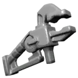
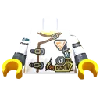
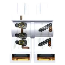
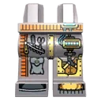
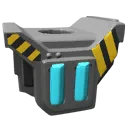
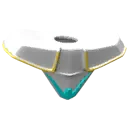

# Loot matrix 293

[Item database](../README.md) | [Methodology](../Methodology.md)

## Sources and mapped locations

| Kind | Source | Location evidence | Conditions |
| --- | --- | --- | --- |
| Vendor | [Meldric Steamvalve - Assembly Vendor (LOT 6633)](../sources/object-6633.md) | [Nimbus Station (1200)](../locations/zone-1200.md) | Default inventory; vendorInvOverride can replace it |

**Generic loot probability unavailable:** at least one entry has maxToDrop < minToDrop. Vendor code treats a zero endpoint as “include the full table”; the generic loot code does not define that interpretation. No drop percentage is fabricated for this matrix.

## Item candidates

Default vendor-stock probabilities are shown only when this matrix has a registered vendor. Loot probabilities use the generic algorithm, not a guarantee of actual use by every script/activity.

| Item | Modeled loot chance / expected count | Default vendor stock |
| --- | --- | --- |
| { .lu-ti width="24" loading="lazy" } [Rank 1 Engineer Book (LOT 130)](../130.md) | Undefined for generic loot: reversed count range | 100% |
| { .lu-ti width="24" loading="lazy" } [Rank 1 Summoner Book (LOT 131)](../131.md) | Undefined for generic loot: reversed count range | 100% |
| { .lu-ti width="24" loading="lazy" } [Engineer Helmet 1 (LOT 7356)](../7356.md) | Undefined for generic loot: reversed count range | 100% |
| { .lu-ti width="24" loading="lazy" } [Engineer Helmet 2 (LOT 7363)](../7363.md) | Undefined for generic loot: reversed count range | 100% |
| { .lu-ti width="24" loading="lazy" } [Engineer Shirt 1 (LOT 7370)](../7370.md) | Undefined for generic loot: reversed count range | 100% |
| { .lu-ti width="24" loading="lazy" } [Engineer Shirt 2 (LOT 7371)](../7371.md) | Undefined for generic loot: reversed count range | 100% |
| { .lu-ti width="24" loading="lazy" } [Engineer Pants 1 (LOT 7382)](../7382.md) | Undefined for generic loot: reversed count range | 100% |
| { .lu-ti width="24" loading="lazy" } [Engineer Pants 2 (LOT 7383)](../7383.md) | Undefined for generic loot: reversed count range | 100% |
| { .lu-ti width="24" loading="lazy" } [Engineer Wrench 1 (LOT 7394)](../7394.md) | Undefined for generic loot: reversed count range | 100% |
| { .lu-ti width="24" loading="lazy" } [Engineer Wrench 2 (LOT 7395)](../7395.md) | Undefined for generic loot: reversed count range | 100% |
| { .lu-ti width="24" loading="lazy" } [Engineer Controller 2 (LOT 7405)](../7405.md) | Undefined for generic loot: reversed count range | 100% |
| { .lu-ti width="24" loading="lazy" } [Inventor Goggles 1 (LOT 7454)](../7454.md) | Undefined for generic loot: reversed count range | 100% |
| { .lu-ti width="24" loading="lazy" } [Inventor Goggles 2 (LOT 7455)](../7455.md) | Undefined for generic loot: reversed count range | 100% |
| { .lu-ti width="24" loading="lazy" } [Summoner Hat 1 (LOT 7457)](../7457.md) | Undefined for generic loot: reversed count range | 100% |
| { .lu-ti width="24" loading="lazy" } [Summoner Hat 2 (LOT 7458)](../7458.md) | Undefined for generic loot: reversed count range | 100% |
| { .lu-ti width="24" loading="lazy" } [Inventor Armor 1 (LOT 7478)](../7478.md) | Undefined for generic loot: reversed count range | 100% |
| { .lu-ti width="24" loading="lazy" } [Inventor Armor 2 (LOT 7479)](../7479.md) | Undefined for generic loot: reversed count range | 100% |
| { .lu-ti width="24" loading="lazy" } [Summoner Robe 1 (LOT 7481)](../7481.md) | Undefined for generic loot: reversed count range | 100% |
| { .lu-ti width="24" loading="lazy" } [Summoner Robe 2 (LOT 7482)](../7482.md) | Undefined for generic loot: reversed count range | 100% |
| { .lu-ti width="24" loading="lazy" } [Inventor Pants 1 (LOT 7502)](../7502.md) | Undefined for generic loot: reversed count range | 100% |
| { .lu-ti width="24" loading="lazy" } [Inventor Pants 2 (LOT 7503)](../7503.md) | Undefined for generic loot: reversed count range | 100% |
| { .lu-ti width="24" loading="lazy" } [Summoner Pants 1 (LOT 7505)](../7505.md) | Undefined for generic loot: reversed count range | 100% |
| { .lu-ti width="24" loading="lazy" } [Summoner Pants 2 (LOT 7506)](../7506.md) | Undefined for generic loot: reversed count range | 100% |
| { .lu-ti width="24" loading="lazy" } [Inventor Improved Launcher 1 (LOT 7526)](../7526.md) | Undefined for generic loot: reversed count range | 100% |
| { .lu-ti width="24" loading="lazy" } [Inventor Improved Launcher 2 (LOT 7527)](../7527.md) | Undefined for generic loot: reversed count range | 100% |
| { .lu-ti width="24" loading="lazy" } [Summoner Staff 1 (LOT 7529)](../7529.md) | Undefined for generic loot: reversed count range | 100% |
| { .lu-ti width="24" loading="lazy" } [Summoner Staff 2 (LOT 7530)](../7530.md) | Undefined for generic loot: reversed count range | 100% |
| { .lu-ti width="24" loading="lazy" } [Summoner Orb 2 (LOT 7556)](../7556.md) | Undefined for generic loot: reversed count range | 100% |
| { .lu-ti width="24" loading="lazy" } [Engineer Vest 2 (LOT 8462)](../8462.md) | Undefined for generic loot: reversed count range | 100% |
| { .lu-ti width="24" loading="lazy" } [Inventor Shoulderpads 2 (LOT 8463)](../8463.md) | Undefined for generic loot: reversed count range | 100% |
| { .lu-ti width="24" loading="lazy" } [Summoner Shoulderpads 2 (LOT 8464)](../8464.md) | Undefined for generic loot: reversed count range | 100% |
| { .lu-ti width="24" loading="lazy" } [Assembly Awesome-Ade (LOT 9624)](../9624.md) | Undefined for generic loot: reversed count range | 100% |
| { .lu-ti width="24" loading="lazy" } [Rank 1 Inventor Book (LOT 11925)](../11925.md) | Undefined for generic loot: reversed count range | 100% |
| { .lu-ti width="24" loading="lazy" } [Large Bag of Green Imaginite (LOT 13134)](../13134.md) | Undefined for generic loot: reversed count range | 100% |
| { .lu-ti width="24" loading="lazy" } [Medium Bag of Red Imaginite (LOT 13139)](../13139.md) | Undefined for generic loot: reversed count range | 100% |
| { .lu-ti width="24" loading="lazy" } [Small Bag of Blue Imaginite (LOT 13144)](../13144.md) | Undefined for generic loot: reversed count range | 100% |

## Raw matrix entries

| Row | Loot table | Rarity table | Trigger | Min | Max | Flag | Gate |
| --- | --- | --- | --- | --- | --- | --- | --- |
| 677 | 177 | 22 | 1 | 1 | 0 |  |  |

[LootMatrix](../../../db/LootMatrix.md), [LootTable](../../../db/LootTable.md), [RarityTable](../../../db/RarityTable.md).
