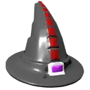
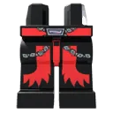
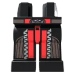
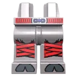

# Loot matrix 294

[Item database](../README.md) | [Methodology](../Methodology.md)

## Sources and mapped locations

| Kind | Source | Location evidence | Conditions |
| --- | --- | --- | --- |
| Vendor | [Cog Blammo - Paradox Vendor (LOT 6632)](../sources/object-6632.md) | [Nimbus Station (1200)](../locations/zone-1200.md) | Default inventory; vendorInvOverride can replace it |
| Vendor | [Testdude2 (LOT 11223)](../sources/object-11223.md) | No default-stock placement found | Default inventory; vendorInvOverride can replace it |

**Generic loot probability unavailable:** at least one entry has maxToDrop < minToDrop. Vendor code treats a zero endpoint as “include the full table”; the generic loot code does not define that interpretation. No drop percentage is fabricated for this matrix.

## Item candidates

Default vendor-stock probabilities are shown only when this matrix has a registered vendor. Loot probabilities use the generic algorithm, not a guarantee of actual use by every script/activity.

| Item | Modeled loot chance / expected count | Default vendor stock |
| --- | --- | --- |
| { .lu-ti width="24" loading="lazy" } [Rank 1 Sorcerer Book (LOT 118)](../118.md) | Undefined for generic loot: reversed count range | 100% |
| { .lu-ti width="24" loading="lazy" } [Rank 1 Space Marauder Book (LOT 125)](../125.md) | Undefined for generic loot: reversed count range | 100% |
| { .lu-ti width="24" loading="lazy" } [Sorcerer Hat 1 (LOT 7357)](../7357.md) | Undefined for generic loot: reversed count range | 100% |
| { .lu-ti width="24" loading="lazy" } [Sorcerer Hat 2 (LOT 7361)](../7361.md) | Undefined for generic loot: reversed count range | 100% |
| { .lu-ti width="24" loading="lazy" } [Sorcerer Breastplate 1 (LOT 7373)](../7373.md) | Undefined for generic loot: reversed count range | 100% |
| { .lu-ti width="24" loading="lazy" } [Sorcerer Breastplate 2 (LOT 7374)](../7374.md) | Undefined for generic loot: reversed count range | 100% |
| { .lu-ti width="24" loading="lazy" } [Sorcerer Pants 1 (LOT 7385)](../7385.md) | Undefined for generic loot: reversed count range | 100% |
| { .lu-ti width="24" loading="lazy" } [Sorcerer Pants 2 (LOT 7386)](../7386.md) | Undefined for generic loot: reversed count range | 100% |
| { .lu-ti width="24" loading="lazy" } [Sorcerer Wand 1 (LOT 7397)](../7397.md) | Undefined for generic loot: reversed count range | 100% |
| { .lu-ti width="24" loading="lazy" } [Sorcerer Wand 2 (LOT 7398)](../7398.md) | Undefined for generic loot: reversed count range | 100% |
| { .lu-ti width="24" loading="lazy" } [Sorcerer Orb 2 (LOT 7407)](../7407.md) | Undefined for generic loot: reversed count range | 100% |
| { .lu-ti width="24" loading="lazy" } [Space Marauder Helm 1 (LOT 7448)](../7448.md) | Undefined for generic loot: reversed count range | 100% |
| { .lu-ti width="24" loading="lazy" } [Space Marauder Helm 2 (LOT 7449)](../7449.md) | Undefined for generic loot: reversed count range | 100% |
| { .lu-ti width="24" loading="lazy" } [Shinobi Hood 1 (LOT 7451)](../7451.md) | Undefined for generic loot: reversed count range | 100% |
| { .lu-ti width="24" loading="lazy" } [Shinobi Hood 2 (LOT 7452)](../7452.md) | Undefined for generic loot: reversed count range | 100% |
| { .lu-ti width="24" loading="lazy" } [Space Marauder Jacket 1 (LOT 7472)](../7472.md) | Undefined for generic loot: reversed count range | 100% |
| { .lu-ti width="24" loading="lazy" } [Space Marauder Jacket 2 (LOT 7473)](../7473.md) | Undefined for generic loot: reversed count range | 100% |
| { .lu-ti width="24" loading="lazy" } [Shinobi Gi 1 (LOT 7475)](../7475.md) | Undefined for generic loot: reversed count range | 100% |
| { .lu-ti width="24" loading="lazy" } [Shinobi Gi 2 (LOT 7476)](../7476.md) | Undefined for generic loot: reversed count range | 100% |
| { .lu-ti width="24" loading="lazy" } [Space Marauder Pants 1 (LOT 7496)](../7496.md) | Undefined for generic loot: reversed count range | 100% |
| { .lu-ti width="24" loading="lazy" } [Space Marauder Pants 2 (LOT 7497)](../7497.md) | Undefined for generic loot: reversed count range | 100% |
| { .lu-ti width="24" loading="lazy" } [Shinobi Leggings 1 (LOT 7499)](../7499.md) | Undefined for generic loot: reversed count range | 100% |
| { .lu-ti width="24" loading="lazy" } [Shinobi Leggings 2 (LOT 7500)](../7500.md) | Undefined for generic loot: reversed count range | 100% |
| { .lu-ti width="24" loading="lazy" } [Space Marauder Blaster 1 (LOT 7520)](../7520.md) | Undefined for generic loot: reversed count range | 100% |
| { .lu-ti width="24" loading="lazy" } [Space Marauder Blaster 2 (LOT 7521)](../7521.md) | Undefined for generic loot: reversed count range | 100% |
| { .lu-ti width="24" loading="lazy" } [Shinobi Katana 1 (LOT 7523)](../7523.md) | Undefined for generic loot: reversed count range | 100% |
| { .lu-ti width="24" loading="lazy" } [Shinobi Katana 2 (LOT 7524)](../7524.md) | Undefined for generic loot: reversed count range | 100% |
| { .lu-ti width="24" loading="lazy" } [Space Marauder Launcher 2 (LOT 7548)](../7548.md) | Undefined for generic loot: reversed count range | 100% |
| { .lu-ti width="24" loading="lazy" } [Sorcerer Shoulderpads 2 (LOT 8459)](../8459.md) | Undefined for generic loot: reversed count range | 100% |
| { .lu-ti width="24" loading="lazy" } [Space Marauder Shoulderpads 2 (LOT 8460)](../8460.md) | Undefined for generic loot: reversed count range | 100% |
| { .lu-ti width="24" loading="lazy" } [Shinobi Shoulderpads 2 (LOT 8461)](../8461.md) | Undefined for generic loot: reversed count range | 100% |
| { .lu-ti width="24" loading="lazy" } [Paradox Power Potion (LOT 9625)](../9625.md) | Undefined for generic loot: reversed count range | 100% |
| { .lu-ti width="24" loading="lazy" } [Rank 1 Shinobi Book (LOT 11922)](../11922.md) | Undefined for generic loot: reversed count range | 100% |
| { .lu-ti width="24" loading="lazy" } [Large Bag of Green Imaginite (LOT 13137)](../13137.md) | Undefined for generic loot: reversed count range | 100% |
| { .lu-ti width="24" loading="lazy" } [Medium Bag of Red Imaginite (LOT 13138)](../13138.md) | Undefined for generic loot: reversed count range | 100% |
| { .lu-ti width="24" loading="lazy" } [Small Bag of Blue Imaginite (LOT 13146)](../13146.md) | Undefined for generic loot: reversed count range | 100% |

## Raw matrix entries

| Row | Loot table | Rarity table | Trigger | Min | Max | Flag | Gate |
| --- | --- | --- | --- | --- | --- | --- | --- |
| 678 | 179 | 22 | 1 | 1 | 0 |  |  |

[LootMatrix](../../../db/LootMatrix.md), [LootTable](../../../db/LootTable.md), [RarityTable](../../../db/RarityTable.md).
