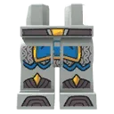
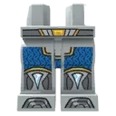
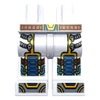
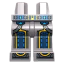
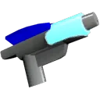
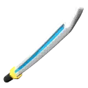
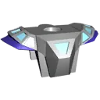

# Loot matrix 295

[Item database](../README.md) | [Methodology](../Methodology.md)

## Sources and mapped locations

| Kind | Source | Location evidence | Conditions |
| --- | --- | --- | --- |
| Vendor | [Xeno Blueblade - Sentinel Vendor (LOT 6631)](../sources/object-6631.md) | [Nimbus Station (1200)](../locations/zone-1200.md) | Default inventory; vendorInvOverride can replace it |

**Generic loot probability unavailable:** at least one entry has maxToDrop < minToDrop. Vendor code treats a zero endpoint as “include the full table”; the generic loot code does not define that interpretation. No drop percentage is fabricated for this matrix.

## Item candidates

Default vendor-stock probabilities are shown only when this matrix has a registered vendor. Loot probabilities use the generic algorithm, not a guarantee of actual use by every script/activity.

| Item | Modeled loot chance / expected count | Default vendor stock |
| --- | --- | --- |
| { .lu-ti width="24" loading="lazy" } [Rank 1 Knight Book (LOT 80)](../80.md) | Undefined for generic loot: reversed count range | 100% |
| { .lu-ti width="24" loading="lazy" } [Rank 1 Samurai Book (LOT 89)](../89.md) | Undefined for generic loot: reversed count range | 100% |
| { .lu-ti width="24" loading="lazy" } [Knight Helm 1 (LOT 7355)](../7355.md) | Undefined for generic loot: reversed count range | 100% |
| { .lu-ti width="24" loading="lazy" } [Knight Helm 2 (LOT 7359)](../7359.md) | Undefined for generic loot: reversed count range | 100% |
| { .lu-ti width="24" loading="lazy" } [Knight Breastplate 1 (LOT 7367)](../7367.md) | Undefined for generic loot: reversed count range | 100% |
| { .lu-ti width="24" loading="lazy" } [Knight Breastplate 2 (LOT 7368)](../7368.md) | Undefined for generic loot: reversed count range | 100% |
| { .lu-ti width="24" loading="lazy" } [Knight Leggings 1 (LOT 7379)](../7379.md) | Undefined for generic loot: reversed count range | 100% |
| { .lu-ti width="24" loading="lazy" } [Knight Leggings 2 (LOT 7380)](../7380.md) | Undefined for generic loot: reversed count range | 100% |
| { .lu-ti width="24" loading="lazy" } [Knight Greatsword 1 (LOT 7391)](../7391.md) | Undefined for generic loot: reversed count range | 100% |
| { .lu-ti width="24" loading="lazy" } [Knight Greatsword 2 (LOT 7392)](../7392.md) | Undefined for generic loot: reversed count range | 100% |
| { .lu-ti width="24" loading="lazy" } [Knight Shield 2 (LOT 7403)](../7403.md) | Undefined for generic loot: reversed count range | 100% |
| { .lu-ti width="24" loading="lazy" } [Space Ranger Helmet 1 (LOT 7442)](../7442.md) | Undefined for generic loot: reversed count range | 100% |
| { .lu-ti width="24" loading="lazy" } [Space Ranger Helmet 2 (LOT 7443)](../7443.md) | Undefined for generic loot: reversed count range | 100% |
| { .lu-ti width="24" loading="lazy" } [Samurai Helm 1 (LOT 7445)](../7445.md) | Undefined for generic loot: reversed count range | 100% |
| { .lu-ti width="24" loading="lazy" } [Samurai Helm 2 (LOT 7446)](../7446.md) | Undefined for generic loot: reversed count range | 100% |
| { .lu-ti width="24" loading="lazy" } [Space Ranger Armor 1 (LOT 7466)](../7466.md) | Undefined for generic loot: reversed count range | 100% |
| { .lu-ti width="24" loading="lazy" } [Space Ranger Armor 2 (LOT 7467)](../7467.md) | Undefined for generic loot: reversed count range | 100% |
| { .lu-ti width="24" loading="lazy" } [Samurai Breastplate 1 (LOT 7469)](../7469.md) | Undefined for generic loot: reversed count range | 100% |
| { .lu-ti width="24" loading="lazy" } [Samurai Breastplate 2 (LOT 7470)](../7470.md) | Undefined for generic loot: reversed count range | 100% |
| { .lu-ti width="24" loading="lazy" } [Space Ranger Pants 1 (LOT 7490)](../7490.md) | Undefined for generic loot: reversed count range | 100% |
| { .lu-ti width="24" loading="lazy" } [Space Ranger Pants 2 (LOT 7491)](../7491.md) | Undefined for generic loot: reversed count range | 100% |
| { .lu-ti width="24" loading="lazy" } [Samurai Leggings 1 (LOT 7493)](../7493.md) | Undefined for generic loot: reversed count range | 100% |
| { .lu-ti width="24" loading="lazy" } [Samurai Leggings 2 (LOT 7494)](../7494.md) | Undefined for generic loot: reversed count range | 100% |
| { .lu-ti width="24" loading="lazy" } [Space Ranger Zipgun 1 (LOT 7514)](../7514.md) | Undefined for generic loot: reversed count range | 100% |
| { .lu-ti width="24" loading="lazy" } [Space Ranger Zipgun 2 (LOT 7515)](../7515.md) | Undefined for generic loot: reversed count range | 100% |
| { .lu-ti width="24" loading="lazy" } [Samurai Katana 1 (LOT 7517)](../7517.md) | Undefined for generic loot: reversed count range | 100% |
| { .lu-ti width="24" loading="lazy" } [Samurai Katana 2 (LOT 7518)](../7518.md) | Undefined for generic loot: reversed count range | 100% |
| { .lu-ti width="24" loading="lazy" } [Space Ranger Launcher 2 (LOT 7544)](../7544.md) | Undefined for generic loot: reversed count range | 100% |
| { .lu-ti width="24" loading="lazy" } [Samurai Bow 2 (LOT 7546)](../7546.md) | Undefined for generic loot: reversed count range | 100% |
| { .lu-ti width="24" loading="lazy" } [Knight Shoulderpads 2 (LOT 8456)](../8456.md) | Undefined for generic loot: reversed count range | 100% |
| { .lu-ti width="24" loading="lazy" } [Space Ranger Pack 2 (LOT 8457)](../8457.md) | Undefined for generic loot: reversed count range | 100% |
| { .lu-ti width="24" loading="lazy" } [Samurai Shoulderpads 2 (LOT 8458)](../8458.md) | Undefined for generic loot: reversed count range | 100% |
| { .lu-ti width="24" loading="lazy" } [Sentinel Super Soda (LOT 9623)](../9623.md) | Undefined for generic loot: reversed count range | 100% |
| { .lu-ti width="24" loading="lazy" } [Rank 1 Space Ranger Book (LOT 11924)](../11924.md) | Undefined for generic loot: reversed count range | 100% |
| { .lu-ti width="24" loading="lazy" } [Large Bag of Green Imaginite (LOT 13136)](../13136.md) | Undefined for generic loot: reversed count range | 100% |
| { .lu-ti width="24" loading="lazy" } [Medium Bag of Red Imaginite (LOT 13141)](../13141.md) | Undefined for generic loot: reversed count range | 100% |
| { .lu-ti width="24" loading="lazy" } [Small Bag of Blue Imaginite (LOT 13143)](../13143.md) | Undefined for generic loot: reversed count range | 100% |

## Raw matrix entries

| Row | Loot table | Rarity table | Trigger | Min | Max | Flag | Gate |
| --- | --- | --- | --- | --- | --- | --- | --- |
| 679 | 178 | 22 | 1 | 1 | 0 |  |  |
| 4444 | 808 | 22 | 1 | 1 | 0 |  | levelprogression |

[LootMatrix](../../../db/LootMatrix.md), [LootTable](../../../db/LootTable.md), [RarityTable](../../../db/RarityTable.md).
