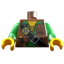
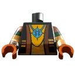
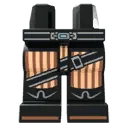
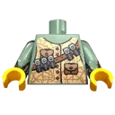
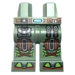
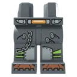
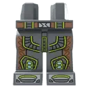
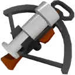
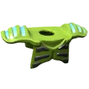

# Loot matrix 296

[Item database](../README.md) | [Methodology](../Methodology.md)

## Sources and mapped locations

| Kind | Source | Location evidence | Conditions |
| --- | --- | --- | --- |
| Vendor | [Magnus Bumperdent - Venture League Vendor (LOT 6634)](../sources/object-6634.md) | [Nimbus Station (1200)](../locations/zone-1200.md) | Default inventory; vendorInvOverride can replace it |

**Generic loot probability unavailable:** at least one entry has maxToDrop < minToDrop. Vendor code treats a zero endpoint as “include the full table”; the generic loot code does not define that interpretation. No drop percentage is fabricated for this matrix.

## Item candidates

Default vendor-stock probabilities are shown only when this matrix has a registered vendor. Loot probabilities use the generic algorithm, not a guarantee of actual use by every script/activity.

| Item | Modeled loot chance / expected count | Default vendor stock |
| --- | --- | --- |
| { .lu-ti width="24" loading="lazy" } [Rank 1 Buccaneer Book (LOT 20)](../20.md) | Undefined for generic loot: reversed count range | 100% |
| { .lu-ti width="24" loading="lazy" } [Rank 1 Daredevil Book (LOT 21)](../21.md) | Undefined for generic loot: reversed count range | 100% |
| { .lu-ti width="24" loading="lazy" } [Buccaneer Scarf 1 (LOT 7358)](../7358.md) | Undefined for generic loot: reversed count range | 100% |
| { .lu-ti width="24" loading="lazy" } [Buccaneer Scarf 2 (LOT 7365)](../7365.md) | Undefined for generic loot: reversed count range | 100% |
| { .lu-ti width="24" loading="lazy" } [Buccaneer Shirt 1 (LOT 7376)](../7376.md) | Undefined for generic loot: reversed count range | 100% |
| { .lu-ti width="24" loading="lazy" } [Buccaneer Shirt 2 (LOT 7377)](../7377.md) | Undefined for generic loot: reversed count range | 100% |
| { .lu-ti width="24" loading="lazy" } [Buccaneer Pantaloons 1 (LOT 7388)](../7388.md) | Undefined for generic loot: reversed count range | 100% |
| { .lu-ti width="24" loading="lazy" } [Buccaneer Pantaloons 2 (LOT 7389)](../7389.md) | Undefined for generic loot: reversed count range | 100% |
| { .lu-ti width="24" loading="lazy" } [Buccaneer Pistol &amp; Cutlass 1 (LOT 7400)](../7400.md) | Undefined for generic loot: reversed count range | 100% |
| { .lu-ti width="24" loading="lazy" } [Buccaneer Pistol &amp; Cutlass 2 (LOT 7401)](../7401.md) | Undefined for generic loot: reversed count range | 100% |
| { .lu-ti width="24" loading="lazy" } [Adventurer Hat 1 (LOT 7460)](../7460.md) | Undefined for generic loot: reversed count range | 100% |
| { .lu-ti width="24" loading="lazy" } [Adventurer Hat 2 (LOT 7461)](../7461.md) | Undefined for generic loot: reversed count range | 100% |
| { .lu-ti width="24" loading="lazy" } [Daredevil Helmet 1 (LOT 7463)](../7463.md) | Undefined for generic loot: reversed count range | 100% |
| { .lu-ti width="24" loading="lazy" } [Daredevil Helmet 2 (LOT 7464)](../7464.md) | Undefined for generic loot: reversed count range | 100% |
| { .lu-ti width="24" loading="lazy" } [Adventurer Coat 1 (LOT 7484)](../7484.md) | Undefined for generic loot: reversed count range | 100% |
| { .lu-ti width="24" loading="lazy" } [Adventurer Coat 2 (LOT 7485)](../7485.md) | Undefined for generic loot: reversed count range | 100% |
| { .lu-ti width="24" loading="lazy" } [Daredevil Jacket 1 (LOT 7487)](../7487.md) | Undefined for generic loot: reversed count range | 100% |
| { .lu-ti width="24" loading="lazy" } [Daredevil Jacket 2 (LOT 7488)](../7488.md) | Undefined for generic loot: reversed count range | 100% |
| { .lu-ti width="24" loading="lazy" } [Adventurer Pants 1 (LOT 7508)](../7508.md) | Undefined for generic loot: reversed count range | 100% |
| { .lu-ti width="24" loading="lazy" } [Adventurer Pants 2 (LOT 7509)](../7509.md) | Undefined for generic loot: reversed count range | 100% |
| { .lu-ti width="24" loading="lazy" } [Daredevil Pants 1 (LOT 7511)](../7511.md) | Undefined for generic loot: reversed count range | 100% |
| { .lu-ti width="24" loading="lazy" } [Daredevil Pants 2 (LOT 7512)](../7512.md) | Undefined for generic loot: reversed count range | 100% |
| { .lu-ti width="24" loading="lazy" } [Adventurer Crossbow 1 (LOT 7532)](../7532.md) | Undefined for generic loot: reversed count range | 100% |
| { .lu-ti width="24" loading="lazy" } [Adventurer Crossbow 2 (LOT 7533)](../7533.md) | Undefined for generic loot: reversed count range | 100% |
| { .lu-ti width="24" loading="lazy" } [Daredevil Flareguns 1 (LOT 7535)](../7535.md) | Undefined for generic loot: reversed count range | 100% |
| { .lu-ti width="24" loading="lazy" } [Daredevil Flareguns 2 (LOT 7536)](../7536.md) | Undefined for generic loot: reversed count range | 100% |
| { .lu-ti width="24" loading="lazy" } [Adventurer Backpack 2 (LOT 8465)](../8465.md) | Undefined for generic loot: reversed count range | 100% |
| { .lu-ti width="24" loading="lazy" } [Daredevil Shoulderpads 2 (LOT 8466)](../8466.md) | Undefined for generic loot: reversed count range | 100% |
| { .lu-ti width="24" loading="lazy" } [Buccaneer Bandolier 2 (LOT 8467)](../8467.md) | Undefined for generic loot: reversed count range | 100% |
| { .lu-ti width="24" loading="lazy" } [Venture Vitality Vial (LOT 9626)](../9626.md) | Undefined for generic loot: reversed count range | 100% |
| { .lu-ti width="24" loading="lazy" } [Adventurer Whip 2 (LOT 11458)](../11458.md) | Undefined for generic loot: reversed count range | 100% |
| { .lu-ti width="24" loading="lazy" } [Rank 1 Adventurer Book (LOT 11923)](../11923.md) | Undefined for generic loot: reversed count range | 100% |
| { .lu-ti width="24" loading="lazy" } [Large Bag of Green Imaginite (LOT 13135)](../13135.md) | Undefined for generic loot: reversed count range | 100% |
| { .lu-ti width="24" loading="lazy" } [Medium Bag of Red Imaginite (LOT 13140)](../13140.md) | Undefined for generic loot: reversed count range | 100% |
| { .lu-ti width="24" loading="lazy" } [Small Bag of Blue Imaginite (LOT 13145)](../13145.md) | Undefined for generic loot: reversed count range | 100% |

## Raw matrix entries

| Row | Loot table | Rarity table | Trigger | Min | Max | Flag | Gate |
| --- | --- | --- | --- | --- | --- | --- | --- |
| 680 | 180 | 22 | 1 | 1 | 0 |  |  |

[LootMatrix](../../../db/LootMatrix.md), [LootTable](../../../db/LootTable.md), [RarityTable](../../../db/RarityTable.md).
