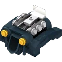
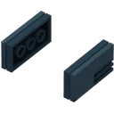
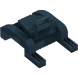
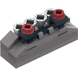

# Loot matrix 327

[Item database](../README.md) | [Methodology](../Methodology.md)

## Sources and mapped locations

| Kind | Source | Location evidence | Conditions |
| --- | --- | --- | --- |
| Package | [Thrust Bucket Package (LOT 9470)](../sources/object-9470.md) | No matched local placement found | Static association, not a live-spawn guarantee |

## Item candidates

Default vendor-stock probabilities are shown only when this matrix has a registered vendor. Loot probabilities use the generic algorithm, not a guarantee of actual use by every script/activity.

| Item | Modeled loot chance / expected count | Default vendor stock |
| --- | --- | --- |
| { .lu-ti width="24" loading="lazy" } [Bolt Ox Front Bumper 2 (LOT 9376)](../9376.md) | 10%; mean 0.1 | Not associated with a vendor |
| { .lu-ti width="24" loading="lazy" } [Bolt Ox Engine Panel 2 (LOT 9385)](../9385.md) | 100%; mean 1 | Not associated with a vendor |
| { .lu-ti width="24" loading="lazy" } [Bolt Ox Side Panels 2 (LOT 9395)](../9395.md) | 100%; mean 1 | Not associated with a vendor |
| { .lu-ti width="24" loading="lazy" } [Bolt Ox Rear Panel (LOT 9400)](../9400.md) | 100%; mean 1 | Not associated with a vendor |
| { .lu-ti width="24" loading="lazy" } [Bolt Ox Rear Bumper 2 (LOT 9403)](../9403.md) | 100%; mean 1 | Not associated with a vendor |

## Raw matrix entries

| Row | Loot table | Rarity table | Trigger | Min | Max | Flag | Gate |
| --- | --- | --- | --- | --- | --- | --- | --- |
| 799 | 221 | 4 | 1 | 1 | 1 |  |  |
| 800 | 222 | 4 | 1 | 1 | 1 |  |  |
| 801 | 223 | 4 | 1 | 1 | 1 |  |  |
| 802 | 224 | 4 | 1 | 1 | 1 |  |  |
| 803 | 225 | 4 | 1 | 1 | 1 |  |  |

[LootMatrix](../../../db/LootMatrix.md), [LootTable](../../../db/LootTable.md), [RarityTable](../../../db/RarityTable.md).
