# Loot matrix 332

[Item database](../README.md) | [Methodology](../Methodology.md)

## Sources and mapped locations

| Kind | Source | Location evidence | Conditions |
| --- | --- | --- | --- |
| Vendor | [Rudder Bumpsteer - Racing Vendor (LOT 9502)](../sources/object-9502.md) | [Gnarled Forest Deep Dive Map (375)](../locations/zone-375.md); [Gnarled Forest (1300)](../locations/zone-1300.md) | Default inventory; vendorInvOverride can replace it |

**Generic loot probability unavailable:** at least one entry has maxToDrop < minToDrop. Vendor code treats a zero endpoint as “include the full table”; the generic loot code does not define that interpretation. No drop percentage is fabricated for this matrix.

## Item candidates

Default vendor-stock probabilities are shown only when this matrix has a registered vendor. Loot probabilities use the generic algorithm, not a guarantee of actual use by every script/activity.

| Item | Modeled loot chance / expected count | Default vendor stock |
| --- | --- | --- |
| { .lu-ti width="24" loading="lazy" } [Green Imaginite (LOT 3039)](../3039.md) | Undefined for generic loot: reversed count range | 100% |
| { .lu-ti width="24" loading="lazy" } [Red Imaginite (LOT 3040)](../3040.md) | Undefined for generic loot: reversed count range | 100% |
| { .lu-ti width="24" loading="lazy" } [Red Racing Helmet (LOT 7730)](../7730.md) | Undefined for generic loot: reversed count range | 100% |
| { .lu-ti width="24" loading="lazy" } [Blue Racing Helmet (LOT 7992)](../7992.md) | Undefined for generic loot: reversed count range | 100% |
| { .lu-ti width="24" loading="lazy" } [Green Racing Helmet (LOT 8037)](../8037.md) | Undefined for generic loot: reversed count range | 100% |
| { .lu-ti width="24" loading="lazy" } [White Racing Helmet (LOT 8038)](../8038.md) | Undefined for generic loot: reversed count range | 100% |
| { .lu-ti width="24" loading="lazy" } [Yellow Racing Helmet (LOT 8039)](../8039.md) | Undefined for generic loot: reversed count range | 100% |
| { .lu-ti width="24" loading="lazy" } [Car Chassis (LOT 8129)](../8129.md) | Undefined for generic loot: reversed count range | 100% |
| 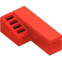{ .lu-ti width="24" loading="lazy" } [Paragon Warp Side Panels 1 (LOT 8133)](../8133.md) | Undefined for generic loot: reversed count range | 100% |
| { .lu-ti width="24" loading="lazy" } [Paragon Warp Rear Bumper 2 (LOT 8237)](../8237.md) | Undefined for generic loot: reversed count range | 100% |
| { .lu-ti width="24" loading="lazy" } [Chase Cutter Engine Panel 2 (LOT 9339)](../9339.md) | Undefined for generic loot: reversed count range | 100% |
| { .lu-ti width="24" loading="lazy" } [Chase Cutter Side Panels 2 (LOT 9350)](../9350.md) | Undefined for generic loot: reversed count range | 100% |
| { .lu-ti width="24" loading="lazy" } [Chase Cutter Side Panels 2 (LOT 9351)](../9351.md) | Undefined for generic loot: reversed count range | 100% |
| 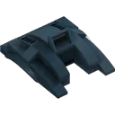{ .lu-ti width="24" loading="lazy" } [Chase Cutter Rear Panel 3 (LOT 9362)](../9362.md) | Undefined for generic loot: reversed count range | 100% |
| { .lu-ti width="24" loading="lazy" } [Chase Cutter Rear Bumper 1 (LOT 9368)](../9368.md) | Undefined for generic loot: reversed count range | 100% |
| { .lu-ti width="24" loading="lazy" } [Chase Cutter Rear Bumper 1 (LOT 9369)](../9369.md) | Undefined for generic loot: reversed count range | 100% |
| 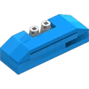{ .lu-ti width="24" loading="lazy" } [Chase Cutter Rear Bumper 1 (LOT 9370)](../9370.md) | Undefined for generic loot: reversed count range | 100% |
| { .lu-ti width="24" loading="lazy" } [Bolt Ox Engine Panel 1 (LOT 9380)](../9380.md) | Undefined for generic loot: reversed count range | 100% |
| { .lu-ti width="24" loading="lazy" } [Bolt Ox Engine Panel 2 (LOT 9383)](../9383.md) | Undefined for generic loot: reversed count range | 100% |
| 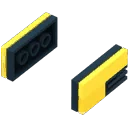{ .lu-ti width="24" loading="lazy" } [Bolt Ox Side Panels 2 (LOT 9394)](../9394.md) | Undefined for generic loot: reversed count range | 100% |
| 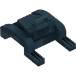{ .lu-ti width="24" loading="lazy" } [Bolt Ox Rear Panel (LOT 9400)](../9400.md) | Undefined for generic loot: reversed count range | 100% |
| 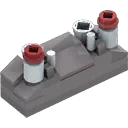{ .lu-ti width="24" loading="lazy" } [Thrust Bucket Rear Bumper (LOT 9401)](../9401.md) | Undefined for generic loot: reversed count range | 100% |
| 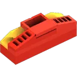{ .lu-ti width="24" loading="lazy" } [Paragon Warp Front Bumper 2 (LOT 9405)](../9405.md) | Undefined for generic loot: reversed count range | 100% |
| { .lu-ti width="24" loading="lazy" } [Paragon Warp Front Bumper 2 (LOT 9406)](../9406.md) | Undefined for generic loot: reversed count range | 100% |
| 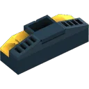{ .lu-ti width="24" loading="lazy" } [Paragon Warp Front Bumper 2 (LOT 9407)](../9407.md) | Undefined for generic loot: reversed count range | 100% |
| 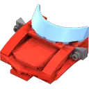{ .lu-ti width="24" loading="lazy" } [Paragon Warp Engine Panel 1 (LOT 9410)](../9410.md) | Undefined for generic loot: reversed count range | 100% |
| 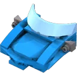{ .lu-ti width="24" loading="lazy" } [Paragon Warp Engine Panel 1 (LOT 9411)](../9411.md) | Undefined for generic loot: reversed count range | 100% |
| { .lu-ti width="24" loading="lazy" } [Paragon Warp Engine Panel 2 (LOT 9413)](../9413.md) | Undefined for generic loot: reversed count range | 100% |
| { .lu-ti width="24" loading="lazy" } [Paragon Warp Engine Panel 2 (LOT 9414)](../9414.md) | Undefined for generic loot: reversed count range | 100% |
| 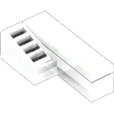{ .lu-ti width="24" loading="lazy" } [Paragon Warp Side Panels 1 (LOT 9416)](../9416.md) | Undefined for generic loot: reversed count range | 100% |
| { .lu-ti width="24" loading="lazy" } [Paragon Warp Side Panels 2 (LOT 9419)](../9419.md) | Undefined for generic loot: reversed count range | 100% |
| { .lu-ti width="24" loading="lazy" } [Paragon Warp Side Panels 2 (LOT 9420)](../9420.md) | Undefined for generic loot: reversed count range | 100% |
| { .lu-ti width="24" loading="lazy" } [Paragon Warp Rear Panel 1 (LOT 9422)](../9422.md) | Undefined for generic loot: reversed count range | 100% |
| { .lu-ti width="24" loading="lazy" } [Paragon Warp Rear Panel 1 (LOT 9423)](../9423.md) | Undefined for generic loot: reversed count range | 100% |
| { .lu-ti width="24" loading="lazy" } [Paragon Warp Rear Panel 2 (LOT 9425)](../9425.md) | Undefined for generic loot: reversed count range | 100% |
| { .lu-ti width="24" loading="lazy" } [Paragon Warp Rear Panel 2 (LOT 9426)](../9426.md) | Undefined for generic loot: reversed count range | 100% |
| { .lu-ti width="24" loading="lazy" } [Paragon Warp Rear Panel 2 (LOT 9427)](../9427.md) | Undefined for generic loot: reversed count range | 100% |
| { .lu-ti width="24" loading="lazy" } [Paragon Warp Rear Bumper 1 (LOT 9430)](../9430.md) | Undefined for generic loot: reversed count range | 100% |
| { .lu-ti width="24" loading="lazy" } [Paragon Warp Rear Bumper 1 (LOT 9431)](../9431.md) | Undefined for generic loot: reversed count range | 100% |
| { .lu-ti width="24" loading="lazy" } [Paragon Warp Rear Bumper 1 (LOT 9432)](../9432.md) | Undefined for generic loot: reversed count range | 100% |
| 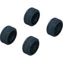{ .lu-ti width="24" loading="lazy" } [Black Rim Wheels (LOT 9453)](../9453.md) | Undefined for generic loot: reversed count range | 100% |

## Raw matrix entries

| Row | Loot table | Rarity table | Trigger | Min | Max | Flag | Gate |
| --- | --- | --- | --- | --- | --- | --- | --- |
| 814 | 236 | 4 | 1 | 1 | 0 |  |  |

[LootMatrix](../../../db/LootMatrix.md), [LootTable](../../../db/LootTable.md), [RarityTable](../../../db/RarityTable.md).
