# Loot matrix 369

[Item database](../README.md) | [Methodology](../Methodology.md)

## Sources and mapped locations

| Kind | Source | Location evidence | Conditions |
| --- | --- | --- | --- |
| Vendor | [Darby Snapwish - Brick Vendor (LOT 9706)](../sources/object-9706.md) | [Avant Gardens (1100)](../locations/zone-1100.md) | Default inventory; vendorInvOverride can replace it |

**Generic loot probability unavailable:** at least one entry has maxToDrop < minToDrop. Vendor code treats a zero endpoint as “include the full table”; the generic loot code does not define that interpretation. No drop percentage is fabricated for this matrix.

## Item candidates

Default vendor-stock probabilities are shown only when this matrix has a registered vendor. Loot probabilities use the generic algorithm, not a guarantee of actual use by every script/activity.

| Item | Modeled loot chance / expected count | Default vendor stock |
| --- | --- | --- |
| 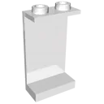{ .lu-ti width="24" loading="lazy" } [Panel 1x2x3 (LOT 17)](../17.md) | Undefined for generic loot: reversed count range | 100% |
| { .lu-ti width="24" loading="lazy" } [Brick 2x4 (LOT 29)](../29.md) | Undefined for generic loot: reversed count range | 100% |
| { .lu-ti width="24" loading="lazy" } [Brick 2x3 (LOT 30)](../30.md) | Undefined for generic loot: reversed count range | 100% |
| { .lu-ti width="24" loading="lazy" } [Brick 2x2 (LOT 31)](../31.md) | Undefined for generic loot: reversed count range | 100% |
| { .lu-ti width="24" loading="lazy" } [Brick 1x2 (LOT 32)](../32.md) | Undefined for generic loot: reversed count range | 100% |
| { .lu-ti width="24" loading="lazy" } [Brick 1x1 (LOT 33)](../33.md) | Undefined for generic loot: reversed count range | 100% |
| { .lu-ti width="24" loading="lazy" } [Brick 2x8 (LOT 35)](../35.md) | Undefined for generic loot: reversed count range | 100% |
| { .lu-ti width="24" loading="lazy" } [Brick 1x8 (LOT 36)](../36.md) | Undefined for generic loot: reversed count range | 100% |
| { .lu-ti width="24" loading="lazy" } [Brick 1x6 (LOT 37)](../37.md) | Undefined for generic loot: reversed count range | 100% |
| { .lu-ti width="24" loading="lazy" } [Brick 1x4 (LOT 38)](../38.md) | Undefined for generic loot: reversed count range | 100% |
| { .lu-ti width="24" loading="lazy" } [Plate 2x4 (LOT 39)](../39.md) | Undefined for generic loot: reversed count range | 100% |
| { .lu-ti width="24" loading="lazy" } [Plate 2x3 (LOT 40)](../40.md) | Undefined for generic loot: reversed count range | 100% |
| { .lu-ti width="24" loading="lazy" } [Plate 1x2 (LOT 41)](../41.md) | Undefined for generic loot: reversed count range | 100% |
| { .lu-ti width="24" loading="lazy" } [Plate 1x1 (LOT 42)](../42.md) | Undefined for generic loot: reversed count range | 100% |
| { .lu-ti width="24" loading="lazy" } [Plate 1x8 (LOT 58)](../58.md) | Undefined for generic loot: reversed count range | 100% |
| 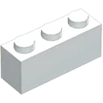{ .lu-ti width="24" loading="lazy" } [Brick 1x3 (LOT 59)](../59.md) | Undefined for generic loot: reversed count range | 100% |
| 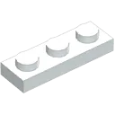{ .lu-ti width="24" loading="lazy" } [Plate 1x3 (LOT 60)](../60.md) | Undefined for generic loot: reversed count range | 100% |
| 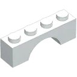{ .lu-ti width="24" loading="lazy" } [Brick 1x4 with Bow (LOT 61)](../61.md) | Undefined for generic loot: reversed count range | 100% |
| { .lu-ti width="24" loading="lazy" } [Plate 1x6 (LOT 62)](../62.md) | Undefined for generic loot: reversed count range | 100% |
| { .lu-ti width="24" loading="lazy" } [Plate 1x4 (LOT 66)](../66.md) | Undefined for generic loot: reversed count range | 100% |
| { .lu-ti width="24" loading="lazy" } [Bow 1x3x2 (LOT 77)](../77.md) | Undefined for generic loot: reversed count range | 100% |
| 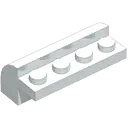{ .lu-ti width="24" loading="lazy" } [Brick with Bow 4x1x1 1/3 (LOT 81)](../81.md) | Undefined for generic loot: reversed count range | 100% |
| { .lu-ti width="24" loading="lazy" } [Bow 1x1x1 1/3 (LOT 82)](../82.md) | Undefined for generic loot: reversed count range | 100% |
| 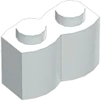{ .lu-ti width="24" loading="lazy" } [Brick 1x2 Palisade (LOT 88)](../88.md) | Undefined for generic loot: reversed count range | 100% |
| { .lu-ti width="24" loading="lazy" } [Brick 2x6 (LOT 98)](../98.md) | Undefined for generic loot: reversed count range | 100% |
| 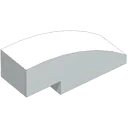{ .lu-ti width="24" loading="lazy" } [Slope Brick 1x3 Curved (LOT 105)](../105.md) | Undefined for generic loot: reversed count range | 100% |
| 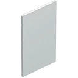{ .lu-ti width="24" loading="lazy" } [Glass for Frame 1x4x6 (LOT 107)](../107.md) | Undefined for generic loot: reversed count range | 100% |
| 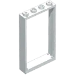{ .lu-ti width="24" loading="lazy" } [Frame 1x4x6 for Door (LOT 122)](../122.md) | Undefined for generic loot: reversed count range | 100% |
| { .lu-ti width="24" loading="lazy" } [Plate 2x6 (LOT 144)](../144.md) | Undefined for generic loot: reversed count range | 100% |
| 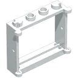{ .lu-ti width="24" loading="lazy" } [Window Frame 4x3 (LOT 336)](../336.md) | Undefined for generic loot: reversed count range | 100% |
| 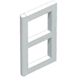{ .lu-ti width="24" loading="lazy" } [Window for Frame 2x3 (LOT 337)](../337.md) | Undefined for generic loot: reversed count range | 100% |
| 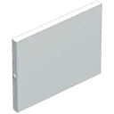{ .lu-ti width="24" loading="lazy" } [Glass for Frame 1x4x3 (LOT 338)](../338.md) | Undefined for generic loot: reversed count range | 100% |
| 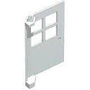{ .lu-ti width="24" loading="lazy" } [Door with Pane for Frame 4x5 (LOT 340)](../340.md) | Undefined for generic loot: reversed count range | 100% |
| 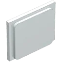{ .lu-ti width="24" loading="lazy" } [Glass for Train Window 1x4x3 (LOT 352)](../352.md) | Undefined for generic loot: reversed count range | 100% |
| 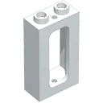{ .lu-ti width="24" loading="lazy" } [Frame 1x2x3 Narrow (LOT 353)](../353.md) | Undefined for generic loot: reversed count range | 100% |
| 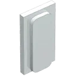{ .lu-ti width="24" loading="lazy" } [Glass for Train Window 1x2x3 (LOT 354)](../354.md) | Undefined for generic loot: reversed count range | 100% |
| 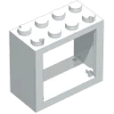{ .lu-ti width="24" loading="lazy" } [Window Frame 2x4x3 (LOT 360)](../360.md) | Undefined for generic loot: reversed count range | 100% |
| 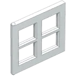{ .lu-ti width="24" loading="lazy" } [Window 4x3 (LOT 361)](../361.md) | Undefined for generic loot: reversed count range | 100% |
| 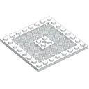{ .lu-ti width="24" loading="lazy" } [Grid Plate 8x8 (LOT 363)](../363.md) | Undefined for generic loot: reversed count range | 100% |
| 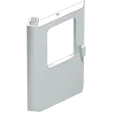{ .lu-ti width="24" loading="lazy" } [Train Door 1x4x5 Left (LOT 367)](../367.md) | Undefined for generic loot: reversed count range | 100% |
| 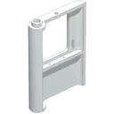{ .lu-ti width="24" loading="lazy" } [Train Door 1x4x5 Right (LOT 368)](../368.md) | Undefined for generic loot: reversed count range | 100% |
| 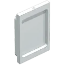{ .lu-ti width="24" loading="lazy" } [Glass for Train Door (LOT 369)](../369.md) | Undefined for generic loot: reversed count range | 100% |
| 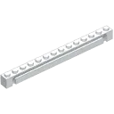{ .lu-ti width="24" loading="lazy" } [Brick 1x14 with Groove (LOT 374)](../374.md) | Undefined for generic loot: reversed count range | 100% |
| 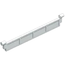{ .lu-ti width="24" loading="lazy" } [Element for Rolling Gate (LOT 375)](../375.md) | Undefined for generic loot: reversed count range | 100% |
| 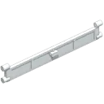{ .lu-ti width="24" loading="lazy" } [End Element for Rolling Gate (LOT 376)](../376.md) | Undefined for generic loot: reversed count range | 100% |
| 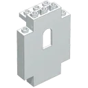{ .lu-ti width="24" loading="lazy" } [Panel Wall 1x5x6 with Window (LOT 386)](../386.md) | Undefined for generic loot: reversed count range | 100% |
| { .lu-ti width="24" loading="lazy" } [Frame Skylight 4x4x3/45° (LOT 387)](../387.md) | Undefined for generic loot: reversed count range | 100% |
| { .lu-ti width="24" loading="lazy" } [Glass for Skylight 4x4x3/45° (LOT 388)](../388.md) | Undefined for generic loot: reversed count range | 100% |
| 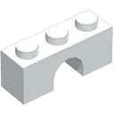{ .lu-ti width="24" loading="lazy" } [Brick 1x3 with Bow (LOT 392)](../392.md) | Undefined for generic loot: reversed count range | 100% |
| 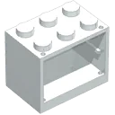{ .lu-ti width="24" loading="lazy" } [Cupboard 2x3x2 (LOT 397)](../397.md) | Undefined for generic loot: reversed count range | 100% |
| 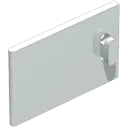{ .lu-ti width="24" loading="lazy" } [Cupboard Door 3x2 (LOT 398)](../398.md) | Undefined for generic loot: reversed count range | 100% |
| 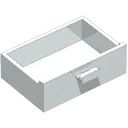{ .lu-ti width="24" loading="lazy" } [Drawer (LOT 399)](../399.md) | Undefined for generic loot: reversed count range | 100% |
| { .lu-ti width="24" loading="lazy" } [Airplane Window (LOT 425)](../425.md) | Undefined for generic loot: reversed count range | 100% |
| 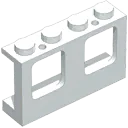{ .lu-ti width="24" loading="lazy" } [Panel 1x4x2 with Windows (LOT 426)](../426.md) | Undefined for generic loot: reversed count range | 100% |
| 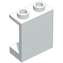{ .lu-ti width="24" loading="lazy" } [Panel 1x2x2 (LOT 427)](../427.md) | Undefined for generic loot: reversed count range | 100% |
| { .lu-ti width="24" loading="lazy" } [Bow 1x6x 3 1/3 (LOT 449)](../449.md) | Undefined for generic loot: reversed count range | 100% |
| 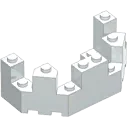{ .lu-ti width="24" loading="lazy" } [Castle Balcony 4x8x2 (LOT 454)](../454.md) | Undefined for generic loot: reversed count range | 100% |
| 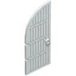{ .lu-ti width="24" loading="lazy" } [Wooden Door 4x8 with 1/4-Circle Top (LOT 461)](../461.md) | Undefined for generic loot: reversed count range | 100% |
| 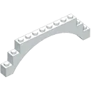{ .lu-ti width="24" loading="lazy" } [Arch Brick 1x12x3 (LOT 464)](../464.md) | Undefined for generic loot: reversed count range | 100% |
| 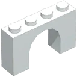{ .lu-ti width="24" loading="lazy" } [Arch Brick 1x4x2 (LOT 477)](../477.md) | Undefined for generic loot: reversed count range | 100% |
| { .lu-ti width="24" loading="lazy" } [Arch 1x6x2 (LOT 478)](../478.md) | Undefined for generic loot: reversed count range | 100% |
| { .lu-ti width="24" loading="lazy" } [Brick 1x4x1 1/3 with Bowed Ridge (LOT 480)](../480.md) | Undefined for generic loot: reversed count range | 100% |
| { .lu-ti width="24" loading="lazy" } [Brick 2x4 with Bowed Ridge (LOT 481)](../481.md) | Undefined for generic loot: reversed count range | 100% |
| 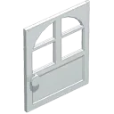{ .lu-ti width="24" loading="lazy" } [Door with Pane for Frame 2x6x6 (LOT 489)](../489.md) | Undefined for generic loot: reversed count range | 100% |
| 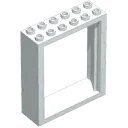{ .lu-ti width="24" loading="lazy" } [Frame 2x6x6 (LOT 490)](../490.md) | Undefined for generic loot: reversed count range | 100% |
| 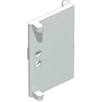{ .lu-ti width="24" loading="lazy" } [Container Door 1x2x3 (LOT 497)](../497.md) | Undefined for generic loot: reversed count range | 100% |
| 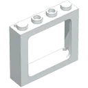{ .lu-ti width="24" loading="lazy" } [Train Window 1x4x3 (LOT 498)](../498.md) | Undefined for generic loot: reversed count range | 100% |
| 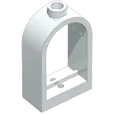{ .lu-ti width="24" loading="lazy" } [Window Frame 1x2x2 2/3 Curved Top (LOT 512)](../512.md) | Undefined for generic loot: reversed count range | 100% |
| 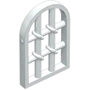{ .lu-ti width="24" loading="lazy" } [Iron Bars for Window (LOT 513)](../513.md) | Undefined for generic loot: reversed count range | 100% |
| 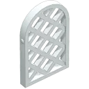{ .lu-ti width="24" loading="lazy" } [Fly-Screen for Window (LOT 514)](../514.md) | Undefined for generic loot: reversed count range | 100% |
| 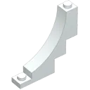{ .lu-ti width="24" loading="lazy" } [Brick with Bow 1x5x4 Inverted (LOT 524)](../524.md) | Undefined for generic loot: reversed count range | 100% |
| 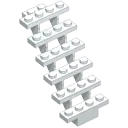{ .lu-ti width="24" loading="lazy" } [Staircase 4x6x7 (LOT 529)](../529.md) | Undefined for generic loot: reversed count range | 100% |
| 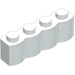{ .lu-ti width="24" loading="lazy" } [Palisade Brick 1x4 (LOT 530)](../530.md) | Undefined for generic loot: reversed count range | 100% |
| 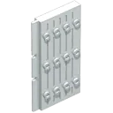{ .lu-ti width="24" loading="lazy" } [Wooden Door 5x9 with Studs (LOT 545)](../545.md) | Undefined for generic loot: reversed count range | 100% |
| 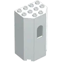{ .lu-ti width="24" loading="lazy" } [Castle Tower Element 4x3x6 (LOT 549)](../549.md) | Undefined for generic loot: reversed count range | 100% |
| 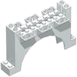{ .lu-ti width="24" loading="lazy" } [Arch with Groove 2x12x6 (LOT 553)](../553.md) | Undefined for generic loot: reversed count range | 100% |
| 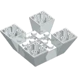{ .lu-ti width="24" loading="lazy" } [Slope Brick 65° 6x6x2 Inverted Quadruple (LOT 578)](../578.md) | Undefined for generic loot: reversed count range | 100% |
| { .lu-ti width="24" loading="lazy" } [Lattice Brick 2x2x10 Type 1 (LOT 594)](../594.md) | Undefined for generic loot: reversed count range | 100% |
| { .lu-ti width="24" loading="lazy" } [Panel 4x4x6 1/4-Circle (LOT 602)](../602.md) | Undefined for generic loot: reversed count range | 100% |
| { .lu-ti width="24" loading="lazy" } [Tower Roof Half 6x8x9 (LOT 625)](../625.md) | Undefined for generic loot: reversed count range | 100% |
| { .lu-ti width="24" loading="lazy" } [Wall 1x8x6 with Doorway and 2 Vertical Clips (LOT 630)](../630.md) | Undefined for generic loot: reversed count range | 100% |
| { .lu-ti width="24" loading="lazy" } [Pitched Roof 6x6x3 (LOT 640)](../640.md) | Undefined for generic loot: reversed count range | 100% |
| { .lu-ti width="24" loading="lazy" } [Lattice Door 4x7 2/3 (LOT 660)](../660.md) | Undefined for generic loot: reversed count range | 100% |
| { .lu-ti width="24" loading="lazy" } [Brick Column 1x1x6 (LOT 674)](../674.md) | Undefined for generic loot: reversed count range | 100% |
| { .lu-ti width="24" loading="lazy" } [Brick Curved 1/4 4x4 (LOT 717)](../717.md) | Undefined for generic loot: reversed count range | 100% |
| { .lu-ti width="24" loading="lazy" } [Panel Wall 3x8x6 with Window (LOT 723)](../723.md) | Undefined for generic loot: reversed count range | 100% |
| { .lu-ti width="24" loading="lazy" } [Frame 1x4x6 with 2 Cross-Beams (LOT 761)](../761.md) | Undefined for generic loot: reversed count range | 100% |
| { .lu-ti width="24" loading="lazy" } [Lattice Brick 2x2x10 Type 2 (LOT 763)](../763.md) | Undefined for generic loot: reversed count range | 100% |
| { .lu-ti width="24" loading="lazy" } [Panel 1x6x5 (LOT 765)](../765.md) | Undefined for generic loot: reversed count range | 100% |
| { .lu-ti width="24" loading="lazy" } [Brick Column 2x2x11 (LOT 776)](../776.md) | Undefined for generic loot: reversed count range | 100% |
| { .lu-ti width="24" loading="lazy" } [Brick with Bow 1x5x4 (LOT 787)](../787.md) | Undefined for generic loot: reversed count range | 100% |
| { .lu-ti width="24" loading="lazy" } [Panel Wall 3x3x6 Corner (LOT 791)](../791.md) | Undefined for generic loot: reversed count range | 100% |
| { .lu-ti width="24" loading="lazy" } [Panel 1x2x2 with Window (LOT 794)](../794.md) | Undefined for generic loot: reversed count range | 100% |
| { .lu-ti width="24" loading="lazy" } [Windscreen 6x6 Octagonal with Hinge (LOT 803)](../803.md) | Undefined for generic loot: reversed count range | 100% |
| { .lu-ti width="24" loading="lazy" } [Corner Brick 3x3 with Cut-Out (LOT 819)](../819.md) | Undefined for generic loot: reversed count range | 100% |
| { .lu-ti width="24" loading="lazy" } [Panel 3x2x6 Curved (LOT 822)](../822.md) | Undefined for generic loot: reversed count range | 100% |
| { .lu-ti width="24" loading="lazy" } [Window 2x3 with Lattice (LOT 833)](../833.md) | Undefined for generic loot: reversed count range | 100% |
| { .lu-ti width="24" loading="lazy" } [Panel 3x4x6 with Curve (LOT 844)](../844.md) | Undefined for generic loot: reversed count range | 100% |
| { .lu-ti width="24" loading="lazy" } [Panel 5x6x10 with Curve (LOT 845)](../845.md) | Undefined for generic loot: reversed count range | 100% |
| { .lu-ti width="24" loading="lazy" } [Dome 10x10x4 with Hinge (LOT 849)](../849.md) | Undefined for generic loot: reversed count range | 100% |
| { .lu-ti width="24" loading="lazy" } [Hemisphere 10x10x4 Inverted (LOT 850)](../850.md) | Undefined for generic loot: reversed count range | 100% |
| { .lu-ti width="24" loading="lazy" } [Brick 1x4 with Groove (LOT 853)](../853.md) | Undefined for generic loot: reversed count range | 100% |
| { .lu-ti width="24" loading="lazy" } [Plate 2x2 (LOT 865)](../865.md) | Undefined for generic loot: reversed count range | 100% |
| { .lu-ti width="24" loading="lazy" } [Plate 2x8 (LOT 869)](../869.md) | Undefined for generic loot: reversed count range | 100% |
| { .lu-ti width="24" loading="lazy" } [Door 1x3x2 Right (LOT 882)](../882.md) | Undefined for generic loot: reversed count range | 100% |
| { .lu-ti width="24" loading="lazy" } [Left Door 1x3x2 (LOT 883)](../883.md) | Undefined for generic loot: reversed count range | 100% |
| { .lu-ti width="24" loading="lazy" } [Door 1x3x3 Right (LOT 884)](../884.md) | Undefined for generic loot: reversed count range | 100% |
| { .lu-ti width="24" loading="lazy" } [Door 1x3x3 Left (LOT 885)](../885.md) | Undefined for generic loot: reversed count range | 100% |
| { .lu-ti width="24" loading="lazy" } [Door 1x3x4 Right (LOT 886)](../886.md) | Undefined for generic loot: reversed count range | 100% |
| { .lu-ti width="24" loading="lazy" } [Door 1x3x4 Left (LOT 887)](../887.md) | Undefined for generic loot: reversed count range | 100% |
| { .lu-ti width="24" loading="lazy" } [Brick with Bow 1x6x2 (LOT 894)](../894.md) | Undefined for generic loot: reversed count range | 100% |
| { .lu-ti width="24" loading="lazy" } [Brick with Bow 1x8x2 (LOT 895)](../895.md) | Undefined for generic loot: reversed count range | 100% |
| { .lu-ti width="24" loading="lazy" } [Brick with Bow 1x6 (LOT 899)](../899.md) | Undefined for generic loot: reversed count range | 100% |
| { .lu-ti width="24" loading="lazy" } [Brick 1x6x5 (LOT 928)](../928.md) | Undefined for generic loot: reversed count range | 100% |
| { .lu-ti width="24" loading="lazy" } [Brick 1x3x5 (LOT 929)](../929.md) | Undefined for generic loot: reversed count range | 100% |
| { .lu-ti width="24" loading="lazy" } [Door 1x3x1 Right (LOT 933)](../933.md) | Undefined for generic loot: reversed count range | 100% |
| { .lu-ti width="24" loading="lazy" } [Door 1x3x1 Left (LOT 934)](../934.md) | Undefined for generic loot: reversed count range | 100% |
| { .lu-ti width="24" loading="lazy" } [Brick 1x1x2 with Shutter Holder (LOT 5078)](../5078.md) | Undefined for generic loot: reversed count range | 100% |
| { .lu-ti width="24" loading="lazy" } [Shutter 2x3 (LOT 5103)](../5103.md) | Undefined for generic loot: reversed count range | 100% |
| { .lu-ti width="24" loading="lazy" } [Sliding Gate 6x5 (LOT 5137)](../5137.md) | Undefined for generic loot: reversed count range | 100% |
| { .lu-ti width="24" loading="lazy" } [Rock Face 4x10x6 (LOT 5158)](../5158.md) | Undefined for generic loot: reversed count range | 100% |
| { .lu-ti width="24" loading="lazy" } [Rock Face 3x8x7 (LOT 5159)](../5159.md) | Undefined for generic loot: reversed count range | 100% |
| { .lu-ti width="24" loading="lazy" } [Panel 1x4x3 (LOT 5197)](../5197.md) | Undefined for generic loot: reversed count range | 100% |
| { .lu-ti width="24" loading="lazy" } [Brick with Lion Head (LOT 5259)](../5259.md) | Undefined for generic loot: reversed count range | 100% |
| { .lu-ti width="24" loading="lazy" } [Wooden Door 4x6 with Pane (LOT 5333)](../5333.md) | Undefined for generic loot: reversed count range | 100% |
| { .lu-ti width="24" loading="lazy" } [Rock Face 2x4x6 (LOT 5386)](../5386.md) | Undefined for generic loot: reversed count range | 100% |
| { .lu-ti width="24" loading="lazy" } [Glass Door with Frame 4x5 Left (LOT 5387)](../5387.md) | Undefined for generic loot: reversed count range | 100% |
| { .lu-ti width="24" loading="lazy" } [Door 1x3x4 Right (LOT 5491)](../5491.md) | Undefined for generic loot: reversed count range | 100% |
| { .lu-ti width="24" loading="lazy" } [Left Door 1x3x4 (LOT 5492)](../5492.md) | Undefined for generic loot: reversed count range | 100% |
| { .lu-ti width="24" loading="lazy" } [Panel 1x2x2 with Window (LOT 5511)](../5511.md) | Undefined for generic loot: reversed count range | 100% |
| { .lu-ti width="24" loading="lazy" } [Panel 1x4x3 (LOT 5526)](../5526.md) | Undefined for generic loot: reversed count range | 100% |
| { .lu-ti width="24" loading="lazy" } [Frame 1x2x2 (LOT 5527)](../5527.md) | Undefined for generic loot: reversed count range | 100% |
| { .lu-ti width="24" loading="lazy" } [Frame 1x2x3 (LOT 5528)](../5528.md) | Undefined for generic loot: reversed count range | 100% |
| { .lu-ti width="24" loading="lazy" } [Frame 1x4x3 (LOT 5529)](../5529.md) | Undefined for generic loot: reversed count range | 100% |
| { .lu-ti width="24" loading="lazy" } [Frame 1x4x6 (LOT 5530)](../5530.md) | Undefined for generic loot: reversed count range | 100% |
| { .lu-ti width="24" loading="lazy" } [Frame 2x4x3 (LOT 5531)](../5531.md) | Undefined for generic loot: reversed count range | 100% |
| { .lu-ti width="24" loading="lazy" } [Glass for Frame 1x2x3 (LOT 5532)](../5532.md) | Undefined for generic loot: reversed count range | 100% |
| { .lu-ti width="24" loading="lazy" } [Window ½ for Frame 1x4x3 (LOT 5533)](../5533.md) | Undefined for generic loot: reversed count range | 100% |
| { .lu-ti width="24" loading="lazy" } [Lid ½ for Frame 1x4x3 (LOT 5534)](../5534.md) | Undefined for generic loot: reversed count range | 100% |
| { .lu-ti width="24" loading="lazy" } [Glass Door with Stud for Frame 1x4x6 (LOT 5535)](../5535.md) | Undefined for generic loot: reversed count range | 100% |
| { .lu-ti width="24" loading="lazy" } [Lattice Door for Frame 1x4x6 (LOT 5536)](../5536.md) | Undefined for generic loot: reversed count range | 100% |
| { .lu-ti width="24" loading="lazy" } [Door with Pane for Frame 1x4x6 (LOT 5537)](../5537.md) | Undefined for generic loot: reversed count range | 100% |
| { .lu-ti width="24" loading="lazy" } [Door 1x3x3 Right (LOT 5542)](../5542.md) | Undefined for generic loot: reversed count range | 100% |
| { .lu-ti width="24" loading="lazy" } [Left Door 1x3x3 (LOT 5543)](../5543.md) | Undefined for generic loot: reversed count range | 100% |
| { .lu-ti width="24" loading="lazy" } [Glass Door with Stud for 1x4x6 Frame (LOT 5553)](../5553.md) | Undefined for generic loot: reversed count range | 100% |
| { .lu-ti width="24" loading="lazy" } [Shutter 1x2x3 with Shaft (LOT 5554)](../5554.md) | Undefined for generic loot: reversed count range | 100% |
| { .lu-ti width="24" loading="lazy" } [Frame Slanting 3x4x3 (LOT 5555)](../5555.md) | Undefined for generic loot: reversed count range | 100% |
| { .lu-ti width="24" loading="lazy" } [Slope Brick 2x4x2/3 Curved (LOT 5557)](../5557.md) | Undefined for generic loot: reversed count range | 100% |
| { .lu-ti width="24" loading="lazy" } [Panel 1x4x2 with Windows (LOT 5561)](../5561.md) | Undefined for generic loot: reversed count range | 100% |
| { .lu-ti width="24" loading="lazy" } [Slope Brick 1x4 Curved (LOT 5570)](../5570.md) | Undefined for generic loot: reversed count range | 100% |
| { .lu-ti width="24" loading="lazy" } [Glass Door with Frame 4x5 Right (LOT 5612)](../5612.md) | Undefined for generic loot: reversed count range | 100% |
| { .lu-ti width="24" loading="lazy" } [Brick Curved 1/4 2x2 (LOT 5618)](../5618.md) | Undefined for generic loot: reversed count range | 100% |
| { .lu-ti width="24" loading="lazy" } [Panel 6x10x11 with Studs (LOT 8790)](../8790.md) | Undefined for generic loot: reversed count range | 100% |
| { .lu-ti width="24" loading="lazy" } [1/4-Dome 10x10x12 (LOT 8791)](../8791.md) | Undefined for generic loot: reversed count range | 100% |
| { .lu-ti width="24" loading="lazy" } [1/4-Dome Brick 3x3x2 Top (LOT 8795)](../8795.md) | Undefined for generic loot: reversed count range | 100% |
| { .lu-ti width="24" loading="lazy" } [1/4-Dome Brick 3x3x2 Inverted (LOT 8796)](../8796.md) | Undefined for generic loot: reversed count range | 100% |
| { .lu-ti width="24" loading="lazy" } [Panel 4x4x6 Corner Concave (LOT 8797)](../8797.md) | Undefined for generic loot: reversed count range | 100% |
| { .lu-ti width="24" loading="lazy" } [Panel 3x3x6 Corner Convex (LOT 8798)](../8798.md) | Undefined for generic loot: reversed count range | 100% |
| { .lu-ti width="24" loading="lazy" } [Wooden Door 3x6 with 1/4 Circle Top (LOT 8806)](../8806.md) | Undefined for generic loot: reversed count range | 100% |
| { .lu-ti width="24" loading="lazy" } [Crane Gantry 2x16x16 (LOT 8815)](../8815.md) | Undefined for generic loot: reversed count range | 100% |
| { .lu-ti width="24" loading="lazy" } [Crane Base 2x16x16 (LOT 8816)](../8816.md) | Undefined for generic loot: reversed count range | 100% |
| { .lu-ti width="24" loading="lazy" } [Stanchion 5 (LOT 8817)](../8817.md) | Undefined for generic loot: reversed count range | 100% |
| { .lu-ti width="24" loading="lazy" } [Fence Gate 1x4 (LOT 8830)](../8830.md) | Undefined for generic loot: reversed count range | 100% |
| { .lu-ti width="24" loading="lazy" } [Door 1x5x4 Right (LOT 8832)](../8832.md) | Undefined for generic loot: reversed count range | 100% |
| { .lu-ti width="24" loading="lazy" } [Left Door 1x5x4 (LOT 8833)](../8833.md) | Undefined for generic loot: reversed count range | 100% |
| { .lu-ti width="24" loading="lazy" } [Door 4x6 with Grill (LOT 8841)](../8841.md) | Undefined for generic loot: reversed count range | 100% |
| { .lu-ti width="24" loading="lazy" } [Casing 2x4x2 (LOT 8855)](../8855.md) | Undefined for generic loot: reversed count range | 100% |
| { .lu-ti width="24" loading="lazy" } [Lattice Corner 1x4x6 (LOT 8863)](../8863.md) | Undefined for generic loot: reversed count range | 100% |
| { .lu-ti width="24" loading="lazy" } [Frame Right 1x4x6 Inverted (LOT 8864)](../8864.md) | Undefined for generic loot: reversed count range | 100% |
| { .lu-ti width="24" loading="lazy" } [Panel 6x6x9 1/4-Circle with Dome (LOT 8867)](../8867.md) | Undefined for generic loot: reversed count range | 100% |
| { .lu-ti width="24" loading="lazy" } [Brick 2x3x2x1/3 Octagonal Diagonal (LOT 8872)](../8872.md) | Undefined for generic loot: reversed count range | 100% |
| { .lu-ti width="24" loading="lazy" } [Brick 2x2x3 1/3 Octagonal (LOT 8873)](../8873.md) | Undefined for generic loot: reversed count range | 100% |
| { .lu-ti width="24" loading="lazy" } [Cone 2x2x1 1/3 Octagonal (LOT 8874)](../8874.md) | Undefined for generic loot: reversed count range | 100% |
| { .lu-ti width="24" loading="lazy" } [Brick 2x2x3x1/3 Octagonal with Studs on Side (LOT 8877)](../8877.md) | Undefined for generic loot: reversed count range | 100% |
| { .lu-ti width="24" loading="lazy" } [Brick 2x2x3x1/3 Octagonal with 90° Angle (LOT 8878)](../8878.md) | Undefined for generic loot: reversed count range | 100% |
| { .lu-ti width="24" loading="lazy" } [Panel Wall Corner with Window 6x6x6 (LOT 8880)](../8880.md) | Undefined for generic loot: reversed count range | 100% |
| { .lu-ti width="24" loading="lazy" } [Panel 3x3x6 1/4-Circle with Dome (LOT 8882)](../8882.md) | Undefined for generic loot: reversed count range | 100% |
| { .lu-ti width="24" loading="lazy" } [Castle Balcony 7x7x2 (LOT 8885)](../8885.md) | Undefined for generic loot: reversed count range | 100% |
| { .lu-ti width="24" loading="lazy" } [Stable Door (LOT 8886)](../8886.md) | Undefined for generic loot: reversed count range | 100% |
| { .lu-ti width="24" loading="lazy" } [Corner Brick 5x5 with Cut-Out (LOT 8889)](../8889.md) | Undefined for generic loot: reversed count range | 100% |
| { .lu-ti width="24" loading="lazy" } [Frame 1x4x4 (LOT 8892)](../8892.md) | Undefined for generic loot: reversed count range | 100% |
| { .lu-ti width="24" loading="lazy" } [Door 4x4 with Grills and Handle (LOT 8893)](../8893.md) | Undefined for generic loot: reversed count range | 100% |
| { .lu-ti width="24" loading="lazy" } [Plate Frame 6x8 for Trap Door (LOT 8920)](../8920.md) | Undefined for generic loot: reversed count range | 100% |
| { .lu-ti width="24" loading="lazy" } [Plate Trap Door 4x5 (LOT 8921)](../8921.md) | Undefined for generic loot: reversed count range | 100% |
| { .lu-ti width="24" loading="lazy" } [Fence 1x6x2 with Arches (LOT 8923)](../8923.md) | Undefined for generic loot: reversed count range | 100% |
| { .lu-ti width="24" loading="lazy" } [Panel Wall 6x3x6 Corner with Window (LOT 8927)](../8927.md) | Undefined for generic loot: reversed count range | 100% |
| { .lu-ti width="24" loading="lazy" } [Palisade Wall 1x6x6 (LOT 8936)](../8936.md) | Undefined for generic loot: reversed count range | 100% |
| { .lu-ti width="24" loading="lazy" } [Panel 3x6x6 with Window and Roof Slope (LOT 8946)](../8946.md) | Undefined for generic loot: reversed count range | 100% |
| { .lu-ti width="24" loading="lazy" } [Bow Brick 1x3x2 (LOT 8991)](../8991.md) | Undefined for generic loot: reversed count range | 100% |
| { .lu-ti width="24" loading="lazy" } [Slope Brick 2x8x2 Curved (LOT 9004)](../9004.md) | Undefined for generic loot: reversed count range | 100% |
| { .lu-ti width="24" loading="lazy" } [Chain 16M (LOT 9089)](../9089.md) | Undefined for generic loot: reversed count range | 100% |
| { .lu-ti width="24" loading="lazy" } [Lattice 1/2 for Frame 1x4x3 (LOT 9095)](../9095.md) | Undefined for generic loot: reversed count range | 100% |
| { .lu-ti width="24" loading="lazy" } [Lattice Brick 1x6x5 with Cross-Beams (LOT 9139)](../9139.md) | Undefined for generic loot: reversed count range | 100% |
| { .lu-ti width="24" loading="lazy" } [Lattice A-mast 1x6x10 (LOT 9140)](../9140.md) | Undefined for generic loot: reversed count range | 100% |
| { .lu-ti width="24" loading="lazy" } [Roll Bar 4x6x3 (LOT 9141)](../9141.md) | Undefined for generic loot: reversed count range | 100% |
| { .lu-ti width="24" loading="lazy" } [Windscreen 1x6x3 Vertical (LOT 9143)](../9143.md) | Undefined for generic loot: reversed count range | 100% |
| { .lu-ti width="24" loading="lazy" } [Lattice Brick 2x2x5 (LOT 9168)](../9168.md) | Undefined for generic loot: reversed count range | 100% |
| { .lu-ti width="24" loading="lazy" } [Glass Door for Frame 1x4x6 (LOT 9174)](../9174.md) | Undefined for generic loot: reversed count range | 100% |
| { .lu-ti width="24" loading="lazy" } [Panel 2x4x5 1/2-Circle (LOT 9178)](../9178.md) | Undefined for generic loot: reversed count range | 100% |
| { .lu-ti width="24" loading="lazy" } [Panel 1x2x3 (LOT 9202)](../9202.md) | Undefined for generic loot: reversed count range | 100% |
| { .lu-ti width="24" loading="lazy" } [Panel 3x6x6 1/2-Circle (LOT 9238)](../9238.md) | Undefined for generic loot: reversed count range | 100% |
| { .lu-ti width="24" loading="lazy" } [Brick 1x2x5 with Groove (LOT 9241)](../9241.md) | Undefined for generic loot: reversed count range | 100% |
| { .lu-ti width="24" loading="lazy" } [Window with Frame 2x6x6 (LOT 10197)](../10197.md) | Undefined for generic loot: reversed count range | 100% |
| { .lu-ti width="24" loading="lazy" } [Glass for Frame 1x2x2 (LOT 10258)](../10258.md) | Undefined for generic loot: reversed count range | 100% |
| { .lu-ti width="24" loading="lazy" } [Glass for Frame 1x4x3 (LOT 10259)](../10259.md) | Undefined for generic loot: reversed count range | 100% |
| { .lu-ti width="24" loading="lazy" } [Wall 1x4x5 with Bowed Window (LOT 11137)](../11137.md) | Undefined for generic loot: reversed count range | 100% |
| { .lu-ti width="24" loading="lazy" } [Window 2x4/1x4 (LOT 16319)](../16319.md) | Undefined for generic loot: reversed count range | 100% |
| { .lu-ti width="24" loading="lazy" } [Suspension Bridge 4x16x3 (LOT 16324)](../16324.md) | Undefined for generic loot: reversed count range | 100% |
| { .lu-ti width="24" loading="lazy" } [Plateau 16x16x2 1/3 (LOT 16325)](../16325.md) | Undefined for generic loot: reversed count range | 100% |
| { .lu-ti width="24" loading="lazy" } [Approach 16x16x2 1/3 (LOT 16327)](../16327.md) | Undefined for generic loot: reversed count range | 100% |
| { .lu-ti width="24" loading="lazy" } [Wall Corner 6x6x12 (LOT 16338)](../16338.md) | Undefined for generic loot: reversed count range | 100% |
| { .lu-ti width="24" loading="lazy" } [Roadway Straight 16x32 (LOT 16344)](../16344.md) | Undefined for generic loot: reversed count range | 100% |
| { .lu-ti width="24" loading="lazy" } [Wall 1x12x12 (LOT 16392)](../16392.md) | Undefined for generic loot: reversed count range | 100% |
| { .lu-ti width="24" loading="lazy" } [Windscreen 2x12x4 (LOT 16393)](../16393.md) | Undefined for generic loot: reversed count range | 100% |
| { .lu-ti width="24" loading="lazy" } [Wall 3x3x6, 45° (LOT 16409)](../16409.md) | Undefined for generic loot: reversed count range | 100% |
| { .lu-ti width="24" loading="lazy" } [Lattice for Frame 4x6 (LOT 16440)](../16440.md) | Undefined for generic loot: reversed count range | 100% |
| { .lu-ti width="24" loading="lazy" } [Brick 1x3x2 with Inside and Outside Bow (LOT 16446)](../16446.md) | Undefined for generic loot: reversed count range | 100% |
| { .lu-ti width="24" loading="lazy" } [Brick 1x6 with Inside Bow (LOT 16448)](../16448.md) | Undefined for generic loot: reversed count range | 100% |

## Raw matrix entries

| Row | Loot table | Rarity table | Trigger | Min | Max | Flag | Gate |
| --- | --- | --- | --- | --- | --- | --- | --- |
| 1018 | 110 | 19 | 1 | 1 | 0 |  |  |
| 1019 | 245 | 19 | 1 | 1 | 0 |  |  |

[LootMatrix](../../../db/LootMatrix.md), [LootTable](../../../db/LootTable.md), [RarityTable](../../../db/RarityTable.md).
