# Loot matrix 371

[Item database](../README.md) | [Methodology](../Methodology.md)

## Sources and mapped locations

| Kind | Source | Location evidence | Conditions |
| --- | --- | --- | --- |
| Vendor | [Rolly Jodger - Brick Vendor (LOT 9707)](../sources/object-9707.md) | [Gnarled Forest Deep Dive Map (375)](../locations/zone-375.md); [Gnarled Forest (1300)](../locations/zone-1300.md) | Default inventory; vendorInvOverride can replace it |
| Vendor | [Unnamed LOT 16469 (LOT 16469)](../sources/object-16469.md) | No default-stock placement found | Default inventory; vendorInvOverride can replace it |

**Generic loot probability unavailable:** at least one entry has maxToDrop < minToDrop. Vendor code treats a zero endpoint as “include the full table”; the generic loot code does not define that interpretation. No drop percentage is fabricated for this matrix.

## Item candidates

Default vendor-stock probabilities are shown only when this matrix has a registered vendor. Loot probabilities use the generic algorithm, not a guarantee of actual use by every script/activity.

| Item | Modeled loot chance / expected count | Default vendor stock |
| --- | --- | --- |
| { .lu-ti width="24" loading="lazy" } [Dustbin (LOT 22)](../22.md) | Undefined for generic loot: reversed count range | 100% |
| 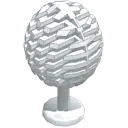{ .lu-ti width="24" loading="lazy" } [Foliate Tree, Globe (LOT 112)](../112.md) | Undefined for generic loot: reversed count range | 100% |
| 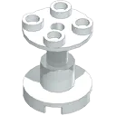{ .lu-ti width="24" loading="lazy" } [Telescope Stand 2x2x2 (LOT 344)](../344.md) | Undefined for generic loot: reversed count range | 100% |
| { .lu-ti width="24" loading="lazy" } [Antenna 4 (LOT 348)](../348.md) | Undefined for generic loot: reversed count range | 100% |
| { .lu-ti width="24" loading="lazy" } [Gate 1x4x2 with 2 Studs (LOT 357)](../357.md) | Undefined for generic loot: reversed count range | 100% |
| 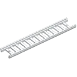{ .lu-ti width="24" loading="lazy" } [Ladder (LOT 370)](../370.md) | Undefined for generic loot: reversed count range | 100% |
| { .lu-ti width="24" loading="lazy" } [Dish 6x6 Inverted with Grid (LOT 381)](../381.md) | Undefined for generic loot: reversed count range | 100% |
| 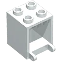{ .lu-ti width="24" loading="lazy" } [Box 2x2x2 with Hinge (LOT 383)](../383.md) | Undefined for generic loot: reversed count range | 100% |
| 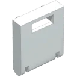{ .lu-ti width="24" loading="lazy" } [Lid for Box 2x2x2 (LOT 384)](../384.md) | Undefined for generic loot: reversed count range | 100% |
| { .lu-ti width="24" loading="lazy" } [Wooden Tub, Round 4x4 (LOT 385)](../385.md) | Undefined for generic loot: reversed count range | 100% |
| 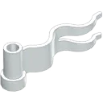{ .lu-ti width="24" loading="lazy" } [Streamer (LOT 393)](../393.md) | Undefined for generic loot: reversed count range | 100% |
| { .lu-ti width="24" loading="lazy" } [Brick 1x1 Round with Cross Flower (LOT 411)](../411.md) | Undefined for generic loot: reversed count range | 100% |
| { .lu-ti width="24" loading="lazy" } [Brick 1x1 Round with Flower (LOT 412)](../412.md) | Undefined for generic loot: reversed count range | 100% |
| 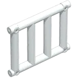{ .lu-ti width="24" loading="lazy" } [Lattice 1x4x3 (LOT 435)](../435.md) | Undefined for generic loot: reversed count range | 100% |
| 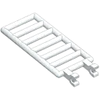{ .lu-ti width="24" loading="lazy" } [Grating 1x4x6 with 2 Horizontal Clips (LOT 436)](../436.md) | Undefined for generic loot: reversed count range | 100% |
| 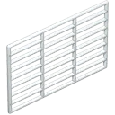{ .lu-ti width="24" loading="lazy" } [Lattice 9X13 M (LOT 444)](../444.md) | Undefined for generic loot: reversed count range | 100% |
| { .lu-ti width="24" loading="lazy" } [Bush (LOT 452)](../452.md) | Undefined for generic loot: reversed count range | 100% |
| 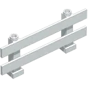{ .lu-ti width="24" loading="lazy" } [Lattice Fence 1x8x2 2/3 (LOT 459)](../459.md) | Undefined for generic loot: reversed count range | 100% |
| 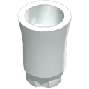{ .lu-ti width="24" loading="lazy" } [Palm Stem Element (LOT 468)](../468.md) | Undefined for generic loot: reversed count range | 100% |
| { .lu-ti width="24" loading="lazy" } [Hanger 1x6 with 4 Studs (LOT 469)](../469.md) | Undefined for generic loot: reversed count range | 100% |
| { .lu-ti width="24" loading="lazy" } [Palm Leaf (LOT 470)](../470.md) | Undefined for generic loot: reversed count range | 100% |
| { .lu-ti width="24" loading="lazy" } [Tile 1x2 with Handle 1x4x2 (LOT 479)](../479.md) | Undefined for generic loot: reversed count range | 100% |
| 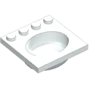{ .lu-ti width="24" loading="lazy" } [Washbowl 4x4 with 4 Studs (LOT 482)](../482.md) | Undefined for generic loot: reversed count range | 100% |
| { .lu-ti width="24" loading="lazy" } [Plant with 3 Leaves (LOT 496)](../496.md) | Undefined for generic loot: reversed count range | 100% |
| { .lu-ti width="24" loading="lazy" } [Plate 1x6 with Railing (LOT 502)](../502.md) | Undefined for generic loot: reversed count range | 100% |
| { .lu-ti width="24" loading="lazy" } [Tile 1x2 with Water Tap (LOT 504)](../504.md) | Undefined for generic loot: reversed count range | 100% |
| { .lu-ti width="24" loading="lazy" } [Tap Element 1x2 (LOT 505)](../505.md) | Undefined for generic loot: reversed count range | 100% |
| { .lu-ti width="24" loading="lazy" } [Plate 2x2 with Parabolic Ring (LOT 511)](../511.md) | Undefined for generic loot: reversed count range | 100% |
| { .lu-ti width="24" loading="lazy" } [Grating 1x4x2 with 2 Studs (LOT 516)](../516.md) | Undefined for generic loot: reversed count range | 100% |
| { .lu-ti width="24" loading="lazy" } [Grating 4x4x2 with 2 Studs 1/4-Circle (LOT 517)](../517.md) | Undefined for generic loot: reversed count range | 100% |
| { .lu-ti width="24" loading="lazy" } [Petals/Propeller with 4 Studs (LOT 520)](../520.md) | Undefined for generic loot: reversed count range | 100% |
| { .lu-ti width="24" loading="lazy" } [Sea Grass (LOT 521)](../521.md) | Undefined for generic loot: reversed count range | 100% |
| 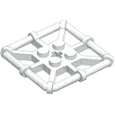{ .lu-ti width="24" loading="lazy" } [Plate 2x2 with Square Ring (LOT 522)](../522.md) | Undefined for generic loot: reversed count range | 100% |
| 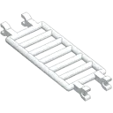{ .lu-ti width="24" loading="lazy" } [Grating 1x4x6 with 4 Horizontal Clips (LOT 523)](../523.md) | Undefined for generic loot: reversed count range | 100% |
| 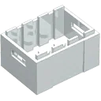{ .lu-ti width="24" loading="lazy" } [Box 3x4 (LOT 534)](../534.md) | Undefined for generic loot: reversed count range | 100% |
| 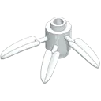{ .lu-ti width="24" loading="lazy" } [Brick 1x1 Round with 3 Bamboo Leaves (LOT 539)](../539.md) | Undefined for generic loot: reversed count range | 100% |
| { .lu-ti width="24" loading="lazy" } [Fern Leaf (LOT 548)](../548.md) | Undefined for generic loot: reversed count range | 100% |
| 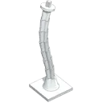{ .lu-ti width="24" loading="lazy" } [Tile 4x4 with Palm Stem (LOT 563)](../563.md) | Undefined for generic loot: reversed count range | 100% |
| { .lu-ti width="24" loading="lazy" } [Palm Leaves Quadruple (LOT 564)](../564.md) | Undefined for generic loot: reversed count range | 100% |
| { .lu-ti width="24" loading="lazy" } [Picket Fence 1x4x2 (LOT 628)](../628.md) | Undefined for generic loot: reversed count range | 100% |
| 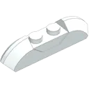{ .lu-ti width="24" loading="lazy" } [Brick 1x4 with 2 Studs and Curved Ends (LOT 633)](../633.md) | Undefined for generic loot: reversed count range | 100% |
| { .lu-ti width="24" loading="lazy" } [Parabolic Dish (LOT 768)](../768.md) | Undefined for generic loot: reversed count range | 100% |
| { .lu-ti width="24" loading="lazy" } [Lamppost 2x2x7 (LOT 784)](../784.md) | Undefined for generic loot: reversed count range | 100% |
| { .lu-ti width="24" loading="lazy" } [Plant Leaves 6x5 (LOT 802)](../802.md) | Undefined for generic loot: reversed count range | 100% |
| { .lu-ti width="24" loading="lazy" } [Plant Leaves 4x3 (LOT 806)](../806.md) | Undefined for generic loot: reversed count range | 100% |
| { .lu-ti width="24" loading="lazy" } [Small Spruce Tree (LOT 810)](../810.md) | Undefined for generic loot: reversed count range | 100% |
| 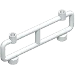{ .lu-ti width="24" loading="lazy" } [Gate 1x8x2 (LOT 828)](../828.md) | Undefined for generic loot: reversed count range | 100% |
| { .lu-ti width="24" loading="lazy" } [Barrel 2x2 (LOT 829)](../829.md) | Undefined for generic loot: reversed count range | 100% |
| { .lu-ti width="24" loading="lazy" } [Palm Leaf (LOT 830)](../830.md) | Undefined for generic loot: reversed count range | 100% |
| 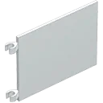{ .lu-ti width="24" loading="lazy" } [Flag 6x4 with Horizontal Clips (LOT 831)](../831.md) | Undefined for generic loot: reversed count range | 100% |
| 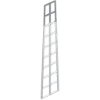{ .lu-ti width="24" loading="lazy" } [Shroud (LOT 838)](../838.md) | Undefined for generic loot: reversed count range | 100% |
| 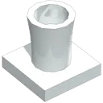{ .lu-ti width="24" loading="lazy" } [Tile 2x2 with Palm Base (LOT 841)](../841.md) | Undefined for generic loot: reversed count range | 100% |
| 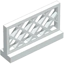{ .lu-ti width="24" loading="lazy" } [Fence 1x4x2 (LOT 879)](../879.md) | Undefined for generic loot: reversed count range | 100% |
| 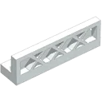{ .lu-ti width="24" loading="lazy" } [Fence 1x4x1 (LOT 912)](../912.md) | Undefined for generic loot: reversed count range | 100% |
| { .lu-ti width="24" loading="lazy" } [Flower Stems (LOT 924)](../924.md) | Undefined for generic loot: reversed count range | 100% |
| 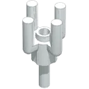{ .lu-ti width="24" loading="lazy" } [Fork Connector with 4 Tips (LOT 1213)](../1213.md) | Undefined for generic loot: reversed count range | 100% |
| 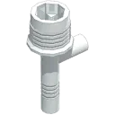{ .lu-ti width="24" loading="lazy" } [Space Blaster with Grooves (LOT 1215)](../1215.md) | Undefined for generic loot: reversed count range | 100% |
| { .lu-ti width="24" loading="lazy" } [Spruce Tree (LOT 2137)](../2137.md) | Undefined for generic loot: reversed count range | 100% |
| 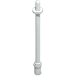{ .lu-ti width="24" loading="lazy" } [Bar 7 with Stopper and Pin on End (LOT 5066)](../5066.md) | Undefined for generic loot: reversed count range | 100% |
| 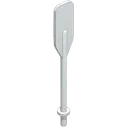{ .lu-ti width="24" loading="lazy" } [Oar (LOT 5151)](../5151.md) | Undefined for generic loot: reversed count range | 100% |
| { .lu-ti width="24" loading="lazy" } [Flame with Haft (LOT 5169)](../5169.md) | Undefined for generic loot: reversed count range | 100% |
| { .lu-ti width="24" loading="lazy" } [1x1 Round with Ice Cream (LOT 5187)](../5187.md) | Undefined for generic loot: reversed count range | 100% |
| 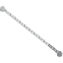{ .lu-ti width="24" loading="lazy" } [Chain 16M (LOT 5208)](../5208.md) | Undefined for generic loot: reversed count range | 100% |
| { .lu-ti width="24" loading="lazy" } [Crystal Globe (LOT 5210)](../5210.md) | Undefined for generic loot: reversed count range | 100% |
| 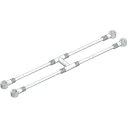{ .lu-ti width="24" loading="lazy" } [Strap 12M (LOT 5240)](../5240.md) | Undefined for generic loot: reversed count range | 100% |
| { .lu-ti width="24" loading="lazy" } [Energy Element (LOT 5244)](../5244.md) | Undefined for generic loot: reversed count range | 100% |
| { .lu-ti width="24" loading="lazy" } [Spider Web (LOT 5253)](../5253.md) | Undefined for generic loot: reversed count range | 100% |
| 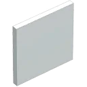{ .lu-ti width="24" loading="lazy" } [Square Sign with Vertical Clip (LOT 5255)](../5255.md) | Undefined for generic loot: reversed count range | 100% |
| { .lu-ti width="24" loading="lazy" } [Triangular Sign with Vertical Clip (LOT 5256)](../5256.md) | Undefined for generic loot: reversed count range | 100% |
| { .lu-ti width="24" loading="lazy" } [Round Sign with Clip (LOT 5257)](../5257.md) | Undefined for generic loot: reversed count range | 100% |
| { .lu-ti width="24" loading="lazy" } [Rock 4x4x1 1/3 Top Part (LOT 5263)](../5263.md) | Undefined for generic loot: reversed count range | 100% |
| { .lu-ti width="24" loading="lazy" } [Rock Crystal (LOT 5270)](../5270.md) | Undefined for generic loot: reversed count range | 100% |
| { .lu-ti width="24" loading="lazy" } [Ice Crystal (LOT 5357)](../5357.md) | Undefined for generic loot: reversed count range | 100% |
| { .lu-ti width="24" loading="lazy" } [Moulding Element with 4 Flowers (LOT 5468)](../5468.md) | Undefined for generic loot: reversed count range | 100% |
| 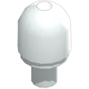{ .lu-ti width="24" loading="lazy" } [Round Cap 1x1 with Bar (LOT 5488)](../5488.md) | Undefined for generic loot: reversed count range | 100% |
| 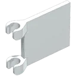{ .lu-ti width="24" loading="lazy" } [Flag 2x2 with Horizontal Clips (LOT 5552)](../5552.md) | Undefined for generic loot: reversed count range | 100% |
| 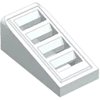{ .lu-ti width="24" loading="lazy" } [Slope 1x2x2/3 Brick with Grating (LOT 5562)](../5562.md) | Undefined for generic loot: reversed count range | 100% |
| 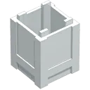{ .lu-ti width="24" loading="lazy" } [Box 2x2x2 (LOT 5571)](../5571.md) | Undefined for generic loot: reversed count range | 100% |
| 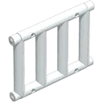{ .lu-ti width="24" loading="lazy" } [Lattice 1x4x3 (LOT 5573)](../5573.md) | Undefined for generic loot: reversed count range | 100% |
| { .lu-ti width="24" loading="lazy" } [String with End Studs 30M (LOT 5594)](../5594.md) | Undefined for generic loot: reversed count range | 100% |
| { .lu-ti width="24" loading="lazy" } [Soccer Ball (LOT 5610)](../5610.md) | Undefined for generic loot: reversed count range | 100% |
| { .lu-ti width="24" loading="lazy" } [Baroque Sign (LOT 8787)](../8787.md) | Undefined for generic loot: reversed count range | 100% |
| 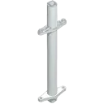{ .lu-ti width="24" loading="lazy" } [Boat Mast Extension (LOT 8804)](../8804.md) | Undefined for generic loot: reversed count range | 100% |
| 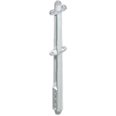{ .lu-ti width="24" loading="lazy" } [Boat Bowsprit (LOT 8805)](../8805.md) | Undefined for generic loot: reversed count range | 100% |
| 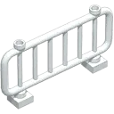{ .lu-ti width="24" loading="lazy" } [Gate 1x8x3 (LOT 8810)](../8810.md) | Undefined for generic loot: reversed count range | 100% |
| 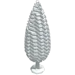{ .lu-ti width="24" loading="lazy" } [Cypress (LOT 8845)](../8845.md) | Undefined for generic loot: reversed count range | 100% |
| { .lu-ti width="24" loading="lazy" } [Sunshade (LOT 8851)](../8851.md) | Undefined for generic loot: reversed count range | 100% |
| { .lu-ti width="24" loading="lazy" } [Bush Bottom (LOT 8883)](../8883.md) | Undefined for generic loot: reversed count range | 100% |
| 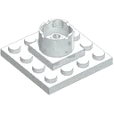{ .lu-ti width="24" loading="lazy" } [Plate 4x4 with Boat Mast Base (LOT 8884)](../8884.md) | Undefined for generic loot: reversed count range | 100% |
| 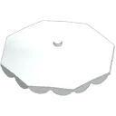{ .lu-ti width="24" loading="lazy" } [Parasol (LOT 8903)](../8903.md) | Undefined for generic loot: reversed count range | 100% |
| 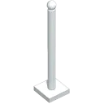{ .lu-ti width="24" loading="lazy" } [Tile 2x2 with Parasol Stand (LOT 8904)](../8904.md) | Undefined for generic loot: reversed count range | 100% |
| { .lu-ti width="24" loading="lazy" } [Bath Tub 6x12x2 1/3 (LOT 8915)](../8915.md) | Undefined for generic loot: reversed count range | 100% |
| 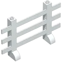{ .lu-ti width="24" loading="lazy" } [Lattice Fence 2x12x6 (LOT 8928)](../8928.md) | Undefined for generic loot: reversed count range | 100% |
| { .lu-ti width="24" loading="lazy" } [Hollow Stump (LOT 8933)](../8933.md) | Undefined for generic loot: reversed count range | 100% |
| { .lu-ti width="24" loading="lazy" } [Barrel 4x4 (LOT 8935)](../8935.md) | Undefined for generic loot: reversed count range | 100% |
| { .lu-ti width="24" loading="lazy" } [Sensor Dish with Bent Stem (LOT 8942)](../8942.md) | Undefined for generic loot: reversed count range | 100% |
| 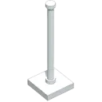{ .lu-ti width="24" loading="lazy" } [Standard with Foot 2x2x5 (LOT 8943)](../8943.md) | Undefined for generic loot: reversed count range | 100% |
| 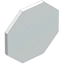{ .lu-ti width="24" loading="lazy" } [Sign Octagonal with Vertical Clip (LOT 8944)](../8944.md) | Undefined for generic loot: reversed count range | 100% |
| { .lu-ti width="24" loading="lazy" } [Rock 4x4x1 2/3 Bottom Part (LOT 8947)](../8947.md) | Undefined for generic loot: reversed count range | 100% |
| 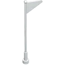{ .lu-ti width="24" loading="lazy" } [Antenna 8 with Streamer (LOT 8949)](../8949.md) | Undefined for generic loot: reversed count range | 100% |
| { .lu-ti width="24" loading="lazy" } [BIONICLE Flame (LOT 8986)](../8986.md) | Undefined for generic loot: reversed count range | 100% |
| 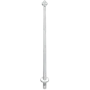{ .lu-ti width="24" loading="lazy" } [Ski Pole (LOT 8992)](../8992.md) | Undefined for generic loot: reversed count range | 100% |
| 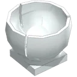{ .lu-ti width="24" loading="lazy" } [Pivot Joint Housing on 2x2-Base (LOT 9018)](../9018.md) | Undefined for generic loot: reversed count range | 100% |
| { .lu-ti width="24" loading="lazy" } [1/2 Ball 3M (LOT 9019)](../9019.md) | Undefined for generic loot: reversed count range | 100% |
| 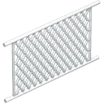{ .lu-ti width="24" loading="lazy" } [Grid 95x57 (LOT 9034)](../9034.md) | Undefined for generic loot: reversed count range | 100% |
| { .lu-ti width="24" loading="lazy" } [Ball Ø16 (LOT 9061)](../9061.md) | Undefined for generic loot: reversed count range | 100% |
| { .lu-ti width="24" loading="lazy" } [Technic Dome 7x7x5 Ø4.85 (LOT 9078)](../9078.md) | Undefined for generic loot: reversed count range | 100% |
| { .lu-ti width="24" loading="lazy" } [Spiral Tube with Flanges (LOT 9133)](../9133.md) | Undefined for generic loot: reversed count range | 100% |
| { .lu-ti width="24" loading="lazy" } [Birdcage (LOT 9175)](../9175.md) | Undefined for generic loot: reversed count range | 100% |
| { .lu-ti width="24" loading="lazy" } [Flame 7M with Shaft (LOT 9186)](../9186.md) | Undefined for generic loot: reversed count range | 100% |
| { .lu-ti width="24" loading="lazy" } [Flame 1x4 with Shaft (LOT 9239)](../9239.md) | Undefined for generic loot: reversed count range | 100% |
| { .lu-ti width="24" loading="lazy" } [Control Stick with Base (LOT 10192)](../10192.md) | Undefined for generic loot: reversed count range | 100% |
| { .lu-ti width="24" loading="lazy" } [Treasure chest 2x4 Bottom Part (LOT 10233)](../10233.md) | Undefined for generic loot: reversed count range | 100% |
| { .lu-ti width="24" loading="lazy" } [Treasure chest 2x4 Lid (LOT 10234)](../10234.md) | Undefined for generic loot: reversed count range | 100% |
| { .lu-ti width="24" loading="lazy" } [Mummy Coffin (LOT 16341)](../16341.md) | Undefined for generic loot: reversed count range | 100% |
| { .lu-ti width="24" loading="lazy" } [Mummy Coffin Lid (LOT 16342)](../16342.md) | Undefined for generic loot: reversed count range | 100% |
| { .lu-ti width="24" loading="lazy" } [Globe (LOT 16380)](../16380.md) | Undefined for generic loot: reversed count range | 100% |
| { .lu-ti width="24" loading="lazy" } [Flame (LOT 16399)](../16399.md) | Undefined for generic loot: reversed count range | 100% |
| { .lu-ti width="24" loading="lazy" } [Scarab Shield with Ø 3.2 Shaft (LOT 16465)](../16465.md) | Undefined for generic loot: reversed count range | 100% |

## Raw matrix entries

| Row | Loot table | Rarity table | Trigger | Min | Max | Flag | Gate |
| --- | --- | --- | --- | --- | --- | --- | --- |
| 1021 | 244 | 19 | 1 | 1 | 0 |  |  |

[LootMatrix](../../../db/LootMatrix.md), [LootTable](../../../db/LootTable.md), [RarityTable](../../../db/RarityTable.md).
