# Loot matrix 372

[Item database](../README.md) | [Methodology](../Methodology.md)

## Sources and mapped locations

| Kind | Source | Location evidence | Conditions |
| --- | --- | --- | --- |
| Vendor | [Ro Tundra - Brick Vendor (LOT 9705)](../sources/object-9705.md) | [Forbidden Valley (1400)](../locations/zone-1400.md) | Default inventory; vendorInvOverride can replace it |

**Generic loot probability unavailable:** at least one entry has maxToDrop < minToDrop. Vendor code treats a zero endpoint as “include the full table”; the generic loot code does not define that interpretation. No drop percentage is fabricated for this matrix.

## Item candidates

Default vendor-stock probabilities are shown only when this matrix has a registered vendor. Loot probabilities use the generic algorithm, not a guarantee of actual use by every script/activity.

| Item | Modeled loot chance / expected count | Default vendor stock |
| --- | --- | --- |
| { .lu-ti width="24" loading="lazy" } [Plate 1x4 with 2 Snaps (LOT 28)](../28.md) | Undefined for generic loot: reversed count range | 100% |
| { .lu-ti width="24" loading="lazy" } [Windscreen 2x4x2 (LOT 67)](../67.md) | Undefined for generic loot: reversed count range | 100% |
| { .lu-ti width="24" loading="lazy" } [Panel 1x2x3 (LOT 71)](../71.md) | Undefined for generic loot: reversed count range | 100% |
| 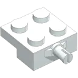{ .lu-ti width="24" loading="lazy" } [Plate 2x2 with Snap (LOT 74)](../74.md) | Undefined for generic loot: reversed count range | 100% |
| 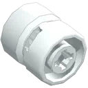{ .lu-ti width="24" loading="lazy" } [Rim Ø11 Wide (LOT 78)](../78.md) | Undefined for generic loot: reversed count range | 100% |
| 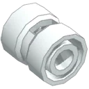{ .lu-ti width="24" loading="lazy" } [Rim Ø8 Wide (LOT 87)](../87.md) | Undefined for generic loot: reversed count range | 100% |
| { .lu-ti width="24" loading="lazy" } [Hub Ø17.6 x 14mm (LOT 91)](../91.md) | Undefined for generic loot: reversed count range | 100% |
| { .lu-ti width="24" loading="lazy" } [Tire Ø30.4 (LOT 94)](../94.md) | Undefined for generic loot: reversed count range | 100% |
| { .lu-ti width="24" loading="lazy" } [Tire Ø24 Wide (LOT 95)](../95.md) | Undefined for generic loot: reversed count range | 100% |
| { .lu-ti width="24" loading="lazy" } [Plate 2x2 with Bilateral Wheel Bearings (LOT 102)](../102.md) | Undefined for generic loot: reversed count range | 100% |
| { .lu-ti width="24" loading="lazy" } [Rim Ø18 Wide  (LOT 106)](../106.md) | Undefined for generic loot: reversed count range | 100% |
| { .lu-ti width="24" loading="lazy" } [Plate 2x2 with 2 Snaps (LOT 116)](../116.md) | Undefined for generic loot: reversed count range | 100% |
| { .lu-ti width="24" loading="lazy" } [Slope Brick 45° 2x4 Inverted Double with Cut-Out (LOT 119)](../119.md) | Undefined for generic loot: reversed count range | 100% |
| { .lu-ti width="24" loading="lazy" } [Cone 2x2x2 (LOT 345)](../345.md) | Undefined for generic loot: reversed count range | 100% |
| { .lu-ti width="24" loading="lazy" } [Cone 4x4x2 (LOT 346)](../346.md) | Undefined for generic loot: reversed count range | 100% |
| { .lu-ti width="24" loading="lazy" } [Bracket Plate 2x2 - 2x2 (LOT 347)](../347.md) | Undefined for generic loot: reversed count range | 100% |
| { .lu-ti width="24" loading="lazy" } [Tipper Body 4x6-Base (LOT 356)](../356.md) | Undefined for generic loot: reversed count range | 100% |
| { .lu-ti width="24" loading="lazy" } [Car Chassis Plate 4x10 (LOT 371)](../371.md) | Undefined for generic loot: reversed count range | 100% |
| 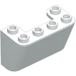{ .lu-ti width="24" loading="lazy" } [Windscreen 2x4x2 Inverted (LOT 380)](../380.md) | Undefined for generic loot: reversed count range | 100% |
| { .lu-ti width="24" loading="lazy" } [Balloon Tire Ø8/Ø21 (LOT 382)](../382.md) | Undefined for generic loot: reversed count range | 100% |
| { .lu-ti width="24" loading="lazy" } [Stanchion 2x4x5 Inclined (LOT 389)](../389.md) | Undefined for generic loot: reversed count range | 100% |
| { .lu-ti width="24" loading="lazy" } [Wagon Wheel Spoked, Large (LOT 391)](../391.md) | Undefined for generic loot: reversed count range | 100% |
| { .lu-ti width="24" loading="lazy" } [Brick 2x2x2 Round with Fins (LOT 402)](../402.md) | Undefined for generic loot: reversed count range | 100% |
| 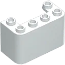{ .lu-ti width="24" loading="lazy" } [Windscreen 2x4x2 Vertical (LOT 403)](../403.md) | Undefined for generic loot: reversed count range | 100% |
| 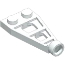{ .lu-ti width="24" loading="lazy" } [Plate 1x2 with Lattice Strut and End Tube (LOT 405)](../405.md) | Undefined for generic loot: reversed count range | 100% |
| { .lu-ti width="24" loading="lazy" } [Cockpit Bottom 6x6x1 1/3 (LOT 406)](../406.md) | Undefined for generic loot: reversed count range | 100% |
| { .lu-ti width="24" loading="lazy" } [Bracket 2x3 - 2x2 (LOT 407)](../407.md) | Undefined for generic loot: reversed count range | 100% |
| { .lu-ti width="24" loading="lazy" } [Propeller 3 Blades Ø5.5 (LOT 409)](../409.md) | Undefined for generic loot: reversed count range | 100% |
| { .lu-ti width="24" loading="lazy" } [Angle Bracket 2x8 (LOT 413)](../413.md) | Undefined for generic loot: reversed count range | 100% |
| { .lu-ti width="24" loading="lazy" } [Cone 4x4x2 Hollow (LOT 416)](../416.md) | Undefined for generic loot: reversed count range | 100% |
| { .lu-ti width="24" loading="lazy" } [Slope Brick 45° 4x4 Inverted Double with Cut-Out (LOT 420)](../420.md) | Undefined for generic loot: reversed count range | 100% |
| { .lu-ti width="24" loading="lazy" } [Wedge 4x4 Triple, Inverted (LOT 421)](../421.md) | Undefined for generic loot: reversed count range | 100% |
| { .lu-ti width="24" loading="lazy" } [Wedge 4x6 Inverted (LOT 422)](../422.md) | Undefined for generic loot: reversed count range | 100% |
| { .lu-ti width="24" loading="lazy" } [Wedge 4x4 with Cut-Out (LOT 423)](../423.md) | Undefined for generic loot: reversed count range | 100% |
| { .lu-ti width="24" loading="lazy" } [Jet Turbine with 2x2 Base (LOT 429)](../429.md) | Undefined for generic loot: reversed count range | 100% |
| { .lu-ti width="24" loading="lazy" } [Blades for Jet Turbine (LOT 430)](../430.md) | Undefined for generic loot: reversed count range | 100% |
| { .lu-ti width="24" loading="lazy" } [Plate 2x2 with Landing Gear (LOT 431)](../431.md) | Undefined for generic loot: reversed count range | 100% |
| { .lu-ti width="24" loading="lazy" } [Inverted Windscreen 3x4x4 (LOT 432)](../432.md) | Undefined for generic loot: reversed count range | 100% |
| 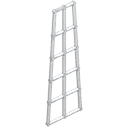{ .lu-ti width="24" loading="lazy" } [Shroud, Small (LOT 447)](../447.md) | Undefined for generic loot: reversed count range | 100% |
| 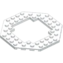{ .lu-ti width="24" loading="lazy" } [Plate 10x10 Octagonal with Cut-Out (LOT 451)](../451.md) | Undefined for generic loot: reversed count range | 100% |
| { .lu-ti width="24" loading="lazy" } [Windscreen 2x5X1 1/3 (LOT 456)](../456.md) | Undefined for generic loot: reversed count range | 100% |
| { .lu-ti width="24" loading="lazy" } [Angle Bracket 2x5x2 1/3 (LOT 460)](../460.md) | Undefined for generic loot: reversed count range | 100% |
| 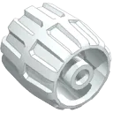{ .lu-ti width="24" loading="lazy" } [Wheel Hard-Plastic Ø24 Small (LOT 467)](../467.md) | Undefined for generic loot: reversed count range | 100% |
| { .lu-ti width="24" loading="lazy" } [Brick 4x6 Wedge with Cut-Out (LOT 472)](../472.md) | Undefined for generic loot: reversed count range | 100% |
| { .lu-ti width="24" loading="lazy" } [Plate 2x2 2/3 with 2 Snaps (LOT 473)](../473.md) | Undefined for generic loot: reversed count range | 100% |
| { .lu-ti width="24" loading="lazy" } [Cone 3x3x2 (LOT 488)](../488.md) | Undefined for generic loot: reversed count range | 100% |
| { .lu-ti width="24" loading="lazy" } [Tail Fin 2x6x4 (LOT 491)](../491.md) | Undefined for generic loot: reversed count range | 100% |
| 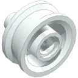{ .lu-ti width="24" loading="lazy" } [Hub Ø17mm with 4 Studs (LOT 492)](../492.md) | Undefined for generic loot: reversed count range | 100% |
| { .lu-ti width="24" loading="lazy" } [Brick 2x4 with 2 Pins (LOT 493)](../493.md) | Undefined for generic loot: reversed count range | 100% |
| { .lu-ti width="24" loading="lazy" } [Brick 2x2 with Cross Axle Hole and 2 Pins (LOT 506)](../506.md) | Undefined for generic loot: reversed count range | 100% |
| { .lu-ti width="24" loading="lazy" } [Tire Ø14.4 Smooth, Wide (LOT 509)](../509.md) | Undefined for generic loot: reversed count range | 100% |
| { .lu-ti width="24" loading="lazy" } [Radiator Grille 1x4x2 (LOT 533)](../533.md) | Undefined for generic loot: reversed count range | 100% |
| 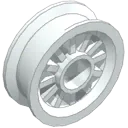{ .lu-ti width="24" loading="lazy" } [Hub with Spokes Ø17 (LOT 536)](../536.md) | Undefined for generic loot: reversed count range | 100% |
| { .lu-ti width="24" loading="lazy" } [Plate 2x4 with 2 Pins (LOT 538)](../538.md) | Undefined for generic loot: reversed count range | 100% |
| { .lu-ti width="24" loading="lazy" } [Slope Brick 45° 2x10x2 Double (LOT 540)](../540.md) | Undefined for generic loot: reversed count range | 100% |
| { .lu-ti width="24" loading="lazy" } [Motorbike Front Fork (LOT 542)](../542.md) | Undefined for generic loot: reversed count range | 100% |
| 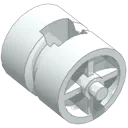{ .lu-ti width="24" loading="lazy" } [Rim for Motorcycle (LOT 543)](../543.md) | Undefined for generic loot: reversed count range | 100% |
| 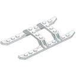{ .lu-ti width="24" loading="lazy" } [Landing Skid 12x6x1 1/3 (LOT 550)](../550.md) | Undefined for generic loot: reversed count range | 100% |
| { .lu-ti width="24" loading="lazy" } [Cockpit Glass 4x5x3 (LOT 552)](../552.md) | Undefined for generic loot: reversed count range | 100% |
| { .lu-ti width="24" loading="lazy" } [Catapult Arm 12 (LOT 554)](../554.md) | Undefined for generic loot: reversed count range | 100% |
| { .lu-ti width="24" loading="lazy" } [Catwalk 3x14x2 1/3 (LOT 557)](../557.md) | Undefined for generic loot: reversed count range | 100% |
| { .lu-ti width="24" loading="lazy" } [Tipper Bucket 8x12x3 1/3  (LOT 558)](../558.md) | Undefined for generic loot: reversed count range | 100% |
| { .lu-ti width="24" loading="lazy" } [Plate 6x6x2/3 Cross with Dome (LOT 559)](../559.md) | Undefined for generic loot: reversed count range | 100% |
| { .lu-ti width="24" loading="lazy" } [Wheel Hard-Plastic Ø43 with Treads (LOT 561)](../561.md) | Undefined for generic loot: reversed count range | 100% |
| { .lu-ti width="24" loading="lazy" } [Propeller Ø7 with 3 Blades and Pin Hole (LOT 562)](../562.md) | Undefined for generic loot: reversed count range | 100% |
| { .lu-ti width="24" loading="lazy" } [Thruster with Grill on 2x2-Tile (LOT 569)](../569.md) | Undefined for generic loot: reversed count range | 100% |
| { .lu-ti width="24" loading="lazy" } [Brick with Shaft 1x8x1 (LOT 570)](../570.md) | Undefined for generic loot: reversed count range | 100% |
| { .lu-ti width="24" loading="lazy" } [Windscreen 3x6x5 (LOT 575)](../575.md) | Undefined for generic loot: reversed count range | 100% |
| 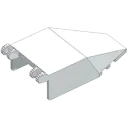{ .lu-ti width="24" loading="lazy" } [Cockpit 4x7x2 Angular with Vertical Fork (LOT 577)](../577.md) | Undefined for generic loot: reversed count range | 100% |
| { .lu-ti width="24" loading="lazy" } [Wedge 11° Double 2x16 (LOT 580)](../580.md) | Undefined for generic loot: reversed count range | 100% |
| { .lu-ti width="24" loading="lazy" } [Cockpit 19° Bowed Type 2 (LOT 582)](../582.md) | Undefined for generic loot: reversed count range | 100% |
| { .lu-ti width="24" loading="lazy" } [Shovel 4x6x2 1/3 with Vertical Fork (LOT 588)](../588.md) | Undefined for generic loot: reversed count range | 100% |
| 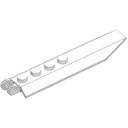{ .lu-ti width="24" loading="lazy" } [Flap 2x8 with Vertical Fork (LOT 589)](../589.md) | Undefined for generic loot: reversed count range | 100% |
| { .lu-ti width="24" loading="lazy" } [Engine Block 2x2x2 2/3 Sloped (LOT 605)](../605.md) | Undefined for generic loot: reversed count range | 100% |
| { .lu-ti width="24" loading="lazy" } [Bonnet 2x2 Curved (LOT 606)](../606.md) | Undefined for generic loot: reversed count range | 100% |
| { .lu-ti width="24" loading="lazy" } [Bonnet 2x2 Motor (LOT 607)](../607.md) | Undefined for generic loot: reversed count range | 100% |
| { .lu-ti width="24" loading="lazy" } [Rotor 4x16x1 with 2 Blades (LOT 608)](../608.md) | Undefined for generic loot: reversed count range | 100% |
| { .lu-ti width="24" loading="lazy" } [Windscreen 6x8x3 (LOT 616)](../616.md) | Undefined for generic loot: reversed count range | 100% |
| { .lu-ti width="24" loading="lazy" } [Dinghy 8x18x3 1/3 (LOT 623)](../623.md) | Undefined for generic loot: reversed count range | 100% |
| { .lu-ti width="24" loading="lazy" } [Spoked Wheel Ø43 (LOT 624)](../624.md) | Undefined for generic loot: reversed count range | 100% |
| { .lu-ti width="24" loading="lazy" } [Saw Blade, Round Ø36.7 (LOT 635)](../635.md) | Undefined for generic loot: reversed count range | 100% |
| { .lu-ti width="24" loading="lazy" } [Wedge 3x8x2 Curved Right (LOT 643)](../643.md) | Undefined for generic loot: reversed count range | 100% |
| { .lu-ti width="24" loading="lazy" } [Wedge 3x8x2 Curved Left (LOT 644)](../644.md) | Undefined for generic loot: reversed count range | 100% |
| { .lu-ti width="24" loading="lazy" } [Shell 6x8x2 (LOT 645)](../645.md) | Undefined for generic loot: reversed count range | 100% |
| 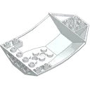{ .lu-ti width="24" loading="lazy" } [Shell 6x8x2 Inverted (LOT 646)](../646.md) | Undefined for generic loot: reversed count range | 100% |
| { .lu-ti width="24" loading="lazy" } [Plate 2x2 with Wedged Fenders (LOT 655)](../655.md) | Undefined for generic loot: reversed count range | 100% |
| { .lu-ti width="24" loading="lazy" } [Bonnet 2x2 (LOT 656)](../656.md) | Undefined for generic loot: reversed count range | 100% |
| 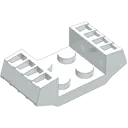{ .lu-ti width="24" loading="lazy" } [Plate 2x4 with Grille (LOT 657)](../657.md) | Undefined for generic loot: reversed count range | 100% |
| { .lu-ti width="24" loading="lazy" } [Cockpit 4x6x2 Curved (LOT 658)](../658.md) | Undefined for generic loot: reversed count range | 100% |
| 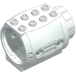{ .lu-ti width="24" loading="lazy" } [Turbine 4x5x3 with 8 Studs (LOT 661)](../661.md) | Undefined for generic loot: reversed count range | 100% |
| { .lu-ti width="24" loading="lazy" } [Turbine Wheel with Pin (LOT 662)](../662.md) | Undefined for generic loot: reversed count range | 100% |
| { .lu-ti width="24" loading="lazy" } [Wedge 4x6 Inverted (LOT 667)](../667.md) | Undefined for generic loot: reversed count range | 100% |
| { .lu-ti width="24" loading="lazy" } [Wedge Plate 4x4 with Cut-Out (LOT 668)](../668.md) | Undefined for generic loot: reversed count range | 100% |
| { .lu-ti width="24" loading="lazy" } [Tail Fin 2x3x2 (LOT 684)](../684.md) | Undefined for generic loot: reversed count range | 100% |
| { .lu-ti width="24" loading="lazy" } [Plate 1x2 with Racer Mudguards (LOT 685)](../685.md) | Undefined for generic loot: reversed count range | 100% |
| { .lu-ti width="24" loading="lazy" } [Front 2x2 with Suction Cup (LOT 686)](../686.md) | Undefined for generic loot: reversed count range | 100% |
| { .lu-ti width="24" loading="lazy" } [Banner 2x2 with Vertical Clips, Trapezoid (LOT 687)](../687.md) | Undefined for generic loot: reversed count range | 100% |
| { .lu-ti width="24" loading="lazy" } [Wedge 4x16 (LOT 689)](../689.md) | Undefined for generic loot: reversed count range | 100% |
| { .lu-ti width="24" loading="lazy" } [Cowl 4x4x2/3 (LOT 690)](../690.md) | Undefined for generic loot: reversed count range | 100% |
| { .lu-ti width="24" loading="lazy" } [Shell 6x10x2 (LOT 691)](../691.md) | Undefined for generic loot: reversed count range | 100% |
| { .lu-ti width="24" loading="lazy" } [Shell 6x10x2 Inverted (LOT 695)](../695.md) | Undefined for generic loot: reversed count range | 100% |
| { .lu-ti width="24" loading="lazy" } [Wedge Plate 6x4 with Cut-Out (LOT 696)](../696.md) | Undefined for generic loot: reversed count range | 100% |
| { .lu-ti width="24" loading="lazy" } [Shovel 4x8x2 2/3 with Vertical Fork (LOT 703)](../703.md) | Undefined for generic loot: reversed count range | 100% |
| { .lu-ti width="24" loading="lazy" } [Cone Half 8x4x6 (LOT 704)](../704.md) | Undefined for generic loot: reversed count range | 100% |
| { .lu-ti width="24" loading="lazy" } [Wedge 4x4 Curved (LOT 705)](../705.md) | Undefined for generic loot: reversed count range | 100% |
| { .lu-ti width="24" loading="lazy" } [Wedge 4x4 Triple, Open with Struts (LOT 706)](../706.md) | Undefined for generic loot: reversed count range | 100% |
| 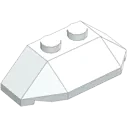{ .lu-ti width="24" loading="lazy" } [Wedge 4x2 Triple (LOT 707)](../707.md) | Undefined for generic loot: reversed count range | 100% |
| 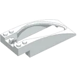{ .lu-ti width="24" loading="lazy" } [Cockpit Frame 4x10x2 with Oval Cut-Out (LOT 708)](../708.md) | Undefined for generic loot: reversed count range | 100% |
| { .lu-ti width="24" loading="lazy" } [Cockpit Oval with Vertical Fork (LOT 709)](../709.md) | Undefined for generic loot: reversed count range | 100% |
| { .lu-ti width="24" loading="lazy" } [Cockpit Bottom 4x10x2 (LOT 710)](../710.md) | Undefined for generic loot: reversed count range | 100% |
| { .lu-ti width="24" loading="lazy" } [Lattice 3x28 (LOT 714)](../714.md) | Undefined for generic loot: reversed count range | 100% |
| { .lu-ti width="24" loading="lazy" } [Boat Mast 2x2x20 (LOT 715)](../715.md) | Undefined for generic loot: reversed count range | 100% |
| { .lu-ti width="24" loading="lazy" } [Mast 2x22 with Platform 4x4 (LOT 716)](../716.md) | Undefined for generic loot: reversed count range | 100% |
| { .lu-ti width="24" loading="lazy" } [Wedge Plate 3x4 with Cut-Out (LOT 722)](../722.md) | Undefined for generic loot: reversed count range | 100% |
| { .lu-ti width="24" loading="lazy" } [Wedge 4x4 Triple (LOT 725)](../725.md) | Undefined for generic loot: reversed count range | 100% |
| { .lu-ti width="24" loading="lazy" } [Boat Bow Plate 6x7 (LOT 727)](../727.md) | Undefined for generic loot: reversed count range | 100% |
| { .lu-ti width="24" loading="lazy" } [Wedge 4x4  (LOT 730)](../730.md) | Undefined for generic loot: reversed count range | 100% |
| { .lu-ti width="24" loading="lazy" } [Brick 2x2 with Fender (LOT 731)](../731.md) | Undefined for generic loot: reversed count range | 100% |
| { .lu-ti width="24" loading="lazy" } [Dome 6x6 with Vertical Fork (LOT 732)](../732.md) | Undefined for generic loot: reversed count range | 100% |
| { .lu-ti width="24" loading="lazy" } [Motorbike Chassis (LOT 733)](../733.md) | Undefined for generic loot: reversed count range | 100% |
| { .lu-ti width="24" loading="lazy" } [BMX Bike Fairing (LOT 734)](../734.md) | Undefined for generic loot: reversed count range | 100% |
| { .lu-ti width="24" loading="lazy" } [Tire Ø20.9 (LOT 735)](../735.md) | Undefined for generic loot: reversed count range | 100% |
| { .lu-ti width="24" loading="lazy" } [Rim with Axle Ø14.58 (LOT 736)](../736.md) | Undefined for generic loot: reversed count range | 100% |
| { .lu-ti width="24" loading="lazy" } [Engine 2x2x1 1/3 with Air Intake (LOT 737)](../737.md) | Undefined for generic loot: reversed count range | 100% |
| { .lu-ti width="24" loading="lazy" } [Plate 1x2 with Radiator (LOT 738)](../738.md) | Undefined for generic loot: reversed count range | 100% |
| { .lu-ti width="24" loading="lazy" } [Tile with Cover Curved 1x4.5 (LOT 739)](../739.md) | Undefined for generic loot: reversed count range | 100% |
| { .lu-ti width="24" loading="lazy" } [Plate 1x2 with Spoiler (LOT 740)](../740.md) | Undefined for generic loot: reversed count range | 100% |
| { .lu-ti width="24" loading="lazy" } [Wedge 3x10 Curved Left (LOT 743)](../743.md) | Undefined for generic loot: reversed count range | 100% |
| 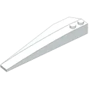{ .lu-ti width="24" loading="lazy" } [Wedge 3x10 Curved Right (LOT 744)](../744.md) | Undefined for generic loot: reversed count range | 100% |
| 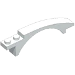{ .lu-ti width="24" loading="lazy" } [Slope Brick 1x8x1 2/3 Curved with Arch (LOT 745)](../745.md) | Undefined for generic loot: reversed count range | 100% |
| { .lu-ti width="24" loading="lazy" } [Flag 5x6 Hexagonal with Horizontal Clips (LOT 747)](../747.md) | Undefined for generic loot: reversed count range | 100% |
| { .lu-ti width="24" loading="lazy" } [Cowl 4x6x2/3 (LOT 749)](../749.md) | Undefined for generic loot: reversed count range | 100% |
| { .lu-ti width="24" loading="lazy" } [Car Chassis Plate 4x12x2/3 (LOT 751)](../751.md) | Undefined for generic loot: reversed count range | 100% |
| { .lu-ti width="24" loading="lazy" } [Slope Brick 45° 1x6 Double Inverted with Cut-Out (LOT 754)](../754.md) | Undefined for generic loot: reversed count range | 100% |
| { .lu-ti width="24" loading="lazy" } [Wheel Hard-Plastic with Spokes Ø56x22 (LOT 757)](../757.md) | Undefined for generic loot: reversed count range | 100% |
| { .lu-ti width="24" loading="lazy" } [Rim Ø18 (LOT 758)](../758.md) | Undefined for generic loot: reversed count range | 100% |
| 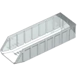{ .lu-ti width="24" loading="lazy" } [Tipper Body 8x24x5 (LOT 759)](../759.md) | Undefined for generic loot: reversed count range | 100% |
| { .lu-ti width="24" loading="lazy" } [Windscreen 4x3x1 1/3 (LOT 760)](../760.md) | Undefined for generic loot: reversed count range | 100% |
| { .lu-ti width="24" loading="lazy" } [Flap 3x12 with Vertical Fork (LOT 762)](../762.md) | Undefined for generic loot: reversed count range | 100% |
| { .lu-ti width="24" loading="lazy" } [Quarter Circle Brick with Sloped Rim 10x10 (LOT 764)](../764.md) | Undefined for generic loot: reversed count range | 100% |
| { .lu-ti width="24" loading="lazy" } [Exhaust Pipe with Pin (LOT 769)](../769.md) | Undefined for generic loot: reversed count range | 100% |
| { .lu-ti width="24" loading="lazy" } [Rubber Boat 6x10 (LOT 777)](../777.md) | Undefined for generic loot: reversed count range | 100% |
| { .lu-ti width="24" loading="lazy" } [Bay Window 3x8x6 (LOT 778)](../778.md) | Undefined for generic loot: reversed count range | 100% |
| { .lu-ti width="24" loading="lazy" } [Trike Chassis (LOT 780)](../780.md) | Undefined for generic loot: reversed count range | 100% |
| { .lu-ti width="24" loading="lazy" } [Tail Fin on Tile 1x4 (LOT 788)](../788.md) | Undefined for generic loot: reversed count range | 100% |
| { .lu-ti width="24" loading="lazy" } [Tile 2x2 Round with Hanger on Top (LOT 793)](../793.md) | Undefined for generic loot: reversed count range | 100% |
| { .lu-ti width="24" loading="lazy" } [Towing Bars with 1x2 and 2x2 Plates (LOT 795)](../795.md) | Undefined for generic loot: reversed count range | 100% |
| { .lu-ti width="24" loading="lazy" } [Plate 2x2 with Airplane Landing Gear (LOT 801)](../801.md) | Undefined for generic loot: reversed count range | 100% |
| { .lu-ti width="24" loading="lazy" } [Propeller Ø3.5 with 3 Blades (LOT 805)](../805.md) | Undefined for generic loot: reversed count range | 100% |
| { .lu-ti width="24" loading="lazy" } [Windscreen 3x4x1/3 (LOT 812)](../812.md) | Undefined for generic loot: reversed count range | 100% |
| { .lu-ti width="24" loading="lazy" } [Rowing Boat 5x14x2 1/3 (LOT 839)](../839.md) | Undefined for generic loot: reversed count range | 100% |
| 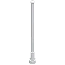{ .lu-ti width="24" loading="lazy" } [Antenna 8 (LOT 843)](../843.md) | Undefined for generic loot: reversed count range | 100% |
| { .lu-ti width="24" loading="lazy" } [Window for Ship's Bridge (LOT 851)](../851.md) | Undefined for generic loot: reversed count range | 100% |
| { .lu-ti width="24" loading="lazy" } [Plate 2x2 Round with Clips for Wheel (LOT 855)](../855.md) | Undefined for generic loot: reversed count range | 100% |
| { .lu-ti width="24" loading="lazy" } [Train Roof Front 45°/33° 6x6 with Cut-Out (LOT 862)](../862.md) | Undefined for generic loot: reversed count range | 100% |
| { .lu-ti width="24" loading="lazy" } [Tipper Bucket Front with Chute (LOT 898)](../898.md) | Undefined for generic loot: reversed count range | 100% |
| { .lu-ti width="24" loading="lazy" } [Hub Ø8mm for Fork Bearing (LOT 901)](../901.md) | Undefined for generic loot: reversed count range | 100% |
| 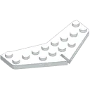{ .lu-ti width="24" loading="lazy" } [Plate 4x8 Tail Fin (LOT 903)](../903.md) | Undefined for generic loot: reversed count range | 100% |
| { .lu-ti width="24" loading="lazy" } [Plate 1x2 with Jet Engine (LOT 904)](../904.md) | Undefined for generic loot: reversed count range | 100% |
| 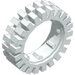{ .lu-ti width="24" loading="lazy" } [Tire Ø17 Narrow (LOT 906)](../906.md) | Undefined for generic loot: reversed count range | 100% |
| { .lu-ti width="24" loading="lazy" } [Plate 7x12 Right Wing (LOT 909)](../909.md) | Undefined for generic loot: reversed count range | 100% |
| { .lu-ti width="24" loading="lazy" } [Plate 7x12 Left Wing (LOT 910)](../910.md) | Undefined for generic loot: reversed count range | 100% |
| { .lu-ti width="24" loading="lazy" } [Tail Fin on Plate 2x3 (LOT 911)](../911.md) | Undefined for generic loot: reversed count range | 100% |
| { .lu-ti width="24" loading="lazy" } [Tire for Tractor Ø17/Ø43 (LOT 913)](../913.md) | Undefined for generic loot: reversed count range | 100% |
| { .lu-ti width="24" loading="lazy" } [Tire Ø15 Narrow (LOT 914)](../914.md) | Undefined for generic loot: reversed count range | 100% |
| { .lu-ti width="24" loading="lazy" } [Plate 2x2 with Fenders (LOT 931)](../931.md) | Undefined for generic loot: reversed count range | 100% |
| { .lu-ti width="24" loading="lazy" } [Plate 2x4 Mudguard (LOT 932)](../932.md) | Undefined for generic loot: reversed count range | 100% |
| { .lu-ti width="24" loading="lazy" } [Steering Nozzle with 2 Studs  (LOT 1200)](../1200.md) | Undefined for generic loot: reversed count range | 100% |
| { .lu-ti width="24" loading="lazy" } [Tiny Wheels with Axle (LOT 1211)](../1211.md) | Undefined for generic loot: reversed count range | 100% |
| { .lu-ti width="24" loading="lazy" } [Technic Bumper 1x4x7 (LOT 1233)](../1233.md) | Undefined for generic loot: reversed count range | 100% |
| 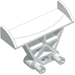{ .lu-ti width="24" loading="lazy" } [Spoiler with Framework and 2 Pins (LOT 1234)](../1234.md) | Undefined for generic loot: reversed count range | 100% |
| { .lu-ti width="24" loading="lazy" } [Technic Railing with 2 Pins (LOT 1235)](../1235.md) | Undefined for generic loot: reversed count range | 100% |
| 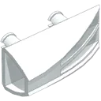{ .lu-ti width="24" loading="lazy" } [Technic Air Intake Curved with 2 Pins (LOT 1236)](../1236.md) | Undefined for generic loot: reversed count range | 100% |
| { .lu-ti width="24" loading="lazy" } [Dolly without Wheel (LOT 5036)](../5036.md) | Undefined for generic loot: reversed count range | 100% |
| { .lu-ti width="24" loading="lazy" } [Tipper Body 3x4-Base (LOT 5038)](../5038.md) | Undefined for generic loot: reversed count range | 100% |
| { .lu-ti width="24" loading="lazy" } [Middle Section Ship 8x16 (LOT 5054)](../5054.md) | Undefined for generic loot: reversed count range | 100% |
| 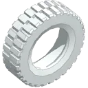{ .lu-ti width="24" loading="lazy" } [Tire Ø43.2 (LOT 5065)](../5065.md) | Undefined for generic loot: reversed count range | 100% |
| { .lu-ti width="24" loading="lazy" } [Pantograph with Vertical Fork (LOT 5071)](../5071.md) | Undefined for generic loot: reversed count range | 100% |
| 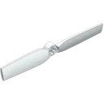{ .lu-ti width="24" loading="lazy" } [Propeller Ø9 with 2 Blades and Pin Hole (LOT 5072)](../5072.md) | Undefined for generic loot: reversed count range | 100% |
| { .lu-ti width="24" loading="lazy" } [Semi Trailer Truck Chassis 6x34 (LOT 5073)](../5073.md) | Undefined for generic loot: reversed count range | 100% |
| { .lu-ti width="24" loading="lazy" } [Train Wagon Chassis 6x28 (LOT 5113)](../5113.md) | Undefined for generic loot: reversed count range | 100% |
| { .lu-ti width="24" loading="lazy" } [Car Chassis Plate 4x5 (LOT 5114)](../5114.md) | Undefined for generic loot: reversed count range | 100% |
| 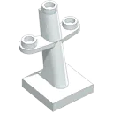{ .lu-ti width="24" loading="lazy" } [Boat Mast 2x2x3 (LOT 5115)](../5115.md) | Undefined for generic loot: reversed count range | 100% |
| 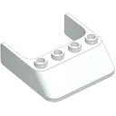{ .lu-ti width="24" loading="lazy" } [Windscreen 4x4x1 (LOT 5185)](../5185.md) | Undefined for generic loot: reversed count range | 100% |
| { .lu-ti width="24" loading="lazy" } [Train Wagon Chassis 6x24 (LOT 5192)](../5192.md) | Undefined for generic loot: reversed count range | 100% |
| { .lu-ti width="24" loading="lazy" } [Plate Wing 6x8x2/3 with Lattice (LOT 5199)](../5199.md) | Undefined for generic loot: reversed count range | 100% |
| { .lu-ti width="24" loading="lazy" } [Vehicle Cabin 4x5 with 2 seats (LOT 5221)](../5221.md) | Undefined for generic loot: reversed count range | 100% |
| { .lu-ti width="24" loading="lazy" } [Slope Brick 45° 4x6 Double Inverted (LOT 5235)](../5235.md) | Undefined for generic loot: reversed count range | 100% |
| { .lu-ti width="24" loading="lazy" } [Helicopter Chassis 4x7x3 (LOT 5254)](../5254.md) | Undefined for generic loot: reversed count range | 100% |
| { .lu-ti width="24" loading="lazy" } [Hook with Ball 1x3 (LOT 5271)](../5271.md) | Undefined for generic loot: reversed count range | 100% |
| { .lu-ti width="24" loading="lazy" } [Ball Coupling with Vertical Fork (LOT 5272)](../5272.md) | Undefined for generic loot: reversed count range | 100% |
| { .lu-ti width="24" loading="lazy" } [Sprocket Wheel Ø24 (LOT 5285)](../5285.md) | Undefined for generic loot: reversed count range | 100% |
| { .lu-ti width="24" loading="lazy" } [Bobbin (LOT 5286)](../5286.md) | Undefined for generic loot: reversed count range | 100% |
| 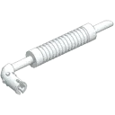{ .lu-ti width="24" loading="lazy" } [Exhaust Pipe with Grooves and Pin (LOT 5347)](../5347.md) | Undefined for generic loot: reversed count range | 100% |
| { .lu-ti width="24" loading="lazy" } [Tire Ø17.6 (LOT 5361)](../5361.md) | Undefined for generic loot: reversed count range | 100% |
| 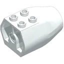{ .lu-ti width="24" loading="lazy" } [Snake Body Piece (LOT 5373)](../5373.md) | Undefined for generic loot: reversed count range | 100% |
| { .lu-ti width="24" loading="lazy" } [Tire Ø43.2 (LOT 5375)](../5375.md) | Undefined for generic loot: reversed count range | 100% |
| 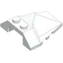{ .lu-ti width="24" loading="lazy" } [Wedge 4x4 Triple with Tip (LOT 5385)](../5385.md) | Undefined for generic loot: reversed count range | 100% |
| { .lu-ti width="24" loading="lazy" } [Tire Ø14.58 Narrow (LOT 5407)](../5407.md) | Undefined for generic loot: reversed count range | 100% |
| { .lu-ti width="24" loading="lazy" } [Brick 1x4x1 1/3 with Studs on Side (LOT 5417)](../5417.md) | Undefined for generic loot: reversed count range | 100% |
| { .lu-ti width="24" loading="lazy" } [Jet Hull Top 8x8x2 (LOT 5437)](../5437.md) | Undefined for generic loot: reversed count range | 100% |
| { .lu-ti width="24" loading="lazy" } [Airplane Door (LOT 5438)](../5438.md) | Undefined for generic loot: reversed count range | 100% |
| 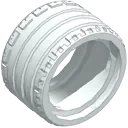{ .lu-ti width="24" loading="lazy" } [Tire Ø37 Wide (LOT 5453)](../5453.md) | Undefined for generic loot: reversed count range | 100% |
| { .lu-ti width="24" loading="lazy" } [Rim Ø18 Wide with Cross Axle Hole (LOT 5454)](../5454.md) | Undefined for generic loot: reversed count range | 100% |
| 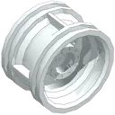{ .lu-ti width="24" loading="lazy" } [Rim 30x20 (LOT 5455)](../5455.md) | Undefined for generic loot: reversed count range | 100% |
| { .lu-ti width="24" loading="lazy" } [Balloon Tire Ø24 (LOT 5469)](../5469.md) | Undefined for generic loot: reversed count range | 100% |
| { .lu-ti width="24" loading="lazy" } [Balloon Tire Ø37 (LOT 5470)](../5470.md) | Undefined for generic loot: reversed count range | 100% |
| 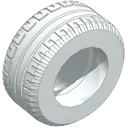{ .lu-ti width="24" loading="lazy" } [Racing Tire Ø30.4 (LOT 5486)](../5486.md) | Undefined for generic loot: reversed count range | 100% |
| { .lu-ti width="24" loading="lazy" } [Slope Brick 45° 4x6 Double Inverted with Cut-Out (LOT 5516)](../5516.md) | Undefined for generic loot: reversed count range | 100% |
| { .lu-ti width="24" loading="lazy" } [Tire Ø21, Wide (LOT 5545)](../5545.md) | Undefined for generic loot: reversed count range | 100% |
| { .lu-ti width="24" loading="lazy" } [Technic Casing with Air Intakes (LOT 5558)](../5558.md) | Undefined for generic loot: reversed count range | 100% |
| { .lu-ti width="24" loading="lazy" } [Plate 1x4x2/3 with 2 Protruding Pistons (LOT 5559)](../5559.md) | Undefined for generic loot: reversed count range | 100% |
| { .lu-ti width="24" loading="lazy" } [Brick 4x4x2 with Bow (LOT 5564)](../5564.md) | Undefined for generic loot: reversed count range | 100% |
| { .lu-ti width="24" loading="lazy" } [Spool Ø16 (LOT 5565)](../5565.md) | Undefined for generic loot: reversed count range | 100% |
| { .lu-ti width="24" loading="lazy" } [Windscreen 8x5x2 Edged (LOT 5579)](../5579.md) | Undefined for generic loot: reversed count range | 100% |
| { .lu-ti width="24" loading="lazy" } [Cockpit 6x8x4 with Vertical Fork (LOT 5580)](../5580.md) | Undefined for generic loot: reversed count range | 100% |
| { .lu-ti width="24" loading="lazy" } [Hub Cap Ø24 (LOT 5586)](../5586.md) | Undefined for generic loot: reversed count range | 100% |
| { .lu-ti width="24" loading="lazy" } [Plate 2x16 Rotor Blade (LOT 5589)](../5589.md) | Undefined for generic loot: reversed count range | 100% |
| 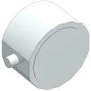{ .lu-ti width="24" loading="lazy" } [Magnet Cylindrical (LOT 5611)](../5611.md) | Undefined for generic loot: reversed count range | 100% |
| { .lu-ti width="24" loading="lazy" } [Train Bearing 3x6 (LOT 5613)](../5613.md) | Undefined for generic loot: reversed count range | 100% |
| { .lu-ti width="24" loading="lazy" } [Windscreen 4x3x3 Edged (LOT 5617)](../5617.md) | Undefined for generic loot: reversed count range | 100% |
| 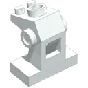{ .lu-ti width="24" loading="lazy" } [Tile 1x2 with Console (LOT 8789)](../8789.md) | Undefined for generic loot: reversed count range | 100% |
| { .lu-ti width="24" loading="lazy" } [Panel 3x6 Angled with Vertical Clips (LOT 8792)](../8792.md) | Undefined for generic loot: reversed count range | 100% |
| { .lu-ti width="24" loading="lazy" } [Car Chassis 4x7 (LOT 8793)](../8793.md) | Undefined for generic loot: reversed count range | 100% |
| { .lu-ti width="24" loading="lazy" } [Holder for Circular Brush (LOT 8799)](../8799.md) | Undefined for generic loot: reversed count range | 100% |
| { .lu-ti width="24" loading="lazy" } [Axle with Hafts (LOT 8801)](../8801.md) | Undefined for generic loot: reversed count range | 100% |
| 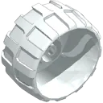{ .lu-ti width="24" loading="lazy" } [Wheel Hard-Plastic Ø56 Large (LOT 8802)](../8802.md) | Undefined for generic loot: reversed count range | 100% |
| { .lu-ti width="24" loading="lazy" } [Wheel Hard-Plastic Ø75 Giant (LOT 8808)](../8808.md) | Undefined for generic loot: reversed count range | 100% |
| { .lu-ti width="24" loading="lazy" } [Device Shield with Vertical Clips (LOT 8809)](../8809.md) | Undefined for generic loot: reversed count range | 100% |
| { .lu-ti width="24" loading="lazy" } [Wheel Hard-Plastic Medium (LOT 8811)](../8811.md) | Undefined for generic loot: reversed count range | 100% |
| { .lu-ti width="24" loading="lazy" } [Bow Plate 9x10 (LOT 8812)](../8812.md) | Undefined for generic loot: reversed count range | 100% |
| { .lu-ti width="24" loading="lazy" } [Brick Bow 8x10 (LOT 8813)](../8813.md) | Undefined for generic loot: reversed count range | 100% |
| { .lu-ti width="24" loading="lazy" } [Boat Bow 6x6 Bottom (LOT 8814)](../8814.md) | Undefined for generic loot: reversed count range | 100% |
| { .lu-ti width="24" loading="lazy" } [Technic Excavator Bucket (LOT 8825)](../8825.md) | Undefined for generic loot: reversed count range | 100% |
| { .lu-ti width="24" loading="lazy" } [Tail Fin 4x2x2 (LOT 8835)](../8835.md) | Undefined for generic loot: reversed count range | 100% |
| { .lu-ti width="24" loading="lazy" } [Mini Shield (LOT 8847)](../8847.md) | Undefined for generic loot: reversed count range | 100% |
| 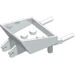{ .lu-ti width="24" loading="lazy" } [Wheelbarrow (LOT 8849)](../8849.md) | Undefined for generic loot: reversed count range | 100% |
| { .lu-ti width="24" loading="lazy" } [Train Buffer (LOT 8850)](../8850.md) | Undefined for generic loot: reversed count range | 100% |
| { .lu-ti width="24" loading="lazy" } [Thread Drum (LOT 8854)](../8854.md) | Undefined for generic loot: reversed count range | 100% |
| { .lu-ti width="24" loading="lazy" } [Thruster with Grills Below 2x2-Plate (LOT 8856)](../8856.md) | Undefined for generic loot: reversed count range | 100% |
| { .lu-ti width="24" loading="lazy" } [Tail Fin with Rocket Engine (LOT 8865)](../8865.md) | Undefined for generic loot: reversed count range | 100% |
| { .lu-ti width="24" loading="lazy" } [Plate 4x4 with Boat Mast Base (LOT 8866)](../8866.md) | Undefined for generic loot: reversed count range | 100% |
| { .lu-ti width="24" loading="lazy" } [Canoe (LOT 8868)](../8868.md) | Undefined for generic loot: reversed count range | 100% |
| { .lu-ti width="24" loading="lazy" } [Shoulder Jet Pack (LOT 8869)](../8869.md) | Undefined for generic loot: reversed count range | 100% |
| { .lu-ti width="24" loading="lazy" } [Propeller Ring-Casing with Fins (LOT 8875)](../8875.md) | Undefined for generic loot: reversed count range | 100% |
| { .lu-ti width="24" loading="lazy" } [Ship's Propeller with 3 Blades and Cross Axle Hole (LOT 8876)](../8876.md) | Undefined for generic loot: reversed count range | 100% |
| { .lu-ti width="24" loading="lazy" } [Cockpit 4x11x2 2/3 Bottom (LOT 8881)](../8881.md) | Undefined for generic loot: reversed count range | 100% |
| { .lu-ti width="24" loading="lazy" } [Windscreen 4x6x1 1/3 (LOT 8891)](../8891.md) | Undefined for generic loot: reversed count range | 100% |
| { .lu-ti width="24" loading="lazy" } [Plate Wing 16x14 (LOT 8899)](../8899.md) | Undefined for generic loot: reversed count range | 100% |
| { .lu-ti width="24" loading="lazy" } [Technic Wheel Block 4x4 (LOT 8909)](../8909.md) | Undefined for generic loot: reversed count range | 100% |
| { .lu-ti width="24" loading="lazy" } [End Piece for Lorry (LOT 8916)](../8916.md) | Undefined for generic loot: reversed count range | 100% |
| { .lu-ti width="24" loading="lazy" } [Car Chassis Plate 4x10x2/3 (LOT 8917)](../8917.md) | Undefined for generic loot: reversed count range | 100% |
| { .lu-ti width="24" loading="lazy" } [Bowsprit 11 2/3 M (LOT 8922)](../8922.md) | Undefined for generic loot: reversed count range | 100% |
| { .lu-ti width="24" loading="lazy" } [1/4-Dish 10x10 Inverted (LOT 8939)](../8939.md) | Undefined for generic loot: reversed count range | 100% |
| { .lu-ti width="24" loading="lazy" } [Flat-Bed Platform 6x12 with Vertical Fork (LOT 8945)](../8945.md) | Undefined for generic loot: reversed count range | 100% |
| { .lu-ti width="24" loading="lazy" } [1/4-Dish 10x10 Top (LOT 8948)](../8948.md) | Undefined for generic loot: reversed count range | 100% |
| { .lu-ti width="24" loading="lazy" } [Tire Ø62.4 (LOT 8957)](../8957.md) | Undefined for generic loot: reversed count range | 100% |
| 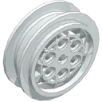{ .lu-ti width="24" loading="lazy" } [Rim Ø43.2 (LOT 8958)](../8958.md) | Undefined for generic loot: reversed count range | 100% |
| { .lu-ti width="24" loading="lazy" } [Wedge 6x8 with Cut-Out (LOT 8962)](../8962.md) | Undefined for generic loot: reversed count range | 100% |
| { .lu-ti width="24" loading="lazy" } [Windscreen 6x12x6 (LOT 9005)](../9005.md) | Undefined for generic loot: reversed count range | 100% |
| { .lu-ti width="24" loading="lazy" } [Casing 6x8x4 (LOT 9009)](../9009.md) | Undefined for generic loot: reversed count range | 100% |
| { .lu-ti width="24" loading="lazy" } [Hub Ø11.2 x 7.84mm (LOT 9010)](../9010.md) | Undefined for generic loot: reversed count range | 100% |
| { .lu-ti width="24" loading="lazy" } [Crawler Track Rubber 151mm (LOT 9014)](../9014.md) | Undefined for generic loot: reversed count range | 100% |
| { .lu-ti width="24" loading="lazy" } [Cockpit 6x4x3 with Vertical Fork (LOT 9022)](../9022.md) | Undefined for generic loot: reversed count range | 100% |
| { .lu-ti width="24" loading="lazy" } [Tank Bottom 8x6x2 (LOT 9023)](../9023.md) | Undefined for generic loot: reversed count range | 100% |
| { .lu-ti width="24" loading="lazy" } [Tank Top Part 8x6x2 (LOT 9024)](../9024.md) | Undefined for generic loot: reversed count range | 100% |
| { .lu-ti width="24" loading="lazy" } [Train Buffer with Plough (LOT 9027)](../9027.md) | Undefined for generic loot: reversed count range | 100% |
| { .lu-ti width="24" loading="lazy" } [Boat Bow 12x10 (LOT 9029)](../9029.md) | Undefined for generic loot: reversed count range | 100% |
| { .lu-ti width="24" loading="lazy" } [Boat Bow Plate 12x8 (LOT 9030)](../9030.md) | Undefined for generic loot: reversed count range | 100% |
| { .lu-ti width="24" loading="lazy" } [Sailing Ship Stern Cabin (LOT 9031)](../9031.md) | Undefined for generic loot: reversed count range | 100% |
| { .lu-ti width="24" loading="lazy" } [Bonnet 3x4x2/3 Curved with Cut-Out (LOT 9040)](../9040.md) | Undefined for generic loot: reversed count range | 100% |
| { .lu-ti width="24" loading="lazy" } [Cockpit 10x4x3 (LOT 9041)](../9041.md) | Undefined for generic loot: reversed count range | 100% |
| { .lu-ti width="24" loading="lazy" } [Car Chassis Plate 6x16x2/3 (LOT 9043)](../9043.md) | Undefined for generic loot: reversed count range | 100% |
| { .lu-ti width="24" loading="lazy" } [Viking Ship Front 16x20x8 (LOT 9045)](../9045.md) | Undefined for generic loot: reversed count range | 100% |
| { .lu-ti width="24" loading="lazy" } [Caterpillar Belt, Rubber (LOT 9050)](../9050.md) | Undefined for generic loot: reversed count range | 100% |
| 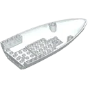{ .lu-ti width="24" loading="lazy" } [Airplane Bottom 8x16x2 (LOT 9051)](../9051.md) | Undefined for generic loot: reversed count range | 100% |
| { .lu-ti width="24" loading="lazy" } [Jet Hull Bottom 8x8x2 (LOT 9052)](../9052.md) | Undefined for generic loot: reversed count range | 100% |
| { .lu-ti width="24" loading="lazy" } [Plate Wing 54x20x2/3 (LOT 9053)](../9053.md) | Undefined for generic loot: reversed count range | 100% |
| { .lu-ti width="24" loading="lazy" } [Tail Fin 2x12x8 (LOT 9054)](../9054.md) | Undefined for generic loot: reversed count range | 100% |
| { .lu-ti width="24" loading="lazy" } [Airplane Hull 8x8x5 Top with Door (LOT 9055)](../9055.md) | Undefined for generic loot: reversed count range | 100% |
| { .lu-ti width="24" loading="lazy" } [Balloon Tire Ø94.8 (LOT 9056)](../9056.md) | Undefined for generic loot: reversed count range | 100% |
| { .lu-ti width="24" loading="lazy" } [Airplane End 8x16x7 (LOT 9059)](../9059.md) | Undefined for generic loot: reversed count range | 100% |
| { .lu-ti width="24" loading="lazy" } [Turbo Propeller (LOT 9060)](../9060.md) | Undefined for generic loot: reversed count range | 100% |
| { .lu-ti width="24" loading="lazy" } [Jet Front 8x16x5 with Cockpit (LOT 9062)](../9062.md) | Undefined for generic loot: reversed count range | 100% |
| { .lu-ti width="24" loading="lazy" } [Balloon Tire Ø56 (LOT 9064)](../9064.md) | Undefined for generic loot: reversed count range | 100% |
| { .lu-ti width="24" loading="lazy" } [Tire Ø30.4 Narrow (LOT 9066)](../9066.md) | Undefined for generic loot: reversed count range | 100% |
| { .lu-ti width="24" loading="lazy" } [Tire Ø43 Narrow (LOT 9067)](../9067.md) | Undefined for generic loot: reversed count range | 100% |
| { .lu-ti width="24" loading="lazy" } [Rim Ø30 (LOT 9068)](../9068.md) | Undefined for generic loot: reversed count range | 100% |
| { .lu-ti width="24" loading="lazy" } [Crawler Track Element 5x1 (LOT 9070)](../9070.md) | Undefined for generic loot: reversed count range | 100% |
| { .lu-ti width="24" loading="lazy" } [Cam Wheel Ø26 (LOT 9071)](../9071.md) | Undefined for generic loot: reversed count range | 100% |
| { .lu-ti width="24" loading="lazy" } [Cylinder Shell 3x6x10 Conical (LOT 9080)](../9080.md) | Undefined for generic loot: reversed count range | 100% |
| { .lu-ti width="24" loading="lazy" } [Tire Ø14 Smooth (LOT 9087)](../9087.md) | Undefined for generic loot: reversed count range | 100% |
| { .lu-ti width="24" loading="lazy" } [Technic Panel 4x7x4 Right (LOT 9100)](../9100.md) | Undefined for generic loot: reversed count range | 100% |
| { .lu-ti width="24" loading="lazy" } [Technic Panel 4x7x4 Left (LOT 9101)](../9101.md) | Undefined for generic loot: reversed count range | 100% |
| 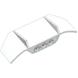{ .lu-ti width="24" loading="lazy" } [Technic Spoiler 3x11x2 (LOT 9102)](../9102.md) | Undefined for generic loot: reversed count range | 100% |
| { .lu-ti width="24" loading="lazy" } [Saw Blade, Round Ø71.32 (LOT 9105)](../9105.md) | Undefined for generic loot: reversed count range | 100% |
| 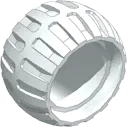{ .lu-ti width="24" loading="lazy" } [Balloon Tire Ø43 (LOT 9107)](../9107.md) | Undefined for generic loot: reversed count range | 100% |
| { .lu-ti width="24" loading="lazy" } [Bonnet 6x5x2 Curved (LOT 9109)](../9109.md) | Undefined for generic loot: reversed count range | 100% |
| 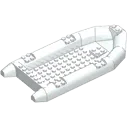{ .lu-ti width="24" loading="lazy" } [Rubber Boat 22x10x3 (LOT 9129)](../9129.md) | Undefined for generic loot: reversed count range | 100% |
| 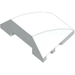{ .lu-ti width="24" loading="lazy" } [Wedge 4x3 Curved (LOT 9132)](../9132.md) | Undefined for generic loot: reversed count range | 100% |
| { .lu-ti width="24" loading="lazy" } [Technic Wheel Ø62 with Spikes (LOT 9150)](../9150.md) | Undefined for generic loot: reversed count range | 100% |
| { .lu-ti width="24" loading="lazy" } [Sprocket Wheel with Spikes Ø62 (LOT 9151)](../9151.md) | Undefined for generic loot: reversed count range | 100% |
| { .lu-ti width="24" loading="lazy" } [Conical Drill with Spikes (LOT 9152)](../9152.md) | Undefined for generic loot: reversed count range | 100% |
| { .lu-ti width="24" loading="lazy" } [Technic Wall Element 5x11 (LOT 9155)](../9155.md) | Undefined for generic loot: reversed count range | 100% |
| { .lu-ti width="24" loading="lazy" } [Wedge 4x4 Triple, Rocky (LOT 9159)](../9159.md) | Undefined for generic loot: reversed count range | 100% |
| { .lu-ti width="24" loading="lazy" } [9V Train Engine (LOT 9160)](../9160.md) | Undefined for generic loot: reversed count range | 100% |
| { .lu-ti width="24" loading="lazy" } [Caterpillar Belt Element, Rubber (LOT 9163)](../9163.md) | Undefined for generic loot: reversed count range | 100% |
| 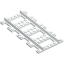{ .lu-ti width="24" loading="lazy" } [Straight Rail Metalized (LOT 9169)](../9169.md) | Undefined for generic loot: reversed count range | 100% |
| 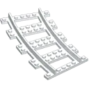{ .lu-ti width="24" loading="lazy" } [Curved Rail 22.5 Metalized (LOT 9170)](../9170.md) | Undefined for generic loot: reversed count range | 100% |
| { .lu-ti width="24" loading="lazy" } [Railroad Switch Right (LOT 9171)](../9171.md) | Undefined for generic loot: reversed count range | 100% |
| { .lu-ti width="24" loading="lazy" } [Railroad Switch Left (LOT 9172)](../9172.md) | Undefined for generic loot: reversed count range | 100% |
| { .lu-ti width="24" loading="lazy" } [Slope Brick 45° 4x10x2 Double with Windows (LOT 9173)](../9173.md) | Undefined for generic loot: reversed count range | 100% |
| { .lu-ti width="24" loading="lazy" } [Cockpit Egg-shaped with Vertical Fork Ø64x48 (LOT 9188)](../9188.md) | Undefined for generic loot: reversed count range | 100% |
| { .lu-ti width="24" loading="lazy" } [Slope Brick 1x10 Curved (LOT 9189)](../9189.md) | Undefined for generic loot: reversed count range | 100% |
| { .lu-ti width="24" loading="lazy" } [Technic Panel 3x5 Left (LOT 9196)](../9196.md) | Undefined for generic loot: reversed count range | 100% |
| { .lu-ti width="24" loading="lazy" } [Bow 6x10x1 Bottom (LOT 9205)](../9205.md) | Undefined for generic loot: reversed count range | 100% |
| { .lu-ti width="24" loading="lazy" } [Tail Fin 2x12x5 (LOT 9206)](../9206.md) | Undefined for generic loot: reversed count range | 100% |
| { .lu-ti width="24" loading="lazy" } [Airplane Hull 6x10 Front Top with Studs (LOT 9207)](../9207.md) | Undefined for generic loot: reversed count range | 100% |
| { .lu-ti width="24" loading="lazy" } [Bow 6x10x4 Base (LOT 9208)](../9208.md) | Undefined for generic loot: reversed count range | 100% |
| { .lu-ti width="24" loading="lazy" } [Key Stone 4x4 Round (LOT 9226)](../9226.md) | Undefined for generic loot: reversed count range | 100% |
| { .lu-ti width="24" loading="lazy" } [Ship's Propeller Ø6 with 7 Blades and Pin Hole (LOT 9227)](../9227.md) | Undefined for generic loot: reversed count range | 100% |
| { .lu-ti width="24" loading="lazy" } [Cockpit 6x4x2 Oval with Handle (LOT 9228)](../9228.md) | Undefined for generic loot: reversed count range | 100% |
| { .lu-ti width="24" loading="lazy" } [Motorcycle Fairing (LOT 9244)](../9244.md) | Undefined for generic loot: reversed count range | 100% |
| { .lu-ti width="24" loading="lazy" } [Cockpit 19° Bowed Type 2 (LOT 9245)](../9245.md) | Undefined for generic loot: reversed count range | 100% |
| { .lu-ti width="24" loading="lazy" } [Rim Ø56 (LOT 9247)](../9247.md) | Undefined for generic loot: reversed count range | 100% |
| { .lu-ti width="24" loading="lazy" } [Forklift with Vertical Fork (LOT 10175)](../10175.md) | Undefined for generic loot: reversed count range | 100% |
| { .lu-ti width="24" loading="lazy" } [Train Buffer 1 (LOT 10185)](../10185.md) | Undefined for generic loot: reversed count range | 100% |
| { .lu-ti width="24" loading="lazy" } [Train Buffer 2 (LOT 10186)](../10186.md) | Undefined for generic loot: reversed count range | 100% |
| { .lu-ti width="24" loading="lazy" } [Mini Bicycle (LOT 10191)](../10191.md) | Undefined for generic loot: reversed count range | 100% |
| { .lu-ti width="24" loading="lazy" } [Drum Holder 2x2 (LOT 10228)](../10228.md) | Undefined for generic loot: reversed count range | 100% |
| { .lu-ti width="24" loading="lazy" } [Drum Ø11 (LOT 10229)](../10229.md) | Undefined for generic loot: reversed count range | 100% |
| { .lu-ti width="24" loading="lazy" } [Tire Ø14 Smooth (LOT 10230)](../10230.md) | Undefined for generic loot: reversed count range | 100% |
| { .lu-ti width="24" loading="lazy" } [Cockpit Glass 6x4x2 (LOT 10253)](../10253.md) | Undefined for generic loot: reversed count range | 100% |
| { .lu-ti width="24" loading="lazy" } [Window for Plane Front 6x10x4 (LOT 10270)](../10270.md) | Undefined for generic loot: reversed count range | 100% |
| { .lu-ti width="24" loading="lazy" } [Plane Front 6x10x4 with Window (LOT 10271)](../10271.md) | Undefined for generic loot: reversed count range | 100% |
| { .lu-ti width="24" loading="lazy" } [Plate 2x4x1 1/3 with Side Bows (LOT 11134)](../11134.md) | Undefined for generic loot: reversed count range | 100% |
| { .lu-ti width="24" loading="lazy" } [Tire Ø21x12 Normal, Wide (LOT 11135)](../11135.md) | Undefined for generic loot: reversed count range | 100% |
| { .lu-ti width="24" loading="lazy" } [Wheel with Spokes Ø27.4 (LOT 16322)](../16322.md) | Undefined for generic loot: reversed count range | 100% |
| { .lu-ti width="24" loading="lazy" } [Windscreen 3x10x3 (LOT 16328)](../16328.md) | Undefined for generic loot: reversed count range | 100% |
| { .lu-ti width="24" loading="lazy" } [Wing 4x8x3 1/3 2x4 Under (LOT 16339)](../16339.md) | Undefined for generic loot: reversed count range | 100% |
| { .lu-ti width="24" loading="lazy" } [Bowed Cockpit 6x8x3 (LOT 16345)](../16345.md) | Undefined for generic loot: reversed count range | 100% |
| { .lu-ti width="24" loading="lazy" } [Cockpit 6x12x2 (LOT 16346)](../16346.md) | Undefined for generic loot: reversed count range | 100% |
| { .lu-ti width="24" loading="lazy" } [Spoked Wheel Ø56 (LOT 16355)](../16355.md) | Undefined for generic loot: reversed count range | 100% |
| { .lu-ti width="24" loading="lazy" } [Exhaust Pipe, Left (LOT 16367)](../16367.md) | Undefined for generic loot: reversed count range | 100% |
| { .lu-ti width="24" loading="lazy" } [Exhaust Pipe, Right (LOT 16368)](../16368.md) | Undefined for generic loot: reversed count range | 100% |
| { .lu-ti width="24" loading="lazy" } [Double Wing 8x8 (LOT 16389)](../16389.md) | Undefined for generic loot: reversed count range | 100% |
| { .lu-ti width="24" loading="lazy" } [Cockpit Element 4x8x3 (LOT 16390)](../16390.md) | Undefined for generic loot: reversed count range | 100% |
| { .lu-ti width="24" loading="lazy" } [Track Element, 5x1.5 (LOT 16416)](../16416.md) | Undefined for generic loot: reversed count range | 100% |
| { .lu-ti width="24" loading="lazy" } [Motorcycle Tire Ø 94.2 (LOT 16417)](../16417.md) | Undefined for generic loot: reversed count range | 100% |
| { .lu-ti width="24" loading="lazy" } [Motorcycle Rim Ø 75 (LOT 16419)](../16419.md) | Undefined for generic loot: reversed count range | 100% |
| { .lu-ti width="24" loading="lazy" } [Windscreen 6x3x2 (LOT 16438)](../16438.md) | Undefined for generic loot: reversed count range | 100% |

## Raw matrix entries

| Row | Loot table | Rarity table | Trigger | Min | Max | Flag | Gate |
| --- | --- | --- | --- | --- | --- | --- | --- |
| 1022 | 113 | 19 | 1 | 1 | 0 |  |  |

[LootMatrix](../../../db/LootMatrix.md), [LootTable](../../../db/LootTable.md), [RarityTable](../../../db/RarityTable.md).
