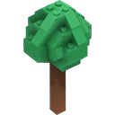

# Loot matrix 391

[Item database](../README.md) | [Methodology](../Methodology.md)

## Sources and mapped locations

| Kind | Source | Location evidence | Conditions |
| --- | --- | --- | --- |
| Package | [Basic Tree Model Pack (LOT 9775)](../sources/object-9775.md) | No matched local placement found | Static association, not a live-spawn guarantee |

## Item candidates

Default vendor-stock probabilities are shown only when this matrix has a registered vendor. Loot probabilities use the generic algorithm, not a guarantee of actual use by every script/activity.

| Item | Modeled loot chance / expected count | Default vendor stock |
| --- | --- | --- |
| { .lu-ti width="24" loading="lazy" } [Pine Tree Model 1 (LOT 9598)](../9598.md) | 100%; mean 1 | Not associated with a vendor |
| { .lu-ti width="24" loading="lazy" } [Pine Tree Model 2 (LOT 9599)](../9599.md) | 100%; mean 1 | Not associated with a vendor |
| { .lu-ti width="24" loading="lazy" } [Green Tree Model 3 (LOT 9600)](../9600.md) | 100%; mean 1 | Not associated with a vendor |
| { .lu-ti width="24" loading="lazy" } [Red Tree Model 3 (LOT 9908)](../9908.md) | 100%; mean 1 | Not associated with a vendor |
| { .lu-ti width="24" loading="lazy" } [Yellow Tree Model 3 (LOT 9909)](../9909.md) | 100%; mean 1 | Not associated with a vendor |

## Raw matrix entries

| Row | Loot table | Rarity table | Trigger | Min | Max | Flag | Gate |
| --- | --- | --- | --- | --- | --- | --- | --- |
| 1048 | 265 | 26 | 1 | 1 | 1 |  |  |
| 1049 | 266 | 26 | 1 | 1 | 1 |  |  |
| 1050 | 267 | 26 | 1 | 1 | 1 |  |  |
| 1051 | 268 | 26 | 1 | 1 | 1 |  |  |
| 1052 | 269 | 26 | 1 | 1 | 1 |  |  |

[LootMatrix](../../../db/LootMatrix.md), [LootTable](../../../db/LootTable.md), [RarityTable](../../../db/RarityTable.md).
