# Loot matrix 396

[Item database](../README.md) | [Methodology](../Methodology.md)

## Sources and mapped locations

| Kind | Source | Location evidence | Conditions |
| --- | --- | --- | --- |
| Activity | [FV - Wishing Well Fountain (LOT 9930)](../sources/object-9930.md) | [Forbidden Valley (1400)](../locations/zone-1400.md) | FV Wishing Well 5 (activity ID 9930, rating threshold 950, reward 67); Selected only if this is the highest eligible rating threshold; instance zone not specified.; Static association, not a live-spawn guarantee |

## Item candidates

Default vendor-stock probabilities are shown only when this matrix has a registered vendor. Loot probabilities use the generic algorithm, not a guarantee of actual use by every script/activity.

| Item | Modeled loot chance / expected count | Default vendor stock |
| --- | --- | --- |
| { .lu-ti width="24" loading="lazy" } [Plate 1x4 with 2 Snaps (LOT 28)](../28.md) | 0.5687191%; mean 0.0056980057 | Not associated with a vendor |
| { .lu-ti width="24" loading="lazy" } [Windscreen 2x4x2 (LOT 67)](../67.md) | 0.5687191%; mean 0.0056980057 | Not associated with a vendor |
| { .lu-ti width="24" loading="lazy" } [Panel 1x2x3 (LOT 71)](../71.md) | 0.5687191%; mean 0.0056980057 | Not associated with a vendor |
| { .lu-ti width="24" loading="lazy" } [Plate 2x2 with Snap (LOT 74)](../74.md) | 0.5687191%; mean 0.0056980057 | Not associated with a vendor |
| { .lu-ti width="24" loading="lazy" } [Rim Ø11 Wide (LOT 78)](../78.md) | 0.5687191%; mean 0.0056980057 | Not associated with a vendor |
| { .lu-ti width="24" loading="lazy" } [Rim Ø8 Wide (LOT 87)](../87.md) | 0.5687191%; mean 0.0056980057 | Not associated with a vendor |
| { .lu-ti width="24" loading="lazy" } [Hub Ø17.6 x 14mm (LOT 91)](../91.md) | 0.5687191%; mean 0.0056980057 | Not associated with a vendor |
| { .lu-ti width="24" loading="lazy" } [Tire Ø30.4 (LOT 94)](../94.md) | 0.5687191%; mean 0.0056980057 | Not associated with a vendor |
| 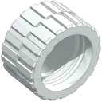{ .lu-ti width="24" loading="lazy" } [Tire Ø24 Wide (LOT 95)](../95.md) | 0.5687191%; mean 0.0056980057 | Not associated with a vendor |
| { .lu-ti width="24" loading="lazy" } [Plate 2x2 with Bilateral Wheel Bearings (LOT 102)](../102.md) | 0.5687191%; mean 0.0056980057 | Not associated with a vendor |
| { .lu-ti width="24" loading="lazy" } [Rim Ø18 Wide  (LOT 106)](../106.md) | 0.5687191%; mean 0.0056980057 | Not associated with a vendor |
| { .lu-ti width="24" loading="lazy" } [Plate 2x2 with 2 Snaps (LOT 116)](../116.md) | 0.5687191%; mean 0.0056980057 | Not associated with a vendor |
| { .lu-ti width="24" loading="lazy" } [Slope Brick 45° 2x4 Inverted Double with Cut-Out (LOT 119)](../119.md) | 0.5687191%; mean 0.0056980057 | Not associated with a vendor |
| 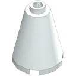{ .lu-ti width="24" loading="lazy" } [Cone 2x2x2 (LOT 345)](../345.md) | 0.5687191%; mean 0.0056980057 | Not associated with a vendor |
| { .lu-ti width="24" loading="lazy" } [Cone 4x4x2 (LOT 346)](../346.md) | 0.5687191%; mean 0.0056980057 | Not associated with a vendor |
| { .lu-ti width="24" loading="lazy" } [Bracket Plate 2x2 - 2x2 (LOT 347)](../347.md) | 0.5687191%; mean 0.0056980057 | Not associated with a vendor |
| { .lu-ti width="24" loading="lazy" } [Tipper Body 4x6-Base (LOT 356)](../356.md) | 0.5687191%; mean 0.0056980057 | Not associated with a vendor |
| { .lu-ti width="24" loading="lazy" } [Car Chassis Plate 4x10 (LOT 371)](../371.md) | 0.5687191%; mean 0.0056980057 | Not associated with a vendor |
| { .lu-ti width="24" loading="lazy" } [Windscreen 2x4x2 Inverted (LOT 380)](../380.md) | 0.5687191%; mean 0.0056980057 | Not associated with a vendor |
| { .lu-ti width="24" loading="lazy" } [Balloon Tire Ø8/Ø21 (LOT 382)](../382.md) | 0.5687191%; mean 0.0056980057 | Not associated with a vendor |
| { .lu-ti width="24" loading="lazy" } [Stanchion 2x4x5 Inclined (LOT 389)](../389.md) | 0.5687191%; mean 0.0056980057 | Not associated with a vendor |
| { .lu-ti width="24" loading="lazy" } [Wagon Wheel Spoked, Large (LOT 391)](../391.md) | 0.5687191%; mean 0.0056980057 | Not associated with a vendor |
| { .lu-ti width="24" loading="lazy" } [Brick 2x2x2 Round with Fins (LOT 402)](../402.md) | 0.5687191%; mean 0.0056980057 | Not associated with a vendor |
| { .lu-ti width="24" loading="lazy" } [Windscreen 2x4x2 Vertical (LOT 403)](../403.md) | 0.5687191%; mean 0.0056980057 | Not associated with a vendor |
| { .lu-ti width="24" loading="lazy" } [Plate 1x2 with Lattice Strut and End Tube (LOT 405)](../405.md) | 0.5687191%; mean 0.0056980057 | Not associated with a vendor |
| 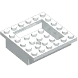{ .lu-ti width="24" loading="lazy" } [Cockpit Bottom 6x6x1 1/3 (LOT 406)](../406.md) | 0.5687191%; mean 0.0056980057 | Not associated with a vendor |
| { .lu-ti width="24" loading="lazy" } [Bracket 2x3 - 2x2 (LOT 407)](../407.md) | 0.5687191%; mean 0.0056980057 | Not associated with a vendor |
| { .lu-ti width="24" loading="lazy" } [Propeller 3 Blades Ø5.5 (LOT 409)](../409.md) | 0.5687191%; mean 0.0056980057 | Not associated with a vendor |
| { .lu-ti width="24" loading="lazy" } [Angle Bracket 2x8 (LOT 413)](../413.md) | 0.5687191%; mean 0.0056980057 | Not associated with a vendor |
| { .lu-ti width="24" loading="lazy" } [Cone 4x4x2 Hollow (LOT 416)](../416.md) | 0.5687191%; mean 0.0056980057 | Not associated with a vendor |
| 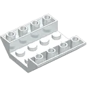{ .lu-ti width="24" loading="lazy" } [Slope Brick 45° 4x4 Inverted Double with Cut-Out (LOT 420)](../420.md) | 0.5687191%; mean 0.0056980057 | Not associated with a vendor |
| 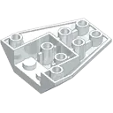{ .lu-ti width="24" loading="lazy" } [Wedge 4x4 Triple, Inverted (LOT 421)](../421.md) | 0.5687191%; mean 0.0056980057 | Not associated with a vendor |
| { .lu-ti width="24" loading="lazy" } [Wedge 4x6 Inverted (LOT 422)](../422.md) | 0.5687191%; mean 0.0056980057 | Not associated with a vendor |
| { .lu-ti width="24" loading="lazy" } [Wedge 4x4 with Cut-Out (LOT 423)](../423.md) | 0.5687191%; mean 0.0056980057 | Not associated with a vendor |
| 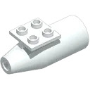{ .lu-ti width="24" loading="lazy" } [Jet Turbine with 2x2 Base (LOT 429)](../429.md) | 0.5687191%; mean 0.0056980057 | Not associated with a vendor |
| { .lu-ti width="24" loading="lazy" } [Blades for Jet Turbine (LOT 430)](../430.md) | 0.5687191%; mean 0.0056980057 | Not associated with a vendor |
| { .lu-ti width="24" loading="lazy" } [Plate 2x2 with Landing Gear (LOT 431)](../431.md) | 0.5687191%; mean 0.0056980057 | Not associated with a vendor |
| { .lu-ti width="24" loading="lazy" } [Inverted Windscreen 3x4x4 (LOT 432)](../432.md) | 0.5687191%; mean 0.0056980057 | Not associated with a vendor |
| { .lu-ti width="24" loading="lazy" } [Shroud, Small (LOT 447)](../447.md) | 0.5687191%; mean 0.0056980057 | Not associated with a vendor |
| { .lu-ti width="24" loading="lazy" } [Plate 10x10 Octagonal with Cut-Out (LOT 451)](../451.md) | 0.5687191%; mean 0.0056980057 | Not associated with a vendor |
| { .lu-ti width="24" loading="lazy" } [Windscreen 2x5X1 1/3 (LOT 456)](../456.md) | 0.5687191%; mean 0.0056980057 | Not associated with a vendor |
| { .lu-ti width="24" loading="lazy" } [Angle Bracket 2x5x2 1/3 (LOT 460)](../460.md) | 0.5687191%; mean 0.0056980057 | Not associated with a vendor |
| { .lu-ti width="24" loading="lazy" } [Wheel Hard-Plastic Ø24 Small (LOT 467)](../467.md) | 0.5687191%; mean 0.0056980057 | Not associated with a vendor |
| { .lu-ti width="24" loading="lazy" } [Brick 4x6 Wedge with Cut-Out (LOT 472)](../472.md) | 0.5687191%; mean 0.0056980057 | Not associated with a vendor |
| { .lu-ti width="24" loading="lazy" } [Plate 2x2 2/3 with 2 Snaps (LOT 473)](../473.md) | 0.5687191%; mean 0.0056980057 | Not associated with a vendor |
| { .lu-ti width="24" loading="lazy" } [Cone 3x3x2 (LOT 488)](../488.md) | 0.5687191%; mean 0.0056980057 | Not associated with a vendor |
| { .lu-ti width="24" loading="lazy" } [Tail Fin 2x6x4 (LOT 491)](../491.md) | 0.5687191%; mean 0.0056980057 | Not associated with a vendor |
| { .lu-ti width="24" loading="lazy" } [Hub Ø17mm with 4 Studs (LOT 492)](../492.md) | 0.5687191%; mean 0.0056980057 | Not associated with a vendor |
| { .lu-ti width="24" loading="lazy" } [Brick 2x4 with 2 Pins (LOT 493)](../493.md) | 0.5687191%; mean 0.0056980057 | Not associated with a vendor |
| 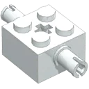{ .lu-ti width="24" loading="lazy" } [Brick 2x2 with Cross Axle Hole and 2 Pins (LOT 506)](../506.md) | 0.5687191%; mean 0.0056980057 | Not associated with a vendor |
| { .lu-ti width="24" loading="lazy" } [Tire Ø14.4 Smooth, Wide (LOT 509)](../509.md) | 0.5687191%; mean 0.0056980057 | Not associated with a vendor |
| { .lu-ti width="24" loading="lazy" } [Radiator Grille 1x4x2 (LOT 533)](../533.md) | 0.5687191%; mean 0.0056980057 | Not associated with a vendor |
| { .lu-ti width="24" loading="lazy" } [Hub with Spokes Ø17 (LOT 536)](../536.md) | 0.5687191%; mean 0.0056980057 | Not associated with a vendor |
| { .lu-ti width="24" loading="lazy" } [Plate 2x4 with 2 Pins (LOT 538)](../538.md) | 0.5687191%; mean 0.0056980057 | Not associated with a vendor |
| { .lu-ti width="24" loading="lazy" } [Slope Brick 45° 2x10x2 Double (LOT 540)](../540.md) | 0.5687191%; mean 0.0056980057 | Not associated with a vendor |
| 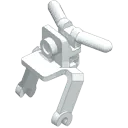{ .lu-ti width="24" loading="lazy" } [Motorbike Front Fork (LOT 542)](../542.md) | 0.5687191%; mean 0.0056980057 | Not associated with a vendor |
| { .lu-ti width="24" loading="lazy" } [Rim for Motorcycle (LOT 543)](../543.md) | 0.5687191%; mean 0.0056980057 | Not associated with a vendor |
| { .lu-ti width="24" loading="lazy" } [Landing Skid 12x6x1 1/3 (LOT 550)](../550.md) | 0.5687191%; mean 0.0056980057 | Not associated with a vendor |
| { .lu-ti width="24" loading="lazy" } [Cockpit Glass 4x5x3 (LOT 552)](../552.md) | 0.5687191%; mean 0.0056980057 | Not associated with a vendor |
| { .lu-ti width="24" loading="lazy" } [Catapult Arm 12 (LOT 554)](../554.md) | 0.5687191%; mean 0.0056980057 | Not associated with a vendor |
| 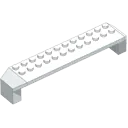{ .lu-ti width="24" loading="lazy" } [Catwalk 3x14x2 1/3 (LOT 557)](../557.md) | 0.5687191%; mean 0.0056980057 | Not associated with a vendor |
| { .lu-ti width="24" loading="lazy" } [Tipper Bucket 8x12x3 1/3  (LOT 558)](../558.md) | 0.5687191%; mean 0.0056980057 | Not associated with a vendor |
| { .lu-ti width="24" loading="lazy" } [Plate 6x6x2/3 Cross with Dome (LOT 559)](../559.md) | 0.5687191%; mean 0.0056980057 | Not associated with a vendor |
| { .lu-ti width="24" loading="lazy" } [Wheel Hard-Plastic Ø43 with Treads (LOT 561)](../561.md) | 0.5687191%; mean 0.0056980057 | Not associated with a vendor |
| { .lu-ti width="24" loading="lazy" } [Propeller Ø7 with 3 Blades and Pin Hole (LOT 562)](../562.md) | 0.5687191%; mean 0.0056980057 | Not associated with a vendor |
| { .lu-ti width="24" loading="lazy" } [Thruster with Grill on 2x2-Tile (LOT 569)](../569.md) | 0.5687191%; mean 0.0056980057 | Not associated with a vendor |
| 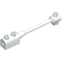{ .lu-ti width="24" loading="lazy" } [Brick with Shaft 1x8x1 (LOT 570)](../570.md) | 0.5687191%; mean 0.0056980057 | Not associated with a vendor |
| { .lu-ti width="24" loading="lazy" } [Windscreen 3x6x5 (LOT 575)](../575.md) | 0.5687191%; mean 0.0056980057 | Not associated with a vendor |
| { .lu-ti width="24" loading="lazy" } [Cockpit 4x7x2 Angular with Vertical Fork (LOT 577)](../577.md) | 0.5687191%; mean 0.0056980057 | Not associated with a vendor |
| { .lu-ti width="24" loading="lazy" } [Wedge 11° Double 2x16 (LOT 580)](../580.md) | 0.5687191%; mean 0.0056980057 | Not associated with a vendor |
| { .lu-ti width="24" loading="lazy" } [Cockpit 19° Bowed Type 2 (LOT 582)](../582.md) | 0.5687191%; mean 0.0056980057 | Not associated with a vendor |
| { .lu-ti width="24" loading="lazy" } [Shovel 4x6x2 1/3 with Vertical Fork (LOT 588)](../588.md) | 0.5687191%; mean 0.0056980057 | Not associated with a vendor |
| { .lu-ti width="24" loading="lazy" } [Flap 2x8 with Vertical Fork (LOT 589)](../589.md) | 0.5687191%; mean 0.0056980057 | Not associated with a vendor |
| { .lu-ti width="24" loading="lazy" } [Engine Block 2x2x2 2/3 Sloped (LOT 605)](../605.md) | 0.5687191%; mean 0.0056980057 | Not associated with a vendor |
| { .lu-ti width="24" loading="lazy" } [Bonnet 2x2 Curved (LOT 606)](../606.md) | 0.5687191%; mean 0.0056980057 | Not associated with a vendor |
| { .lu-ti width="24" loading="lazy" } [Bonnet 2x2 Motor (LOT 607)](../607.md) | 0.5687191%; mean 0.0056980057 | Not associated with a vendor |
| { .lu-ti width="24" loading="lazy" } [Rotor 4x16x1 with 2 Blades (LOT 608)](../608.md) | 0.5687191%; mean 0.0056980057 | Not associated with a vendor |
| { .lu-ti width="24" loading="lazy" } [Windscreen 6x8x3 (LOT 616)](../616.md) | 0.5687191%; mean 0.0056980057 | Not associated with a vendor |
| { .lu-ti width="24" loading="lazy" } [Dinghy 8x18x3 1/3 (LOT 623)](../623.md) | 0.5687191%; mean 0.0056980057 | Not associated with a vendor |
| { .lu-ti width="24" loading="lazy" } [Spoked Wheel Ø43 (LOT 624)](../624.md) | 0.5687191%; mean 0.0056980057 | Not associated with a vendor |
| { .lu-ti width="24" loading="lazy" } [Saw Blade, Round Ø36.7 (LOT 635)](../635.md) | 0.5687191%; mean 0.0056980057 | Not associated with a vendor |
| { .lu-ti width="24" loading="lazy" } [Wedge 3x8x2 Curved Right (LOT 643)](../643.md) | 0.5687191%; mean 0.0056980057 | Not associated with a vendor |
| 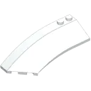{ .lu-ti width="24" loading="lazy" } [Wedge 3x8x2 Curved Left (LOT 644)](../644.md) | 0.5687191%; mean 0.0056980057 | Not associated with a vendor |
| { .lu-ti width="24" loading="lazy" } [Shell 6x8x2 (LOT 645)](../645.md) | 0.5687191%; mean 0.0056980057 | Not associated with a vendor |
| { .lu-ti width="24" loading="lazy" } [Shell 6x8x2 Inverted (LOT 646)](../646.md) | 0.5687191%; mean 0.0056980057 | Not associated with a vendor |
| { .lu-ti width="24" loading="lazy" } [Plate 2x2 with Wedged Fenders (LOT 655)](../655.md) | 0.5687191%; mean 0.0056980057 | Not associated with a vendor |
| { .lu-ti width="24" loading="lazy" } [Bonnet 2x2 (LOT 656)](../656.md) | 0.5687191%; mean 0.0056980057 | Not associated with a vendor |
| { .lu-ti width="24" loading="lazy" } [Plate 2x4 with Grille (LOT 657)](../657.md) | 0.5687191%; mean 0.0056980057 | Not associated with a vendor |
| { .lu-ti width="24" loading="lazy" } [Cockpit 4x6x2 Curved (LOT 658)](../658.md) | 0.5687191%; mean 0.0056980057 | Not associated with a vendor |
| { .lu-ti width="24" loading="lazy" } [Turbine 4x5x3 with 8 Studs (LOT 661)](../661.md) | 0.5687191%; mean 0.0056980057 | Not associated with a vendor |
| 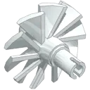{ .lu-ti width="24" loading="lazy" } [Turbine Wheel with Pin (LOT 662)](../662.md) | 0.5687191%; mean 0.0056980057 | Not associated with a vendor |
| { .lu-ti width="24" loading="lazy" } [Wedge 4x6 Inverted (LOT 667)](../667.md) | 0.5687191%; mean 0.0056980057 | Not associated with a vendor |
| { .lu-ti width="24" loading="lazy" } [Wedge Plate 4x4 with Cut-Out (LOT 668)](../668.md) | 0.5687191%; mean 0.0056980057 | Not associated with a vendor |
| { .lu-ti width="24" loading="lazy" } [Tail Fin 2x3x2 (LOT 684)](../684.md) | 0.5687191%; mean 0.0056980057 | Not associated with a vendor |
| { .lu-ti width="24" loading="lazy" } [Plate 1x2 with Racer Mudguards (LOT 685)](../685.md) | 0.5687191%; mean 0.0056980057 | Not associated with a vendor |
| { .lu-ti width="24" loading="lazy" } [Front 2x2 with Suction Cup (LOT 686)](../686.md) | 0.5687191%; mean 0.0056980057 | Not associated with a vendor |
| 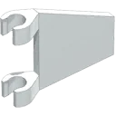{ .lu-ti width="24" loading="lazy" } [Banner 2x2 with Vertical Clips, Trapezoid (LOT 687)](../687.md) | 0.5687191%; mean 0.0056980057 | Not associated with a vendor |
| { .lu-ti width="24" loading="lazy" } [Wedge 4x16 (LOT 689)](../689.md) | 0.5687191%; mean 0.0056980057 | Not associated with a vendor |
| { .lu-ti width="24" loading="lazy" } [Cowl 4x4x2/3 (LOT 690)](../690.md) | 0.5687191%; mean 0.0056980057 | Not associated with a vendor |
| { .lu-ti width="24" loading="lazy" } [Shell 6x10x2 (LOT 691)](../691.md) | 0.5687191%; mean 0.0056980057 | Not associated with a vendor |
| 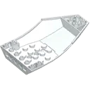{ .lu-ti width="24" loading="lazy" } [Shell 6x10x2 Inverted (LOT 695)](../695.md) | 0.5687191%; mean 0.0056980057 | Not associated with a vendor |
| { .lu-ti width="24" loading="lazy" } [Wedge Plate 6x4 with Cut-Out (LOT 696)](../696.md) | 0.5687191%; mean 0.0056980057 | Not associated with a vendor |
| { .lu-ti width="24" loading="lazy" } [Shovel 4x8x2 2/3 with Vertical Fork (LOT 703)](../703.md) | 0.5687191%; mean 0.0056980057 | Not associated with a vendor |
| 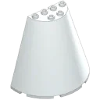{ .lu-ti width="24" loading="lazy" } [Cone Half 8x4x6 (LOT 704)](../704.md) | 0.5687191%; mean 0.0056980057 | Not associated with a vendor |
| { .lu-ti width="24" loading="lazy" } [Wedge 4x4 Curved (LOT 705)](../705.md) | 0.5687191%; mean 0.0056980057 | Not associated with a vendor |
| { .lu-ti width="24" loading="lazy" } [Wedge 4x4 Triple, Open with Struts (LOT 706)](../706.md) | 0.5687191%; mean 0.0056980057 | Not associated with a vendor |
| { .lu-ti width="24" loading="lazy" } [Wedge 4x2 Triple (LOT 707)](../707.md) | 0.5687191%; mean 0.0056980057 | Not associated with a vendor |
| { .lu-ti width="24" loading="lazy" } [Cockpit Frame 4x10x2 with Oval Cut-Out (LOT 708)](../708.md) | 0.5687191%; mean 0.0056980057 | Not associated with a vendor |
| { .lu-ti width="24" loading="lazy" } [Cockpit Oval with Vertical Fork (LOT 709)](../709.md) | 0.5687191%; mean 0.0056980057 | Not associated with a vendor |
| { .lu-ti width="24" loading="lazy" } [Cockpit Bottom 4x10x2 (LOT 710)](../710.md) | 0.5687191%; mean 0.0056980057 | Not associated with a vendor |
| 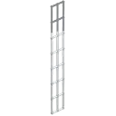{ .lu-ti width="24" loading="lazy" } [Lattice 3x28 (LOT 714)](../714.md) | 0.5687191%; mean 0.0056980057 | Not associated with a vendor |
| { .lu-ti width="24" loading="lazy" } [Boat Mast 2x2x20 (LOT 715)](../715.md) | 0.5687191%; mean 0.0056980057 | Not associated with a vendor |
| { .lu-ti width="24" loading="lazy" } [Mast 2x22 with Platform 4x4 (LOT 716)](../716.md) | 0.5687191%; mean 0.0056980057 | Not associated with a vendor |
| { .lu-ti width="24" loading="lazy" } [Wedge Plate 3x4 with Cut-Out (LOT 722)](../722.md) | 0.5687191%; mean 0.0056980057 | Not associated with a vendor |
| { .lu-ti width="24" loading="lazy" } [Bar 1.5 with Clip (LOT 724)](../724.md) | 0.65005226%; mean 0.006514658 | Not associated with a vendor |
| { .lu-ti width="24" loading="lazy" } [Wedge 4x4 Triple (LOT 725)](../725.md) | 0.5687191%; mean 0.0056980057 | Not associated with a vendor |
| { .lu-ti width="24" loading="lazy" } [Boat Bow Plate 6x7 (LOT 727)](../727.md) | 0.5687191%; mean 0.0056980057 | Not associated with a vendor |
| { .lu-ti width="24" loading="lazy" } [Wedge 4x4  (LOT 730)](../730.md) | 0.5687191%; mean 0.0056980057 | Not associated with a vendor |
| 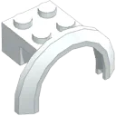{ .lu-ti width="24" loading="lazy" } [Brick 2x2 with Fender (LOT 731)](../731.md) | 0.5687191%; mean 0.0056980057 | Not associated with a vendor |
| { .lu-ti width="24" loading="lazy" } [Dome 6x6 with Vertical Fork (LOT 732)](../732.md) | 0.5687191%; mean 0.0056980057 | Not associated with a vendor |
| 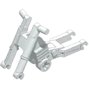{ .lu-ti width="24" loading="lazy" } [Motorbike Chassis (LOT 733)](../733.md) | 0.5687191%; mean 0.0056980057 | Not associated with a vendor |
| 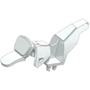{ .lu-ti width="24" loading="lazy" } [BMX Bike Fairing (LOT 734)](../734.md) | 0.5687191%; mean 0.0056980057 | Not associated with a vendor |
| { .lu-ti width="24" loading="lazy" } [Tire Ø20.9 (LOT 735)](../735.md) | 0.5687191%; mean 0.0056980057 | Not associated with a vendor |
| { .lu-ti width="24" loading="lazy" } [Rim with Axle Ø14.58 (LOT 736)](../736.md) | 0.5687191%; mean 0.0056980057 | Not associated with a vendor |
| { .lu-ti width="24" loading="lazy" } [Engine 2x2x1 1/3 with Air Intake (LOT 737)](../737.md) | 0.5687191%; mean 0.0056980057 | Not associated with a vendor |
| { .lu-ti width="24" loading="lazy" } [Plate 1x2 with Radiator (LOT 738)](../738.md) | 0.5687191%; mean 0.0056980057 | Not associated with a vendor |
| 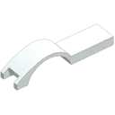{ .lu-ti width="24" loading="lazy" } [Tile with Cover Curved 1x4.5 (LOT 739)](../739.md) | 0.5687191%; mean 0.0056980057 | Not associated with a vendor |
| { .lu-ti width="24" loading="lazy" } [Plate 1x2 with Spoiler (LOT 740)](../740.md) | 0.5687191%; mean 0.0056980057 | Not associated with a vendor |
| { .lu-ti width="24" loading="lazy" } [Wedge 3x10 Curved Left (LOT 743)](../743.md) | 0.5687191%; mean 0.0056980057 | Not associated with a vendor |
| { .lu-ti width="24" loading="lazy" } [Wedge 3x10 Curved Right (LOT 744)](../744.md) | 0.5687191%; mean 0.0056980057 | Not associated with a vendor |
| { .lu-ti width="24" loading="lazy" } [Slope Brick 1x8x1 2/3 Curved with Arch (LOT 745)](../745.md) | 0.5687191%; mean 0.0056980057 | Not associated with a vendor |
| { .lu-ti width="24" loading="lazy" } [Flag 5x6 Hexagonal with Horizontal Clips (LOT 747)](../747.md) | 0.5687191%; mean 0.0056980057 | Not associated with a vendor |
| { .lu-ti width="24" loading="lazy" } [Cowl 4x6x2/3 (LOT 749)](../749.md) | 0.5687191%; mean 0.0056980057 | Not associated with a vendor |
| { .lu-ti width="24" loading="lazy" } [Car Chassis Plate 4x12x2/3 (LOT 751)](../751.md) | 0.5687191%; mean 0.0056980057 | Not associated with a vendor |
| { .lu-ti width="24" loading="lazy" } [Slope Brick 45° 1x6 Double Inverted with Cut-Out (LOT 754)](../754.md) | 0.5687191%; mean 0.0056980057 | Not associated with a vendor |
| { .lu-ti width="24" loading="lazy" } [Wheel Hard-Plastic with Spokes Ø56x22 (LOT 757)](../757.md) | 0.5687191%; mean 0.0056980057 | Not associated with a vendor |
| { .lu-ti width="24" loading="lazy" } [Rim Ø18 (LOT 758)](../758.md) | 0.5687191%; mean 0.0056980057 | Not associated with a vendor |
| { .lu-ti width="24" loading="lazy" } [Tipper Body 8x24x5 (LOT 759)](../759.md) | 0.5687191%; mean 0.0056980057 | Not associated with a vendor |
| { .lu-ti width="24" loading="lazy" } [Windscreen 4x3x1 1/3 (LOT 760)](../760.md) | 0.5687191%; mean 0.0056980057 | Not associated with a vendor |
| 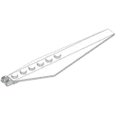{ .lu-ti width="24" loading="lazy" } [Flap 3x12 with Vertical Fork (LOT 762)](../762.md) | 0.5687191%; mean 0.0056980057 | Not associated with a vendor |
| { .lu-ti width="24" loading="lazy" } [Quarter Circle Brick with Sloped Rim 10x10 (LOT 764)](../764.md) | 0.5687191%; mean 0.0056980057 | Not associated with a vendor |
| 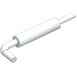{ .lu-ti width="24" loading="lazy" } [Exhaust Pipe with Pin (LOT 769)](../769.md) | 0.5687191%; mean 0.0056980057 | Not associated with a vendor |
| { .lu-ti width="24" loading="lazy" } [Rubber Boat 6x10 (LOT 777)](../777.md) | 0.5687191%; mean 0.0056980057 | Not associated with a vendor |
| 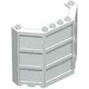{ .lu-ti width="24" loading="lazy" } [Bay Window 3x8x6 (LOT 778)](../778.md) | 0.5687191%; mean 0.0056980057 | Not associated with a vendor |
| 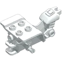{ .lu-ti width="24" loading="lazy" } [Trike Chassis (LOT 780)](../780.md) | 0.5687191%; mean 0.0056980057 | Not associated with a vendor |
| 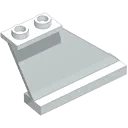{ .lu-ti width="24" loading="lazy" } [Tail Fin on Tile 1x4 (LOT 788)](../788.md) | 0.5687191%; mean 0.0056980057 | Not associated with a vendor |
| { .lu-ti width="24" loading="lazy" } [Tile 2x2 Round with Hanger on Top (LOT 793)](../793.md) | 0.5687191%; mean 0.0056980057 | Not associated with a vendor |
| { .lu-ti width="24" loading="lazy" } [Towing Bars with 1x2 and 2x2 Plates (LOT 795)](../795.md) | 0.5687191%; mean 0.0056980057 | Not associated with a vendor |
| { .lu-ti width="24" loading="lazy" } [Plate 2x2 with Airplane Landing Gear (LOT 801)](../801.md) | 0.5687191%; mean 0.0056980057 | Not associated with a vendor |
| { .lu-ti width="24" loading="lazy" } [Propeller Ø3.5 with 3 Blades (LOT 805)](../805.md) | 0.5687191%; mean 0.0056980057 | Not associated with a vendor |
| { .lu-ti width="24" loading="lazy" } [Windscreen 3x4x1/3 (LOT 812)](../812.md) | 0.5687191%; mean 0.0056980057 | Not associated with a vendor |
| { .lu-ti width="24" loading="lazy" } [Rowing Boat 5x14x2 1/3 (LOT 839)](../839.md) | 0.5687191%; mean 0.0056980057 | Not associated with a vendor |
| { .lu-ti width="24" loading="lazy" } [Antenna 8 (LOT 843)](../843.md) | 0.5687191%; mean 0.0056980057 | Not associated with a vendor |
| { .lu-ti width="24" loading="lazy" } [Window for Ship's Bridge (LOT 851)](../851.md) | 0.5687191%; mean 0.0056980057 | Not associated with a vendor |
| { .lu-ti width="24" loading="lazy" } [Plate 2x2 Round with Clips for Wheel (LOT 855)](../855.md) | 0.5687191%; mean 0.0056980057 | Not associated with a vendor |
| 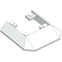{ .lu-ti width="24" loading="lazy" } [Train Roof Front 45°/33° 6x6 with Cut-Out (LOT 862)](../862.md) | 0.5687191%; mean 0.0056980057 | Not associated with a vendor |
| 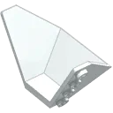{ .lu-ti width="24" loading="lazy" } [Tipper Bucket Front with Chute (LOT 898)](../898.md) | 0.5687191%; mean 0.0056980057 | Not associated with a vendor |
| { .lu-ti width="24" loading="lazy" } [Hub Ø8mm for Fork Bearing (LOT 901)](../901.md) | 0.5687191%; mean 0.0056980057 | Not associated with a vendor |
| { .lu-ti width="24" loading="lazy" } [Plate 4x8 Tail Fin (LOT 903)](../903.md) | 0.5687191%; mean 0.0056980057 | Not associated with a vendor |
| { .lu-ti width="24" loading="lazy" } [Plate 1x2 with Jet Engine (LOT 904)](../904.md) | 0.5687191%; mean 0.0056980057 | Not associated with a vendor |
| { .lu-ti width="24" loading="lazy" } [Tire Ø17 Narrow (LOT 906)](../906.md) | 0.5687191%; mean 0.0056980057 | Not associated with a vendor |
| { .lu-ti width="24" loading="lazy" } [Plate 7x12 Right Wing (LOT 909)](../909.md) | 0.5687191%; mean 0.0056980057 | Not associated with a vendor |
| { .lu-ti width="24" loading="lazy" } [Plate 7x12 Left Wing (LOT 910)](../910.md) | 0.5687191%; mean 0.0056980057 | Not associated with a vendor |
| 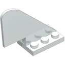{ .lu-ti width="24" loading="lazy" } [Tail Fin on Plate 2x3 (LOT 911)](../911.md) | 0.5687191%; mean 0.0056980057 | Not associated with a vendor |
| { .lu-ti width="24" loading="lazy" } [Tire for Tractor Ø17/Ø43 (LOT 913)](../913.md) | 0.5687191%; mean 0.0056980057 | Not associated with a vendor |
| { .lu-ti width="24" loading="lazy" } [Tire Ø15 Narrow (LOT 914)](../914.md) | 0.5687191%; mean 0.0056980057 | Not associated with a vendor |
| { .lu-ti width="24" loading="lazy" } [Plate 2x2 with Fenders (LOT 931)](../931.md) | 0.5687191%; mean 0.0056980057 | Not associated with a vendor |
| 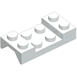{ .lu-ti width="24" loading="lazy" } [Plate 2x4 Mudguard (LOT 932)](../932.md) | 0.5687191%; mean 0.0056980057 | Not associated with a vendor |
| { .lu-ti width="24" loading="lazy" } [Steering Nozzle with 2 Studs  (LOT 1200)](../1200.md) | 0.5687191%; mean 0.0056980057 | Not associated with a vendor |
| { .lu-ti width="24" loading="lazy" } [Minifigure Head (LOT 1209)](../1209.md) | 0.65005226%; mean 0.006514658 | Not associated with a vendor |
| { .lu-ti width="24" loading="lazy" } [Bracket 1x1 with Pin Hole - 1x1 with Stud (LOT 1210)](../1210.md) | 0.65005226%; mean 0.006514658 | Not associated with a vendor |
| { .lu-ti width="24" loading="lazy" } [Tiny Wheels with Axle (LOT 1211)](../1211.md) | 0.5687191%; mean 0.0056980057 | Not associated with a vendor |
| { .lu-ti width="24" loading="lazy" } [Tool Holder (LOT 1212)](../1212.md) | 0.65005226%; mean 0.006514658 | Not associated with a vendor |
| { .lu-ti width="24" loading="lazy" } [Hand Ladle (LOT 1214)](../1214.md) | 0.65005226%; mean 0.006514658 | Not associated with a vendor |
| { .lu-ti width="24" loading="lazy" } [Megaphone (LOT 1217)](../1217.md) | 0.65005226%; mean 0.006514658 | Not associated with a vendor |
| { .lu-ti width="24" loading="lazy" } [Skid 1x4 with Stud and Clip (LOT 1219)](../1219.md) | 0.65005226%; mean 0.006514658 | Not associated with a vendor |
| { .lu-ti width="24" loading="lazy" } [Telephone Receiver (LOT 1220)](../1220.md) | 0.65005226%; mean 0.006514658 | Not associated with a vendor |
| { .lu-ti width="24" loading="lazy" } [Chalice (LOT 1222)](../1222.md) | 0.65005226%; mean 0.006514658 | Not associated with a vendor |
| { .lu-ti width="24" loading="lazy" } [Binoculars, Round (LOT 1224)](../1224.md) | 0.65005226%; mean 0.006514658 | Not associated with a vendor |
| 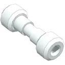{ .lu-ti width="24" loading="lazy" } [Wheel for Skate Board (LOT 1225)](../1225.md) | 0.65005226%; mean 0.006514658 | Not associated with a vendor |
| 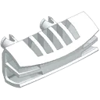{ .lu-ti width="24" loading="lazy" } [Technic Bumper 1x4x7 (LOT 1233)](../1233.md) | 0.5687191%; mean 0.0056980057 | Not associated with a vendor |
| { .lu-ti width="24" loading="lazy" } [Spoiler with Framework and 2 Pins (LOT 1234)](../1234.md) | 0.5687191%; mean 0.0056980057 | Not associated with a vendor |
| { .lu-ti width="24" loading="lazy" } [Technic Railing with 2 Pins (LOT 1235)](../1235.md) | 0.5687191%; mean 0.0056980057 | Not associated with a vendor |
| { .lu-ti width="24" loading="lazy" } [Technic Air Intake Curved with 2 Pins (LOT 1236)](../1236.md) | 0.5687191%; mean 0.0056980057 | Not associated with a vendor |
| { .lu-ti width="24" loading="lazy" } [Healing Banana (LOT 1966)](../1966.md) | 2.88461538%; mean 0.028846154 | Not associated with a vendor |
| { .lu-ti width="24" loading="lazy" } [Whip with Loop (LOT 2135)](../2135.md) | 0.65005226%; mean 0.006514658 | Not associated with a vendor |
| { .lu-ti width="24" loading="lazy" } [Notion Potion (LOT 2198)](../2198.md) | 2.88461538%; mean 0.028846154 | Not associated with a vendor |
| 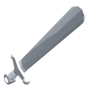{ .lu-ti width="24" loading="lazy" } [Great Longsword of Lightning (LOT 2586)](../2586.md) | 0% in the generic loot model | Not associated with a vendor |
| { .lu-ti width="24" loading="lazy" } [Quicksicle (LOT 2620)](../2620.md) | 2.88461538%; mean 0.028846154 | Not associated with a vendor |
| { .lu-ti width="24" loading="lazy" } [Throwing Star Shirt (LOT 2959)](../2959.md) | 0.45454545%; mean 0.0045454545 | Not associated with a vendor |
| { .lu-ti width="24" loading="lazy" } [Armor Polish (LOT 2993)](../2993.md) | 2.88461538%; mean 0.028846154 | Not associated with a vendor |
| { .lu-ti width="24" loading="lazy" } [Healing Cherry (LOT 2994)](../2994.md) | 2.88461538%; mean 0.028846154 | Not associated with a vendor |
| { .lu-ti width="24" loading="lazy" } [Healing Apple (LOT 2995)](../2995.md) | 2.88461538%; mean 0.028846154 | Not associated with a vendor |
| { .lu-ti width="24" loading="lazy" } [Armor Shine (LOT 2996)](../2996.md) | 2.88461538%; mean 0.028846154 | Not associated with a vendor |
| { .lu-ti width="24" loading="lazy" } [Armor Gleam (LOT 2997)](../2997.md) | 2.88461538%; mean 0.028846154 | Not associated with a vendor |
| { .lu-ti width="24" loading="lazy" } [Strong Notion Potion (LOT 2998)](../2998.md) | 2.88461538%; mean 0.028846154 | Not associated with a vendor |
| { .lu-ti width="24" loading="lazy" } [Super Notion Potion (LOT 2999)](../2999.md) | 2.88461538%; mean 0.028846154 | Not associated with a vendor |
| { .lu-ti width="24" loading="lazy" } [Blue Imaginite (LOT 3038)](../3038.md) | 2%; mean 0.02 | Not associated with a vendor |
| { .lu-ti width="24" loading="lazy" } [Green Imaginite (LOT 3039)](../3039.md) | 2.88461538%; mean 0.028846154 | Not associated with a vendor |
| { .lu-ti width="24" loading="lazy" } [Red Imaginite (LOT 3040)](../3040.md) | 3.75%; mean 0.0375 | Not associated with a vendor |
| { .lu-ti width="24" loading="lazy" } [Amber Gem (LOT 3100)](../3100.md) | 2.88461538%; mean 0.028846154 | Not associated with a vendor |
| { .lu-ti width="24" loading="lazy" } [Super Bobbejaan Spanner (LOT 3855)](../3855.md) | 0.55555556%; mean 0.0055555556 | Not associated with a vendor |
| { .lu-ti width="24" loading="lazy" } [Castle Maiden's Headdress (LOT 5032)](../5032.md) | 0.65005226%; mean 0.006514658 | Not associated with a vendor |
| 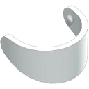{ .lu-ti width="24" loading="lazy" } [Crash Helmet Visor (LOT 5033)](../5033.md) | 0.65005226%; mean 0.006514658 | Not associated with a vendor |
| { .lu-ti width="24" loading="lazy" } [Dolly without Wheel (LOT 5036)](../5036.md) | 0.5687191%; mean 0.0056980057 | Not associated with a vendor |
| { .lu-ti width="24" loading="lazy" } [Tipper Body 3x4-Base (LOT 5038)](../5038.md) | 0.5687191%; mean 0.0056980057 | Not associated with a vendor |
| { .lu-ti width="24" loading="lazy" } [Knapsack (LOT 5039)](../5039.md) | 0.65005226%; mean 0.006514658 | Not associated with a vendor |
| { .lu-ti width="24" loading="lazy" } [Admiral's Hat (LOT 5040)](../5040.md) | 0.65005226%; mean 0.006514658 | Not associated with a vendor |
| 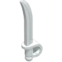{ .lu-ti width="24" loading="lazy" } [Sabre (LOT 5041)](../5041.md) | 0.65005226%; mean 0.006514658 | Not associated with a vendor |
| { .lu-ti width="24" loading="lazy" } [Paddle (LOT 5046)](../5046.md) | 0.65005226%; mean 0.006514658 | Not associated with a vendor |
| { .lu-ti width="24" loading="lazy" } [Head Scarf (LOT 5047)](../5047.md) | 0.65005226%; mean 0.006514658 | Not associated with a vendor |
| { .lu-ti width="24" loading="lazy" } [Shako (LOT 5049)](../5049.md) | 0.65005226%; mean 0.006514658 | Not associated with a vendor |
| { .lu-ti width="24" loading="lazy" } [Middle Section Ship 8x16 (LOT 5054)](../5054.md) | 0.5687191%; mean 0.0056980057 | Not associated with a vendor |
| { .lu-ti width="24" loading="lazy" } [Flintlock Rifle (LOT 5055)](../5055.md) | 0.65005226%; mean 0.006514658 | Not associated with a vendor |
| 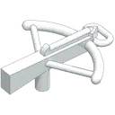{ .lu-ti width="24" loading="lazy" } [Crossbow (LOT 5056)](../5056.md) | 0.65005226%; mean 0.006514658 | Not associated with a vendor |
| { .lu-ti width="24" loading="lazy" } [Oval Battle Shield (LOT 5058)](../5058.md) | 0.65005226%; mean 0.006514658 | Not associated with a vendor |
| { .lu-ti width="24" loading="lazy" } [Knight Armor with Skirt (LOT 5059)](../5059.md) | 0.65005226%; mean 0.006514658 | Not associated with a vendor |
| { .lu-ti width="24" loading="lazy" } [Ghost Costume (LOT 5060)](../5060.md) | 0.65005226%; mean 0.006514658 | Not associated with a vendor |
| 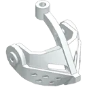{ .lu-ti width="24" loading="lazy" } [Visor for Knight's Helmet (LOT 5061)](../5061.md) | 0.65005226%; mean 0.006514658 | Not associated with a vendor |
| { .lu-ti width="24" loading="lazy" } [Life Vest (LOT 5062)](../5062.md) | 0.65005226%; mean 0.006514658 | Not associated with a vendor |
| 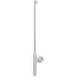{ .lu-ti width="24" loading="lazy" } [Fishing Rod (LOT 5063)](../5063.md) | 0.65005226%; mean 0.006514658 | Not associated with a vendor |
| { .lu-ti width="24" loading="lazy" } [Tire Ø43.2 (LOT 5065)](../5065.md) | 0.5687191%; mean 0.0056980057 | Not associated with a vendor |
| { .lu-ti width="24" loading="lazy" } [Pantograph with Vertical Fork (LOT 5071)](../5071.md) | 0.5687191%; mean 0.0056980057 | Not associated with a vendor |
| { .lu-ti width="24" loading="lazy" } [Propeller Ø9 with 2 Blades and Pin Hole (LOT 5072)](../5072.md) | 0.5687191%; mean 0.0056980057 | Not associated with a vendor |
| { .lu-ti width="24" loading="lazy" } [Semi Trailer Truck Chassis 6x34 (LOT 5073)](../5073.md) | 0.5687191%; mean 0.0056980057 | Not associated with a vendor |
| { .lu-ti width="24" loading="lazy" } [Peaked Cap (LOT 5079)](../5079.md) | 0.65005226%; mean 0.006514658 | Not associated with a vendor |
| { .lu-ti width="24" loading="lazy" } [Construction Worker's Helmet (LOT 5089)](../5089.md) | 0.65005226%; mean 0.006514658 | Not associated with a vendor |
| { .lu-ti width="24" loading="lazy" } [Firefighter's Helmet (LOT 5090)](../5090.md) | 0.65005226%; mean 0.006514658 | Not associated with a vendor |
| { .lu-ti width="24" loading="lazy" } [Firefighter's Axe (LOT 5091)](../5091.md) | 0.65005226%; mean 0.006514658 | Not associated with a vendor |
| 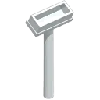{ .lu-ti width="24" loading="lazy" } [Push Broom (LOT 5092)](../5092.md) | 0.65005226%; mean 0.006514658 | Not associated with a vendor |
| { .lu-ti width="24" loading="lazy" } [Shovel (LOT 5093)](../5093.md) | 0.65005226%; mean 0.006514658 | Not associated with a vendor |
| { .lu-ti width="24" loading="lazy" } [Oxygen Bottles (LOT 5094)](../5094.md) | 0.65005226%; mean 0.006514658 | Not associated with a vendor |
| { .lu-ti width="24" loading="lazy" } [Vest (LOT 5095)](../5095.md) | 0.65005226%; mean 0.006514658 | Not associated with a vendor |
| { .lu-ti width="24" loading="lazy" } [PickAxe (LOT 5096)](../5096.md) | 0.65005226%; mean 0.006514658 | Not associated with a vendor |
| { .lu-ti width="24" loading="lazy" } [Great Helm with Neck Protection (LOT 5097)](../5097.md) | 0.65005226%; mean 0.006514658 | Not associated with a vendor |
| { .lu-ti width="24" loading="lazy" } [Knight Shield Triangular (LOT 5098)](../5098.md) | 0.65005226%; mean 0.006514658 | Not associated with a vendor |
| { .lu-ti width="24" loading="lazy" } [Shortsword (LOT 5099)](../5099.md) | 0.65005226%; mean 0.006514658 | Not associated with a vendor |
| { .lu-ti width="24" loading="lazy" } [Battle Axe (LOT 5100)](../5100.md) | 0.65005226%; mean 0.006514658 | Not associated with a vendor |
| { .lu-ti width="24" loading="lazy" } [Knight Jousting Lance (LOT 5101)](../5101.md) | 0.65005226%; mean 0.006514658 | Not associated with a vendor |
| { .lu-ti width="24" loading="lazy" } [Hair Brush (LOT 5102)](../5102.md) | 0.65005226%; mean 0.006514658 | Not associated with a vendor |
| { .lu-ti width="24" loading="lazy" } [Baker's Hat (LOT 5106)](../5106.md) | 0.65005226%; mean 0.006514658 | Not associated with a vendor |
| { .lu-ti width="24" loading="lazy" } [Mug with Holder (LOT 5107)](../5107.md) | 0.65005226%; mean 0.006514658 | Not associated with a vendor |
| { .lu-ti width="24" loading="lazy" } [Wig, Boy (LOT 5108)](../5108.md) | 0.65005226%; mean 0.006514658 | Not associated with a vendor |
| { .lu-ti width="24" loading="lazy" } [Handheld Radio (LOT 5109)](../5109.md) | 0.65005226%; mean 0.006514658 | Not associated with a vendor |
| { .lu-ti width="24" loading="lazy" } [Screwdriver/Wrench (LOT 5110)](../5110.md) | 0.65005226%; mean 0.006514658 | Not associated with a vendor |
| { .lu-ti width="24" loading="lazy" } [Train Wagon Chassis 6x28 (LOT 5113)](../5113.md) | 0.5687191%; mean 0.0056980057 | Not associated with a vendor |
| { .lu-ti width="24" loading="lazy" } [Car Chassis Plate 4x5 (LOT 5114)](../5114.md) | 0.5687191%; mean 0.0056980057 | Not associated with a vendor |
| { .lu-ti width="24" loading="lazy" } [Boat Mast 2x2x3 (LOT 5115)](../5115.md) | 0.5687191%; mean 0.0056980057 | Not associated with a vendor |
| { .lu-ti width="24" loading="lazy" } [Pipe Wrench (LOT 5116)](../5116.md) | 0.65005226%; mean 0.006514658 | Not associated with a vendor |
| { .lu-ti width="24" loading="lazy" } [Broom (LOT 5117)](../5117.md) | 0.65005226%; mean 0.006514658 | Not associated with a vendor |
| { .lu-ti width="24" loading="lazy" } [Ladle (LOT 5118)](../5118.md) | 0.65005226%; mean 0.006514658 | Not associated with a vendor |
| { .lu-ti width="24" loading="lazy" } [Pot with Handles (LOT 5119)](../5119.md) | 0.65005226%; mean 0.006514658 | Not associated with a vendor |
| { .lu-ti width="24" loading="lazy" } [Loaf of Bread (LOT 5120)](../5120.md) | 0.65005226%; mean 0.006514658 | Not associated with a vendor |
| { .lu-ti width="24" loading="lazy" } [Space Gun (LOT 5123)](../5123.md) | 0.65005226%; mean 0.006514658 | Not associated with a vendor |
| { .lu-ti width="24" loading="lazy" } [Pitcher (LOT 5124)](../5124.md) | 0.65005226%; mean 0.006514658 | Not associated with a vendor |
| 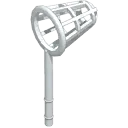{ .lu-ti width="24" loading="lazy" } [Butterfly Net (LOT 5125)](../5125.md) | 0.65005226%; mean 0.006514658 | Not associated with a vendor |
| { .lu-ti width="24" loading="lazy" } [Large Axe (LOT 5126)](../5126.md) | 0.65005226%; mean 0.006514658 | Not associated with a vendor |
| { .lu-ti width="24" loading="lazy" } [Suitcase (LOT 5128)](../5128.md) | 0.65005226%; mean 0.006514658 | Not associated with a vendor |
| { .lu-ti width="24" loading="lazy" } [Metal Detector (LOT 5129)](../5129.md) | 0.65005226%; mean 0.006514658 | Not associated with a vendor |
| { .lu-ti width="24" loading="lazy" } [Horse Saddle (LOT 5130)](../5130.md) | 0.65005226%; mean 0.006514658 | Not associated with a vendor |
| { .lu-ti width="24" loading="lazy" } [Spear (LOT 5133)](../5133.md) | 0.65005226%; mean 0.006514658 | Not associated with a vendor |
| { .lu-ti width="24" loading="lazy" } [Quiver (LOT 5134)](../5134.md) | 0.65005226%; mean 0.006514658 | Not associated with a vendor |
| { .lu-ti width="24" loading="lazy" } [Bow (LOT 5135)](../5135.md) | 0.65005226%; mean 0.006514658 | Not associated with a vendor |
| { .lu-ti width="24" loading="lazy" } [Knight Tournament Helmet (LOT 5136)](../5136.md) | 0.65005226%; mean 0.006514658 | Not associated with a vendor |
| { .lu-ti width="24" loading="lazy" } [Sledgehammer (LOT 5138)](../5138.md) | 0.65005226%; mean 0.006514658 | Not associated with a vendor |
| { .lu-ti width="24" loading="lazy" } [Pannier (LOT 5139)](../5139.md) | 0.65005226%; mean 0.006514658 | Not associated with a vendor |
| { .lu-ti width="24" loading="lazy" } [Pan (LOT 5140)](../5140.md) | 0.65005226%; mean 0.006514658 | Not associated with a vendor |
| { .lu-ti width="24" loading="lazy" } [Pot with Handle (LOT 5141)](../5141.md) | 0.65005226%; mean 0.006514658 | Not associated with a vendor |
| { .lu-ti width="24" loading="lazy" } [Wig with Wavy Hair (LOT 5142)](../5142.md) | 0.65005226%; mean 0.006514658 | Not associated with a vendor |
| { .lu-ti width="24" loading="lazy" } [Stretcher 2x6 (LOT 5145)](../5145.md) | 0.65005226%; mean 0.006514658 | Not associated with a vendor |
| 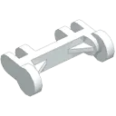{ .lu-ti width="24" loading="lazy" } [Underframe for Stretcher (LOT 5146)](../5146.md) | 0.65005226%; mean 0.006514658 | Not associated with a vendor |
| { .lu-ti width="24" loading="lazy" } [Jetpack with Studs (LOT 5150)](../5150.md) | 0.65005226%; mean 0.006514658 | Not associated with a vendor |
| { .lu-ti width="24" loading="lazy" } [Surfboard 10M (LOT 5156)](../5156.md) | 0.65005226%; mean 0.006514658 | Not associated with a vendor |
| { .lu-ti width="24" loading="lazy" } [Frogman Visor (LOT 5161)](../5161.md) | 0.65005226%; mean 0.006514658 | Not associated with a vendor |
| { .lu-ti width="24" loading="lazy" } [Wig Ponytail (LOT 5162)](../5162.md) | 0.65005226%; mean 0.006514658 | Not associated with a vendor |
| { .lu-ti width="24" loading="lazy" } [Ice Saw (LOT 5164)](../5164.md) | 0.65005226%; mean 0.006514658 | Not associated with a vendor |
| { .lu-ti width="24" loading="lazy" } [Halberd (LOT 5166)](../5166.md) | 0.65005226%; mean 0.006514658 | Not associated with a vendor |
| { .lu-ti width="24" loading="lazy" } [Magic Wand (LOT 5167)](../5167.md) | 0.65005226%; mean 0.006514658 | Not associated with a vendor |
| { .lu-ti width="24" loading="lazy" } [Horse Dragon Mask with Clip (LOT 5168)](../5168.md) | 0.65005226%; mean 0.006514658 | Not associated with a vendor |
| { .lu-ti width="24" loading="lazy" } [Magic Hat (LOT 5173)](../5173.md) | 0.65005226%; mean 0.006514658 | Not associated with a vendor |
| { .lu-ti width="24" loading="lazy" } [Santa Beard (LOT 5174)](../5174.md) | 0.65005226%; mean 0.006514658 | Not associated with a vendor |
| { .lu-ti width="24" loading="lazy" } [Fireman Breathing Mask (LOT 5175)](../5175.md) | 0.65005226%; mean 0.006514658 | Not associated with a vendor |
| { .lu-ti width="24" loading="lazy" } [Feeding Bottle (LOT 5181)](../5181.md) | 0.65005226%; mean 0.006514658 | Not associated with a vendor |
| { .lu-ti width="24" loading="lazy" } [Windscreen 4x4x1 (LOT 5185)](../5185.md) | 0.5687191%; mean 0.0056980057 | Not associated with a vendor |
| { .lu-ti width="24" loading="lazy" } [Dish Ø24 (LOT 5188)](../5188.md) | 0.65005226%; mean 0.006514658 | Not associated with a vendor |
| 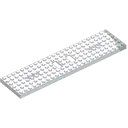{ .lu-ti width="24" loading="lazy" } [Train Wagon Chassis 6x24 (LOT 5192)](../5192.md) | 0.5687191%; mean 0.0056980057 | Not associated with a vendor |
| { .lu-ti width="24" loading="lazy" } [Cherry (LOT 5195)](../5195.md) | 0.65005226%; mean 0.006514658 | Not associated with a vendor |
| { .lu-ti width="24" loading="lazy" } [Astronaut Visor (LOT 5196)](../5196.md) | 0.65005226%; mean 0.006514658 | Not associated with a vendor |
| 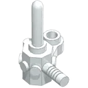{ .lu-ti width="24" loading="lazy" } [Hand-Held Scanner (LOT 5198)](../5198.md) | 0.65005226%; mean 0.006514658 | Not associated with a vendor |
| { .lu-ti width="24" loading="lazy" } [Plate Wing 6x8x2/3 with Lattice (LOT 5199)](../5199.md) | 0.5687191%; mean 0.0056980057 | Not associated with a vendor |
| { .lu-ti width="24" loading="lazy" } [Morion Helmet (LOT 5201)](../5201.md) | 0.65005226%; mean 0.006514658 | Not associated with a vendor |
| { .lu-ti width="24" loading="lazy" } [Harpoon 5M (LOT 5203)](../5203.md) | 0.65005226%; mean 0.006514658 | Not associated with a vendor |
| { .lu-ti width="24" loading="lazy" } [Camera (LOT 5204)](../5204.md) | 0.65005226%; mean 0.006514658 | Not associated with a vendor |
| { .lu-ti width="24" loading="lazy" } [Diver's Mask (LOT 5205)](../5205.md) | 0.65005226%; mean 0.006514658 | Not associated with a vendor |
| { .lu-ti width="24" loading="lazy" } [Oxygen Bottle with Tube (LOT 5206)](../5206.md) | 0.65005226%; mean 0.006514658 | Not associated with a vendor |
| { .lu-ti width="24" loading="lazy" } [Bat Helmet (LOT 5209)](../5209.md) | 0.65005226%; mean 0.006514658 | Not associated with a vendor |
| { .lu-ti width="24" loading="lazy" } [Alien Breastplate (LOT 5212)](../5212.md) | 0.65005226%; mean 0.006514658 | Not associated with a vendor |
| { .lu-ti width="24" loading="lazy" } [Indian Feather with Bolt (LOT 5213)](../5213.md) | 0.65005226%; mean 0.006514658 | Not associated with a vendor |
| { .lu-ti width="24" loading="lazy" } [Indian Feather with Clip (LOT 5214)](../5214.md) | 0.65005226%; mean 0.006514658 | Not associated with a vendor |
| 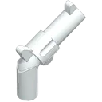{ .lu-ti width="24" loading="lazy" } [Revolver (LOT 5215)](../5215.md) | 0.65005226%; mean 0.006514658 | Not associated with a vendor |
| { .lu-ti width="24" loading="lazy" } [Neck Scarf (LOT 5216)](../5216.md) | 0.65005226%; mean 0.006514658 | Not associated with a vendor |
| { .lu-ti width="24" loading="lazy" } [Officer's Cap (LOT 5217)](../5217.md) | 0.65005226%; mean 0.006514658 | Not associated with a vendor |
| { .lu-ti width="24" loading="lazy" } [Rifle (LOT 5218)](../5218.md) | 0.65005226%; mean 0.006514658 | Not associated with a vendor |
| { .lu-ti width="24" loading="lazy" } [Movie Camera (LOT 5220)](../5220.md) | 0.65005226%; mean 0.006514658 | Not associated with a vendor |
| { .lu-ti width="24" loading="lazy" } [Vehicle Cabin 4x5 with 2 seats (LOT 5221)](../5221.md) | 0.5687191%; mean 0.0056980057 | Not associated with a vendor |
| { .lu-ti width="24" loading="lazy" } [Magnifying Glass (LOT 5222)](../5222.md) | 0.65005226%; mean 0.006514658 | Not associated with a vendor |
| { .lu-ti width="24" loading="lazy" } [Diamond with Stick (LOT 5223)](../5223.md) | 0.65005226%; mean 0.006514658 | Not associated with a vendor |
| { .lu-ti width="24" loading="lazy" } [Sextant (LOT 5224)](../5224.md) | 0.65005226%; mean 0.006514658 | Not associated with a vendor |
| { .lu-ti width="24" loading="lazy" } [Rucksack, Opening (LOT 5225)](../5225.md) | 0.65005226%; mean 0.006514658 | Not associated with a vendor |
| { .lu-ti width="24" loading="lazy" } [Safari Hat (LOT 5226)](../5226.md) | 0.65005226%; mean 0.006514658 | Not associated with a vendor |
| { .lu-ti width="24" loading="lazy" } [Pharaoh's Headdress (LOT 5227)](../5227.md) | 0.65005226%; mean 0.006514658 | Not associated with a vendor |
| { .lu-ti width="24" loading="lazy" } [Flying Goggles (LOT 5229)](../5229.md) | 0.65005226%; mean 0.006514658 | Not associated with a vendor |
| { .lu-ti width="24" loading="lazy" } [Flying Helmet (LOT 5230)](../5230.md) | 0.65005226%; mean 0.006514658 | Not associated with a vendor |
| { .lu-ti width="24" loading="lazy" } [Safari Helmet (LOT 5231)](../5231.md) | 0.65005226%; mean 0.006514658 | Not associated with a vendor |
| { .lu-ti width="24" loading="lazy" } [Ninja Sword (LOT 5232)](../5232.md) | 0.65005226%; mean 0.006514658 | Not associated with a vendor |
| { .lu-ti width="24" loading="lazy" } [Samurai Armor (LOT 5233)](../5233.md) | 0.65005226%; mean 0.006514658 | Not associated with a vendor |
| { .lu-ti width="24" loading="lazy" } [Slope Brick 45° 4x6 Double Inverted (LOT 5235)](../5235.md) | 0.5687191%; mean 0.0056980057 | Not associated with a vendor |
| { .lu-ti width="24" loading="lazy" } [Grappling Hook (LOT 5241)](../5241.md) | 0.65005226%; mean 0.006514658 | Not associated with a vendor |
| { .lu-ti width="24" loading="lazy" } [Ice Axe (LOT 5242)](../5242.md) | 0.65005226%; mean 0.006514658 | Not associated with a vendor |
| { .lu-ti width="24" loading="lazy" } [Circular Saw (LOT 5243)](../5243.md) | 0.65005226%; mean 0.006514658 | Not associated with a vendor |
| { .lu-ti width="24" loading="lazy" } [Insectoid Helmet (LOT 5245)](../5245.md) | 0.65005226%; mean 0.006514658 | Not associated with a vendor |
| { .lu-ti width="24" loading="lazy" } [Shell (LOT 5246)](../5246.md) | 0.65005226%; mean 0.006514658 | Not associated with a vendor |
| { .lu-ti width="24" loading="lazy" } [Popsicle (LOT 5247)](../5247.md) | 0.65005226%; mean 0.006514658 | Not associated with a vendor |
| { .lu-ti width="24" loading="lazy" } [Pneumatic Hammer (LOT 5250)](../5250.md) | 0.65005226%; mean 0.006514658 | Not associated with a vendor |
| { .lu-ti width="24" loading="lazy" } [Slider Roller with Handle (LOT 5251)](../5251.md) | 0.65005226%; mean 0.006514658 | Not associated with a vendor |
| { .lu-ti width="24" loading="lazy" } [Helicopter Chassis 4x7x3 (LOT 5254)](../5254.md) | 0.5687191%; mean 0.0056980057 | Not associated with a vendor |
| { .lu-ti width="24" loading="lazy" } [Knight's Helmet with Brim (LOT 5258)](../5258.md) | 0.65005226%; mean 0.006514658 | Not associated with a vendor |
| { .lu-ti width="24" loading="lazy" } [Inca Helmet (LOT 5260)](../5260.md) | 0.65005226%; mean 0.006514658 | Not associated with a vendor |
| { .lu-ti width="24" loading="lazy" } [Snowshoe (LOT 5261)](../5261.md) | 0.65005226%; mean 0.006514658 | Not associated with a vendor |
| { .lu-ti width="24" loading="lazy" } [Polar Hood with Fur Lining (LOT 5262)](../5262.md) | 0.65005226%; mean 0.006514658 | Not associated with a vendor |
| { .lu-ti width="24" loading="lazy" } [Binoculars, High-tech (LOT 5264)](../5264.md) | 0.65005226%; mean 0.006514658 | Not associated with a vendor |
| { .lu-ti width="24" loading="lazy" } [Polar Rucksack (LOT 5265)](../5265.md) | 0.65005226%; mean 0.006514658 | Not associated with a vendor |
| { .lu-ti width="24" loading="lazy" } [Space Helmet without Chin Strap (LOT 5266)](../5266.md) | 0.65005226%; mean 0.006514658 | Not associated with a vendor |
| { .lu-ti width="24" loading="lazy" } [Lifering with Stud (LOT 5267)](../5267.md) | 0.65005226%; mean 0.006514658 | Not associated with a vendor |
| { .lu-ti width="24" loading="lazy" } [Hood (LOT 5269)](../5269.md) | 0.65005226%; mean 0.006514658 | Not associated with a vendor |
| { .lu-ti width="24" loading="lazy" } [Hook with Ball 1x3 (LOT 5271)](../5271.md) | 0.5687191%; mean 0.0056980057 | Not associated with a vendor |
| 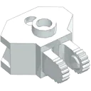{ .lu-ti width="24" loading="lazy" } [Ball Coupling with Vertical Fork (LOT 5272)](../5272.md) | 0.5687191%; mean 0.0056980057 | Not associated with a vendor |
| { .lu-ti width="24" loading="lazy" } [Wig with Multiple Braids (LOT 5276)](../5276.md) | 0.65005226%; mean 0.006514658 | Not associated with a vendor |
| { .lu-ti width="24" loading="lazy" } [Wig, Crew Cut (LOT 5282)](../5282.md) | 0.65005226%; mean 0.006514658 | Not associated with a vendor |
| 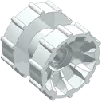{ .lu-ti width="24" loading="lazy" } [Sprocket Wheel Ø24 (LOT 5285)](../5285.md) | 0.5687191%; mean 0.0056980057 | Not associated with a vendor |
| { .lu-ti width="24" loading="lazy" } [Bobbin (LOT 5286)](../5286.md) | 0.5687191%; mean 0.0056980057 | Not associated with a vendor |
| { .lu-ti width="24" loading="lazy" } [Book (LOT 5311)](../5311.md) | 0.65005226%; mean 0.006514658 | Not associated with a vendor |
| { .lu-ti width="24" loading="lazy" } [Apple with Leaf (LOT 5312)](../5312.md) | 0.65005226%; mean 0.006514658 | Not associated with a vendor |
| { .lu-ti width="24" loading="lazy" } [Pot with Handle (LOT 5313)](../5313.md) | 0.65005226%; mean 0.006514658 | Not associated with a vendor |
| { .lu-ti width="24" loading="lazy" } [Turkey Drumstick (LOT 5314)](../5314.md) | 0.65005226%; mean 0.006514658 | Not associated with a vendor |
| { .lu-ti width="24" loading="lazy" } [Glass (LOT 5315)](../5315.md) | 0.65005226%; mean 0.006514658 | Not associated with a vendor |
| { .lu-ti width="24" loading="lazy" } [Sausage (LOT 5316)](../5316.md) | 0.65005226%; mean 0.006514658 | Not associated with a vendor |
| { .lu-ti width="24" loading="lazy" } [Banana (LOT 5317)](../5317.md) | 0.65005226%; mean 0.006514658 | Not associated with a vendor |
| { .lu-ti width="24" loading="lazy" } [Ice-Cream Cone (LOT 5318)](../5318.md) | 0.65005226%; mean 0.006514658 | Not associated with a vendor |
| { .lu-ti width="24" loading="lazy" } [Croissant (LOT 5321)](../5321.md) | 0.65005226%; mean 0.006514658 | Not associated with a vendor |
| { .lu-ti width="24" loading="lazy" } [Comb (LOT 5322)](../5322.md) | 0.65005226%; mean 0.006514658 | Not associated with a vendor |
| { .lu-ti width="24" loading="lazy" } [Carrot (LOT 5323)](../5323.md) | 0.65005226%; mean 0.006514658 | Not associated with a vendor |
| { .lu-ti width="24" loading="lazy" } [Rosette with Ribbon (LOT 5324)](../5324.md) | 0.65005226%; mean 0.006514658 | Not associated with a vendor |
| { .lu-ti width="24" loading="lazy" } [Celery (LOT 5325)](../5325.md) | 0.65005226%; mean 0.006514658 | Not associated with a vendor |
| { .lu-ti width="24" loading="lazy" } [Turban (LOT 5329)](../5329.md) | 0.65005226%; mean 0.006514658 | Not associated with a vendor |
| { .lu-ti width="24" loading="lazy" } [Old Man's Wig (LOT 5330)](../5330.md) | 0.65005226%; mean 0.006514658 | Not associated with a vendor |
| { .lu-ti width="24" loading="lazy" } [Man's Wig (LOT 5331)](../5331.md) | 0.65005226%; mean 0.006514658 | Not associated with a vendor |
| { .lu-ti width="24" loading="lazy" } [Boy's Hair (LOT 5332)](../5332.md) | 0.65005226%; mean 0.006514658 | Not associated with a vendor |
| { .lu-ti width="24" loading="lazy" } [Girl's Hair (LOT 5334)](../5334.md) | 0.65005226%; mean 0.006514658 | Not associated with a vendor |
| { .lu-ti width="24" loading="lazy" } [Exhaust Pipe with Grooves and Pin (LOT 5347)](../5347.md) | 0.5687191%; mean 0.0056980057 | Not associated with a vendor |
| { .lu-ti width="24" loading="lazy" } [Knit Cap (LOT 5351)](../5351.md) | 0.65005226%; mean 0.006514658 | Not associated with a vendor |
| { .lu-ti width="24" loading="lazy" } [Minifig Short Legs and Hips (LOT 5354)](../5354.md) | 0.65005226%; mean 0.006514658 | Not associated with a vendor |
| { .lu-ti width="24" loading="lazy" } [Wig, Wolfman  (LOT 5359)](../5359.md) | 0.65005226%; mean 0.006514658 | Not associated with a vendor |
| { .lu-ti width="24" loading="lazy" } [Skateboard 1 (LOT 5360)](../5360.md) | 0.65005226%; mean 0.006514658 | Not associated with a vendor |
| { .lu-ti width="24" loading="lazy" } [Tire Ø17.6 (LOT 5361)](../5361.md) | 0.5687191%; mean 0.0056980057 | Not associated with a vendor |
| { .lu-ti width="24" loading="lazy" } [Basketball (LOT 5362)](../5362.md) | 0.65005226%; mean 0.006514658 | Not associated with a vendor |
| { .lu-ti width="24" loading="lazy" } [Wig with Blow-dried Hairdo (LOT 5364)](../5364.md) | 0.65005226%; mean 0.006514658 | Not associated with a vendor |
| { .lu-ti width="24" loading="lazy" } [Scimitar (LOT 5366)](../5366.md) | 0.65005226%; mean 0.006514658 | Not associated with a vendor |
| { .lu-ti width="24" loading="lazy" } [Russian Fur Cap (LOT 5370)](../5370.md) | 0.65005226%; mean 0.006514658 | Not associated with a vendor |
| { .lu-ti width="24" loading="lazy" } [Spiked Pike (LOT 5371)](../5371.md) | 0.65005226%; mean 0.006514658 | Not associated with a vendor |
| { .lu-ti width="24" loading="lazy" } [Snake Body Piece (LOT 5373)](../5373.md) | 0.5687191%; mean 0.0056980057 | Not associated with a vendor |
| { .lu-ti width="24" loading="lazy" } [Tire Ø43.2 (LOT 5375)](../5375.md) | 0.5687191%; mean 0.0056980057 | Not associated with a vendor |
| { .lu-ti width="24" loading="lazy" } [Knife (LOT 5377)](../5377.md) | 0.65005226%; mean 0.006514658 | Not associated with a vendor |
| 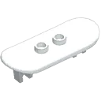{ .lu-ti width="24" loading="lazy" } [Skateboard 2 (LOT 5381)](../5381.md) | 0.65005226%; mean 0.006514658 | Not associated with a vendor |
| { .lu-ti width="24" loading="lazy" } [Ice Hockey Helmet (LOT 5383)](../5383.md) | 0.65005226%; mean 0.006514658 | Not associated with a vendor |
| 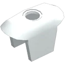{ .lu-ti width="24" loading="lazy" } [Hockey Body Armor (LOT 5384)](../5384.md) | 0.65005226%; mean 0.006514658 | Not associated with a vendor |
| { .lu-ti width="24" loading="lazy" } [Wedge 4x4 Triple with Tip (LOT 5385)](../5385.md) | 0.5687191%; mean 0.0056980057 | Not associated with a vendor |
| { .lu-ti width="24" loading="lazy" } [Wing 4x7 Scaled (LOT 5389)](../5389.md) | 0.65005226%; mean 0.006514658 | Not associated with a vendor |
| { .lu-ti width="24" loading="lazy" } [Visor No. 1 Wise (LOT 5391)](../5391.md) | 0.65005226%; mean 0.006514658 | Not associated with a vendor |
| { .lu-ti width="24" loading="lazy" } [Visor No. 3 Rookie (LOT 5392)](../5392.md) | 0.65005226%; mean 0.006514658 | Not associated with a vendor |
| { .lu-ti width="24" loading="lazy" } [Visor No. 4 Brute (LOT 5393)](../5393.md) | 0.65005226%; mean 0.006514658 | Not associated with a vendor |
| { .lu-ti width="24" loading="lazy" } [Visor No. 2 Joker (LOT 5394)](../5394.md) | 0.65005226%; mean 0.006514658 | Not associated with a vendor |
| { .lu-ti width="24" loading="lazy" } [Visor No. 5 Evil (LOT 5395)](../5395.md) | 0.65005226%; mean 0.006514658 | Not associated with a vendor |
| { .lu-ti width="24" loading="lazy" } [Dark Knight Helmet (LOT 5397)](../5397.md) | 0.65005226%; mean 0.006514658 | Not associated with a vendor |
| { .lu-ti width="24" loading="lazy" } [Knight Shield Octagonal with Stud (LOT 5398)](../5398.md) | 0.65005226%; mean 0.006514658 | Not associated with a vendor |
| { .lu-ti width="24" loading="lazy" } [Sword with Inverted V-Guard (LOT 5399)](../5399.md) | 0.65005226%; mean 0.006514658 | Not associated with a vendor |
| 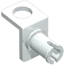{ .lu-ti width="24" loading="lazy" } [Bracket 1x1 with Pin (LOT 5401)](../5401.md) | 0.65005226%; mean 0.006514658 | Not associated with a vendor |
| { .lu-ti width="24" loading="lazy" } [Tire Ø14.58 Narrow (LOT 5407)](../5407.md) | 0.5687191%; mean 0.0056980057 | Not associated with a vendor |
| { .lu-ti width="24" loading="lazy" } [Brick 1x4x1 1/3 with Studs on Side (LOT 5417)](../5417.md) | 0.5687191%; mean 0.0056980057 | Not associated with a vendor |
| { .lu-ti width="24" loading="lazy" } [Viking Helmet (LOT 5418)](../5418.md) | 0.65005226%; mean 0.006514658 | Not associated with a vendor |
| { .lu-ti width="24" loading="lazy" } [BattleAxe Head with Horizontal Clip (LOT 5419)](../5419.md) | 0.65005226%; mean 0.006514658 | Not associated with a vendor |
| { .lu-ti width="24" loading="lazy" } [Wig Manga 1 (LOT 5433)](../5433.md) | 0.65005226%; mean 0.006514658 | Not associated with a vendor |
| { .lu-ti width="24" loading="lazy" } [Wig Manga 2 (LOT 5434)](../5434.md) | 0.65005226%; mean 0.006514658 | Not associated with a vendor |
| { .lu-ti width="24" loading="lazy" } [Jet Hull Top 8x8x2 (LOT 5437)](../5437.md) | 0.5687191%; mean 0.0056980057 | Not associated with a vendor |
| { .lu-ti width="24" loading="lazy" } [Airplane Door (LOT 5438)](../5438.md) | 0.5687191%; mean 0.0056980057 | Not associated with a vendor |
| { .lu-ti width="24" loading="lazy" } [Hammer (LOT 5446)](../5446.md) | 0.65005226%; mean 0.006514658 | Not associated with a vendor |
| { .lu-ti width="24" loading="lazy" } [Oil Can (LOT 5447)](../5447.md) | 0.65005226%; mean 0.006514658 | Not associated with a vendor |
| { .lu-ti width="24" loading="lazy" } [Drilling Machine (LOT 5448)](../5448.md) | 0.65005226%; mean 0.006514658 | Not associated with a vendor |
| { .lu-ti width="24" loading="lazy" } [Screwdriver (LOT 5449)](../5449.md) | 0.65005226%; mean 0.006514658 | Not associated with a vendor |
| { .lu-ti width="24" loading="lazy" } [Open Firm Key (LOT 5450)](../5450.md) | 0.65005226%; mean 0.006514658 | Not associated with a vendor |
| { .lu-ti width="24" loading="lazy" } [Closed Wrench (LOT 5451)](../5451.md) | 0.65005226%; mean 0.006514658 | Not associated with a vendor |
| { .lu-ti width="24" loading="lazy" } [Tire Ø37 Wide (LOT 5453)](../5453.md) | 0.5687191%; mean 0.0056980057 | Not associated with a vendor |
| { .lu-ti width="24" loading="lazy" } [Rim Ø18 Wide with Cross Axle Hole (LOT 5454)](../5454.md) | 0.5687191%; mean 0.0056980057 | Not associated with a vendor |
| { .lu-ti width="24" loading="lazy" } [Rim 30x20 (LOT 5455)](../5455.md) | 0.5687191%; mean 0.0056980057 | Not associated with a vendor |
| { .lu-ti width="24" loading="lazy" } [Balloon Tire Ø24 (LOT 5469)](../5469.md) | 0.5687191%; mean 0.0056980057 | Not associated with a vendor |
| { .lu-ti width="24" loading="lazy" } [Balloon Tire Ø37 (LOT 5470)](../5470.md) | 0.5687191%; mean 0.0056980057 | Not associated with a vendor |
| { .lu-ti width="24" loading="lazy" } [Silver Harpoons (LOT 5471)](../5471.md) | 0.65005226%; mean 0.006514658 | Not associated with a vendor |
| { .lu-ti width="24" loading="lazy" } [Racing Tire Ø30.4 (LOT 5486)](../5486.md) | 0.5687191%; mean 0.0056980057 | Not associated with a vendor |
| { .lu-ti width="24" loading="lazy" } [Scythe Blade (LOT 5502)](../5502.md) | 0.65005226%; mean 0.006514658 | Not associated with a vendor |
| { .lu-ti width="24" loading="lazy" } [Round Shield (LOT 5503)](../5503.md) | 0.65005226%; mean 0.006514658 | Not associated with a vendor |
| { .lu-ti width="24" loading="lazy" } [Morningstar (LOT 5504)](../5504.md) | 0.65005226%; mean 0.006514658 | Not associated with a vendor |
| { .lu-ti width="24" loading="lazy" } [Lightning Bolt with Handle (LOT 5505)](../5505.md) | 0.65005226%; mean 0.006514658 | Not associated with a vendor |
| { .lu-ti width="24" loading="lazy" } [Frogman's Feet (LOT 5506)](../5506.md) | 0.65005226%; mean 0.006514658 | Not associated with a vendor |
| { .lu-ti width="24" loading="lazy" } [Lady Wig (LOT 5507)](../5507.md) | 0.65005226%; mean 0.006514658 | Not associated with a vendor |
| { .lu-ti width="24" loading="lazy" } [Princess Hair (LOT 5508)](../5508.md) | 0.65005226%; mean 0.006514658 | Not associated with a vendor |
| { .lu-ti width="24" loading="lazy" } [Slope Brick 45° 4x6 Double Inverted with Cut-Out (LOT 5516)](../5516.md) | 0.5687191%; mean 0.0056980057 | Not associated with a vendor |
| { .lu-ti width="24" loading="lazy" } [Tire Ø21, Wide (LOT 5545)](../5545.md) | 0.5687191%; mean 0.0056980057 | Not associated with a vendor |
| { .lu-ti width="24" loading="lazy" } [Dwarf King's Helmet (LOT 5546)](../5546.md) | 0.65005226%; mean 0.006514658 | Not associated with a vendor |
| { .lu-ti width="24" loading="lazy" } [Dwarf Warrior's Helmet (LOT 5547)](../5547.md) | 0.65005226%; mean 0.006514658 | Not associated with a vendor |
| { .lu-ti width="24" loading="lazy" } [Dwarf King Beard (LOT 5548)](../5548.md) | 0.65005226%; mean 0.006514658 | Not associated with a vendor |
| { .lu-ti width="24" loading="lazy" } [Dwarf Warrior Beard (LOT 5549)](../5549.md) | 0.65005226%; mean 0.006514658 | Not associated with a vendor |
| { .lu-ti width="24" loading="lazy" } [Warrior Helmet (LOT 5550)](../5550.md) | 0.65005226%; mean 0.006514658 | Not associated with a vendor |
| { .lu-ti width="24" loading="lazy" } [Notched Scimitar (LOT 5551)](../5551.md) | 0.65005226%; mean 0.006514658 | Not associated with a vendor |
| { .lu-ti width="24" loading="lazy" } [Nozzle with Shaft (LOT 5556)](../5556.md) | 0.65005226%; mean 0.006514658 | Not associated with a vendor |
| { .lu-ti width="24" loading="lazy" } [Technic Casing with Air Intakes (LOT 5558)](../5558.md) | 0.5687191%; mean 0.0056980057 | Not associated with a vendor |
| { .lu-ti width="24" loading="lazy" } [Plate 1x4x2/3 with 2 Protruding Pistons (LOT 5559)](../5559.md) | 0.5687191%; mean 0.0056980057 | Not associated with a vendor |
| { .lu-ti width="24" loading="lazy" } [Brick 4x4x2 with Bow (LOT 5564)](../5564.md) | 0.5687191%; mean 0.0056980057 | Not associated with a vendor |
| { .lu-ti width="24" loading="lazy" } [Spool Ø16 (LOT 5565)](../5565.md) | 0.5687191%; mean 0.0056980057 | Not associated with a vendor |
| { .lu-ti width="24" loading="lazy" } [Knight Shield Octagonal (LOT 5572)](../5572.md) | 0.65005226%; mean 0.006514658 | Not associated with a vendor |
| { .lu-ti width="24" loading="lazy" } [Breastplate (LOT 5576)](../5576.md) | 0.65005226%; mean 0.006514658 | Not associated with a vendor |
| { .lu-ti width="24" loading="lazy" } [Windscreen 8x5x2 Edged (LOT 5579)](../5579.md) | 0.5687191%; mean 0.0056980057 | Not associated with a vendor |
| 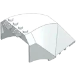{ .lu-ti width="24" loading="lazy" } [Cockpit 6x8x4 with Vertical Fork (LOT 5580)](../5580.md) | 0.5687191%; mean 0.0056980057 | Not associated with a vendor |
| { .lu-ti width="24" loading="lazy" } [Wig with Long Ponytail (LOT 5582)](../5582.md) | 0.65005226%; mean 0.006514658 | Not associated with a vendor |
| { .lu-ti width="24" loading="lazy" } [Helmet with Jagged Jaw (LOT 5583)](../5583.md) | 0.65005226%; mean 0.006514658 | Not associated with a vendor |
| { .lu-ti width="24" loading="lazy" } [Barbed Wire (LOT 5585)](../5585.md) | 0.65005226%; mean 0.006514658 | Not associated with a vendor |
| { .lu-ti width="24" loading="lazy" } [Hub Cap Ø24 (LOT 5586)](../5586.md) | 0.5687191%; mean 0.0056980057 | Not associated with a vendor |
| { .lu-ti width="24" loading="lazy" } [Wig, Bowl Cut (LOT 5587)](../5587.md) | 0.65005226%; mean 0.006514658 | Not associated with a vendor |
| { .lu-ti width="24" loading="lazy" } [Plate 2x16 Rotor Blade (LOT 5589)](../5589.md) | 0.5687191%; mean 0.0056980057 | Not associated with a vendor |
| 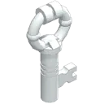{ .lu-ti width="24" loading="lazy" } [Antique Key (LOT 5590)](../5590.md) | 0.65005226%; mean 0.006514658 | Not associated with a vendor |
| { .lu-ti width="24" loading="lazy" } [Wig, Boy (LOT 5592)](../5592.md) | 0.65005226%; mean 0.006514658 | Not associated with a vendor |
| { .lu-ti width="24" loading="lazy" } [Light Sword Handle (LOT 5598)](../5598.md) | 0.65005226%; mean 0.006514658 | Not associated with a vendor |
| { .lu-ti width="24" loading="lazy" } [Bucket (LOT 5601)](../5601.md) | 0.65005226%; mean 0.006514658 | Not associated with a vendor |
| { .lu-ti width="24" loading="lazy" } [Fanfare Horn, Chrome (LOT 5604)](../5604.md) | 0.65005226%; mean 0.006514658 | Not associated with a vendor |
| { .lu-ti width="24" loading="lazy" } [Handle for Bucket (LOT 5605)](../5605.md) | 0.65005226%; mean 0.006514658 | Not associated with a vendor |
| { .lu-ti width="24" loading="lazy" } [Space Suit (LOT 5607)](../5607.md) | 0.65005226%; mean 0.006514658 | Not associated with a vendor |
| { .lu-ti width="24" loading="lazy" } [Goblet (LOT 5608)](../5608.md) | 0.65005226%; mean 0.006514658 | Not associated with a vendor |
| { .lu-ti width="24" loading="lazy" } [Magnet Cylindrical (LOT 5611)](../5611.md) | 0.5687191%; mean 0.0056980057 | Not associated with a vendor |
| { .lu-ti width="24" loading="lazy" } [Train Bearing 3x6 (LOT 5613)](../5613.md) | 0.5687191%; mean 0.0056980057 | Not associated with a vendor |
| { .lu-ti width="24" loading="lazy" } [Windscreen 4x3x3 Edged (LOT 5617)](../5617.md) | 0.5687191%; mean 0.0056980057 | Not associated with a vendor |
| { .lu-ti width="24" loading="lazy" } [BaseBall Cap (LOT 5622)](../5622.md) | 0.65005226%; mean 0.006514658 | Not associated with a vendor |
| { .lu-ti width="24" loading="lazy" } [Great Mattock (LOT 5696)](../5696.md) | 2.5%; mean 0.025 | Not associated with a vendor |
| { .lu-ti width="24" loading="lazy" } [Brick Booster Pack (LOT 5834)](../5834.md) | 2.88461538%; mean 0.028846154 | Not associated with a vendor |
| { .lu-ti width="24" loading="lazy" } [Super Brick Booster Pack (LOT 5835)](../5835.md) | 3.75%; mean 0.0375 | Not associated with a vendor |
| { .lu-ti width="24" loading="lazy" } [Picnic Basket (LOT 5836)](../5836.md) | 2.88461538%; mean 0.028846154 | Not associated with a vendor |
| { .lu-ti width="24" loading="lazy" } [Super Picnic Basket (LOT 5837)](../5837.md) | 3.75%; mean 0.0375 | Not associated with a vendor |
| { .lu-ti width="24" loading="lazy" } [Maelstrom-Infected Brick (LOT 6194)](../6194.md) | 100%; mean 2 | Not associated with a vendor |
| { .lu-ti width="24" loading="lazy" } [Thirst Quencher (LOT 6201)](../6201.md) | 2.88461538%; mean 0.028846154 | Not associated with a vendor |
| { .lu-ti width="24" loading="lazy" } [Great Composite Axe (LOT 6852)](../6852.md) | 2.5%; mean 0.025 | Not associated with a vendor |
| { .lu-ti width="24" loading="lazy" } [Dark Red Gem (LOT 6862)](../6862.md) | 1%; mean 0.01 | Not associated with a vendor |
| { .lu-ti width="24" loading="lazy" } [Yellow Gem (LOT 6863)](../6863.md) | 1%; mean 0.01 | Not associated with a vendor |
| { .lu-ti width="24" loading="lazy" } [Green Gem (LOT 6864)](../6864.md) | 2%; mean 0.02 | Not associated with a vendor |
| { .lu-ti width="24" loading="lazy" } [Light Blue Gem (LOT 6865)](../6865.md) | 3.75%; mean 0.0375 | Not associated with a vendor |
| { .lu-ti width="24" loading="lazy" } [Pink Gem (LOT 6866)](../6866.md) | 2.88461538%; mean 0.028846154 | Not associated with a vendor |
| { .lu-ti width="24" loading="lazy" } [Flash Bang (LOT 6884)](../6884.md) | 2.88461538%; mean 0.028846154 | Not associated with a vendor |
| { .lu-ti width="24" loading="lazy" } [Great Fang (LOT 7069)](../7069.md) | 2.5%; mean 0.025 | Not associated with a vendor |
| { .lu-ti width="24" loading="lazy" } [Elite Saw of Drowsiness (LOT 7283)](../7283.md) | 0% in the generic loot model | Not associated with a vendor |
| { .lu-ti width="24" loading="lazy" } [Elite Blade of Knock Down (LOT 7284)](../7284.md) | 0% in the generic loot model | Not associated with a vendor |
| { .lu-ti width="24" loading="lazy" } [Buttery Croissant (LOT 7724)](../7724.md) | 2.88461538%; mean 0.028846154 | Not associated with a vendor |
| { .lu-ti width="24" loading="lazy" } [Healing Drumstick (LOT 7725)](../7725.md) | 2.88461538%; mean 0.028846154 | Not associated with a vendor |
| { .lu-ti width="24" loading="lazy" } [Firecracker (LOT 7778)](../7778.md) | 2.88461538%; mean 0.028846154 | Not associated with a vendor |
| { .lu-ti width="24" loading="lazy" } [Hat of Sprouting Imagination (LOT 7780)](../7780.md) | 0% in the generic loot model | Not associated with a vendor |
| { .lu-ti width="24" loading="lazy" } [Lantern Model (LOT 8049)](../8049.md) | 1.78571429%; mean 0.017857143 | Not associated with a vendor |
| { .lu-ti width="24" loading="lazy" } [Small Shrine Model (LOT 8050)](../8050.md) | 0.5%; mean 0.005 | Not associated with a vendor |
| { .lu-ti width="24" loading="lazy" } [Exceptional Katana (LOT 8331)](../8331.md) | 2.5%; mean 0.025 | Not associated with a vendor |
| { .lu-ti width="24" loading="lazy" } [Gothic Paradox Shirt (LOT 8357)](../8357.md) | 0.45454545%; mean 0.0045454545 | Not associated with a vendor |
| { .lu-ti width="24" loading="lazy" } [Pink Kimono (LOT 8358)](../8358.md) | 0% in the generic loot model | Not associated with a vendor |
| { .lu-ti width="24" loading="lazy" } [Sensei Shirt (LOT 8360)](../8360.md) | 0.45454545%; mean 0.0045454545 | Not associated with a vendor |
| { .lu-ti width="24" loading="lazy" } [Belted Ninja Shirt (LOT 8361)](../8361.md) | 0% in the generic loot model | Not associated with a vendor |
| { .lu-ti width="24" loading="lazy" } [Bag of Glitter (LOT 8363)](../8363.md) | 2.88461538%; mean 0.028846154 | Not associated with a vendor |
| { .lu-ti width="24" loading="lazy" } [Potion of Shielding (LOT 8365)](../8365.md) | 2.88461538%; mean 0.028846154 | Not associated with a vendor |
| { .lu-ti width="24" loading="lazy" } [Cloud Burst (LOT 8366)](../8366.md) | 2.88461538%; mean 0.028846154 | Not associated with a vendor |
| { .lu-ti width="24" loading="lazy" } [Shuriken (LOT 8371)](../8371.md) | 2.88461538%; mean 0.028846154 | Not associated with a vendor |
| { .lu-ti width="24" loading="lazy" } [Sushi (LOT 8375)](../8375.md) | 2.88461538%; mean 0.028846154 | Not associated with a vendor |
| { .lu-ti width="24" loading="lazy" } [Tough Buff Sauce (LOT 8376)](../8376.md) | 2.88461538%; mean 0.028846154 | Not associated with a vendor |
| { .lu-ti width="24" loading="lazy" } [Elite Oar (LOT 8447)](../8447.md) | 0% in the generic loot model | Not associated with a vendor |
| { .lu-ti width="24" loading="lazy" } [Super Hatchet (LOT 8448)](../8448.md) | 0.55555556%; mean 0.0055555556 | Not associated with a vendor |
| { .lu-ti width="24" loading="lazy" } [Super Shovel (LOT 8449)](../8449.md) | 0.55555556%; mean 0.0055555556 | Not associated with a vendor |
| { .lu-ti width="24" loading="lazy" } [Elite Pickaxe (LOT 8450)](../8450.md) | 0% in the generic loot model | Not associated with a vendor |
| { .lu-ti width="24" loading="lazy" } [Super Shortsword (LOT 8452)](../8452.md) | 0.55555556%; mean 0.0055555556 | Not associated with a vendor |
| { .lu-ti width="24" loading="lazy" } [Elite Shortsword (LOT 8453)](../8453.md) | 0% in the generic loot model | Not associated with a vendor |
| { .lu-ti width="24" loading="lazy" } [Super Hairbrush (LOT 8454)](../8454.md) | 0.55555556%; mean 0.0055555556 | Not associated with a vendor |
| { .lu-ti width="24" loading="lazy" } [Great Crescent Wrench (LOT 8455)](../8455.md) | 2.5%; mean 0.025 | Not associated with a vendor |
| { .lu-ti width="24" loading="lazy" } [Super Spear (LOT 8468)](../8468.md) | 0.55555556%; mean 0.0055555556 | Not associated with a vendor |
| { .lu-ti width="24" loading="lazy" } [Elite Ice Saw (LOT 8469)](../8469.md) | 0% in the generic loot model | Not associated with a vendor |
| { .lu-ti width="24" loading="lazy" } [Elite Halberd (LOT 8470)](../8470.md) | 0% in the generic loot model | Not associated with a vendor |
| { .lu-ti width="24" loading="lazy" } [Elite Katana (LOT 8472)](../8472.md) | 0% in the generic loot model | Not associated with a vendor |
| { .lu-ti width="24" loading="lazy" } [Elite Scimitar (LOT 8473)](../8473.md) | 0% in the generic loot model | Not associated with a vendor |
| { .lu-ti width="24" loading="lazy" } [Great Corseque (LOT 8474)](../8474.md) | 2.5%; mean 0.025 | Not associated with a vendor |
| { .lu-ti width="24" loading="lazy" } [Super Corseque (LOT 8475)](../8475.md) | 0.55555556%; mean 0.0055555556 | Not associated with a vendor |
| { .lu-ti width="24" loading="lazy" } [Super Dirk (LOT 8477)](../8477.md) | 0.55555556%; mean 0.0055555556 | Not associated with a vendor |
| { .lu-ti width="24" loading="lazy" } [Elite Fang (LOT 8478)](../8478.md) | 0% in the generic loot model | Not associated with a vendor |
| { .lu-ti width="24" loading="lazy" } [Scorpion Shield (LOT 8529)](../8529.md) | 0.45454545%; mean 0.0045454545 | Not associated with a vendor |
| { .lu-ti width="24" loading="lazy" } [Dox Shoulderpads (LOT 8536)](../8536.md) | 0.45454545%; mean 0.0045454545 | Not associated with a vendor |
| { .lu-ti width="24" loading="lazy" } [Tech Armor (LOT 8537)](../8537.md) | 0.45454545%; mean 0.0045454545 | Not associated with a vendor |
| { .lu-ti width="24" loading="lazy" } [Scutum Shield (LOT 8538)](../8538.md) | 0% in the generic loot model | Not associated with a vendor |
| { .lu-ti width="24" loading="lazy" } [Messenger Bag (LOT 8539)](../8539.md) | 0% in the generic loot model | Not associated with a vendor |
| { .lu-ti width="24" loading="lazy" } [King's Crown (LOT 8544)](../8544.md) | 0% in the generic loot model | Not associated with a vendor |
| { .lu-ti width="24" loading="lazy" } [Shabby Ninja Shirt (LOT 8606)](../8606.md) | 0% in the generic loot model | Not associated with a vendor |
| { .lu-ti width="24" loading="lazy" } [Ruffled and Striped Shirt (LOT 8607)](../8607.md) | 0.45454545%; mean 0.0045454545 | Not associated with a vendor |
| { .lu-ti width="24" loading="lazy" } [Viking Barbarian Shirt (LOT 8620)](../8620.md) | 0.45454545%; mean 0.0045454545 | Not associated with a vendor |
| { .lu-ti width="24" loading="lazy" } [Mail Shirt with Gorget (LOT 8621)](../8621.md) | 0.45454545%; mean 0.0045454545 | Not associated with a vendor |
| { .lu-ti width="24" loading="lazy" } [Union Shirt (LOT 8630)](../8630.md) | 0% in the generic loot model | Not associated with a vendor |
| { .lu-ti width="24" loading="lazy" } [Squire's Helm (LOT 8636)](../8636.md) | 0% in the generic loot model | Not associated with a vendor |
| { .lu-ti width="24" loading="lazy" } [Powered Armor (LOT 8638)](../8638.md) | 0% in the generic loot model | Not associated with a vendor |
| { .lu-ti width="24" loading="lazy" } [Bell Bottoms (LOT 8640)](../8640.md) | 0.45454545%; mean 0.0045454545 | Not associated with a vendor |
| { .lu-ti width="24" loading="lazy" } [Gauchos (LOT 8644)](../8644.md) | 0% in the generic loot model | Not associated with a vendor |
| { .lu-ti width="24" loading="lazy" } [Iron Legs (LOT 8645)](../8645.md) | 0% in the generic loot model | Not associated with a vendor |
| { .lu-ti width="24" loading="lazy" } [Hammer Pants (LOT 8651)](../8651.md) | 0.45454545%; mean 0.0045454545 | Not associated with a vendor |
| { .lu-ti width="24" loading="lazy" } [Wrench (LOT 8674)](../8674.md) | 0% in the generic loot model | Not associated with a vendor |
| { .lu-ti width="24" loading="lazy" } [Grease Can (LOT 8680)](../8680.md) | 0% in the generic loot model | Not associated with a vendor |
| { .lu-ti width="24" loading="lazy" } [Tile 1x2 with Console (LOT 8789)](../8789.md) | 0.5687191%; mean 0.0056980057 | Not associated with a vendor |
| { .lu-ti width="24" loading="lazy" } [Panel 3x6 Angled with Vertical Clips (LOT 8792)](../8792.md) | 0.5687191%; mean 0.0056980057 | Not associated with a vendor |
| { .lu-ti width="24" loading="lazy" } [Car Chassis 4x7 (LOT 8793)](../8793.md) | 0.5687191%; mean 0.0056980057 | Not associated with a vendor |
| { .lu-ti width="24" loading="lazy" } [Holder for Circular Brush (LOT 8799)](../8799.md) | 0.5687191%; mean 0.0056980057 | Not associated with a vendor |
| { .lu-ti width="24" loading="lazy" } [Axle with Hafts (LOT 8801)](../8801.md) | 0.5687191%; mean 0.0056980057 | Not associated with a vendor |
| { .lu-ti width="24" loading="lazy" } [Wheel Hard-Plastic Ø56 Large (LOT 8802)](../8802.md) | 0.5687191%; mean 0.0056980057 | Not associated with a vendor |
| { .lu-ti width="24" loading="lazy" } [Epaulets (LOT 8803)](../8803.md) | 0.65005226%; mean 0.006514658 | Not associated with a vendor |
| { .lu-ti width="24" loading="lazy" } [Flintlock Pistol (LOT 8807)](../8807.md) | 0.65005226%; mean 0.006514658 | Not associated with a vendor |
| { .lu-ti width="24" loading="lazy" } [Wheel Hard-Plastic Ø75 Giant (LOT 8808)](../8808.md) | 0.5687191%; mean 0.0056980057 | Not associated with a vendor |
| { .lu-ti width="24" loading="lazy" } [Device Shield with Vertical Clips (LOT 8809)](../8809.md) | 0.5687191%; mean 0.0056980057 | Not associated with a vendor |
| { .lu-ti width="24" loading="lazy" } [Wheel Hard-Plastic Medium (LOT 8811)](../8811.md) | 0.5687191%; mean 0.0056980057 | Not associated with a vendor |
| { .lu-ti width="24" loading="lazy" } [Bow Plate 9x10 (LOT 8812)](../8812.md) | 0.5687191%; mean 0.0056980057 | Not associated with a vendor |
| { .lu-ti width="24" loading="lazy" } [Brick Bow 8x10 (LOT 8813)](../8813.md) | 0.5687191%; mean 0.0056980057 | Not associated with a vendor |
| { .lu-ti width="24" loading="lazy" } [Boat Bow 6x6 Bottom (LOT 8814)](../8814.md) | 0.5687191%; mean 0.0056980057 | Not associated with a vendor |
| { .lu-ti width="24" loading="lazy" } [Technic Excavator Bucket (LOT 8825)](../8825.md) | 0.5687191%; mean 0.0056980057 | Not associated with a vendor |
| { .lu-ti width="24" loading="lazy" } [Tail Fin 4x2x2 (LOT 8835)](../8835.md) | 0.5687191%; mean 0.0056980057 | Not associated with a vendor |
| { .lu-ti width="24" loading="lazy" } [Wig with Small Pigtails (LOT 8839)](../8839.md) | 0.65005226%; mean 0.006514658 | Not associated with a vendor |
| { .lu-ti width="24" loading="lazy" } [Cowboy Hat (LOT 8840)](../8840.md) | 0.65005226%; mean 0.006514658 | Not associated with a vendor |
| { .lu-ti width="24" loading="lazy" } [Mini Crash Helmet (LOT 8846)](../8846.md) | 0.65005226%; mean 0.006514658 | Not associated with a vendor |
| { .lu-ti width="24" loading="lazy" } [Mini Shield (LOT 8847)](../8847.md) | 0.5687191%; mean 0.0056980057 | Not associated with a vendor |
| { .lu-ti width="24" loading="lazy" } [Great Helm with Chin Guard (LOT 8848)](../8848.md) | 0.65005226%; mean 0.006514658 | Not associated with a vendor |
| { .lu-ti width="24" loading="lazy" } [Wheelbarrow (LOT 8849)](../8849.md) | 0.5687191%; mean 0.0056980057 | Not associated with a vendor |
| { .lu-ti width="24" loading="lazy" } [Train Buffer (LOT 8850)](../8850.md) | 0.5687191%; mean 0.0056980057 | Not associated with a vendor |
| { .lu-ti width="24" loading="lazy" } [Thread Drum (LOT 8854)](../8854.md) | 0.5687191%; mean 0.0056980057 | Not associated with a vendor |
| { .lu-ti width="24" loading="lazy" } [Thruster with Grills Below 2x2-Plate (LOT 8856)](../8856.md) | 0.5687191%; mean 0.0056980057 | Not associated with a vendor |
| { .lu-ti width="24" loading="lazy" } [Pitchfork (LOT 8858)](../8858.md) | 0.65005226%; mean 0.006514658 | Not associated with a vendor |
| { .lu-ti width="24" loading="lazy" } [Forestman Cap (LOT 8860)](../8860.md) | 0.65005226%; mean 0.006514658 | Not associated with a vendor |
| { .lu-ti width="24" loading="lazy" } [Plastic Cape (LOT 8861)](../8861.md) | 0.65005226%; mean 0.006514658 | Not associated with a vendor |
| { .lu-ti width="24" loading="lazy" } [Tail Fin with Rocket Engine (LOT 8865)](../8865.md) | 0.5687191%; mean 0.0056980057 | Not associated with a vendor |
| { .lu-ti width="24" loading="lazy" } [Plate 4x4 with Boat Mast Base (LOT 8866)](../8866.md) | 0.5687191%; mean 0.0056980057 | Not associated with a vendor |
| { .lu-ti width="24" loading="lazy" } [Canoe (LOT 8868)](../8868.md) | 0.5687191%; mean 0.0056980057 | Not associated with a vendor |
| { .lu-ti width="24" loading="lazy" } [Shoulder Jet Pack (LOT 8869)](../8869.md) | 0.5687191%; mean 0.0056980057 | Not associated with a vendor |
| { .lu-ti width="24" loading="lazy" } [Bobbed Hair (LOT 8870)](../8870.md) | 0.65005226%; mean 0.006514658 | Not associated with a vendor |
| { .lu-ti width="24" loading="lazy" } [Islander Demon Mask (LOT 8871)](../8871.md) | 0.65005226%; mean 0.006514658 | Not associated with a vendor |
| { .lu-ti width="24" loading="lazy" } [Propeller Ring-Casing with Fins (LOT 8875)](../8875.md) | 0.5687191%; mean 0.0056980057 | Not associated with a vendor |
| { .lu-ti width="24" loading="lazy" } [Ship's Propeller with 3 Blades and Cross Axle Hole (LOT 8876)](../8876.md) | 0.5687191%; mean 0.0056980057 | Not associated with a vendor |
| { .lu-ti width="24" loading="lazy" } [Cockpit 4x11x2 2/3 Bottom (LOT 8881)](../8881.md) | 0.5687191%; mean 0.0056980057 | Not associated with a vendor |
| { .lu-ti width="24" loading="lazy" } [Space Suit with Helmet and Propeller (LOT 8887)](../8887.md) | 0.65005226%; mean 0.006514658 | Not associated with a vendor |
| { .lu-ti width="24" loading="lazy" } [Space Suit with Helmet and Breathing Device (LOT 8888)](../8888.md) | 0.65005226%; mean 0.006514658 | Not associated with a vendor |
| { .lu-ti width="24" loading="lazy" } [Visor with Antenna (LOT 8890)](../8890.md) | 0.65005226%; mean 0.006514658 | Not associated with a vendor |
| { .lu-ti width="24" loading="lazy" } [Windscreen 4x6x1 1/3 (LOT 8891)](../8891.md) | 0.5687191%; mean 0.0056980057 | Not associated with a vendor |
| { .lu-ti width="24" loading="lazy" } [Oval Suitcase (LOT 8894)](../8894.md) | 0.65005226%; mean 0.006514658 | Not associated with a vendor |
| { .lu-ti width="24" loading="lazy" } [Plate Wing 16x14 (LOT 8899)](../8899.md) | 0.5687191%; mean 0.0056980057 | Not associated with a vendor |
| { .lu-ti width="24" loading="lazy" } [Technic Wheel Block 4x4 (LOT 8909)](../8909.md) | 0.5687191%; mean 0.0056980057 | Not associated with a vendor |
| { .lu-ti width="24" loading="lazy" } [End Piece for Lorry (LOT 8916)](../8916.md) | 0.5687191%; mean 0.0056980057 | Not associated with a vendor |
| { .lu-ti width="24" loading="lazy" } [Car Chassis Plate 4x10x2/3 (LOT 8917)](../8917.md) | 0.5687191%; mean 0.0056980057 | Not associated with a vendor |
| { .lu-ti width="24" loading="lazy" } [Helmet with Hose and Stud (LOT 8919)](../8919.md) | 0.65005226%; mean 0.006514658 | Not associated with a vendor |
| { .lu-ti width="24" loading="lazy" } [Bowsprit 11 2/3 M (LOT 8922)](../8922.md) | 0.5687191%; mean 0.0056980057 | Not associated with a vendor |
| { .lu-ti width="24" loading="lazy" } [Underwater scooter (LOT 8926)](../8926.md) | 0.65005226%; mean 0.006514658 | Not associated with a vendor |
| { .lu-ti width="24" loading="lazy" } [Medicine Man Wig (LOT 8929)](../8929.md) | 0.65005226%; mean 0.006514658 | Not associated with a vendor |
| { .lu-ti width="24" loading="lazy" } [Indian Wig (LOT 8930)](../8930.md) | 0.65005226%; mean 0.006514658 | Not associated with a vendor |
| { .lu-ti width="24" loading="lazy" } [Alien Helmet (LOT 8931)](../8931.md) | 0.65005226%; mean 0.006514658 | Not associated with a vendor |
| { .lu-ti width="24" loading="lazy" } [Crash Helmet (LOT 8932)](../8932.md) | 0.65005226%; mean 0.006514658 | Not associated with a vendor |
| { .lu-ti width="24" loading="lazy" } [Chief Brilliant Plumage (LOT 8934)](../8934.md) | 0.65005226%; mean 0.006514658 | Not associated with a vendor |
| { .lu-ti width="24" loading="lazy" } [Samurai Helmet (LOT 8938)](../8938.md) | 0.65005226%; mean 0.006514658 | Not associated with a vendor |
| { .lu-ti width="24" loading="lazy" } [1/4-Dish 10x10 Inverted (LOT 8939)](../8939.md) | 0.5687191%; mean 0.0056980057 | Not associated with a vendor |
| { .lu-ti width="24" loading="lazy" } [Aqua Suit Helmet (LOT 8940)](../8940.md) | 0.65005226%; mean 0.006514658 | Not associated with a vendor |
| { .lu-ti width="24" loading="lazy" } [Flat-Bed Platform 6x12 with Vertical Fork (LOT 8945)](../8945.md) | 0.5687191%; mean 0.0056980057 | Not associated with a vendor |
| { .lu-ti width="24" loading="lazy" } [1/4-Dish 10x10 Top (LOT 8948)](../8948.md) | 0.5687191%; mean 0.0056980057 | Not associated with a vendor |
| { .lu-ti width="24" loading="lazy" } [Tire Ø62.4 (LOT 8957)](../8957.md) | 0.5687191%; mean 0.0056980057 | Not associated with a vendor |
| { .lu-ti width="24" loading="lazy" } [Rim Ø43.2 (LOT 8958)](../8958.md) | 0.5687191%; mean 0.0056980057 | Not associated with a vendor |
| { .lu-ti width="24" loading="lazy" } [Wedge 6x8 with Cut-Out (LOT 8962)](../8962.md) | 0.5687191%; mean 0.0056980057 | Not associated with a vendor |
| { .lu-ti width="24" loading="lazy" } [Hairdryer (LOT 8987)](../8987.md) | 0.65005226%; mean 0.006514658 | Not associated with a vendor |
| { .lu-ti width="24" loading="lazy" } [Turkey (LOT 8988)](../8988.md) | 0.65005226%; mean 0.006514658 | Not associated with a vendor |
| { .lu-ti width="24" loading="lazy" } [Decoration Ball (LOT 8989)](../8989.md) | 0.65005226%; mean 0.006514658 | Not associated with a vendor |
| { .lu-ti width="24" loading="lazy" } [Windscreen 6x12x6 (LOT 9005)](../9005.md) | 0.5687191%; mean 0.0056980057 | Not associated with a vendor |
| { .lu-ti width="24" loading="lazy" } [Skates with 2 Studs (LOT 9007)](../9007.md) | 0.65005226%; mean 0.006514658 | Not associated with a vendor |
| { .lu-ti width="24" loading="lazy" } [Casing 6x8x4 (LOT 9009)](../9009.md) | 0.5687191%; mean 0.0056980057 | Not associated with a vendor |
| { .lu-ti width="24" loading="lazy" } [Hub Ø11.2 x 7.84mm (LOT 9010)](../9010.md) | 0.5687191%; mean 0.0056980057 | Not associated with a vendor |
| { .lu-ti width="24" loading="lazy" } [Crawler Track Rubber 151mm (LOT 9014)](../9014.md) | 0.5687191%; mean 0.0056980057 | Not associated with a vendor |
| { .lu-ti width="24" loading="lazy" } [Cockpit 6x4x3 with Vertical Fork (LOT 9022)](../9022.md) | 0.5687191%; mean 0.0056980057 | Not associated with a vendor |
| { .lu-ti width="24" loading="lazy" } [Tank Bottom 8x6x2 (LOT 9023)](../9023.md) | 0.5687191%; mean 0.0056980057 | Not associated with a vendor |
| { .lu-ti width="24" loading="lazy" } [Tank Top Part 8x6x2 (LOT 9024)](../9024.md) | 0.5687191%; mean 0.0056980057 | Not associated with a vendor |
| { .lu-ti width="24" loading="lazy" } [Train Buffer with Plough (LOT 9027)](../9027.md) | 0.5687191%; mean 0.0056980057 | Not associated with a vendor |
| { .lu-ti width="24" loading="lazy" } [Snowboard (LOT 9028)](../9028.md) | 0.65005226%; mean 0.006514658 | Not associated with a vendor |
| { .lu-ti width="24" loading="lazy" } [Boat Bow 12x10 (LOT 9029)](../9029.md) | 0.5687191%; mean 0.0056980057 | Not associated with a vendor |
| { .lu-ti width="24" loading="lazy" } [Boat Bow Plate 12x8 (LOT 9030)](../9030.md) | 0.5687191%; mean 0.0056980057 | Not associated with a vendor |
| { .lu-ti width="24" loading="lazy" } [Sailing Ship Stern Cabin (LOT 9031)](../9031.md) | 0.5687191%; mean 0.0056980057 | Not associated with a vendor |
| { .lu-ti width="24" loading="lazy" } [Cloth Cape (LOT 9036)](../9036.md) | 0.65005226%; mean 0.006514658 | Not associated with a vendor |
| { .lu-ti width="24" loading="lazy" } [Bonnet 3x4x2/3 Curved with Cut-Out (LOT 9040)](../9040.md) | 0.5687191%; mean 0.0056980057 | Not associated with a vendor |
| { .lu-ti width="24" loading="lazy" } [Cockpit 10x4x3 (LOT 9041)](../9041.md) | 0.5687191%; mean 0.0056980057 | Not associated with a vendor |
| { .lu-ti width="24" loading="lazy" } [Car Chassis Plate 6x16x2/3 (LOT 9043)](../9043.md) | 0.5687191%; mean 0.0056980057 | Not associated with a vendor |
| { .lu-ti width="24" loading="lazy" } [Viking Ship Front 16x20x8 (LOT 9045)](../9045.md) | 0.5687191%; mean 0.0056980057 | Not associated with a vendor |
| { .lu-ti width="24" loading="lazy" } [Caterpillar Belt, Rubber (LOT 9050)](../9050.md) | 0.5687191%; mean 0.0056980057 | Not associated with a vendor |
| { .lu-ti width="24" loading="lazy" } [Airplane Bottom 8x16x2 (LOT 9051)](../9051.md) | 0.5687191%; mean 0.0056980057 | Not associated with a vendor |
| { .lu-ti width="24" loading="lazy" } [Jet Hull Bottom 8x8x2 (LOT 9052)](../9052.md) | 0.5687191%; mean 0.0056980057 | Not associated with a vendor |
| { .lu-ti width="24" loading="lazy" } [Plate Wing 54x20x2/3 (LOT 9053)](../9053.md) | 0.5687191%; mean 0.0056980057 | Not associated with a vendor |
| { .lu-ti width="24" loading="lazy" } [Tail Fin 2x12x8 (LOT 9054)](../9054.md) | 0.5687191%; mean 0.0056980057 | Not associated with a vendor |
| { .lu-ti width="24" loading="lazy" } [Airplane Hull 8x8x5 Top with Door (LOT 9055)](../9055.md) | 0.5687191%; mean 0.0056980057 | Not associated with a vendor |
| { .lu-ti width="24" loading="lazy" } [Balloon Tire Ø94.8 (LOT 9056)](../9056.md) | 0.5687191%; mean 0.0056980057 | Not associated with a vendor |
| { .lu-ti width="24" loading="lazy" } [Airplane End 8x16x7 (LOT 9059)](../9059.md) | 0.5687191%; mean 0.0056980057 | Not associated with a vendor |
| { .lu-ti width="24" loading="lazy" } [Turbo Propeller (LOT 9060)](../9060.md) | 0.5687191%; mean 0.0056980057 | Not associated with a vendor |
| { .lu-ti width="24" loading="lazy" } [Jet Front 8x16x5 with Cockpit (LOT 9062)](../9062.md) | 0.5687191%; mean 0.0056980057 | Not associated with a vendor |
| { .lu-ti width="24" loading="lazy" } [Balloon Tire Ø56 (LOT 9064)](../9064.md) | 0.5687191%; mean 0.0056980057 | Not associated with a vendor |
| { .lu-ti width="24" loading="lazy" } [Shackles (LOT 9065)](../9065.md) | 0.65005226%; mean 0.006514658 | Not associated with a vendor |
| { .lu-ti width="24" loading="lazy" } [Tire Ø30.4 Narrow (LOT 9066)](../9066.md) | 0.5687191%; mean 0.0056980057 | Not associated with a vendor |
| { .lu-ti width="24" loading="lazy" } [Tire Ø43 Narrow (LOT 9067)](../9067.md) | 0.5687191%; mean 0.0056980057 | Not associated with a vendor |
| { .lu-ti width="24" loading="lazy" } [Rim Ø30 (LOT 9068)](../9068.md) | 0.5687191%; mean 0.0056980057 | Not associated with a vendor |
| { .lu-ti width="24" loading="lazy" } [Crawler Track Element 5x1 (LOT 9070)](../9070.md) | 0.5687191%; mean 0.0056980057 | Not associated with a vendor |
| { .lu-ti width="24" loading="lazy" } [Cam Wheel Ø26 (LOT 9071)](../9071.md) | 0.5687191%; mean 0.0056980057 | Not associated with a vendor |
| { .lu-ti width="24" loading="lazy" } [Cylinder Shell 3x6x10 Conical (LOT 9080)](../9080.md) | 0.5687191%; mean 0.0056980057 | Not associated with a vendor |
| { .lu-ti width="24" loading="lazy" } [Tire Ø14 Smooth (LOT 9087)](../9087.md) | 0.5687191%; mean 0.0056980057 | Not associated with a vendor |
| { .lu-ti width="24" loading="lazy" } [Troll Club (LOT 9097)](../9097.md) | 0.65005226%; mean 0.006514658 | Not associated with a vendor |
| { .lu-ti width="24" loading="lazy" } [Technic Panel 4x7x4 Right (LOT 9100)](../9100.md) | 0.5687191%; mean 0.0056980057 | Not associated with a vendor |
| { .lu-ti width="24" loading="lazy" } [Technic Panel 4x7x4 Left (LOT 9101)](../9101.md) | 0.5687191%; mean 0.0056980057 | Not associated with a vendor |
| { .lu-ti width="24" loading="lazy" } [Technic Spoiler 3x11x2 (LOT 9102)](../9102.md) | 0.5687191%; mean 0.0056980057 | Not associated with a vendor |
| { .lu-ti width="24" loading="lazy" } [Saw Blade, Round Ø71.32 (LOT 9105)](../9105.md) | 0.5687191%; mean 0.0056980057 | Not associated with a vendor |
| { .lu-ti width="24" loading="lazy" } [Balloon Tire Ø43 (LOT 9107)](../9107.md) | 0.5687191%; mean 0.0056980057 | Not associated with a vendor |
| { .lu-ti width="24" loading="lazy" } [Handcuffs (LOT 9108)](../9108.md) | 0.65005226%; mean 0.006514658 | Not associated with a vendor |
| { .lu-ti width="24" loading="lazy" } [Bonnet 6x5x2 Curved (LOT 9109)](../9109.md) | 0.5687191%; mean 0.0056980057 | Not associated with a vendor |
| { .lu-ti width="24" loading="lazy" } [Fedora Hat (LOT 9110)](../9110.md) | 0.65005226%; mean 0.006514658 | Not associated with a vendor |
| { .lu-ti width="24" loading="lazy" } [Whip, Furled (LOT 9117)](../9117.md) | 0.65005226%; mean 0.006514658 | Not associated with a vendor |
| { .lu-ti width="24" loading="lazy" } [Shoulder Bag (LOT 9118)](../9118.md) | 0.65005226%; mean 0.006514658 | Not associated with a vendor |
| { .lu-ti width="24" loading="lazy" } [Joker Hat (LOT 9124)](../9124.md) | 0.65005226%; mean 0.006514658 | Not associated with a vendor |
| { .lu-ti width="24" loading="lazy" } [Evil Wig (LOT 9128)](../9128.md) | 0.65005226%; mean 0.006514658 | Not associated with a vendor |
| { .lu-ti width="24" loading="lazy" } [Rubber Boat 22x10x3 (LOT 9129)](../9129.md) | 0.5687191%; mean 0.0056980057 | Not associated with a vendor |
| { .lu-ti width="24" loading="lazy" } [Wedge 4x3 Curved (LOT 9132)](../9132.md) | 0.5687191%; mean 0.0056980057 | Not associated with a vendor |
| { .lu-ti width="24" loading="lazy" } [Telescope Bar 1x1x2 (LOT 9145)](../9145.md) | 0.65005226%; mean 0.006514658 | Not associated with a vendor |
| { .lu-ti width="24" loading="lazy" } [Technic Wheel Ø62 with Spikes (LOT 9150)](../9150.md) | 0.5687191%; mean 0.0056980057 | Not associated with a vendor |
| { .lu-ti width="24" loading="lazy" } [Sprocket Wheel with Spikes Ø62 (LOT 9151)](../9151.md) | 0.5687191%; mean 0.0056980057 | Not associated with a vendor |
| { .lu-ti width="24" loading="lazy" } [Conical Drill with Spikes (LOT 9152)](../9152.md) | 0.5687191%; mean 0.0056980057 | Not associated with a vendor |
| { .lu-ti width="24" loading="lazy" } [Blade with Haft (LOT 9153)](../9153.md) | 0.65005226%; mean 0.006514658 | Not associated with a vendor |
| { .lu-ti width="24" loading="lazy" } [Dynamite (LOT 9154)](../9154.md) | 0.65005226%; mean 0.006514658 | Not associated with a vendor |
| { .lu-ti width="24" loading="lazy" } [Technic Wall Element 5x11 (LOT 9155)](../9155.md) | 0.5687191%; mean 0.0056980057 | Not associated with a vendor |
| { .lu-ti width="24" loading="lazy" } [Wig, Older Guy (LOT 9156)](../9156.md) | 0.65005226%; mean 0.006514658 | Not associated with a vendor |
| { .lu-ti width="24" loading="lazy" } [Wedge 4x4 Triple, Rocky (LOT 9159)](../9159.md) | 0.5687191%; mean 0.0056980057 | Not associated with a vendor |
| { .lu-ti width="24" loading="lazy" } [9V Train Engine (LOT 9160)](../9160.md) | 0.5687191%; mean 0.0056980057 | Not associated with a vendor |
| { .lu-ti width="24" loading="lazy" } [Breastplate Chrome Silver (LOT 9161)](../9161.md) | 0.65005226%; mean 0.006514658 | Not associated with a vendor |
| { .lu-ti width="24" loading="lazy" } [Bugle (LOT 9162)](../9162.md) | 0.65005226%; mean 0.006514658 | Not associated with a vendor |
| { .lu-ti width="24" loading="lazy" } [Caterpillar Belt Element, Rubber (LOT 9163)](../9163.md) | 0.5687191%; mean 0.0056980057 | Not associated with a vendor |
| { .lu-ti width="24" loading="lazy" } [Samurai Helmet Ornament (LOT 9164)](../9164.md) | 0.65005226%; mean 0.006514658 | Not associated with a vendor |
| { .lu-ti width="24" loading="lazy" } [Hand Tool with Suction Cup (LOT 9165)](../9165.md) | 0.65005226%; mean 0.006514658 | Not associated with a vendor |
| { .lu-ti width="24" loading="lazy" } [Straight Rail Metalized (LOT 9169)](../9169.md) | 0.5687191%; mean 0.0056980057 | Not associated with a vendor |
| { .lu-ti width="24" loading="lazy" } [Curved Rail 22.5 Metalized (LOT 9170)](../9170.md) | 0.5687191%; mean 0.0056980057 | Not associated with a vendor |
| { .lu-ti width="24" loading="lazy" } [Railroad Switch Right (LOT 9171)](../9171.md) | 0.5687191%; mean 0.0056980057 | Not associated with a vendor |
| { .lu-ti width="24" loading="lazy" } [Railroad Switch Left (LOT 9172)](../9172.md) | 0.5687191%; mean 0.0056980057 | Not associated with a vendor |
| { .lu-ti width="24" loading="lazy" } [Slope Brick 45° 4x10x2 Double with Windows (LOT 9173)](../9173.md) | 0.5687191%; mean 0.0056980057 | Not associated with a vendor |
| { .lu-ti width="24" loading="lazy" } [Alien Helmet "Snake" (LOT 9179)](../9179.md) | 0.65005226%; mean 0.006514658 | Not associated with a vendor |
| { .lu-ti width="24" loading="lazy" } [Slizer Helmet (LOT 9181)](../9181.md) | 0.65005226%; mean 0.006514658 | Not associated with a vendor |
| { .lu-ti width="24" loading="lazy" } [Skull Helmet (LOT 9182)](../9182.md) | 0.65005226%; mean 0.006514658 | Not associated with a vendor |
| { .lu-ti width="24" loading="lazy" } [Squid Head (LOT 9184)](../9184.md) | 0.65005226%; mean 0.006514658 | Not associated with a vendor |
| { .lu-ti width="24" loading="lazy" } [Kranxx Head (LOT 9185)](../9185.md) | 0.65005226%; mean 0.006514658 | Not associated with a vendor |
| { .lu-ti width="24" loading="lazy" } [Protective Vest (LOT 9187)](../9187.md) | 0.65005226%; mean 0.006514658 | Not associated with a vendor |
| { .lu-ti width="24" loading="lazy" } [Cockpit Egg-shaped with Vertical Fork Ø64x48 (LOT 9188)](../9188.md) | 0.5687191%; mean 0.0056980057 | Not associated with a vendor |
| { .lu-ti width="24" loading="lazy" } [Slope Brick 1x10 Curved (LOT 9189)](../9189.md) | 0.5687191%; mean 0.0056980057 | Not associated with a vendor |
| { .lu-ti width="24" loading="lazy" } [Wig, Girl with Long Hair (LOT 9190)](../9190.md) | 0.65005226%; mean 0.006514658 | Not associated with a vendor |
| { .lu-ti width="24" loading="lazy" } [Fez (LOT 9191)](../9191.md) | 0.65005226%; mean 0.006514658 | Not associated with a vendor |
| { .lu-ti width="24" loading="lazy" } [Technic Panel 3x5 Left (LOT 9196)](../9196.md) | 0.5687191%; mean 0.0056980057 | Not associated with a vendor |
| { .lu-ti width="24" loading="lazy" } [Bow 6x10x1 Bottom (LOT 9205)](../9205.md) | 0.5687191%; mean 0.0056980057 | Not associated with a vendor |
| { .lu-ti width="24" loading="lazy" } [Tail Fin 2x12x5 (LOT 9206)](../9206.md) | 0.5687191%; mean 0.0056980057 | Not associated with a vendor |
| { .lu-ti width="24" loading="lazy" } [Airplane Hull 6x10 Front Top with Studs (LOT 9207)](../9207.md) | 0.5687191%; mean 0.0056980057 | Not associated with a vendor |
| { .lu-ti width="24" loading="lazy" } [Bow 6x10x4 Base (LOT 9208)](../9208.md) | 0.5687191%; mean 0.0056980057 | Not associated with a vendor |
| { .lu-ti width="24" loading="lazy" } [Right Wing for Dragon Knight's Helmet (LOT 9211)](../9211.md) | 0.65005226%; mean 0.006514658 | Not associated with a vendor |
| { .lu-ti width="24" loading="lazy" } [Left Wing for Dragon Knight's Helmet (LOT 9212)](../9212.md) | 0.65005226%; mean 0.006514658 | Not associated with a vendor |
| { .lu-ti width="24" loading="lazy" } [Dragon Ornament for Dragon Knight's Helmet (LOT 9213)](../9213.md) | 0.65005226%; mean 0.006514658 | Not associated with a vendor |
| { .lu-ti width="24" loading="lazy" } [Rosette (LOT 9216)](../9216.md) | 0.65005226%; mean 0.006514658 | Not associated with a vendor |
| { .lu-ti width="24" loading="lazy" } [Imitation jewelry Wheel (LOT 9217)](../9217.md) | 0.65005226%; mean 0.006514658 | Not associated with a vendor |
| { .lu-ti width="24" loading="lazy" } [Feather for Helmet (LOT 9218)](../9218.md) | 0.65005226%; mean 0.006514658 | Not associated with a vendor |
| { .lu-ti width="24" loading="lazy" } [Small Feather for Helmet (LOT 9219)](../9219.md) | 0.65005226%; mean 0.006514658 | Not associated with a vendor |
| { .lu-ti width="24" loading="lazy" } [Big Feather for Helmet (LOT 9220)](../9220.md) | 0.65005226%; mean 0.006514658 | Not associated with a vendor |
| { .lu-ti width="24" loading="lazy" } [Animal Horns (LOT 9221)](../9221.md) | 0.65005226%; mean 0.006514658 | Not associated with a vendor |
| { .lu-ti width="24" loading="lazy" } [Splendorous Feather (LOT 9222)](../9222.md) | 0.65005226%; mean 0.006514658 | Not associated with a vendor |
| { .lu-ti width="24" loading="lazy" } [Key Stone 4x4 Round (LOT 9226)](../9226.md) | 0.5687191%; mean 0.0056980057 | Not associated with a vendor |
| { .lu-ti width="24" loading="lazy" } [Ship's Propeller Ø6 with 7 Blades and Pin Hole (LOT 9227)](../9227.md) | 0.5687191%; mean 0.0056980057 | Not associated with a vendor |
| { .lu-ti width="24" loading="lazy" } [Cockpit 6x4x2 Oval with Handle (LOT 9228)](../9228.md) | 0.5687191%; mean 0.0056980057 | Not associated with a vendor |
| { .lu-ti width="24" loading="lazy" } [Atlantis Suit (LOT 9230)](../9230.md) | 0.65005226%; mean 0.006514658 | Not associated with a vendor |
| { .lu-ti width="24" loading="lazy" } [Squidman Head (LOT 9232)](../9232.md) | 0.65005226%; mean 0.006514658 | Not associated with a vendor |
| { .lu-ti width="24" loading="lazy" } [Visor with Slit (LOT 9234)](../9234.md) | 0.65005226%; mean 0.006514658 | Not associated with a vendor |
| { .lu-ti width="24" loading="lazy" } [Visor for Atlantis Suit (LOT 9243)](../9243.md) | 0.65005226%; mean 0.006514658 | Not associated with a vendor |
| { .lu-ti width="24" loading="lazy" } [Motorcycle Fairing (LOT 9244)](../9244.md) | 0.5687191%; mean 0.0056980057 | Not associated with a vendor |
| { .lu-ti width="24" loading="lazy" } [Cockpit 19° Bowed Type 2 (LOT 9245)](../9245.md) | 0.5687191%; mean 0.0056980057 | Not associated with a vendor |
| { .lu-ti width="24" loading="lazy" } [Rim Ø56 (LOT 9247)](../9247.md) | 0.5687191%; mean 0.0056980057 | Not associated with a vendor |
| { .lu-ti width="24" loading="lazy" } [Super Composite Axe (LOT 9258)](../9258.md) | 0.55555556%; mean 0.0055555556 | Not associated with a vendor |
| { .lu-ti width="24" loading="lazy" } [Headstone Model 1 (LOT 9485)](../9485.md) | 1.78571429%; mean 0.017857143 | Not associated with a vendor |
| { .lu-ti width="24" loading="lazy" } [Headstone Model 2 (LOT 9486)](../9486.md) | 1.78571429%; mean 0.017857143 | Not associated with a vendor |
| { .lu-ti width="24" loading="lazy" } [Pagoda Model (LOT 9535)](../9535.md) | 0.08333333%; mean 0.00083333333 | Not associated with a vendor |
| { .lu-ti width="24" loading="lazy" } [Small Arch Model (LOT 9538)](../9538.md) | 1.78571429%; mean 0.017857143 | Not associated with a vendor |
| { .lu-ti width="24" loading="lazy" } [Fish Statue Model (LOT 9545)](../9545.md) | 0.66666667%; mean 0.0066666667 | Not associated with a vendor |
| { .lu-ti width="24" loading="lazy" } [Red Ninja Fence Model (LOT 9546)](../9546.md) | 1.78571429%; mean 0.017857143 | Not associated with a vendor |
| { .lu-ti width="24" loading="lazy" } [Yellow Ninja Fence Model (LOT 9547)](../9547.md) | 1.78571429%; mean 0.017857143 | Not associated with a vendor |
| { .lu-ti width="24" loading="lazy" } [Blue Ninja Fence Model (LOT 9548)](../9548.md) | 1.78571429%; mean 0.017857143 | Not associated with a vendor |
| { .lu-ti width="24" loading="lazy" } [Ninja Platform Model (LOT 9549)](../9549.md) | 0.08333333%; mean 0.00083333333 | Not associated with a vendor |
| { .lu-ti width="24" loading="lazy" } [Temple Model 1 (LOT 9550)](../9550.md) | 0.66666667%; mean 0.0066666667 | Not associated with a vendor |
| { .lu-ti width="24" loading="lazy" } [Temple Model 2 (LOT 9551)](../9551.md) | 0.66666667%; mean 0.0066666667 | Not associated with a vendor |
| { .lu-ti width="24" loading="lazy" } [Zen Bamboo Large Model (LOT 9552)](../9552.md) | 1.78571429%; mean 0.017857143 | Not associated with a vendor |
| { .lu-ti width="24" loading="lazy" } [Zen Bamboo Medium Model (LOT 9553)](../9553.md) | 1.78571429%; mean 0.017857143 | Not associated with a vendor |
| { .lu-ti width="24" loading="lazy" } [Zen Bamboo Small Model (LOT 9554)](../9554.md) | 1.78571429%; mean 0.017857143 | Not associated with a vendor |
| { .lu-ti width="24" loading="lazy" } [Big Door Model (LOT 9555)](../9555.md) | 0.08333333%; mean 0.00083333333 | Not associated with a vendor |
| { .lu-ti width="24" loading="lazy" } [Mantis Butterfly Model (LOT 9559)](../9559.md) | 1.78571429%; mean 0.017857143 | Not associated with a vendor |
| { .lu-ti width="24" loading="lazy" } [Ninja Gate Model (LOT 9561)](../9561.md) | 0.08333333%; mean 0.00083333333 | Not associated with a vendor |
| { .lu-ti width="24" loading="lazy" } [Pipestack Model (LOT 9567)](../9567.md) | 0.66666667%; mean 0.0066666667 | Not associated with a vendor |
| { .lu-ti width="24" loading="lazy" } [Anvil Model (LOT 9590)](../9590.md) | 1.78571429%; mean 0.017857143 | Not associated with a vendor |
| { .lu-ti width="24" loading="lazy" } [Queen Shirt (LOT 10125)](../10125.md) | 0% in the generic loot model | Not associated with a vendor |
| { .lu-ti width="24" loading="lazy" } [Forklift with Vertical Fork (LOT 10175)](../10175.md) | 0.5687191%; mean 0.0056980057 | Not associated with a vendor |
| { .lu-ti width="24" loading="lazy" } [Minifigure Torso with Right Arm Prosthesis (LOT 10184)](../10184.md) | 0.65005226%; mean 0.006514658 | Not associated with a vendor |
| { .lu-ti width="24" loading="lazy" } [Train Buffer 1 (LOT 10185)](../10185.md) | 0.5687191%; mean 0.0056980057 | Not associated with a vendor |
| { .lu-ti width="24" loading="lazy" } [Train Buffer 2 (LOT 10186)](../10186.md) | 0.5687191%; mean 0.0056980057 | Not associated with a vendor |
| { .lu-ti width="24" loading="lazy" } [Minifigure Legs (LOT 10190)](../10190.md) | 0.65005226%; mean 0.006514658 | Not associated with a vendor |
| { .lu-ti width="24" loading="lazy" } [Mini Bicycle (LOT 10191)](../10191.md) | 0.5687191%; mean 0.0056980057 | Not associated with a vendor |
| { .lu-ti width="24" loading="lazy" } [Minifigure Torso (LOT 10200)](../10200.md) | 0.65005226%; mean 0.006514658 | Not associated with a vendor |
| { .lu-ti width="24" loading="lazy" } [Minifigure Legs with Right Wooden Leg (LOT 10204)](../10204.md) | 0.65005226%; mean 0.006514658 | Not associated with a vendor |
| { .lu-ti width="24" loading="lazy" } [Minifigure Torso with Left Hook Prosthesis (LOT 10205)](../10205.md) | 0.65005226%; mean 0.006514658 | Not associated with a vendor |
| { .lu-ti width="24" loading="lazy" } [Drum Holder 2x2 (LOT 10228)](../10228.md) | 0.5687191%; mean 0.0056980057 | Not associated with a vendor |
| { .lu-ti width="24" loading="lazy" } [Drum Ø11 (LOT 10229)](../10229.md) | 0.5687191%; mean 0.0056980057 | Not associated with a vendor |
| { .lu-ti width="24" loading="lazy" } [Tire Ø14 Smooth (LOT 10230)](../10230.md) | 0.5687191%; mean 0.0056980057 | Not associated with a vendor |
| { .lu-ti width="24" loading="lazy" } [Cockpit Glass 6x4x2 (LOT 10253)](../10253.md) | 0.5687191%; mean 0.0056980057 | Not associated with a vendor |
| { .lu-ti width="24" loading="lazy" } [Window for Plane Front 6x10x4 (LOT 10270)](../10270.md) | 0.5687191%; mean 0.0056980057 | Not associated with a vendor |
| { .lu-ti width="24" loading="lazy" } [Plane Front 6x10x4 with Window (LOT 10271)](../10271.md) | 0.5687191%; mean 0.0056980057 | Not associated with a vendor |
| { .lu-ti width="24" loading="lazy" } [Elite Battle Axe (LOT 10434)](../10434.md) | 0% in the generic loot model | Not associated with a vendor |
| { .lu-ti width="24" loading="lazy" } [Fortress Archway Model (LOT 10751)](../10751.md) | 0.5%; mean 0.005 | Not associated with a vendor |
| { .lu-ti width="24" loading="lazy" } [Fortress Big Bonsai Model (LOT 10752)](../10752.md) | 0.5%; mean 0.005 | Not associated with a vendor |
| { .lu-ti width="24" loading="lazy" } [Fortress Cart Model (LOT 10753)](../10753.md) | 1.78571429%; mean 0.017857143 | Not associated with a vendor |
| { .lu-ti width="24" loading="lazy" } [Fortress Dojo Part Model (LOT 10754)](../10754.md) | 0.08333333%; mean 0.00083333333 | Not associated with a vendor |
| { .lu-ti width="24" loading="lazy" } [Fortress Dragon Kite Model (LOT 10755)](../10755.md) | 1.78571429%; mean 0.017857143 | Not associated with a vendor |
| { .lu-ti width="24" loading="lazy" } [Fortress Dragon Statue Model (LOT 10756)](../10756.md) | 0.5%; mean 0.005 | Not associated with a vendor |
| { .lu-ti width="24" loading="lazy" } [Fortress Elevator Model (LOT 10757)](../10757.md) | 1.78571429%; mean 0.017857143 | Not associated with a vendor |
| { .lu-ti width="24" loading="lazy" } [Fortress Gong Model (LOT 10758)](../10758.md) | 1.78571429%; mean 0.017857143 | Not associated with a vendor |
| { .lu-ti width="24" loading="lazy" } [Fortress Inside Corner Model (LOT 10759)](../10759.md) | 0.08333333%; mean 0.00083333333 | Not associated with a vendor |
| { .lu-ti width="24" loading="lazy" } [Fortress Lantern Model (LOT 10760)](../10760.md) | 1.78571429%; mean 0.017857143 | Not associated with a vendor |
| { .lu-ti width="24" loading="lazy" } [Fortress Large Outside Corner Model (LOT 10761)](../10761.md) | 0.08333333%; mean 0.00083333333 | Not associated with a vendor |
| { .lu-ti width="24" loading="lazy" } [Fortress Large Wall Model (LOT 10762)](../10762.md) | 0.08333333%; mean 0.00083333333 | Not associated with a vendor |
| { .lu-ti width="24" loading="lazy" } [Fortress Big Lizard Shrine Model (LOT 10763)](../10763.md) | 1.78571429%; mean 0.017857143 | Not associated with a vendor |
| { .lu-ti width="24" loading="lazy" } [Fortress Pond Model (LOT 10764)](../10764.md) | 0.08333333%; mean 0.00083333333 | Not associated with a vendor |
| { .lu-ti width="24" loading="lazy" } [Fortress Ramp Model (LOT 10765)](../10765.md) | 0.66666667%; mean 0.0066666667 | Not associated with a vendor |
| { .lu-ti width="24" loading="lazy" } [Fortress Small Outside Corner Model (LOT 10766)](../10766.md) | 0.08333333%; mean 0.00083333333 | Not associated with a vendor |
| { .lu-ti width="24" loading="lazy" } [Fortress Small Wall Model (LOT 10767)](../10767.md) | 0.66666667%; mean 0.0066666667 | Not associated with a vendor |
| { .lu-ti width="24" loading="lazy" } [Fortress Sun Dial Model (LOT 10768)](../10768.md) | 0.5%; mean 0.005 | Not associated with a vendor |
| { .lu-ti width="24" loading="lazy" } [Fortress Wall Gate Model (LOT 10769)](../10769.md) | 0.08333333%; mean 0.00083333333 | Not associated with a vendor |
| { .lu-ti width="24" loading="lazy" } [Fortress Wall Gate Sliding Door Model (LOT 10770)](../10770.md) | 1.78571429%; mean 0.017857143 | Not associated with a vendor |
| { .lu-ti width="24" loading="lazy" } [Fortress Watch Tower Model (LOT 10771)](../10771.md) | 0.08333333%; mean 0.00083333333 | Not associated with a vendor |
| { .lu-ti width="24" loading="lazy" } [Fortress Zen Garden Model 1 (LOT 10772)](../10772.md) | 0.5%; mean 0.005 | Not associated with a vendor |
| { .lu-ti width="24" loading="lazy" } [Fortress Zen Garden Model 2 (LOT 10773)](../10773.md) | 0.5%; mean 0.005 | Not associated with a vendor |
| { .lu-ti width="24" loading="lazy" } [Fortress Zen Garden Model 3 (LOT 10774)](../10774.md) | 0.5%; mean 0.005 | Not associated with a vendor |
| { .lu-ti width="24" loading="lazy" } [Fortress Zen Garden Model 4 (LOT 10775)](../10775.md) | 1.78571429%; mean 0.017857143 | Not associated with a vendor |
| { .lu-ti width="24" loading="lazy" } [Fortress Zen Garden Model 5 (LOT 10776)](../10776.md) | 0.5%; mean 0.005 | Not associated with a vendor |
| { .lu-ti width="24" loading="lazy" } [Fortress Zen Garden Model 6 (LOT 10777)](../10777.md) | 0.5%; mean 0.005 | Not associated with a vendor |
| { .lu-ti width="24" loading="lazy" } [Fortress Zen Garden Model 7 (LOT 10778)](../10778.md) | 0.5%; mean 0.005 | Not associated with a vendor |
| { .lu-ti width="24" loading="lazy" } [Fortress Zen Garden Model 8 (LOT 10779)](../10779.md) | 0.5%; mean 0.005 | Not associated with a vendor |
| { .lu-ti width="24" loading="lazy" } [Fortress Zen Garden Model 9 (LOT 10780)](../10780.md) | 1.78571429%; mean 0.017857143 | Not associated with a vendor |
| { .lu-ti width="24" loading="lazy" } [Toolchest Model 1 (LOT 10781)](../10781.md) | 0.5%; mean 0.005 | Not associated with a vendor |
| { .lu-ti width="24" loading="lazy" } [Toolchest Model 2 (LOT 10782)](../10782.md) | 0.5%; mean 0.005 | Not associated with a vendor |
| { .lu-ti width="24" loading="lazy" } [Workbench Model (LOT 10783)](../10783.md) | 0.5%; mean 0.005 | Not associated with a vendor |
| { .lu-ti width="24" loading="lazy" } [BroadSword (LOT 11113)](../11113.md) | 0.65005226%; mean 0.006514658 | Not associated with a vendor |
| { .lu-ti width="24" loading="lazy" } [Plate 2x4x1 1/3 with Side Bows (LOT 11134)](../11134.md) | 0.5687191%; mean 0.0056980057 | Not associated with a vendor |
| { .lu-ti width="24" loading="lazy" } [Tire Ø21x12 Normal, Wide (LOT 11135)](../11135.md) | 0.5687191%; mean 0.0056980057 | Not associated with a vendor |
| { .lu-ti width="24" loading="lazy" } [Faction Token Proxy (LOT 13763)](../13763.md) | 100%; mean 1 | Not associated with a vendor |
| { .lu-ti width="24" loading="lazy" } [Med Pack (LOT 14679)](../14679.md) | 2%; mean 0.02 | Not associated with a vendor |
| { .lu-ti width="24" loading="lazy" } [Armor Repair Kit (LOT 14680)](../14680.md) | 2%; mean 0.02 | Not associated with a vendor |
| { .lu-ti width="24" loading="lazy" } [Wheel with Spokes Ø27.4 (LOT 16322)](../16322.md) | 0.5687191%; mean 0.0056980057 | Not associated with a vendor |
| { .lu-ti width="24" loading="lazy" } [Windscreen 3x10x3 (LOT 16328)](../16328.md) | 0.5687191%; mean 0.0056980057 | Not associated with a vendor |
| { .lu-ti width="24" loading="lazy" } [Wing 4x8x3 1/3 2x4 Under (LOT 16339)](../16339.md) | 0.5687191%; mean 0.0056980057 | Not associated with a vendor |
| { .lu-ti width="24" loading="lazy" } [Bowed Cockpit 6x8x3 (LOT 16345)](../16345.md) | 0.5687191%; mean 0.0056980057 | Not associated with a vendor |
| { .lu-ti width="24" loading="lazy" } [Cockpit 6x12x2 (LOT 16346)](../16346.md) | 0.5687191%; mean 0.0056980057 | Not associated with a vendor |
| { .lu-ti width="24" loading="lazy" } [Spoked Wheel Ø56 (LOT 16355)](../16355.md) | 0.5687191%; mean 0.0056980057 | Not associated with a vendor |
| { .lu-ti width="24" loading="lazy" } [Exhaust Pipe, Left (LOT 16367)](../16367.md) | 0.5687191%; mean 0.0056980057 | Not associated with a vendor |
| { .lu-ti width="24" loading="lazy" } [Exhaust Pipe, Right (LOT 16368)](../16368.md) | 0.5687191%; mean 0.0056980057 | Not associated with a vendor |
| { .lu-ti width="24" loading="lazy" } [Farmer's Cap (LOT 16370)](../16370.md) | 0.65005226%; mean 0.006514658 | Not associated with a vendor |
| { .lu-ti width="24" loading="lazy" } [Goggles (LOT 16373)](../16373.md) | 0.65005226%; mean 0.006514658 | Not associated with a vendor |
| { .lu-ti width="24" loading="lazy" } [Double Wing 8x8 (LOT 16389)](../16389.md) | 0.5687191%; mean 0.0056980057 | Not associated with a vendor |
| { .lu-ti width="24" loading="lazy" } [Cockpit Element 4x8x3 (LOT 16390)](../16390.md) | 0.5687191%; mean 0.0056980057 | Not associated with a vendor |
| { .lu-ti width="24" loading="lazy" } [Wig, Medium Hair (LOT 16412)](../16412.md) | 0.65005226%; mean 0.006514658 | Not associated with a vendor |
| { .lu-ti width="24" loading="lazy" } [Porcupine, Shoulder Armor (LOT 16415)](../16415.md) | 0.65005226%; mean 0.006514658 | Not associated with a vendor |
| { .lu-ti width="24" loading="lazy" } [Track Element, 5x1.5 (LOT 16416)](../16416.md) | 0.5687191%; mean 0.0056980057 | Not associated with a vendor |
| { .lu-ti width="24" loading="lazy" } [Motorcycle Tire Ø 94.2 (LOT 16417)](../16417.md) | 0.5687191%; mean 0.0056980057 | Not associated with a vendor |
| { .lu-ti width="24" loading="lazy" } [Motorcycle Rim Ø 75 (LOT 16419)](../16419.md) | 0.5687191%; mean 0.0056980057 | Not associated with a vendor |
| { .lu-ti width="24" loading="lazy" } [Knight&#96;s Helmet (LOT 16421)](../16421.md) | 0.65005226%; mean 0.006514658 | Not associated with a vendor |
| { .lu-ti width="24" loading="lazy" } [Wig, Short Hair (LOT 16434)](../16434.md) | 0.65005226%; mean 0.006514658 | Not associated with a vendor |
| { .lu-ti width="24" loading="lazy" } [Wig, Long Hair (LOT 16435)](../16435.md) | 0.65005226%; mean 0.006514658 | Not associated with a vendor |
| { .lu-ti width="24" loading="lazy" } [Windscreen 6x3x2 (LOT 16438)](../16438.md) | 0.5687191%; mean 0.0056980057 | Not associated with a vendor |
| { .lu-ti width="24" loading="lazy" } [Sack (LOT 16441)](../16441.md) | 0.65005226%; mean 0.006514658 | Not associated with a vendor |
| { .lu-ti width="24" loading="lazy" } [Ø3.2 Shaft with Cored Knob (LOT 16444)](../16444.md) | 0.65005226%; mean 0.006514658 | Not associated with a vendor |
| { .lu-ti width="24" loading="lazy" } [5 M. Ø3.2 Bone (LOT 16445)](../16445.md) | 0.65005226%; mean 0.006514658 | Not associated with a vendor |
| { .lu-ti width="24" loading="lazy" } [Armour with Spike (LOT 16449)](../16449.md) | 0.65005226%; mean 0.006514658 | Not associated with a vendor |
| { .lu-ti width="24" loading="lazy" } [Star with Ø3.2 Wheel (LOT 16450)](../16450.md) | 0.65005226%; mean 0.006514658 | Not associated with a vendor |
| { .lu-ti width="24" loading="lazy" } [Hat (LOT 16451)](../16451.md) | 0.65005226%; mean 0.006514658 | Not associated with a vendor |
| { .lu-ti width="24" loading="lazy" } [Sensei Beard (LOT 16459)](../16459.md) | 0.65005226%; mean 0.006514658 | Not associated with a vendor |
| { .lu-ti width="24" loading="lazy" } [Egyptian Sword (LOT 16461)](../16461.md) | 0.65005226%; mean 0.006514658 | Not associated with a vendor |
| { .lu-ti width="24" loading="lazy" } [Anubis Head (LOT 16462)](../16462.md) | 0.65005226%; mean 0.006514658 | Not associated with a vendor |
| { .lu-ti width="24" loading="lazy" } [Horus Hat (LOT 16463)](../16463.md) | 0.65005226%; mean 0.006514658 | Not associated with a vendor |
| { .lu-ti width="24" loading="lazy" } [Egyptian Eaglewing (LOT 16464)](../16464.md) | 0.65005226%; mean 0.006514658 | Not associated with a vendor |
| { .lu-ti width="24" loading="lazy" } [Shaft Ø3.2 with Cored Ø3.2 Hole (LOT 16466)](../16466.md) | 0.65005226%; mean 0.006514658 | Not associated with a vendor |
| { .lu-ti width="24" loading="lazy" } [Crowbar (LOT 16507)](../16507.md) | 0.65005226%; mean 0.006514658 | Not associated with a vendor |
| { .lu-ti width="24" loading="lazy" } [Helmet with Ø3.2 Shaft at Front (LOT 16509)](../16509.md) | 0.65005226%; mean 0.006514658 | Not associated with a vendor |

## Raw matrix entries

| Row | Loot table | Rarity table | Trigger | Min | Max | Flag | Gate |
| --- | --- | --- | --- | --- | --- | --- | --- |
| 1148 | 279 | 29 | 0.2 | 1 | 1 |  |  |
| 1149 | 277 | 4 | 1 | 1 | 1 |  |  |
| 1150 | 88 | 9 | 1 | 1 | 3 |  |  |
| 1151 | 243 | 19 | 1 | 1 | 3 |  |  |
| 1152 | 278 | 4 | 0.5 | 1 | 1 |  |  |
| 1155 | 670 | 23 | 1 | 1 | 1 |  |  |
| 1210 | 113 | 19 | 1 | 1 | 3 |  |  |
| 1212 | 276 | 29 | 0.2 | 1 | 1 |  |  |

[LootMatrix](../../../db/LootMatrix.md), [LootTable](../../../db/LootTable.md), [RarityTable](../../../db/RarityTable.md).
