# Loot matrix 405

[Item database](../README.md) | [Methodology](../Methodology.md)

## Sources and mapped locations

| Kind | Source | Location evidence | Conditions |
| --- | --- | --- | --- |
| Vendor | [Brutus Speck - Model Vendor (LOT 10026)](../sources/object-10026.md) | [Avant Gardens (1100)](../locations/zone-1100.md) | Default inventory; vendorInvOverride can replace it |

**Generic loot probability unavailable:** at least one entry has maxToDrop < minToDrop. Vendor code treats a zero endpoint as “include the full table”; the generic loot code does not define that interpretation. No drop percentage is fabricated for this matrix.

## Item candidates

Default vendor-stock probabilities are shown only when this matrix has a registered vendor. Loot probabilities use the generic algorithm, not a guarantee of actual use by every script/activity.

| Item | Modeled loot chance / expected count | Default vendor stock |
| --- | --- | --- |
| { .lu-ti width="24" loading="lazy" } [Classic Rocket Nose Cone (LOT 4713)](../4713.md) | Undefined for generic loot: reversed count range | 100% |
| 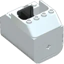{ .lu-ti width="24" loading="lazy" } [Classic Rocket Cockpit (LOT 4714)](../4714.md) | Undefined for generic loot: reversed count range | 100% |
| 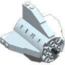{ .lu-ti width="24" loading="lazy" } [Classic Rocket Engine (LOT 4715)](../4715.md) | Undefined for generic loot: reversed count range | 100% |
| 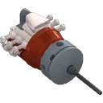{ .lu-ti width="24" loading="lazy" } [Steampunk Rocket Nose Cone (LOT 4716)](../4716.md) | Undefined for generic loot: reversed count range | 100% |
| 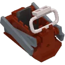{ .lu-ti width="24" loading="lazy" } [Steampunk Rocket Cockpit (LOT 4717)](../4717.md) | Undefined for generic loot: reversed count range | 100% |
| 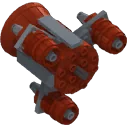{ .lu-ti width="24" loading="lazy" } [Steampunk Rocket Engine (LOT 4718)](../4718.md) | Undefined for generic loot: reversed count range | 100% |
| 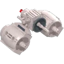{ .lu-ti width="24" loading="lazy" } [Pod Rocket Nose Cone (LOT 4719)](../4719.md) | Undefined for generic loot: reversed count range | 100% |
| 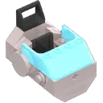{ .lu-ti width="24" loading="lazy" } [Pod Rocket Cockpit (LOT 4720)](../4720.md) | Undefined for generic loot: reversed count range | 100% |
| 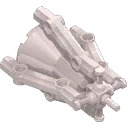{ .lu-ti width="24" loading="lazy" } [Pod Rocket Engine (LOT 4721)](../4721.md) | Undefined for generic loot: reversed count range | 100% |
| { .lu-ti width="24" loading="lazy" } [Castle Arbalest Model (LOT 9652)](../9652.md) | Undefined for generic loot: reversed count range | 100% |
| { .lu-ti width="24" loading="lazy" } [Castle Barrel Gun Model (LOT 9653)](../9653.md) | Undefined for generic loot: reversed count range | 100% |
| { .lu-ti width="24" loading="lazy" } [Castle Catapult Model (LOT 9654)](../9654.md) | Undefined for generic loot: reversed count range | 100% |
| { .lu-ti width="24" loading="lazy" } [Castle Inner Corner Model (LOT 9656)](../9656.md) | Undefined for generic loot: reversed count range | 100% |
| { .lu-ti width="24" loading="lazy" } [Castle Outside Corner Model (LOT 9657)](../9657.md) | Undefined for generic loot: reversed count range | 100% |
| { .lu-ti width="24" loading="lazy" } [Castle Small Corner Model (LOT 9658)](../9658.md) | Undefined for generic loot: reversed count range | 100% |
| 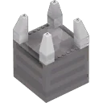{ .lu-ti width="24" loading="lazy" } [Castle Crossing Model (LOT 9659)](../9659.md) | Undefined for generic loot: reversed count range | 100% |
| { .lu-ti width="24" loading="lazy" } [Castle Gate Model (LOT 9660)](../9660.md) | Undefined for generic loot: reversed count range | 100% |
| { .lu-ti width="24" loading="lazy" } [Castle Outhouse Model (LOT 9661)](../9661.md) | Undefined for generic loot: reversed count range | 100% |
| { .lu-ti width="24" loading="lazy" } [Castle Ramp Model (LOT 9662)](../9662.md) | Undefined for generic loot: reversed count range | 100% |
| { .lu-ti width="24" loading="lazy" } [Castle Staircase Model (LOT 9663)](../9663.md) | Undefined for generic loot: reversed count range | 100% |
| { .lu-ti width="24" loading="lazy" } [Castle Tower Model (LOT 9664)](../9664.md) | Undefined for generic loot: reversed count range | 100% |
| 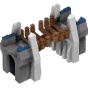{ .lu-ti width="24" loading="lazy" } [Castle Wall Bridge Model (LOT 9665)](../9665.md) | Undefined for generic loot: reversed count range | 100% |
| { .lu-ti width="24" loading="lazy" } [Castle Wall End Model (LOT 9666)](../9666.md) | Undefined for generic loot: reversed count range | 100% |
| { .lu-ti width="24" loading="lazy" } [Castle Small Wall Model 1 (LOT 9667)](../9667.md) | Undefined for generic loot: reversed count range | 100% |
| { .lu-ti width="24" loading="lazy" } [Castle Small Wall Model 2 (LOT 9668)](../9668.md) | Undefined for generic loot: reversed count range | 100% |
| { .lu-ti width="24" loading="lazy" } [Castle Small Wall Model 3 (LOT 9669)](../9669.md) | Undefined for generic loot: reversed count range | 100% |
| { .lu-ti width="24" loading="lazy" } [Castle Small Wall Model 4 (LOT 9670)](../9670.md) | Undefined for generic loot: reversed count range | 100% |
| { .lu-ti width="24" loading="lazy" } [Castle Straight Wall Model (LOT 9671)](../9671.md) | Undefined for generic loot: reversed count range | 100% |
| 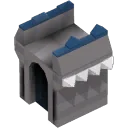{ .lu-ti width="24" loading="lazy" } [Castle Medium Straight Wall Model (LOT 9672)](../9672.md) | Undefined for generic loot: reversed count range | 100% |
| { .lu-ti width="24" loading="lazy" } [Castle Medium Spikes Wall Model (LOT 9673)](../9673.md) | Undefined for generic loot: reversed count range | 100% |
| { .lu-ti width="24" loading="lazy" } [Castle T-Wall Model (LOT 9674)](../9674.md) | Undefined for generic loot: reversed count range | 100% |
| { .lu-ti width="24" loading="lazy" } [Castle Tower Wall With No Top Model (LOT 9675)](../9675.md) | Undefined for generic loot: reversed count range | 100% |
| { .lu-ti width="24" loading="lazy" } [Castle Tower Wall With Top Model (LOT 9676)](../9676.md) | Undefined for generic loot: reversed count range | 100% |
| { .lu-ti width="24" loading="lazy" } [Castle Widening Wall Model (LOT 9677)](../9677.md) | Undefined for generic loot: reversed count range | 100% |
| { .lu-ti width="24" loading="lazy" } [Castle Wall With Stairs Model (LOT 9678)](../9678.md) | Undefined for generic loot: reversed count range | 100% |
| { .lu-ti width="24" loading="lazy" } [House Bathtub Model 1 (LOT 10328)](../10328.md) | Undefined for generic loot: reversed count range | 100% |
| { .lu-ti width="24" loading="lazy" } [House Bathtub Model 2 (LOT 10329)](../10329.md) | Undefined for generic loot: reversed count range | 100% |
| { .lu-ti width="24" loading="lazy" } [House Closed Door Model 1 (LOT 10330)](../10330.md) | Undefined for generic loot: reversed count range | 100% |
| 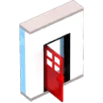{ .lu-ti width="24" loading="lazy" } [House Open Door Model 1 (LOT 10331)](../10331.md) | Undefined for generic loot: reversed count range | 100% |
| { .lu-ti width="24" loading="lazy" } [House Closed Door Model 2 (LOT 10332)](../10332.md) | Undefined for generic loot: reversed count range | 100% |
| { .lu-ti width="24" loading="lazy" } [House Open Door Model 2 (LOT 10333)](../10333.md) | Undefined for generic loot: reversed count range | 100% |
| { .lu-ti width="24" loading="lazy" } [House Closed Door Model 3 (LOT 10334)](../10334.md) | Undefined for generic loot: reversed count range | 100% |
| { .lu-ti width="24" loading="lazy" } [House Open Door Model 3 (LOT 10335)](../10335.md) | Undefined for generic loot: reversed count range | 100% |
| { .lu-ti width="24" loading="lazy" } [House Kitchen Model 1 (LOT 10336)](../10336.md) | Undefined for generic loot: reversed count range | 100% |
| { .lu-ti width="24" loading="lazy" } [House Kitchen Model 2 (LOT 10337)](../10337.md) | Undefined for generic loot: reversed count range | 100% |
| { .lu-ti width="24" loading="lazy" } [House Kitchen Model 3 (LOT 10338)](../10338.md) | Undefined for generic loot: reversed count range | 100% |
| { .lu-ti width="24" loading="lazy" } [House Laundry Model 1 (LOT 10339)](../10339.md) | Undefined for generic loot: reversed count range | 100% |
| { .lu-ti width="24" loading="lazy" } [House Laundry Model 2 (LOT 10340)](../10340.md) | Undefined for generic loot: reversed count range | 100% |
| { .lu-ti width="24" loading="lazy" } [House Library Model 1 (LOT 10341)](../10341.md) | Undefined for generic loot: reversed count range | 100% |
| { .lu-ti width="24" loading="lazy" } [House Library Model 2 (LOT 10342)](../10342.md) | Undefined for generic loot: reversed count range | 100% |
| { .lu-ti width="24" loading="lazy" } [House Library Model 3 (LOT 10343)](../10343.md) | Undefined for generic loot: reversed count range | 100% |
| { .lu-ti width="24" loading="lazy" } [House Library Model 4 (LOT 10344)](../10344.md) | Undefined for generic loot: reversed count range | 100% |
| { .lu-ti width="24" loading="lazy" } [House Toilet Model 2 (LOT 10345)](../10345.md) | Undefined for generic loot: reversed count range | 100% |
| { .lu-ti width="24" loading="lazy" } [House Vanity Model 1 (LOT 10346)](../10346.md) | Undefined for generic loot: reversed count range | 100% |
| { .lu-ti width="24" loading="lazy" } [House Vanity Model 2 (LOT 10347)](../10347.md) | Undefined for generic loot: reversed count range | 100% |
| { .lu-ti width="24" loading="lazy" } [House Vanity Model 3 (LOT 10348)](../10348.md) | Undefined for generic loot: reversed count range | 100% |
| { .lu-ti width="24" loading="lazy" } [House Vanity Model 4 (LOT 10349)](../10349.md) | Undefined for generic loot: reversed count range | 100% |
| { .lu-ti width="24" loading="lazy" } [House Wall Arch Model (LOT 10350)](../10350.md) | Undefined for generic loot: reversed count range | 100% |
| { .lu-ti width="24" loading="lazy" } [House Wall Art Model 1 (LOT 10351)](../10351.md) | Undefined for generic loot: reversed count range | 100% |
| { .lu-ti width="24" loading="lazy" } [House Wall Art Model 2 (LOT 10352)](../10352.md) | Undefined for generic loot: reversed count range | 100% |
| { .lu-ti width="24" loading="lazy" } [House Wall Blank Model 1 (LOT 10353)](../10353.md) | Undefined for generic loot: reversed count range | 100% |
| { .lu-ti width="24" loading="lazy" } [House Wall Blank Model 2 (LOT 10354)](../10354.md) | Undefined for generic loot: reversed count range | 100% |
| 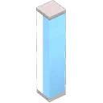{ .lu-ti width="24" loading="lazy" } [House Wall Blank Model 3 (LOT 10355)](../10355.md) | Undefined for generic loot: reversed count range | 100% |
| { .lu-ti width="24" loading="lazy" } [House Wall Corner Model 1 (LOT 10356)](../10356.md) | Undefined for generic loot: reversed count range | 100% |
| { .lu-ti width="24" loading="lazy" } [House Wall Corner Model 2 (LOT 10357)](../10357.md) | Undefined for generic loot: reversed count range | 100% |
| { .lu-ti width="24" loading="lazy" } [House Wall Corner Model 3 (LOT 10358)](../10358.md) | Undefined for generic loot: reversed count range | 100% |
| 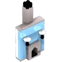{ .lu-ti width="24" loading="lazy" } [House Wall Fireplace Model 1 (LOT 10359)](../10359.md) | Undefined for generic loot: reversed count range | 100% |
| 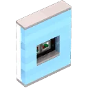{ .lu-ti width="24" loading="lazy" } [House Window Model 1 (LOT 10360)](../10360.md) | Undefined for generic loot: reversed count range | 100% |
| { .lu-ti width="24" loading="lazy" } [House Window Model 2 (LOT 10361)](../10361.md) | Undefined for generic loot: reversed count range | 100% |
| { .lu-ti width="24" loading="lazy" } [House Window Model 3 (LOT 10362)](../10362.md) | Undefined for generic loot: reversed count range | 100% |
| { .lu-ti width="24" loading="lazy" } [House Window Model 4 (LOT 10363)](../10363.md) | Undefined for generic loot: reversed count range | 100% |
| 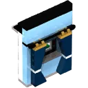{ .lu-ti width="24" loading="lazy" } [House Window Model 5 (LOT 10364)](../10364.md) | Undefined for generic loot: reversed count range | 100% |
| { .lu-ti width="24" loading="lazy" } [House Window Model 6 (LOT 10365)](../10365.md) | Undefined for generic loot: reversed count range | 100% |
| 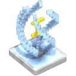{ .lu-ti width="24" loading="lazy" } [Boundless Possibilities Model (LOT 11201)](../11201.md) | Undefined for generic loot: reversed count range | 100% |
| { .lu-ti width="24" loading="lazy" } [Classic Blue Rocket Nose Cone (LOT 14444)](../14444.md) | Undefined for generic loot: reversed count range | 100% |
| 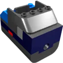{ .lu-ti width="24" loading="lazy" } [Classic Blue Rocket Cockpit (LOT 14445)](../14445.md) | Undefined for generic loot: reversed count range | 100% |
| { .lu-ti width="24" loading="lazy" } [Classic Blue Rocket Engine (LOT 14446)](../14446.md) | Undefined for generic loot: reversed count range | 100% |
| { .lu-ti width="24" loading="lazy" } [Classic Pink Rocket Nose Cone (LOT 14451)](../14451.md) | Undefined for generic loot: reversed count range | 100% |
| 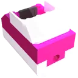{ .lu-ti width="24" loading="lazy" } [Classic Pink Rocket Cockpit (LOT 14452)](../14452.md) | Undefined for generic loot: reversed count range | 100% |
| { .lu-ti width="24" loading="lazy" } [Classic Pink Rocket Engine (LOT 14453)](../14453.md) | Undefined for generic loot: reversed count range | 100% |
| { .lu-ti width="24" loading="lazy" } [Classic Yellow Rocket Nose Cone (LOT 14454)](../14454.md) | Undefined for generic loot: reversed count range | 100% |
| 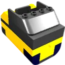{ .lu-ti width="24" loading="lazy" } [Classic Yellow Rocket Cockpit (LOT 14455)](../14455.md) | Undefined for generic loot: reversed count range | 100% |
| 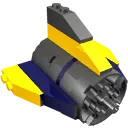{ .lu-ti width="24" loading="lazy" } [Classic Yellow Rocket Engine (LOT 14456)](../14456.md) | Undefined for generic loot: reversed count range | 100% |

## Raw matrix entries

| Row | Loot table | Rarity table | Trigger | Min | Max | Flag | Gate |
| --- | --- | --- | --- | --- | --- | --- | --- |
| 1217 | 281 | 19 | 1 | 1 | 0 |  |  |
| 1267 | 283 | 4 | 1 | 1 | 0 |  |  |

[LootMatrix](../../../db/LootMatrix.md), [LootTable](../../../db/LootTable.md), [RarityTable](../../../db/RarityTable.md).
