# Loot matrix 406

[Item database](../README.md) | [Methodology](../Methodology.md)

## Sources and mapped locations

| Kind | Source | Location evidence | Conditions |
| --- | --- | --- | --- |
| Vendor | [Autumn Helix - Model Vendor (LOT 10027)](../sources/object-10027.md) | [Nimbus Station (1200)](../locations/zone-1200.md) | Default inventory; vendorInvOverride can replace it |

**Generic loot probability unavailable:** at least one entry has maxToDrop < minToDrop. Vendor code treats a zero endpoint as “include the full table”; the generic loot code does not define that interpretation. No drop percentage is fabricated for this matrix.

## Item candidates

Default vendor-stock probabilities are shown only when this matrix has a registered vendor. Loot probabilities use the generic algorithm, not a guarantee of actual use by every script/activity.

| Item | Modeled loot chance / expected count | Default vendor stock |
| --- | --- | --- |
| { .lu-ti width="24" loading="lazy" } [Blue Imaginite (LOT 3038)](../3038.md) | Undefined for generic loot: reversed count range | 100% |
| { .lu-ti width="24" loading="lazy" } [Picnic Table Model (LOT 7758)](../7758.md) | Undefined for generic loot: reversed count range | 100% |
| 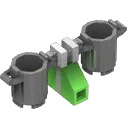{ .lu-ti width="24" loading="lazy" } [Double Trash Can Model (LOT 7759)](../7759.md) | Undefined for generic loot: reversed count range | 100% |
| { .lu-ti width="24" loading="lazy" } [Trash Can Model (LOT 7761)](../7761.md) | Undefined for generic loot: reversed count range | 100% |
| 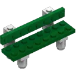{ .lu-ti width="24" loading="lazy" } [Bench Model (LOT 7770)](../7770.md) | Undefined for generic loot: reversed count range | 100% |
| { .lu-ti width="24" loading="lazy" } [Cooler Model (LOT 7771)](../7771.md) | Undefined for generic loot: reversed count range | 100% |
| { .lu-ti width="24" loading="lazy" } [Piano Model (LOT 7773)](../7773.md) | Undefined for generic loot: reversed count range | 100% |
| { .lu-ti width="24" loading="lazy" } [Guitar Model (LOT 7774)](../7774.md) | Undefined for generic loot: reversed count range | 100% |
| 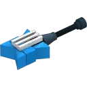{ .lu-ti width="24" loading="lazy" } [Bass Guitar Model (LOT 7775)](../7775.md) | Undefined for generic loot: reversed count range | 100% |
| { .lu-ti width="24" loading="lazy" } [Fire Hydrant Model (LOT 7808)](../7808.md) | Undefined for generic loot: reversed count range | 100% |
| { .lu-ti width="24" loading="lazy" } [Cash Register Model (LOT 7818)](../7818.md) | Undefined for generic loot: reversed count range | 100% |
| { .lu-ti width="24" loading="lazy" } [DJ Table Model (LOT 7822)](../7822.md) | Undefined for generic loot: reversed count range | 100% |
| { .lu-ti width="24" loading="lazy" } [Tank Pallet Model (LOT 7825)](../7825.md) | Undefined for generic loot: reversed count range | 100% |
| { .lu-ti width="24" loading="lazy" } [Oil Drum Model (LOT 7826)](../7826.md) | Undefined for generic loot: reversed count range | 100% |
| { .lu-ti width="24" loading="lazy" } [Dolly Model (LOT 7827)](../7827.md) | Undefined for generic loot: reversed count range | 100% |
| { .lu-ti width="24" loading="lazy" } [Torch Cart Model (LOT 7828)](../7828.md) | Undefined for generic loot: reversed count range | 100% |
| { .lu-ti width="24" loading="lazy" } [Engine Model (LOT 7829)](../7829.md) | Undefined for generic loot: reversed count range | 100% |
| { .lu-ti width="24" loading="lazy" } [Pallet Model (LOT 7830)](../7830.md) | Undefined for generic loot: reversed count range | 100% |
| { .lu-ti width="24" loading="lazy" } [Vendor Rack Model (LOT 7832)](../7832.md) | Undefined for generic loot: reversed count range | 100% |
| { .lu-ti width="24" loading="lazy" } [Double Lamppost Model (LOT 8270)](../8270.md) | Undefined for generic loot: reversed count range | 100% |
| 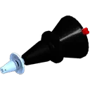{ .lu-ti width="24" loading="lazy" } [Nimbus Rocket Nose Cone (LOT 9516)](../9516.md) | Undefined for generic loot: reversed count range | 100% |
| 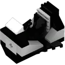{ .lu-ti width="24" loading="lazy" } [Nimbus Rocket Cockpit (LOT 9517)](../9517.md) | Undefined for generic loot: reversed count range | 100% |
| { .lu-ti width="24" loading="lazy" } [Nimbus Rocket Engine (LOT 9518)](../9518.md) | Undefined for generic loot: reversed count range | 100% |
| 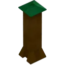{ .lu-ti width="24" loading="lazy" } [Zoo Wall Straight Pillar Model (LOT 13639)](../13639.md) | Undefined for generic loot: reversed count range | 100% |
| 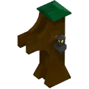{ .lu-ti width="24" loading="lazy" } [Zoo Wall Pillar Gate Support Model  (LOT 13640)](../13640.md) | Undefined for generic loot: reversed count range | 100% |
| 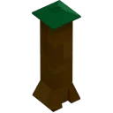{ .lu-ti width="24" loading="lazy" } [Zoo Wall Corner Pillar Model (LOT 13641)](../13641.md) | Undefined for generic loot: reversed count range | 100% |
| 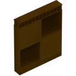{ .lu-ti width="24" loading="lazy" } [Zoo Wall Panel Model  (LOT 13642)](../13642.md) | Undefined for generic loot: reversed count range | 100% |
| 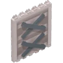{ .lu-ti width="24" loading="lazy" } [Zoo Wall Gate Model  (LOT 13643)](../13643.md) | Undefined for generic loot: reversed count range | 100% |
| 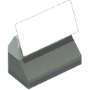{ .lu-ti width="24" loading="lazy" } [Zoo Sign Model 2 (LOT 13644)](../13644.md) | Undefined for generic loot: reversed count range | 100% |
| 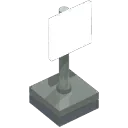{ .lu-ti width="24" loading="lazy" } [Zoo Sign Model 1 (LOT 13645)](../13645.md) | Undefined for generic loot: reversed count range | 100% |
| 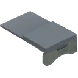{ .lu-ti width="24" loading="lazy" } [Zoo Ramped Path Model (LOT 13646)](../13646.md) | Undefined for generic loot: reversed count range | 100% |
| 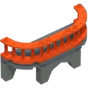{ .lu-ti width="24" loading="lazy" } [Zoo Raised Pathway with Railing Model (LOT 13647)](../13647.md) | Undefined for generic loot: reversed count range | 100% |
| 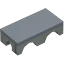{ .lu-ti width="24" loading="lazy" } [Zoo Raised Pathway Model (LOT 13648)](../13648.md) | Undefined for generic loot: reversed count range | 100% |
| 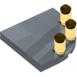{ .lu-ti width="24" loading="lazy" } [Zoo Pathway Corner Model 2 (LOT 13649)](../13649.md) | Undefined for generic loot: reversed count range | 100% |
| 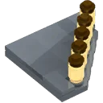{ .lu-ti width="24" loading="lazy" } [Zoo Pathway Corner Model 1 (LOT 13650)](../13650.md) | Undefined for generic loot: reversed count range | 100% |
| 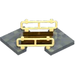{ .lu-ti width="24" loading="lazy" } [Zoo Angled Bridge Pathway Model 2 (LOT 13651)](../13651.md) | Undefined for generic loot: reversed count range | 100% |
| 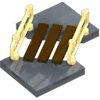{ .lu-ti width="24" loading="lazy" } [Zoo Angled Bridge Pathway Model 1 (LOT 13652)](../13652.md) | Undefined for generic loot: reversed count range | 100% |
| 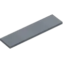{ .lu-ti width="24" loading="lazy" } [Zoo Long Pathway Model (LOT 13653)](../13653.md) | Undefined for generic loot: reversed count range | 100% |
| 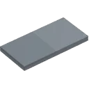{ .lu-ti width="24" loading="lazy" } [Zoo Short Pathway Model (LOT 13654)](../13654.md) | Undefined for generic loot: reversed count range | 100% |
| 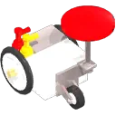{ .lu-ti width="24" loading="lazy" } [Zoo Hot Dog Cart Model (LOT 13655)](../13655.md) | Undefined for generic loot: reversed count range | 100% |
| { .lu-ti width="24" loading="lazy" } [Zoo Gift Stand Model (LOT 13656)](../13656.md) | Undefined for generic loot: reversed count range | 100% |
| 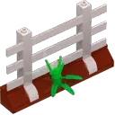{ .lu-ti width="24" loading="lazy" } [Zoo Straight Wooden Fence Model (LOT 13657)](../13657.md) | Undefined for generic loot: reversed count range | 100% |
| 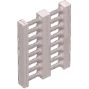{ .lu-ti width="24" loading="lazy" } [Zoo Wooden Fence Gate Model (LOT 13658)](../13658.md) | Undefined for generic loot: reversed count range | 100% |
| 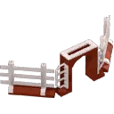{ .lu-ti width="24" loading="lazy" } [Zoo Wooden Fence Corner with Gate Model (LOT 13659)](../13659.md) | Undefined for generic loot: reversed count range | 100% |
| 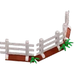{ .lu-ti width="24" loading="lazy" } [Zoo Wooden Fence Corner Model (LOT 13660)](../13660.md) | Undefined for generic loot: reversed count range | 100% |
| 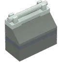{ .lu-ti width="24" loading="lazy" } [Zoo Straight Sloped Fence Model (LOT 13661)](../13661.md) | Undefined for generic loot: reversed count range | 100% |
| 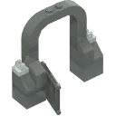{ .lu-ti width="24" loading="lazy" } [Zoo Sloped Fence with Open Gate Model (LOT 13662)](../13662.md) | Undefined for generic loot: reversed count range | 100% |
| 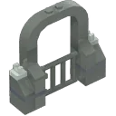{ .lu-ti width="24" loading="lazy" } [Zoo Sloped Fence with Closed Gate Model (LOT 13663)](../13663.md) | Undefined for generic loot: reversed count range | 100% |
| 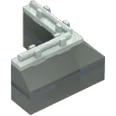{ .lu-ti width="24" loading="lazy" } [Zoo Sloped Outside Corner Fence Model (LOT 13664)](../13664.md) | Undefined for generic loot: reversed count range | 100% |
| 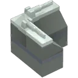{ .lu-ti width="24" loading="lazy" } [Zoo Sloped Inside Fence Corner Model (LOT 13665)](../13665.md) | Undefined for generic loot: reversed count range | 100% |
| 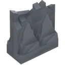{ .lu-ti width="24" loading="lazy" } [Zoo Straight Rock Fence Model 2 (LOT 13666)](../13666.md) | Undefined for generic loot: reversed count range | 100% |
| 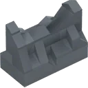{ .lu-ti width="24" loading="lazy" } [Zoo Straight Rock Fence Model 1 (LOT 13667)](../13667.md) | Undefined for generic loot: reversed count range | 100% |
| 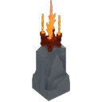{ .lu-ti width="24" loading="lazy" } [Zoo Rock Fence Pillar with Torches Model (LOT 13668)](../13668.md) | Undefined for generic loot: reversed count range | 100% |
| 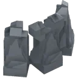{ .lu-ti width="24" loading="lazy" } [Zoo Rock Fence Corner Model (LOT 13669)](../13669.md) | Undefined for generic loot: reversed count range | 100% |
| 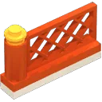{ .lu-ti width="24" loading="lazy" } [Zoo Straight Petting Zoo Fence Model 2 (LOT 13670)](../13670.md) | Undefined for generic loot: reversed count range | 100% |
| 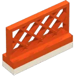{ .lu-ti width="24" loading="lazy" } [Zoo Straight Petting Zoo Fence Model 1 (LOT 13671)](../13671.md) | Undefined for generic loot: reversed count range | 100% |
| 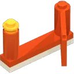{ .lu-ti width="24" loading="lazy" } [Zoo Petting Zoo Fence with Open Gate Model (LOT 13672)](../13672.md) | Undefined for generic loot: reversed count range | 100% |
| 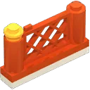{ .lu-ti width="24" loading="lazy" } [Zoo Petting Zoo Fence with Closed Gate Model (LOT 13673)](../13673.md) | Undefined for generic loot: reversed count range | 100% |
| 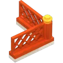{ .lu-ti width="24" loading="lazy" } [Zoo Petting Zoo Fence Corner Model (LOT 13674)](../13674.md) | Undefined for generic loot: reversed count range | 100% |
| 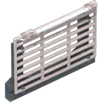{ .lu-ti width="24" loading="lazy" } [Zoo Electrified Straight Fence Model (LOT 13675)](../13675.md) | Undefined for generic loot: reversed count range | 100% |
| 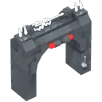{ .lu-ti width="24" loading="lazy" } [Zoo Electrified Gatehouse Model (LOT 13676)](../13676.md) | Undefined for generic loot: reversed count range | 100% |
| 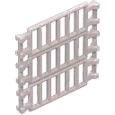{ .lu-ti width="24" loading="lazy" } [Zoo Electrified Gate Model (LOT 13677)](../13677.md) | Undefined for generic loot: reversed count range | 100% |
| 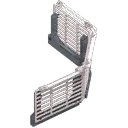{ .lu-ti width="24" loading="lazy" } [Zoo Electrified Outside Fence Corner Model (LOT 13678)](../13678.md) | Undefined for generic loot: reversed count range | 100% |
| 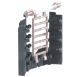{ .lu-ti width="24" loading="lazy" } [Zoo Electrified Inside Fence Corner Model (LOT 13679)](../13679.md) | Undefined for generic loot: reversed count range | 100% |
| 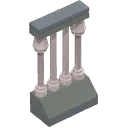{ .lu-ti width="24" loading="lazy" } [Zoo Barred Straight Fence Model (LOT 13680)](../13680.md) | Undefined for generic loot: reversed count range | 100% |
| 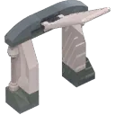{ .lu-ti width="24" loading="lazy" } [Zoo Barred Fence with Open Gate Model (LOT 13681)](../13681.md) | Undefined for generic loot: reversed count range | 100% |
| 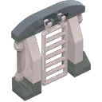{ .lu-ti width="24" loading="lazy" } [Zoo Barred Fence with Closed Gate Model (LOT 13682)](../13682.md) | Undefined for generic loot: reversed count range | 100% |
| 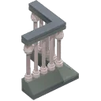{ .lu-ti width="24" loading="lazy" } [Zoo Barred Outside Fence Corner Model (LOT 13683)](../13683.md) | Undefined for generic loot: reversed count range | 100% |
| 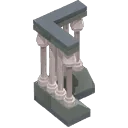{ .lu-ti width="24" loading="lazy" } [Zoo Barred Inside Fence Corner Model (LOT 13684)](../13684.md) | Undefined for generic loot: reversed count range | 100% |
| { .lu-ti width="24" loading="lazy" } [Zoo Critter House Middle Model 2 (LOT 13685)](../13685.md) | Undefined for generic loot: reversed count range | 100% |
| { .lu-ti width="24" loading="lazy" } [Zoo Critter House Middle Model 1 (LOT 13686)](../13686.md) | Undefined for generic loot: reversed count range | 100% |
| { .lu-ti width="24" loading="lazy" } [Zoo Critter House End Model 2 (LOT 13687)](../13687.md) | Undefined for generic loot: reversed count range | 100% |
| { .lu-ti width="24" loading="lazy" } [Zoo Critter House End Model 1 (LOT 13688)](../13688.md) | Undefined for generic loot: reversed count range | 100% |
| { .lu-ti width="24" loading="lazy" } [Zoo Straight Courtyard Edge Model Long (LOT 13689)](../13689.md) | Undefined for generic loot: reversed count range | 100% |
| { .lu-ti width="24" loading="lazy" } [Zoo Straight Courtyard Edge Model Short (LOT 13690)](../13690.md) | Undefined for generic loot: reversed count range | 100% |
| { .lu-ti width="24" loading="lazy" } [Zoo Courtyard Edge Corner Model  (LOT 13691)](../13691.md) | Undefined for generic loot: reversed count range | 100% |
| { .lu-ti width="24" loading="lazy" } [Zoo Courtyard Model Long (LOT 13692)](../13692.md) | Undefined for generic loot: reversed count range | 100% |
| { .lu-ti width="24" loading="lazy" } [Zoo Courtyard Model Short (LOT 13693)](../13693.md) | Undefined for generic loot: reversed count range | 100% |
| { .lu-ti width="24" loading="lazy" } [Zoo Straight Building Wall Model (LOT 13694)](../13694.md) | Undefined for generic loot: reversed count range | 100% |
| { .lu-ti width="24" loading="lazy" } [Zoo Building Wall with Open Doors Model (LOT 13695)](../13695.md) | Undefined for generic loot: reversed count range | 100% |
| { .lu-ti width="24" loading="lazy" } [Zoo Building Wall with Closed Doors Model (LOT 13696)](../13696.md) | Undefined for generic loot: reversed count range | 100% |
| { .lu-ti width="24" loading="lazy" } [Zoo Building Wall Corner Model  (LOT 13697)](../13697.md) | Undefined for generic loot: reversed count range | 100% |
| { .lu-ti width="24" loading="lazy" } [Zoo Building Roof with Tower Model (LOT 13698)](../13698.md) | Undefined for generic loot: reversed count range | 100% |
| { .lu-ti width="24" loading="lazy" } [Zoo Building Roof Model  (LOT 13699)](../13699.md) | Undefined for generic loot: reversed count range | 100% |
| { .lu-ti width="24" loading="lazy" } [Zoo Straight Aviary Wall Model (LOT 13700)](../13700.md) | Undefined for generic loot: reversed count range | 100% |
| { .lu-ti width="24" loading="lazy" } [Zoo Aviary Wall End Cap Model  (LOT 13701)](../13701.md) | Undefined for generic loot: reversed count range | 100% |
| { .lu-ti width="24" loading="lazy" } [Zoo Aviary Wall Corner Model  (LOT 13702)](../13702.md) | Undefined for generic loot: reversed count range | 100% |
| { .lu-ti width="24" loading="lazy" } [Zoo Straight Aviary Floor Model 4 (LOT 13703)](../13703.md) | Undefined for generic loot: reversed count range | 100% |
| { .lu-ti width="24" loading="lazy" } [Zoo Straight Aviary Floor Model 3 (LOT 13704)](../13704.md) | Undefined for generic loot: reversed count range | 100% |
| { .lu-ti width="24" loading="lazy" } [Zoo Straight Aviary Floor Model 2 (LOT 13705)](../13705.md) | Undefined for generic loot: reversed count range | 100% |
| { .lu-ti width="24" loading="lazy" } [Zoo Straight Aviary Floor Model 1 (LOT 13706)](../13706.md) | Undefined for generic loot: reversed count range | 100% |
| { .lu-ti width="24" loading="lazy" } [Zoo Aviary Floor Corner Model 4 (LOT 13707)](../13707.md) | Undefined for generic loot: reversed count range | 100% |
| { .lu-ti width="24" loading="lazy" } [Zoo Aviary Floor Corner Model 3 (LOT 13708)](../13708.md) | Undefined for generic loot: reversed count range | 100% |
| { .lu-ti width="24" loading="lazy" } [Zoo Aviary Floor Corner Model 2 (LOT 13709)](../13709.md) | Undefined for generic loot: reversed count range | 100% |
| { .lu-ti width="24" loading="lazy" } [Zoo Aviary Floor Corner Model 1 (LOT 13710)](../13710.md) | Undefined for generic loot: reversed count range | 100% |
| { .lu-ti width="24" loading="lazy" } [Safari Waterhole Model  (LOT 13717)](../13717.md) | Undefined for generic loot: reversed count range | 100% |
| { .lu-ti width="24" loading="lazy" } [Safari Umbrella Model  (LOT 13718)](../13718.md) | Undefined for generic loot: reversed count range | 100% |
| { .lu-ti width="24" loading="lazy" } [Safari Termite Mound Model  (LOT 13719)](../13719.md) | Undefined for generic loot: reversed count range | 100% |
| { .lu-ti width="24" loading="lazy" } [Safari Tent Model 2 (LOT 13720)](../13720.md) | Undefined for generic loot: reversed count range | 100% |
| { .lu-ti width="24" loading="lazy" } [Safari Tent Model 1 (LOT 13721)](../13721.md) | Undefined for generic loot: reversed count range | 100% |
| { .lu-ti width="24" loading="lazy" } [Safari Rover Model  (LOT 13722)](../13722.md) | Undefined for generic loot: reversed count range | 100% |
| { .lu-ti width="24" loading="lazy" } [Safari Plane Model  (LOT 13723)](../13723.md) | Undefined for generic loot: reversed count range | 100% |
| { .lu-ti width="24" loading="lazy" } [Safari Lion Rock Model (LOT 13724)](../13724.md) | Undefined for generic loot: reversed count range | 100% |
| { .lu-ti width="24" loading="lazy" } [Safari Gate Model  (LOT 13725)](../13725.md) | Undefined for generic loot: reversed count range | 100% |
| { .lu-ti width="24" loading="lazy" } [Safari Cooking Place Model  (LOT 13726)](../13726.md) | Undefined for generic loot: reversed count range | 100% |
| { .lu-ti width="24" loading="lazy" } [Safari Bench Model  (LOT 13727)](../13727.md) | Undefined for generic loot: reversed count range | 100% |
| { .lu-ti width="24" loading="lazy" } [Safari Baobab Tree Model (LOT 13728)](../13728.md) | Undefined for generic loot: reversed count range | 100% |

## Raw matrix entries

| Row | Loot table | Rarity table | Trigger | Min | Max | Flag | Gate |
| --- | --- | --- | --- | --- | --- | --- | --- |
| 1282 | 182 | 4 | 1 | 1 | 0 |  |  |
| 1283 | 284 | 4 | 1 | 1 | 0 |  |  |
| 3855 | 668 | 4 | 1 | 1 | 0 |  |  |
| 3856 | 669 | 4 | 1 | 1 | 0 |  |  |

[LootMatrix](../../../db/LootMatrix.md), [LootTable](../../../db/LootTable.md), [RarityTable](../../../db/RarityTable.md).
