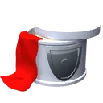
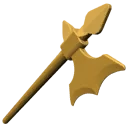
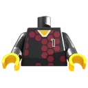
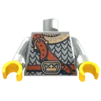

# Loot matrix 44

[Item database](../README.md) | [Methodology](../Methodology.md)

## Sources and mapped locations

| Kind | Source | Location evidence | Conditions |
| --- | --- | --- | --- |
| Vendor | [Unnamed LOT 2418 (LOT 2418)](../sources/object-2418.md) | No default-stock placement found | Default inventory; vendorInvOverride can replace it |
| Vendor | [Unnamed LOT 2420 (LOT 2420)](../sources/object-2420.md) | No default-stock placement found | Default inventory; vendorInvOverride can replace it |
| Vendor | [Unnamed LOT 2529 (LOT 2529)](../sources/object-2529.md) | No default-stock placement found | Default inventory; vendorInvOverride can replace it |
| Vendor | [Unnamed LOT 2530 (LOT 2530)](../sources/object-2530.md) | No default-stock placement found | Default inventory; vendorInvOverride can replace it |
| Vendor | [Unnamed LOT 2655 (LOT 2655)](../sources/object-2655.md) | No default-stock placement found | Default inventory; vendorInvOverride can replace it |
| Vendor | [Unnamed LOT 2656 (LOT 2656)](../sources/object-2656.md) | No default-stock placement found | Default inventory; vendorInvOverride can replace it |
| Vendor | [Unnamed LOT 3058 (LOT 3058)](../sources/object-3058.md) | No default-stock placement found | Default inventory; vendorInvOverride can replace it |
| Vendor | [RAF - NPCtest2 (LOT 3755)](../sources/object-3755.md) | No default-stock placement found | Default inventory; vendorInvOverride can replace it |
| Vendor | [Template vendor (LOT 6324)](../sources/object-6324.md) | No default-stock placement found | Default inventory; vendorInvOverride can replace it |
| Vendor | [Test commit (LOT 6875)](../sources/object-6875.md) | No default-stock placement found | Default inventory; vendorInvOverride can replace it |
| Vendor | [Kore Swordcube - Gear Vendor (LOT 7430)](../sources/object-7430.md) | No default-stock placement found | Default inventory; vendorInvOverride can replace it |

**Generic loot probability unavailable:** at least one entry has maxToDrop < minToDrop. Vendor code treats a zero endpoint as “include the full table”; the generic loot code does not define that interpretation. No drop percentage is fabricated for this matrix.

## Item candidates

Default vendor-stock probabilities are shown only when this matrix has a registered vendor. Loot probabilities use the generic algorithm, not a guarantee of actual use by every script/activity.

| Item | Modeled loot chance / expected count | Default vendor stock |
| --- | --- | --- |
| { .lu-ti width="24" loading="lazy" } [Healing Banana (LOT 1966)](../1966.md) | Undefined for generic loot: reversed count range | 100% |
| { .lu-ti width="24" loading="lazy" } [Notion Potion (LOT 2198)](../2198.md) | Undefined for generic loot: reversed count range | 100% |
| { .lu-ti width="24" loading="lazy" } [Quicksicle (LOT 2620)](../2620.md) | Undefined for generic loot: reversed count range | 100% |
| { .lu-ti width="24" loading="lazy" } [Armor Polish (LOT 2993)](../2993.md) | Undefined for generic loot: reversed count range | 100% |
| { .lu-ti width="24" loading="lazy" } [Healing Cherry (LOT 2994)](../2994.md) | Undefined for generic loot: reversed count range | 100% |
| { .lu-ti width="24" loading="lazy" } [Armor Shine (LOT 2996)](../2996.md) | Undefined for generic loot: reversed count range | 100% |
| { .lu-ti width="24" loading="lazy" } [Strong Notion Potion (LOT 2998)](../2998.md) | Undefined for generic loot: reversed count range | 100% |
| { .lu-ti width="24" loading="lazy" } [Green Imaginite (LOT 3039)](../3039.md) | Undefined for generic loot: reversed count range | 100% |
| { .lu-ti width="24" loading="lazy" } [Red Imaginite (LOT 3040)](../3040.md) | Undefined for generic loot: reversed count range | 100% |
| { .lu-ti width="24" loading="lazy" } [Superior Huge Axe (LOT 8485)](../8485.md) | Undefined for generic loot: reversed count range | 100% |
| { .lu-ti width="24" loading="lazy" } [Superior Halberd (LOT 8490)](../8490.md) | Undefined for generic loot: reversed count range | 100% |
| { .lu-ti width="24" loading="lazy" } [Improved Ice Saw (LOT 8501)](../8501.md) | Undefined for generic loot: reversed count range | 100% |
| { .lu-ti width="24" loading="lazy" } [Basic Force Blade (LOT 8505)](../8505.md) | Undefined for generic loot: reversed count range | 100% |
| { .lu-ti width="24" loading="lazy" } [Quality Dirk (LOT 8506)](../8506.md) | Undefined for generic loot: reversed count range | 100% |
| { .lu-ti width="24" loading="lazy" } [Black Soccer Shirt (LOT 8604)](../8604.md) | Undefined for generic loot: reversed count range | 100% |
| { .lu-ti width="24" loading="lazy" } [Dark Blue Princess Shirt (LOT 8623)](../8623.md) | Undefined for generic loot: reversed count range | 100% |
| { .lu-ti width="24" loading="lazy" } [Mail Shirt with Belt (LOT 8625)](../8625.md) | Undefined for generic loot: reversed count range | 100% |
| { .lu-ti width="24" loading="lazy" } [Jeans (LOT 8648)](../8648.md) | Undefined for generic loot: reversed count range | 100% |
| { .lu-ti width="24" loading="lazy" } [Basic Shortsword (LOT 10431)](../10431.md) | Undefined for generic loot: reversed count range | 100% |
| { .lu-ti width="24" loading="lazy" } [Basic Spear (LOT 10432)](../10432.md) | Undefined for generic loot: reversed count range | 100% |
| { .lu-ti width="24" loading="lazy" } [Basic Hammer (LOT 10433)](../10433.md) | Undefined for generic loot: reversed count range | 100% |
| { .lu-ti width="24" loading="lazy" } [Handsome Mug (LOT 11299)](../11299.md) | Undefined for generic loot: reversed count range | 100% |

## Raw matrix entries

| Row | Loot table | Rarity table | Trigger | Min | Max | Flag | Gate |
| --- | --- | --- | --- | --- | --- | --- | --- |
| 735 | 89 | 4 | 1 | 1 | 0 |  |  |

[LootMatrix](../../../db/LootMatrix.md), [LootTable](../../../db/LootTable.md), [RarityTable](../../../db/RarityTable.md).
