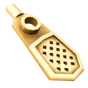

# Loot matrix 452

[Item database](../README.md) | [Methodology](../Methodology.md)

## Sources and mapped locations

| Kind | Source | Location evidence | Conditions |
| --- | --- | --- | --- |
| Drop | [WBL - Ice Cube (LOT 10592)](../sources/object-10592.md) | [DeepFreeze (1601)](../locations/zone-1601.md) | DestructibleComponent 1588; static component precedence; Static association, not a live-spawn guarantee |

## Item candidates

Default vendor-stock probabilities are shown only when this matrix has a registered vendor. Loot probabilities use the generic algorithm, not a guarantee of actual use by every script/activity.

| Item | Modeled loot chance / expected count | Default vendor stock |
| --- | --- | --- |
| { .lu-ti width="24" loading="lazy" } [Snowshoe (LOT 10508)](../10508.md) | 75%; mean 0.75 | Not associated with a vendor |
| Imagination Powerup 3 points (LOT 11910; not an item registration) | 100%; mean 1.5 | Not associated with a vendor |
| Armor Powerup 2 points (LOT 11912; not an item registration) | 100%; mean 1 | Not associated with a vendor |
| Life Powerup 2 points (LOT 11915; not an item registration) | 100%; mean 1 | Not associated with a vendor |

## Raw matrix entries

| Row | Loot table | Rarity table | Trigger | Min | Max | Flag | Gate |
| --- | --- | --- | --- | --- | --- | --- | --- |
| 1427 | 367 | 25 | 0.75 | 1 | 1 |  |  |
| 1637 | 415 | 4 | 1 | 1 | 1 |  |  |
| 1638 | 420 | 4 | 1 | 1 | 2 |  |  |
| 1639 | 423 | 4 | 1 | 1 | 1 |  |  |

[LootMatrix](../../../db/LootMatrix.md), [LootTable](../../../db/LootTable.md), [RarityTable](../../../db/RarityTable.md).
