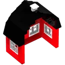

# Loot matrix 482

[Item database](../README.md) | [Methodology](../Methodology.md)

## Sources and mapped locations

| Kind | Source | Location evidence | Conditions |
| --- | --- | --- | --- |
| Package | [12 Month Subscriber Reward Pack (LOT 11316)](../sources/object-11316.md) | No matched local placement found | Static association, not a live-spawn guarantee |
| Package | [LEGO Universe Experience Reward Pack (LOT 11317)](../sources/object-11317.md) | No matched local placement found | Static association, not a live-spawn guarantee |

## Item candidates

Default vendor-stock probabilities are shown only when this matrix has a registered vendor. Loot probabilities use the generic algorithm, not a guarantee of actual use by every script/activity.

| Item | Modeled loot chance / expected count | Default vendor stock |
| --- | --- | --- |
| { .lu-ti width="24" loading="lazy" } [Old Skool Shirt (LOT 8600)](../8600.md) | 100%; mean 1 | Not associated with a vendor |
| { .lu-ti width="24" loading="lazy" } [Farm Barn Back Model (LOT 11695)](../11695.md) | 100%; mean 1 | Not associated with a vendor |
| { .lu-ti width="24" loading="lazy" } [Farm Barn Front Model (LOT 11696)](../11696.md) | 100%; mean 1 | Not associated with a vendor |
| { .lu-ti width="24" loading="lazy" } [Farm Barn Middle Model (LOT 11697)](../11697.md) | 100%; mean 1 | Not associated with a vendor |
| { .lu-ti width="24" loading="lazy" } [Farm Silo Model 1 (LOT 11711)](../11711.md) | 100%; mean 1 | Not associated with a vendor |

## Raw matrix entries

| Row | Loot table | Rarity table | Trigger | Min | Max | Flag | Gate |
| --- | --- | --- | --- | --- | --- | --- | --- |
| 1551 | 408 | 25 | 1 | 1 | 1 |  |  |
| 1552 | 409 | 25 | 1 | 1 | 1 |  |  |
| 1553 | 410 | 25 | 1 | 1 | 1 |  |  |
| 1554 | 411 | 24 | 1 | 1 | 1 |  |  |
| 1555 | 412 | 25 | 1 | 1 | 1 |  |  |

[LootMatrix](../../../db/LootMatrix.md), [LootTable](../../../db/LootTable.md), [RarityTable](../../../db/RarityTable.md).
