# Loot matrix 530

[Item database](../README.md) | [Methodology](../Methodology.md)

## Sources and mapped locations

| Kind | Source | Location evidence | Conditions |
| --- | --- | --- | --- |
| Drop | [AM - Skeleton Growlspeaker Amp Smashable (LOT 12171)](../sources/object-12171.md) | [Crux Prime (1800)](../locations/zone-1800.md) | DestructibleComponent 1663; static component precedence; Static association, not a live-spawn guarantee |

## Item candidates

Default vendor-stock probabilities are shown only when this matrix has a registered vendor. Loot probabilities use the generic algorithm, not a guarantee of actual use by every script/activity.

| Item | Modeled loot chance / expected count | Default vendor stock |
| --- | --- | --- |
| { .lu-ti width="24" loading="lazy" } [Brick 2x4 (LOT 29)](../29.md) | 1.81818182%; mean 0.018181818 | Not associated with a vendor |
| { .lu-ti width="24" loading="lazy" } [Brick 2x3 (LOT 30)](../30.md) | 1.81818182%; mean 0.018181818 | Not associated with a vendor |
| { .lu-ti width="24" loading="lazy" } [Brick 2x2 (LOT 31)](../31.md) | 1.81818182%; mean 0.018181818 | Not associated with a vendor |
| { .lu-ti width="24" loading="lazy" } [Brick 1x2 (LOT 32)](../32.md) | 1.81818182%; mean 0.018181818 | Not associated with a vendor |
| { .lu-ti width="24" loading="lazy" } [Brick 1x1 (LOT 33)](../33.md) | 1.81818182%; mean 0.018181818 | Not associated with a vendor |
| { .lu-ti width="24" loading="lazy" } [Brick 2x8 (LOT 35)](../35.md) | 1.81818182%; mean 0.018181818 | Not associated with a vendor |
| { .lu-ti width="24" loading="lazy" } [Brick 1x8 (LOT 36)](../36.md) | 1.81818182%; mean 0.018181818 | Not associated with a vendor |
| { .lu-ti width="24" loading="lazy" } [Brick 1x6 (LOT 37)](../37.md) | 1.81818182%; mean 0.018181818 | Not associated with a vendor |
| { .lu-ti width="24" loading="lazy" } [Brick 1x4 (LOT 38)](../38.md) | 1.81818182%; mean 0.018181818 | Not associated with a vendor |
| { .lu-ti width="24" loading="lazy" } [Plate 2x4 (LOT 39)](../39.md) | 1.81818182%; mean 0.018181818 | Not associated with a vendor |
| { .lu-ti width="24" loading="lazy" } [Plate 2x3 (LOT 40)](../40.md) | 1.81818182%; mean 0.018181818 | Not associated with a vendor |
| { .lu-ti width="24" loading="lazy" } [Plate 1x2 (LOT 41)](../41.md) | 1.81818182%; mean 0.018181818 | Not associated with a vendor |
| { .lu-ti width="24" loading="lazy" } [Plate 1x1 (LOT 42)](../42.md) | 1.81818182%; mean 0.018181818 | Not associated with a vendor |
| 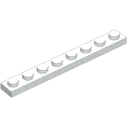{ .lu-ti width="24" loading="lazy" } [Plate 1x8 (LOT 58)](../58.md) | 1.81818182%; mean 0.018181818 | Not associated with a vendor |
| { .lu-ti width="24" loading="lazy" } [Brick 1x3 (LOT 59)](../59.md) | 1.81818182%; mean 0.018181818 | Not associated with a vendor |
| { .lu-ti width="24" loading="lazy" } [Plate 1x3 (LOT 60)](../60.md) | 1.81818182%; mean 0.018181818 | Not associated with a vendor |
| { .lu-ti width="24" loading="lazy" } [Plate 1x6 (LOT 62)](../62.md) | 1.81818182%; mean 0.018181818 | Not associated with a vendor |
| { .lu-ti width="24" loading="lazy" } [Plate 1x4 (LOT 66)](../66.md) | 1.81818182%; mean 0.018181818 | Not associated with a vendor |
| { .lu-ti width="24" loading="lazy" } [Brick 2x6 (LOT 98)](../98.md) | 1.81818182%; mean 0.018181818 | Not associated with a vendor |
| { .lu-ti width="24" loading="lazy" } [Plate 2x6 (LOT 144)](../144.md) | 1.81818182%; mean 0.018181818 | Not associated with a vendor |
| { .lu-ti width="24" loading="lazy" } [Plate 2x2 (LOT 865)](../865.md) | 1.81818182%; mean 0.018181818 | Not associated with a vendor |
| { .lu-ti width="24" loading="lazy" } [Plate 2x8 (LOT 869)](../869.md) | 1.81818182%; mean 0.018181818 | Not associated with a vendor |
| Imagination Powerup 2 points (LOT 4035; not an item registration) | 100%; mean 1 | Not associated with a vendor |
| { .lu-ti width="24" loading="lazy" } [Maelstrom-Infected Brick (LOT 6194)](../6194.md) | 10%; mean 0.1 | Not associated with a vendor |
| Armor Powerup 2 points (LOT 11912; not an item registration) | 100%; mean 1 | Not associated with a vendor |
| Life Powerup 2 points (LOT 11915; not an item registration) | 100%; mean 1 | Not associated with a vendor |
| 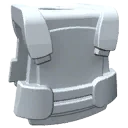{ .lu-ti width="24" loading="lazy" } [Crux Prime Armor (LOT 12095)](../12095.md) | 0.00018182%; mean 0.0000018181818 | Not associated with a vendor |
| { .lu-ti width="24" loading="lazy" } [Nexus Airtanks (LOT 12098)](../12098.md) | 0.0125%; mean 0.000125 | Not associated with a vendor |
| { .lu-ti width="24" loading="lazy" } [Massive Firecracker (LOT 12107)](../12107.md) | 0.05%; mean 0.0005 | Not associated with a vendor |
| { .lu-ti width="24" loading="lazy" } [Doc in a Box (LOT 12319)](../12319.md) | 0.15%; mean 0.0015 | Not associated with a vendor |
| { .lu-ti width="24" loading="lazy" } [Flogmore's Hat (LOT 12435)](../12435.md) | 0.00018182%; mean 0.0000018181818 | Not associated with a vendor |
| { .lu-ti width="24" loading="lazy" } [Explorien Bot Helm (LOT 12472)](../12472.md) | 0.00114286%; mean 0.000011428571 | Not associated with a vendor |
| { .lu-ti width="24" loading="lazy" } [Skeleton Ziggurat Model (LOT 12495)](../12495.md) | 0.00111111%; mean 0.000011111111 | Not associated with a vendor |
| { .lu-ti width="24" loading="lazy" } [Skeleton Watchtower Wall Model (LOT 12496)](../12496.md) | 0.00111111%; mean 0.000011111111 | Not associated with a vendor |
| { .lu-ti width="24" loading="lazy" } [Skeleton Corner Wall Model (LOT 12497)](../12497.md) | 0.01%; mean 0.0001 | Not associated with a vendor |
| { .lu-ti width="24" loading="lazy" } [Skeleton Wall Model (LOT 12498)](../12498.md) | 0.01%; mean 0.0001 | Not associated with a vendor |
| 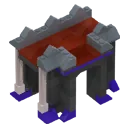{ .lu-ti width="24" loading="lazy" } [Skeleton T-Wall Model (LOT 12499)](../12499.md) | 0.00111111%; mean 0.000011111111 | Not associated with a vendor |
| { .lu-ti width="24" loading="lazy" } [Skeleton Skull Tower Model (LOT 12500)](../12500.md) | 0.00111111%; mean 0.000011111111 | Not associated with a vendor |
| 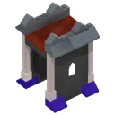{ .lu-ti width="24" loading="lazy" } [Skeleton Short Wall Model (LOT 12501)](../12501.md) | 0.01%; mean 0.0001 | Not associated with a vendor |
| { .lu-ti width="24" loading="lazy" } [Skeleton Ribcage Bridge Model (LOT 12502)](../12502.md) | 0.00111111%; mean 0.000011111111 | Not associated with a vendor |
| { .lu-ti width="24" loading="lazy" } [Skeleton Repair Facility Model (LOT 12503)](../12503.md) | 0.00111111%; mean 0.000011111111 | Not associated with a vendor |
| { .lu-ti width="24" loading="lazy" } [Skeleton Wall Pillars Model (LOT 12504)](../12504.md) | 0.075%; mean 0.00075 | Not associated with a vendor |
| { .lu-ti width="24" loading="lazy" } [Skeleton Mobile Drilling Rig Model (LOT 12505)](../12505.md) | 0.00111111%; mean 0.000011111111 | Not associated with a vendor |
| { .lu-ti width="24" loading="lazy" } [Skeleton Hover Drone Model (LOT 12506)](../12506.md) | 0.00111111%; mean 0.000011111111 | Not associated with a vendor |
| 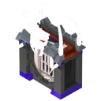{ .lu-ti width="24" loading="lazy" } [Skeleton Gate Model (LOT 12507)](../12507.md) | 0.00111111%; mean 0.000011111111 | Not associated with a vendor |
| { .lu-ti width="24" loading="lazy" } [Skeleton Elevator Model (LOT 12508)](../12508.md) | 0.01%; mean 0.0001 | Not associated with a vendor |
| { .lu-ti width="24" loading="lazy" } [Evergiving Goblet (LOT 12562)](../12562.md) | 0.003%; mean 0.00003 | Not associated with a vendor |
| 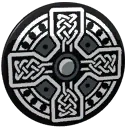{ .lu-ti width="24" loading="lazy" } [Knotwork Shield (LOT 12672)](../12672.md) | 0.0125%; mean 0.000125 | Not associated with a vendor |
| { .lu-ti width="24" loading="lazy" } [Wolf Shield (LOT 12677)](../12677.md) | 0.00018182%; mean 0.0000018181818 | Not associated with a vendor |
| { .lu-ti width="24" loading="lazy" } [Bat Lord Shield (LOT 12678)](../12678.md) | 0.00018182%; mean 0.0000018181818 | Not associated with a vendor |
| { .lu-ti width="24" loading="lazy" } [Bat Lord Shirt (LOT 12686)](../12686.md) | 0.00018182%; mean 0.0000018181818 | Not associated with a vendor |
| 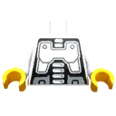{ .lu-ti width="24" loading="lazy" } [Explorien Bot Shirt (LOT 12690)](../12690.md) | 0.003%; mean 0.00003 | Not associated with a vendor |
| 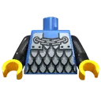{ .lu-ti width="24" loading="lazy" } [Scale Mail Shirt (LOT 12698)](../12698.md) | 0.00114286%; mean 0.000011428571 | Not associated with a vendor |
| { .lu-ti width="24" loading="lazy" } [Denim Shirt (LOT 12700)](../12700.md) | 0.0125%; mean 0.000125 | Not associated with a vendor |
| { .lu-ti width="24" loading="lazy" } [Blacktron Shirt (LOT 12707)](../12707.md) | 0.003%; mean 0.00003 | Not associated with a vendor |
| 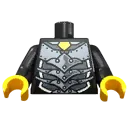{ .lu-ti width="24" loading="lazy" } [Banded Armor (LOT 12708)](../12708.md) | 0.003%; mean 0.00003 | Not associated with a vendor |
| { .lu-ti width="24" loading="lazy" } [Paisley Shirt (LOT 12710)](../12710.md) | 0.0125%; mean 0.000125 | Not associated with a vendor |
| 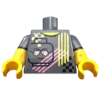{ .lu-ti width="24" loading="lazy" } [Blocks Shirt (LOT 12711)](../12711.md) | 0.0125%; mean 0.000125 | Not associated with a vendor |
| { .lu-ti width="24" loading="lazy" } [Futuron Shirt (LOT 12714)](../12714.md) | 0.003%; mean 0.00003 | Not associated with a vendor |
| { .lu-ti width="24" loading="lazy" } [Tiki Batik Shirt (LOT 12715)](../12715.md) | 0.00018182%; mean 0.0000018181818 | Not associated with a vendor |
| { .lu-ti width="24" loading="lazy" } [Elite Broadsword (LOT 12718)](../12718.md) | 0.00026667%; mean 0.0000026666667 | Not associated with a vendor |
| 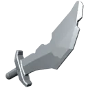{ .lu-ti width="24" loading="lazy" } [Super Cleaver (LOT 12719)](../12719.md) | 0.000375%; mean 0.00000375 | Not associated with a vendor |
| { .lu-ti width="24" loading="lazy" } [Super Dagger (LOT 12720)](../12720.md) | 0.000375%; mean 0.00000375 | Not associated with a vendor |
| { .lu-ti width="24" loading="lazy" } [Super Fang (LOT 12721)](../12721.md) | 0.000375%; mean 0.00000375 | Not associated with a vendor |
| { .lu-ti width="24" loading="lazy" } [Heroic Trident of Lightning (LOT 12722)](../12722.md) | 0.00004%; mean 4e-7 | Not associated with a vendor |
| { .lu-ti width="24" loading="lazy" } [Super Morning Star (LOT 12724)](../12724.md) | 0.000375%; mean 0.00000375 | Not associated with a vendor |
| { .lu-ti width="24" loading="lazy" } [Elite Javelin (LOT 12728)](../12728.md) | 0.00026667%; mean 0.0000026666667 | Not associated with a vendor |
| 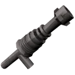{ .lu-ti width="24" loading="lazy" } [Elite Long Barrel Blaster (LOT 12729)](../12729.md) | 0.00004%; mean 4e-7 | Not associated with a vendor |
| 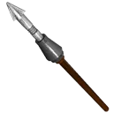{ .lu-ti width="24" loading="lazy" } [Fantastic Pilum (LOT 12730)](../12730.md) | 0.00004%; mean 4e-7 | Not associated with a vendor |
| { .lu-ti width="24" loading="lazy" } [Spike Hammer (LOT 12731)](../12731.md) | 0.00004%; mean 4e-7 | Not associated with a vendor |
| { .lu-ti width="24" loading="lazy" } [The Big One! (LOT 12735)](../12735.md) | 0.00018182%; mean 0.0000018181818 | Not associated with a vendor |
| { .lu-ti width="24" loading="lazy" } [Bone Suit Shirt (LOT 12758)](../12758.md) | 0.00114286%; mean 0.000011428571 | Not associated with a vendor |
| { .lu-ti width="24" loading="lazy" } [Battle Croissant (LOT 12762)](../12762.md) | 0.15%; mean 0.0015 | Not associated with a vendor |
| { .lu-ti width="24" loading="lazy" } [BBQ Drumstick (LOT 12763)](../12763.md) | 0.15%; mean 0.0015 | Not associated with a vendor |
| { .lu-ti width="24" loading="lazy" } [Big Fountain Soda (LOT 12764)](../12764.md) | 0.05%; mean 0.0005 | Not associated with a vendor |
| { .lu-ti width="24" loading="lazy" } [Energy Bar (LOT 12765)](../12765.md) | 0.15%; mean 0.0015 | Not associated with a vendor |
| { .lu-ti width="24" loading="lazy" } [Xpresso (LOT 12766)](../12766.md) | 0.05%; mean 0.0005 | Not associated with a vendor |
| { .lu-ti width="24" loading="lazy" } [Buff Out Armor Brush (LOT 12767)](../12767.md) | 0.15%; mean 0.0015 | Not associated with a vendor |
| { .lu-ti width="24" loading="lazy" } [Dancin' Hat (LOT 12779)](../12779.md) | 0.00114286%; mean 0.000011428571 | Not associated with a vendor |
| { .lu-ti width="24" loading="lazy" } [Egyptian Headdress (LOT 12780)](../12780.md) | 0.00114286%; mean 0.000011428571 | Not associated with a vendor |
| { .lu-ti width="24" loading="lazy" } [Eisenhut (LOT 12782)](../12782.md) | 0.00114286%; mean 0.000011428571 | Not associated with a vendor |
| { .lu-ti width="24" loading="lazy" } [Iron Barbute (LOT 12784)](../12784.md) | 0.0125%; mean 0.000125 | Not associated with a vendor |
| { .lu-ti width="24" loading="lazy" } [Miners' Helm (LOT 12785)](../12785.md) | 0.00114286%; mean 0.000011428571 | Not associated with a vendor |
| { .lu-ti width="24" loading="lazy" } [Dragon Helm MK III (LOT 12786)](../12786.md) | 0.00018182%; mean 0.0000018181818 | Not associated with a vendor |
| { .lu-ti width="24" loading="lazy" } [Bone Suit Pants (LOT 12798)](../12798.md) | 0.00018182%; mean 0.0000018181818 | Not associated with a vendor |
| { .lu-ti width="24" loading="lazy" } [Bat Lord Staff (LOT 12802)](../12802.md) | 0.00004%; mean 4e-7 | Not associated with a vendor |
| { .lu-ti width="24" loading="lazy" } [Mosaic Jester Cap (LOT 12901)](../12901.md) | 0.00018182%; mean 0.0000018181818 | Not associated with a vendor |
| { .lu-ti width="24" loading="lazy" } [Mosaic Wand (LOT 12927)](../12927.md) | 0.00026667%; mean 0.0000026666667 | Not associated with a vendor |
| 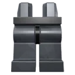{ .lu-ti width="24" loading="lazy" } [Bat Lord Pants (LOT 13000)](../13000.md) | 0.00018182%; mean 0.0000018181818 | Not associated with a vendor |
| { .lu-ti width="24" loading="lazy" } [Faction Token Proxy (LOT 13763)](../13763.md) | 2%; mean 0.02 | Not associated with a vendor |
| { .lu-ti width="24" loading="lazy" } [Med Pack (LOT 14679)](../14679.md) | 0.05%; mean 0.0005 | Not associated with a vendor |
| { .lu-ti width="24" loading="lazy" } [Armor Repair Kit (LOT 14680)](../14680.md) | 0.05%; mean 0.0005 | Not associated with a vendor |

## Raw matrix entries

| Row | Loot table | Rarity table | Trigger | Min | Max | Flag | Gate |
| --- | --- | --- | --- | --- | --- | --- | --- |
| 1778 | 415 | 4 | 1 | 1 | 1 |  |  |
| 1779 | 419 | 4 | 1 | 1 | 1 |  |  |
| 1780 | 423 | 4 | 1 | 1 | 1 |  |  |
| 3011 | 443 | 4 | 0.0001 | 1 | 1 |  |  |
| 3012 | 444 | 4 | 0.001 | 1 | 1 |  |  |
| 3013 | 445 | 4 | 0.01 | 1 | 1 |  |  |
| 3014 | 446 | 4 | 0.005 | 1 | 1 |  |  |
| 3015 | 110 | 4 | 0.4 | 1 | 1 |  |  |
| 3426 | 670 | 23 | 0.02 | 1 | 1 |  |  |
| 3474 | 88 | 9 | 0.1 | 1 | 1 |  |  |

[LootMatrix](../../../db/LootMatrix.md), [LootTable](../../../db/LootTable.md), [RarityTable](../../../db/RarityTable.md).
