# Loot matrix 535

[Item database](../README.md) | [Methodology](../Methodology.md)

## Sources and mapped locations

| Kind | Source | Location evidence | Conditions |
| --- | --- | --- | --- |
| Drop | [AM - Bone Pet Dig (LOT 12192)](../sources/object-12192.md) | [Avant Gardens (1100)](../locations/zone-1100.md); [Forbidden Valley (1400)](../locations/zone-1400.md); [Gnarled Forest Deep Dive Map (375)](../locations/zone-375.md); [Gnarled Forest (1300)](../locations/zone-1300.md); [Crux Prime (1800)](../locations/zone-1800.md) | DestructibleComponent 1790; static component precedence; Static association, not a live-spawn guarantee |
| Activity | AM Bone Pet Dig (activity ID 12192, rating threshold 1, reward 160) | Selected only if this is the highest eligible rating threshold; instance zone not specified. | AM Bone Pet Dig (activity ID 12192, rating threshold 1, reward 160); Selected only if this is the highest eligible rating threshold; instance zone not specified.; Static association, not a live-spawn guarantee |

## Item candidates

Default vendor-stock probabilities are shown only when this matrix has a registered vendor. Loot probabilities use the generic algorithm, not a guarantee of actual use by every script/activity.

| Item | Modeled loot chance / expected count | Default vendor stock |
| --- | --- | --- |
| { .lu-ti width="24" loading="lazy" } [Brick 2x4 (LOT 29)](../29.md) | 6.71487603%; mean 0.068181818 | Not associated with a vendor |
| { .lu-ti width="24" loading="lazy" } [Brick 2x3 (LOT 30)](../30.md) | 6.71487603%; mean 0.068181818 | Not associated with a vendor |
| { .lu-ti width="24" loading="lazy" } [Brick 2x2 (LOT 31)](../31.md) | 6.71487603%; mean 0.068181818 | Not associated with a vendor |
| { .lu-ti width="24" loading="lazy" } [Brick 1x2 (LOT 32)](../32.md) | 6.71487603%; mean 0.068181818 | Not associated with a vendor |
| { .lu-ti width="24" loading="lazy" } [Brick 1x1 (LOT 33)](../33.md) | 6.71487603%; mean 0.068181818 | Not associated with a vendor |
| { .lu-ti width="24" loading="lazy" } [Brick 2x8 (LOT 35)](../35.md) | 6.71487603%; mean 0.068181818 | Not associated with a vendor |
| { .lu-ti width="24" loading="lazy" } [Brick 1x8 (LOT 36)](../36.md) | 6.71487603%; mean 0.068181818 | Not associated with a vendor |
| { .lu-ti width="24" loading="lazy" } [Brick 1x6 (LOT 37)](../37.md) | 6.71487603%; mean 0.068181818 | Not associated with a vendor |
| { .lu-ti width="24" loading="lazy" } [Brick 1x4 (LOT 38)](../38.md) | 6.71487603%; mean 0.068181818 | Not associated with a vendor |
| { .lu-ti width="24" loading="lazy" } [Plate 2x4 (LOT 39)](../39.md) | 6.71487603%; mean 0.068181818 | Not associated with a vendor |
| { .lu-ti width="24" loading="lazy" } [Plate 2x3 (LOT 40)](../40.md) | 6.71487603%; mean 0.068181818 | Not associated with a vendor |
| 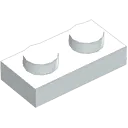{ .lu-ti width="24" loading="lazy" } [Plate 1x2 (LOT 41)](../41.md) | 6.71487603%; mean 0.068181818 | Not associated with a vendor |
| { .lu-ti width="24" loading="lazy" } [Plate 1x1 (LOT 42)](../42.md) | 6.71487603%; mean 0.068181818 | Not associated with a vendor |
| { .lu-ti width="24" loading="lazy" } [Plate 1x8 (LOT 58)](../58.md) | 6.71487603%; mean 0.068181818 | Not associated with a vendor |
| { .lu-ti width="24" loading="lazy" } [Brick 1x3 (LOT 59)](../59.md) | 6.71487603%; mean 0.068181818 | Not associated with a vendor |
| { .lu-ti width="24" loading="lazy" } [Plate 1x3 (LOT 60)](../60.md) | 6.71487603%; mean 0.068181818 | Not associated with a vendor |
| { .lu-ti width="24" loading="lazy" } [Plate 1x6 (LOT 62)](../62.md) | 6.71487603%; mean 0.068181818 | Not associated with a vendor |
| { .lu-ti width="24" loading="lazy" } [Plate 1x4 (LOT 66)](../66.md) | 6.71487603%; mean 0.068181818 | Not associated with a vendor |
| { .lu-ti width="24" loading="lazy" } [Brick 2x6 (LOT 98)](../98.md) | 6.71487603%; mean 0.068181818 | Not associated with a vendor |
| { .lu-ti width="24" loading="lazy" } [Plate 2x6 (LOT 144)](../144.md) | 6.71487603%; mean 0.068181818 | Not associated with a vendor |
| { .lu-ti width="24" loading="lazy" } [Plate 2x2 (LOT 865)](../865.md) | 6.71487603%; mean 0.068181818 | Not associated with a vendor |
| { .lu-ti width="24" loading="lazy" } [Plate 2x8 (LOT 869)](../869.md) | 6.71487603%; mean 0.068181818 | Not associated with a vendor |
| 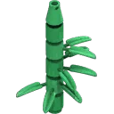{ .lu-ti width="24" loading="lazy" } [Bamboo Model (LOT 7974)](../7974.md) | 0.30737705%; mean 0.0030737705 | Not associated with a vendor |
| { .lu-ti width="24" loading="lazy" } [Garden Tool Rack Model (LOT 9564)](../9564.md) | 0.2016129%; mean 0.002016129 | Not associated with a vendor |
| { .lu-ti width="24" loading="lazy" } [Drill Press Model (LOT 10750)](../10750.md) | 0.30737705%; mean 0.0030737705 | Not associated with a vendor |
| { .lu-ti width="24" loading="lazy" } [AC Unit Model (LOT 10788)](../10788.md) | 0.2016129%; mean 0.002016129 | Not associated with a vendor |
| { .lu-ti width="24" loading="lazy" } [Bird Post Model (LOT 10789)](../10789.md) | 0.2016129%; mean 0.002016129 | Not associated with a vendor |
| 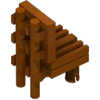{ .lu-ti width="24" loading="lazy" } [Brown Chair Model (LOT 10790)](../10790.md) | 0.30737705%; mean 0.0030737705 | Not associated with a vendor |
| 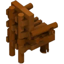{ .lu-ti width="24" loading="lazy" } [Brown Chair With Arms Model (LOT 10791)](../10791.md) | 0.30737705%; mean 0.0030737705 | Not associated with a vendor |
| 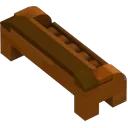{ .lu-ti width="24" loading="lazy" } [Brown Couch Model (LOT 10792)](../10792.md) | 0.2016129%; mean 0.002016129 | Not associated with a vendor |
| 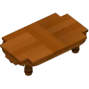{ .lu-ti width="24" loading="lazy" } [Brown Dining Table Model (LOT 10793)](../10793.md) | 0.2016129%; mean 0.002016129 | Not associated with a vendor |
| { .lu-ti width="24" loading="lazy" } [Brown Dining Table With Chair Model (LOT 10794)](../10794.md) | 0.2016129%; mean 0.002016129 | Not associated with a vendor |
| 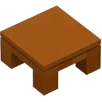{ .lu-ti width="24" loading="lazy" } [Brown Table Model 2 (LOT 10795)](../10795.md) | 0.30737705%; mean 0.0030737705 | Not associated with a vendor |
| 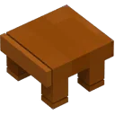{ .lu-ti width="24" loading="lazy" } [Brown Table Model 1 (LOT 10796)](../10796.md) | 0.30737705%; mean 0.0030737705 | Not associated with a vendor |
| { .lu-ti width="24" loading="lazy" } [China Cabinet Model (LOT 10797)](../10797.md) | 0.2016129%; mean 0.002016129 | Not associated with a vendor |
| { .lu-ti width="24" loading="lazy" } [Deer Head Model (LOT 10798)](../10798.md) | 0.2016129%; mean 0.002016129 | Not associated with a vendor |
| 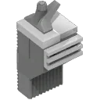{ .lu-ti width="24" loading="lazy" } [Drinking Fountain Model 1 (LOT 10799)](../10799.md) | 0.30737705%; mean 0.0030737705 | Not associated with a vendor |
| { .lu-ti width="24" loading="lazy" } [Generator Model (LOT 10800)](../10800.md) | 0.2016129%; mean 0.002016129 | Not associated with a vendor |
| 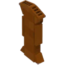{ .lu-ti width="24" loading="lazy" } [Grandfather Clock Model (LOT 10801)](../10801.md) | 0.30737705%; mean 0.0030737705 | Not associated with a vendor |
| { .lu-ti width="24" loading="lazy" } [Green Flames Model (LOT 10802)](../10802.md) | 0.30737705%; mean 0.0030737705 | Not associated with a vendor |
| 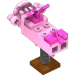{ .lu-ti width="24" loading="lazy" } [Playground Pig Ride Model (LOT 10803)](../10803.md) | 0.2016129%; mean 0.002016129 | Not associated with a vendor |
| { .lu-ti width="24" loading="lazy" } [Playground Ride Model (LOT 10804)](../10804.md) | 0.30737705%; mean 0.0030737705 | Not associated with a vendor |
| { .lu-ti width="24" loading="lazy" } [See Saw Model (LOT 10805)](../10805.md) | 0.2016129%; mean 0.002016129 | Not associated with a vendor |
| { .lu-ti width="24" loading="lazy" } [Throne Model (LOT 10806)](../10806.md) | 0.2016129%; mean 0.002016129 | Not associated with a vendor |
| { .lu-ti width="24" loading="lazy" } [Water Pump Model (LOT 10808)](../10808.md) | 0.30737705%; mean 0.0030737705 | Not associated with a vendor |
| { .lu-ti width="24" loading="lazy" } [Armchair Model (LOT 10809)](../10809.md) | 0.30737705%; mean 0.0030737705 | Not associated with a vendor |
| 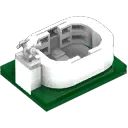{ .lu-ti width="24" loading="lazy" } [Bathtub Model (LOT 10810)](../10810.md) | 0.2016129%; mean 0.002016129 | Not associated with a vendor |
| { .lu-ti width="24" loading="lazy" } [Black Silver Chair Model (LOT 10811)](../10811.md) | 0.30737705%; mean 0.0030737705 | Not associated with a vendor |
| 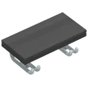{ .lu-ti width="24" loading="lazy" } [Black Silver Dining Table Model (LOT 10812)](../10812.md) | 0.30737705%; mean 0.0030737705 | Not associated with a vendor |
| 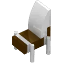{ .lu-ti width="24" loading="lazy" } [Brown Silver Chair Model (LOT 10813)](../10813.md) | 0.30737705%; mean 0.0030737705 | Not associated with a vendor |
| 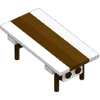{ .lu-ti width="24" loading="lazy" } [Brown Silver Dining Table Model (LOT 10814)](../10814.md) | 0.30737705%; mean 0.0030737705 | Not associated with a vendor |
| { .lu-ti width="24" loading="lazy" } [Coffee Table Model (LOT 10815)](../10815.md) | 0.30737705%; mean 0.0030737705 | Not associated with a vendor |
| 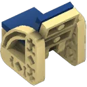{ .lu-ti width="24" loading="lazy" } [Deck Chair Model (LOT 10816)](../10816.md) | 0.30737705%; mean 0.0030737705 | Not associated with a vendor |
| { .lu-ti width="24" loading="lazy" } [Dollhouse Model (LOT 10818)](../10818.md) | 0.2016129%; mean 0.002016129 | Not associated with a vendor |
| 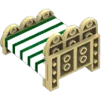{ .lu-ti width="24" loading="lazy" } [Double Bed Model (LOT 10819)](../10819.md) | 0.2016129%; mean 0.002016129 | Not associated with a vendor |
| { .lu-ti width="24" loading="lazy" } [Evergreen Plant Model (LOT 10820)](../10820.md) | 0.30737705%; mean 0.0030737705 | Not associated with a vendor |
| 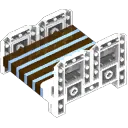{ .lu-ti width="24" loading="lazy" } [King Bed Model (LOT 10821)](../10821.md) | 0.2016129%; mean 0.002016129 | Not associated with a vendor |
| { .lu-ti width="24" loading="lazy" } [Large Plant Model (LOT 10822)](../10822.md) | 0.30737705%; mean 0.0030737705 | Not associated with a vendor |
| { .lu-ti width="24" loading="lazy" } [Lime Blue Table Model (LOT 10823)](../10823.md) | 0.2016129%; mean 0.002016129 | Not associated with a vendor |
| 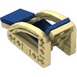{ .lu-ti width="24" loading="lazy" } [Lounge Chair Model 1 (LOT 10824)](../10824.md) | 0.30737705%; mean 0.0030737705 | Not associated with a vendor |
| 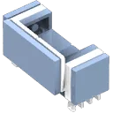{ .lu-ti width="24" loading="lazy" } [Love Seat Model 2 (LOT 10825)](../10825.md) | 0.30737705%; mean 0.0030737705 | Not associated with a vendor |
| { .lu-ti width="24" loading="lazy" } [Love Seat Model 1 (LOT 10826)](../10826.md) | 0.30737705%; mean 0.0030737705 | Not associated with a vendor |
| { .lu-ti width="24" loading="lazy" } [Blue Polka Dot Chair Model (LOT 10827)](../10827.md) | 0.30737705%; mean 0.0030737705 | Not associated with a vendor |
| 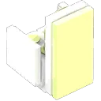{ .lu-ti width="24" loading="lazy" } [Lime Polka Dot Chair Model (LOT 10828)](../10828.md) | 0.30737705%; mean 0.0030737705 | Not associated with a vendor |
| { .lu-ti width="24" loading="lazy" } [Pink Polka Dot Chair Model (LOT 10829)](../10829.md) | 0.30737705%; mean 0.0030737705 | Not associated with a vendor |
| { .lu-ti width="24" loading="lazy" } [Yellow Polka Dot Chair Model (LOT 10830)](../10830.md) | 0.30737705%; mean 0.0030737705 | Not associated with a vendor |
| { .lu-ti width="24" loading="lazy" } [Sink Model (LOT 10831)](../10831.md) | 0.30737705%; mean 0.0030737705 | Not associated with a vendor |
| { .lu-ti width="24" loading="lazy" } [Small Plant Model (LOT 10832)](../10832.md) | 0.30737705%; mean 0.0030737705 | Not associated with a vendor |
| { .lu-ti width="24" loading="lazy" } [Red and White Sofa Model (LOT 10833)](../10833.md) | 0.2016129%; mean 0.002016129 | Not associated with a vendor |
| 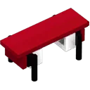{ .lu-ti width="24" loading="lazy" } [Sofa Table Model (LOT 10834)](../10834.md) | 0.30737705%; mean 0.0030737705 | Not associated with a vendor |
| 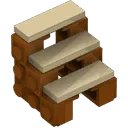{ .lu-ti width="24" loading="lazy" } [Step Stool Model (LOT 10835)](../10835.md) | 0.2016129%; mean 0.002016129 | Not associated with a vendor |
| { .lu-ti width="24" loading="lazy" } [Tan Chair Model (LOT 10836)](../10836.md) | 0.30737705%; mean 0.0030737705 | Not associated with a vendor |
| { .lu-ti width="24" loading="lazy" } [Toilet Model (LOT 10837)](../10837.md) | 0.30737705%; mean 0.0030737705 | Not associated with a vendor |
| { .lu-ti width="24" loading="lazy" } [Wooden Chair Model (LOT 10838)](../10838.md) | 0.30737705%; mean 0.0030737705 | Not associated with a vendor |
| 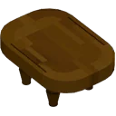{ .lu-ti width="24" loading="lazy" } [Wooden Dining Table Model (LOT 10839)](../10839.md) | 0.2016129%; mean 0.002016129 | Not associated with a vendor |
| { .lu-ti width="24" loading="lazy" } [Flamingo Model (LOT 10840)](../10840.md) | 0.30737705%; mean 0.0030737705 | Not associated with a vendor |
| { .lu-ti width="24" loading="lazy" } [Sun Dial Model (LOT 10841)](../10841.md) | 0.30737705%; mean 0.0030737705 | Not associated with a vendor |
| { .lu-ti width="24" loading="lazy" } [Rickshaw Model (LOT 10843)](../10843.md) | 0.30737705%; mean 0.0030737705 | Not associated with a vendor |
| { .lu-ti width="24" loading="lazy" } [Lamp Model (LOT 10844)](../10844.md) | 0.30737705%; mean 0.0030737705 | Not associated with a vendor |
| { .lu-ti width="24" loading="lazy" } [TV Set Model (LOT 10846)](../10846.md) | 0.30737705%; mean 0.0030737705 | Not associated with a vendor |
| { .lu-ti width="24" loading="lazy" } [Bird Bath Model 2 (LOT 10847)](../10847.md) | 0.30737705%; mean 0.0030737705 | Not associated with a vendor |
| { .lu-ti width="24" loading="lazy" } [Drinking Fountain Model 2 (LOT 10848)](../10848.md) | 0.30737705%; mean 0.0030737705 | Not associated with a vendor |
| { .lu-ti width="24" loading="lazy" } [Dumpster Model (LOT 10849)](../10849.md) | 0% in the generic loot model | Not associated with a vendor |
| { .lu-ti width="24" loading="lazy" } [Flower Statue Model (LOT 10850)](../10850.md) | 0.30737705%; mean 0.0030737705 | Not associated with a vendor |
| { .lu-ti width="24" loading="lazy" } [Gnome Model (LOT 10851)](../10851.md) | 0.30737705%; mean 0.0030737705 | Not associated with a vendor |
| { .lu-ti width="24" loading="lazy" } [Anvil Model (LOT 10852)](../10852.md) | 0.30737705%; mean 0.0030737705 | Not associated with a vendor |
| { .lu-ti width="24" loading="lazy" } [Crane Game Model (LOT 10853)](../10853.md) | 0.2016129%; mean 0.002016129 | Not associated with a vendor |
| 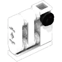{ .lu-ti width="24" loading="lazy" } [Electric Radiator Model (LOT 10854)](../10854.md) | 0.30737705%; mean 0.0030737705 | Not associated with a vendor |
| { .lu-ti width="24" loading="lazy" } [Espresso Machine Model (LOT 10855)](../10855.md) | 0.30737705%; mean 0.0030737705 | Not associated with a vendor |
| { .lu-ti width="24" loading="lazy" } [Flower Model (LOT 10857)](../10857.md) | 0.30737705%; mean 0.0030737705 | Not associated with a vendor |
| { .lu-ti width="24" loading="lazy" } [Fountain Model (LOT 10858)](../10858.md) | 0.30737705%; mean 0.0030737705 | Not associated with a vendor |
| 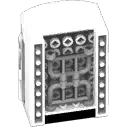{ .lu-ti width="24" loading="lazy" } [Fridge Model (LOT 10859)](../10859.md) | 0% in the generic loot model | Not associated with a vendor |
| 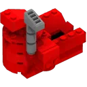{ .lu-ti width="24" loading="lazy" } [Furnace Model (LOT 10860)](../10860.md) | 0% in the generic loot model | Not associated with a vendor |
| { .lu-ti width="24" loading="lazy" } [Guide Model (LOT 10861)](../10861.md) | 0.30737705%; mean 0.0030737705 | Not associated with a vendor |
| { .lu-ti width="24" loading="lazy" } [Gum Dispenser Model (LOT 10862)](../10862.md) | 0.30737705%; mean 0.0030737705 | Not associated with a vendor |
| 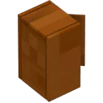{ .lu-ti width="24" loading="lazy" } [Ice Cabinet Model (LOT 10864)](../10864.md) | 0.2016129%; mean 0.002016129 | Not associated with a vendor |
| { .lu-ti width="24" loading="lazy" } [Ice Cooler Model (LOT 10865)](../10865.md) | 0.2016129%; mean 0.002016129 | Not associated with a vendor |
| { .lu-ti width="24" loading="lazy" } [Mushroom Model (LOT 10866)](../10866.md) | 0.30737705%; mean 0.0030737705 | Not associated with a vendor |
| { .lu-ti width="24" loading="lazy" } [Newspaper Stand Model (LOT 10867)](../10867.md) | 0.30737705%; mean 0.0030737705 | Not associated with a vendor |
| 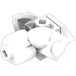{ .lu-ti width="24" loading="lazy" } [Park Bunny Model (LOT 10868)](../10868.md) | 0.30737705%; mean 0.0030737705 | Not associated with a vendor |
| { .lu-ti width="24" loading="lazy" } [Phone Booth Model (LOT 10869)](../10869.md) | 0.2016129%; mean 0.002016129 | Not associated with a vendor |
| { .lu-ti width="24" loading="lazy" } [Picnic Model (LOT 10870)](../10870.md) | 0.30737705%; mean 0.0030737705 | Not associated with a vendor |
| 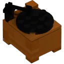{ .lu-ti width="24" loading="lazy" } [Record Player Model (LOT 10872)](../10872.md) | 0.2016129%; mean 0.002016129 | Not associated with a vendor |
| 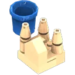{ .lu-ti width="24" loading="lazy" } [Sand Castle Model (LOT 10873)](../10873.md) | 0.30737705%; mean 0.0030737705 | Not associated with a vendor |
| 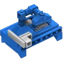{ .lu-ti width="24" loading="lazy" } [Table Saw Model (LOT 10875)](../10875.md) | 0.2016129%; mean 0.002016129 | Not associated with a vendor |
| 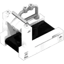{ .lu-ti width="24" loading="lazy" } [Tread Mill Model (LOT 10876)](../10876.md) | 0.2016129%; mean 0.002016129 | Not associated with a vendor |
| { .lu-ti width="24" loading="lazy" } [Toy Duck Model (LOT 10877)](../10877.md) | 0.30737705%; mean 0.0030737705 | Not associated with a vendor |
| { .lu-ti width="24" loading="lazy" } [Toy Excavator Model (LOT 10878)](../10878.md) | 0.30737705%; mean 0.0030737705 | Not associated with a vendor |
| { .lu-ti width="24" loading="lazy" } [Toy Push Car Model (LOT 10879)](../10879.md) | 0.30737705%; mean 0.0030737705 | Not associated with a vendor |
| { .lu-ti width="24" loading="lazy" } [Toy Tractor Model (LOT 10880)](../10880.md) | 0.30737705%; mean 0.0030737705 | Not associated with a vendor |
| { .lu-ti width="24" loading="lazy" } [Warning Sign Model (LOT 10882)](../10882.md) | 0.30737705%; mean 0.0030737705 | Not associated with a vendor |
| 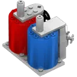{ .lu-ti width="24" loading="lazy" } [Water Heater Model (LOT 10883)](../10883.md) | 0.2016129%; mean 0.002016129 | Not associated with a vendor |
| 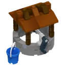{ .lu-ti width="24" loading="lazy" } [Water Well Model (LOT 10884)](../10884.md) | 0.2016129%; mean 0.002016129 | Not associated with a vendor |
| { .lu-ti width="24" loading="lazy" } [Workbench Model (LOT 10887)](../10887.md) | 0.2016129%; mean 0.002016129 | Not associated with a vendor |
| { .lu-ti width="24" loading="lazy" } [Birdhouse Model (LOT 10888)](../10888.md) | 0.2016129%; mean 0.002016129 | Not associated with a vendor |
| 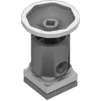{ .lu-ti width="24" loading="lazy" } [Bird Bath Model 3 (LOT 10889)](../10889.md) | 0.30737705%; mean 0.0030737705 | Not associated with a vendor |
| { .lu-ti width="24" loading="lazy" } [Lounge Chair Model 2 (LOT 10890)](../10890.md) | 0.30737705%; mean 0.0030737705 | Not associated with a vendor |
| { .lu-ti width="24" loading="lazy" } [Skeleton Bone (LOT 12322)](../12322.md) | 100%; mean 1 | Not associated with a vendor |

## Raw matrix entries

| Row | Loot table | Rarity table | Trigger | Min | Max | Flag | Gate |
| --- | --- | --- | --- | --- | --- | --- | --- |
| 1793 | 110 | 18 | 1 | 1 | 2 |  |  |
| 1794 | 139 | 29 | 0.25 | 1 | 1 |  |  |
| 2131 | 453 | 23 | 1 | 1 | 1 |  |  |

[LootMatrix](../../../db/LootMatrix.md), [LootTable](../../../db/LootTable.md), [RarityTable](../../../db/RarityTable.md).
