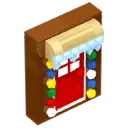
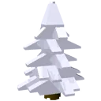
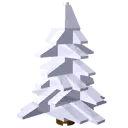

# Loot matrix 538

[Item database](../README.md) | [Methodology](../Methodology.md)

## Sources and mapped locations

| Kind | Source | Location evidence | Conditions |
| --- | --- | --- | --- |
| Package | [Winter Model Surprise Giftbox (LOT 12231)](../sources/object-12231.md) | No matched local placement found | Static association, not a live-spawn guarantee |

## Item candidates

Default vendor-stock probabilities are shown only when this matrix has a registered vendor. Loot probabilities use the generic algorithm, not a guarantee of actual use by every script/activity.

| Item | Modeled loot chance / expected count | Default vendor stock |
| --- | --- | --- |
| { .lu-ti width="24" loading="lazy" } [Winter Fireplace Model (LOT 11873)](../11873.md) | 12.5%; mean 0.125 | Not associated with a vendor |
| { .lu-ti width="24" loading="lazy" } [Winter Gingerbread House Door Model 1 (LOT 11874)](../11874.md) | 12.5%; mean 0.125 | Not associated with a vendor |
| { .lu-ti width="24" loading="lazy" } [Winter Gingerbread House Door Model 2 (LOT 11875)](../11875.md) | 12.5%; mean 0.125 | Not associated with a vendor |
| { .lu-ti width="24" loading="lazy" } [Winter Gingerbread House End Model 1 (LOT 11876)](../11876.md) | 25%; mean 0.25 | Not associated with a vendor |
| { .lu-ti width="24" loading="lazy" } [Winter Gingerbread House End Model 2 (LOT 11877)](../11877.md) | 25%; mean 0.25 | Not associated with a vendor |
| { .lu-ti width="24" loading="lazy" } [Winter Gingerbread House Side Model 1 (LOT 11878)](../11878.md) | 25%; mean 0.25 | Not associated with a vendor |
| { .lu-ti width="24" loading="lazy" } [Winter Gingerbread House Window Model 1 (LOT 11879)](../11879.md) | 12.5%; mean 0.125 | Not associated with a vendor |
| { .lu-ti width="24" loading="lazy" } [Winter Northpole Model (LOT 11880)](../11880.md) | 11.11111111%; mean 0.11111111 | Not associated with a vendor |
| { .lu-ti width="24" loading="lazy" } [Winter Penguin Model (LOT 11881)](../11881.md) | 11.11111111%; mean 0.11111111 | Not associated with a vendor |
| { .lu-ti width="24" loading="lazy" } [Winter Present Model 1 (LOT 11882)](../11882.md) | 11.11111111%; mean 0.11111111 | Not associated with a vendor |
| { .lu-ti width="24" loading="lazy" } [Winter Present Model 2 (LOT 11883)](../11883.md) | 11.11111111%; mean 0.11111111 | Not associated with a vendor |
| { .lu-ti width="24" loading="lazy" } [Winter Present Model 3 (LOT 11884)](../11884.md) | 11.11111111%; mean 0.11111111 | Not associated with a vendor |
| { .lu-ti width="24" loading="lazy" } [Winter Reindeer Model (LOT 11885)](../11885.md) | 12.5%; mean 0.125 | Not associated with a vendor |
| { .lu-ti width="24" loading="lazy" } [Winter Sleigh Model (LOT 11886)](../11886.md) | 25%; mean 0.25 | Not associated with a vendor |
| { .lu-ti width="24" loading="lazy" } [Winter Snowman Model (LOT 11887)](../11887.md) | 11.11111111%; mean 0.11111111 | Not associated with a vendor |
| { .lu-ti width="24" loading="lazy" } [Winter Snowmobile Model (LOT 11888)](../11888.md) | 12.5%; mean 0.125 | Not associated with a vendor |
| { .lu-ti width="24" loading="lazy" } [Winter Train Car Model (LOT 11889)](../11889.md) | 11.11111111%; mean 0.11111111 | Not associated with a vendor |
| { .lu-ti width="24" loading="lazy" } [Winter Train Engine Model (LOT 11890)](../11890.md) | 11.11111111%; mean 0.11111111 | Not associated with a vendor |
| { .lu-ti width="24" loading="lazy" } [Winter Train Tender Model (LOT 11891)](../11891.md) | 11.11111111%; mean 0.11111111 | Not associated with a vendor |
| { .lu-ti width="24" loading="lazy" } [Winter Tree Model 1 (LOT 11892)](../11892.md) | 12.5%; mean 0.125 | Not associated with a vendor |
| { .lu-ti width="24" loading="lazy" } [Winter Tree Model 2 (LOT 11893)](../11893.md) | 12.5%; mean 0.125 | Not associated with a vendor |

## Raw matrix entries

| Row | Loot table | Rarity table | Trigger | Min | Max | Flag | Gate |
| --- | --- | --- | --- | --- | --- | --- | --- |
| 1815 | 463 | 4 | 1 | 1 | 1 |  |  |
| 1816 | 464 | 4 | 1 | 1 | 1 |  |  |
| 1819 | 456 | 4 | 1 | 1 | 1 |  |  |

[LootMatrix](../../../db/LootMatrix.md), [LootTable](../../../db/LootTable.md), [RarityTable](../../../db/RarityTable.md).
