# Loot matrix 570

[Item database](../README.md) | [Methodology](../Methodology.md)

## Sources and mapped locations

| Kind | Source | Location evidence | Conditions |
| --- | --- | --- | --- |
| Activity | [GF - Wishing Well Dingy (LOT 11279)](../sources/object-11279.md) | [Gnarled Forest Deep Dive Map (375)](../locations/zone-375.md); [Gnarled Forest (1300)](../locations/zone-1300.md) | GF Wishing Well 5 (activity ID 11279, rating threshold 950, reward 155); Selected only if this is the highest eligible rating threshold; instance zone not specified.; Static association, not a live-spawn guarantee |

## Item candidates

Default vendor-stock probabilities are shown only when this matrix has a registered vendor. Loot probabilities use the generic algorithm, not a guarantee of actual use by every script/activity.

| Item | Modeled loot chance / expected count | Default vendor stock |
| --- | --- | --- |
| { .lu-ti width="24" loading="lazy" } [Dustbin (LOT 22)](../22.md) | 1.67127652%; mean 0.016806723 | Not associated with a vendor |
| 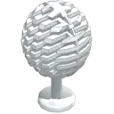{ .lu-ti width="24" loading="lazy" } [Foliate Tree, Globe (LOT 112)](../112.md) | 1.67127652%; mean 0.016806723 | Not associated with a vendor |
| 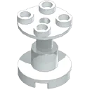{ .lu-ti width="24" loading="lazy" } [Telescope Stand 2x2x2 (LOT 344)](../344.md) | 1.67127652%; mean 0.016806723 | Not associated with a vendor |
| { .lu-ti width="24" loading="lazy" } [Antenna 4 (LOT 348)](../348.md) | 1.67127652%; mean 0.016806723 | Not associated with a vendor |
| { .lu-ti width="24" loading="lazy" } [Gate 1x4x2 with 2 Studs (LOT 357)](../357.md) | 1.67127652%; mean 0.016806723 | Not associated with a vendor |
| 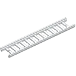{ .lu-ti width="24" loading="lazy" } [Ladder (LOT 370)](../370.md) | 1.67127652%; mean 0.016806723 | Not associated with a vendor |
| { .lu-ti width="24" loading="lazy" } [Dish 6x6 Inverted with Grid (LOT 381)](../381.md) | 1.67127652%; mean 0.016806723 | Not associated with a vendor |
| 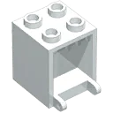{ .lu-ti width="24" loading="lazy" } [Box 2x2x2 with Hinge (LOT 383)](../383.md) | 1.67127652%; mean 0.016806723 | Not associated with a vendor |
| 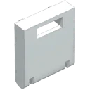{ .lu-ti width="24" loading="lazy" } [Lid for Box 2x2x2 (LOT 384)](../384.md) | 1.67127652%; mean 0.016806723 | Not associated with a vendor |
| { .lu-ti width="24" loading="lazy" } [Wooden Tub, Round 4x4 (LOT 385)](../385.md) | 1.67127652%; mean 0.016806723 | Not associated with a vendor |
| 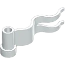{ .lu-ti width="24" loading="lazy" } [Streamer (LOT 393)](../393.md) | 1.67127652%; mean 0.016806723 | Not associated with a vendor |
| { .lu-ti width="24" loading="lazy" } [Brick 1x1 Round with Cross Flower (LOT 411)](../411.md) | 1.67127652%; mean 0.016806723 | Not associated with a vendor |
| { .lu-ti width="24" loading="lazy" } [Brick 1x1 Round with Flower (LOT 412)](../412.md) | 1.67127652%; mean 0.016806723 | Not associated with a vendor |
| 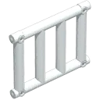{ .lu-ti width="24" loading="lazy" } [Lattice 1x4x3 (LOT 435)](../435.md) | 1.67127652%; mean 0.016806723 | Not associated with a vendor |
| 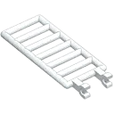{ .lu-ti width="24" loading="lazy" } [Grating 1x4x6 with 2 Horizontal Clips (LOT 436)](../436.md) | 1.67127652%; mean 0.016806723 | Not associated with a vendor |
| 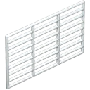{ .lu-ti width="24" loading="lazy" } [Lattice 9X13 M (LOT 444)](../444.md) | 1.67127652%; mean 0.016806723 | Not associated with a vendor |
| { .lu-ti width="24" loading="lazy" } [Bush (LOT 452)](../452.md) | 1.67127652%; mean 0.016806723 | Not associated with a vendor |
| 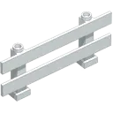{ .lu-ti width="24" loading="lazy" } [Lattice Fence 1x8x2 2/3 (LOT 459)](../459.md) | 1.67127652%; mean 0.016806723 | Not associated with a vendor |
| 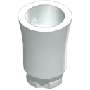{ .lu-ti width="24" loading="lazy" } [Palm Stem Element (LOT 468)](../468.md) | 1.67127652%; mean 0.016806723 | Not associated with a vendor |
| { .lu-ti width="24" loading="lazy" } [Hanger 1x6 with 4 Studs (LOT 469)](../469.md) | 1.67127652%; mean 0.016806723 | Not associated with a vendor |
| { .lu-ti width="24" loading="lazy" } [Palm Leaf (LOT 470)](../470.md) | 1.67127652%; mean 0.016806723 | Not associated with a vendor |
| { .lu-ti width="24" loading="lazy" } [Tile 1x2 with Handle 1x4x2 (LOT 479)](../479.md) | 1.67127652%; mean 0.016806723 | Not associated with a vendor |
| 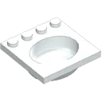{ .lu-ti width="24" loading="lazy" } [Washbowl 4x4 with 4 Studs (LOT 482)](../482.md) | 1.67127652%; mean 0.016806723 | Not associated with a vendor |
| 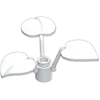{ .lu-ti width="24" loading="lazy" } [Plant with 3 Leaves (LOT 496)](../496.md) | 1.67127652%; mean 0.016806723 | Not associated with a vendor |
| { .lu-ti width="24" loading="lazy" } [Plate 1x6 with Railing (LOT 502)](../502.md) | 1.67127652%; mean 0.016806723 | Not associated with a vendor |
| { .lu-ti width="24" loading="lazy" } [Tile 1x2 with Water Tap (LOT 504)](../504.md) | 1.67127652%; mean 0.016806723 | Not associated with a vendor |
| { .lu-ti width="24" loading="lazy" } [Tap Element 1x2 (LOT 505)](../505.md) | 1.67127652%; mean 0.016806723 | Not associated with a vendor |
| { .lu-ti width="24" loading="lazy" } [Plate 2x2 with Parabolic Ring (LOT 511)](../511.md) | 1.67127652%; mean 0.016806723 | Not associated with a vendor |
| { .lu-ti width="24" loading="lazy" } [Grating 1x4x2 with 2 Studs (LOT 516)](../516.md) | 1.67127652%; mean 0.016806723 | Not associated with a vendor |
| { .lu-ti width="24" loading="lazy" } [Grating 4x4x2 with 2 Studs 1/4-Circle (LOT 517)](../517.md) | 1.67127652%; mean 0.016806723 | Not associated with a vendor |
| { .lu-ti width="24" loading="lazy" } [Petals/Propeller with 4 Studs (LOT 520)](../520.md) | 1.67127652%; mean 0.016806723 | Not associated with a vendor |
| { .lu-ti width="24" loading="lazy" } [Sea Grass (LOT 521)](../521.md) | 1.67127652%; mean 0.016806723 | Not associated with a vendor |
| 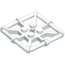{ .lu-ti width="24" loading="lazy" } [Plate 2x2 with Square Ring (LOT 522)](../522.md) | 1.67127652%; mean 0.016806723 | Not associated with a vendor |
| 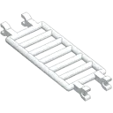{ .lu-ti width="24" loading="lazy" } [Grating 1x4x6 with 4 Horizontal Clips (LOT 523)](../523.md) | 1.67127652%; mean 0.016806723 | Not associated with a vendor |
| 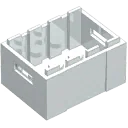{ .lu-ti width="24" loading="lazy" } [Box 3x4 (LOT 534)](../534.md) | 1.67127652%; mean 0.016806723 | Not associated with a vendor |
| 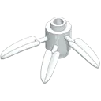{ .lu-ti width="24" loading="lazy" } [Brick 1x1 Round with 3 Bamboo Leaves (LOT 539)](../539.md) | 1.67127652%; mean 0.016806723 | Not associated with a vendor |
| { .lu-ti width="24" loading="lazy" } [Fern Leaf (LOT 548)](../548.md) | 1.67127652%; mean 0.016806723 | Not associated with a vendor |
| 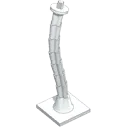{ .lu-ti width="24" loading="lazy" } [Tile 4x4 with Palm Stem (LOT 563)](../563.md) | 1.67127652%; mean 0.016806723 | Not associated with a vendor |
| { .lu-ti width="24" loading="lazy" } [Palm Leaves Quadruple (LOT 564)](../564.md) | 1.67127652%; mean 0.016806723 | Not associated with a vendor |
| { .lu-ti width="24" loading="lazy" } [Picket Fence 1x4x2 (LOT 628)](../628.md) | 1.67127652%; mean 0.016806723 | Not associated with a vendor |
| 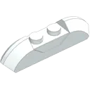{ .lu-ti width="24" loading="lazy" } [Brick 1x4 with 2 Studs and Curved Ends (LOT 633)](../633.md) | 1.67127652%; mean 0.016806723 | Not associated with a vendor |
| { .lu-ti width="24" loading="lazy" } [Bar 1.5 with Clip (LOT 724)](../724.md) | 0.65005226%; mean 0.006514658 | Not associated with a vendor |
| { .lu-ti width="24" loading="lazy" } [Parabolic Dish (LOT 768)](../768.md) | 1.67127652%; mean 0.016806723 | Not associated with a vendor |
| { .lu-ti width="24" loading="lazy" } [Lamppost 2x2x7 (LOT 784)](../784.md) | 1.67127652%; mean 0.016806723 | Not associated with a vendor |
| { .lu-ti width="24" loading="lazy" } [Plant Leaves 6x5 (LOT 802)](../802.md) | 1.67127652%; mean 0.016806723 | Not associated with a vendor |
| { .lu-ti width="24" loading="lazy" } [Plant Leaves 4x3 (LOT 806)](../806.md) | 1.67127652%; mean 0.016806723 | Not associated with a vendor |
| { .lu-ti width="24" loading="lazy" } [Small Spruce Tree (LOT 810)](../810.md) | 1.67127652%; mean 0.016806723 | Not associated with a vendor |
| 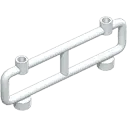{ .lu-ti width="24" loading="lazy" } [Gate 1x8x2 (LOT 828)](../828.md) | 1.67127652%; mean 0.016806723 | Not associated with a vendor |
| { .lu-ti width="24" loading="lazy" } [Barrel 2x2 (LOT 829)](../829.md) | 1.67127652%; mean 0.016806723 | Not associated with a vendor |
| { .lu-ti width="24" loading="lazy" } [Palm Leaf (LOT 830)](../830.md) | 1.67127652%; mean 0.016806723 | Not associated with a vendor |
| 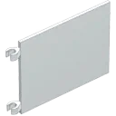{ .lu-ti width="24" loading="lazy" } [Flag 6x4 with Horizontal Clips (LOT 831)](../831.md) | 1.67127652%; mean 0.016806723 | Not associated with a vendor |
| 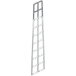{ .lu-ti width="24" loading="lazy" } [Shroud (LOT 838)](../838.md) | 1.67127652%; mean 0.016806723 | Not associated with a vendor |
| 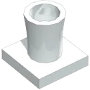{ .lu-ti width="24" loading="lazy" } [Tile 2x2 with Palm Base (LOT 841)](../841.md) | 1.67127652%; mean 0.016806723 | Not associated with a vendor |
| 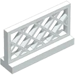{ .lu-ti width="24" loading="lazy" } [Fence 1x4x2 (LOT 879)](../879.md) | 1.67127652%; mean 0.016806723 | Not associated with a vendor |
| 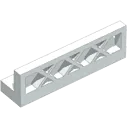{ .lu-ti width="24" loading="lazy" } [Fence 1x4x1 (LOT 912)](../912.md) | 1.67127652%; mean 0.016806723 | Not associated with a vendor |
| { .lu-ti width="24" loading="lazy" } [Flower Stems (LOT 924)](../924.md) | 1.67127652%; mean 0.016806723 | Not associated with a vendor |
| { .lu-ti width="24" loading="lazy" } [Minifigure Head (LOT 1209)](../1209.md) | 0.65005226%; mean 0.006514658 | Not associated with a vendor |
| { .lu-ti width="24" loading="lazy" } [Bracket 1x1 with Pin Hole - 1x1 with Stud (LOT 1210)](../1210.md) | 0.65005226%; mean 0.006514658 | Not associated with a vendor |
| 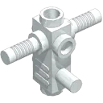{ .lu-ti width="24" loading="lazy" } [Tool Holder (LOT 1212)](../1212.md) | 0.65005226%; mean 0.006514658 | Not associated with a vendor |
| 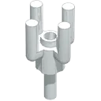{ .lu-ti width="24" loading="lazy" } [Fork Connector with 4 Tips (LOT 1213)](../1213.md) | 1.67127652%; mean 0.016806723 | Not associated with a vendor |
| { .lu-ti width="24" loading="lazy" } [Hand Ladle (LOT 1214)](../1214.md) | 0.65005226%; mean 0.006514658 | Not associated with a vendor |
| 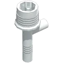{ .lu-ti width="24" loading="lazy" } [Space Blaster with Grooves (LOT 1215)](../1215.md) | 1.67127652%; mean 0.016806723 | Not associated with a vendor |
| { .lu-ti width="24" loading="lazy" } [Megaphone (LOT 1217)](../1217.md) | 0.65005226%; mean 0.006514658 | Not associated with a vendor |
| { .lu-ti width="24" loading="lazy" } [Skid 1x4 with Stud and Clip (LOT 1219)](../1219.md) | 0.65005226%; mean 0.006514658 | Not associated with a vendor |
| { .lu-ti width="24" loading="lazy" } [Telephone Receiver (LOT 1220)](../1220.md) | 0.65005226%; mean 0.006514658 | Not associated with a vendor |
| { .lu-ti width="24" loading="lazy" } [Chalice (LOT 1222)](../1222.md) | 0.65005226%; mean 0.006514658 | Not associated with a vendor |
| { .lu-ti width="24" loading="lazy" } [Binoculars, Round (LOT 1224)](../1224.md) | 0.65005226%; mean 0.006514658 | Not associated with a vendor |
| { .lu-ti width="24" loading="lazy" } [Wheel for Skate Board (LOT 1225)](../1225.md) | 0.65005226%; mean 0.006514658 | Not associated with a vendor |
| { .lu-ti width="24" loading="lazy" } [Hot Chocolate (LOT 1883)](../1883.md) | 2.67857143%; mean 0.026785714 | Not associated with a vendor |
| { .lu-ti width="24" loading="lazy" } [Healing Banana (LOT 1966)](../1966.md) | 2.67857143%; mean 0.026785714 | Not associated with a vendor |
| { .lu-ti width="24" loading="lazy" } [Whip with Loop (LOT 2135)](../2135.md) | 0.65005226%; mean 0.006514658 | Not associated with a vendor |
| 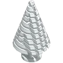{ .lu-ti width="24" loading="lazy" } [Spruce Tree (LOT 2137)](../2137.md) | 1.67127652%; mean 0.016806723 | Not associated with a vendor |
| { .lu-ti width="24" loading="lazy" } [Notion Potion (LOT 2198)](../2198.md) | 2.67857143%; mean 0.026785714 | Not associated with a vendor |
| { .lu-ti width="24" loading="lazy" } [Quicksicle (LOT 2620)](../2620.md) | 2.67857143%; mean 0.026785714 | Not associated with a vendor |
| 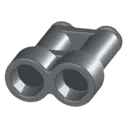{ .lu-ti width="24" loading="lazy" } [Binoculars (LOT 2634)](../2634.md) | 0.45454545%; mean 0.0045454545 | Not associated with a vendor |
| { .lu-ti width="24" loading="lazy" } [Exceptional Hatchet (LOT 2643)](../2643.md) | 0% in the generic loot model | Not associated with a vendor |
| { .lu-ti width="24" loading="lazy" } [Worthy Corseque (LOT 2644)](../2644.md) | 1.875%; mean 0.01875 | Not associated with a vendor |
| { .lu-ti width="24" loading="lazy" } [Black Pirate Ship Shirt (LOT 2954)](../2954.md) | 0% in the generic loot model | Not associated with a vendor |
| { .lu-ti width="24" loading="lazy" } [Armor Polish (LOT 2993)](../2993.md) | 2.67857143%; mean 0.026785714 | Not associated with a vendor |
| { .lu-ti width="24" loading="lazy" } [Healing Cherry (LOT 2994)](../2994.md) | 2.67857143%; mean 0.026785714 | Not associated with a vendor |
| { .lu-ti width="24" loading="lazy" } [Healing Apple (LOT 2995)](../2995.md) | 2.67857143%; mean 0.026785714 | Not associated with a vendor |
| { .lu-ti width="24" loading="lazy" } [Armor Shine (LOT 2996)](../2996.md) | 2.67857143%; mean 0.026785714 | Not associated with a vendor |
| { .lu-ti width="24" loading="lazy" } [Armor Gleam (LOT 2997)](../2997.md) | 2.67857143%; mean 0.026785714 | Not associated with a vendor |
| { .lu-ti width="24" loading="lazy" } [Strong Notion Potion (LOT 2998)](../2998.md) | 2.67857143%; mean 0.026785714 | Not associated with a vendor |
| { .lu-ti width="24" loading="lazy" } [Super Notion Potion (LOT 2999)](../2999.md) | 2.67857143%; mean 0.026785714 | Not associated with a vendor |
| { .lu-ti width="24" loading="lazy" } [BBQ Blast Hot Dog (LOT 3011)](../3011.md) | 2.67857143%; mean 0.026785714 | Not associated with a vendor |
| { .lu-ti width="24" loading="lazy" } [Blue Imaginite (LOT 3038)](../3038.md) | 1.6%; mean 0.016 | Not associated with a vendor |
| { .lu-ti width="24" loading="lazy" } [Green Imaginite (LOT 3039)](../3039.md) | 2.67857143%; mean 0.026785714 | Not associated with a vendor |
| { .lu-ti width="24" loading="lazy" } [Red Imaginite (LOT 3040)](../3040.md) | 3%; mean 0.03 | Not associated with a vendor |
| { .lu-ti width="24" loading="lazy" } [Worthy Shovel (LOT 3067)](../3067.md) | 1.875%; mean 0.01875 | Not associated with a vendor |
| { .lu-ti width="24" loading="lazy" } [Amber Gem (LOT 3100)](../3100.md) | 2.67857143%; mean 0.026785714 | Not associated with a vendor |
| { .lu-ti width="24" loading="lazy" } [Castle Maiden's Headdress (LOT 5032)](../5032.md) | 0.65005226%; mean 0.006514658 | Not associated with a vendor |
| { .lu-ti width="24" loading="lazy" } [Crash Helmet Visor (LOT 5033)](../5033.md) | 0.65005226%; mean 0.006514658 | Not associated with a vendor |
| { .lu-ti width="24" loading="lazy" } [Knapsack (LOT 5039)](../5039.md) | 0.65005226%; mean 0.006514658 | Not associated with a vendor |
| 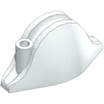{ .lu-ti width="24" loading="lazy" } [Admiral's Hat (LOT 5040)](../5040.md) | 0.65005226%; mean 0.006514658 | Not associated with a vendor |
| { .lu-ti width="24" loading="lazy" } [Sabre (LOT 5041)](../5041.md) | 0.65005226%; mean 0.006514658 | Not associated with a vendor |
| { .lu-ti width="24" loading="lazy" } [Paddle (LOT 5046)](../5046.md) | 0.65005226%; mean 0.006514658 | Not associated with a vendor |
| { .lu-ti width="24" loading="lazy" } [Head Scarf (LOT 5047)](../5047.md) | 0.65005226%; mean 0.006514658 | Not associated with a vendor |
| { .lu-ti width="24" loading="lazy" } [Shako (LOT 5049)](../5049.md) | 0.65005226%; mean 0.006514658 | Not associated with a vendor |
| 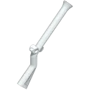{ .lu-ti width="24" loading="lazy" } [Flintlock Rifle (LOT 5055)](../5055.md) | 0.65005226%; mean 0.006514658 | Not associated with a vendor |
| { .lu-ti width="24" loading="lazy" } [Crossbow (LOT 5056)](../5056.md) | 0.65005226%; mean 0.006514658 | Not associated with a vendor |
| { .lu-ti width="24" loading="lazy" } [Oval Battle Shield (LOT 5058)](../5058.md) | 0.65005226%; mean 0.006514658 | Not associated with a vendor |
| { .lu-ti width="24" loading="lazy" } [Knight Armor with Skirt (LOT 5059)](../5059.md) | 0.65005226%; mean 0.006514658 | Not associated with a vendor |
| { .lu-ti width="24" loading="lazy" } [Ghost Costume (LOT 5060)](../5060.md) | 0.65005226%; mean 0.006514658 | Not associated with a vendor |
| { .lu-ti width="24" loading="lazy" } [Visor for Knight's Helmet (LOT 5061)](../5061.md) | 0.65005226%; mean 0.006514658 | Not associated with a vendor |
| { .lu-ti width="24" loading="lazy" } [Life Vest (LOT 5062)](../5062.md) | 0.65005226%; mean 0.006514658 | Not associated with a vendor |
| { .lu-ti width="24" loading="lazy" } [Fishing Rod (LOT 5063)](../5063.md) | 0.65005226%; mean 0.006514658 | Not associated with a vendor |
| 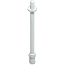{ .lu-ti width="24" loading="lazy" } [Bar 7 with Stopper and Pin on End (LOT 5066)](../5066.md) | 1.67127652%; mean 0.016806723 | Not associated with a vendor |
| { .lu-ti width="24" loading="lazy" } [Peaked Cap (LOT 5079)](../5079.md) | 0.65005226%; mean 0.006514658 | Not associated with a vendor |
| { .lu-ti width="24" loading="lazy" } [Construction Worker's Helmet (LOT 5089)](../5089.md) | 0.65005226%; mean 0.006514658 | Not associated with a vendor |
| { .lu-ti width="24" loading="lazy" } [Firefighter's Helmet (LOT 5090)](../5090.md) | 0.65005226%; mean 0.006514658 | Not associated with a vendor |
| { .lu-ti width="24" loading="lazy" } [Firefighter's Axe (LOT 5091)](../5091.md) | 0.65005226%; mean 0.006514658 | Not associated with a vendor |
| { .lu-ti width="24" loading="lazy" } [Push Broom (LOT 5092)](../5092.md) | 0.65005226%; mean 0.006514658 | Not associated with a vendor |
| { .lu-ti width="24" loading="lazy" } [Shovel (LOT 5093)](../5093.md) | 0.65005226%; mean 0.006514658 | Not associated with a vendor |
| { .lu-ti width="24" loading="lazy" } [Oxygen Bottles (LOT 5094)](../5094.md) | 0.65005226%; mean 0.006514658 | Not associated with a vendor |
| { .lu-ti width="24" loading="lazy" } [Vest (LOT 5095)](../5095.md) | 0.65005226%; mean 0.006514658 | Not associated with a vendor |
| { .lu-ti width="24" loading="lazy" } [PickAxe (LOT 5096)](../5096.md) | 0.65005226%; mean 0.006514658 | Not associated with a vendor |
| { .lu-ti width="24" loading="lazy" } [Great Helm with Neck Protection (LOT 5097)](../5097.md) | 0.65005226%; mean 0.006514658 | Not associated with a vendor |
| { .lu-ti width="24" loading="lazy" } [Knight Shield Triangular (LOT 5098)](../5098.md) | 0.65005226%; mean 0.006514658 | Not associated with a vendor |
| { .lu-ti width="24" loading="lazy" } [Shortsword (LOT 5099)](../5099.md) | 0.65005226%; mean 0.006514658 | Not associated with a vendor |
| { .lu-ti width="24" loading="lazy" } [Battle Axe (LOT 5100)](../5100.md) | 0.65005226%; mean 0.006514658 | Not associated with a vendor |
| { .lu-ti width="24" loading="lazy" } [Knight Jousting Lance (LOT 5101)](../5101.md) | 0.65005226%; mean 0.006514658 | Not associated with a vendor |
| { .lu-ti width="24" loading="lazy" } [Hair Brush (LOT 5102)](../5102.md) | 0.65005226%; mean 0.006514658 | Not associated with a vendor |
| { .lu-ti width="24" loading="lazy" } [Baker's Hat (LOT 5106)](../5106.md) | 0.65005226%; mean 0.006514658 | Not associated with a vendor |
| { .lu-ti width="24" loading="lazy" } [Mug with Holder (LOT 5107)](../5107.md) | 0.65005226%; mean 0.006514658 | Not associated with a vendor |
| { .lu-ti width="24" loading="lazy" } [Wig, Boy (LOT 5108)](../5108.md) | 0.65005226%; mean 0.006514658 | Not associated with a vendor |
| { .lu-ti width="24" loading="lazy" } [Handheld Radio (LOT 5109)](../5109.md) | 0.65005226%; mean 0.006514658 | Not associated with a vendor |
| { .lu-ti width="24" loading="lazy" } [Screwdriver/Wrench (LOT 5110)](../5110.md) | 0.65005226%; mean 0.006514658 | Not associated with a vendor |
| { .lu-ti width="24" loading="lazy" } [Pipe Wrench (LOT 5116)](../5116.md) | 0.65005226%; mean 0.006514658 | Not associated with a vendor |
| { .lu-ti width="24" loading="lazy" } [Broom (LOT 5117)](../5117.md) | 0.65005226%; mean 0.006514658 | Not associated with a vendor |
| { .lu-ti width="24" loading="lazy" } [Ladle (LOT 5118)](../5118.md) | 0.65005226%; mean 0.006514658 | Not associated with a vendor |
| { .lu-ti width="24" loading="lazy" } [Pot with Handles (LOT 5119)](../5119.md) | 0.65005226%; mean 0.006514658 | Not associated with a vendor |
| { .lu-ti width="24" loading="lazy" } [Loaf of Bread (LOT 5120)](../5120.md) | 0.65005226%; mean 0.006514658 | Not associated with a vendor |
| { .lu-ti width="24" loading="lazy" } [Space Gun (LOT 5123)](../5123.md) | 0.65005226%; mean 0.006514658 | Not associated with a vendor |
| { .lu-ti width="24" loading="lazy" } [Pitcher (LOT 5124)](../5124.md) | 0.65005226%; mean 0.006514658 | Not associated with a vendor |
| { .lu-ti width="24" loading="lazy" } [Butterfly Net (LOT 5125)](../5125.md) | 0.65005226%; mean 0.006514658 | Not associated with a vendor |
| { .lu-ti width="24" loading="lazy" } [Large Axe (LOT 5126)](../5126.md) | 0.65005226%; mean 0.006514658 | Not associated with a vendor |
| { .lu-ti width="24" loading="lazy" } [Suitcase (LOT 5128)](../5128.md) | 0.65005226%; mean 0.006514658 | Not associated with a vendor |
| { .lu-ti width="24" loading="lazy" } [Metal Detector (LOT 5129)](../5129.md) | 0.65005226%; mean 0.006514658 | Not associated with a vendor |
| { .lu-ti width="24" loading="lazy" } [Horse Saddle (LOT 5130)](../5130.md) | 0.65005226%; mean 0.006514658 | Not associated with a vendor |
| 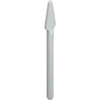{ .lu-ti width="24" loading="lazy" } [Spear (LOT 5133)](../5133.md) | 0.65005226%; mean 0.006514658 | Not associated with a vendor |
| { .lu-ti width="24" loading="lazy" } [Quiver (LOT 5134)](../5134.md) | 0.65005226%; mean 0.006514658 | Not associated with a vendor |
| 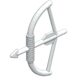{ .lu-ti width="24" loading="lazy" } [Bow (LOT 5135)](../5135.md) | 0.65005226%; mean 0.006514658 | Not associated with a vendor |
| { .lu-ti width="24" loading="lazy" } [Knight Tournament Helmet (LOT 5136)](../5136.md) | 0.65005226%; mean 0.006514658 | Not associated with a vendor |
| { .lu-ti width="24" loading="lazy" } [Sledgehammer (LOT 5138)](../5138.md) | 0.65005226%; mean 0.006514658 | Not associated with a vendor |
| { .lu-ti width="24" loading="lazy" } [Pannier (LOT 5139)](../5139.md) | 0.65005226%; mean 0.006514658 | Not associated with a vendor |
| { .lu-ti width="24" loading="lazy" } [Pan (LOT 5140)](../5140.md) | 0.65005226%; mean 0.006514658 | Not associated with a vendor |
| { .lu-ti width="24" loading="lazy" } [Pot with Handle (LOT 5141)](../5141.md) | 0.65005226%; mean 0.006514658 | Not associated with a vendor |
| { .lu-ti width="24" loading="lazy" } [Wig with Wavy Hair (LOT 5142)](../5142.md) | 0.65005226%; mean 0.006514658 | Not associated with a vendor |
| { .lu-ti width="24" loading="lazy" } [Stretcher 2x6 (LOT 5145)](../5145.md) | 0.65005226%; mean 0.006514658 | Not associated with a vendor |
| { .lu-ti width="24" loading="lazy" } [Underframe for Stretcher (LOT 5146)](../5146.md) | 0.65005226%; mean 0.006514658 | Not associated with a vendor |
| { .lu-ti width="24" loading="lazy" } [Jetpack with Studs (LOT 5150)](../5150.md) | 0.65005226%; mean 0.006514658 | Not associated with a vendor |
| 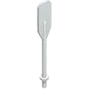{ .lu-ti width="24" loading="lazy" } [Oar (LOT 5151)](../5151.md) | 1.67127652%; mean 0.016806723 | Not associated with a vendor |
| { .lu-ti width="24" loading="lazy" } [Surfboard 10M (LOT 5156)](../5156.md) | 0.65005226%; mean 0.006514658 | Not associated with a vendor |
| { .lu-ti width="24" loading="lazy" } [Frogman Visor (LOT 5161)](../5161.md) | 0.65005226%; mean 0.006514658 | Not associated with a vendor |
| { .lu-ti width="24" loading="lazy" } [Wig Ponytail (LOT 5162)](../5162.md) | 0.65005226%; mean 0.006514658 | Not associated with a vendor |
| { .lu-ti width="24" loading="lazy" } [Ice Saw (LOT 5164)](../5164.md) | 0.65005226%; mean 0.006514658 | Not associated with a vendor |
| { .lu-ti width="24" loading="lazy" } [Halberd (LOT 5166)](../5166.md) | 0.65005226%; mean 0.006514658 | Not associated with a vendor |
| { .lu-ti width="24" loading="lazy" } [Magic Wand (LOT 5167)](../5167.md) | 0.65005226%; mean 0.006514658 | Not associated with a vendor |
| { .lu-ti width="24" loading="lazy" } [Horse Dragon Mask with Clip (LOT 5168)](../5168.md) | 0.65005226%; mean 0.006514658 | Not associated with a vendor |
| { .lu-ti width="24" loading="lazy" } [Flame with Haft (LOT 5169)](../5169.md) | 1.67127652%; mean 0.016806723 | Not associated with a vendor |
| { .lu-ti width="24" loading="lazy" } [Magic Hat (LOT 5173)](../5173.md) | 0.65005226%; mean 0.006514658 | Not associated with a vendor |
| { .lu-ti width="24" loading="lazy" } [Santa Beard (LOT 5174)](../5174.md) | 0.65005226%; mean 0.006514658 | Not associated with a vendor |
| { .lu-ti width="24" loading="lazy" } [Fireman Breathing Mask (LOT 5175)](../5175.md) | 0.65005226%; mean 0.006514658 | Not associated with a vendor |
| { .lu-ti width="24" loading="lazy" } [Feeding Bottle (LOT 5181)](../5181.md) | 0.65005226%; mean 0.006514658 | Not associated with a vendor |
| { .lu-ti width="24" loading="lazy" } [1x1 Round with Ice Cream (LOT 5187)](../5187.md) | 1.67127652%; mean 0.016806723 | Not associated with a vendor |
| { .lu-ti width="24" loading="lazy" } [Dish Ø24 (LOT 5188)](../5188.md) | 0.65005226%; mean 0.006514658 | Not associated with a vendor |
| { .lu-ti width="24" loading="lazy" } [Cherry (LOT 5195)](../5195.md) | 0.65005226%; mean 0.006514658 | Not associated with a vendor |
| { .lu-ti width="24" loading="lazy" } [Astronaut Visor (LOT 5196)](../5196.md) | 0.65005226%; mean 0.006514658 | Not associated with a vendor |
| { .lu-ti width="24" loading="lazy" } [Hand-Held Scanner (LOT 5198)](../5198.md) | 0.65005226%; mean 0.006514658 | Not associated with a vendor |
| { .lu-ti width="24" loading="lazy" } [Morion Helmet (LOT 5201)](../5201.md) | 0.65005226%; mean 0.006514658 | Not associated with a vendor |
| { .lu-ti width="24" loading="lazy" } [Harpoon 5M (LOT 5203)](../5203.md) | 0.65005226%; mean 0.006514658 | Not associated with a vendor |
| { .lu-ti width="24" loading="lazy" } [Camera (LOT 5204)](../5204.md) | 0.65005226%; mean 0.006514658 | Not associated with a vendor |
| { .lu-ti width="24" loading="lazy" } [Diver's Mask (LOT 5205)](../5205.md) | 0.65005226%; mean 0.006514658 | Not associated with a vendor |
| { .lu-ti width="24" loading="lazy" } [Oxygen Bottle with Tube (LOT 5206)](../5206.md) | 0.65005226%; mean 0.006514658 | Not associated with a vendor |
| 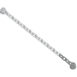{ .lu-ti width="24" loading="lazy" } [Chain 16M (LOT 5208)](../5208.md) | 1.67127652%; mean 0.016806723 | Not associated with a vendor |
| { .lu-ti width="24" loading="lazy" } [Bat Helmet (LOT 5209)](../5209.md) | 0.65005226%; mean 0.006514658 | Not associated with a vendor |
| { .lu-ti width="24" loading="lazy" } [Crystal Globe (LOT 5210)](../5210.md) | 1.67127652%; mean 0.016806723 | Not associated with a vendor |
| { .lu-ti width="24" loading="lazy" } [Alien Breastplate (LOT 5212)](../5212.md) | 0.65005226%; mean 0.006514658 | Not associated with a vendor |
| { .lu-ti width="24" loading="lazy" } [Indian Feather with Bolt (LOT 5213)](../5213.md) | 0.65005226%; mean 0.006514658 | Not associated with a vendor |
| { .lu-ti width="24" loading="lazy" } [Indian Feather with Clip (LOT 5214)](../5214.md) | 0.65005226%; mean 0.006514658 | Not associated with a vendor |
| { .lu-ti width="24" loading="lazy" } [Revolver (LOT 5215)](../5215.md) | 0.65005226%; mean 0.006514658 | Not associated with a vendor |
| { .lu-ti width="24" loading="lazy" } [Neck Scarf (LOT 5216)](../5216.md) | 0.65005226%; mean 0.006514658 | Not associated with a vendor |
| { .lu-ti width="24" loading="lazy" } [Officer's Cap (LOT 5217)](../5217.md) | 0.65005226%; mean 0.006514658 | Not associated with a vendor |
| { .lu-ti width="24" loading="lazy" } [Rifle (LOT 5218)](../5218.md) | 0.65005226%; mean 0.006514658 | Not associated with a vendor |
| { .lu-ti width="24" loading="lazy" } [Movie Camera (LOT 5220)](../5220.md) | 0.65005226%; mean 0.006514658 | Not associated with a vendor |
| { .lu-ti width="24" loading="lazy" } [Magnifying Glass (LOT 5222)](../5222.md) | 0.65005226%; mean 0.006514658 | Not associated with a vendor |
| { .lu-ti width="24" loading="lazy" } [Diamond with Stick (LOT 5223)](../5223.md) | 0.65005226%; mean 0.006514658 | Not associated with a vendor |
| { .lu-ti width="24" loading="lazy" } [Sextant (LOT 5224)](../5224.md) | 0.65005226%; mean 0.006514658 | Not associated with a vendor |
| { .lu-ti width="24" loading="lazy" } [Rucksack, Opening (LOT 5225)](../5225.md) | 0.65005226%; mean 0.006514658 | Not associated with a vendor |
| { .lu-ti width="24" loading="lazy" } [Safari Hat (LOT 5226)](../5226.md) | 0.65005226%; mean 0.006514658 | Not associated with a vendor |
| { .lu-ti width="24" loading="lazy" } [Pharaoh's Headdress (LOT 5227)](../5227.md) | 0.65005226%; mean 0.006514658 | Not associated with a vendor |
| { .lu-ti width="24" loading="lazy" } [Flying Goggles (LOT 5229)](../5229.md) | 0.65005226%; mean 0.006514658 | Not associated with a vendor |
| { .lu-ti width="24" loading="lazy" } [Flying Helmet (LOT 5230)](../5230.md) | 0.65005226%; mean 0.006514658 | Not associated with a vendor |
| { .lu-ti width="24" loading="lazy" } [Safari Helmet (LOT 5231)](../5231.md) | 0.65005226%; mean 0.006514658 | Not associated with a vendor |
| { .lu-ti width="24" loading="lazy" } [Ninja Sword (LOT 5232)](../5232.md) | 0.65005226%; mean 0.006514658 | Not associated with a vendor |
| { .lu-ti width="24" loading="lazy" } [Samurai Armor (LOT 5233)](../5233.md) | 0.65005226%; mean 0.006514658 | Not associated with a vendor |
| 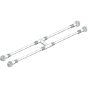{ .lu-ti width="24" loading="lazy" } [Strap 12M (LOT 5240)](../5240.md) | 1.67127652%; mean 0.016806723 | Not associated with a vendor |
| { .lu-ti width="24" loading="lazy" } [Grappling Hook (LOT 5241)](../5241.md) | 0.65005226%; mean 0.006514658 | Not associated with a vendor |
| { .lu-ti width="24" loading="lazy" } [Ice Axe (LOT 5242)](../5242.md) | 0.65005226%; mean 0.006514658 | Not associated with a vendor |
| { .lu-ti width="24" loading="lazy" } [Circular Saw (LOT 5243)](../5243.md) | 0.65005226%; mean 0.006514658 | Not associated with a vendor |
| { .lu-ti width="24" loading="lazy" } [Energy Element (LOT 5244)](../5244.md) | 1.67127652%; mean 0.016806723 | Not associated with a vendor |
| { .lu-ti width="24" loading="lazy" } [Insectoid Helmet (LOT 5245)](../5245.md) | 0.65005226%; mean 0.006514658 | Not associated with a vendor |
| { .lu-ti width="24" loading="lazy" } [Shell (LOT 5246)](../5246.md) | 0.65005226%; mean 0.006514658 | Not associated with a vendor |
| { .lu-ti width="24" loading="lazy" } [Popsicle (LOT 5247)](../5247.md) | 0.65005226%; mean 0.006514658 | Not associated with a vendor |
| { .lu-ti width="24" loading="lazy" } [Pneumatic Hammer (LOT 5250)](../5250.md) | 0.65005226%; mean 0.006514658 | Not associated with a vendor |
| { .lu-ti width="24" loading="lazy" } [Slider Roller with Handle (LOT 5251)](../5251.md) | 0.65005226%; mean 0.006514658 | Not associated with a vendor |
| 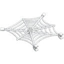{ .lu-ti width="24" loading="lazy" } [Spider Web (LOT 5253)](../5253.md) | 1.67127652%; mean 0.016806723 | Not associated with a vendor |
| 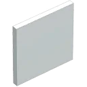{ .lu-ti width="24" loading="lazy" } [Square Sign with Vertical Clip (LOT 5255)](../5255.md) | 1.67127652%; mean 0.016806723 | Not associated with a vendor |
| { .lu-ti width="24" loading="lazy" } [Triangular Sign with Vertical Clip (LOT 5256)](../5256.md) | 1.67127652%; mean 0.016806723 | Not associated with a vendor |
| { .lu-ti width="24" loading="lazy" } [Round Sign with Clip (LOT 5257)](../5257.md) | 1.67127652%; mean 0.016806723 | Not associated with a vendor |
| { .lu-ti width="24" loading="lazy" } [Knight's Helmet with Brim (LOT 5258)](../5258.md) | 0.65005226%; mean 0.006514658 | Not associated with a vendor |
| { .lu-ti width="24" loading="lazy" } [Inca Helmet (LOT 5260)](../5260.md) | 0.65005226%; mean 0.006514658 | Not associated with a vendor |
| 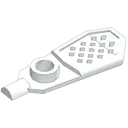{ .lu-ti width="24" loading="lazy" } [Snowshoe (LOT 5261)](../5261.md) | 0.65005226%; mean 0.006514658 | Not associated with a vendor |
| { .lu-ti width="24" loading="lazy" } [Polar Hood with Fur Lining (LOT 5262)](../5262.md) | 0.65005226%; mean 0.006514658 | Not associated with a vendor |
| { .lu-ti width="24" loading="lazy" } [Rock 4x4x1 1/3 Top Part (LOT 5263)](../5263.md) | 1.67127652%; mean 0.016806723 | Not associated with a vendor |
| { .lu-ti width="24" loading="lazy" } [Binoculars, High-tech (LOT 5264)](../5264.md) | 0.65005226%; mean 0.006514658 | Not associated with a vendor |
| { .lu-ti width="24" loading="lazy" } [Polar Rucksack (LOT 5265)](../5265.md) | 0.65005226%; mean 0.006514658 | Not associated with a vendor |
| { .lu-ti width="24" loading="lazy" } [Space Helmet without Chin Strap (LOT 5266)](../5266.md) | 0.65005226%; mean 0.006514658 | Not associated with a vendor |
| { .lu-ti width="24" loading="lazy" } [Lifering with Stud (LOT 5267)](../5267.md) | 0.65005226%; mean 0.006514658 | Not associated with a vendor |
| { .lu-ti width="24" loading="lazy" } [Hood (LOT 5269)](../5269.md) | 0.65005226%; mean 0.006514658 | Not associated with a vendor |
| 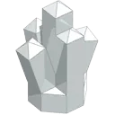{ .lu-ti width="24" loading="lazy" } [Rock Crystal (LOT 5270)](../5270.md) | 1.67127652%; mean 0.016806723 | Not associated with a vendor |
| { .lu-ti width="24" loading="lazy" } [Wig with Multiple Braids (LOT 5276)](../5276.md) | 0.65005226%; mean 0.006514658 | Not associated with a vendor |
| { .lu-ti width="24" loading="lazy" } [Wig, Crew Cut (LOT 5282)](../5282.md) | 0.65005226%; mean 0.006514658 | Not associated with a vendor |
| { .lu-ti width="24" loading="lazy" } [Book (LOT 5311)](../5311.md) | 0.65005226%; mean 0.006514658 | Not associated with a vendor |
| { .lu-ti width="24" loading="lazy" } [Apple with Leaf (LOT 5312)](../5312.md) | 0.65005226%; mean 0.006514658 | Not associated with a vendor |
| { .lu-ti width="24" loading="lazy" } [Pot with Handle (LOT 5313)](../5313.md) | 0.65005226%; mean 0.006514658 | Not associated with a vendor |
| { .lu-ti width="24" loading="lazy" } [Turkey Drumstick (LOT 5314)](../5314.md) | 0.65005226%; mean 0.006514658 | Not associated with a vendor |
| { .lu-ti width="24" loading="lazy" } [Glass (LOT 5315)](../5315.md) | 0.65005226%; mean 0.006514658 | Not associated with a vendor |
| { .lu-ti width="24" loading="lazy" } [Sausage (LOT 5316)](../5316.md) | 0.65005226%; mean 0.006514658 | Not associated with a vendor |
| { .lu-ti width="24" loading="lazy" } [Banana (LOT 5317)](../5317.md) | 0.65005226%; mean 0.006514658 | Not associated with a vendor |
| { .lu-ti width="24" loading="lazy" } [Ice-Cream Cone (LOT 5318)](../5318.md) | 0.65005226%; mean 0.006514658 | Not associated with a vendor |
| { .lu-ti width="24" loading="lazy" } [Croissant (LOT 5321)](../5321.md) | 0.65005226%; mean 0.006514658 | Not associated with a vendor |
| { .lu-ti width="24" loading="lazy" } [Comb (LOT 5322)](../5322.md) | 0.65005226%; mean 0.006514658 | Not associated with a vendor |
| { .lu-ti width="24" loading="lazy" } [Carrot (LOT 5323)](../5323.md) | 0.65005226%; mean 0.006514658 | Not associated with a vendor |
| { .lu-ti width="24" loading="lazy" } [Rosette with Ribbon (LOT 5324)](../5324.md) | 0.65005226%; mean 0.006514658 | Not associated with a vendor |
| { .lu-ti width="24" loading="lazy" } [Celery (LOT 5325)](../5325.md) | 0.65005226%; mean 0.006514658 | Not associated with a vendor |
| { .lu-ti width="24" loading="lazy" } [Turban (LOT 5329)](../5329.md) | 0.65005226%; mean 0.006514658 | Not associated with a vendor |
| { .lu-ti width="24" loading="lazy" } [Old Man's Wig (LOT 5330)](../5330.md) | 0.65005226%; mean 0.006514658 | Not associated with a vendor |
| { .lu-ti width="24" loading="lazy" } [Man's Wig (LOT 5331)](../5331.md) | 0.65005226%; mean 0.006514658 | Not associated with a vendor |
| { .lu-ti width="24" loading="lazy" } [Boy's Hair (LOT 5332)](../5332.md) | 0.65005226%; mean 0.006514658 | Not associated with a vendor |
| { .lu-ti width="24" loading="lazy" } [Girl's Hair (LOT 5334)](../5334.md) | 0.65005226%; mean 0.006514658 | Not associated with a vendor |
| { .lu-ti width="24" loading="lazy" } [Knit Cap (LOT 5351)](../5351.md) | 0.65005226%; mean 0.006514658 | Not associated with a vendor |
| { .lu-ti width="24" loading="lazy" } [Minifig Short Legs and Hips (LOT 5354)](../5354.md) | 0.65005226%; mean 0.006514658 | Not associated with a vendor |
| 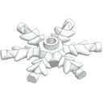{ .lu-ti width="24" loading="lazy" } [Ice Crystal (LOT 5357)](../5357.md) | 1.67127652%; mean 0.016806723 | Not associated with a vendor |
| { .lu-ti width="24" loading="lazy" } [Wig, Wolfman  (LOT 5359)](../5359.md) | 0.65005226%; mean 0.006514658 | Not associated with a vendor |
| { .lu-ti width="24" loading="lazy" } [Skateboard 1 (LOT 5360)](../5360.md) | 0.65005226%; mean 0.006514658 | Not associated with a vendor |
| { .lu-ti width="24" loading="lazy" } [Basketball (LOT 5362)](../5362.md) | 0.65005226%; mean 0.006514658 | Not associated with a vendor |
| { .lu-ti width="24" loading="lazy" } [Wig with Blow-dried Hairdo (LOT 5364)](../5364.md) | 0.65005226%; mean 0.006514658 | Not associated with a vendor |
| { .lu-ti width="24" loading="lazy" } [Scimitar (LOT 5366)](../5366.md) | 0.65005226%; mean 0.006514658 | Not associated with a vendor |
| { .lu-ti width="24" loading="lazy" } [Russian Fur Cap (LOT 5370)](../5370.md) | 0.65005226%; mean 0.006514658 | Not associated with a vendor |
| { .lu-ti width="24" loading="lazy" } [Spiked Pike (LOT 5371)](../5371.md) | 0.65005226%; mean 0.006514658 | Not associated with a vendor |
| { .lu-ti width="24" loading="lazy" } [Knife (LOT 5377)](../5377.md) | 0.65005226%; mean 0.006514658 | Not associated with a vendor |
| { .lu-ti width="24" loading="lazy" } [Skateboard 2 (LOT 5381)](../5381.md) | 0.65005226%; mean 0.006514658 | Not associated with a vendor |
| { .lu-ti width="24" loading="lazy" } [Ice Hockey Helmet (LOT 5383)](../5383.md) | 0.65005226%; mean 0.006514658 | Not associated with a vendor |
| { .lu-ti width="24" loading="lazy" } [Hockey Body Armor (LOT 5384)](../5384.md) | 0.65005226%; mean 0.006514658 | Not associated with a vendor |
| { .lu-ti width="24" loading="lazy" } [Wing 4x7 Scaled (LOT 5389)](../5389.md) | 0.65005226%; mean 0.006514658 | Not associated with a vendor |
| { .lu-ti width="24" loading="lazy" } [Visor No. 1 Wise (LOT 5391)](../5391.md) | 0.65005226%; mean 0.006514658 | Not associated with a vendor |
| { .lu-ti width="24" loading="lazy" } [Visor No. 3 Rookie (LOT 5392)](../5392.md) | 0.65005226%; mean 0.006514658 | Not associated with a vendor |
| { .lu-ti width="24" loading="lazy" } [Visor No. 4 Brute (LOT 5393)](../5393.md) | 0.65005226%; mean 0.006514658 | Not associated with a vendor |
| { .lu-ti width="24" loading="lazy" } [Visor No. 2 Joker (LOT 5394)](../5394.md) | 0.65005226%; mean 0.006514658 | Not associated with a vendor |
| { .lu-ti width="24" loading="lazy" } [Visor No. 5 Evil (LOT 5395)](../5395.md) | 0.65005226%; mean 0.006514658 | Not associated with a vendor |
| { .lu-ti width="24" loading="lazy" } [Dark Knight Helmet (LOT 5397)](../5397.md) | 0.65005226%; mean 0.006514658 | Not associated with a vendor |
| { .lu-ti width="24" loading="lazy" } [Knight Shield Octagonal with Stud (LOT 5398)](../5398.md) | 0.65005226%; mean 0.006514658 | Not associated with a vendor |
| { .lu-ti width="24" loading="lazy" } [Sword with Inverted V-Guard (LOT 5399)](../5399.md) | 0.65005226%; mean 0.006514658 | Not associated with a vendor |
| { .lu-ti width="24" loading="lazy" } [Bracket 1x1 with Pin (LOT 5401)](../5401.md) | 0.65005226%; mean 0.006514658 | Not associated with a vendor |
| { .lu-ti width="24" loading="lazy" } [Viking Helmet (LOT 5418)](../5418.md) | 0.65005226%; mean 0.006514658 | Not associated with a vendor |
| { .lu-ti width="24" loading="lazy" } [BattleAxe Head with Horizontal Clip (LOT 5419)](../5419.md) | 0.65005226%; mean 0.006514658 | Not associated with a vendor |
| { .lu-ti width="24" loading="lazy" } [Wig Manga 1 (LOT 5433)](../5433.md) | 0.65005226%; mean 0.006514658 | Not associated with a vendor |
| { .lu-ti width="24" loading="lazy" } [Wig Manga 2 (LOT 5434)](../5434.md) | 0.65005226%; mean 0.006514658 | Not associated with a vendor |
| { .lu-ti width="24" loading="lazy" } [Hammer (LOT 5446)](../5446.md) | 0.65005226%; mean 0.006514658 | Not associated with a vendor |
| { .lu-ti width="24" loading="lazy" } [Oil Can (LOT 5447)](../5447.md) | 0.65005226%; mean 0.006514658 | Not associated with a vendor |
| { .lu-ti width="24" loading="lazy" } [Drilling Machine (LOT 5448)](../5448.md) | 0.65005226%; mean 0.006514658 | Not associated with a vendor |
| { .lu-ti width="24" loading="lazy" } [Screwdriver (LOT 5449)](../5449.md) | 0.65005226%; mean 0.006514658 | Not associated with a vendor |
| 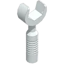{ .lu-ti width="24" loading="lazy" } [Open Firm Key (LOT 5450)](../5450.md) | 0.65005226%; mean 0.006514658 | Not associated with a vendor |
| { .lu-ti width="24" loading="lazy" } [Closed Wrench (LOT 5451)](../5451.md) | 0.65005226%; mean 0.006514658 | Not associated with a vendor |
| { .lu-ti width="24" loading="lazy" } [Moulding Element with 4 Flowers (LOT 5468)](../5468.md) | 1.67127652%; mean 0.016806723 | Not associated with a vendor |
| { .lu-ti width="24" loading="lazy" } [Silver Harpoons (LOT 5471)](../5471.md) | 0.65005226%; mean 0.006514658 | Not associated with a vendor |
| 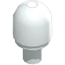{ .lu-ti width="24" loading="lazy" } [Round Cap 1x1 with Bar (LOT 5488)](../5488.md) | 1.67127652%; mean 0.016806723 | Not associated with a vendor |
| { .lu-ti width="24" loading="lazy" } [Scythe Blade (LOT 5502)](../5502.md) | 0.65005226%; mean 0.006514658 | Not associated with a vendor |
| { .lu-ti width="24" loading="lazy" } [Round Shield (LOT 5503)](../5503.md) | 0.65005226%; mean 0.006514658 | Not associated with a vendor |
| { .lu-ti width="24" loading="lazy" } [Morningstar (LOT 5504)](../5504.md) | 0.65005226%; mean 0.006514658 | Not associated with a vendor |
| { .lu-ti width="24" loading="lazy" } [Lightning Bolt with Handle (LOT 5505)](../5505.md) | 0.65005226%; mean 0.006514658 | Not associated with a vendor |
| { .lu-ti width="24" loading="lazy" } [Frogman's Feet (LOT 5506)](../5506.md) | 0.65005226%; mean 0.006514658 | Not associated with a vendor |
| { .lu-ti width="24" loading="lazy" } [Lady Wig (LOT 5507)](../5507.md) | 0.65005226%; mean 0.006514658 | Not associated with a vendor |
| { .lu-ti width="24" loading="lazy" } [Princess Hair (LOT 5508)](../5508.md) | 0.65005226%; mean 0.006514658 | Not associated with a vendor |
| { .lu-ti width="24" loading="lazy" } [Dwarf King's Helmet (LOT 5546)](../5546.md) | 0.65005226%; mean 0.006514658 | Not associated with a vendor |
| { .lu-ti width="24" loading="lazy" } [Dwarf Warrior's Helmet (LOT 5547)](../5547.md) | 0.65005226%; mean 0.006514658 | Not associated with a vendor |
| { .lu-ti width="24" loading="lazy" } [Dwarf King Beard (LOT 5548)](../5548.md) | 0.65005226%; mean 0.006514658 | Not associated with a vendor |
| { .lu-ti width="24" loading="lazy" } [Dwarf Warrior Beard (LOT 5549)](../5549.md) | 0.65005226%; mean 0.006514658 | Not associated with a vendor |
| { .lu-ti width="24" loading="lazy" } [Warrior Helmet (LOT 5550)](../5550.md) | 0.65005226%; mean 0.006514658 | Not associated with a vendor |
| 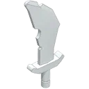{ .lu-ti width="24" loading="lazy" } [Notched Scimitar (LOT 5551)](../5551.md) | 0.65005226%; mean 0.006514658 | Not associated with a vendor |
| 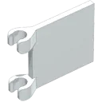{ .lu-ti width="24" loading="lazy" } [Flag 2x2 with Horizontal Clips (LOT 5552)](../5552.md) | 1.67127652%; mean 0.016806723 | Not associated with a vendor |
| { .lu-ti width="24" loading="lazy" } [Nozzle with Shaft (LOT 5556)](../5556.md) | 0.65005226%; mean 0.006514658 | Not associated with a vendor |
| { .lu-ti width="24" loading="lazy" } [Slope 1x2x2/3 Brick with Grating (LOT 5562)](../5562.md) | 1.67127652%; mean 0.016806723 | Not associated with a vendor |
| 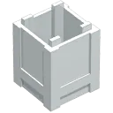{ .lu-ti width="24" loading="lazy" } [Box 2x2x2 (LOT 5571)](../5571.md) | 1.67127652%; mean 0.016806723 | Not associated with a vendor |
| { .lu-ti width="24" loading="lazy" } [Knight Shield Octagonal (LOT 5572)](../5572.md) | 0.65005226%; mean 0.006514658 | Not associated with a vendor |
| { .lu-ti width="24" loading="lazy" } [Lattice 1x4x3 (LOT 5573)](../5573.md) | 1.67127652%; mean 0.016806723 | Not associated with a vendor |
| { .lu-ti width="24" loading="lazy" } [Breastplate (LOT 5576)](../5576.md) | 0.65005226%; mean 0.006514658 | Not associated with a vendor |
| { .lu-ti width="24" loading="lazy" } [Wig with Long Ponytail (LOT 5582)](../5582.md) | 0.65005226%; mean 0.006514658 | Not associated with a vendor |
| { .lu-ti width="24" loading="lazy" } [Helmet with Jagged Jaw (LOT 5583)](../5583.md) | 0.65005226%; mean 0.006514658 | Not associated with a vendor |
| { .lu-ti width="24" loading="lazy" } [Barbed Wire (LOT 5585)](../5585.md) | 0.65005226%; mean 0.006514658 | Not associated with a vendor |
| { .lu-ti width="24" loading="lazy" } [Wig, Bowl Cut (LOT 5587)](../5587.md) | 0.65005226%; mean 0.006514658 | Not associated with a vendor |
| { .lu-ti width="24" loading="lazy" } [Antique Key (LOT 5590)](../5590.md) | 0.65005226%; mean 0.006514658 | Not associated with a vendor |
| { .lu-ti width="24" loading="lazy" } [Wig, Boy (LOT 5592)](../5592.md) | 0.65005226%; mean 0.006514658 | Not associated with a vendor |
| { .lu-ti width="24" loading="lazy" } [String with End Studs 30M (LOT 5594)](../5594.md) | 1.67127652%; mean 0.016806723 | Not associated with a vendor |
| { .lu-ti width="24" loading="lazy" } [Light Sword Handle (LOT 5598)](../5598.md) | 0.65005226%; mean 0.006514658 | Not associated with a vendor |
| { .lu-ti width="24" loading="lazy" } [Bucket (LOT 5601)](../5601.md) | 0.65005226%; mean 0.006514658 | Not associated with a vendor |
| { .lu-ti width="24" loading="lazy" } [Fanfare Horn, Chrome (LOT 5604)](../5604.md) | 0.65005226%; mean 0.006514658 | Not associated with a vendor |
| { .lu-ti width="24" loading="lazy" } [Handle for Bucket (LOT 5605)](../5605.md) | 0.65005226%; mean 0.006514658 | Not associated with a vendor |
| { .lu-ti width="24" loading="lazy" } [Space Suit (LOT 5607)](../5607.md) | 0.65005226%; mean 0.006514658 | Not associated with a vendor |
| { .lu-ti width="24" loading="lazy" } [Goblet (LOT 5608)](../5608.md) | 0.65005226%; mean 0.006514658 | Not associated with a vendor |
| { .lu-ti width="24" loading="lazy" } [Soccer Ball (LOT 5610)](../5610.md) | 1.67127652%; mean 0.016806723 | Not associated with a vendor |
| { .lu-ti width="24" loading="lazy" } [BaseBall Cap (LOT 5622)](../5622.md) | 0.65005226%; mean 0.006514658 | Not associated with a vendor |
| { .lu-ti width="24" loading="lazy" } [Hiccup Tablets (LOT 5832)](../5832.md) | 2.67857143%; mean 0.026785714 | Not associated with a vendor |
| { .lu-ti width="24" loading="lazy" } [Brick Booster Pack (LOT 5834)](../5834.md) | 2.67857143%; mean 0.026785714 | Not associated with a vendor |
| { .lu-ti width="24" loading="lazy" } [Super Brick Booster Pack (LOT 5835)](../5835.md) | 3%; mean 0.03 | Not associated with a vendor |
| { .lu-ti width="24" loading="lazy" } [Picnic Basket (LOT 5836)](../5836.md) | 2.67857143%; mean 0.026785714 | Not associated with a vendor |
| { .lu-ti width="24" loading="lazy" } [Super Picnic Basket (LOT 5837)](../5837.md) | 3%; mean 0.03 | Not associated with a vendor |
| { .lu-ti width="24" loading="lazy" } [Tiny Mushroom Model (LOT 6027)](../6027.md) | 0.96153846%; mean 0.0096153846 | Not associated with a vendor |
| { .lu-ti width="24" loading="lazy" } [Small Mushroom Model (LOT 6028)](../6028.md) | 0.96153846%; mean 0.0096153846 | Not associated with a vendor |
| { .lu-ti width="24" loading="lazy" } [Medium Mushroom Model (LOT 6029)](../6029.md) | 0.96153846%; mean 0.0096153846 | Not associated with a vendor |
| 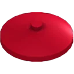{ .lu-ti width="24" loading="lazy" } [Large Mushroom Model (LOT 6030)](../6030.md) | 0.96153846%; mean 0.0096153846 | Not associated with a vendor |
| { .lu-ti width="24" loading="lazy" } [Tiny Crate Model (LOT 6031)](../6031.md) | 0.375%; mean 0.00375 | Not associated with a vendor |
| { .lu-ti width="24" loading="lazy" } [Small Crate Model (LOT 6032)](../6032.md) | 0.375%; mean 0.00375 | Not associated with a vendor |
| { .lu-ti width="24" loading="lazy" } [Medium Crate Model (LOT 6033)](../6033.md) | 0.14285714%; mean 0.0014285714 | Not associated with a vendor |
| { .lu-ti width="24" loading="lazy" } [Large Crate Model (LOT 6034)](../6034.md) | 0.14285714%; mean 0.0014285714 | Not associated with a vendor |
| { .lu-ti width="24" loading="lazy" } [Wooden Barrel Model (LOT 6035)](../6035.md) | 0.96153846%; mean 0.0096153846 | Not associated with a vendor |
| { .lu-ti width="24" loading="lazy" } [Tent Model (LOT 6036)](../6036.md) | 0.14285714%; mean 0.0014285714 | Not associated with a vendor |
| { .lu-ti width="24" loading="lazy" } [Desk Model (LOT 6037)](../6037.md) | 0.375%; mean 0.00375 | Not associated with a vendor |
| { .lu-ti width="24" loading="lazy" } [Water Cooler Model (LOT 6039)](../6039.md) | 0.96153846%; mean 0.0096153846 | Not associated with a vendor |
| { .lu-ti width="24" loading="lazy" } [Crate of Bananas Model (LOT 6040)](../6040.md) | 0.96153846%; mean 0.0096153846 | Not associated with a vendor |
| { .lu-ti width="24" loading="lazy" } [Pirate Lantern Model (LOT 6041)](../6041.md) | 0.96153846%; mean 0.0096153846 | Not associated with a vendor |
| { .lu-ti width="24" loading="lazy" } [Timeclock Model (LOT 6043)](../6043.md) | 0.96153846%; mean 0.0096153846 | Not associated with a vendor |
| { .lu-ti width="24" loading="lazy" } [Small Table Model (LOT 6044)](../6044.md) | 0.96153846%; mean 0.0096153846 | Not associated with a vendor |
| { .lu-ti width="24" loading="lazy" } [Brig Model (LOT 6045)](../6045.md) | 0.375%; mean 0.00375 | Not associated with a vendor |
| { .lu-ti width="24" loading="lazy" } [Hat Stand Model 1 (LOT 6053)](../6053.md) | 0.96153846%; mean 0.0096153846 | Not associated with a vendor |
| { .lu-ti width="24" loading="lazy" } [Hat Stand Model 2 (LOT 6054)](../6054.md) | 0.96153846%; mean 0.0096153846 | Not associated with a vendor |
| { .lu-ti width="24" loading="lazy" } [Hat Stand Model 3 (LOT 6055)](../6055.md) | 0.96153846%; mean 0.0096153846 | Not associated with a vendor |
| { .lu-ti width="24" loading="lazy" } [Weapon Rack Model (LOT 6056)](../6056.md) | 0.375%; mean 0.00375 | Not associated with a vendor |
| { .lu-ti width="24" loading="lazy" } [Sword Barrel Model (LOT 6058)](../6058.md) | 0.96153846%; mean 0.0096153846 | Not associated with a vendor |
| { .lu-ti width="24" loading="lazy" } [Hut Model (LOT 6060)](../6060.md) | 0.375%; mean 0.00375 | Not associated with a vendor |
| 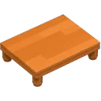{ .lu-ti width="24" loading="lazy" } [Coffee Table Model (LOT 6064)](../6064.md) | 0.96153846%; mean 0.0096153846 | Not associated with a vendor |
| { .lu-ti width="24" loading="lazy" } [Cart Model (LOT 6065)](../6065.md) | 0.96153846%; mean 0.0096153846 | Not associated with a vendor |
| { .lu-ti width="24" loading="lazy" } [Cot Model (LOT 6066)](../6066.md) | 0.96153846%; mean 0.0096153846 | Not associated with a vendor |
| { .lu-ti width="24" loading="lazy" } [Raft with Sails Model (LOT 6068)](../6068.md) | 0.375%; mean 0.00375 | Not associated with a vendor |
| { .lu-ti width="24" loading="lazy" } [Fence Model (LOT 6071)](../6071.md) | 0.96153846%; mean 0.0096153846 | Not associated with a vendor |
| { .lu-ti width="24" loading="lazy" } [Wood Pile Model (LOT 6072)](../6072.md) | 0.96153846%; mean 0.0096153846 | Not associated with a vendor |
| { .lu-ti width="24" loading="lazy" } [Maelstrom-Infected Brick (LOT 6194)](../6194.md) | 100%; mean 2 | Not associated with a vendor |
| { .lu-ti width="24" loading="lazy" } [Thirst Quencher (LOT 6201)](../6201.md) | 2.67857143%; mean 0.026785714 | Not associated with a vendor |
| { .lu-ti width="24" loading="lazy" } [Island Jail Model (LOT 6518)](../6518.md) | 0.14285714%; mean 0.0014285714 | Not associated with a vendor |
| { .lu-ti width="24" loading="lazy" } [Lookout Post Model (LOT 6519)](../6519.md) | 0.375%; mean 0.00375 | Not associated with a vendor |
| { .lu-ti width="24" loading="lazy" } [Island Fort Model (LOT 6520)](../6520.md) | 0.14285714%; mean 0.0014285714 | Not associated with a vendor |
| { .lu-ti width="24" loading="lazy" } [Mini Raft Model (LOT 6521)](../6521.md) | 0.375%; mean 0.00375 | Not associated with a vendor |
| { .lu-ti width="24" loading="lazy" } [Volley Gun Model (LOT 6522)](../6522.md) | 0.375%; mean 0.00375 | Not associated with a vendor |
| { .lu-ti width="24" loading="lazy" } [Palm Tree Model (LOT 6523)](../6523.md) | 0.96153846%; mean 0.0096153846 | Not associated with a vendor |
| { .lu-ti width="24" loading="lazy" } [Island Plant Model (LOT 6524)](../6524.md) | 0.96153846%; mean 0.0096153846 | Not associated with a vendor |
| { .lu-ti width="24" loading="lazy" } [Deluxe Raft Model (LOT 6525)](../6525.md) | 0.14285714%; mean 0.0014285714 | Not associated with a vendor |
| { .lu-ti width="24" loading="lazy" } [Large Cannon Model (LOT 6526)](../6526.md) | 0.96153846%; mean 0.0096153846 | Not associated with a vendor |
| { .lu-ti width="24" loading="lazy" } [Box of Pistols Model (LOT 6774)](../6774.md) | 0.96153846%; mean 0.0096153846 | Not associated with a vendor |
| { .lu-ti width="24" loading="lazy" } [Small Cannon Model (LOT 6776)](../6776.md) | 0.96153846%; mean 0.0096153846 | Not associated with a vendor |
| { .lu-ti width="24" loading="lazy" } [Box of Cups Model (LOT 6778)](../6778.md) | 0.96153846%; mean 0.0096153846 | Not associated with a vendor |
| { .lu-ti width="24" loading="lazy" } [Tiki Torch Model (LOT 6779)](../6779.md) | 0.96153846%; mean 0.0096153846 | Not associated with a vendor |
| { .lu-ti width="24" loading="lazy" } [Mini Galleon Model (LOT 6781)](../6781.md) | 0.16666667%; mean 0.0016666667 | Not associated with a vendor |
| { .lu-ti width="24" loading="lazy" } [Mini Windrunner Model (LOT 6782)](../6782.md) | 0.14285714%; mean 0.0014285714 | Not associated with a vendor |
| { .lu-ti width="24" loading="lazy" } [Hardtack Biscuit (LOT 6790)](../6790.md) | 2.67857143%; mean 0.026785714 | Not associated with a vendor |
| { .lu-ti width="24" loading="lazy" } [Cat Model (LOT 6840)](../6840.md) | 0.96153846%; mean 0.0096153846 | Not associated with a vendor |
| { .lu-ti width="24" loading="lazy" } [Morion Helmet (LOT 6853)](../6853.md) | 0.45454545%; mean 0.0045454545 | Not associated with a vendor |
| { .lu-ti width="24" loading="lazy" } [Green Shoulder Parrot (LOT 6854)](../6854.md) | 0% in the generic loot model | Not associated with a vendor |
| { .lu-ti width="24" loading="lazy" } [Yellow Shoulder Parrot (LOT 6855)](../6855.md) | 0% in the generic loot model | Not associated with a vendor |
| { .lu-ti width="24" loading="lazy" } [Orange Shoulder Parrot (LOT 6856)](../6856.md) | 0% in the generic loot model | Not associated with a vendor |
| { .lu-ti width="24" loading="lazy" } [Dark Red Gem (LOT 6862)](../6862.md) | 1%; mean 0.01 | Not associated with a vendor |
| { .lu-ti width="24" loading="lazy" } [Yellow Gem (LOT 6863)](../6863.md) | 1%; mean 0.01 | Not associated with a vendor |
| { .lu-ti width="24" loading="lazy" } [Green Gem (LOT 6864)](../6864.md) | 1.6%; mean 0.016 | Not associated with a vendor |
| { .lu-ti width="24" loading="lazy" } [Light Blue Gem (LOT 6865)](../6865.md) | 3%; mean 0.03 | Not associated with a vendor |
| { .lu-ti width="24" loading="lazy" } [Pink Gem (LOT 6866)](../6866.md) | 2.67857143%; mean 0.026785714 | Not associated with a vendor |
| { .lu-ti width="24" loading="lazy" } [Clamshell Model (LOT 6869)](../6869.md) | 0.96153846%; mean 0.0096153846 | Not associated with a vendor |
| { .lu-ti width="24" loading="lazy" } [Snake Model (LOT 6870)](../6870.md) | 0.96153846%; mean 0.0096153846 | Not associated with a vendor |
| { .lu-ti width="24" loading="lazy" } [Armored Viking Helmet (LOT 6880)](../6880.md) | 0% in the generic loot model | Not associated with a vendor |
| { .lu-ti width="24" loading="lazy" } [Flash Bang (LOT 6884)](../6884.md) | 2.67857143%; mean 0.026785714 | Not associated with a vendor |
| { .lu-ti width="24" loading="lazy" } [Stinky Fish (LOT 6885)](../6885.md) | 2.67857143%; mean 0.026785714 | Not associated with a vendor |
| { .lu-ti width="24" loading="lazy" } [Tasty Fish (LOT 6886)](../6886.md) | 2.67857143%; mean 0.026785714 | Not associated with a vendor |
| { .lu-ti width="24" loading="lazy" } [Pirate Duck Model (LOT 6941)](../6941.md) | 0.14285714%; mean 0.0014285714 | Not associated with a vendor |
| { .lu-ti width="24" loading="lazy" } [Shark Model (LOT 6942)](../6942.md) | 0.96153846%; mean 0.0096153846 | Not associated with a vendor |
| Unnamed LOT 6943 (LOT 6943; not an item registration) | 0% in the generic loot model | Not associated with a vendor |
| { .lu-ti width="24" loading="lazy" } [Superior Fish on a Stick (LOT 6973)](../6973.md) | 0.71428571%; mean 0.0071428571 | Not associated with a vendor |
| { .lu-ti width="24" loading="lazy" } [Frog Model (LOT 7057)](../7057.md) | 0.96153846%; mean 0.0096153846 | Not associated with a vendor |
| { .lu-ti width="24" loading="lazy" } [Starfish Model (LOT 7060)](../7060.md) | 0.96153846%; mean 0.0096153846 | Not associated with a vendor |
| { .lu-ti width="24" loading="lazy" } [Worthy Force Blade (LOT 7068)](../7068.md) | 1.875%; mean 0.01875 | Not associated with a vendor |
| { .lu-ti width="24" loading="lazy" } [Superior Lance (LOT 7070)](../7070.md) | 0.71428571%; mean 0.0071428571 | Not associated with a vendor |
| { .lu-ti width="24" loading="lazy" } [Worthy Javelin (LOT 7079)](../7079.md) | 1.875%; mean 0.01875 | Not associated with a vendor |
| { .lu-ti width="24" loading="lazy" } [Boom Trap Kit (LOT 7084)](../7084.md) | 2.67857143%; mean 0.026785714 | Not associated with a vendor |
| { .lu-ti width="24" loading="lazy" } [Candle Holder Model (LOT 7122)](../7122.md) | 0.96153846%; mean 0.0096153846 | Not associated with a vendor |
| { .lu-ti width="24" loading="lazy" } [Dock Model (LOT 7123)](../7123.md) | 0.375%; mean 0.00375 | Not associated with a vendor |
| { .lu-ti width="24" loading="lazy" } [Organ Model (LOT 7124)](../7124.md) | 0.16666667%; mean 0.0016666667 | Not associated with a vendor |
| { .lu-ti width="24" loading="lazy" } [Shack Model (LOT 7125)](../7125.md) | 0.16666667%; mean 0.0016666667 | Not associated with a vendor |
| { .lu-ti width="24" loading="lazy" } [Soda Rack Model (LOT 7126)](../7126.md) | 0.375%; mean 0.00375 | Not associated with a vendor |
| { .lu-ti width="24" loading="lazy" } [Treasure Chest Model (LOT 7127)](../7127.md) | 0.375%; mean 0.00375 | Not associated with a vendor |
| { .lu-ti width="24" loading="lazy" } [Cabinet Model (LOT 7134)](../7134.md) | 0.375%; mean 0.00375 | Not associated with a vendor |
| { .lu-ti width="24" loading="lazy" } [Antique Chair Model (LOT 7135)](../7135.md) | 0.96153846%; mean 0.0096153846 | Not associated with a vendor |
| { .lu-ti width="24" loading="lazy" } [Red Shoulder Parrot (LOT 7570)](../7570.md) | 0% in the generic loot model | Not associated with a vendor |
| { .lu-ti width="24" loading="lazy" } [Buttery Croissant (LOT 7724)](../7724.md) | 2.67857143%; mean 0.026785714 | Not associated with a vendor |
| { .lu-ti width="24" loading="lazy" } [Healing Drumstick (LOT 7725)](../7725.md) | 2.67857143%; mean 0.026785714 | Not associated with a vendor |
| { .lu-ti width="24" loading="lazy" } [Firecracker (LOT 7778)](../7778.md) | 2.67857143%; mean 0.026785714 | Not associated with a vendor |
| { .lu-ti width="24" loading="lazy" } [Armchair Model (LOT 8051)](../8051.md) | 0.96153846%; mean 0.0096153846 | Not associated with a vendor |
| { .lu-ti width="24" loading="lazy" } [Goblet Box Model (LOT 8055)](../8055.md) | 0.96153846%; mean 0.0096153846 | Not associated with a vendor |
| { .lu-ti width="24" loading="lazy" } [Red Shako Hat (LOT 8085)](../8085.md) | 0% in the generic loot model | Not associated with a vendor |
| { .lu-ti width="24" loading="lazy" } [Blue Imperial Shirt (LOT 8087)](../8087.md) | 0.45454545%; mean 0.0045454545 | Not associated with a vendor |
| { .lu-ti width="24" loading="lazy" } [Shield of Blocking (LOT 8333)](../8333.md) | 0% in the generic loot model | Not associated with a vendor |
| { .lu-ti width="24" loading="lazy" } [Potion of Shielding (LOT 8365)](../8365.md) | 2.67857143%; mean 0.026785714 | Not associated with a vendor |
| { .lu-ti width="24" loading="lazy" } [Superior Shortsword (LOT 8479)](../8479.md) | 0.71428571%; mean 0.0071428571 | Not associated with a vendor |
| { .lu-ti width="24" loading="lazy" } [Exceptional Axe (LOT 8480)](../8480.md) | 0% in the generic loot model | Not associated with a vendor |
| { .lu-ti width="24" loading="lazy" } [Worthy Wrench (LOT 8481)](../8481.md) | 1.875%; mean 0.01875 | Not associated with a vendor |
| { .lu-ti width="24" loading="lazy" } [Exceptional Pipe Wrench (LOT 8482)](../8482.md) | 0% in the generic loot model | Not associated with a vendor |
| { .lu-ti width="24" loading="lazy" } [Exceptional Ladle (LOT 8483)](../8483.md) | 0% in the generic loot model | Not associated with a vendor |
| { .lu-ti width="24" loading="lazy" } [Worthy Butterfly Net (LOT 8484)](../8484.md) | 1.875%; mean 0.01875 | Not associated with a vendor |
| { .lu-ti width="24" loading="lazy" } [Superior Huge Axe (LOT 8485)](../8485.md) | 0.71428571%; mean 0.0071428571 | Not associated with a vendor |
| { .lu-ti width="24" loading="lazy" } [Exceptional Spear (LOT 8487)](../8487.md) | 0% in the generic loot model | Not associated with a vendor |
| { .lu-ti width="24" loading="lazy" } [Superior Hammer (LOT 8488)](../8488.md) | 0.71428571%; mean 0.0071428571 | Not associated with a vendor |
| { .lu-ti width="24" loading="lazy" } [Worthy Ice Saw (LOT 8489)](../8489.md) | 1.875%; mean 0.01875 | Not associated with a vendor |
| { .lu-ti width="24" loading="lazy" } [Superior Halberd (LOT 8490)](../8490.md) | 0.71428571%; mean 0.0071428571 | Not associated with a vendor |
| { .lu-ti width="24" loading="lazy" } [Wand of Knockback (LOT 8491)](../8491.md) | 0% in the generic loot model | Not associated with a vendor |
| { .lu-ti width="24" loading="lazy" } [Wand of Sleep (LOT 8492)](../8492.md) | 0% in the generic loot model | Not associated with a vendor |
| { .lu-ti width="24" loading="lazy" } [Superior Katana (LOT 8493)](../8493.md) | 0.71428571%; mean 0.0071428571 | Not associated with a vendor |
| { .lu-ti width="24" loading="lazy" } [Exceptional Dagger (LOT 8494)](../8494.md) | 0% in the generic loot model | Not associated with a vendor |
| { .lu-ti width="24" loading="lazy" } [Exceptional Force Blade (LOT 8495)](../8495.md) | 0% in the generic loot model | Not associated with a vendor |
| { .lu-ti width="24" loading="lazy" } [Worthy Morning Star (LOT 8496)](../8496.md) | 1.875%; mean 0.01875 | Not associated with a vendor |
| { .lu-ti width="24" loading="lazy" } [Heater Shield (LOT 8531)](../8531.md) | 0% in the generic loot model | Not associated with a vendor |
| { .lu-ti width="24" loading="lazy" } [Briefcase (LOT 8532)](../8532.md) | 0% in the generic loot model | Not associated with a vendor |
| { .lu-ti width="24" loading="lazy" } [Quiver (LOT 8533)](../8533.md) | 0% in the generic loot model | Not associated with a vendor |
| { .lu-ti width="24" loading="lazy" } [Utility Harness (LOT 8534)](../8534.md) | 0% in the generic loot model | Not associated with a vendor |
| { .lu-ti width="24" loading="lazy" } [Scoundrel Cap (LOT 8547)](../8547.md) | 0.45454545%; mean 0.0045454545 | Not associated with a vendor |
| { .lu-ti width="24" loading="lazy" } [Red Uniform (LOT 8603)](../8603.md) | 0.45454545%; mean 0.0045454545 | Not associated with a vendor |
| { .lu-ti width="24" loading="lazy" } [Aviator Shirt (LOT 8612)](../8612.md) | 0.45454545%; mean 0.0045454545 | Not associated with a vendor |
| { .lu-ti width="24" loading="lazy" } [Cattle Rustler Shirt (LOT 8613)](../8613.md) | 0.45454545%; mean 0.0045454545 | Not associated with a vendor |
| { .lu-ti width="24" loading="lazy" } [Inmate Shirt (LOT 8616)](../8616.md) | 0% in the generic loot model | Not associated with a vendor |
| { .lu-ti width="24" loading="lazy" } [Retro Daredevil Shirt (LOT 8617)](../8617.md) | 0.45454545%; mean 0.0045454545 | Not associated with a vendor |
| { .lu-ti width="24" loading="lazy" } [Pirate Princess Dress (LOT 8626)](../8626.md) | 0% in the generic loot model | Not associated with a vendor |
| { .lu-ti width="24" loading="lazy" } [Confederate Shirt (LOT 8631)](../8631.md) | 0% in the generic loot model | Not associated with a vendor |
| { .lu-ti width="24" loading="lazy" } [Steel Legs (LOT 8641)](../8641.md) | 0.45454545%; mean 0.0045454545 | Not associated with a vendor |
| { .lu-ti width="24" loading="lazy" } [Capris (LOT 8643)](../8643.md) | 0% in the generic loot model | Not associated with a vendor |
| { .lu-ti width="24" loading="lazy" } [Chaps (LOT 8649)](../8649.md) | 0.45454545%; mean 0.0045454545 | Not associated with a vendor |
| { .lu-ti width="24" loading="lazy" } [Tights (LOT 8650)](../8650.md) | 0% in the generic loot model | Not associated with a vendor |
| { .lu-ti width="24" loading="lazy" } [Kettle Helmet (LOT 8673)](../8673.md) | 0% in the generic loot model | Not associated with a vendor |
| { .lu-ti width="24" loading="lazy" } [Epaulets of Authority (LOT 8683)](../8683.md) | 0% in the generic loot model | Not associated with a vendor |
| { .lu-ti width="24" loading="lazy" } [Sailor Hat (LOT 8685)](../8685.md) | 0% in the generic loot model | Not associated with a vendor |
| { .lu-ti width="24" loading="lazy" } [Baroque Sign (LOT 8787)](../8787.md) | 1.67127652%; mean 0.016806723 | Not associated with a vendor |
| { .lu-ti width="24" loading="lazy" } [Epaulets (LOT 8803)](../8803.md) | 0.65005226%; mean 0.006514658 | Not associated with a vendor |
| { .lu-ti width="24" loading="lazy" } [Boat Mast Extension (LOT 8804)](../8804.md) | 1.67127652%; mean 0.016806723 | Not associated with a vendor |
| { .lu-ti width="24" loading="lazy" } [Boat Bowsprit (LOT 8805)](../8805.md) | 1.67127652%; mean 0.016806723 | Not associated with a vendor |
| { .lu-ti width="24" loading="lazy" } [Flintlock Pistol (LOT 8807)](../8807.md) | 0.65005226%; mean 0.006514658 | Not associated with a vendor |
| { .lu-ti width="24" loading="lazy" } [Gate 1x8x3 (LOT 8810)](../8810.md) | 1.67127652%; mean 0.016806723 | Not associated with a vendor |
| { .lu-ti width="24" loading="lazy" } [Wig with Small Pigtails (LOT 8839)](../8839.md) | 0.65005226%; mean 0.006514658 | Not associated with a vendor |
| { .lu-ti width="24" loading="lazy" } [Cowboy Hat (LOT 8840)](../8840.md) | 0.65005226%; mean 0.006514658 | Not associated with a vendor |
| { .lu-ti width="24" loading="lazy" } [Cypress (LOT 8845)](../8845.md) | 1.67127652%; mean 0.016806723 | Not associated with a vendor |
| { .lu-ti width="24" loading="lazy" } [Mini Crash Helmet (LOT 8846)](../8846.md) | 0.65005226%; mean 0.006514658 | Not associated with a vendor |
| { .lu-ti width="24" loading="lazy" } [Great Helm with Chin Guard (LOT 8848)](../8848.md) | 0.65005226%; mean 0.006514658 | Not associated with a vendor |
| { .lu-ti width="24" loading="lazy" } [Sunshade (LOT 8851)](../8851.md) | 1.67127652%; mean 0.016806723 | Not associated with a vendor |
| { .lu-ti width="24" loading="lazy" } [Pitchfork (LOT 8858)](../8858.md) | 0.65005226%; mean 0.006514658 | Not associated with a vendor |
| { .lu-ti width="24" loading="lazy" } [Forestman Cap (LOT 8860)](../8860.md) | 0.65005226%; mean 0.006514658 | Not associated with a vendor |
| { .lu-ti width="24" loading="lazy" } [Plastic Cape (LOT 8861)](../8861.md) | 0.65005226%; mean 0.006514658 | Not associated with a vendor |
| { .lu-ti width="24" loading="lazy" } [Bobbed Hair (LOT 8870)](../8870.md) | 0.65005226%; mean 0.006514658 | Not associated with a vendor |
| { .lu-ti width="24" loading="lazy" } [Islander Demon Mask (LOT 8871)](../8871.md) | 0.65005226%; mean 0.006514658 | Not associated with a vendor |
| { .lu-ti width="24" loading="lazy" } [Bush Bottom (LOT 8883)](../8883.md) | 1.67127652%; mean 0.016806723 | Not associated with a vendor |
| { .lu-ti width="24" loading="lazy" } [Plate 4x4 with Boat Mast Base (LOT 8884)](../8884.md) | 1.67127652%; mean 0.016806723 | Not associated with a vendor |
| { .lu-ti width="24" loading="lazy" } [Space Suit with Helmet and Propeller (LOT 8887)](../8887.md) | 0.65005226%; mean 0.006514658 | Not associated with a vendor |
| { .lu-ti width="24" loading="lazy" } [Space Suit with Helmet and Breathing Device (LOT 8888)](../8888.md) | 0.65005226%; mean 0.006514658 | Not associated with a vendor |
| { .lu-ti width="24" loading="lazy" } [Visor with Antenna (LOT 8890)](../8890.md) | 0.65005226%; mean 0.006514658 | Not associated with a vendor |
| { .lu-ti width="24" loading="lazy" } [Oval Suitcase (LOT 8894)](../8894.md) | 0.65005226%; mean 0.006514658 | Not associated with a vendor |
| { .lu-ti width="24" loading="lazy" } [Parasol (LOT 8903)](../8903.md) | 1.67127652%; mean 0.016806723 | Not associated with a vendor |
| { .lu-ti width="24" loading="lazy" } [Tile 2x2 with Parasol Stand (LOT 8904)](../8904.md) | 1.67127652%; mean 0.016806723 | Not associated with a vendor |
| { .lu-ti width="24" loading="lazy" } [Bath Tub 6x12x2 1/3 (LOT 8915)](../8915.md) | 1.67127652%; mean 0.016806723 | Not associated with a vendor |
| { .lu-ti width="24" loading="lazy" } [Helmet with Hose and Stud (LOT 8919)](../8919.md) | 0.65005226%; mean 0.006514658 | Not associated with a vendor |
| { .lu-ti width="24" loading="lazy" } [Underwater scooter (LOT 8926)](../8926.md) | 0.65005226%; mean 0.006514658 | Not associated with a vendor |
| { .lu-ti width="24" loading="lazy" } [Lattice Fence 2x12x6 (LOT 8928)](../8928.md) | 1.67127652%; mean 0.016806723 | Not associated with a vendor |
| { .lu-ti width="24" loading="lazy" } [Medicine Man Wig (LOT 8929)](../8929.md) | 0.65005226%; mean 0.006514658 | Not associated with a vendor |
| { .lu-ti width="24" loading="lazy" } [Indian Wig (LOT 8930)](../8930.md) | 0.65005226%; mean 0.006514658 | Not associated with a vendor |
| { .lu-ti width="24" loading="lazy" } [Alien Helmet (LOT 8931)](../8931.md) | 0.65005226%; mean 0.006514658 | Not associated with a vendor |
| { .lu-ti width="24" loading="lazy" } [Crash Helmet (LOT 8932)](../8932.md) | 0.65005226%; mean 0.006514658 | Not associated with a vendor |
| { .lu-ti width="24" loading="lazy" } [Hollow Stump (LOT 8933)](../8933.md) | 1.67127652%; mean 0.016806723 | Not associated with a vendor |
| { .lu-ti width="24" loading="lazy" } [Chief Brilliant Plumage (LOT 8934)](../8934.md) | 0.65005226%; mean 0.006514658 | Not associated with a vendor |
| { .lu-ti width="24" loading="lazy" } [Barrel 4x4 (LOT 8935)](../8935.md) | 1.67127652%; mean 0.016806723 | Not associated with a vendor |
| { .lu-ti width="24" loading="lazy" } [Samurai Helmet (LOT 8938)](../8938.md) | 0.65005226%; mean 0.006514658 | Not associated with a vendor |
| { .lu-ti width="24" loading="lazy" } [Aqua Suit Helmet (LOT 8940)](../8940.md) | 0.65005226%; mean 0.006514658 | Not associated with a vendor |
| { .lu-ti width="24" loading="lazy" } [Sensor Dish with Bent Stem (LOT 8942)](../8942.md) | 1.67127652%; mean 0.016806723 | Not associated with a vendor |
| { .lu-ti width="24" loading="lazy" } [Standard with Foot 2x2x5 (LOT 8943)](../8943.md) | 1.67127652%; mean 0.016806723 | Not associated with a vendor |
| { .lu-ti width="24" loading="lazy" } [Sign Octagonal with Vertical Clip (LOT 8944)](../8944.md) | 1.67127652%; mean 0.016806723 | Not associated with a vendor |
| { .lu-ti width="24" loading="lazy" } [Rock 4x4x1 2/3 Bottom Part (LOT 8947)](../8947.md) | 1.67127652%; mean 0.016806723 | Not associated with a vendor |
| { .lu-ti width="24" loading="lazy" } [Antenna 8 with Streamer (LOT 8949)](../8949.md) | 1.67127652%; mean 0.016806723 | Not associated with a vendor |
| { .lu-ti width="24" loading="lazy" } [BIONICLE Flame (LOT 8986)](../8986.md) | 1.67127652%; mean 0.016806723 | Not associated with a vendor |
| { .lu-ti width="24" loading="lazy" } [Hairdryer (LOT 8987)](../8987.md) | 0.65005226%; mean 0.006514658 | Not associated with a vendor |
| { .lu-ti width="24" loading="lazy" } [Turkey (LOT 8988)](../8988.md) | 0.65005226%; mean 0.006514658 | Not associated with a vendor |
| { .lu-ti width="24" loading="lazy" } [Decoration Ball (LOT 8989)](../8989.md) | 0.65005226%; mean 0.006514658 | Not associated with a vendor |
| { .lu-ti width="24" loading="lazy" } [Ski Pole (LOT 8992)](../8992.md) | 1.67127652%; mean 0.016806723 | Not associated with a vendor |
| { .lu-ti width="24" loading="lazy" } [Skates with 2 Studs (LOT 9007)](../9007.md) | 0.65005226%; mean 0.006514658 | Not associated with a vendor |
| { .lu-ti width="24" loading="lazy" } [Pivot Joint Housing on 2x2-Base (LOT 9018)](../9018.md) | 1.67127652%; mean 0.016806723 | Not associated with a vendor |
| { .lu-ti width="24" loading="lazy" } [1/2 Ball 3M (LOT 9019)](../9019.md) | 1.67127652%; mean 0.016806723 | Not associated with a vendor |
| { .lu-ti width="24" loading="lazy" } [Snowboard (LOT 9028)](../9028.md) | 0.65005226%; mean 0.006514658 | Not associated with a vendor |
| { .lu-ti width="24" loading="lazy" } [Grid 95x57 (LOT 9034)](../9034.md) | 1.67127652%; mean 0.016806723 | Not associated with a vendor |
| { .lu-ti width="24" loading="lazy" } [Cloth Cape (LOT 9036)](../9036.md) | 0.65005226%; mean 0.006514658 | Not associated with a vendor |
| { .lu-ti width="24" loading="lazy" } [Ball Ø16 (LOT 9061)](../9061.md) | 1.67127652%; mean 0.016806723 | Not associated with a vendor |
| { .lu-ti width="24" loading="lazy" } [Shackles (LOT 9065)](../9065.md) | 0.65005226%; mean 0.006514658 | Not associated with a vendor |
| { .lu-ti width="24" loading="lazy" } [Technic Dome 7x7x5 Ø4.85 (LOT 9078)](../9078.md) | 1.67127652%; mean 0.016806723 | Not associated with a vendor |
| { .lu-ti width="24" loading="lazy" } [Troll Club (LOT 9097)](../9097.md) | 0.65005226%; mean 0.006514658 | Not associated with a vendor |
| { .lu-ti width="24" loading="lazy" } [Handcuffs (LOT 9108)](../9108.md) | 0.65005226%; mean 0.006514658 | Not associated with a vendor |
| { .lu-ti width="24" loading="lazy" } [Fedora Hat (LOT 9110)](../9110.md) | 0.65005226%; mean 0.006514658 | Not associated with a vendor |
| { .lu-ti width="24" loading="lazy" } [Whip, Furled (LOT 9117)](../9117.md) | 0.65005226%; mean 0.006514658 | Not associated with a vendor |
| { .lu-ti width="24" loading="lazy" } [Shoulder Bag (LOT 9118)](../9118.md) | 0.65005226%; mean 0.006514658 | Not associated with a vendor |
| { .lu-ti width="24" loading="lazy" } [Joker Hat (LOT 9124)](../9124.md) | 0.65005226%; mean 0.006514658 | Not associated with a vendor |
| { .lu-ti width="24" loading="lazy" } [Evil Wig (LOT 9128)](../9128.md) | 0.65005226%; mean 0.006514658 | Not associated with a vendor |
| { .lu-ti width="24" loading="lazy" } [Spiral Tube with Flanges (LOT 9133)](../9133.md) | 1.67127652%; mean 0.016806723 | Not associated with a vendor |
| { .lu-ti width="24" loading="lazy" } [Telescope Bar 1x1x2 (LOT 9145)](../9145.md) | 0.65005226%; mean 0.006514658 | Not associated with a vendor |
| { .lu-ti width="24" loading="lazy" } [Blade with Haft (LOT 9153)](../9153.md) | 0.65005226%; mean 0.006514658 | Not associated with a vendor |
| { .lu-ti width="24" loading="lazy" } [Dynamite (LOT 9154)](../9154.md) | 0.65005226%; mean 0.006514658 | Not associated with a vendor |
| { .lu-ti width="24" loading="lazy" } [Wig, Older Guy (LOT 9156)](../9156.md) | 0.65005226%; mean 0.006514658 | Not associated with a vendor |
| { .lu-ti width="24" loading="lazy" } [Breastplate Chrome Silver (LOT 9161)](../9161.md) | 0.65005226%; mean 0.006514658 | Not associated with a vendor |
| { .lu-ti width="24" loading="lazy" } [Bugle (LOT 9162)](../9162.md) | 0.65005226%; mean 0.006514658 | Not associated with a vendor |
| { .lu-ti width="24" loading="lazy" } [Samurai Helmet Ornament (LOT 9164)](../9164.md) | 0.65005226%; mean 0.006514658 | Not associated with a vendor |
| { .lu-ti width="24" loading="lazy" } [Hand Tool with Suction Cup (LOT 9165)](../9165.md) | 0.65005226%; mean 0.006514658 | Not associated with a vendor |
| { .lu-ti width="24" loading="lazy" } [Birdcage (LOT 9175)](../9175.md) | 1.67127652%; mean 0.016806723 | Not associated with a vendor |
| { .lu-ti width="24" loading="lazy" } [Alien Helmet "Snake" (LOT 9179)](../9179.md) | 0.65005226%; mean 0.006514658 | Not associated with a vendor |
| { .lu-ti width="24" loading="lazy" } [Slizer Helmet (LOT 9181)](../9181.md) | 0.65005226%; mean 0.006514658 | Not associated with a vendor |
| { .lu-ti width="24" loading="lazy" } [Skull Helmet (LOT 9182)](../9182.md) | 0.65005226%; mean 0.006514658 | Not associated with a vendor |
| { .lu-ti width="24" loading="lazy" } [Squid Head (LOT 9184)](../9184.md) | 0.65005226%; mean 0.006514658 | Not associated with a vendor |
| { .lu-ti width="24" loading="lazy" } [Kranxx Head (LOT 9185)](../9185.md) | 0.65005226%; mean 0.006514658 | Not associated with a vendor |
| { .lu-ti width="24" loading="lazy" } [Flame 7M with Shaft (LOT 9186)](../9186.md) | 1.67127652%; mean 0.016806723 | Not associated with a vendor |
| { .lu-ti width="24" loading="lazy" } [Protective Vest (LOT 9187)](../9187.md) | 0.65005226%; mean 0.006514658 | Not associated with a vendor |
| { .lu-ti width="24" loading="lazy" } [Wig, Girl with Long Hair (LOT 9190)](../9190.md) | 0.65005226%; mean 0.006514658 | Not associated with a vendor |
| { .lu-ti width="24" loading="lazy" } [Fez (LOT 9191)](../9191.md) | 0.65005226%; mean 0.006514658 | Not associated with a vendor |
| { .lu-ti width="24" loading="lazy" } [Right Wing for Dragon Knight's Helmet (LOT 9211)](../9211.md) | 0.65005226%; mean 0.006514658 | Not associated with a vendor |
| { .lu-ti width="24" loading="lazy" } [Left Wing for Dragon Knight's Helmet (LOT 9212)](../9212.md) | 0.65005226%; mean 0.006514658 | Not associated with a vendor |
| { .lu-ti width="24" loading="lazy" } [Dragon Ornament for Dragon Knight's Helmet (LOT 9213)](../9213.md) | 0.65005226%; mean 0.006514658 | Not associated with a vendor |
| { .lu-ti width="24" loading="lazy" } [Rosette (LOT 9216)](../9216.md) | 0.65005226%; mean 0.006514658 | Not associated with a vendor |
| { .lu-ti width="24" loading="lazy" } [Imitation jewelry Wheel (LOT 9217)](../9217.md) | 0.65005226%; mean 0.006514658 | Not associated with a vendor |
| { .lu-ti width="24" loading="lazy" } [Feather for Helmet (LOT 9218)](../9218.md) | 0.65005226%; mean 0.006514658 | Not associated with a vendor |
| { .lu-ti width="24" loading="lazy" } [Small Feather for Helmet (LOT 9219)](../9219.md) | 0.65005226%; mean 0.006514658 | Not associated with a vendor |
| { .lu-ti width="24" loading="lazy" } [Big Feather for Helmet (LOT 9220)](../9220.md) | 0.65005226%; mean 0.006514658 | Not associated with a vendor |
| { .lu-ti width="24" loading="lazy" } [Animal Horns (LOT 9221)](../9221.md) | 0.65005226%; mean 0.006514658 | Not associated with a vendor |
| { .lu-ti width="24" loading="lazy" } [Splendorous Feather (LOT 9222)](../9222.md) | 0.65005226%; mean 0.006514658 | Not associated with a vendor |
| { .lu-ti width="24" loading="lazy" } [Atlantis Suit (LOT 9230)](../9230.md) | 0.65005226%; mean 0.006514658 | Not associated with a vendor |
| { .lu-ti width="24" loading="lazy" } [Squidman Head (LOT 9232)](../9232.md) | 0.65005226%; mean 0.006514658 | Not associated with a vendor |
| { .lu-ti width="24" loading="lazy" } [Visor with Slit (LOT 9234)](../9234.md) | 0.65005226%; mean 0.006514658 | Not associated with a vendor |
| { .lu-ti width="24" loading="lazy" } [Flame 1x4 with Shaft (LOT 9239)](../9239.md) | 1.67127652%; mean 0.016806723 | Not associated with a vendor |
| { .lu-ti width="24" loading="lazy" } [Visor for Atlantis Suit (LOT 9243)](../9243.md) | 0.65005226%; mean 0.006514658 | Not associated with a vendor |
| { .lu-ti width="24" loading="lazy" } [Mushroom Model 5 (LOT 9537)](../9537.md) | 0.96153846%; mean 0.0096153846 | Not associated with a vendor |
| { .lu-ti width="24" loading="lazy" } [Submarine Model (LOT 9565)](../9565.md) | 0.96153846%; mean 0.0096153846 | Not associated with a vendor |
| Unnamed LOT 9572 (LOT 9572; not an item registration) | 0% in the generic loot model | Not associated with a vendor |
| { .lu-ti width="24" loading="lazy" } [Shipwreck Hideout Pack (LOT 9603)](../9603.md) | 0.96153846%; mean 0.0096153846 | Not associated with a vendor |
| { .lu-ti width="24" loading="lazy" } [Black Aussie Hat (LOT 9615)](../9615.md) | 0.45454545%; mean 0.0045454545 | Not associated with a vendor |
| { .lu-ti width="24" loading="lazy" } [Modular Dock Model 1 (LOT 9812)](../9812.md) | 0.375%; mean 0.00375 | Not associated with a vendor |
| { .lu-ti width="24" loading="lazy" } [Modular Dock Model 2 (LOT 9813)](../9813.md) | 0.375%; mean 0.00375 | Not associated with a vendor |
| { .lu-ti width="24" loading="lazy" } [Modular Dock Model 3 (LOT 9814)](../9814.md) | 0.14285714%; mean 0.0014285714 | Not associated with a vendor |
| { .lu-ti width="24" loading="lazy" } [Cup of Yo (LOT 10038)](../10038.md) | 1.6%; mean 0.016 | Not associated with a vendor |
| { .lu-ti width="24" loading="lazy" } [Pirate Captain's Hut Model (LOT 10069)](../10069.md) | 0.16666667%; mean 0.0016666667 | Not associated with a vendor |
| { .lu-ti width="24" loading="lazy" } [Pirate Tower Model (LOT 10070)](../10070.md) | 0.16666667%; mean 0.0016666667 | Not associated with a vendor |
| { .lu-ti width="24" loading="lazy" } [Pirate Idol Model (LOT 10071)](../10071.md) | 0.375%; mean 0.00375 | Not associated with a vendor |
| { .lu-ti width="24" loading="lazy" } [Palm Tree Model 2 (LOT 10072)](../10072.md) | 0.375%; mean 0.00375 | Not associated with a vendor |
| { .lu-ti width="24" loading="lazy" } [Pirate Staircase Model (LOT 10073)](../10073.md) | 0.14285714%; mean 0.0014285714 | Not associated with a vendor |
| { .lu-ti width="24" loading="lazy" } [Pirate Gate Model (LOT 10074)](../10074.md) | 0.14285714%; mean 0.0014285714 | Not associated with a vendor |
| { .lu-ti width="24" loading="lazy" } [Pirate Wall Model 1 (LOT 10075)](../10075.md) | 0.14285714%; mean 0.0014285714 | Not associated with a vendor |
| { .lu-ti width="24" loading="lazy" } [Pirate Wall Model 2 (LOT 10076)](../10076.md) | 0.14285714%; mean 0.0014285714 | Not associated with a vendor |
| { .lu-ti width="24" loading="lazy" } [Pirate Wall Model 3 (LOT 10077)](../10077.md) | 0.14285714%; mean 0.0014285714 | Not associated with a vendor |
| { .lu-ti width="24" loading="lazy" } [Pirate Wall End Model (LOT 10078)](../10078.md) | 0.14285714%; mean 0.0014285714 | Not associated with a vendor |
| { .lu-ti width="24" loading="lazy" } [Pirate Wall With Gunport Model (LOT 10079)](../10079.md) | 0.14285714%; mean 0.0014285714 | Not associated with a vendor |
| { .lu-ti width="24" loading="lazy" } [Pirate Wall Bridge Model (LOT 10080)](../10080.md) | 0.14285714%; mean 0.0014285714 | Not associated with a vendor |
| { .lu-ti width="24" loading="lazy" } [Pirate Barrel Hut Model 1 (LOT 10081)](../10081.md) | 0.14285714%; mean 0.0014285714 | Not associated with a vendor |
| { .lu-ti width="24" loading="lazy" } [Pirate Barrel Hut Model 2 (LOT 10082)](../10082.md) | 0.14285714%; mean 0.0014285714 | Not associated with a vendor |
| { .lu-ti width="24" loading="lazy" } [Pirate Barrel Hut Model 3 (LOT 10083)](../10083.md) | 0.14285714%; mean 0.0014285714 | Not associated with a vendor |
| { .lu-ti width="24" loading="lazy" } [Pirate Corner Wall Model (LOT 10084)](../10084.md) | 0.14285714%; mean 0.0014285714 | Not associated with a vendor |
| { .lu-ti width="24" loading="lazy" } [Pirate Corner Lookout Model (LOT 10085)](../10085.md) | 0.14285714%; mean 0.0014285714 | Not associated with a vendor |
| { .lu-ti width="24" loading="lazy" } [Pirate Medium Wall Model (LOT 10086)](../10086.md) | 0.375%; mean 0.00375 | Not associated with a vendor |
| { .lu-ti width="24" loading="lazy" } [Pirate Small Wall Model (LOT 10087)](../10087.md) | 0.375%; mean 0.00375 | Not associated with a vendor |
| { .lu-ti width="24" loading="lazy" } [Pirate T-Wall Model (LOT 10088)](../10088.md) | 0.14285714%; mean 0.0014285714 | Not associated with a vendor |
| { .lu-ti width="24" loading="lazy" } [Pirate T-Wall With Stairs Model (LOT 10089)](../10089.md) | 0.14285714%; mean 0.0014285714 | Not associated with a vendor |
| { .lu-ti width="24" loading="lazy" } [Pirate Ship Model 5 (LOT 10090)](../10090.md) | 0.16666667%; mean 0.0016666667 | Not associated with a vendor |
| { .lu-ti width="24" loading="lazy" } [Pirate Ship Model 1 (LOT 10091)](../10091.md) | 0.14285714%; mean 0.0014285714 | Not associated with a vendor |
| { .lu-ti width="24" loading="lazy" } [Pirate Ship Model 3 (LOT 10092)](../10092.md) | 0.14285714%; mean 0.0014285714 | Not associated with a vendor |
| { .lu-ti width="24" loading="lazy" } [Pirate Ship Model 2 (LOT 10093)](../10093.md) | 0.14285714%; mean 0.0014285714 | Not associated with a vendor |
| { .lu-ti width="24" loading="lazy" } [Pirate Ship Model 4 (LOT 10094)](../10094.md) | 0.14285714%; mean 0.0014285714 | Not associated with a vendor |
| { .lu-ti width="24" loading="lazy" } [Minifigure Torso with Right Arm Prosthesis (LOT 10184)](../10184.md) | 0.65005226%; mean 0.006514658 | Not associated with a vendor |
| { .lu-ti width="24" loading="lazy" } [Minifigure Legs (LOT 10190)](../10190.md) | 0.65005226%; mean 0.006514658 | Not associated with a vendor |
| { .lu-ti width="24" loading="lazy" } [Control Stick with Base (LOT 10192)](../10192.md) | 1.67127652%; mean 0.016806723 | Not associated with a vendor |
| { .lu-ti width="24" loading="lazy" } [Minifigure Torso (LOT 10200)](../10200.md) | 0.65005226%; mean 0.006514658 | Not associated with a vendor |
| { .lu-ti width="24" loading="lazy" } [Minifigure Legs with Right Wooden Leg (LOT 10204)](../10204.md) | 0.65005226%; mean 0.006514658 | Not associated with a vendor |
| { .lu-ti width="24" loading="lazy" } [Minifigure Torso with Left Hook Prosthesis (LOT 10205)](../10205.md) | 0.65005226%; mean 0.006514658 | Not associated with a vendor |
| { .lu-ti width="24" loading="lazy" } [Treasure chest 2x4 Bottom Part (LOT 10233)](../10233.md) | 1.67127652%; mean 0.016806723 | Not associated with a vendor |
| { .lu-ti width="24" loading="lazy" } [Treasure chest 2x4 Lid (LOT 10234)](../10234.md) | 1.67127652%; mean 0.016806723 | Not associated with a vendor |
| { .lu-ti width="24" loading="lazy" } [BroadSword (LOT 11113)](../11113.md) | 0.65005226%; mean 0.006514658 | Not associated with a vendor |
| { .lu-ti width="24" loading="lazy" } [Anchors Away (LOT 13426)](../13426.md) | 3%; mean 0.03 | Not associated with a vendor |
| { .lu-ti width="24" loading="lazy" } [Faction Token Proxy (LOT 13763)](../13763.md) | 100%; mean 1 | Not associated with a vendor |
| { .lu-ti width="24" loading="lazy" } [Med Pack (LOT 14679)](../14679.md) | 1.6%; mean 0.016 | Not associated with a vendor |
| { .lu-ti width="24" loading="lazy" } [Armor Repair Kit (LOT 14680)](../14680.md) | 1.6%; mean 0.016 | Not associated with a vendor |
| { .lu-ti width="24" loading="lazy" } [Mummy Coffin (LOT 16341)](../16341.md) | 1.67127652%; mean 0.016806723 | Not associated with a vendor |
| { .lu-ti width="24" loading="lazy" } [Mummy Coffin Lid (LOT 16342)](../16342.md) | 1.67127652%; mean 0.016806723 | Not associated with a vendor |
| { .lu-ti width="24" loading="lazy" } [Farmer's Cap (LOT 16370)](../16370.md) | 0.65005226%; mean 0.006514658 | Not associated with a vendor |
| { .lu-ti width="24" loading="lazy" } [Goggles (LOT 16373)](../16373.md) | 0.65005226%; mean 0.006514658 | Not associated with a vendor |
| { .lu-ti width="24" loading="lazy" } [Globe (LOT 16380)](../16380.md) | 1.67127652%; mean 0.016806723 | Not associated with a vendor |
| { .lu-ti width="24" loading="lazy" } [Flame (LOT 16399)](../16399.md) | 1.67127652%; mean 0.016806723 | Not associated with a vendor |
| { .lu-ti width="24" loading="lazy" } [Wig, Medium Hair (LOT 16412)](../16412.md) | 0.65005226%; mean 0.006514658 | Not associated with a vendor |
| { .lu-ti width="24" loading="lazy" } [Porcupine, Shoulder Armor (LOT 16415)](../16415.md) | 0.65005226%; mean 0.006514658 | Not associated with a vendor |
| { .lu-ti width="24" loading="lazy" } [Knight&#96;s Helmet (LOT 16421)](../16421.md) | 0.65005226%; mean 0.006514658 | Not associated with a vendor |
| { .lu-ti width="24" loading="lazy" } [Wig, Short Hair (LOT 16434)](../16434.md) | 0.65005226%; mean 0.006514658 | Not associated with a vendor |
| { .lu-ti width="24" loading="lazy" } [Wig, Long Hair (LOT 16435)](../16435.md) | 0.65005226%; mean 0.006514658 | Not associated with a vendor |
| { .lu-ti width="24" loading="lazy" } [Sack (LOT 16441)](../16441.md) | 0.65005226%; mean 0.006514658 | Not associated with a vendor |
| { .lu-ti width="24" loading="lazy" } [Ø3.2 Shaft with Cored Knob (LOT 16444)](../16444.md) | 0.65005226%; mean 0.006514658 | Not associated with a vendor |
| { .lu-ti width="24" loading="lazy" } [5 M. Ø3.2 Bone (LOT 16445)](../16445.md) | 0.65005226%; mean 0.006514658 | Not associated with a vendor |
| { .lu-ti width="24" loading="lazy" } [Armour with Spike (LOT 16449)](../16449.md) | 0.65005226%; mean 0.006514658 | Not associated with a vendor |
| { .lu-ti width="24" loading="lazy" } [Star with Ø3.2 Wheel (LOT 16450)](../16450.md) | 0.65005226%; mean 0.006514658 | Not associated with a vendor |
| { .lu-ti width="24" loading="lazy" } [Hat (LOT 16451)](../16451.md) | 0.65005226%; mean 0.006514658 | Not associated with a vendor |
| { .lu-ti width="24" loading="lazy" } [Sensei Beard (LOT 16459)](../16459.md) | 0.65005226%; mean 0.006514658 | Not associated with a vendor |
| { .lu-ti width="24" loading="lazy" } [Egyptian Sword (LOT 16461)](../16461.md) | 0.65005226%; mean 0.006514658 | Not associated with a vendor |
| { .lu-ti width="24" loading="lazy" } [Anubis Head (LOT 16462)](../16462.md) | 0.65005226%; mean 0.006514658 | Not associated with a vendor |
| { .lu-ti width="24" loading="lazy" } [Horus Hat (LOT 16463)](../16463.md) | 0.65005226%; mean 0.006514658 | Not associated with a vendor |
| { .lu-ti width="24" loading="lazy" } [Egyptian Eaglewing (LOT 16464)](../16464.md) | 0.65005226%; mean 0.006514658 | Not associated with a vendor |
| { .lu-ti width="24" loading="lazy" } [Scarab Shield with Ø 3.2 Shaft (LOT 16465)](../16465.md) | 1.67127652%; mean 0.016806723 | Not associated with a vendor |
| { .lu-ti width="24" loading="lazy" } [Shaft Ø3.2 with Cored Ø3.2 Hole (LOT 16466)](../16466.md) | 0.65005226%; mean 0.006514658 | Not associated with a vendor |
| { .lu-ti width="24" loading="lazy" } [Crowbar (LOT 16507)](../16507.md) | 0.65005226%; mean 0.006514658 | Not associated with a vendor |
| { .lu-ti width="24" loading="lazy" } [Helmet with Ø3.2 Shaft at Front (LOT 16509)](../16509.md) | 0.65005226%; mean 0.006514658 | Not associated with a vendor |

## Raw matrix entries

| Row | Loot table | Rarity table | Trigger | Min | Max | Flag | Gate |
| --- | --- | --- | --- | --- | --- | --- | --- |
| 1869 | 102 | 29 | 0.2 | 1 | 1 |  |  |
| 1870 | 88 | 9 | 1 | 1 | 3 |  |  |
| 1871 | 103 | 4 | 1 | 1 | 1 |  |  |
| 1872 | 105 | 4 | 0.5 | 1 | 1 |  |  |
| 1873 | 244 | 19 | 1 | 1 | 3 |  |  |
| 1874 | 104 | 29 | 0.2 | 1 | 1 |  |  |
| 1875 | 670 | 23 | 1 | 1 | 1 |  |  |
| 1879 | 243 | 19 | 1 | 1 | 3 |  |  |

[LootMatrix](../../../db/LootMatrix.md), [LootTable](../../../db/LootTable.md), [RarityTable](../../../db/RarityTable.md).
