# Loot matrix 574

[Item database](../README.md) | [Methodology](../Methodology.md)

## Sources and mapped locations

| Kind | Source | Location evidence | Conditions |
| --- | --- | --- | --- |
| Activity | [NS - Wishing Well Birdbath (LOT 11280)](../sources/object-11280.md) | [Nimbus Station (1200)](../locations/zone-1200.md) | NS Wishing Well 1 (activity ID 11280, rating threshold -1, reward 159); Selected only if this is the highest eligible rating threshold; instance zone not specified.; Static association, not a live-spawn guarantee |

## Item candidates

Default vendor-stock probabilities are shown only when this matrix has a registered vendor. Loot probabilities use the generic algorithm, not a guarantee of actual use by every script/activity.

| Item | Modeled loot chance / expected count | Default vendor stock |
| --- | --- | --- |
| { .lu-ti width="24" loading="lazy" } [Corner Brick 1x2x2 (LOT 16)](../16.md) | 1.02123429%; mean 0.010245902 | Not associated with a vendor |
| 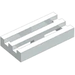{ .lu-ti width="24" loading="lazy" } [Tile 1x2 Grill (LOT 18)](../18.md) | 1.02123429%; mean 0.010245902 | Not associated with a vendor |
| { .lu-ti width="24" loading="lazy" } [Corner Plate 1x2x2 (LOT 19)](../19.md) | 1.02123429%; mean 0.010245902 | Not associated with a vendor |
| { .lu-ti width="24" loading="lazy" } [Technic Bearing Plate 2x2 with Pin Hole (LOT 23)](../23.md) | 1.02123429%; mean 0.010245902 | Not associated with a vendor |
| { .lu-ti width="24" loading="lazy" } [Slope Brick 75° 1x2x3 Inverted (LOT 24)](../24.md) | 1.02123429%; mean 0.010245902 | Not associated with a vendor |
| { .lu-ti width="24" loading="lazy" } [Brick 1x16 (LOT 26)](../26.md) | 1.02123429%; mean 0.010245902 | Not associated with a vendor |
| { .lu-ti width="24" loading="lazy" } [Brick 2x10 (LOT 34)](../34.md) | 1.02123429%; mean 0.010245902 | Not associated with a vendor |
| { .lu-ti width="24" loading="lazy" } [Plate 4x10 (LOT 43)](../43.md) | 1.02123429%; mean 0.010245902 | Not associated with a vendor |
| { .lu-ti width="24" loading="lazy" } [Plate 4x4 (LOT 44)](../44.md) | 1.02123429%; mean 0.010245902 | Not associated with a vendor |
| { .lu-ti width="24" loading="lazy" } [Plate 4x6 (LOT 45)](../45.md) | 1.02123429%; mean 0.010245902 | Not associated with a vendor |
| { .lu-ti width="24" loading="lazy" } [Plate 6x10 (LOT 46)](../46.md) | 1.02123429%; mean 0.010245902 | Not associated with a vendor |
| { .lu-ti width="24" loading="lazy" } [Plate 4x8 (LOT 47)](../47.md) | 1.02123429%; mean 0.010245902 | Not associated with a vendor |
| { .lu-ti width="24" loading="lazy" } [Plate 6x8 (LOT 48)](../48.md) | 1.02123429%; mean 0.010245902 | Not associated with a vendor |
| { .lu-ti width="24" loading="lazy" } [Slope Brick 45° 2x2 (LOT 49)](../49.md) | 1.02123429%; mean 0.010245902 | Not associated with a vendor |
| { .lu-ti width="24" loading="lazy" } [Slope Brick 45° 1x2 (LOT 50)](../50.md) | 1.02123429%; mean 0.010245902 | Not associated with a vendor |
| { .lu-ti width="24" loading="lazy" } [Slope Brick 45° 2x2 Outside Corner (LOT 51)](../51.md) | 1.02123429%; mean 0.010245902 | Not associated with a vendor |
| { .lu-ti width="24" loading="lazy" } [Slope Brick 45° 2x2 Inside Corner (LOT 52)](../52.md) | 1.02123429%; mean 0.010245902 | Not associated with a vendor |
| { .lu-ti width="24" loading="lazy" } [Brick 1x1 Round (LOT 53)](../53.md) | 1.02123429%; mean 0.010245902 | Not associated with a vendor |
| { .lu-ti width="24" loading="lazy" } [Tile 1x2 (LOT 55)](../55.md) | 1.02123429%; mean 0.010245902 | Not associated with a vendor |
| { .lu-ti width="24" loading="lazy" } [Tile 1x1 (LOT 56)](../56.md) | 1.02123429%; mean 0.010245902 | Not associated with a vendor |
| { .lu-ti width="24" loading="lazy" } [Plate 1x6 (LOT 62)](../62.md) | 1.02123429%; mean 0.010245902 | Not associated with a vendor |
| { .lu-ti width="24" loading="lazy" } [Slope Brick 25° 1x3 (LOT 73)](../73.md) | 1.02123429%; mean 0.010245902 | Not associated with a vendor |
| { .lu-ti width="24" loading="lazy" } [Brick 1x1 with 4 Studs (LOT 76)](../76.md) | 1.02123429%; mean 0.010245902 | Not associated with a vendor |
| { .lu-ti width="24" loading="lazy" } [Plate 1x1 Round (LOT 84)](../84.md) | 1.02123429%; mean 0.010245902 | Not associated with a vendor |
| { .lu-ti width="24" loading="lazy" } [Technic Brick 1x1 (LOT 86)](../86.md) | 1.02123429%; mean 0.010245902 | Not associated with a vendor |
| { .lu-ti width="24" loading="lazy" } [Slope Brick 1x1x2/3 (LOT 104)](../104.md) | 1.02123429%; mean 0.010245902 | Not associated with a vendor |
| { .lu-ti width="24" loading="lazy" } [Washing Machine Brick (LOT 109)](../109.md) | 1.02123429%; mean 0.010245902 | Not associated with a vendor |
| { .lu-ti width="24" loading="lazy" } [Plate 1x1 with Collar and Bilateral Studs (LOT 110)](../110.md) | 1.02123429%; mean 0.010245902 | Not associated with a vendor |
| { .lu-ti width="24" loading="lazy" } [Slope Brick 45° 1x2 Inverted (LOT 111)](../111.md) | 1.02123429%; mean 0.010245902 | Not associated with a vendor |
| { .lu-ti width="24" loading="lazy" } [Slope Brick 25° 2x3 (LOT 113)](../113.md) | 1.02123429%; mean 0.010245902 | Not associated with a vendor |
| { .lu-ti width="24" loading="lazy" } [Slope Brick 25° 1x3 Inverted (LOT 114)](../114.md) | 1.02123429%; mean 0.010245902 | Not associated with a vendor |
| { .lu-ti width="24" loading="lazy" } [Slope Brick 75° 1x2x3 (LOT 115)](../115.md) | 1.02123429%; mean 0.010245902 | Not associated with a vendor |
| { .lu-ti width="24" loading="lazy" } [Brick 2x2 Round (LOT 120)](../120.md) | 1.02123429%; mean 0.010245902 | Not associated with a vendor |
| { .lu-ti width="24" loading="lazy" } [Brick 1x4 with Studs on Side (LOT 121)](../121.md) | 1.02123429%; mean 0.010245902 | Not associated with a vendor |
| { .lu-ti width="24" loading="lazy" } [Angle Bracket Plate 1x2 / 2x2 (LOT 124)](../124.md) | 1.02123429%; mean 0.010245902 | Not associated with a vendor |
| { .lu-ti width="24" loading="lazy" } [Slope Brick 25° 3x3 Outside Corner (LOT 141)](../141.md) | 1.02123429%; mean 0.010245902 | Not associated with a vendor |
| { .lu-ti width="24" loading="lazy" } [Plate 1x2 with Single Stud (LOT 143)](../143.md) | 1.02123429%; mean 0.010245902 | Not associated with a vendor |
| { .lu-ti width="24" loading="lazy" } [Plate 2x2 Round (LOT 178)](../178.md) | 1.02123429%; mean 0.010245902 | Not associated with a vendor |
| { .lu-ti width="24" loading="lazy" } [Slope Brick 45° 2x2 Corner, Inverted (LOT 179)](../179.md) | 1.02123429%; mean 0.010245902 | Not associated with a vendor |
| { .lu-ti width="24" loading="lazy" } [Plate 2x10 (LOT 180)](../180.md) | 1.02123429%; mean 0.010245902 | Not associated with a vendor |
| { .lu-ti width="24" loading="lazy" } [Plate 1x2 with Handles (LOT 335)](../335.md) | 1.02123429%; mean 0.010245902 | Not associated with a vendor |
| { .lu-ti width="24" loading="lazy" } [Windscreen 3x6 25° (LOT 343)](../343.md) | 1.02123429%; mean 0.010245902 | Not associated with a vendor |
| { .lu-ti width="24" loading="lazy" } [Plate 6x6 (LOT 349)](../349.md) | 1.02123429%; mean 0.010245902 | Not associated with a vendor |
| { .lu-ti width="24" loading="lazy" } [Dish 4x4 Inverted (LOT 350)](../350.md) | 1.02123429%; mean 0.010245902 | Not associated with a vendor |
| { .lu-ti width="24" loading="lazy" } [Dish 8x8 Inverted (LOT 351)](../351.md) | 1.02123429%; mean 0.010245902 | Not associated with a vendor |
| { .lu-ti width="24" loading="lazy" } [Tile 2x2 Round (LOT 362)](../362.md) | 1.02123429%; mean 0.010245902 | Not associated with a vendor |
| { .lu-ti width="24" loading="lazy" } [Slope Brick 25° 3x3 (LOT 364)](../364.md) | 1.02123429%; mean 0.010245902 | Not associated with a vendor |
| { .lu-ti width="24" loading="lazy" } [Tile 1x8 (LOT 365)](../365.md) | 1.02123429%; mean 0.010245902 | Not associated with a vendor |
| { .lu-ti width="24" loading="lazy" } [Plate 1x2 with Ladder (LOT 366)](../366.md) | 1.02123429%; mean 0.010245902 | Not associated with a vendor |
| { .lu-ti width="24" loading="lazy" } [Brick 1x2 with Groove (LOT 373)](../373.md) | 1.02123429%; mean 0.010245902 | Not associated with a vendor |
| { .lu-ti width="24" loading="lazy" } [Plate 2x16 (LOT 379)](../379.md) | 1.02123429%; mean 0.010245902 | Not associated with a vendor |
| { .lu-ti width="24" loading="lazy" } [Plate 1x10 (LOT 390)](../390.md) | 1.02123429%; mean 0.010245902 | Not associated with a vendor |
| { .lu-ti width="24" loading="lazy" } [Slope Brick 25° 6x6 Double (LOT 394)](../394.md) | 1.02123429%; mean 0.010245902 | Not associated with a vendor |
| { .lu-ti width="24" loading="lazy" } [Plate 1x8 with Slide (LOT 395)](../395.md) | 1.02123429%; mean 0.010245902 | Not associated with a vendor |
| { .lu-ti width="24" loading="lazy" } [Slope Brick 6x8 (LOT 396)](../396.md) | 1.02123429%; mean 0.010245902 | Not associated with a vendor |
| { .lu-ti width="24" loading="lazy" } [Brick 1x1x1 Round with Fins (LOT 400)](../400.md) | 1.02123429%; mean 0.010245902 | Not associated with a vendor |
| { .lu-ti width="24" loading="lazy" } [Plate 1x4 with Offset Ends (LOT 401)](../401.md) | 1.02123429%; mean 0.010245902 | Not associated with a vendor |
| { .lu-ti width="24" loading="lazy" } [Camera Brick 1x2x2/3 (LOT 404)](../404.md) | 1.02123429%; mean 0.010245902 | Not associated with a vendor |
| { .lu-ti width="24" loading="lazy" } [Tap 1x1 (LOT 408)](../408.md) | 1.02123429%; mean 0.010245902 | Not associated with a vendor |
| { .lu-ti width="24" loading="lazy" } [Dish 2x2 Inverted (LOT 415)](../415.md) | 1.02123429%; mean 0.010245902 | Not associated with a vendor |
| { .lu-ti width="24" loading="lazy" } [Slope Brick 25°/45° 4x3 (LOT 424)](../424.md) | 1.02123429%; mean 0.010245902 | Not associated with a vendor |
| { .lu-ti width="24" loading="lazy" } [Panel 1x2x1 (LOT 428)](../428.md) | 1.02123429%; mean 0.010245902 | Not associated with a vendor |
| { .lu-ti width="24" loading="lazy" } [Plate 6x6, 1/4-Circle (LOT 434)](../434.md) | 1.02123429%; mean 0.010245902 | Not associated with a vendor |
| { .lu-ti width="24" loading="lazy" } [Brick 1x2x5 with Groove (LOT 446)](../446.md) | 1.02123429%; mean 0.010245902 | Not associated with a vendor |
| { .lu-ti width="24" loading="lazy" } [Brick 2x4x2 with Bottom Connection on Sides (LOT 450)](../450.md) | 1.02123429%; mean 0.010245902 | Not associated with a vendor |
| { .lu-ti width="24" loading="lazy" } [Corner Plate 6x6x45° (LOT 462)](../462.md) | 1.02123429%; mean 0.010245902 | Not associated with a vendor |
| { .lu-ti width="24" loading="lazy" } [Brick 1x10 (LOT 465)](../465.md) | 1.02123429%; mean 0.010245902 | Not associated with a vendor |
| { .lu-ti width="24" loading="lazy" } [Brick 1x12 (LOT 466)](../466.md) | 1.02123429%; mean 0.010245902 | Not associated with a vendor |
| { .lu-ti width="24" loading="lazy" } [Tile 8x8 Round with 4 Studs (LOT 474)](../474.md) | 1.02123429%; mean 0.010245902 | Not associated with a vendor |
| { .lu-ti width="24" loading="lazy" } [Tile 4x4 with 4 Studs (LOT 475)](../475.md) | 1.02123429%; mean 0.010245902 | Not associated with a vendor |
| 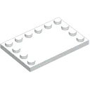{ .lu-ti width="24" loading="lazy" } [Tile 4x6 with 12 Studs (LOT 476)](../476.md) | 1.02123429%; mean 0.010245902 | Not associated with a vendor |
| { .lu-ti width="24" loading="lazy" } [Brick 2x3 with Curved Top (LOT 483)](../483.md) | 1.02123429%; mean 0.010245902 | Not associated with a vendor |
| { .lu-ti width="24" loading="lazy" } [Panel 1x1x1 Corner (LOT 487)](../487.md) | 1.02123429%; mean 0.010245902 | Not associated with a vendor |
| { .lu-ti width="24" loading="lazy" } [Wedge Brick 2x3 Right (LOT 499)](../499.md) | 1.02123429%; mean 0.010245902 | Not associated with a vendor |
| 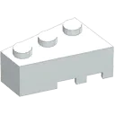{ .lu-ti width="24" loading="lazy" } [Wedge Brick 2x3 Left (LOT 500)](../500.md) | 1.02123429%; mean 0.010245902 | Not associated with a vendor |
| { .lu-ti width="24" loading="lazy" } [Tile 4x8 with 12 Studs (LOT 501)](../501.md) | 1.02123429%; mean 0.010245902 | Not associated with a vendor |
| { .lu-ti width="24" loading="lazy" } [Tile 1x6 (LOT 503)](../503.md) | 1.02123429%; mean 0.010245902 | Not associated with a vendor |
| { .lu-ti width="24" loading="lazy" } [Plate 6x6 Octagonal with Cut-Out (LOT 518)](../518.md) | 1.02123429%; mean 0.010245902 | Not associated with a vendor |
| { .lu-ti width="24" loading="lazy" } [Dome 2x2x1 2/3 (LOT 535)](../535.md) | 1.02123429%; mean 0.010245902 | Not associated with a vendor |
| { .lu-ti width="24" loading="lazy" } [Panel 4x6x6 Sloped (LOT 537)](../537.md) | 1.02123429%; mean 0.010245902 | Not associated with a vendor |
| 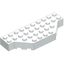{ .lu-ti width="24" loading="lazy" } [Brick 2x10 with Bay (LOT 541)](../541.md) | 1.02123429%; mean 0.010245902 | Not associated with a vendor |
| { .lu-ti width="24" loading="lazy" } [Slope Brick 55° 1x6x5 (LOT 551)](../551.md) | 1.02123429%; mean 0.010245902 | Not associated with a vendor |
| { .lu-ti width="24" loading="lazy" } [Wedge Plate 6x12 Left (LOT 566)](../566.md) | 1.02123429%; mean 0.010245902 | Not associated with a vendor |
| { .lu-ti width="24" loading="lazy" } [Wedge Plate 6x12 Right (LOT 567)](../567.md) | 1.02123429%; mean 0.010245902 | Not associated with a vendor |
| { .lu-ti width="24" loading="lazy" } [Plate 3x3, 1/4-Circle (LOT 568)](../568.md) | 1.02123429%; mean 0.010245902 | Not associated with a vendor |
| { .lu-ti width="24" loading="lazy" } [Cylinder Brick 3x6x2 2/3 (LOT 571)](../571.md) | 1.02123429%; mean 0.010245902 | Not associated with a vendor |
| { .lu-ti width="24" loading="lazy" } [Brick 2x2x2 Round  (LOT 572)](../572.md) | 1.02123429%; mean 0.010245902 | Not associated with a vendor |
| { .lu-ti width="24" loading="lazy" } [Astromech Robot Leg (LOT 573)](../573.md) | 1.02123429%; mean 0.010245902 | Not associated with a vendor |
| { .lu-ti width="24" loading="lazy" } [Slope Brick 18° 2x4 (LOT 574)](../574.md) | 1.02123429%; mean 0.010245902 | Not associated with a vendor |
| { .lu-ti width="24" loading="lazy" } [Brick 2x2 Round with Dome (LOT 576)](../576.md) | 1.02123429%; mean 0.010245902 | Not associated with a vendor |
| { .lu-ti width="24" loading="lazy" } [Light Sword Blade (LOT 579)](../579.md) | 1.02123429%; mean 0.010245902 | Not associated with a vendor |
| { .lu-ti width="24" loading="lazy" } [Slope Brick 75° 2x2x3 (LOT 590)](../590.md) | 1.02123429%; mean 0.010245902 | Not associated with a vendor |
| { .lu-ti width="24" loading="lazy" } [Corner Plate 45° 4x4 (LOT 591)](../591.md) | 1.02123429%; mean 0.010245902 | Not associated with a vendor |
| { .lu-ti width="24" loading="lazy" } [Corner Plate 45° 8x8 (LOT 592)](../592.md) | 1.02123429%; mean 0.010245902 | Not associated with a vendor |
| { .lu-ti width="24" loading="lazy" } [Corner Brick 45° 3x3 (LOT 593)](../593.md) | 1.02123429%; mean 0.010245902 | Not associated with a vendor |
| 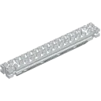{ .lu-ti width="24" loading="lazy" } [Beam 2x16x1 2/3 with Studs and Lattice (LOT 595)](../595.md) | 1.02123429%; mean 0.010245902 | Not associated with a vendor |
| { .lu-ti width="24" loading="lazy" } [Plate 4x4 1/4-Circle (LOT 603)](../603.md) | 1.02123429%; mean 0.010245902 | Not associated with a vendor |
| { .lu-ti width="24" loading="lazy" } [Plate 1x8 with Extended Slide (LOT 604)](../604.md) | 1.02123429%; mean 0.010245902 | Not associated with a vendor |
| { .lu-ti width="24" loading="lazy" } [Plate 1x2 with Slide (LOT 613)](../613.md) | 1.02123429%; mean 0.010245902 | Not associated with a vendor |
| { .lu-ti width="24" loading="lazy" } [Wedge Plate 4x6 (LOT 614)](../614.md) | 1.02123429%; mean 0.010245902 | Not associated with a vendor |
| { .lu-ti width="24" loading="lazy" } [Plate 8x8 (LOT 639)](../639.md) | 1.02123429%; mean 0.010245902 | Not associated with a vendor |
| { .lu-ti width="24" loading="lazy" } [Wedge 2x6 Curved Right (LOT 641)](../641.md) | 1.02123429%; mean 0.010245902 | Not associated with a vendor |
| { .lu-ti width="24" loading="lazy" } [Wedge 2x6 Curved Left (LOT 642)](../642.md) | 1.02123429%; mean 0.010245902 | Not associated with a vendor |
| { .lu-ti width="24" loading="lazy" } [Slope Brick 1x6 Curved (LOT 647)](../647.md) | 1.02123429%; mean 0.010245902 | Not associated with a vendor |
| { .lu-ti width="24" loading="lazy" } [Slope Brick 1x6 Curved, Inverted (LOT 648)](../648.md) | 1.02123429%; mean 0.010245902 | Not associated with a vendor |
| 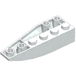{ .lu-ti width="24" loading="lazy" } [Wedge 2x6 Curved Inverted Right (LOT 649)](../649.md) | 1.02123429%; mean 0.010245902 | Not associated with a vendor |
| 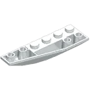{ .lu-ti width="24" loading="lazy" } [Wedge 2x6 Curved Inverted Left (LOT 650)](../650.md) | 1.02123429%; mean 0.010245902 | Not associated with a vendor |
| { .lu-ti width="24" loading="lazy" } [Wedge Brick 2x4 Right (LOT 651)](../651.md) | 1.02123429%; mean 0.010245902 | Not associated with a vendor |
| 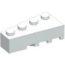{ .lu-ti width="24" loading="lazy" } [Wedge Brick 2x4 Left (LOT 652)](../652.md) | 1.02123429%; mean 0.010245902 | Not associated with a vendor |
| { .lu-ti width="24" loading="lazy" } [Wedge Plate 2x4 Right (LOT 653)](../653.md) | 1.02123429%; mean 0.010245902 | Not associated with a vendor |
| 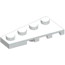{ .lu-ti width="24" loading="lazy" } [Wedge Plate 2x4 Left (LOT 654)](../654.md) | 1.02123429%; mean 0.010245902 | Not associated with a vendor |
| { .lu-ti width="24" loading="lazy" } [Plate 1x2 with Shaft 12M (LOT 659)](../659.md) | 1.02123429%; mean 0.010245902 | Not associated with a vendor |
| { .lu-ti width="24" loading="lazy" } [Slope Brick 18° 4x4 Corner (LOT 663)](../663.md) | 1.02123429%; mean 0.010245902 | Not associated with a vendor |
| { .lu-ti width="24" loading="lazy" } [Wedge 2x4 Triple Left  (LOT 664)](../664.md) | 1.02123429%; mean 0.010245902 | Not associated with a vendor |
| { .lu-ti width="24" loading="lazy" } [Wedge 2x4 Triple Right (LOT 665)](../665.md) | 1.02123429%; mean 0.010245902 | Not associated with a vendor |
| { .lu-ti width="24" loading="lazy" } [Wedge 4x6 Curved (LOT 666)](../666.md) | 1.02123429%; mean 0.010245902 | Not associated with a vendor |
| { .lu-ti width="24" loading="lazy" } [Wedge Brick 2x4 Right Sloped (LOT 669)](../669.md) | 1.02123429%; mean 0.010245902 | Not associated with a vendor |
| { .lu-ti width="24" loading="lazy" } [Wedge Brick 2x4 Left Sloped (LOT 670)](../670.md) | 1.02123429%; mean 0.010245902 | Not associated with a vendor |
| { .lu-ti width="24" loading="lazy" } [Wedge Plate 2x3 Right (LOT 671)](../671.md) | 1.02123429%; mean 0.010245902 | Not associated with a vendor |
| 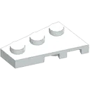{ .lu-ti width="24" loading="lazy" } [Wedge Plate 2x3 Left (LOT 672)](../672.md) | 1.02123429%; mean 0.010245902 | Not associated with a vendor |
| { .lu-ti width="24" loading="lazy" } [Brick 8x8 (LOT 673)](../673.md) | 1.02123429%; mean 0.010245902 | Not associated with a vendor |
| { .lu-ti width="24" loading="lazy" } [Dish 3x3 Inverted (LOT 675)](../675.md) | 1.02123429%; mean 0.010245902 | Not associated with a vendor |
| { .lu-ti width="24" loading="lazy" } [Brick 8x16 (LOT 676)](../676.md) | 1.02123429%; mean 0.010245902 | Not associated with a vendor |
| { .lu-ti width="24" loading="lazy" } [Dish 6x6 Inverted  (LOT 677)](../677.md) | 1.02123429%; mean 0.010245902 | Not associated with a vendor |
| 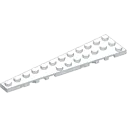{ .lu-ti width="24" loading="lazy" } [Wedge Plate 3x12 Left (LOT 693)](../693.md) | 1.02123429%; mean 0.010245902 | Not associated with a vendor |
| { .lu-ti width="24" loading="lazy" } [Wedge Plate 3x12 Right (LOT 694)](../694.md) | 1.02123429%; mean 0.010245902 | Not associated with a vendor |
| { .lu-ti width="24" loading="lazy" } [Bonnet 2x3x2/3 Curved with Flap and 2 Studs (LOT 700)](../700.md) | 1.02123429%; mean 0.010245902 | Not associated with a vendor |
| { .lu-ti width="24" loading="lazy" } [Bonnet 2x2x2/3 Curved with 2 Studs (LOT 701)](../701.md) | 1.02123429%; mean 0.010245902 | Not associated with a vendor |
| { .lu-ti width="24" loading="lazy" } [Bonnet 1x2x2/3 Curved with Flap (LOT 702)](../702.md) | 1.02123429%; mean 0.010245902 | Not associated with a vendor |
| { .lu-ti width="24" loading="lazy" } [Brick 1x1 with 2 Studs (LOT 711)](../711.md) | 1.02123429%; mean 0.010245902 | Not associated with a vendor |
| { .lu-ti width="24" loading="lazy" } [Plate 1x1 with Tooth (LOT 726)](../726.md) | 1.02123429%; mean 0.010245902 | Not associated with a vendor |
| { .lu-ti width="24" loading="lazy" } [Wedge Plate 3x8 Right (LOT 728)](../728.md) | 1.02123429%; mean 0.010245902 | Not associated with a vendor |
| { .lu-ti width="24" loading="lazy" } [Wedge Plate 3x8 Left (LOT 729)](../729.md) | 1.02123429%; mean 0.010245902 | Not associated with a vendor |
| { .lu-ti width="24" loading="lazy" } [Dish 10x10 (LOT 746)](../746.md) | 1.02123429%; mean 0.010245902 | Not associated with a vendor |
| { .lu-ti width="24" loading="lazy" } [Wedge Plate 2x4 (LOT 748)](../748.md) | 1.02123429%; mean 0.010245902 | Not associated with a vendor |
| 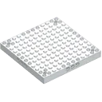{ .lu-ti width="24" loading="lazy" } [Brick 12x12 0 4.85 Combo (LOT 752)](../752.md) | 1.02123429%; mean 0.010245902 | Not associated with a vendor |
| { .lu-ti width="24" loading="lazy" } [Brick 1x2 with 4 Studs (LOT 753)](../753.md) | 1.02123429%; mean 0.010245902 | Not associated with a vendor |
| { .lu-ti width="24" loading="lazy" } [Wedge Plate 3x6 Right (LOT 755)](../755.md) | 1.02123429%; mean 0.010245902 | Not associated with a vendor |
| { .lu-ti width="24" loading="lazy" } [Wedge Plate 3x6 Left (LOT 756)](../756.md) | 1.02123429%; mean 0.010245902 | Not associated with a vendor |
| { .lu-ti width="24" loading="lazy" } [Tube Straight 2 with Stud (LOT 766)](../766.md) | 1.02123429%; mean 0.010245902 | Not associated with a vendor |
| { .lu-ti width="24" loading="lazy" } [Tube Curved 2x2 (LOT 767)](../767.md) | 1.02123429%; mean 0.010245902 | Not associated with a vendor |
| { .lu-ti width="24" loading="lazy" } [Slope Brick 1x3 45° Inverted Double (LOT 789)](../789.md) | 1.02123429%; mean 0.010245902 | Not associated with a vendor |
| { .lu-ti width="24" loading="lazy" } [Corner Plate 10x10 45° (LOT 797)](../797.md) | 1.02123429%; mean 0.010245902 | Not associated with a vendor |
| { .lu-ti width="24" loading="lazy" } [Airplane Wing 4x9 (LOT 800)](../800.md) | 1.02123429%; mean 0.010245902 | Not associated with a vendor |
| { .lu-ti width="24" loading="lazy" } [Corner Plate 3x6 Double 45° (LOT 804)](../804.md) | 1.02123429%; mean 0.010245902 | Not associated with a vendor |
| { .lu-ti width="24" loading="lazy" } [Tile 1x4 (LOT 807)](../807.md) | 1.02123429%; mean 0.010245902 | Not associated with a vendor |
| { .lu-ti width="24" loading="lazy" } [Brick 2x4x2 with Studs on Sides (LOT 809)](../809.md) | 1.02123429%; mean 0.010245902 | Not associated with a vendor |
| { .lu-ti width="24" loading="lazy" } [Angle Bracket Plate 1x2 / 1x4 (LOT 811)](../811.md) | 1.02123429%; mean 0.010245902 | Not associated with a vendor |
| { .lu-ti width="24" loading="lazy" } [Plate 2x12 (LOT 814)](../814.md) | 1.02123429%; mean 0.010245902 | Not associated with a vendor |
| { .lu-ti width="24" loading="lazy" } [Corner Plate 45° 3x3 (LOT 815)](../815.md) | 1.02123429%; mean 0.010245902 | Not associated with a vendor |
| 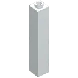{ .lu-ti width="24" loading="lazy" } [Brick 1x1x5 (LOT 816)](../816.md) | 1.02123429%; mean 0.010245902 | Not associated with a vendor |
| 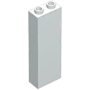{ .lu-ti width="24" loading="lazy" } [Brick 1x2x5 (LOT 817)](../817.md) | 1.02123429%; mean 0.010245902 | Not associated with a vendor |
| { .lu-ti width="24" loading="lazy" } [Brick 4x4 ¼-Circle (LOT 846)](../846.md) | 1.02123429%; mean 0.010245902 | Not associated with a vendor |
| { .lu-ti width="24" loading="lazy" } [Corner Plate 2x4x4 (LOT 852)](../852.md) | 1.02123429%; mean 0.010245902 | Not associated with a vendor |
| { .lu-ti width="24" loading="lazy" } [Slide Shoe Round 2x2 (LOT 854)](../854.md) | 1.02123429%; mean 0.010245902 | Not associated with a vendor |
| { .lu-ti width="24" loading="lazy" } [Train Roof 45° 2x6 with Cut-Out (LOT 861)](../861.md) | 1.02123429%; mean 0.010245902 | Not associated with a vendor |
| { .lu-ti width="24" loading="lazy" } [Profile Brick 1x2 (LOT 863)](../863.md) | 1.02123429%; mean 0.010245902 | Not associated with a vendor |
| { .lu-ti width="24" loading="lazy" } [Plate 6x16 (LOT 866)](../866.md) | 1.02123429%; mean 0.010245902 | Not associated with a vendor |
| { .lu-ti width="24" loading="lazy" } [Plate 6x12 (LOT 867)](../867.md) | 1.02123429%; mean 0.010245902 | Not associated with a vendor |
| { .lu-ti width="24" loading="lazy" } [Plate 4x12 (LOT 868)](../868.md) | 1.02123429%; mean 0.010245902 | Not associated with a vendor |
| { .lu-ti width="24" loading="lazy" } [Slope Brick 45° 4x2 (LOT 870)](../870.md) | 1.02123429%; mean 0.010245902 | Not associated with a vendor |
| { .lu-ti width="24" loading="lazy" } [Slope Brick 45° 3x2 (LOT 871)](../871.md) | 1.02123429%; mean 0.010245902 | Not associated with a vendor |
| { .lu-ti width="24" loading="lazy" } [Slope Brick 45° Ridged 2x4 (LOT 872)](../872.md) | 1.02123429%; mean 0.010245902 | Not associated with a vendor |
| { .lu-ti width="24" loading="lazy" } [Slope Brick 45° Ridged 2x2 (LOT 873)](../873.md) | 1.02123429%; mean 0.010245902 | Not associated with a vendor |
| { .lu-ti width="24" loading="lazy" } [Slope Brick 45° Ridged 1x2 (LOT 874)](../874.md) | 1.02123429%; mean 0.010245902 | Not associated with a vendor |
| { .lu-ti width="24" loading="lazy" } [Slope Brick 45° Triple Ridged 1x2 (LOT 875)](../875.md) | 1.02123429%; mean 0.010245902 | Not associated with a vendor |
| { .lu-ti width="24" loading="lazy" } [Slope Brick 45° 1x2 Top, with Inverted Connection (LOT 876)](../876.md) | 1.02123429%; mean 0.010245902 | Not associated with a vendor |
| { .lu-ti width="24" loading="lazy" } [Flat Tile 2x2 (LOT 877)](../877.md) | 1.02123429%; mean 0.010245902 | Not associated with a vendor |
| 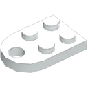{ .lu-ti width="24" loading="lazy" } [Plate 2x3 Semi-Round with Eye (LOT 878)](../878.md) | 1.02123429%; mean 0.010245902 | Not associated with a vendor |
| { .lu-ti width="24" loading="lazy" } [Brick 1x2x2 (LOT 890)](../890.md) | 1.02123429%; mean 0.010245902 | Not associated with a vendor |
| { .lu-ti width="24" loading="lazy" } [Slope Brick 25° 4x3 (LOT 891)](../891.md) | 1.02123429%; mean 0.010245902 | Not associated with a vendor |
| { .lu-ti width="24" loading="lazy" } [Slope Brick 25° Ridged 2x4 (LOT 892)](../892.md) | 1.02123429%; mean 0.010245902 | Not associated with a vendor |
| { .lu-ti width="24" loading="lazy" } [Slope Brick 25° Ridged 2x2 (LOT 893)](../893.md) | 1.02123429%; mean 0.010245902 | Not associated with a vendor |
| { .lu-ti width="24" loading="lazy" } [Plate 6x14 (LOT 900)](../900.md) | 1.02123429%; mean 0.010245902 | Not associated with a vendor |
| { .lu-ti width="24" loading="lazy" } [Slope Brick 45° 2x2 Inverted (LOT 916)](../916.md) | 1.02123429%; mean 0.010245902 | Not associated with a vendor |
| { .lu-ti width="24" loading="lazy" } [Slope Brick 65° 2x2x2 (LOT 917)](../917.md) | 1.02123429%; mean 0.010245902 | Not associated with a vendor |
| { .lu-ti width="24" loading="lazy" } [Slope Brick 75° 2x2x3 Corner (LOT 919)](../919.md) | 1.02123429%; mean 0.010245902 | Not associated with a vendor |
| { .lu-ti width="24" loading="lazy" } [Slope Brick 73° 2x2x2 Pyramid (LOT 920)](../920.md) | 1.02123429%; mean 0.010245902 | Not associated with a vendor |
| { .lu-ti width="24" loading="lazy" } [Slope Brick 25° 2x3 Inverted (LOT 927)](../927.md) | 1.02123429%; mean 0.010245902 | Not associated with a vendor |
| { .lu-ti width="24" loading="lazy" } [Brick 2x2 with Bow and Studs (LOT 1199)](../1199.md) | 1.02123429%; mean 0.010245902 | Not associated with a vendor |
| { .lu-ti width="24" loading="lazy" } [Robot Arm with Stud and Clip (LOT 1218)](../1218.md) | 1.02123429%; mean 0.010245902 | Not associated with a vendor |
| { .lu-ti width="24" loading="lazy" } [Pneumatic T-Piece (LOT 1265)](../1265.md) | 1.02123429%; mean 0.010245902 | Not associated with a vendor |
| { .lu-ti width="24" loading="lazy" } [Healing Banana (LOT 1966)](../1966.md) | 1.14130435%; mean 0.011413043 | Not associated with a vendor |
| { .lu-ti width="24" loading="lazy" } [Notion Potion (LOT 2198)](../2198.md) | 1.14130435%; mean 0.011413043 | Not associated with a vendor |
| { .lu-ti width="24" loading="lazy" } [Bright Red Pants (LOT 2508)](../2508.md) | 0.0625%; mean 0.000625 | Not associated with a vendor |
| { .lu-ti width="24" loading="lazy" } [Bright Orange Pants (LOT 2509)](../2509.md) | 0.0625%; mean 0.000625 | Not associated with a vendor |
| { .lu-ti width="24" loading="lazy" } [Brick Yellow Pants (LOT 2511)](../2511.md) | 0.0625%; mean 0.000625 | Not associated with a vendor |
| 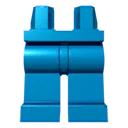{ .lu-ti width="24" loading="lazy" } [Medium Blue Pants (LOT 2513)](../2513.md) | 0.0625%; mean 0.000625 | Not associated with a vendor |
| { .lu-ti width="24" loading="lazy" } [Sand Green Pants (LOT 2514)](../2514.md) | 0.0625%; mean 0.000625 | Not associated with a vendor |
| { .lu-ti width="24" loading="lazy" } [Dark Green Pants (LOT 2515)](../2515.md) | 0.0625%; mean 0.000625 | Not associated with a vendor |
| { .lu-ti width="24" loading="lazy" } [Earth Green Pants (LOT 2516)](../2516.md) | 0.0625%; mean 0.000625 | Not associated with a vendor |
| { .lu-ti width="24" loading="lazy" } [Earth Blue Pants (LOT 2517)](../2517.md) | 0.0625%; mean 0.000625 | Not associated with a vendor |
| { .lu-ti width="24" loading="lazy" } [Bright Blue Pants (LOT 2519)](../2519.md) | 0.0625%; mean 0.000625 | Not associated with a vendor |
| { .lu-ti width="24" loading="lazy" } [Sand Blue Pants (LOT 2520)](../2520.md) | 0.0625%; mean 0.000625 | Not associated with a vendor |
| { .lu-ti width="24" loading="lazy" } [Dark Stone Grey Pants (LOT 2521)](../2521.md) | 0.0625%; mean 0.000625 | Not associated with a vendor |
| { .lu-ti width="24" loading="lazy" } [Medium Stone Grey Pants (LOT 2522)](../2522.md) | 0.0625%; mean 0.000625 | Not associated with a vendor |
| { .lu-ti width="24" loading="lazy" } [White Pants (LOT 2523)](../2523.md) | 0.0625%; mean 0.000625 | Not associated with a vendor |
| { .lu-ti width="24" loading="lazy" } [Black Pants (LOT 2524)](../2524.md) | 0.0625%; mean 0.000625 | Not associated with a vendor |
| { .lu-ti width="24" loading="lazy" } [Reddish Brown Pants (LOT 2526)](../2526.md) | 0.0625%; mean 0.000625 | Not associated with a vendor |
| { .lu-ti width="24" loading="lazy" } [Dark Red Pants (LOT 2527)](../2527.md) | 0.0625%; mean 0.000625 | Not associated with a vendor |
| { .lu-ti width="24" loading="lazy" } [Quicksicle (LOT 2620)](../2620.md) | 1.14130435%; mean 0.011413043 | Not associated with a vendor |
| { .lu-ti width="24" loading="lazy" } [Armor Polish (LOT 2993)](../2993.md) | 1.14130435%; mean 0.011413043 | Not associated with a vendor |
| { .lu-ti width="24" loading="lazy" } [Healing Cherry (LOT 2994)](../2994.md) | 1.14130435%; mean 0.011413043 | Not associated with a vendor |
| { .lu-ti width="24" loading="lazy" } [Armor Shine (LOT 2996)](../2996.md) | 1.14130435%; mean 0.011413043 | Not associated with a vendor |
| { .lu-ti width="24" loading="lazy" } [Strong Notion Potion (LOT 2998)](../2998.md) | 1.14130435%; mean 0.011413043 | Not associated with a vendor |
| { .lu-ti width="24" loading="lazy" } [BBQ Blast Hot Dog (LOT 3011)](../3011.md) | 1.14130435%; mean 0.011413043 | Not associated with a vendor |
| { .lu-ti width="24" loading="lazy" } [Green Imaginite (LOT 3039)](../3039.md) | 1.14130435%; mean 0.011413043 | Not associated with a vendor |
| { .lu-ti width="24" loading="lazy" } [Red Imaginite (LOT 3040)](../3040.md) | 1.75%; mean 0.0175 | Not associated with a vendor |
| { .lu-ti width="24" loading="lazy" } [Amber Gem (LOT 3100)](../3100.md) | 1.14130435%; mean 0.011413043 | Not associated with a vendor |
| { .lu-ti width="24" loading="lazy" } [Long Sleeve Shirt (LOT 4049)](../4049.md) | 0.00156495%; mean 0.000015649452 | Not associated with a vendor |
| { .lu-ti width="24" loading="lazy" } [Short Sleeve Shirt (LOT 4050)](../4050.md) | 0.00156495%; mean 0.000015649452 | Not associated with a vendor |
| { .lu-ti width="24" loading="lazy" } [Checkered Shirt (LOT 4051)](../4051.md) | 0.00156495%; mean 0.000015649452 | Not associated with a vendor |
| { .lu-ti width="24" loading="lazy" } [Open Collar Shirt (LOT 4052)](../4052.md) | 0.00156495%; mean 0.000015649452 | Not associated with a vendor |
| { .lu-ti width="24" loading="lazy" } [Jacket with Pockets (LOT 4053)](../4053.md) | 0.00156495%; mean 0.000015649452 | Not associated with a vendor |
| { .lu-ti width="24" loading="lazy" } [Business Jacket (LOT 4054)](../4054.md) | 0.00156495%; mean 0.000015649452 | Not associated with a vendor |
| { .lu-ti width="24" loading="lazy" } [Coveralls (LOT 4055)](../4055.md) | 0.00156495%; mean 0.000015649452 | Not associated with a vendor |
| { .lu-ti width="24" loading="lazy" } [Girl's Business Jacket (LOT 4056)](../4056.md) | 0.00156495%; mean 0.000015649452 | Not associated with a vendor |
| { .lu-ti width="24" loading="lazy" } [Business Suit (LOT 4057)](../4057.md) | 0.00156495%; mean 0.000015649452 | Not associated with a vendor |
| { .lu-ti width="24" loading="lazy" } [Striped Zipper Jacket (LOT 4058)](../4058.md) | 0.00156495%; mean 0.000015649452 | Not associated with a vendor |
| { .lu-ti width="24" loading="lazy" } [Rumpled Jacket (LOT 4059)](../4059.md) | 0.00156495%; mean 0.000015649452 | Not associated with a vendor |
| { .lu-ti width="24" loading="lazy" } [Casual Suit (LOT 4060)](../4060.md) | 0.00156495%; mean 0.000015649452 | Not associated with a vendor |
| { .lu-ti width="24" loading="lazy" } [Yellow Flower Shirt (LOT 4061)](../4061.md) | 0.00156495%; mean 0.000015649452 | Not associated with a vendor |
| { .lu-ti width="24" loading="lazy" } [Sailboat Shirt (LOT 4062)](../4062.md) | 0.00156495%; mean 0.000015649452 | Not associated with a vendor |
| { .lu-ti width="24" loading="lazy" } [Shirt with Vest (LOT 4063)](../4063.md) | 0.00156495%; mean 0.000015649452 | Not associated with a vendor |
| { .lu-ti width="24" loading="lazy" } [Zipper Jacket (LOT 4064)](../4064.md) | 0.00156495%; mean 0.000015649452 | Not associated with a vendor |
| { .lu-ti width="24" loading="lazy" } [Textured Polo Shirt (LOT 4065)](../4065.md) | 0.00156495%; mean 0.000015649452 | Not associated with a vendor |
| { .lu-ti width="24" loading="lazy" } [Sparkle Tank Top (LOT 4066)](../4066.md) | 0.00156495%; mean 0.000015649452 | Not associated with a vendor |
| { .lu-ti width="24" loading="lazy" } [Polo Shirt (LOT 4067)](../4067.md) | 0.00156495%; mean 0.000015649452 | Not associated with a vendor |
| { .lu-ti width="24" loading="lazy" } [Ripped Shirt (LOT 4068)](../4068.md) | 0.00156495%; mean 0.000015649452 | Not associated with a vendor |
| { .lu-ti width="24" loading="lazy" } [Red Vest (LOT 4069)](../4069.md) | 0.00156495%; mean 0.000015649452 | Not associated with a vendor |
| { .lu-ti width="24" loading="lazy" } [Green Coveralls (LOT 4070)](../4070.md) | 0.00156495%; mean 0.000015649452 | Not associated with a vendor |
| { .lu-ti width="24" loading="lazy" } [Girl's Medieval Vest (LOT 4071)](../4071.md) | 0.00156495%; mean 0.000015649452 | Not associated with a vendor |
| { .lu-ti width="24" loading="lazy" } [Medieval Vest (LOT 4072)](../4072.md) | 0.00156495%; mean 0.000015649452 | Not associated with a vendor |
| { .lu-ti width="24" loading="lazy" } [Medieval Rags (LOT 4073)](../4073.md) | 0.00156495%; mean 0.000015649452 | Not associated with a vendor |
| { .lu-ti width="24" loading="lazy" } [Boy's Tank Top (LOT 4074)](../4074.md) | 0.00156495%; mean 0.000015649452 | Not associated with a vendor |
| { .lu-ti width="24" loading="lazy" } [Girl's Tank Top (LOT 4075)](../4075.md) | 0.00156495%; mean 0.000015649452 | Not associated with a vendor |
| { .lu-ti width="24" loading="lazy" } [Girl's Midriff Jacket (LOT 4076)](../4076.md) | 0.00156495%; mean 0.000015649452 | Not associated with a vendor |
| { .lu-ti width="24" loading="lazy" } [Corduroy Jacket (LOT 4077)](../4077.md) | 0.00156495%; mean 0.000015649452 | Not associated with a vendor |
| { .lu-ti width="24" loading="lazy" } [Oxford Sweater (LOT 4078)](../4078.md) | 0.00156495%; mean 0.000015649452 | Not associated with a vendor |
| { .lu-ti width="24" loading="lazy" } [Number 5 Jersey (LOT 4079)](../4079.md) | 0.00156495%; mean 0.000015649452 | Not associated with a vendor |
| { .lu-ti width="24" loading="lazy" } [Starry Tank Top (LOT 4080)](../4080.md) | 0.00156495%; mean 0.000015649452 | Not associated with a vendor |
| { .lu-ti width="24" loading="lazy" } [Hoodie (LOT 4081)](../4081.md) | 0.00156495%; mean 0.000015649452 | Not associated with a vendor |
| { .lu-ti width="24" loading="lazy" } [Red Flower Shirt (LOT 4082)](../4082.md) | 0.00156495%; mean 0.000015649452 | Not associated with a vendor |
| { .lu-ti width="24" loading="lazy" } [Long Sleeve Shirt (LOT 4083)](../4083.md) | 0.00156495%; mean 0.000015649452 | Not associated with a vendor |
| { .lu-ti width="24" loading="lazy" } [Short Sleeve Shirt (LOT 4084)](../4084.md) | 0.00156495%; mean 0.000015649452 | Not associated with a vendor |
| { .lu-ti width="24" loading="lazy" } [Checkered Shirt (LOT 4085)](../4085.md) | 0.00156495%; mean 0.000015649452 | Not associated with a vendor |
| { .lu-ti width="24" loading="lazy" } [Open Collar Shirt (LOT 4086)](../4086.md) | 0.00156495%; mean 0.000015649452 | Not associated with a vendor |
| { .lu-ti width="24" loading="lazy" } [Jacket with Pockets (LOT 4087)](../4087.md) | 0.00156495%; mean 0.000015649452 | Not associated with a vendor |
| { .lu-ti width="24" loading="lazy" } [Business Jacket (LOT 4088)](../4088.md) | 0.00156495%; mean 0.000015649452 | Not associated with a vendor |
| { .lu-ti width="24" loading="lazy" } [Coveralls (LOT 4089)](../4089.md) | 0.00156495%; mean 0.000015649452 | Not associated with a vendor |
| { .lu-ti width="24" loading="lazy" } [Girl's Business Jacket (LOT 4090)](../4090.md) | 0.00156495%; mean 0.000015649452 | Not associated with a vendor |
| { .lu-ti width="24" loading="lazy" } [Business Suit (LOT 4091)](../4091.md) | 0.00156495%; mean 0.000015649452 | Not associated with a vendor |
| { .lu-ti width="24" loading="lazy" } [Striped Zipper Jacket (LOT 4092)](../4092.md) | 0.00156495%; mean 0.000015649452 | Not associated with a vendor |
| { .lu-ti width="24" loading="lazy" } [Rumpled Jacket (LOT 4093)](../4093.md) | 0.00156495%; mean 0.000015649452 | Not associated with a vendor |
| { .lu-ti width="24" loading="lazy" } [Casual Suit (LOT 4094)](../4094.md) | 0.00156495%; mean 0.000015649452 | Not associated with a vendor |
| { .lu-ti width="24" loading="lazy" } [Yellow Flower Shirt (LOT 4095)](../4095.md) | 0.00156495%; mean 0.000015649452 | Not associated with a vendor |
| { .lu-ti width="24" loading="lazy" } [Sailboat Shirt (LOT 4096)](../4096.md) | 0.00156495%; mean 0.000015649452 | Not associated with a vendor |
| { .lu-ti width="24" loading="lazy" } [Shirt with Vest (LOT 4097)](../4097.md) | 0.00156495%; mean 0.000015649452 | Not associated with a vendor |
| { .lu-ti width="24" loading="lazy" } [Zipper Jacket (LOT 4098)](../4098.md) | 0.00156495%; mean 0.000015649452 | Not associated with a vendor |
| { .lu-ti width="24" loading="lazy" } [Textured Polo Shirt (LOT 4099)](../4099.md) | 0.00156495%; mean 0.000015649452 | Not associated with a vendor |
| { .lu-ti width="24" loading="lazy" } [Sparkle Tank Top (LOT 4100)](../4100.md) | 0.00156495%; mean 0.000015649452 | Not associated with a vendor |
| { .lu-ti width="24" loading="lazy" } [Polo Shirt (LOT 4101)](../4101.md) | 0.00156495%; mean 0.000015649452 | Not associated with a vendor |
| { .lu-ti width="24" loading="lazy" } [Ripped Shirt (LOT 4102)](../4102.md) | 0.00156495%; mean 0.000015649452 | Not associated with a vendor |
| { .lu-ti width="24" loading="lazy" } [Red Vest (LOT 4103)](../4103.md) | 0.00156495%; mean 0.000015649452 | Not associated with a vendor |
| { .lu-ti width="24" loading="lazy" } [Green Coveralls (LOT 4104)](../4104.md) | 0.00156495%; mean 0.000015649452 | Not associated with a vendor |
| { .lu-ti width="24" loading="lazy" } [Girl's Medieval Vest (LOT 4105)](../4105.md) | 0.00156495%; mean 0.000015649452 | Not associated with a vendor |
| { .lu-ti width="24" loading="lazy" } [Medieval Vest (LOT 4106)](../4106.md) | 0.00156495%; mean 0.000015649452 | Not associated with a vendor |
| { .lu-ti width="24" loading="lazy" } [Medieval Rags (LOT 4107)](../4107.md) | 0.00156495%; mean 0.000015649452 | Not associated with a vendor |
| { .lu-ti width="24" loading="lazy" } [Boy's Tank Top (LOT 4108)](../4108.md) | 0.00156495%; mean 0.000015649452 | Not associated with a vendor |
| { .lu-ti width="24" loading="lazy" } [Girl's Tank Top (LOT 4109)](../4109.md) | 0.00156495%; mean 0.000015649452 | Not associated with a vendor |
| { .lu-ti width="24" loading="lazy" } [Girl's Midriff Jacket (LOT 4110)](../4110.md) | 0.00156495%; mean 0.000015649452 | Not associated with a vendor |
| { .lu-ti width="24" loading="lazy" } [Corduroy Jacket (LOT 4111)](../4111.md) | 0.00156495%; mean 0.000015649452 | Not associated with a vendor |
| { .lu-ti width="24" loading="lazy" } [Oxford Sweater (LOT 4112)](../4112.md) | 0.00156495%; mean 0.000015649452 | Not associated with a vendor |
| { .lu-ti width="24" loading="lazy" } [Number 5 Jersey (LOT 4113)](../4113.md) | 0.00156495%; mean 0.000015649452 | Not associated with a vendor |
| { .lu-ti width="24" loading="lazy" } [Starry Tank Top (LOT 4114)](../4114.md) | 0.00156495%; mean 0.000015649452 | Not associated with a vendor |
| { .lu-ti width="24" loading="lazy" } [Hoodie (LOT 4115)](../4115.md) | 0.00156495%; mean 0.000015649452 | Not associated with a vendor |
| { .lu-ti width="24" loading="lazy" } [Red Flower Shirt (LOT 4116)](../4116.md) | 0.00156495%; mean 0.000015649452 | Not associated with a vendor |
| { .lu-ti width="24" loading="lazy" } [Short Sleeve Shirt (LOT 4152)](../4152.md) | 0.00156495%; mean 0.000015649452 | Not associated with a vendor |
| { .lu-ti width="24" loading="lazy" } [Checkered Shirt (LOT 4153)](../4153.md) | 0.00156495%; mean 0.000015649452 | Not associated with a vendor |
| { .lu-ti width="24" loading="lazy" } [Open Collar Shirt (LOT 4154)](../4154.md) | 0.00156495%; mean 0.000015649452 | Not associated with a vendor |
| { .lu-ti width="24" loading="lazy" } [Jacket with Pockets (LOT 4155)](../4155.md) | 0.00156495%; mean 0.000015649452 | Not associated with a vendor |
| { .lu-ti width="24" loading="lazy" } [Business Jacket (LOT 4156)](../4156.md) | 0.00156495%; mean 0.000015649452 | Not associated with a vendor |
| { .lu-ti width="24" loading="lazy" } [Coveralls (LOT 4157)](../4157.md) | 0.00156495%; mean 0.000015649452 | Not associated with a vendor |
| { .lu-ti width="24" loading="lazy" } [Girl's Business Jacket (LOT 4158)](../4158.md) | 0.00156495%; mean 0.000015649452 | Not associated with a vendor |
| { .lu-ti width="24" loading="lazy" } [Business Suit (LOT 4159)](../4159.md) | 0.00156495%; mean 0.000015649452 | Not associated with a vendor |
| { .lu-ti width="24" loading="lazy" } [Striped Zipper Jacket (LOT 4160)](../4160.md) | 0.00156495%; mean 0.000015649452 | Not associated with a vendor |
| { .lu-ti width="24" loading="lazy" } [Rumpled Jacket (LOT 4161)](../4161.md) | 0.00156495%; mean 0.000015649452 | Not associated with a vendor |
| { .lu-ti width="24" loading="lazy" } [Casual Suit (LOT 4162)](../4162.md) | 0.00156495%; mean 0.000015649452 | Not associated with a vendor |
| { .lu-ti width="24" loading="lazy" } [Yellow Flower Shirt (LOT 4163)](../4163.md) | 0.00156495%; mean 0.000015649452 | Not associated with a vendor |
| { .lu-ti width="24" loading="lazy" } [Sailboat Shirt (LOT 4164)](../4164.md) | 0.00156495%; mean 0.000015649452 | Not associated with a vendor |
| { .lu-ti width="24" loading="lazy" } [Shirt with Vest (LOT 4165)](../4165.md) | 0.00156495%; mean 0.000015649452 | Not associated with a vendor |
| { .lu-ti width="24" loading="lazy" } [Zipper Jacket (LOT 4166)](../4166.md) | 0.00156495%; mean 0.000015649452 | Not associated with a vendor |
| { .lu-ti width="24" loading="lazy" } [Textured Polo Shirt (LOT 4167)](../4167.md) | 0.00156495%; mean 0.000015649452 | Not associated with a vendor |
| { .lu-ti width="24" loading="lazy" } [Sparkle Tank Top (LOT 4168)](../4168.md) | 0.00156495%; mean 0.000015649452 | Not associated with a vendor |
| { .lu-ti width="24" loading="lazy" } [Polo Shirt (LOT 4169)](../4169.md) | 0.00156495%; mean 0.000015649452 | Not associated with a vendor |
| { .lu-ti width="24" loading="lazy" } [Ripped Shirt (LOT 4170)](../4170.md) | 0.00156495%; mean 0.000015649452 | Not associated with a vendor |
| { .lu-ti width="24" loading="lazy" } [Red Vest (LOT 4171)](../4171.md) | 0.00156495%; mean 0.000015649452 | Not associated with a vendor |
| { .lu-ti width="24" loading="lazy" } [Green Coveralls (LOT 4172)](../4172.md) | 0.00156495%; mean 0.000015649452 | Not associated with a vendor |
| { .lu-ti width="24" loading="lazy" } [Girl's Medieval Vest (LOT 4173)](../4173.md) | 0.00156495%; mean 0.000015649452 | Not associated with a vendor |
| { .lu-ti width="24" loading="lazy" } [Medieval Vest (LOT 4174)](../4174.md) | 0.00156495%; mean 0.000015649452 | Not associated with a vendor |
| { .lu-ti width="24" loading="lazy" } [Medieval Rags (LOT 4175)](../4175.md) | 0.00156495%; mean 0.000015649452 | Not associated with a vendor |
| { .lu-ti width="24" loading="lazy" } [Boy's Tank Top (LOT 4176)](../4176.md) | 0.00156495%; mean 0.000015649452 | Not associated with a vendor |
| { .lu-ti width="24" loading="lazy" } [Girl's Tank Top (LOT 4177)](../4177.md) | 0.00156495%; mean 0.000015649452 | Not associated with a vendor |
| { .lu-ti width="24" loading="lazy" } [Girl's Midriff Jacket (LOT 4178)](../4178.md) | 0.00156495%; mean 0.000015649452 | Not associated with a vendor |
| { .lu-ti width="24" loading="lazy" } [Corduroy Jacket (LOT 4179)](../4179.md) | 0.00156495%; mean 0.000015649452 | Not associated with a vendor |
| { .lu-ti width="24" loading="lazy" } [Oxford Sweater (LOT 4180)](../4180.md) | 0.00156495%; mean 0.000015649452 | Not associated with a vendor |
| { .lu-ti width="24" loading="lazy" } [Number 5 Jersey (LOT 4181)](../4181.md) | 0.00156495%; mean 0.000015649452 | Not associated with a vendor |
| { .lu-ti width="24" loading="lazy" } [Starry Tank Top (LOT 4182)](../4182.md) | 0.00156495%; mean 0.000015649452 | Not associated with a vendor |
| { .lu-ti width="24" loading="lazy" } [Hoodie (LOT 4183)](../4183.md) | 0.00156495%; mean 0.000015649452 | Not associated with a vendor |
| { .lu-ti width="24" loading="lazy" } [Red Flower Shirt (LOT 4184)](../4184.md) | 0.00156495%; mean 0.000015649452 | Not associated with a vendor |
| { .lu-ti width="24" loading="lazy" } [Long Sleeve Shirt (LOT 4185)](../4185.md) | 0.00156495%; mean 0.000015649452 | Not associated with a vendor |
| { .lu-ti width="24" loading="lazy" } [Short Sleeve Shirt (LOT 4186)](../4186.md) | 0.00156495%; mean 0.000015649452 | Not associated with a vendor |
| { .lu-ti width="24" loading="lazy" } [Checkered Shirt (LOT 4187)](../4187.md) | 0.00156495%; mean 0.000015649452 | Not associated with a vendor |
| { .lu-ti width="24" loading="lazy" } [Open Collar Shirt (LOT 4188)](../4188.md) | 0.00156495%; mean 0.000015649452 | Not associated with a vendor |
| { .lu-ti width="24" loading="lazy" } [Jacket with Pockets (LOT 4189)](../4189.md) | 0.00156495%; mean 0.000015649452 | Not associated with a vendor |
| { .lu-ti width="24" loading="lazy" } [Business Jacket (LOT 4190)](../4190.md) | 0.00156495%; mean 0.000015649452 | Not associated with a vendor |
| { .lu-ti width="24" loading="lazy" } [Coveralls (LOT 4191)](../4191.md) | 0.00156495%; mean 0.000015649452 | Not associated with a vendor |
| { .lu-ti width="24" loading="lazy" } [Girl's Business Jacket (LOT 4192)](../4192.md) | 0.00156495%; mean 0.000015649452 | Not associated with a vendor |
| { .lu-ti width="24" loading="lazy" } [Business Suit (LOT 4193)](../4193.md) | 0.00156495%; mean 0.000015649452 | Not associated with a vendor |
| { .lu-ti width="24" loading="lazy" } [Striped Zipper Jacket (LOT 4194)](../4194.md) | 0.00156495%; mean 0.000015649452 | Not associated with a vendor |
| { .lu-ti width="24" loading="lazy" } [Rumpled Jacket (LOT 4195)](../4195.md) | 0.00156495%; mean 0.000015649452 | Not associated with a vendor |
| { .lu-ti width="24" loading="lazy" } [Casual Suit (LOT 4196)](../4196.md) | 0.00156495%; mean 0.000015649452 | Not associated with a vendor |
| { .lu-ti width="24" loading="lazy" } [Yellow Flower Shirt (LOT 4197)](../4197.md) | 0.00156495%; mean 0.000015649452 | Not associated with a vendor |
| { .lu-ti width="24" loading="lazy" } [Sailboat Shirt (LOT 4198)](../4198.md) | 0.00156495%; mean 0.000015649452 | Not associated with a vendor |
| { .lu-ti width="24" loading="lazy" } [Shirt with Vest (LOT 4199)](../4199.md) | 0.00156495%; mean 0.000015649452 | Not associated with a vendor |
| { .lu-ti width="24" loading="lazy" } [Zipper Jacket (LOT 4200)](../4200.md) | 0.00156495%; mean 0.000015649452 | Not associated with a vendor |
| { .lu-ti width="24" loading="lazy" } [Textured Polo Shirt (LOT 4201)](../4201.md) | 0.00156495%; mean 0.000015649452 | Not associated with a vendor |
| { .lu-ti width="24" loading="lazy" } [Sparkle Tank Top (LOT 4202)](../4202.md) | 0.00156495%; mean 0.000015649452 | Not associated with a vendor |
| { .lu-ti width="24" loading="lazy" } [Polo Shirt (LOT 4203)](../4203.md) | 0.00156495%; mean 0.000015649452 | Not associated with a vendor |
| { .lu-ti width="24" loading="lazy" } [Ripped Shirt (LOT 4204)](../4204.md) | 0.00156495%; mean 0.000015649452 | Not associated with a vendor |
| { .lu-ti width="24" loading="lazy" } [Red Vest (LOT 4205)](../4205.md) | 0.00156495%; mean 0.000015649452 | Not associated with a vendor |
| { .lu-ti width="24" loading="lazy" } [Green Coveralls (LOT 4206)](../4206.md) | 0.00156495%; mean 0.000015649452 | Not associated with a vendor |
| { .lu-ti width="24" loading="lazy" } [Girl's Medieval Vest (LOT 4207)](../4207.md) | 0.00156495%; mean 0.000015649452 | Not associated with a vendor |
| { .lu-ti width="24" loading="lazy" } [Medieval Vest (LOT 4208)](../4208.md) | 0.00156495%; mean 0.000015649452 | Not associated with a vendor |
| { .lu-ti width="24" loading="lazy" } [Medieval Rags (LOT 4209)](../4209.md) | 0.00156495%; mean 0.000015649452 | Not associated with a vendor |
| { .lu-ti width="24" loading="lazy" } [Boy's Tank Top (LOT 4210)](../4210.md) | 0.00156495%; mean 0.000015649452 | Not associated with a vendor |
| { .lu-ti width="24" loading="lazy" } [Girl's Tank Top (LOT 4211)](../4211.md) | 0.00156495%; mean 0.000015649452 | Not associated with a vendor |
| { .lu-ti width="24" loading="lazy" } [Girl's Midriff Jacket (LOT 4212)](../4212.md) | 0.00156495%; mean 0.000015649452 | Not associated with a vendor |
| { .lu-ti width="24" loading="lazy" } [Corduroy Jacket (LOT 4213)](../4213.md) | 0.00156495%; mean 0.000015649452 | Not associated with a vendor |
| { .lu-ti width="24" loading="lazy" } [Oxford Sweater (LOT 4214)](../4214.md) | 0.00156495%; mean 0.000015649452 | Not associated with a vendor |
| { .lu-ti width="24" loading="lazy" } [Number 5 Jersey (LOT 4215)](../4215.md) | 0.00156495%; mean 0.000015649452 | Not associated with a vendor |
| { .lu-ti width="24" loading="lazy" } [Starry Tank Top (LOT 4216)](../4216.md) | 0.00156495%; mean 0.000015649452 | Not associated with a vendor |
| { .lu-ti width="24" loading="lazy" } [Hoodie (LOT 4217)](../4217.md) | 0.00156495%; mean 0.000015649452 | Not associated with a vendor |
| { .lu-ti width="24" loading="lazy" } [Red Flower Shirt (LOT 4218)](../4218.md) | 0.00156495%; mean 0.000015649452 | Not associated with a vendor |
| { .lu-ti width="24" loading="lazy" } [Long Sleeve Shirt (LOT 4219)](../4219.md) | 0.00156495%; mean 0.000015649452 | Not associated with a vendor |
| { .lu-ti width="24" loading="lazy" } [Short Sleeve Shirt (LOT 4220)](../4220.md) | 0.00156495%; mean 0.000015649452 | Not associated with a vendor |
| { .lu-ti width="24" loading="lazy" } [Checkered Shirt (LOT 4221)](../4221.md) | 0.00156495%; mean 0.000015649452 | Not associated with a vendor |
| { .lu-ti width="24" loading="lazy" } [Open Collar Shirt (LOT 4222)](../4222.md) | 0.00156495%; mean 0.000015649452 | Not associated with a vendor |
| { .lu-ti width="24" loading="lazy" } [Jacket with Pockets (LOT 4223)](../4223.md) | 0.00156495%; mean 0.000015649452 | Not associated with a vendor |
| { .lu-ti width="24" loading="lazy" } [Business Jacket (LOT 4224)](../4224.md) | 0.00156495%; mean 0.000015649452 | Not associated with a vendor |
| { .lu-ti width="24" loading="lazy" } [Coveralls (LOT 4225)](../4225.md) | 0.00156495%; mean 0.000015649452 | Not associated with a vendor |
| { .lu-ti width="24" loading="lazy" } [Girl's Business Jacket (LOT 4226)](../4226.md) | 0.00156495%; mean 0.000015649452 | Not associated with a vendor |
| { .lu-ti width="24" loading="lazy" } [Business Suit (LOT 4227)](../4227.md) | 0.00156495%; mean 0.000015649452 | Not associated with a vendor |
| { .lu-ti width="24" loading="lazy" } [Striped Zipper Jacket (LOT 4228)](../4228.md) | 0.00156495%; mean 0.000015649452 | Not associated with a vendor |
| { .lu-ti width="24" loading="lazy" } [Rumpled Jacket (LOT 4229)](../4229.md) | 0.00156495%; mean 0.000015649452 | Not associated with a vendor |
| { .lu-ti width="24" loading="lazy" } [Casual Suit (LOT 4230)](../4230.md) | 0.00156495%; mean 0.000015649452 | Not associated with a vendor |
| { .lu-ti width="24" loading="lazy" } [Yellow Flower Shirt (LOT 4231)](../4231.md) | 0.00156495%; mean 0.000015649452 | Not associated with a vendor |
| { .lu-ti width="24" loading="lazy" } [Sailboat Shirt (LOT 4232)](../4232.md) | 0.00156495%; mean 0.000015649452 | Not associated with a vendor |
| { .lu-ti width="24" loading="lazy" } [Shirt with Vest (LOT 4233)](../4233.md) | 0.00156495%; mean 0.000015649452 | Not associated with a vendor |
| { .lu-ti width="24" loading="lazy" } [Zipper Jacket (LOT 4234)](../4234.md) | 0.00156495%; mean 0.000015649452 | Not associated with a vendor |
| { .lu-ti width="24" loading="lazy" } [Textured Polo Shirt (LOT 4235)](../4235.md) | 0.00156495%; mean 0.000015649452 | Not associated with a vendor |
| { .lu-ti width="24" loading="lazy" } [Sparkle Tank Top (LOT 4236)](../4236.md) | 0.00156495%; mean 0.000015649452 | Not associated with a vendor |
| { .lu-ti width="24" loading="lazy" } [Polo Shirt (LOT 4237)](../4237.md) | 0.00156495%; mean 0.000015649452 | Not associated with a vendor |
| { .lu-ti width="24" loading="lazy" } [Ripped Shirt (LOT 4238)](../4238.md) | 0.00156495%; mean 0.000015649452 | Not associated with a vendor |
| { .lu-ti width="24" loading="lazy" } [Red Vest (LOT 4239)](../4239.md) | 0.00156495%; mean 0.000015649452 | Not associated with a vendor |
| { .lu-ti width="24" loading="lazy" } [Green Coveralls (LOT 4240)](../4240.md) | 0.00156495%; mean 0.000015649452 | Not associated with a vendor |
| { .lu-ti width="24" loading="lazy" } [Girl's Medieval Vest (LOT 4241)](../4241.md) | 0.00156495%; mean 0.000015649452 | Not associated with a vendor |
| { .lu-ti width="24" loading="lazy" } [Medieval Vest (LOT 4242)](../4242.md) | 0.00156495%; mean 0.000015649452 | Not associated with a vendor |
| { .lu-ti width="24" loading="lazy" } [Medieval Rags (LOT 4243)](../4243.md) | 0.00156495%; mean 0.000015649452 | Not associated with a vendor |
| { .lu-ti width="24" loading="lazy" } [Boy's Tank Top (LOT 4244)](../4244.md) | 0.00156495%; mean 0.000015649452 | Not associated with a vendor |
| { .lu-ti width="24" loading="lazy" } [Girl's Tank Top (LOT 4245)](../4245.md) | 0.00156495%; mean 0.000015649452 | Not associated with a vendor |
| { .lu-ti width="24" loading="lazy" } [Girl's Midriff Jacket (LOT 4246)](../4246.md) | 0.00156495%; mean 0.000015649452 | Not associated with a vendor |
| { .lu-ti width="24" loading="lazy" } [Corduroy Jacket (LOT 4247)](../4247.md) | 0.00156495%; mean 0.000015649452 | Not associated with a vendor |
| { .lu-ti width="24" loading="lazy" } [Oxford Sweater (LOT 4248)](../4248.md) | 0.00156495%; mean 0.000015649452 | Not associated with a vendor |
| { .lu-ti width="24" loading="lazy" } [Number 5 Jersey (LOT 4249)](../4249.md) | 0.00156495%; mean 0.000015649452 | Not associated with a vendor |
| { .lu-ti width="24" loading="lazy" } [Starry Tank Top (LOT 4250)](../4250.md) | 0.00156495%; mean 0.000015649452 | Not associated with a vendor |
| { .lu-ti width="24" loading="lazy" } [Hoodie (LOT 4251)](../4251.md) | 0.00156495%; mean 0.000015649452 | Not associated with a vendor |
| { .lu-ti width="24" loading="lazy" } [Red Flower Shirt (LOT 4252)](../4252.md) | 0.00156495%; mean 0.000015649452 | Not associated with a vendor |
| { .lu-ti width="24" loading="lazy" } [Long Sleeve Shirt (LOT 4253)](../4253.md) | 0.00156495%; mean 0.000015649452 | Not associated with a vendor |
| { .lu-ti width="24" loading="lazy" } [Short Sleeve Shirt (LOT 4254)](../4254.md) | 0.00156495%; mean 0.000015649452 | Not associated with a vendor |
| { .lu-ti width="24" loading="lazy" } [Checkered Shirt (LOT 4255)](../4255.md) | 0.00156495%; mean 0.000015649452 | Not associated with a vendor |
| { .lu-ti width="24" loading="lazy" } [Open Collar Shirt (LOT 4256)](../4256.md) | 0.00156495%; mean 0.000015649452 | Not associated with a vendor |
| { .lu-ti width="24" loading="lazy" } [Jacket with Pockets (LOT 4257)](../4257.md) | 0.00156495%; mean 0.000015649452 | Not associated with a vendor |
| { .lu-ti width="24" loading="lazy" } [Business Jacket (LOT 4258)](../4258.md) | 0.00156495%; mean 0.000015649452 | Not associated with a vendor |
| { .lu-ti width="24" loading="lazy" } [Coveralls (LOT 4259)](../4259.md) | 0.00156495%; mean 0.000015649452 | Not associated with a vendor |
| { .lu-ti width="24" loading="lazy" } [Girl's Business Jacket (LOT 4260)](../4260.md) | 0.00156495%; mean 0.000015649452 | Not associated with a vendor |
| { .lu-ti width="24" loading="lazy" } [Business Suit (LOT 4261)](../4261.md) | 0.00156495%; mean 0.000015649452 | Not associated with a vendor |
| { .lu-ti width="24" loading="lazy" } [Striped Zipper Jacket (LOT 4262)](../4262.md) | 0.00156495%; mean 0.000015649452 | Not associated with a vendor |
| { .lu-ti width="24" loading="lazy" } [Rumpled Jacket (LOT 4263)](../4263.md) | 0.00156495%; mean 0.000015649452 | Not associated with a vendor |
| { .lu-ti width="24" loading="lazy" } [Casual Suit (LOT 4264)](../4264.md) | 0.00156495%; mean 0.000015649452 | Not associated with a vendor |
| { .lu-ti width="24" loading="lazy" } [Yellow Flower Shirt (LOT 4265)](../4265.md) | 0.00156495%; mean 0.000015649452 | Not associated with a vendor |
| { .lu-ti width="24" loading="lazy" } [Sailboat Shirt (LOT 4266)](../4266.md) | 0.00156495%; mean 0.000015649452 | Not associated with a vendor |
| { .lu-ti width="24" loading="lazy" } [Shirt with Vest (LOT 4267)](../4267.md) | 0.00156495%; mean 0.000015649452 | Not associated with a vendor |
| { .lu-ti width="24" loading="lazy" } [Zipper Jacket (LOT 4268)](../4268.md) | 0.00156495%; mean 0.000015649452 | Not associated with a vendor |
| { .lu-ti width="24" loading="lazy" } [Textured Polo Shirt (LOT 4269)](../4269.md) | 0.00156495%; mean 0.000015649452 | Not associated with a vendor |
| { .lu-ti width="24" loading="lazy" } [Sparkle Tank Top (LOT 4270)](../4270.md) | 0.00156495%; mean 0.000015649452 | Not associated with a vendor |
| { .lu-ti width="24" loading="lazy" } [Polo Shirt (LOT 4271)](../4271.md) | 0.00156495%; mean 0.000015649452 | Not associated with a vendor |
| { .lu-ti width="24" loading="lazy" } [Ripped Shirt (LOT 4272)](../4272.md) | 0.00156495%; mean 0.000015649452 | Not associated with a vendor |
| { .lu-ti width="24" loading="lazy" } [Red Vest (LOT 4273)](../4273.md) | 0.00156495%; mean 0.000015649452 | Not associated with a vendor |
| { .lu-ti width="24" loading="lazy" } [Green Coveralls (LOT 4274)](../4274.md) | 0.00156495%; mean 0.000015649452 | Not associated with a vendor |
| { .lu-ti width="24" loading="lazy" } [Girl's Medieval Vest (LOT 4275)](../4275.md) | 0.00156495%; mean 0.000015649452 | Not associated with a vendor |
| { .lu-ti width="24" loading="lazy" } [Medieval Vest (LOT 4276)](../4276.md) | 0.00156495%; mean 0.000015649452 | Not associated with a vendor |
| { .lu-ti width="24" loading="lazy" } [Medieval Rags (LOT 4277)](../4277.md) | 0.00156495%; mean 0.000015649452 | Not associated with a vendor |
| { .lu-ti width="24" loading="lazy" } [Boy's Tank Top (LOT 4278)](../4278.md) | 0.00156495%; mean 0.000015649452 | Not associated with a vendor |
| { .lu-ti width="24" loading="lazy" } [Girl's Tank Top (LOT 4279)](../4279.md) | 0.00156495%; mean 0.000015649452 | Not associated with a vendor |
| { .lu-ti width="24" loading="lazy" } [Girl's Midriff Jacket (LOT 4280)](../4280.md) | 0.00156495%; mean 0.000015649452 | Not associated with a vendor |
| { .lu-ti width="24" loading="lazy" } [Corduroy Jacket (LOT 4281)](../4281.md) | 0.00156495%; mean 0.000015649452 | Not associated with a vendor |
| { .lu-ti width="24" loading="lazy" } [Oxford Sweater (LOT 4282)](../4282.md) | 0.00156495%; mean 0.000015649452 | Not associated with a vendor |
| { .lu-ti width="24" loading="lazy" } [Number 5 Jersey (LOT 4283)](../4283.md) | 0.00156495%; mean 0.000015649452 | Not associated with a vendor |
| { .lu-ti width="24" loading="lazy" } [Starry Tank Top (LOT 4284)](../4284.md) | 0.00156495%; mean 0.000015649452 | Not associated with a vendor |
| { .lu-ti width="24" loading="lazy" } [Hoodie (LOT 4285)](../4285.md) | 0.00156495%; mean 0.000015649452 | Not associated with a vendor |
| { .lu-ti width="24" loading="lazy" } [Red Flower Shirt (LOT 4286)](../4286.md) | 0.00156495%; mean 0.000015649452 | Not associated with a vendor |
| { .lu-ti width="24" loading="lazy" } [Long Sleeve Shirt (LOT 4287)](../4287.md) | 0.00156495%; mean 0.000015649452 | Not associated with a vendor |
| { .lu-ti width="24" loading="lazy" } [Short Sleeve Shirt (LOT 4288)](../4288.md) | 0.00156495%; mean 0.000015649452 | Not associated with a vendor |
| { .lu-ti width="24" loading="lazy" } [Checkered Shirt (LOT 4289)](../4289.md) | 0.00156495%; mean 0.000015649452 | Not associated with a vendor |
| { .lu-ti width="24" loading="lazy" } [Open Collar Shirt (LOT 4290)](../4290.md) | 0.00156495%; mean 0.000015649452 | Not associated with a vendor |
| { .lu-ti width="24" loading="lazy" } [Jacket with Pockets (LOT 4291)](../4291.md) | 0.00156495%; mean 0.000015649452 | Not associated with a vendor |
| { .lu-ti width="24" loading="lazy" } [Business Jacket (LOT 4292)](../4292.md) | 0.00156495%; mean 0.000015649452 | Not associated with a vendor |
| { .lu-ti width="24" loading="lazy" } [Coveralls (LOT 4293)](../4293.md) | 0.00156495%; mean 0.000015649452 | Not associated with a vendor |
| { .lu-ti width="24" loading="lazy" } [Girl's Business Jacket (LOT 4294)](../4294.md) | 0.00156495%; mean 0.000015649452 | Not associated with a vendor |
| { .lu-ti width="24" loading="lazy" } [Business Suit (LOT 4295)](../4295.md) | 0.00156495%; mean 0.000015649452 | Not associated with a vendor |
| { .lu-ti width="24" loading="lazy" } [Striped Zipper Jacket (LOT 4296)](../4296.md) | 0.00156495%; mean 0.000015649452 | Not associated with a vendor |
| { .lu-ti width="24" loading="lazy" } [Rumpled Jacket (LOT 4297)](../4297.md) | 0.00156495%; mean 0.000015649452 | Not associated with a vendor |
| { .lu-ti width="24" loading="lazy" } [Casual Suit (LOT 4298)](../4298.md) | 0.00156495%; mean 0.000015649452 | Not associated with a vendor |
| { .lu-ti width="24" loading="lazy" } [Yellow Flower Shirt (LOT 4299)](../4299.md) | 0.00156495%; mean 0.000015649452 | Not associated with a vendor |
| { .lu-ti width="24" loading="lazy" } [Sailboat Shirt (LOT 4300)](../4300.md) | 0.00156495%; mean 0.000015649452 | Not associated with a vendor |
| { .lu-ti width="24" loading="lazy" } [Shirt with Vest (LOT 4301)](../4301.md) | 0.00156495%; mean 0.000015649452 | Not associated with a vendor |
| { .lu-ti width="24" loading="lazy" } [Zipper Jacket (LOT 4302)](../4302.md) | 0.00156495%; mean 0.000015649452 | Not associated with a vendor |
| { .lu-ti width="24" loading="lazy" } [Textured Polo Shirt (LOT 4303)](../4303.md) | 0.00156495%; mean 0.000015649452 | Not associated with a vendor |
| { .lu-ti width="24" loading="lazy" } [Sparkle Tank Top (LOT 4304)](../4304.md) | 0.00156495%; mean 0.000015649452 | Not associated with a vendor |
| { .lu-ti width="24" loading="lazy" } [Polo Shirt (LOT 4305)](../4305.md) | 0.00156495%; mean 0.000015649452 | Not associated with a vendor |
| { .lu-ti width="24" loading="lazy" } [Ripped Shirt (LOT 4306)](../4306.md) | 0.00156495%; mean 0.000015649452 | Not associated with a vendor |
| { .lu-ti width="24" loading="lazy" } [Red Vest (LOT 4307)](../4307.md) | 0.00156495%; mean 0.000015649452 | Not associated with a vendor |
| { .lu-ti width="24" loading="lazy" } [Green Coveralls (LOT 4308)](../4308.md) | 0.00156495%; mean 0.000015649452 | Not associated with a vendor |
| { .lu-ti width="24" loading="lazy" } [Girl's Medieval Vest (LOT 4309)](../4309.md) | 0.00156495%; mean 0.000015649452 | Not associated with a vendor |
| { .lu-ti width="24" loading="lazy" } [Medieval Vest (LOT 4310)](../4310.md) | 0.00156495%; mean 0.000015649452 | Not associated with a vendor |
| { .lu-ti width="24" loading="lazy" } [Medieval Rags (LOT 4311)](../4311.md) | 0.00156495%; mean 0.000015649452 | Not associated with a vendor |
| { .lu-ti width="24" loading="lazy" } [Boy's Tank Top (LOT 4312)](../4312.md) | 0.00156495%; mean 0.000015649452 | Not associated with a vendor |
| { .lu-ti width="24" loading="lazy" } [Girl's Tank Top (LOT 4313)](../4313.md) | 0.00156495%; mean 0.000015649452 | Not associated with a vendor |
| { .lu-ti width="24" loading="lazy" } [Girl's Midriff Jacket (LOT 4314)](../4314.md) | 0.00156495%; mean 0.000015649452 | Not associated with a vendor |
| { .lu-ti width="24" loading="lazy" } [Corduroy Jacket (LOT 4315)](../4315.md) | 0.00156495%; mean 0.000015649452 | Not associated with a vendor |
| { .lu-ti width="24" loading="lazy" } [Oxford Sweater (LOT 4316)](../4316.md) | 0.00156495%; mean 0.000015649452 | Not associated with a vendor |
| { .lu-ti width="24" loading="lazy" } [Number 5 Jersey (LOT 4317)](../4317.md) | 0.00156495%; mean 0.000015649452 | Not associated with a vendor |
| { .lu-ti width="24" loading="lazy" } [Starry Tank Top (LOT 4318)](../4318.md) | 0.00156495%; mean 0.000015649452 | Not associated with a vendor |
| { .lu-ti width="24" loading="lazy" } [Hoodie (LOT 4319)](../4319.md) | 0.00156495%; mean 0.000015649452 | Not associated with a vendor |
| { .lu-ti width="24" loading="lazy" } [Red Flower Shirt (LOT 4320)](../4320.md) | 0.00156495%; mean 0.000015649452 | Not associated with a vendor |
| { .lu-ti width="24" loading="lazy" } [Long Sleeve Shirt (LOT 4321)](../4321.md) | 0.00156495%; mean 0.000015649452 | Not associated with a vendor |
| { .lu-ti width="24" loading="lazy" } [Short Sleeve Shirt (LOT 4322)](../4322.md) | 0.00156495%; mean 0.000015649452 | Not associated with a vendor |
| { .lu-ti width="24" loading="lazy" } [Checkered Shirt (LOT 4323)](../4323.md) | 0.00156495%; mean 0.000015649452 | Not associated with a vendor |
| { .lu-ti width="24" loading="lazy" } [Open Collar Shirt (LOT 4324)](../4324.md) | 0.00156495%; mean 0.000015649452 | Not associated with a vendor |
| { .lu-ti width="24" loading="lazy" } [Jacket with Pockets (LOT 4325)](../4325.md) | 0.00156495%; mean 0.000015649452 | Not associated with a vendor |
| { .lu-ti width="24" loading="lazy" } [Business Jacket (LOT 4326)](../4326.md) | 0.00156495%; mean 0.000015649452 | Not associated with a vendor |
| { .lu-ti width="24" loading="lazy" } [Coveralls (LOT 4327)](../4327.md) | 0.00156495%; mean 0.000015649452 | Not associated with a vendor |
| { .lu-ti width="24" loading="lazy" } [Girl's Business Jacket (LOT 4328)](../4328.md) | 0.00156495%; mean 0.000015649452 | Not associated with a vendor |
| { .lu-ti width="24" loading="lazy" } [Business Suit (LOT 4329)](../4329.md) | 0.00156495%; mean 0.000015649452 | Not associated with a vendor |
| { .lu-ti width="24" loading="lazy" } [Striped Zipper Jacket (LOT 4330)](../4330.md) | 0.00156495%; mean 0.000015649452 | Not associated with a vendor |
| { .lu-ti width="24" loading="lazy" } [Rumpled Jacket (LOT 4331)](../4331.md) | 0.00156495%; mean 0.000015649452 | Not associated with a vendor |
| { .lu-ti width="24" loading="lazy" } [Casual Suit (LOT 4332)](../4332.md) | 0.00156495%; mean 0.000015649452 | Not associated with a vendor |
| { .lu-ti width="24" loading="lazy" } [Yellow Flower Shirt (LOT 4333)](../4333.md) | 0.00156495%; mean 0.000015649452 | Not associated with a vendor |
| { .lu-ti width="24" loading="lazy" } [Sailboat Shirt (LOT 4334)](../4334.md) | 0.00156495%; mean 0.000015649452 | Not associated with a vendor |
| { .lu-ti width="24" loading="lazy" } [Shirt with Vest (LOT 4335)](../4335.md) | 0.00156495%; mean 0.000015649452 | Not associated with a vendor |
| { .lu-ti width="24" loading="lazy" } [Zipper Jacket (LOT 4336)](../4336.md) | 0.00156495%; mean 0.000015649452 | Not associated with a vendor |
| { .lu-ti width="24" loading="lazy" } [Textured Polo Shirt (LOT 4337)](../4337.md) | 0.00156495%; mean 0.000015649452 | Not associated with a vendor |
| { .lu-ti width="24" loading="lazy" } [Sparkle Tank Top (LOT 4338)](../4338.md) | 0.00156495%; mean 0.000015649452 | Not associated with a vendor |
| { .lu-ti width="24" loading="lazy" } [Polo Shirt (LOT 4339)](../4339.md) | 0.00156495%; mean 0.000015649452 | Not associated with a vendor |
| { .lu-ti width="24" loading="lazy" } [Ripped Shirt (LOT 4340)](../4340.md) | 0.00156495%; mean 0.000015649452 | Not associated with a vendor |
| { .lu-ti width="24" loading="lazy" } [Red Vest (LOT 4341)](../4341.md) | 0.00156495%; mean 0.000015649452 | Not associated with a vendor |
| { .lu-ti width="24" loading="lazy" } [Green Coveralls (LOT 4342)](../4342.md) | 0.00156495%; mean 0.000015649452 | Not associated with a vendor |
| { .lu-ti width="24" loading="lazy" } [Girl's Medieval Vest (LOT 4343)](../4343.md) | 0.00156495%; mean 0.000015649452 | Not associated with a vendor |
| { .lu-ti width="24" loading="lazy" } [Medieval Vest (LOT 4344)](../4344.md) | 0.00156495%; mean 0.000015649452 | Not associated with a vendor |
| { .lu-ti width="24" loading="lazy" } [Medieval Rags (LOT 4345)](../4345.md) | 0.00156495%; mean 0.000015649452 | Not associated with a vendor |
| { .lu-ti width="24" loading="lazy" } [Boy's Tank Top (LOT 4346)](../4346.md) | 0.00156495%; mean 0.000015649452 | Not associated with a vendor |
| { .lu-ti width="24" loading="lazy" } [Girl's Tank Top (LOT 4347)](../4347.md) | 0.00156495%; mean 0.000015649452 | Not associated with a vendor |
| { .lu-ti width="24" loading="lazy" } [Girl's Midriff Jacket (LOT 4348)](../4348.md) | 0.00156495%; mean 0.000015649452 | Not associated with a vendor |
| { .lu-ti width="24" loading="lazy" } [Corduroy Jacket (LOT 4349)](../4349.md) | 0.00156495%; mean 0.000015649452 | Not associated with a vendor |
| { .lu-ti width="24" loading="lazy" } [Oxford Sweater (LOT 4350)](../4350.md) | 0.00156495%; mean 0.000015649452 | Not associated with a vendor |
| { .lu-ti width="24" loading="lazy" } [Number 5 Jersey (LOT 4351)](../4351.md) | 0.00156495%; mean 0.000015649452 | Not associated with a vendor |
| { .lu-ti width="24" loading="lazy" } [Starry Tank Top (LOT 4352)](../4352.md) | 0.00156495%; mean 0.000015649452 | Not associated with a vendor |
| { .lu-ti width="24" loading="lazy" } [Hoodie (LOT 4353)](../4353.md) | 0.00156495%; mean 0.000015649452 | Not associated with a vendor |
| { .lu-ti width="24" loading="lazy" } [Red Flower Shirt (LOT 4354)](../4354.md) | 0.00156495%; mean 0.000015649452 | Not associated with a vendor |
| { .lu-ti width="24" loading="lazy" } [Long Sleeve Shirt (LOT 4355)](../4355.md) | 0.00156495%; mean 0.000015649452 | Not associated with a vendor |
| { .lu-ti width="24" loading="lazy" } [Short Sleeve Shirt (LOT 4356)](../4356.md) | 0.00156495%; mean 0.000015649452 | Not associated with a vendor |
| { .lu-ti width="24" loading="lazy" } [Checkered Shirt (LOT 4357)](../4357.md) | 0.00156495%; mean 0.000015649452 | Not associated with a vendor |
| { .lu-ti width="24" loading="lazy" } [Open Collar Shirt (LOT 4358)](../4358.md) | 0.00156495%; mean 0.000015649452 | Not associated with a vendor |
| { .lu-ti width="24" loading="lazy" } [Jacket with Pockets (LOT 4359)](../4359.md) | 0.00156495%; mean 0.000015649452 | Not associated with a vendor |
| { .lu-ti width="24" loading="lazy" } [Business Jacket (LOT 4360)](../4360.md) | 0.00156495%; mean 0.000015649452 | Not associated with a vendor |
| { .lu-ti width="24" loading="lazy" } [Coveralls (LOT 4361)](../4361.md) | 0.00156495%; mean 0.000015649452 | Not associated with a vendor |
| { .lu-ti width="24" loading="lazy" } [Girl's Business Jacket (LOT 4362)](../4362.md) | 0.00156495%; mean 0.000015649452 | Not associated with a vendor |
| { .lu-ti width="24" loading="lazy" } [Business Suit (LOT 4363)](../4363.md) | 0.00156495%; mean 0.000015649452 | Not associated with a vendor |
| { .lu-ti width="24" loading="lazy" } [Striped Zipper Jacket (LOT 4364)](../4364.md) | 0.00156495%; mean 0.000015649452 | Not associated with a vendor |
| { .lu-ti width="24" loading="lazy" } [Rumpled Jacket (LOT 4365)](../4365.md) | 0.00156495%; mean 0.000015649452 | Not associated with a vendor |
| { .lu-ti width="24" loading="lazy" } [Casual Suit (LOT 4366)](../4366.md) | 0.00156495%; mean 0.000015649452 | Not associated with a vendor |
| { .lu-ti width="24" loading="lazy" } [Yellow Flower Shirt (LOT 4367)](../4367.md) | 0.00156495%; mean 0.000015649452 | Not associated with a vendor |
| { .lu-ti width="24" loading="lazy" } [Sailboat Shirt (LOT 4368)](../4368.md) | 0.00156495%; mean 0.000015649452 | Not associated with a vendor |
| { .lu-ti width="24" loading="lazy" } [Shirt with Vest (LOT 4369)](../4369.md) | 0.00156495%; mean 0.000015649452 | Not associated with a vendor |
| { .lu-ti width="24" loading="lazy" } [Zipper Jacket (LOT 4370)](../4370.md) | 0.00156495%; mean 0.000015649452 | Not associated with a vendor |
| { .lu-ti width="24" loading="lazy" } [Textured Polo Shirt (LOT 4371)](../4371.md) | 0.00156495%; mean 0.000015649452 | Not associated with a vendor |
| { .lu-ti width="24" loading="lazy" } [Sparkle Tank Top (LOT 4372)](../4372.md) | 0.00156495%; mean 0.000015649452 | Not associated with a vendor |
| { .lu-ti width="24" loading="lazy" } [Polo Shirt (LOT 4373)](../4373.md) | 0.00156495%; mean 0.000015649452 | Not associated with a vendor |
| { .lu-ti width="24" loading="lazy" } [Ripped Shirt (LOT 4374)](../4374.md) | 0.00156495%; mean 0.000015649452 | Not associated with a vendor |
| { .lu-ti width="24" loading="lazy" } [Red Vest (LOT 4375)](../4375.md) | 0.00156495%; mean 0.000015649452 | Not associated with a vendor |
| { .lu-ti width="24" loading="lazy" } [Green Coveralls (LOT 4376)](../4376.md) | 0.00156495%; mean 0.000015649452 | Not associated with a vendor |
| { .lu-ti width="24" loading="lazy" } [Girl's Medieval Vest (LOT 4377)](../4377.md) | 0.00156495%; mean 0.000015649452 | Not associated with a vendor |
| { .lu-ti width="24" loading="lazy" } [Medieval Vest (LOT 4378)](../4378.md) | 0.00156495%; mean 0.000015649452 | Not associated with a vendor |
| { .lu-ti width="24" loading="lazy" } [Medieval Rags (LOT 4379)](../4379.md) | 0.00156495%; mean 0.000015649452 | Not associated with a vendor |
| { .lu-ti width="24" loading="lazy" } [Boy's Tank Top (LOT 4380)](../4380.md) | 0.00156495%; mean 0.000015649452 | Not associated with a vendor |
| { .lu-ti width="24" loading="lazy" } [Girl's Tank Top (LOT 4381)](../4381.md) | 0.00156495%; mean 0.000015649452 | Not associated with a vendor |
| { .lu-ti width="24" loading="lazy" } [Girl's Midriff Jacket (LOT 4382)](../4382.md) | 0.00156495%; mean 0.000015649452 | Not associated with a vendor |
| { .lu-ti width="24" loading="lazy" } [Corduroy Jacket (LOT 4383)](../4383.md) | 0.00156495%; mean 0.000015649452 | Not associated with a vendor |
| { .lu-ti width="24" loading="lazy" } [Oxford Sweater (LOT 4384)](../4384.md) | 0.00156495%; mean 0.000015649452 | Not associated with a vendor |
| { .lu-ti width="24" loading="lazy" } [Number 5 Jersey (LOT 4385)](../4385.md) | 0.00156495%; mean 0.000015649452 | Not associated with a vendor |
| { .lu-ti width="24" loading="lazy" } [White Tank Top (LOT 4386)](../4386.md) | 0.00156495%; mean 0.000015649452 | Not associated with a vendor |
| { .lu-ti width="24" loading="lazy" } [Hoodie (LOT 4387)](../4387.md) | 0.00156495%; mean 0.000015649452 | Not associated with a vendor |
| { .lu-ti width="24" loading="lazy" } [Red Flower Shirt (LOT 4388)](../4388.md) | 0.00156495%; mean 0.000015649452 | Not associated with a vendor |
| { .lu-ti width="24" loading="lazy" } [Long Sleeve Shirt (LOT 4389)](../4389.md) | 0.00156495%; mean 0.000015649452 | Not associated with a vendor |
| { .lu-ti width="24" loading="lazy" } [Short Sleeve Shirt (LOT 4390)](../4390.md) | 0.00156495%; mean 0.000015649452 | Not associated with a vendor |
| { .lu-ti width="24" loading="lazy" } [Checkered Shirt (LOT 4391)](../4391.md) | 0.00156495%; mean 0.000015649452 | Not associated with a vendor |
| { .lu-ti width="24" loading="lazy" } [Open Collar Shirt (LOT 4392)](../4392.md) | 0.00156495%; mean 0.000015649452 | Not associated with a vendor |
| { .lu-ti width="24" loading="lazy" } [Jacket with Pockets (LOT 4393)](../4393.md) | 0.00156495%; mean 0.000015649452 | Not associated with a vendor |
| { .lu-ti width="24" loading="lazy" } [Business Jacket (LOT 4394)](../4394.md) | 0.00156495%; mean 0.000015649452 | Not associated with a vendor |
| { .lu-ti width="24" loading="lazy" } [Coveralls (LOT 4395)](../4395.md) | 0.00156495%; mean 0.000015649452 | Not associated with a vendor |
| { .lu-ti width="24" loading="lazy" } [Girl's Business Jacket (LOT 4396)](../4396.md) | 0.00156495%; mean 0.000015649452 | Not associated with a vendor |
| { .lu-ti width="24" loading="lazy" } [Business Suit (LOT 4397)](../4397.md) | 0.00156495%; mean 0.000015649452 | Not associated with a vendor |
| { .lu-ti width="24" loading="lazy" } [Striped Zipper Jacket (LOT 4398)](../4398.md) | 0.00156495%; mean 0.000015649452 | Not associated with a vendor |
| { .lu-ti width="24" loading="lazy" } [Rumpled Jacket (LOT 4399)](../4399.md) | 0.00156495%; mean 0.000015649452 | Not associated with a vendor |
| { .lu-ti width="24" loading="lazy" } [Casual Suit (LOT 4400)](../4400.md) | 0.00156495%; mean 0.000015649452 | Not associated with a vendor |
| { .lu-ti width="24" loading="lazy" } [Yellow Flower Shirt (LOT 4401)](../4401.md) | 0.00156495%; mean 0.000015649452 | Not associated with a vendor |
| { .lu-ti width="24" loading="lazy" } [Sailboat Shirt (LOT 4402)](../4402.md) | 0.00156495%; mean 0.000015649452 | Not associated with a vendor |
| { .lu-ti width="24" loading="lazy" } [Shirt with Vest (LOT 4403)](../4403.md) | 0.00156495%; mean 0.000015649452 | Not associated with a vendor |
| { .lu-ti width="24" loading="lazy" } [Zipper Jacket (LOT 4404)](../4404.md) | 0.00156495%; mean 0.000015649452 | Not associated with a vendor |
| { .lu-ti width="24" loading="lazy" } [Textured Polo Shirt (LOT 4405)](../4405.md) | 0.00156495%; mean 0.000015649452 | Not associated with a vendor |
| { .lu-ti width="24" loading="lazy" } [Sparkle Tank Top (LOT 4406)](../4406.md) | 0.00156495%; mean 0.000015649452 | Not associated with a vendor |
| { .lu-ti width="24" loading="lazy" } [Polo Shirt (LOT 4407)](../4407.md) | 0.00156495%; mean 0.000015649452 | Not associated with a vendor |
| { .lu-ti width="24" loading="lazy" } [Ripped Shirt (LOT 4408)](../4408.md) | 0.00156495%; mean 0.000015649452 | Not associated with a vendor |
| { .lu-ti width="24" loading="lazy" } [Red Vest (LOT 4409)](../4409.md) | 0.00156495%; mean 0.000015649452 | Not associated with a vendor |
| { .lu-ti width="24" loading="lazy" } [Green Coveralls (LOT 4410)](../4410.md) | 0.00156495%; mean 0.000015649452 | Not associated with a vendor |
| { .lu-ti width="24" loading="lazy" } [Girl's Medieval Vest (LOT 4411)](../4411.md) | 0.00156495%; mean 0.000015649452 | Not associated with a vendor |
| { .lu-ti width="24" loading="lazy" } [Medieval Vest (LOT 4412)](../4412.md) | 0.00156495%; mean 0.000015649452 | Not associated with a vendor |
| { .lu-ti width="24" loading="lazy" } [Medieval Rags (LOT 4413)](../4413.md) | 0.00156495%; mean 0.000015649452 | Not associated with a vendor |
| { .lu-ti width="24" loading="lazy" } [Boy's Tank Top (LOT 4414)](../4414.md) | 0.00156495%; mean 0.000015649452 | Not associated with a vendor |
| { .lu-ti width="24" loading="lazy" } [Girl's Tank Top (LOT 4415)](../4415.md) | 0.00156495%; mean 0.000015649452 | Not associated with a vendor |
| { .lu-ti width="24" loading="lazy" } [Girl's Midriff Jacket (LOT 4416)](../4416.md) | 0.00156495%; mean 0.000015649452 | Not associated with a vendor |
| { .lu-ti width="24" loading="lazy" } [Corduroy Jacket (LOT 4417)](../4417.md) | 0.00156495%; mean 0.000015649452 | Not associated with a vendor |
| { .lu-ti width="24" loading="lazy" } [Oxford Sweater (LOT 4418)](../4418.md) | 0.00156495%; mean 0.000015649452 | Not associated with a vendor |
| { .lu-ti width="24" loading="lazy" } [Number 5 Jersey (LOT 4419)](../4419.md) | 0.00156495%; mean 0.000015649452 | Not associated with a vendor |
| { .lu-ti width="24" loading="lazy" } [Starry Tank Top (LOT 4420)](../4420.md) | 0.00156495%; mean 0.000015649452 | Not associated with a vendor |
| { .lu-ti width="24" loading="lazy" } [Hoodie (LOT 4421)](../4421.md) | 0.00156495%; mean 0.000015649452 | Not associated with a vendor |
| { .lu-ti width="24" loading="lazy" } [Red Flower Shirt (LOT 4422)](../4422.md) | 0.00156495%; mean 0.000015649452 | Not associated with a vendor |
| { .lu-ti width="24" loading="lazy" } [Long Sleeve Shirt (LOT 4423)](../4423.md) | 0.00156495%; mean 0.000015649452 | Not associated with a vendor |
| { .lu-ti width="24" loading="lazy" } [Short Sleeve Shirt (LOT 4424)](../4424.md) | 0.00156495%; mean 0.000015649452 | Not associated with a vendor |
| { .lu-ti width="24" loading="lazy" } [Checkered Shirt (LOT 4425)](../4425.md) | 0.00156495%; mean 0.000015649452 | Not associated with a vendor |
| { .lu-ti width="24" loading="lazy" } [Open Collar Shirt (LOT 4426)](../4426.md) | 0.00156495%; mean 0.000015649452 | Not associated with a vendor |
| { .lu-ti width="24" loading="lazy" } [Jacket with Pockets (LOT 4427)](../4427.md) | 0.00156495%; mean 0.000015649452 | Not associated with a vendor |
| { .lu-ti width="24" loading="lazy" } [Business Jacket (LOT 4428)](../4428.md) | 0.00156495%; mean 0.000015649452 | Not associated with a vendor |
| { .lu-ti width="24" loading="lazy" } [Coveralls (LOT 4429)](../4429.md) | 0.00156495%; mean 0.000015649452 | Not associated with a vendor |
| { .lu-ti width="24" loading="lazy" } [Girl's Business Jacket (LOT 4430)](../4430.md) | 0.00156495%; mean 0.000015649452 | Not associated with a vendor |
| { .lu-ti width="24" loading="lazy" } [Business Suit (LOT 4431)](../4431.md) | 0.00156495%; mean 0.000015649452 | Not associated with a vendor |
| { .lu-ti width="24" loading="lazy" } [Striped Zipper Jacket (LOT 4432)](../4432.md) | 0.00156495%; mean 0.000015649452 | Not associated with a vendor |
| { .lu-ti width="24" loading="lazy" } [Rumpled Jacket (LOT 4433)](../4433.md) | 0.00156495%; mean 0.000015649452 | Not associated with a vendor |
| { .lu-ti width="24" loading="lazy" } [Casual Suit (LOT 4434)](../4434.md) | 0.00156495%; mean 0.000015649452 | Not associated with a vendor |
| { .lu-ti width="24" loading="lazy" } [Yellow Flower Shirt (LOT 4435)](../4435.md) | 0.00156495%; mean 0.000015649452 | Not associated with a vendor |
| { .lu-ti width="24" loading="lazy" } [Sailboat Shirt (LOT 4436)](../4436.md) | 0.00156495%; mean 0.000015649452 | Not associated with a vendor |
| { .lu-ti width="24" loading="lazy" } [Shirt with Vest (LOT 4437)](../4437.md) | 0.00156495%; mean 0.000015649452 | Not associated with a vendor |
| { .lu-ti width="24" loading="lazy" } [Zipper Jacket (LOT 4438)](../4438.md) | 0.00156495%; mean 0.000015649452 | Not associated with a vendor |
| { .lu-ti width="24" loading="lazy" } [Textured Polo Shirt (LOT 4439)](../4439.md) | 0.00156495%; mean 0.000015649452 | Not associated with a vendor |
| { .lu-ti width="24" loading="lazy" } [Sparkle Tank Top (LOT 4440)](../4440.md) | 0.00156495%; mean 0.000015649452 | Not associated with a vendor |
| { .lu-ti width="24" loading="lazy" } [Polo Shirt (LOT 4441)](../4441.md) | 0.00156495%; mean 0.000015649452 | Not associated with a vendor |
| { .lu-ti width="24" loading="lazy" } [Ripped Shirt (LOT 4442)](../4442.md) | 0.00156495%; mean 0.000015649452 | Not associated with a vendor |
| { .lu-ti width="24" loading="lazy" } [Red Vest (LOT 4443)](../4443.md) | 0.00156495%; mean 0.000015649452 | Not associated with a vendor |
| { .lu-ti width="24" loading="lazy" } [Green Coveralls (LOT 4444)](../4444.md) | 0.00156495%; mean 0.000015649452 | Not associated with a vendor |
| { .lu-ti width="24" loading="lazy" } [Girl's Medieval Vest (LOT 4445)](../4445.md) | 0.00156495%; mean 0.000015649452 | Not associated with a vendor |
| { .lu-ti width="24" loading="lazy" } [Medieval Vest (LOT 4446)](../4446.md) | 0.00156495%; mean 0.000015649452 | Not associated with a vendor |
| { .lu-ti width="24" loading="lazy" } [Medieval Rags (LOT 4447)](../4447.md) | 0.00156495%; mean 0.000015649452 | Not associated with a vendor |
| { .lu-ti width="24" loading="lazy" } [Boy's Tank Top (LOT 4448)](../4448.md) | 0.00156495%; mean 0.000015649452 | Not associated with a vendor |
| { .lu-ti width="24" loading="lazy" } [Girl's Tank Top (LOT 4449)](../4449.md) | 0.00156495%; mean 0.000015649452 | Not associated with a vendor |
| { .lu-ti width="24" loading="lazy" } [Girl's Midriff Jacket (LOT 4450)](../4450.md) | 0.00156495%; mean 0.000015649452 | Not associated with a vendor |
| { .lu-ti width="24" loading="lazy" } [Corduroy Jacket (LOT 4451)](../4451.md) | 0.00156495%; mean 0.000015649452 | Not associated with a vendor |
| { .lu-ti width="24" loading="lazy" } [Oxford Sweater (LOT 4452)](../4452.md) | 0.00156495%; mean 0.000015649452 | Not associated with a vendor |
| { .lu-ti width="24" loading="lazy" } [Number 5 Jersey (LOT 4453)](../4453.md) | 0.00156495%; mean 0.000015649452 | Not associated with a vendor |
| { .lu-ti width="24" loading="lazy" } [Starry Tank Top (LOT 4454)](../4454.md) | 0.00156495%; mean 0.000015649452 | Not associated with a vendor |
| { .lu-ti width="24" loading="lazy" } [Hoodie (LOT 4455)](../4455.md) | 0.00156495%; mean 0.000015649452 | Not associated with a vendor |
| { .lu-ti width="24" loading="lazy" } [Red Flower Shirt (LOT 4456)](../4456.md) | 0.00156495%; mean 0.000015649452 | Not associated with a vendor |
| { .lu-ti width="24" loading="lazy" } [Long Sleeve Shirt (LOT 4457)](../4457.md) | 0.00156495%; mean 0.000015649452 | Not associated with a vendor |
| { .lu-ti width="24" loading="lazy" } [Short Sleeve Shirt (LOT 4458)](../4458.md) | 0.00156495%; mean 0.000015649452 | Not associated with a vendor |
| { .lu-ti width="24" loading="lazy" } [Checkered Shirt (LOT 4459)](../4459.md) | 0.00156495%; mean 0.000015649452 | Not associated with a vendor |
| { .lu-ti width="24" loading="lazy" } [Open Collar Shirt (LOT 4460)](../4460.md) | 0.00156495%; mean 0.000015649452 | Not associated with a vendor |
| { .lu-ti width="24" loading="lazy" } [Jacket with Pockets (LOT 4461)](../4461.md) | 0.00156495%; mean 0.000015649452 | Not associated with a vendor |
| { .lu-ti width="24" loading="lazy" } [Business Jacket (LOT 4462)](../4462.md) | 0.00156495%; mean 0.000015649452 | Not associated with a vendor |
| { .lu-ti width="24" loading="lazy" } [Coveralls (LOT 4463)](../4463.md) | 0.00156495%; mean 0.000015649452 | Not associated with a vendor |
| { .lu-ti width="24" loading="lazy" } [Girl's Business Jacket (LOT 4464)](../4464.md) | 0.00156495%; mean 0.000015649452 | Not associated with a vendor |
| { .lu-ti width="24" loading="lazy" } [Business Suit (LOT 4465)](../4465.md) | 0.00156495%; mean 0.000015649452 | Not associated with a vendor |
| { .lu-ti width="24" loading="lazy" } [Striped Zipper Jacket (LOT 4466)](../4466.md) | 0.00156495%; mean 0.000015649452 | Not associated with a vendor |
| { .lu-ti width="24" loading="lazy" } [Rumpled Jacket (LOT 4467)](../4467.md) | 0.00156495%; mean 0.000015649452 | Not associated with a vendor |
| { .lu-ti width="24" loading="lazy" } [Casual Suit (LOT 4468)](../4468.md) | 0.00156495%; mean 0.000015649452 | Not associated with a vendor |
| { .lu-ti width="24" loading="lazy" } [Yellow Flower Shirt (LOT 4469)](../4469.md) | 0.00156495%; mean 0.000015649452 | Not associated with a vendor |
| { .lu-ti width="24" loading="lazy" } [Sailboat Shirt (LOT 4470)](../4470.md) | 0.00156495%; mean 0.000015649452 | Not associated with a vendor |
| { .lu-ti width="24" loading="lazy" } [Shirt with Vest (LOT 4471)](../4471.md) | 0.00156495%; mean 0.000015649452 | Not associated with a vendor |
| { .lu-ti width="24" loading="lazy" } [Zipper Jacket (LOT 4472)](../4472.md) | 0.00156495%; mean 0.000015649452 | Not associated with a vendor |
| { .lu-ti width="24" loading="lazy" } [Textured Polo Shirt (LOT 4473)](../4473.md) | 0.00156495%; mean 0.000015649452 | Not associated with a vendor |
| { .lu-ti width="24" loading="lazy" } [Sparkle Tank Top (LOT 4474)](../4474.md) | 0.00156495%; mean 0.000015649452 | Not associated with a vendor |
| { .lu-ti width="24" loading="lazy" } [Polo Shirt (LOT 4475)](../4475.md) | 0.00156495%; mean 0.000015649452 | Not associated with a vendor |
| { .lu-ti width="24" loading="lazy" } [Ripped Shirt (LOT 4476)](../4476.md) | 0.00156495%; mean 0.000015649452 | Not associated with a vendor |
| { .lu-ti width="24" loading="lazy" } [Red Vest (LOT 4477)](../4477.md) | 0.00156495%; mean 0.000015649452 | Not associated with a vendor |
| { .lu-ti width="24" loading="lazy" } [Green Coveralls (LOT 4478)](../4478.md) | 0.00156495%; mean 0.000015649452 | Not associated with a vendor |
| { .lu-ti width="24" loading="lazy" } [Girl's Medieval Vest (LOT 4479)](../4479.md) | 0.00156495%; mean 0.000015649452 | Not associated with a vendor |
| { .lu-ti width="24" loading="lazy" } [Medieval Vest (LOT 4480)](../4480.md) | 0.00156495%; mean 0.000015649452 | Not associated with a vendor |
| { .lu-ti width="24" loading="lazy" } [Medieval Rags (LOT 4481)](../4481.md) | 0.00156495%; mean 0.000015649452 | Not associated with a vendor |
| { .lu-ti width="24" loading="lazy" } [Boy's Tank Top (LOT 4482)](../4482.md) | 0.00156495%; mean 0.000015649452 | Not associated with a vendor |
| { .lu-ti width="24" loading="lazy" } [Girl's Tank Top (LOT 4483)](../4483.md) | 0.00156495%; mean 0.000015649452 | Not associated with a vendor |
| { .lu-ti width="24" loading="lazy" } [Girl's Midriff Jacket (LOT 4484)](../4484.md) | 0.00156495%; mean 0.000015649452 | Not associated with a vendor |
| { .lu-ti width="24" loading="lazy" } [Corduroy Jacket (LOT 4485)](../4485.md) | 0.00156495%; mean 0.000015649452 | Not associated with a vendor |
| { .lu-ti width="24" loading="lazy" } [Oxford Sweater (LOT 4486)](../4486.md) | 0.00156495%; mean 0.000015649452 | Not associated with a vendor |
| { .lu-ti width="24" loading="lazy" } [Number 5 Jersey (LOT 4487)](../4487.md) | 0.00156495%; mean 0.000015649452 | Not associated with a vendor |
| { .lu-ti width="24" loading="lazy" } [Starry Tank Top (LOT 4488)](../4488.md) | 0.00156495%; mean 0.000015649452 | Not associated with a vendor |
| { .lu-ti width="24" loading="lazy" } [Hoodie (LOT 4489)](../4489.md) | 0.00156495%; mean 0.000015649452 | Not associated with a vendor |
| { .lu-ti width="24" loading="lazy" } [Red Flower Shirt (LOT 4490)](../4490.md) | 0.00156495%; mean 0.000015649452 | Not associated with a vendor |
| { .lu-ti width="24" loading="lazy" } [Long Sleeve Shirt (LOT 4491)](../4491.md) | 0.00156495%; mean 0.000015649452 | Not associated with a vendor |
| { .lu-ti width="24" loading="lazy" } [Short Sleeve Shirt (LOT 4492)](../4492.md) | 0.00156495%; mean 0.000015649452 | Not associated with a vendor |
| { .lu-ti width="24" loading="lazy" } [Checkered Shirt (LOT 4493)](../4493.md) | 0.00156495%; mean 0.000015649452 | Not associated with a vendor |
| { .lu-ti width="24" loading="lazy" } [Open Collar Shirt (LOT 4494)](../4494.md) | 0.00156495%; mean 0.000015649452 | Not associated with a vendor |
| { .lu-ti width="24" loading="lazy" } [Jacket with Pockets (LOT 4495)](../4495.md) | 0.00156495%; mean 0.000015649452 | Not associated with a vendor |
| { .lu-ti width="24" loading="lazy" } [Business Jacket (LOT 4496)](../4496.md) | 0.00156495%; mean 0.000015649452 | Not associated with a vendor |
| { .lu-ti width="24" loading="lazy" } [Coveralls (LOT 4497)](../4497.md) | 0.00156495%; mean 0.000015649452 | Not associated with a vendor |
| { .lu-ti width="24" loading="lazy" } [Girl's Business Jacket (LOT 4498)](../4498.md) | 0.00156495%; mean 0.000015649452 | Not associated with a vendor |
| { .lu-ti width="24" loading="lazy" } [Business Suit (LOT 4499)](../4499.md) | 0.00156495%; mean 0.000015649452 | Not associated with a vendor |
| { .lu-ti width="24" loading="lazy" } [Striped Zipper Jacket (LOT 4500)](../4500.md) | 0.00156495%; mean 0.000015649452 | Not associated with a vendor |
| { .lu-ti width="24" loading="lazy" } [Rumpled Jacket (LOT 4501)](../4501.md) | 0.00156495%; mean 0.000015649452 | Not associated with a vendor |
| { .lu-ti width="24" loading="lazy" } [Casual Suit (LOT 4502)](../4502.md) | 0.00156495%; mean 0.000015649452 | Not associated with a vendor |
| { .lu-ti width="24" loading="lazy" } [Yellow Flower Shirt (LOT 4503)](../4503.md) | 0.00156495%; mean 0.000015649452 | Not associated with a vendor |
| { .lu-ti width="24" loading="lazy" } [Sailboat Shirt (LOT 4504)](../4504.md) | 0.00156495%; mean 0.000015649452 | Not associated with a vendor |
| { .lu-ti width="24" loading="lazy" } [Shirt with Vest (LOT 4505)](../4505.md) | 0.00156495%; mean 0.000015649452 | Not associated with a vendor |
| { .lu-ti width="24" loading="lazy" } [Zipper Jacket (LOT 4506)](../4506.md) | 0.00156495%; mean 0.000015649452 | Not associated with a vendor |
| { .lu-ti width="24" loading="lazy" } [Textured Polo Shirt (LOT 4507)](../4507.md) | 0.00156495%; mean 0.000015649452 | Not associated with a vendor |
| { .lu-ti width="24" loading="lazy" } [Sparkle Tank Top (LOT 4508)](../4508.md) | 0.00156495%; mean 0.000015649452 | Not associated with a vendor |
| { .lu-ti width="24" loading="lazy" } [Polo Shirt (LOT 4509)](../4509.md) | 0.00156495%; mean 0.000015649452 | Not associated with a vendor |
| { .lu-ti width="24" loading="lazy" } [Ripped Shirt (LOT 4510)](../4510.md) | 0.00156495%; mean 0.000015649452 | Not associated with a vendor |
| { .lu-ti width="24" loading="lazy" } [Red Vest (LOT 4511)](../4511.md) | 0.00156495%; mean 0.000015649452 | Not associated with a vendor |
| { .lu-ti width="24" loading="lazy" } [Green Coveralls (LOT 4512)](../4512.md) | 0.00156495%; mean 0.000015649452 | Not associated with a vendor |
| { .lu-ti width="24" loading="lazy" } [Girl's Medieval Vest (LOT 4513)](../4513.md) | 0.00156495%; mean 0.000015649452 | Not associated with a vendor |
| { .lu-ti width="24" loading="lazy" } [Medieval Vest (LOT 4514)](../4514.md) | 0.00156495%; mean 0.000015649452 | Not associated with a vendor |
| { .lu-ti width="24" loading="lazy" } [Medieval Rags (LOT 4515)](../4515.md) | 0.00156495%; mean 0.000015649452 | Not associated with a vendor |
| { .lu-ti width="24" loading="lazy" } [Boy's Tank Top (LOT 4516)](../4516.md) | 0.00156495%; mean 0.000015649452 | Not associated with a vendor |
| { .lu-ti width="24" loading="lazy" } [Girl's Tank Top (LOT 4517)](../4517.md) | 0.00156495%; mean 0.000015649452 | Not associated with a vendor |
| { .lu-ti width="24" loading="lazy" } [Girl's Midriff Jacket (LOT 4518)](../4518.md) | 0.00156495%; mean 0.000015649452 | Not associated with a vendor |
| { .lu-ti width="24" loading="lazy" } [Corduroy Jacket (LOT 4519)](../4519.md) | 0.00156495%; mean 0.000015649452 | Not associated with a vendor |
| { .lu-ti width="24" loading="lazy" } [Oxford Sweater (LOT 4520)](../4520.md) | 0.00156495%; mean 0.000015649452 | Not associated with a vendor |
| { .lu-ti width="24" loading="lazy" } [Number 5 Jersey (LOT 4521)](../4521.md) | 0.00156495%; mean 0.000015649452 | Not associated with a vendor |
| { .lu-ti width="24" loading="lazy" } [Starry Tank Top (LOT 4522)](../4522.md) | 0.00156495%; mean 0.000015649452 | Not associated with a vendor |
| { .lu-ti width="24" loading="lazy" } [Hoodie (LOT 4523)](../4523.md) | 0.00156495%; mean 0.000015649452 | Not associated with a vendor |
| { .lu-ti width="24" loading="lazy" } [Red Flower Shirt (LOT 4524)](../4524.md) | 0.00156495%; mean 0.000015649452 | Not associated with a vendor |
| { .lu-ti width="24" loading="lazy" } [Long Sleeve Shirt (LOT 4525)](../4525.md) | 0.00156495%; mean 0.000015649452 | Not associated with a vendor |
| { .lu-ti width="24" loading="lazy" } [Short Sleeve Shirt (LOT 4526)](../4526.md) | 0.00156495%; mean 0.000015649452 | Not associated with a vendor |
| { .lu-ti width="24" loading="lazy" } [Checkered Shirt (LOT 4527)](../4527.md) | 0.00156495%; mean 0.000015649452 | Not associated with a vendor |
| { .lu-ti width="24" loading="lazy" } [Open Collar Shirt (LOT 4528)](../4528.md) | 0.00156495%; mean 0.000015649452 | Not associated with a vendor |
| { .lu-ti width="24" loading="lazy" } [Jacket with Pockets (LOT 4529)](../4529.md) | 0.00156495%; mean 0.000015649452 | Not associated with a vendor |
| { .lu-ti width="24" loading="lazy" } [Business Jacket (LOT 4530)](../4530.md) | 0.00156495%; mean 0.000015649452 | Not associated with a vendor |
| { .lu-ti width="24" loading="lazy" } [Coveralls (LOT 4531)](../4531.md) | 0.00156495%; mean 0.000015649452 | Not associated with a vendor |
| { .lu-ti width="24" loading="lazy" } [Girl's Business Jacket (LOT 4532)](../4532.md) | 0.00156495%; mean 0.000015649452 | Not associated with a vendor |
| { .lu-ti width="24" loading="lazy" } [Business Suit (LOT 4533)](../4533.md) | 0.00156495%; mean 0.000015649452 | Not associated with a vendor |
| { .lu-ti width="24" loading="lazy" } [Striped Zipper Jacket (LOT 4534)](../4534.md) | 0.00156495%; mean 0.000015649452 | Not associated with a vendor |
| { .lu-ti width="24" loading="lazy" } [Rumpled Jacket (LOT 4535)](../4535.md) | 0.00156495%; mean 0.000015649452 | Not associated with a vendor |
| { .lu-ti width="24" loading="lazy" } [Casual Suit (LOT 4536)](../4536.md) | 0.00156495%; mean 0.000015649452 | Not associated with a vendor |
| { .lu-ti width="24" loading="lazy" } [Yellow Flower Shirt (LOT 4537)](../4537.md) | 0.00156495%; mean 0.000015649452 | Not associated with a vendor |
| { .lu-ti width="24" loading="lazy" } [Sailboat Shirt (LOT 4538)](../4538.md) | 0.00156495%; mean 0.000015649452 | Not associated with a vendor |
| { .lu-ti width="24" loading="lazy" } [Shirt with Vest (LOT 4539)](../4539.md) | 0.00156495%; mean 0.000015649452 | Not associated with a vendor |
| { .lu-ti width="24" loading="lazy" } [Zipper Jacket (LOT 4540)](../4540.md) | 0.00156495%; mean 0.000015649452 | Not associated with a vendor |
| { .lu-ti width="24" loading="lazy" } [Textured Polo Shirt (LOT 4541)](../4541.md) | 0.00156495%; mean 0.000015649452 | Not associated with a vendor |
| { .lu-ti width="24" loading="lazy" } [Sparkle Tank Top (LOT 4542)](../4542.md) | 0.00156495%; mean 0.000015649452 | Not associated with a vendor |
| { .lu-ti width="24" loading="lazy" } [Polo Shirt (LOT 4543)](../4543.md) | 0.00156495%; mean 0.000015649452 | Not associated with a vendor |
| { .lu-ti width="24" loading="lazy" } [Ripped Shirt (LOT 4544)](../4544.md) | 0.00156495%; mean 0.000015649452 | Not associated with a vendor |
| { .lu-ti width="24" loading="lazy" } [Red Vest (LOT 4545)](../4545.md) | 0.00156495%; mean 0.000015649452 | Not associated with a vendor |
| { .lu-ti width="24" loading="lazy" } [Green Coveralls (LOT 4546)](../4546.md) | 0.00156495%; mean 0.000015649452 | Not associated with a vendor |
| { .lu-ti width="24" loading="lazy" } [Girl's Medieval Vest (LOT 4547)](../4547.md) | 0.00156495%; mean 0.000015649452 | Not associated with a vendor |
| { .lu-ti width="24" loading="lazy" } [Medieval Vest (LOT 4548)](../4548.md) | 0.00156495%; mean 0.000015649452 | Not associated with a vendor |
| { .lu-ti width="24" loading="lazy" } [Medieval Rags (LOT 4549)](../4549.md) | 0.00156495%; mean 0.000015649452 | Not associated with a vendor |
| { .lu-ti width="24" loading="lazy" } [Boy's Tank Top (LOT 4550)](../4550.md) | 0.00156495%; mean 0.000015649452 | Not associated with a vendor |
| { .lu-ti width="24" loading="lazy" } [Girl's Tank Top (LOT 4551)](../4551.md) | 0.00156495%; mean 0.000015649452 | Not associated with a vendor |
| { .lu-ti width="24" loading="lazy" } [Girl's Midriff Jacket (LOT 4552)](../4552.md) | 0.00156495%; mean 0.000015649452 | Not associated with a vendor |
| { .lu-ti width="24" loading="lazy" } [Corduroy Jacket (LOT 4553)](../4553.md) | 0.00156495%; mean 0.000015649452 | Not associated with a vendor |
| { .lu-ti width="24" loading="lazy" } [Oxford Sweater (LOT 4554)](../4554.md) | 0.00156495%; mean 0.000015649452 | Not associated with a vendor |
| { .lu-ti width="24" loading="lazy" } [Number 5 Jersey (LOT 4555)](../4555.md) | 0.00156495%; mean 0.000015649452 | Not associated with a vendor |
| { .lu-ti width="24" loading="lazy" } [Starry Tank Top (LOT 4556)](../4556.md) | 0.00156495%; mean 0.000015649452 | Not associated with a vendor |
| { .lu-ti width="24" loading="lazy" } [Hoodie (LOT 4557)](../4557.md) | 0.00156495%; mean 0.000015649452 | Not associated with a vendor |
| { .lu-ti width="24" loading="lazy" } [Red Flower Shirt (LOT 4558)](../4558.md) | 0.00156495%; mean 0.000015649452 | Not associated with a vendor |
| { .lu-ti width="24" loading="lazy" } [Long Sleeve Shirt (LOT 4559)](../4559.md) | 0.00156495%; mean 0.000015649452 | Not associated with a vendor |
| { .lu-ti width="24" loading="lazy" } [Short Sleeve Shirt (LOT 4560)](../4560.md) | 0.00156495%; mean 0.000015649452 | Not associated with a vendor |
| { .lu-ti width="24" loading="lazy" } [Checkered Shirt (LOT 4561)](../4561.md) | 0.00156495%; mean 0.000015649452 | Not associated with a vendor |
| { .lu-ti width="24" loading="lazy" } [Open Collar Shirt (LOT 4562)](../4562.md) | 0.00156495%; mean 0.000015649452 | Not associated with a vendor |
| { .lu-ti width="24" loading="lazy" } [Jacket with Pockets (LOT 4563)](../4563.md) | 0.00156495%; mean 0.000015649452 | Not associated with a vendor |
| { .lu-ti width="24" loading="lazy" } [Business Jacket (LOT 4564)](../4564.md) | 0.00156495%; mean 0.000015649452 | Not associated with a vendor |
| { .lu-ti width="24" loading="lazy" } [Coveralls (LOT 4565)](../4565.md) | 0.00156495%; mean 0.000015649452 | Not associated with a vendor |
| { .lu-ti width="24" loading="lazy" } [Girl's Business Jacket (LOT 4566)](../4566.md) | 0.00156495%; mean 0.000015649452 | Not associated with a vendor |
| { .lu-ti width="24" loading="lazy" } [Business Suit (LOT 4567)](../4567.md) | 0.00156495%; mean 0.000015649452 | Not associated with a vendor |
| { .lu-ti width="24" loading="lazy" } [Striped Zipper Jacket (LOT 4568)](../4568.md) | 0.00156495%; mean 0.000015649452 | Not associated with a vendor |
| { .lu-ti width="24" loading="lazy" } [Rumpled Jacket (LOT 4569)](../4569.md) | 0.00156495%; mean 0.000015649452 | Not associated with a vendor |
| { .lu-ti width="24" loading="lazy" } [Casual Suit (LOT 4570)](../4570.md) | 0.00156495%; mean 0.000015649452 | Not associated with a vendor |
| { .lu-ti width="24" loading="lazy" } [Yellow Flower Shirt (LOT 4571)](../4571.md) | 0.00156495%; mean 0.000015649452 | Not associated with a vendor |
| { .lu-ti width="24" loading="lazy" } [Sailboat Shirt (LOT 4572)](../4572.md) | 0.00156495%; mean 0.000015649452 | Not associated with a vendor |
| { .lu-ti width="24" loading="lazy" } [Shirt with Vest (LOT 4573)](../4573.md) | 0.00156495%; mean 0.000015649452 | Not associated with a vendor |
| { .lu-ti width="24" loading="lazy" } [Zipper Jacket (LOT 4574)](../4574.md) | 0.00156495%; mean 0.000015649452 | Not associated with a vendor |
| { .lu-ti width="24" loading="lazy" } [Textured Polo Shirt (LOT 4575)](../4575.md) | 0.00156495%; mean 0.000015649452 | Not associated with a vendor |
| { .lu-ti width="24" loading="lazy" } [Sparkle Tank Top (LOT 4576)](../4576.md) | 0.00156495%; mean 0.000015649452 | Not associated with a vendor |
| { .lu-ti width="24" loading="lazy" } [Polo Shirt (LOT 4577)](../4577.md) | 0.00156495%; mean 0.000015649452 | Not associated with a vendor |
| { .lu-ti width="24" loading="lazy" } [Ripped Shirt (LOT 4578)](../4578.md) | 0.00156495%; mean 0.000015649452 | Not associated with a vendor |
| { .lu-ti width="24" loading="lazy" } [Red Vest (LOT 4579)](../4579.md) | 0.00156495%; mean 0.000015649452 | Not associated with a vendor |
| { .lu-ti width="24" loading="lazy" } [Green Coveralls (LOT 4580)](../4580.md) | 0.00156495%; mean 0.000015649452 | Not associated with a vendor |
| { .lu-ti width="24" loading="lazy" } [Girl's Medieval Vest (LOT 4581)](../4581.md) | 0.00156495%; mean 0.000015649452 | Not associated with a vendor |
| { .lu-ti width="24" loading="lazy" } [Medieval Vest (LOT 4582)](../4582.md) | 0.00156495%; mean 0.000015649452 | Not associated with a vendor |
| { .lu-ti width="24" loading="lazy" } [Medieval Rags (LOT 4583)](../4583.md) | 0.00156495%; mean 0.000015649452 | Not associated with a vendor |
| { .lu-ti width="24" loading="lazy" } [Boy's Tank Top (LOT 4584)](../4584.md) | 0.00156495%; mean 0.000015649452 | Not associated with a vendor |
| { .lu-ti width="24" loading="lazy" } [Girl's Tank Top (LOT 4585)](../4585.md) | 0.00156495%; mean 0.000015649452 | Not associated with a vendor |
| { .lu-ti width="24" loading="lazy" } [Girl's Midriff Jacket (LOT 4586)](../4586.md) | 0.00156495%; mean 0.000015649452 | Not associated with a vendor |
| { .lu-ti width="24" loading="lazy" } [Corduroy Jacket (LOT 4587)](../4587.md) | 0.00156495%; mean 0.000015649452 | Not associated with a vendor |
| { .lu-ti width="24" loading="lazy" } [Oxford Sweater (LOT 4588)](../4588.md) | 0.00156495%; mean 0.000015649452 | Not associated with a vendor |
| { .lu-ti width="24" loading="lazy" } [Number 5 Jersey (LOT 4589)](../4589.md) | 0.00156495%; mean 0.000015649452 | Not associated with a vendor |
| { .lu-ti width="24" loading="lazy" } [Starry Tank Top (LOT 4590)](../4590.md) | 0.00156495%; mean 0.000015649452 | Not associated with a vendor |
| { .lu-ti width="24" loading="lazy" } [Hoodie (LOT 4591)](../4591.md) | 0.00156495%; mean 0.000015649452 | Not associated with a vendor |
| { .lu-ti width="24" loading="lazy" } [Red Flower Shirt (LOT 4592)](../4592.md) | 0.00156495%; mean 0.000015649452 | Not associated with a vendor |
| { .lu-ti width="24" loading="lazy" } [Long Sleeve Shirt (LOT 4593)](../4593.md) | 0.00156495%; mean 0.000015649452 | Not associated with a vendor |
| { .lu-ti width="24" loading="lazy" } [Short Sleeve Shirt (LOT 4594)](../4594.md) | 0.00156495%; mean 0.000015649452 | Not associated with a vendor |
| { .lu-ti width="24" loading="lazy" } [Checkered Shirt (LOT 4595)](../4595.md) | 0.00156495%; mean 0.000015649452 | Not associated with a vendor |
| { .lu-ti width="24" loading="lazy" } [Open Collar Shirt (LOT 4596)](../4596.md) | 0.00156495%; mean 0.000015649452 | Not associated with a vendor |
| { .lu-ti width="24" loading="lazy" } [Jacket with Pockets (LOT 4597)](../4597.md) | 0.00156495%; mean 0.000015649452 | Not associated with a vendor |
| { .lu-ti width="24" loading="lazy" } [Business Jacket (LOT 4598)](../4598.md) | 0.00156495%; mean 0.000015649452 | Not associated with a vendor |
| { .lu-ti width="24" loading="lazy" } [Coveralls (LOT 4599)](../4599.md) | 0.00156495%; mean 0.000015649452 | Not associated with a vendor |
| { .lu-ti width="24" loading="lazy" } [Girl's Business Jacket (LOT 4600)](../4600.md) | 0.00156495%; mean 0.000015649452 | Not associated with a vendor |
| { .lu-ti width="24" loading="lazy" } [Business Suit (LOT 4601)](../4601.md) | 0.00156495%; mean 0.000015649452 | Not associated with a vendor |
| { .lu-ti width="24" loading="lazy" } [Striped Zipper Jacket (LOT 4602)](../4602.md) | 0.00156495%; mean 0.000015649452 | Not associated with a vendor |
| { .lu-ti width="24" loading="lazy" } [Rumpled Jacket (LOT 4603)](../4603.md) | 0.00156495%; mean 0.000015649452 | Not associated with a vendor |
| { .lu-ti width="24" loading="lazy" } [Casual Suit (LOT 4604)](../4604.md) | 0.00156495%; mean 0.000015649452 | Not associated with a vendor |
| { .lu-ti width="24" loading="lazy" } [Yellow Flower Shirt (LOT 4605)](../4605.md) | 0.00156495%; mean 0.000015649452 | Not associated with a vendor |
| { .lu-ti width="24" loading="lazy" } [Sailboat Shirt (LOT 4606)](../4606.md) | 0.00156495%; mean 0.000015649452 | Not associated with a vendor |
| { .lu-ti width="24" loading="lazy" } [Shirt with Vest (LOT 4607)](../4607.md) | 0.00156495%; mean 0.000015649452 | Not associated with a vendor |
| { .lu-ti width="24" loading="lazy" } [Zipper Jacket (LOT 4608)](../4608.md) | 0.00156495%; mean 0.000015649452 | Not associated with a vendor |
| { .lu-ti width="24" loading="lazy" } [Textured Polo Shirt (LOT 4609)](../4609.md) | 0.00156495%; mean 0.000015649452 | Not associated with a vendor |
| { .lu-ti width="24" loading="lazy" } [Sparkle Tank Top (LOT 4610)](../4610.md) | 0.00156495%; mean 0.000015649452 | Not associated with a vendor |
| { .lu-ti width="24" loading="lazy" } [Polo Shirt (LOT 4611)](../4611.md) | 0.00156495%; mean 0.000015649452 | Not associated with a vendor |
| { .lu-ti width="24" loading="lazy" } [Ripped Shirt (LOT 4612)](../4612.md) | 0.00156495%; mean 0.000015649452 | Not associated with a vendor |
| { .lu-ti width="24" loading="lazy" } [Red Vest (LOT 4613)](../4613.md) | 0.00156495%; mean 0.000015649452 | Not associated with a vendor |
| { .lu-ti width="24" loading="lazy" } [Green Coveralls (LOT 4614)](../4614.md) | 0.00156495%; mean 0.000015649452 | Not associated with a vendor |
| { .lu-ti width="24" loading="lazy" } [Girl's Medieval Vest (LOT 4615)](../4615.md) | 0.00156495%; mean 0.000015649452 | Not associated with a vendor |
| { .lu-ti width="24" loading="lazy" } [Medieval Vest (LOT 4616)](../4616.md) | 0.00156495%; mean 0.000015649452 | Not associated with a vendor |
| { .lu-ti width="24" loading="lazy" } [Medieval Rags (LOT 4617)](../4617.md) | 0.00156495%; mean 0.000015649452 | Not associated with a vendor |
| { .lu-ti width="24" loading="lazy" } [Boy's Tank Top (LOT 4618)](../4618.md) | 0.00156495%; mean 0.000015649452 | Not associated with a vendor |
| { .lu-ti width="24" loading="lazy" } [Girl's Tank Top (LOT 4619)](../4619.md) | 0.00156495%; mean 0.000015649452 | Not associated with a vendor |
| { .lu-ti width="24" loading="lazy" } [Girl's Midriff Jacket (LOT 4620)](../4620.md) | 0.00156495%; mean 0.000015649452 | Not associated with a vendor |
| { .lu-ti width="24" loading="lazy" } [Corduroy Jacket (LOT 4621)](../4621.md) | 0.00156495%; mean 0.000015649452 | Not associated with a vendor |
| { .lu-ti width="24" loading="lazy" } [Oxford Sweater (LOT 4622)](../4622.md) | 0.00156495%; mean 0.000015649452 | Not associated with a vendor |
| { .lu-ti width="24" loading="lazy" } [Number 5 Jersey (LOT 4623)](../4623.md) | 0.00156495%; mean 0.000015649452 | Not associated with a vendor |
| { .lu-ti width="24" loading="lazy" } [Starry Tank Top (LOT 4624)](../4624.md) | 0.00156495%; mean 0.000015649452 | Not associated with a vendor |
| { .lu-ti width="24" loading="lazy" } [Hoodie (LOT 4625)](../4625.md) | 0.00156495%; mean 0.000015649452 | Not associated with a vendor |
| { .lu-ti width="24" loading="lazy" } [Red Flower Shirt (LOT 4626)](../4626.md) | 0.00156495%; mean 0.000015649452 | Not associated with a vendor |
| { .lu-ti width="24" loading="lazy" } [Brick 1x2 Hollow (LOT 5074)](../5074.md) | 1.02123429%; mean 0.010245902 | Not associated with a vendor |
| 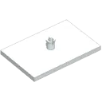{ .lu-ti width="24" loading="lazy" } [Train Bogie Plate 4x6 (LOT 5112)](../5112.md) | 1.02123429%; mean 0.010245902 | Not associated with a vendor |
| { .lu-ti width="24" loading="lazy" } [Slope Brick 45° 8x2 (LOT 5127)](../5127.md) | 1.02123429%; mean 0.010245902 | Not associated with a vendor |
| 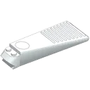{ .lu-ti width="24" loading="lazy" } [Element Separator (LOT 5152)](../5152.md) | 1.02123429%; mean 0.010245902 | Not associated with a vendor |
| { .lu-ti width="24" loading="lazy" } [Brick 12x12 1/4-Circle (LOT 5176)](../5176.md) | 1.02123429%; mean 0.010245902 | Not associated with a vendor |
| 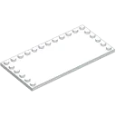{ .lu-ti width="24" loading="lazy" } [Tile 6x12 with 22 Studs (LOT 5179)](../5179.md) | 1.02123429%; mean 0.010245902 | Not associated with a vendor |
| { .lu-ti width="24" loading="lazy" } [Cone 1x1 (LOT 5180)](../5180.md) | 1.02123429%; mean 0.010245902 | Not associated with a vendor |
| { .lu-ti width="24" loading="lazy" } [Brick 4X10 (LOT 5182)](../5182.md) | 1.02123429%; mean 0.010245902 | Not associated with a vendor |
| { .lu-ti width="24" loading="lazy" } [Brick 2x2x3 (LOT 5219)](../5219.md) | 1.02123429%; mean 0.010245902 | Not associated with a vendor |
| { .lu-ti width="24" loading="lazy" } [Panel 1x4x1 (LOT 5274)](../5274.md) | 1.02123429%; mean 0.010245902 | Not associated with a vendor |
| { .lu-ti width="24" loading="lazy" } [Slope Brick 45° 4x6 Double (LOT 5294)](../5294.md) | 1.02123429%; mean 0.010245902 | Not associated with a vendor |
| { .lu-ti width="24" loading="lazy" } [Wedge 3x12 Curved Right (LOT 5355)](../5355.md) | 1.02123429%; mean 0.010245902 | Not associated with a vendor |
| { .lu-ti width="24" loading="lazy" } [Wedge 3x12 Curved Left (LOT 5356)](../5356.md) | 1.02123429%; mean 0.010245902 | Not associated with a vendor |
| { .lu-ti width="24" loading="lazy" } [Tile 8x16 (LOT 5390)](../5390.md) | 1.02123429%; mean 0.010245902 | Not associated with a vendor |
| { .lu-ti width="24" loading="lazy" } [Technic Hub with 4 Sticks (LOT 5400)](../5400.md) | 1.02123429%; mean 0.010245902 | Not associated with a vendor |
| { .lu-ti width="24" loading="lazy" } [Windscreen 3x6 25° (LOT 5489)](../5489.md) | 1.02123429%; mean 0.010245902 | Not associated with a vendor |
| { .lu-ti width="24" loading="lazy" } [Plate 4x4 Round with Pin Hole (LOT 5519)](../5519.md) | 1.02123429%; mean 0.010245902 | Not associated with a vendor |
| { .lu-ti width="24" loading="lazy" } [Slope Brick 18° 1x4 (LOT 5521)](../5521.md) | 1.02123429%; mean 0.010245902 | Not associated with a vendor |
| { .lu-ti width="24" loading="lazy" } [Plate 1x12 (LOT 5523)](../5523.md) | 1.02123429%; mean 0.010245902 | Not associated with a vendor |
| { .lu-ti width="24" loading="lazy" } [Slope Brick 65° 2x1x2 (LOT 5524)](../5524.md) | 1.02123429%; mean 0.010245902 | Not associated with a vendor |
| { .lu-ti width="24" loading="lazy" } [Butterfly Shirt (LOT 5730)](../5730.md) | 0.00156495%; mean 0.000015649452 | Not associated with a vendor |
| { .lu-ti width="24" loading="lazy" } [Mission Giver Shirt (LOT 5731)](../5731.md) | 0.00156495%; mean 0.000015649452 | Not associated with a vendor |
| { .lu-ti width="24" loading="lazy" } [Raincloud Shirt (LOT 5732)](../5732.md) | 0.00156495%; mean 0.000015649452 | Not associated with a vendor |
| { .lu-ti width="24" loading="lazy" } [Minifigure Shirt (LOT 5733)](../5733.md) | 0.00156495%; mean 0.000015649452 | Not associated with a vendor |
| { .lu-ti width="24" loading="lazy" } [Space Jacket (LOT 5734)](../5734.md) | 0.00156495%; mean 0.000015649452 | Not associated with a vendor |
| { .lu-ti width="24" loading="lazy" } [Striped Shirt (LOT 5735)](../5735.md) | 0.00156495%; mean 0.000015649452 | Not associated with a vendor |
| { .lu-ti width="24" loading="lazy" } [Butterfly Shirt (LOT 5736)](../5736.md) | 0.00156495%; mean 0.000015649452 | Not associated with a vendor |
| { .lu-ti width="24" loading="lazy" } [Mission Giver Shirt (LOT 5737)](../5737.md) | 0.00156495%; mean 0.000015649452 | Not associated with a vendor |
| { .lu-ti width="24" loading="lazy" } [Raincloud Shirt (LOT 5738)](../5738.md) | 0.00156495%; mean 0.000015649452 | Not associated with a vendor |
| { .lu-ti width="24" loading="lazy" } [Minifigure Shirt (LOT 5739)](../5739.md) | 0.00156495%; mean 0.000015649452 | Not associated with a vendor |
| { .lu-ti width="24" loading="lazy" } [Space Jacket (LOT 5740)](../5740.md) | 0.00156495%; mean 0.000015649452 | Not associated with a vendor |
| { .lu-ti width="24" loading="lazy" } [Striped Shirt (LOT 5741)](../5741.md) | 0.00156495%; mean 0.000015649452 | Not associated with a vendor |
| { .lu-ti width="24" loading="lazy" } [Butterfly Shirt (LOT 5748)](../5748.md) | 0.00156495%; mean 0.000015649452 | Not associated with a vendor |
| { .lu-ti width="24" loading="lazy" } [Mission Giver Shirt (LOT 5749)](../5749.md) | 0.00156495%; mean 0.000015649452 | Not associated with a vendor |
| { .lu-ti width="24" loading="lazy" } [Raincloud Shirt (LOT 5750)](../5750.md) | 0.00156495%; mean 0.000015649452 | Not associated with a vendor |
| { .lu-ti width="24" loading="lazy" } [Minifigure Shirt (LOT 5751)](../5751.md) | 0.00156495%; mean 0.000015649452 | Not associated with a vendor |
| { .lu-ti width="24" loading="lazy" } [Space Jacket (LOT 5752)](../5752.md) | 0.00156495%; mean 0.000015649452 | Not associated with a vendor |
| { .lu-ti width="24" loading="lazy" } [Striped Shirt (LOT 5753)](../5753.md) | 0.00156495%; mean 0.000015649452 | Not associated with a vendor |
| { .lu-ti width="24" loading="lazy" } [Butterfly Shirt (LOT 5754)](../5754.md) | 0.00156495%; mean 0.000015649452 | Not associated with a vendor |
| { .lu-ti width="24" loading="lazy" } [Mission Giver Shirt (LOT 5755)](../5755.md) | 0.00156495%; mean 0.000015649452 | Not associated with a vendor |
| { .lu-ti width="24" loading="lazy" } [Raincloud Shirt (LOT 5756)](../5756.md) | 0.00156495%; mean 0.000015649452 | Not associated with a vendor |
| { .lu-ti width="24" loading="lazy" } [Minifigure Shirt (LOT 5757)](../5757.md) | 0.00156495%; mean 0.000015649452 | Not associated with a vendor |
| { .lu-ti width="24" loading="lazy" } [Space Jacket (LOT 5758)](../5758.md) | 0.00156495%; mean 0.000015649452 | Not associated with a vendor |
| { .lu-ti width="24" loading="lazy" } [Striped Shirt (LOT 5759)](../5759.md) | 0.00156495%; mean 0.000015649452 | Not associated with a vendor |
| { .lu-ti width="24" loading="lazy" } [Butterfly Shirt (LOT 5760)](../5760.md) | 0.00156495%; mean 0.000015649452 | Not associated with a vendor |
| { .lu-ti width="24" loading="lazy" } [Mission Giver Shirt (LOT 5761)](../5761.md) | 0.00156495%; mean 0.000015649452 | Not associated with a vendor |
| { .lu-ti width="24" loading="lazy" } [Raincloud Shirt (LOT 5762)](../5762.md) | 0.00156495%; mean 0.000015649452 | Not associated with a vendor |
| { .lu-ti width="24" loading="lazy" } [Minifigure Shirt (LOT 5763)](../5763.md) | 0.00156495%; mean 0.000015649452 | Not associated with a vendor |
| { .lu-ti width="24" loading="lazy" } [Space Jacket (LOT 5764)](../5764.md) | 0.00156495%; mean 0.000015649452 | Not associated with a vendor |
| { .lu-ti width="24" loading="lazy" } [Striped Shirt (LOT 5765)](../5765.md) | 0.00156495%; mean 0.000015649452 | Not associated with a vendor |
| { .lu-ti width="24" loading="lazy" } [Butterfly Shirt (LOT 5766)](../5766.md) | 0.00156495%; mean 0.000015649452 | Not associated with a vendor |
| { .lu-ti width="24" loading="lazy" } [Mission Giver Shirt (LOT 5767)](../5767.md) | 0.00156495%; mean 0.000015649452 | Not associated with a vendor |
| { .lu-ti width="24" loading="lazy" } [Raincloud Shirt (LOT 5768)](../5768.md) | 0.00156495%; mean 0.000015649452 | Not associated with a vendor |
| { .lu-ti width="24" loading="lazy" } [Minifigure Shirt (LOT 5769)](../5769.md) | 0.00156495%; mean 0.000015649452 | Not associated with a vendor |
| { .lu-ti width="24" loading="lazy" } [Space Jacket (LOT 5770)](../5770.md) | 0.00156495%; mean 0.000015649452 | Not associated with a vendor |
| { .lu-ti width="24" loading="lazy" } [Striped Shirt (LOT 5771)](../5771.md) | 0.00156495%; mean 0.000015649452 | Not associated with a vendor |
| { .lu-ti width="24" loading="lazy" } [Butterfly Shirt (LOT 5772)](../5772.md) | 0.00156495%; mean 0.000015649452 | Not associated with a vendor |
| { .lu-ti width="24" loading="lazy" } [Mission Giver Shirt (LOT 5773)](../5773.md) | 0.00156495%; mean 0.000015649452 | Not associated with a vendor |
| { .lu-ti width="24" loading="lazy" } [Raincloud Shirt (LOT 5774)](../5774.md) | 0.00156495%; mean 0.000015649452 | Not associated with a vendor |
| { .lu-ti width="24" loading="lazy" } [Minifigure Shirt (LOT 5775)](../5775.md) | 0.00156495%; mean 0.000015649452 | Not associated with a vendor |
| { .lu-ti width="24" loading="lazy" } [Space Jacket (LOT 5776)](../5776.md) | 0.00156495%; mean 0.000015649452 | Not associated with a vendor |
| { .lu-ti width="24" loading="lazy" } [Striped Shirt (LOT 5777)](../5777.md) | 0.00156495%; mean 0.000015649452 | Not associated with a vendor |
| { .lu-ti width="24" loading="lazy" } [Butterfly Shirt (LOT 5778)](../5778.md) | 0.00156495%; mean 0.000015649452 | Not associated with a vendor |
| { .lu-ti width="24" loading="lazy" } [Mission Giver Shirt (LOT 5779)](../5779.md) | 0.00156495%; mean 0.000015649452 | Not associated with a vendor |
| { .lu-ti width="24" loading="lazy" } [Raincloud Shirt (LOT 5780)](../5780.md) | 0.00156495%; mean 0.000015649452 | Not associated with a vendor |
| { .lu-ti width="24" loading="lazy" } [Minifigure Shirt (LOT 5781)](../5781.md) | 0.00156495%; mean 0.000015649452 | Not associated with a vendor |
| { .lu-ti width="24" loading="lazy" } [Space Jacket (LOT 5782)](../5782.md) | 0.00156495%; mean 0.000015649452 | Not associated with a vendor |
| { .lu-ti width="24" loading="lazy" } [Striped Shirt (LOT 5783)](../5783.md) | 0.00156495%; mean 0.000015649452 | Not associated with a vendor |
| { .lu-ti width="24" loading="lazy" } [Butterfly Shirt (LOT 5784)](../5784.md) | 0.00156495%; mean 0.000015649452 | Not associated with a vendor |
| { .lu-ti width="24" loading="lazy" } [Mission Giver Shirt (LOT 5785)](../5785.md) | 0.00156495%; mean 0.000015649452 | Not associated with a vendor |
| { .lu-ti width="24" loading="lazy" } [Raincloud Shirt (LOT 5786)](../5786.md) | 0.00156495%; mean 0.000015649452 | Not associated with a vendor |
| { .lu-ti width="24" loading="lazy" } [Minifigure Shirt (LOT 5787)](../5787.md) | 0.00156495%; mean 0.000015649452 | Not associated with a vendor |
| { .lu-ti width="24" loading="lazy" } [Space Jacket (LOT 5788)](../5788.md) | 0.00156495%; mean 0.000015649452 | Not associated with a vendor |
| { .lu-ti width="24" loading="lazy" } [Striped Shirt (LOT 5789)](../5789.md) | 0.00156495%; mean 0.000015649452 | Not associated with a vendor |
| { .lu-ti width="24" loading="lazy" } [Butterfly Shirt (LOT 5790)](../5790.md) | 0.00156495%; mean 0.000015649452 | Not associated with a vendor |
| { .lu-ti width="24" loading="lazy" } [Mission Giver Shirt (LOT 5791)](../5791.md) | 0.00156495%; mean 0.000015649452 | Not associated with a vendor |
| { .lu-ti width="24" loading="lazy" } [Raincloud Shirt (LOT 5792)](../5792.md) | 0.00156495%; mean 0.000015649452 | Not associated with a vendor |
| { .lu-ti width="24" loading="lazy" } [Minifigure Shirt (LOT 5793)](../5793.md) | 0.00156495%; mean 0.000015649452 | Not associated with a vendor |
| { .lu-ti width="24" loading="lazy" } [Space Jacket (LOT 5794)](../5794.md) | 0.00156495%; mean 0.000015649452 | Not associated with a vendor |
| { .lu-ti width="24" loading="lazy" } [Striped Shirt (LOT 5795)](../5795.md) | 0.00156495%; mean 0.000015649452 | Not associated with a vendor |
| { .lu-ti width="24" loading="lazy" } [Butterfly Shirt (LOT 5796)](../5796.md) | 0.00156495%; mean 0.000015649452 | Not associated with a vendor |
| { .lu-ti width="24" loading="lazy" } [Mission Giver Shirt (LOT 5797)](../5797.md) | 0.00156495%; mean 0.000015649452 | Not associated with a vendor |
| { .lu-ti width="24" loading="lazy" } [Raincloud Shirt (LOT 5798)](../5798.md) | 0.00156495%; mean 0.000015649452 | Not associated with a vendor |
| { .lu-ti width="24" loading="lazy" } [Minifigure Shirt (LOT 5799)](../5799.md) | 0.00156495%; mean 0.000015649452 | Not associated with a vendor |
| { .lu-ti width="24" loading="lazy" } [Space Jacket (LOT 5800)](../5800.md) | 0.00156495%; mean 0.000015649452 | Not associated with a vendor |
| { .lu-ti width="24" loading="lazy" } [Striped Shirt (LOT 5801)](../5801.md) | 0.00156495%; mean 0.000015649452 | Not associated with a vendor |
| { .lu-ti width="24" loading="lazy" } [Butterfly Shirt (LOT 5802)](../5802.md) | 0.00156495%; mean 0.000015649452 | Not associated with a vendor |
| { .lu-ti width="24" loading="lazy" } [Mission Giver Shirt (LOT 5803)](../5803.md) | 0.00156495%; mean 0.000015649452 | Not associated with a vendor |
| { .lu-ti width="24" loading="lazy" } [Raincloud Shirt (LOT 5804)](../5804.md) | 0.00156495%; mean 0.000015649452 | Not associated with a vendor |
| { .lu-ti width="24" loading="lazy" } [Minifigure Shirt (LOT 5805)](../5805.md) | 0.00156495%; mean 0.000015649452 | Not associated with a vendor |
| { .lu-ti width="24" loading="lazy" } [Space Jacket (LOT 5806)](../5806.md) | 0.00156495%; mean 0.000015649452 | Not associated with a vendor |
| { .lu-ti width="24" loading="lazy" } [Striped Shirt (LOT 5807)](../5807.md) | 0.00156495%; mean 0.000015649452 | Not associated with a vendor |
| { .lu-ti width="24" loading="lazy" } [Butterfly Shirt (LOT 5808)](../5808.md) | 0.00156495%; mean 0.000015649452 | Not associated with a vendor |
| { .lu-ti width="24" loading="lazy" } [Mission Giver Shirt (LOT 5809)](../5809.md) | 0.00156495%; mean 0.000015649452 | Not associated with a vendor |
| { .lu-ti width="24" loading="lazy" } [Raincloud Shirt (LOT 5810)](../5810.md) | 0.00156495%; mean 0.000015649452 | Not associated with a vendor |
| { .lu-ti width="24" loading="lazy" } [Minifigure Shirt (LOT 5811)](../5811.md) | 0.00156495%; mean 0.000015649452 | Not associated with a vendor |
| { .lu-ti width="24" loading="lazy" } [Space Jacket (LOT 5812)](../5812.md) | 0.00156495%; mean 0.000015649452 | Not associated with a vendor |
| { .lu-ti width="24" loading="lazy" } [Striped Shirt (LOT 5813)](../5813.md) | 0.00156495%; mean 0.000015649452 | Not associated with a vendor |
| { .lu-ti width="24" loading="lazy" } [Butterfly Shirt (LOT 5814)](../5814.md) | 0.00156495%; mean 0.000015649452 | Not associated with a vendor |
| { .lu-ti width="24" loading="lazy" } [Mission Giver Shirt (LOT 5815)](../5815.md) | 0.00156495%; mean 0.000015649452 | Not associated with a vendor |
| { .lu-ti width="24" loading="lazy" } [Raincloud Shirt (LOT 5816)](../5816.md) | 0.00156495%; mean 0.000015649452 | Not associated with a vendor |
| { .lu-ti width="24" loading="lazy" } [Minifigure Shirt (LOT 5817)](../5817.md) | 0.00156495%; mean 0.000015649452 | Not associated with a vendor |
| { .lu-ti width="24" loading="lazy" } [Space Jacket (LOT 5818)](../5818.md) | 0.00156495%; mean 0.000015649452 | Not associated with a vendor |
| { .lu-ti width="24" loading="lazy" } [Striped Shirt (LOT 5819)](../5819.md) | 0.00156495%; mean 0.000015649452 | Not associated with a vendor |
| { .lu-ti width="24" loading="lazy" } [Butterfly Shirt (LOT 5820)](../5820.md) | 0.00156495%; mean 0.000015649452 | Not associated with a vendor |
| { .lu-ti width="24" loading="lazy" } [Mission Giver Shirt (LOT 5821)](../5821.md) | 0.00156495%; mean 0.000015649452 | Not associated with a vendor |
| { .lu-ti width="24" loading="lazy" } [Raincloud Shirt (LOT 5822)](../5822.md) | 0.00156495%; mean 0.000015649452 | Not associated with a vendor |
| { .lu-ti width="24" loading="lazy" } [Minifigure Shirt (LOT 5823)](../5823.md) | 0.00156495%; mean 0.000015649452 | Not associated with a vendor |
| { .lu-ti width="24" loading="lazy" } [Space Jacket (LOT 5824)](../5824.md) | 0.00156495%; mean 0.000015649452 | Not associated with a vendor |
| { .lu-ti width="24" loading="lazy" } [Striped Shirt (LOT 5825)](../5825.md) | 0.00156495%; mean 0.000015649452 | Not associated with a vendor |
| { .lu-ti width="24" loading="lazy" } [Butterfly Shirt (LOT 5826)](../5826.md) | 0.00156495%; mean 0.000015649452 | Not associated with a vendor |
| { .lu-ti width="24" loading="lazy" } [Mission Giver Shirt (LOT 5827)](../5827.md) | 0.00156495%; mean 0.000015649452 | Not associated with a vendor |
| { .lu-ti width="24" loading="lazy" } [Raincloud Shirt (LOT 5828)](../5828.md) | 0.00156495%; mean 0.000015649452 | Not associated with a vendor |
| { .lu-ti width="24" loading="lazy" } [Minifigure Shirt (LOT 5829)](../5829.md) | 0.00156495%; mean 0.000015649452 | Not associated with a vendor |
| { .lu-ti width="24" loading="lazy" } [Space Jacket (LOT 5830)](../5830.md) | 0.00156495%; mean 0.000015649452 | Not associated with a vendor |
| { .lu-ti width="24" loading="lazy" } [Striped Shirt (LOT 5831)](../5831.md) | 0.00156495%; mean 0.000015649452 | Not associated with a vendor |
| { .lu-ti width="24" loading="lazy" } [Hiccup Tablets (LOT 5832)](../5832.md) | 1.14130435%; mean 0.011413043 | Not associated with a vendor |
| { .lu-ti width="24" loading="lazy" } [Brick Booster Pack (LOT 5834)](../5834.md) | 1.14130435%; mean 0.011413043 | Not associated with a vendor |
| { .lu-ti width="24" loading="lazy" } [Super Brick Booster Pack (LOT 5835)](../5835.md) | 1.75%; mean 0.0175 | Not associated with a vendor |
| { .lu-ti width="24" loading="lazy" } [Picnic Basket (LOT 5836)](../5836.md) | 1.14130435%; mean 0.011413043 | Not associated with a vendor |
| { .lu-ti width="24" loading="lazy" } [Super Picnic Basket (LOT 5837)](../5837.md) | 1.75%; mean 0.0175 | Not associated with a vendor |
| { .lu-ti width="24" loading="lazy" } [Maelstrom-Infected Brick (LOT 6194)](../6194.md) | 10%; mean 0.1 | Not associated with a vendor |
| { .lu-ti width="24" loading="lazy" } [Thirst Quencher (LOT 6201)](../6201.md) | 1.14130435%; mean 0.011413043 | Not associated with a vendor |
| { .lu-ti width="24" loading="lazy" } [Nexus Force Healing Kit (LOT 6207)](../6207.md) | 1.14130435%; mean 0.011413043 | Not associated with a vendor |
| { .lu-ti width="24" loading="lazy" } [Pink Gem (LOT 6866)](../6866.md) | 1.14130435%; mean 0.011413043 | Not associated with a vendor |
| { .lu-ti width="24" loading="lazy" } [Flash Bang (LOT 6884)](../6884.md) | 1.14130435%; mean 0.011413043 | Not associated with a vendor |
| { .lu-ti width="24" loading="lazy" } [Buttery Croissant (LOT 7724)](../7724.md) | 1.14130435%; mean 0.011413043 | Not associated with a vendor |
| { .lu-ti width="24" loading="lazy" } [Healing Drumstick (LOT 7725)](../7725.md) | 1.14130435%; mean 0.011413043 | Not associated with a vendor |
| { .lu-ti width="24" loading="lazy" } [Picnic Table Model (LOT 7758)](../7758.md) | 0.16304348%; mean 0.0016304348 | Not associated with a vendor |
| { .lu-ti width="24" loading="lazy" } [Double Trash Can Model (LOT 7759)](../7759.md) | 0.16304348%; mean 0.0016304348 | Not associated with a vendor |
| { .lu-ti width="24" loading="lazy" } [Trash Can Model (LOT 7761)](../7761.md) | 0.16304348%; mean 0.0016304348 | Not associated with a vendor |
| { .lu-ti width="24" loading="lazy" } [Bench Model (LOT 7770)](../7770.md) | 0.16304348%; mean 0.0016304348 | Not associated with a vendor |
| { .lu-ti width="24" loading="lazy" } [Cooler Model (LOT 7771)](../7771.md) | 0.16304348%; mean 0.0016304348 | Not associated with a vendor |
| { .lu-ti width="24" loading="lazy" } [Piano Model (LOT 7773)](../7773.md) | 0.25%; mean 0.0025 | Not associated with a vendor |
| { .lu-ti width="24" loading="lazy" } [Guitar Model (LOT 7774)](../7774.md) | 0.16304348%; mean 0.0016304348 | Not associated with a vendor |
| { .lu-ti width="24" loading="lazy" } [Bass Guitar Model (LOT 7775)](../7775.md) | 0.16304348%; mean 0.0016304348 | Not associated with a vendor |
| { .lu-ti width="24" loading="lazy" } [Firecracker (LOT 7778)](../7778.md) | 1.14130435%; mean 0.011413043 | Not associated with a vendor |
| { .lu-ti width="24" loading="lazy" } [Fire Hydrant Model (LOT 7808)](../7808.md) | 0.16304348%; mean 0.0016304348 | Not associated with a vendor |
| { .lu-ti width="24" loading="lazy" } [Drumset Model (LOT 7813)](../7813.md) | 0.25%; mean 0.0025 | Not associated with a vendor |
| { .lu-ti width="24" loading="lazy" } [Cash Register Model (LOT 7818)](../7818.md) | 0.16304348%; mean 0.0016304348 | Not associated with a vendor |
| { .lu-ti width="24" loading="lazy" } [DJ Table Model (LOT 7822)](../7822.md) | 0.16304348%; mean 0.0016304348 | Not associated with a vendor |
| { .lu-ti width="24" loading="lazy" } [Tank Pallet Model (LOT 7825)](../7825.md) | 0.15%; mean 0.0015 | Not associated with a vendor |
| { .lu-ti width="24" loading="lazy" } [Oil Drum Model (LOT 7826)](../7826.md) | 0.16304348%; mean 0.0016304348 | Not associated with a vendor |
| { .lu-ti width="24" loading="lazy" } [Dolly Model (LOT 7827)](../7827.md) | 0.16304348%; mean 0.0016304348 | Not associated with a vendor |
| { .lu-ti width="24" loading="lazy" } [Torch Cart Model (LOT 7828)](../7828.md) | 0.16304348%; mean 0.0016304348 | Not associated with a vendor |
| { .lu-ti width="24" loading="lazy" } [Engine Model (LOT 7829)](../7829.md) | 0.15%; mean 0.0015 | Not associated with a vendor |
| { .lu-ti width="24" loading="lazy" } [Pallet Model (LOT 7830)](../7830.md) | 0.16304348%; mean 0.0016304348 | Not associated with a vendor |
| { .lu-ti width="24" loading="lazy" } [Vendor Rack Model (LOT 7832)](../7832.md) | 0.15%; mean 0.0015 | Not associated with a vendor |
| { .lu-ti width="24" loading="lazy" } [Double Lamppost Model (LOT 8270)](../8270.md) | 0.16304348%; mean 0.0016304348 | Not associated with a vendor |
| { .lu-ti width="24" loading="lazy" } [Bag of Glitter (LOT 8363)](../8363.md) | 1.14130435%; mean 0.011413043 | Not associated with a vendor |
| { .lu-ti width="24" loading="lazy" } [Cloud Burst (LOT 8366)](../8366.md) | 1.14130435%; mean 0.011413043 | Not associated with a vendor |
| { .lu-ti width="24" loading="lazy" } [Scooter Chassis 2x6 with Lateral Studs (LOT 8788)](../8788.md) | 1.02123429%; mean 0.010245902 | Not associated with a vendor |
| 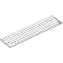{ .lu-ti width="24" loading="lazy" } [Plate 6x24 (LOT 8826)](../8826.md) | 1.02123429%; mean 0.010245902 | Not associated with a vendor |
| { .lu-ti width="24" loading="lazy" } [Brick 1x4 Hollow (LOT 8827)](../8827.md) | 1.02123429%; mean 0.010245902 | Not associated with a vendor |
| { .lu-ti width="24" loading="lazy" } [Tile 1x4 with Hinge for Fence Gate (LOT 8831)](../8831.md) | 1.02123429%; mean 0.010245902 | Not associated with a vendor |
| { .lu-ti width="24" loading="lazy" } [Garrison Cap (LOT 8852)](../8852.md) | 1.02123429%; mean 0.010245902 | Not associated with a vendor |
| { .lu-ti width="24" loading="lazy" } [Slope Brick 53° 1x3x3 1/3 with Studs (LOT 8879)](../8879.md) | 1.02123429%; mean 0.010245902 | Not associated with a vendor |
| 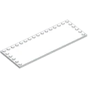{ .lu-ti width="24" loading="lazy" } [Tile 6x16 with 26 Studs (LOT 8895)](../8895.md) | 1.02123429%; mean 0.010245902 | Not associated with a vendor |
| { .lu-ti width="24" loading="lazy" } [Spiral Tube with Flanges (LOT 8896)](../8896.md) | 1.02123429%; mean 0.010245902 | Not associated with a vendor |
| { .lu-ti width="24" loading="lazy" } [Brick 2x6x3 (LOT 8897)](../8897.md) | 1.02123429%; mean 0.010245902 | Not associated with a vendor |
| { .lu-ti width="24" loading="lazy" } [Panel 2x4x4 1/2-Circle (LOT 8898)](../8898.md) | 1.02123429%; mean 0.010245902 | Not associated with a vendor |
| { .lu-ti width="24" loading="lazy" } [Tile 6x6 (LOT 8913)](../8913.md) | 1.02123429%; mean 0.010245902 | Not associated with a vendor |
| { .lu-ti width="24" loading="lazy" } [Ball Ø52mm (LOT 8914)](../8914.md) | 1.02123429%; mean 0.010245902 | Not associated with a vendor |
| { .lu-ti width="24" loading="lazy" } [Brick 2x4x3 (LOT 8937)](../8937.md) | 1.02123429%; mean 0.010245902 | Not associated with a vendor |
| { .lu-ti width="24" loading="lazy" } [Dome 4x4 Faceted (LOT 8941)](../8941.md) | 1.02123429%; mean 0.010245902 | Not associated with a vendor |
| { .lu-ti width="24" loading="lazy" } [Brick 4x18 (LOT 8950)](../8950.md) | 1.02123429%; mean 0.010245902 | Not associated with a vendor |
| { .lu-ti width="24" loading="lazy" } [Slope Brick 2x6 Curved (LOT 9015)](../9015.md) | 1.02123429%; mean 0.010245902 | Not associated with a vendor |
| { .lu-ti width="24" loading="lazy" } [Tile 1x2 Engraved  (LOT 9084)](../9084.md) | 1.02123429%; mean 0.010245902 | Not associated with a vendor |
| 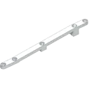{ .lu-ti width="24" loading="lazy" } [Technic Crane Arm 16 (LOT 9086)](../9086.md) | 1.02123429%; mean 0.010245902 | Not associated with a vendor |
| { .lu-ti width="24" loading="lazy" } [Brick 4x12 (LOT 9088)](../9088.md) | 1.02123429%; mean 0.010245902 | Not associated with a vendor |
| { .lu-ti width="24" loading="lazy" } [Spike 2x8 (Flexible) with 2 Studs (LOT 9106)](../9106.md) | 1.02123429%; mean 0.010245902 | Not associated with a vendor |
| { .lu-ti width="24" loading="lazy" } [Tile 1x3 (LOT 9130)](../9130.md) | 1.02123429%; mean 0.010245902 | Not associated with a vendor |
| { .lu-ti width="24" loading="lazy" } [Frame Plate 4x4 (LOT 9157)](../9157.md) | 1.02123429%; mean 0.010245902 | Not associated with a vendor |
| { .lu-ti width="24" loading="lazy" } [Slope Brick 1x2x2/3 (LOT 9192)](../9192.md) | 1.02123429%; mean 0.010245902 | Not associated with a vendor |
| { .lu-ti width="24" loading="lazy" } [Space Blaster, Smooth (LOT 9193)](../9193.md) | 1.02123429%; mean 0.010245902 | Not associated with a vendor |
| { .lu-ti width="24" loading="lazy" } [Dome 4x4 Smooth Ø32 (LOT 9194)](../9194.md) | 1.02123429%; mean 0.010245902 | Not associated with a vendor |
| { .lu-ti width="24" loading="lazy" } [Tile 2x4 (LOT 9195)](../9195.md) | 1.02123429%; mean 0.010245902 | Not associated with a vendor |
| { .lu-ti width="24" loading="lazy" } [Brick 4x4 Round with Pin Hole (LOT 9197)](../9197.md) | 1.02123429%; mean 0.010245902 | Not associated with a vendor |
| { .lu-ti width="24" loading="lazy" } [Brick 1x1 with 1 Stud on Side (LOT 9201)](../9201.md) | 1.02123429%; mean 0.010245902 | Not associated with a vendor |
| 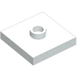{ .lu-ti width="24" loading="lazy" } [Plate 2x2 with 1 Stud (LOT 9203)](../9203.md) | 1.02123429%; mean 0.010245902 | Not associated with a vendor |
| { .lu-ti width="24" loading="lazy" } [Plate 2x6x2/3 with 4 Horizontal Studs (LOT 9204)](../9204.md) | 1.02123429%; mean 0.010245902 | Not associated with a vendor |
| 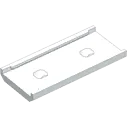{ .lu-ti width="24" loading="lazy" } [Tile 2x6 with Holder (LOT 9237)](../9237.md) | 1.02123429%; mean 0.010245902 | Not associated with a vendor |
| { .lu-ti width="24" loading="lazy" } [Brown Bench Model (LOT 9484)](../9484.md) | 0.16304348%; mean 0.0016304348 | Not associated with a vendor |
| { .lu-ti width="24" loading="lazy" } [Hotdog Cart Model (LOT 9491)](../9491.md) | 0.15%; mean 0.0015 | Not associated with a vendor |
| { .lu-ti width="24" loading="lazy" } [Hotdog Stand Model (LOT 9492)](../9492.md) | 0.16304348%; mean 0.0016304348 | Not associated with a vendor |
| { .lu-ti width="24" loading="lazy" } [Dustbin Model (LOT 9495)](../9495.md) | 0.16304348%; mean 0.0016304348 | Not associated with a vendor |
| { .lu-ti width="24" loading="lazy" } [Sleek Sofa Model (LOT 9496)](../9496.md) | 0.16304348%; mean 0.0016304348 | Not associated with a vendor |
| { .lu-ti width="24" loading="lazy" } [Traffic Light Model (LOT 9497)](../9497.md) | 0.16304348%; mean 0.0016304348 | Not associated with a vendor |
| { .lu-ti width="24" loading="lazy" } [Wagon Model (LOT 9568)](../9568.md) | 0.16304348%; mean 0.0016304348 | Not associated with a vendor |
| { .lu-ti width="24" loading="lazy" } [BBQ Grill Model (LOT 9570)](../9570.md) | 0.15%; mean 0.0015 | Not associated with a vendor |
| { .lu-ti width="24" loading="lazy" } [Mailbox Model (LOT 9574)](../9574.md) | 0.16304348%; mean 0.0016304348 | Not associated with a vendor |
| { .lu-ti width="24" loading="lazy" } [Big Red Magnet Model (LOT 9811)](../9811.md) | 0.16304348%; mean 0.0016304348 | Not associated with a vendor |
| { .lu-ti width="24" loading="lazy" } [Un-Stink Potion (LOT 10021)](../10021.md) | 1.14130435%; mean 0.011413043 | Not associated with a vendor |
| { .lu-ti width="24" loading="lazy" } [Turntable 2x2 (LOT 10195)](../10195.md) | 1.02123429%; mean 0.010245902 | Not associated with a vendor |
| { .lu-ti width="24" loading="lazy" } [Med Pack (LOT 14679)](../14679.md) | 1.75%; mean 0.0175 | Not associated with a vendor |
| { .lu-ti width="24" loading="lazy" } [Armor Repair Kit (LOT 14680)](../14680.md) | 1.75%; mean 0.0175 | Not associated with a vendor |
| { .lu-ti width="24" loading="lazy" } [Cockpit 4x4x4 (LOT 16323)](../16323.md) | 1.02123429%; mean 0.010245902 | Not associated with a vendor |
| 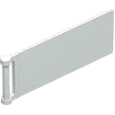{ .lu-ti width="24" loading="lazy" } [Banner with 3.18 Stick 3x8 (LOT 16343)](../16343.md) | 1.02123429%; mean 0.010245902 | Not associated with a vendor |
| { .lu-ti width="24" loading="lazy" } [Brick 4x6 (LOT 16366)](../16366.md) | 1.02123429%; mean 0.010245902 | Not associated with a vendor |
| { .lu-ti width="24" loading="lazy" } [Holder with Cross Axle and Knob (LOT 16374)](../16374.md) | 1.02123429%; mean 0.010245902 | Not associated with a vendor |
| { .lu-ti width="24" loading="lazy" } [Brick 6x6x2 W. Ø4.85 (LOT 16375)](../16375.md) | 1.02123429%; mean 0.010245902 | Not associated with a vendor |
| 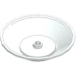{ .lu-ti width="24" loading="lazy" } [Lamp Shade (LOT 16405)](../16405.md) | 1.02123429%; mean 0.010245902 | Not associated with a vendor |
| { .lu-ti width="24" loading="lazy" } [Front 4x6x1 2/3 (LOT 16410)](../16410.md) | 1.02123429%; mean 0.010245902 | Not associated with a vendor |
| { .lu-ti width="24" loading="lazy" } [Brick 2x2 with Groove (LOT 16423)](../16423.md) | 1.02123429%; mean 0.010245902 | Not associated with a vendor |
| { .lu-ti width="24" loading="lazy" } [Round Wall 3x6x10 (LOT 16442)](../16442.md) | 1.02123429%; mean 0.010245902 | Not associated with a vendor |
| { .lu-ti width="24" loading="lazy" } [Plate 1x4 with 2 Knobs (LOT 16443)](../16443.md) | 1.02123429%; mean 0.010245902 | Not associated with a vendor |

## Raw matrix entries

| Row | Loot table | Rarity table | Trigger | Min | Max | Flag | Gate |
| --- | --- | --- | --- | --- | --- | --- | --- |
| 1911 | 186 | 4 | 0.35 | 1 | 1 |  |  |
| 1912 | 88 | 9 | 0.1 | 1 | 1 |  |  |
| 1913 | 111 | 19 | 1 | 2 | 3 |  |  |
| 1914 | 184 | 4 | 0.05 | 1 | 1 |  |  |
| 1915 | 191 | 4 | 0.01 | 1 | 1 |  |  |
| 1916 | 192 | 4 | 0.01 | 1 | 1 |  |  |

[LootMatrix](../../../db/LootMatrix.md), [LootTable](../../../db/LootTable.md), [RarityTable](../../../db/RarityTable.md).
