# Loot matrix 585

[Item database](../README.md) | [Methodology](../Methodology.md)

## Sources and mapped locations

| Kind | Source | Location evidence | Conditions |
| --- | --- | --- | --- |
| Activity | [AG - Wishing Well Vending Machine (LOT 11281)](../sources/object-11281.md) | [Avant Gardens (1100)](../locations/zone-1100.md) | AG Wishing Well 4 (activity ID 11281, rating threshold 900, reward 170); Selected only if this is the highest eligible rating threshold; instance zone not specified.; Static association, not a live-spawn guarantee |

## Item candidates

Default vendor-stock probabilities are shown only when this matrix has a registered vendor. Loot probabilities use the generic algorithm, not a guarantee of actual use by every script/activity.

| Item | Modeled loot chance / expected count | Default vendor stock |
| --- | --- | --- |
| 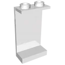{ .lu-ti width="24" loading="lazy" } [Panel 1x2x3 (LOT 17)](../17.md) | 1.01694181%; mean 0.010204082 | Not associated with a vendor |
| { .lu-ti width="24" loading="lazy" } [Brick 2x4 (LOT 29)](../29.md) | 8.81855748%; mean 0.090909091 | Not associated with a vendor |
| { .lu-ti width="24" loading="lazy" } [Brick 2x3 (LOT 30)](../30.md) | 8.81855748%; mean 0.090909091 | Not associated with a vendor |
| { .lu-ti width="24" loading="lazy" } [Brick 2x2 (LOT 31)](../31.md) | 8.81855748%; mean 0.090909091 | Not associated with a vendor |
| { .lu-ti width="24" loading="lazy" } [Brick 1x2 (LOT 32)](../32.md) | 8.81855748%; mean 0.090909091 | Not associated with a vendor |
| { .lu-ti width="24" loading="lazy" } [Brick 1x1 (LOT 33)](../33.md) | 8.81855748%; mean 0.090909091 | Not associated with a vendor |
| { .lu-ti width="24" loading="lazy" } [Brick 2x8 (LOT 35)](../35.md) | 8.81855748%; mean 0.090909091 | Not associated with a vendor |
| { .lu-ti width="24" loading="lazy" } [Brick 1x8 (LOT 36)](../36.md) | 8.81855748%; mean 0.090909091 | Not associated with a vendor |
| { .lu-ti width="24" loading="lazy" } [Brick 1x6 (LOT 37)](../37.md) | 8.81855748%; mean 0.090909091 | Not associated with a vendor |
| { .lu-ti width="24" loading="lazy" } [Brick 1x4 (LOT 38)](../38.md) | 8.81855748%; mean 0.090909091 | Not associated with a vendor |
| { .lu-ti width="24" loading="lazy" } [Plate 2x4 (LOT 39)](../39.md) | 8.81855748%; mean 0.090909091 | Not associated with a vendor |
| { .lu-ti width="24" loading="lazy" } [Plate 2x3 (LOT 40)](../40.md) | 8.81855748%; mean 0.090909091 | Not associated with a vendor |
| { .lu-ti width="24" loading="lazy" } [Plate 1x2 (LOT 41)](../41.md) | 8.81855748%; mean 0.090909091 | Not associated with a vendor |
| { .lu-ti width="24" loading="lazy" } [Plate 1x1 (LOT 42)](../42.md) | 8.81855748%; mean 0.090909091 | Not associated with a vendor |
| { .lu-ti width="24" loading="lazy" } [Plate 1x8 (LOT 58)](../58.md) | 8.81855748%; mean 0.090909091 | Not associated with a vendor |
| { .lu-ti width="24" loading="lazy" } [Brick 1x3 (LOT 59)](../59.md) | 8.81855748%; mean 0.090909091 | Not associated with a vendor |
| { .lu-ti width="24" loading="lazy" } [Plate 1x3 (LOT 60)](../60.md) | 8.81855748%; mean 0.090909091 | Not associated with a vendor |
| 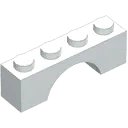{ .lu-ti width="24" loading="lazy" } [Brick 1x4 with Bow (LOT 61)](../61.md) | 1.01694181%; mean 0.010204082 | Not associated with a vendor |
| { .lu-ti width="24" loading="lazy" } [Plate 1x6 (LOT 62)](../62.md) | 8.81855748%; mean 0.090909091 | Not associated with a vendor |
| { .lu-ti width="24" loading="lazy" } [Plate 1x4 (LOT 66)](../66.md) | 8.81855748%; mean 0.090909091 | Not associated with a vendor |
| { .lu-ti width="24" loading="lazy" } [Bow 1x3x2 (LOT 77)](../77.md) | 1.01694181%; mean 0.010204082 | Not associated with a vendor |
| { .lu-ti width="24" loading="lazy" } [Brick with Bow 4x1x1 1/3 (LOT 81)](../81.md) | 1.01694181%; mean 0.010204082 | Not associated with a vendor |
| { .lu-ti width="24" loading="lazy" } [Bow 1x1x1 1/3 (LOT 82)](../82.md) | 1.01694181%; mean 0.010204082 | Not associated with a vendor |
| 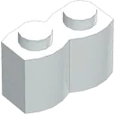{ .lu-ti width="24" loading="lazy" } [Brick 1x2 Palisade (LOT 88)](../88.md) | 1.01694181%; mean 0.010204082 | Not associated with a vendor |
| { .lu-ti width="24" loading="lazy" } [Brick 2x6 (LOT 98)](../98.md) | 8.81855748%; mean 0.090909091 | Not associated with a vendor |
| 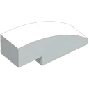{ .lu-ti width="24" loading="lazy" } [Slope Brick 1x3 Curved (LOT 105)](../105.md) | 1.01694181%; mean 0.010204082 | Not associated with a vendor |
| 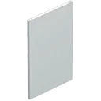{ .lu-ti width="24" loading="lazy" } [Glass for Frame 1x4x6 (LOT 107)](../107.md) | 1.01694181%; mean 0.010204082 | Not associated with a vendor |
| 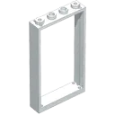{ .lu-ti width="24" loading="lazy" } [Frame 1x4x6 for Door (LOT 122)](../122.md) | 1.01694181%; mean 0.010204082 | Not associated with a vendor |
| { .lu-ti width="24" loading="lazy" } [Plate 2x6 (LOT 144)](../144.md) | 8.81855748%; mean 0.090909091 | Not associated with a vendor |
| 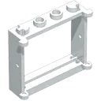{ .lu-ti width="24" loading="lazy" } [Window Frame 4x3 (LOT 336)](../336.md) | 1.01694181%; mean 0.010204082 | Not associated with a vendor |
| 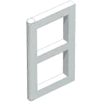{ .lu-ti width="24" loading="lazy" } [Window for Frame 2x3 (LOT 337)](../337.md) | 1.01694181%; mean 0.010204082 | Not associated with a vendor |
| 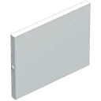{ .lu-ti width="24" loading="lazy" } [Glass for Frame 1x4x3 (LOT 338)](../338.md) | 1.01694181%; mean 0.010204082 | Not associated with a vendor |
| 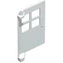{ .lu-ti width="24" loading="lazy" } [Door with Pane for Frame 4x5 (LOT 340)](../340.md) | 1.01694181%; mean 0.010204082 | Not associated with a vendor |
| 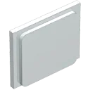{ .lu-ti width="24" loading="lazy" } [Glass for Train Window 1x4x3 (LOT 352)](../352.md) | 1.01694181%; mean 0.010204082 | Not associated with a vendor |
| 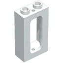{ .lu-ti width="24" loading="lazy" } [Frame 1x2x3 Narrow (LOT 353)](../353.md) | 1.01694181%; mean 0.010204082 | Not associated with a vendor |
| 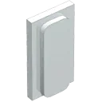{ .lu-ti width="24" loading="lazy" } [Glass for Train Window 1x2x3 (LOT 354)](../354.md) | 1.01694181%; mean 0.010204082 | Not associated with a vendor |
| 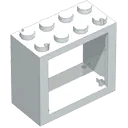{ .lu-ti width="24" loading="lazy" } [Window Frame 2x4x3 (LOT 360)](../360.md) | 1.01694181%; mean 0.010204082 | Not associated with a vendor |
| 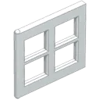{ .lu-ti width="24" loading="lazy" } [Window 4x3 (LOT 361)](../361.md) | 1.01694181%; mean 0.010204082 | Not associated with a vendor |
| 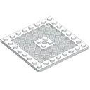{ .lu-ti width="24" loading="lazy" } [Grid Plate 8x8 (LOT 363)](../363.md) | 1.01694181%; mean 0.010204082 | Not associated with a vendor |
| 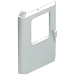{ .lu-ti width="24" loading="lazy" } [Train Door 1x4x5 Left (LOT 367)](../367.md) | 1.01694181%; mean 0.010204082 | Not associated with a vendor |
| 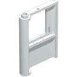{ .lu-ti width="24" loading="lazy" } [Train Door 1x4x5 Right (LOT 368)](../368.md) | 1.01694181%; mean 0.010204082 | Not associated with a vendor |
| 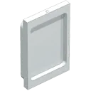{ .lu-ti width="24" loading="lazy" } [Glass for Train Door (LOT 369)](../369.md) | 1.01694181%; mean 0.010204082 | Not associated with a vendor |
| 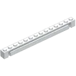{ .lu-ti width="24" loading="lazy" } [Brick 1x14 with Groove (LOT 374)](../374.md) | 1.01694181%; mean 0.010204082 | Not associated with a vendor |
| 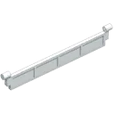{ .lu-ti width="24" loading="lazy" } [Element for Rolling Gate (LOT 375)](../375.md) | 1.01694181%; mean 0.010204082 | Not associated with a vendor |
| 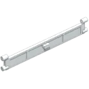{ .lu-ti width="24" loading="lazy" } [End Element for Rolling Gate (LOT 376)](../376.md) | 1.01694181%; mean 0.010204082 | Not associated with a vendor |
| 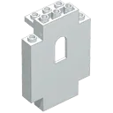{ .lu-ti width="24" loading="lazy" } [Panel Wall 1x5x6 with Window (LOT 386)](../386.md) | 1.01694181%; mean 0.010204082 | Not associated with a vendor |
| { .lu-ti width="24" loading="lazy" } [Frame Skylight 4x4x3/45° (LOT 387)](../387.md) | 1.01694181%; mean 0.010204082 | Not associated with a vendor |
| { .lu-ti width="24" loading="lazy" } [Glass for Skylight 4x4x3/45° (LOT 388)](../388.md) | 1.01694181%; mean 0.010204082 | Not associated with a vendor |
| 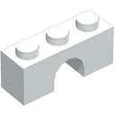{ .lu-ti width="24" loading="lazy" } [Brick 1x3 with Bow (LOT 392)](../392.md) | 1.01694181%; mean 0.010204082 | Not associated with a vendor |
| 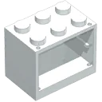{ .lu-ti width="24" loading="lazy" } [Cupboard 2x3x2 (LOT 397)](../397.md) | 1.01694181%; mean 0.010204082 | Not associated with a vendor |
| 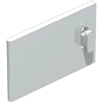{ .lu-ti width="24" loading="lazy" } [Cupboard Door 3x2 (LOT 398)](../398.md) | 1.01694181%; mean 0.010204082 | Not associated with a vendor |
| 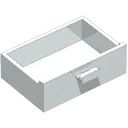{ .lu-ti width="24" loading="lazy" } [Drawer (LOT 399)](../399.md) | 1.01694181%; mean 0.010204082 | Not associated with a vendor |
| { .lu-ti width="24" loading="lazy" } [Airplane Window (LOT 425)](../425.md) | 1.01694181%; mean 0.010204082 | Not associated with a vendor |
| 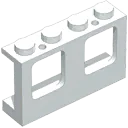{ .lu-ti width="24" loading="lazy" } [Panel 1x4x2 with Windows (LOT 426)](../426.md) | 1.01694181%; mean 0.010204082 | Not associated with a vendor |
| 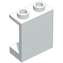{ .lu-ti width="24" loading="lazy" } [Panel 1x2x2 (LOT 427)](../427.md) | 1.01694181%; mean 0.010204082 | Not associated with a vendor |
| { .lu-ti width="24" loading="lazy" } [Bow 1x6x 3 1/3 (LOT 449)](../449.md) | 1.01694181%; mean 0.010204082 | Not associated with a vendor |
| 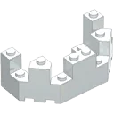{ .lu-ti width="24" loading="lazy" } [Castle Balcony 4x8x2 (LOT 454)](../454.md) | 1.01694181%; mean 0.010204082 | Not associated with a vendor |
| { .lu-ti width="24" loading="lazy" } [Wooden Door 4x8 with 1/4-Circle Top (LOT 461)](../461.md) | 1.01694181%; mean 0.010204082 | Not associated with a vendor |
| { .lu-ti width="24" loading="lazy" } [Arch Brick 1x12x3 (LOT 464)](../464.md) | 1.01694181%; mean 0.010204082 | Not associated with a vendor |
| 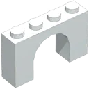{ .lu-ti width="24" loading="lazy" } [Arch Brick 1x4x2 (LOT 477)](../477.md) | 1.01694181%; mean 0.010204082 | Not associated with a vendor |
| { .lu-ti width="24" loading="lazy" } [Arch 1x6x2 (LOT 478)](../478.md) | 1.01694181%; mean 0.010204082 | Not associated with a vendor |
| { .lu-ti width="24" loading="lazy" } [Brick 1x4x1 1/3 with Bowed Ridge (LOT 480)](../480.md) | 1.01694181%; mean 0.010204082 | Not associated with a vendor |
| { .lu-ti width="24" loading="lazy" } [Brick 2x4 with Bowed Ridge (LOT 481)](../481.md) | 1.01694181%; mean 0.010204082 | Not associated with a vendor |
| { .lu-ti width="24" loading="lazy" } [Door with Pane for Frame 2x6x6 (LOT 489)](../489.md) | 1.01694181%; mean 0.010204082 | Not associated with a vendor |
| 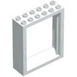{ .lu-ti width="24" loading="lazy" } [Frame 2x6x6 (LOT 490)](../490.md) | 1.01694181%; mean 0.010204082 | Not associated with a vendor |
| 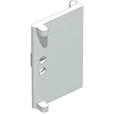{ .lu-ti width="24" loading="lazy" } [Container Door 1x2x3 (LOT 497)](../497.md) | 1.01694181%; mean 0.010204082 | Not associated with a vendor |
| 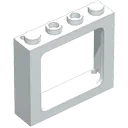{ .lu-ti width="24" loading="lazy" } [Train Window 1x4x3 (LOT 498)](../498.md) | 1.01694181%; mean 0.010204082 | Not associated with a vendor |
| { .lu-ti width="24" loading="lazy" } [Window Frame 1x2x2 2/3 Curved Top (LOT 512)](../512.md) | 1.01694181%; mean 0.010204082 | Not associated with a vendor |
| { .lu-ti width="24" loading="lazy" } [Iron Bars for Window (LOT 513)](../513.md) | 1.01694181%; mean 0.010204082 | Not associated with a vendor |
| 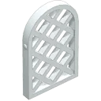{ .lu-ti width="24" loading="lazy" } [Fly-Screen for Window (LOT 514)](../514.md) | 1.01694181%; mean 0.010204082 | Not associated with a vendor |
| { .lu-ti width="24" loading="lazy" } [Brick with Bow 1x5x4 Inverted (LOT 524)](../524.md) | 1.01694181%; mean 0.010204082 | Not associated with a vendor |
| 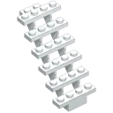{ .lu-ti width="24" loading="lazy" } [Staircase 4x6x7 (LOT 529)](../529.md) | 1.01694181%; mean 0.010204082 | Not associated with a vendor |
| 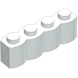{ .lu-ti width="24" loading="lazy" } [Palisade Brick 1x4 (LOT 530)](../530.md) | 1.01694181%; mean 0.010204082 | Not associated with a vendor |
| 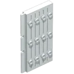{ .lu-ti width="24" loading="lazy" } [Wooden Door 5x9 with Studs (LOT 545)](../545.md) | 1.01694181%; mean 0.010204082 | Not associated with a vendor |
| 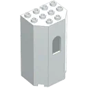{ .lu-ti width="24" loading="lazy" } [Castle Tower Element 4x3x6 (LOT 549)](../549.md) | 1.01694181%; mean 0.010204082 | Not associated with a vendor |
| 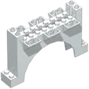{ .lu-ti width="24" loading="lazy" } [Arch with Groove 2x12x6 (LOT 553)](../553.md) | 1.01694181%; mean 0.010204082 | Not associated with a vendor |
| 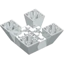{ .lu-ti width="24" loading="lazy" } [Slope Brick 65° 6x6x2 Inverted Quadruple (LOT 578)](../578.md) | 1.01694181%; mean 0.010204082 | Not associated with a vendor |
| 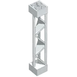{ .lu-ti width="24" loading="lazy" } [Lattice Brick 2x2x10 Type 1 (LOT 594)](../594.md) | 1.01694181%; mean 0.010204082 | Not associated with a vendor |
| 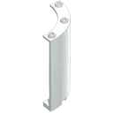{ .lu-ti width="24" loading="lazy" } [Panel 4x4x6 1/4-Circle (LOT 602)](../602.md) | 1.01694181%; mean 0.010204082 | Not associated with a vendor |
| { .lu-ti width="24" loading="lazy" } [Tower Roof Half 6x8x9 (LOT 625)](../625.md) | 1.01694181%; mean 0.010204082 | Not associated with a vendor |
| 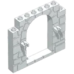{ .lu-ti width="24" loading="lazy" } [Wall 1x8x6 with Doorway and 2 Vertical Clips (LOT 630)](../630.md) | 1.01694181%; mean 0.010204082 | Not associated with a vendor |
| 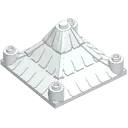{ .lu-ti width="24" loading="lazy" } [Pitched Roof 6x6x3 (LOT 640)](../640.md) | 1.01694181%; mean 0.010204082 | Not associated with a vendor |
| 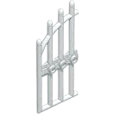{ .lu-ti width="24" loading="lazy" } [Lattice Door 4x7 2/3 (LOT 660)](../660.md) | 1.01694181%; mean 0.010204082 | Not associated with a vendor |
| 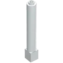{ .lu-ti width="24" loading="lazy" } [Brick Column 1x1x6 (LOT 674)](../674.md) | 1.01694181%; mean 0.010204082 | Not associated with a vendor |
| { .lu-ti width="24" loading="lazy" } [Brick Curved 1/4 4x4 (LOT 717)](../717.md) | 1.01694181%; mean 0.010204082 | Not associated with a vendor |
| 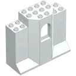{ .lu-ti width="24" loading="lazy" } [Panel Wall 3x8x6 with Window (LOT 723)](../723.md) | 1.01694181%; mean 0.010204082 | Not associated with a vendor |
| 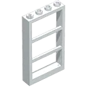{ .lu-ti width="24" loading="lazy" } [Frame 1x4x6 with 2 Cross-Beams (LOT 761)](../761.md) | 1.01694181%; mean 0.010204082 | Not associated with a vendor |
| 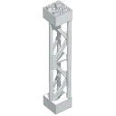{ .lu-ti width="24" loading="lazy" } [Lattice Brick 2x2x10 Type 2 (LOT 763)](../763.md) | 1.01694181%; mean 0.010204082 | Not associated with a vendor |
| { .lu-ti width="24" loading="lazy" } [Panel 1x6x5 (LOT 765)](../765.md) | 1.01694181%; mean 0.010204082 | Not associated with a vendor |
| { .lu-ti width="24" loading="lazy" } [Brick Column 2x2x11 (LOT 776)](../776.md) | 1.01694181%; mean 0.010204082 | Not associated with a vendor |
| { .lu-ti width="24" loading="lazy" } [Brick with Bow 1x5x4 (LOT 787)](../787.md) | 1.01694181%; mean 0.010204082 | Not associated with a vendor |
| { .lu-ti width="24" loading="lazy" } [Panel Wall 3x3x6 Corner (LOT 791)](../791.md) | 1.01694181%; mean 0.010204082 | Not associated with a vendor |
| { .lu-ti width="24" loading="lazy" } [Panel 1x2x2 with Window (LOT 794)](../794.md) | 1.01694181%; mean 0.010204082 | Not associated with a vendor |
| { .lu-ti width="24" loading="lazy" } [Windscreen 6x6 Octagonal with Hinge (LOT 803)](../803.md) | 1.01694181%; mean 0.010204082 | Not associated with a vendor |
| { .lu-ti width="24" loading="lazy" } [Corner Brick 3x3 with Cut-Out (LOT 819)](../819.md) | 1.01694181%; mean 0.010204082 | Not associated with a vendor |
| { .lu-ti width="24" loading="lazy" } [Panel 3x2x6 Curved (LOT 822)](../822.md) | 1.01694181%; mean 0.010204082 | Not associated with a vendor |
| { .lu-ti width="24" loading="lazy" } [Window 2x3 with Lattice (LOT 833)](../833.md) | 1.01694181%; mean 0.010204082 | Not associated with a vendor |
| { .lu-ti width="24" loading="lazy" } [Panel 3x4x6 with Curve (LOT 844)](../844.md) | 1.01694181%; mean 0.010204082 | Not associated with a vendor |
| { .lu-ti width="24" loading="lazy" } [Panel 5x6x10 with Curve (LOT 845)](../845.md) | 1.01694181%; mean 0.010204082 | Not associated with a vendor |
| { .lu-ti width="24" loading="lazy" } [Dome 10x10x4 with Hinge (LOT 849)](../849.md) | 1.01694181%; mean 0.010204082 | Not associated with a vendor |
| { .lu-ti width="24" loading="lazy" } [Hemisphere 10x10x4 Inverted (LOT 850)](../850.md) | 1.01694181%; mean 0.010204082 | Not associated with a vendor |
| { .lu-ti width="24" loading="lazy" } [Brick 1x4 with Groove (LOT 853)](../853.md) | 1.01694181%; mean 0.010204082 | Not associated with a vendor |
| { .lu-ti width="24" loading="lazy" } [Plate 2x2 (LOT 865)](../865.md) | 8.81855748%; mean 0.090909091 | Not associated with a vendor |
| { .lu-ti width="24" loading="lazy" } [Plate 2x8 (LOT 869)](../869.md) | 8.81855748%; mean 0.090909091 | Not associated with a vendor |
| { .lu-ti width="24" loading="lazy" } [Door 1x3x2 Right (LOT 882)](../882.md) | 1.01694181%; mean 0.010204082 | Not associated with a vendor |
| { .lu-ti width="24" loading="lazy" } [Left Door 1x3x2 (LOT 883)](../883.md) | 1.01694181%; mean 0.010204082 | Not associated with a vendor |
| { .lu-ti width="24" loading="lazy" } [Door 1x3x3 Right (LOT 884)](../884.md) | 1.01694181%; mean 0.010204082 | Not associated with a vendor |
| { .lu-ti width="24" loading="lazy" } [Door 1x3x3 Left (LOT 885)](../885.md) | 1.01694181%; mean 0.010204082 | Not associated with a vendor |
| { .lu-ti width="24" loading="lazy" } [Door 1x3x4 Right (LOT 886)](../886.md) | 1.01694181%; mean 0.010204082 | Not associated with a vendor |
| { .lu-ti width="24" loading="lazy" } [Door 1x3x4 Left (LOT 887)](../887.md) | 1.01694181%; mean 0.010204082 | Not associated with a vendor |
| { .lu-ti width="24" loading="lazy" } [Brick with Bow 1x6x2 (LOT 894)](../894.md) | 1.01694181%; mean 0.010204082 | Not associated with a vendor |
| { .lu-ti width="24" loading="lazy" } [Brick with Bow 1x8x2 (LOT 895)](../895.md) | 1.01694181%; mean 0.010204082 | Not associated with a vendor |
| { .lu-ti width="24" loading="lazy" } [Brick with Bow 1x6 (LOT 899)](../899.md) | 1.01694181%; mean 0.010204082 | Not associated with a vendor |
| { .lu-ti width="24" loading="lazy" } [Brick 1x6x5 (LOT 928)](../928.md) | 1.01694181%; mean 0.010204082 | Not associated with a vendor |
| { .lu-ti width="24" loading="lazy" } [Brick 1x3x5 (LOT 929)](../929.md) | 1.01694181%; mean 0.010204082 | Not associated with a vendor |
| { .lu-ti width="24" loading="lazy" } [Door 1x3x1 Right (LOT 933)](../933.md) | 1.01694181%; mean 0.010204082 | Not associated with a vendor |
| { .lu-ti width="24" loading="lazy" } [Door 1x3x1 Left (LOT 934)](../934.md) | 1.01694181%; mean 0.010204082 | Not associated with a vendor |
| { .lu-ti width="24" loading="lazy" } [Healing Banana (LOT 1966)](../1966.md) | 3.94736842%; mean 0.039473684 | Not associated with a vendor |
| { .lu-ti width="24" loading="lazy" } [Notion Potion (LOT 2198)](../2198.md) | 3.94736842%; mean 0.039473684 | Not associated with a vendor |
| { .lu-ti width="24" loading="lazy" } [Quicksicle (LOT 2620)](../2620.md) | 3.94736842%; mean 0.039473684 | Not associated with a vendor |
| { .lu-ti width="24" loading="lazy" } [Armor Polish (LOT 2993)](../2993.md) | 3.94736842%; mean 0.039473684 | Not associated with a vendor |
| { .lu-ti width="24" loading="lazy" } [Healing Cherry (LOT 2994)](../2994.md) | 3.94736842%; mean 0.039473684 | Not associated with a vendor |
| { .lu-ti width="24" loading="lazy" } [Armor Shine (LOT 2996)](../2996.md) | 3.94736842%; mean 0.039473684 | Not associated with a vendor |
| { .lu-ti width="24" loading="lazy" } [Strong Notion Potion (LOT 2998)](../2998.md) | 3.94736842%; mean 0.039473684 | Not associated with a vendor |
| { .lu-ti width="24" loading="lazy" } [BBQ Blast Hot Dog (LOT 3011)](../3011.md) | 3.94736842%; mean 0.039473684 | Not associated with a vendor |
| { .lu-ti width="24" loading="lazy" } [Green Imaginite (LOT 3039)](../3039.md) | 3.94736842%; mean 0.039473684 | Not associated with a vendor |
| { .lu-ti width="24" loading="lazy" } [Red Imaginite (LOT 3040)](../3040.md) | 6.25%; mean 0.0625 | Not associated with a vendor |
| { .lu-ti width="24" loading="lazy" } [Improved Crescent Wrench (LOT 3077)](../3077.md) | 0.25%; mean 0.0025 | Not associated with a vendor |
| { .lu-ti width="24" loading="lazy" } [Amber Gem (LOT 3100)](../3100.md) | 3.94736842%; mean 0.039473684 | Not associated with a vendor |
| { .lu-ti width="24" loading="lazy" } [Basic Shovel (LOT 3872)](../3872.md) | 0.9375%; mean 0.009375 | Not associated with a vendor |
| { .lu-ti width="24" loading="lazy" } [Brick 1x1x2 with Shutter Holder (LOT 5078)](../5078.md) | 1.01694181%; mean 0.010204082 | Not associated with a vendor |
| { .lu-ti width="24" loading="lazy" } [Shutter 2x3 (LOT 5103)](../5103.md) | 1.01694181%; mean 0.010204082 | Not associated with a vendor |
| { .lu-ti width="24" loading="lazy" } [Sliding Gate 6x5 (LOT 5137)](../5137.md) | 1.01694181%; mean 0.010204082 | Not associated with a vendor |
| { .lu-ti width="24" loading="lazy" } [Rock Face 4x10x6 (LOT 5158)](../5158.md) | 1.01694181%; mean 0.010204082 | Not associated with a vendor |
| { .lu-ti width="24" loading="lazy" } [Rock Face 3x8x7 (LOT 5159)](../5159.md) | 1.01694181%; mean 0.010204082 | Not associated with a vendor |
| { .lu-ti width="24" loading="lazy" } [Panel 1x4x3 (LOT 5197)](../5197.md) | 1.01694181%; mean 0.010204082 | Not associated with a vendor |
| { .lu-ti width="24" loading="lazy" } [Brick with Lion Head (LOT 5259)](../5259.md) | 1.01694181%; mean 0.010204082 | Not associated with a vendor |
| { .lu-ti width="24" loading="lazy" } [Wooden Door 4x6 with Pane (LOT 5333)](../5333.md) | 1.01694181%; mean 0.010204082 | Not associated with a vendor |
| { .lu-ti width="24" loading="lazy" } [Rock Face 2x4x6 (LOT 5386)](../5386.md) | 1.01694181%; mean 0.010204082 | Not associated with a vendor |
| { .lu-ti width="24" loading="lazy" } [Glass Door with Frame 4x5 Left (LOT 5387)](../5387.md) | 1.01694181%; mean 0.010204082 | Not associated with a vendor |
| { .lu-ti width="24" loading="lazy" } [Door 1x3x4 Right (LOT 5491)](../5491.md) | 1.01694181%; mean 0.010204082 | Not associated with a vendor |
| { .lu-ti width="24" loading="lazy" } [Left Door 1x3x4 (LOT 5492)](../5492.md) | 1.01694181%; mean 0.010204082 | Not associated with a vendor |
| { .lu-ti width="24" loading="lazy" } [Panel 1x2x2 with Window (LOT 5511)](../5511.md) | 1.01694181%; mean 0.010204082 | Not associated with a vendor |
| { .lu-ti width="24" loading="lazy" } [Panel 1x4x3 (LOT 5526)](../5526.md) | 1.01694181%; mean 0.010204082 | Not associated with a vendor |
| { .lu-ti width="24" loading="lazy" } [Frame 1x2x2 (LOT 5527)](../5527.md) | 1.01694181%; mean 0.010204082 | Not associated with a vendor |
| { .lu-ti width="24" loading="lazy" } [Frame 1x2x3 (LOT 5528)](../5528.md) | 1.01694181%; mean 0.010204082 | Not associated with a vendor |
| { .lu-ti width="24" loading="lazy" } [Frame 1x4x3 (LOT 5529)](../5529.md) | 1.01694181%; mean 0.010204082 | Not associated with a vendor |
| { .lu-ti width="24" loading="lazy" } [Frame 1x4x6 (LOT 5530)](../5530.md) | 1.01694181%; mean 0.010204082 | Not associated with a vendor |
| { .lu-ti width="24" loading="lazy" } [Frame 2x4x3 (LOT 5531)](../5531.md) | 1.01694181%; mean 0.010204082 | Not associated with a vendor |
| { .lu-ti width="24" loading="lazy" } [Glass for Frame 1x2x3 (LOT 5532)](../5532.md) | 1.01694181%; mean 0.010204082 | Not associated with a vendor |
| { .lu-ti width="24" loading="lazy" } [Window ½ for Frame 1x4x3 (LOT 5533)](../5533.md) | 1.01694181%; mean 0.010204082 | Not associated with a vendor |
| { .lu-ti width="24" loading="lazy" } [Lid ½ for Frame 1x4x3 (LOT 5534)](../5534.md) | 1.01694181%; mean 0.010204082 | Not associated with a vendor |
| { .lu-ti width="24" loading="lazy" } [Glass Door with Stud for Frame 1x4x6 (LOT 5535)](../5535.md) | 1.01694181%; mean 0.010204082 | Not associated with a vendor |
| { .lu-ti width="24" loading="lazy" } [Lattice Door for Frame 1x4x6 (LOT 5536)](../5536.md) | 1.01694181%; mean 0.010204082 | Not associated with a vendor |
| { .lu-ti width="24" loading="lazy" } [Door with Pane for Frame 1x4x6 (LOT 5537)](../5537.md) | 1.01694181%; mean 0.010204082 | Not associated with a vendor |
| { .lu-ti width="24" loading="lazy" } [Door 1x3x3 Right (LOT 5542)](../5542.md) | 1.01694181%; mean 0.010204082 | Not associated with a vendor |
| { .lu-ti width="24" loading="lazy" } [Left Door 1x3x3 (LOT 5543)](../5543.md) | 1.01694181%; mean 0.010204082 | Not associated with a vendor |
| { .lu-ti width="24" loading="lazy" } [Glass Door with Stud for 1x4x6 Frame (LOT 5553)](../5553.md) | 1.01694181%; mean 0.010204082 | Not associated with a vendor |
| { .lu-ti width="24" loading="lazy" } [Shutter 1x2x3 with Shaft (LOT 5554)](../5554.md) | 1.01694181%; mean 0.010204082 | Not associated with a vendor |
| { .lu-ti width="24" loading="lazy" } [Frame Slanting 3x4x3 (LOT 5555)](../5555.md) | 1.01694181%; mean 0.010204082 | Not associated with a vendor |
| { .lu-ti width="24" loading="lazy" } [Slope Brick 2x4x2/3 Curved (LOT 5557)](../5557.md) | 1.01694181%; mean 0.010204082 | Not associated with a vendor |
| { .lu-ti width="24" loading="lazy" } [Panel 1x4x2 with Windows (LOT 5561)](../5561.md) | 1.01694181%; mean 0.010204082 | Not associated with a vendor |
| { .lu-ti width="24" loading="lazy" } [Slope Brick 1x4 Curved (LOT 5570)](../5570.md) | 1.01694181%; mean 0.010204082 | Not associated with a vendor |
| { .lu-ti width="24" loading="lazy" } [Glass Door with Frame 4x5 Right (LOT 5612)](../5612.md) | 1.01694181%; mean 0.010204082 | Not associated with a vendor |
| { .lu-ti width="24" loading="lazy" } [Brick Curved 1/4 2x2 (LOT 5618)](../5618.md) | 1.01694181%; mean 0.010204082 | Not associated with a vendor |
| { .lu-ti width="24" loading="lazy" } [Hiccup Tablets (LOT 5832)](../5832.md) | 3.94736842%; mean 0.039473684 | Not associated with a vendor |
| { .lu-ti width="24" loading="lazy" } [Brick Booster Pack (LOT 5834)](../5834.md) | 3.94736842%; mean 0.039473684 | Not associated with a vendor |
| { .lu-ti width="24" loading="lazy" } [Super Brick Booster Pack (LOT 5835)](../5835.md) | 6.25%; mean 0.0625 | Not associated with a vendor |
| { .lu-ti width="24" loading="lazy" } [Picnic Basket (LOT 5836)](../5836.md) | 3.94736842%; mean 0.039473684 | Not associated with a vendor |
| { .lu-ti width="24" loading="lazy" } [Super Picnic Basket (LOT 5837)](../5837.md) | 6.25%; mean 0.0625 | Not associated with a vendor |
| { .lu-ti width="24" loading="lazy" } [Basic Shortsword of Knockback (LOT 5948)](../5948.md) | 0.25%; mean 0.0025 | Not associated with a vendor |
| { .lu-ti width="24" loading="lazy" } [Tiny Mushroom Model (LOT 6027)](../6027.md) | 0.5859375%; mean 0.005859375 | Not associated with a vendor |
| { .lu-ti width="24" loading="lazy" } [Small Mushroom Model (LOT 6028)](../6028.md) | 0.5859375%; mean 0.005859375 | Not associated with a vendor |
| { .lu-ti width="24" loading="lazy" } [Medium Mushroom Model (LOT 6029)](../6029.md) | 0.5859375%; mean 0.005859375 | Not associated with a vendor |
| { .lu-ti width="24" loading="lazy" } [Large Mushroom Model (LOT 6030)](../6030.md) | 0.5859375%; mean 0.005859375 | Not associated with a vendor |
| { .lu-ti width="24" loading="lazy" } [Tiny Crate Model (LOT 6031)](../6031.md) | 0.09615385%; mean 0.00096153846 | Not associated with a vendor |
| { .lu-ti width="24" loading="lazy" } [Small Crate Model (LOT 6032)](../6032.md) | 0.09615385%; mean 0.00096153846 | Not associated with a vendor |
| { .lu-ti width="24" loading="lazy" } [Medium Crate Model (LOT 6033)](../6033.md) | 0.1%; mean 0.001 | Not associated with a vendor |
| { .lu-ti width="24" loading="lazy" } [Large Crate Model (LOT 6034)](../6034.md) | 0.1%; mean 0.001 | Not associated with a vendor |
| { .lu-ti width="24" loading="lazy" } [Wooden Barrel Model (LOT 6035)](../6035.md) | 0.5859375%; mean 0.005859375 | Not associated with a vendor |
| { .lu-ti width="24" loading="lazy" } [Tent Model (LOT 6036)](../6036.md) | 0.1%; mean 0.001 | Not associated with a vendor |
| { .lu-ti width="24" loading="lazy" } [Desk Model (LOT 6037)](../6037.md) | 0.09615385%; mean 0.00096153846 | Not associated with a vendor |
| { .lu-ti width="24" loading="lazy" } [Water Cooler Model (LOT 6039)](../6039.md) | 0.5859375%; mean 0.005859375 | Not associated with a vendor |
| { .lu-ti width="24" loading="lazy" } [Small Table Model (LOT 6044)](../6044.md) | 0.5859375%; mean 0.005859375 | Not associated with a vendor |
| { .lu-ti width="24" loading="lazy" } [Weapon Rack Model (LOT 6056)](../6056.md) | 0.09615385%; mean 0.00096153846 | Not associated with a vendor |
| { .lu-ti width="24" loading="lazy" } [Hut Model (LOT 6060)](../6060.md) | 0.09615385%; mean 0.00096153846 | Not associated with a vendor |
| { .lu-ti width="24" loading="lazy" } [Coffee Table Model (LOT 6064)](../6064.md) | 0.5859375%; mean 0.005859375 | Not associated with a vendor |
| { .lu-ti width="24" loading="lazy" } [Cart Model (LOT 6065)](../6065.md) | 0.5859375%; mean 0.005859375 | Not associated with a vendor |
| { .lu-ti width="24" loading="lazy" } [Fence Model (LOT 6071)](../6071.md) | 0.5859375%; mean 0.005859375 | Not associated with a vendor |
| { .lu-ti width="24" loading="lazy" } [Wood Pile Model (LOT 6072)](../6072.md) | 0.5859375%; mean 0.005859375 | Not associated with a vendor |
| { .lu-ti width="24" loading="lazy" } [Maelstrom-Infected Brick (LOT 6194)](../6194.md) | 75%; mean 1.125 | Not associated with a vendor |
| { .lu-ti width="24" loading="lazy" } [Thirst Quencher (LOT 6201)](../6201.md) | 3.94736842%; mean 0.039473684 | Not associated with a vendor |
| { .lu-ti width="24" loading="lazy" } [Basic Spear of Stunning (LOT 6203)](../6203.md) | 0.25%; mean 0.0025 | Not associated with a vendor |
| { .lu-ti width="24" loading="lazy" } [Nexus Force Healing Kit (LOT 6207)](../6207.md) | 3.94736842%; mean 0.039473684 | Not associated with a vendor |
| { .lu-ti width="24" loading="lazy" } [Improved Fishing Pole (LOT 6742)](../6742.md) | 0.25%; mean 0.0025 | Not associated with a vendor |
| { .lu-ti width="24" loading="lazy" } [Box of Cups Model (LOT 6778)](../6778.md) | 0.5859375%; mean 0.005859375 | Not associated with a vendor |
| { .lu-ti width="24" loading="lazy" } [Blue Baseball Cap (LOT 6803)](../6803.md) | 0.625%; mean 0.00625 | Not associated with a vendor |
| { .lu-ti width="24" loading="lazy" } [Light Blue Gem (LOT 6865)](../6865.md) | 6.25%; mean 0.0625 | Not associated with a vendor |
| { .lu-ti width="24" loading="lazy" } [Pink Gem (LOT 6866)](../6866.md) | 3.94736842%; mean 0.039473684 | Not associated with a vendor |
| { .lu-ti width="24" loading="lazy" } [Improved Composite Axe (LOT 6881)](../6881.md) | 0.25%; mean 0.0025 | Not associated with a vendor |
| { .lu-ti width="24" loading="lazy" } [Flash Bang (LOT 6884)](../6884.md) | 3.94736842%; mean 0.039473684 | Not associated with a vendor |
| { .lu-ti width="24" loading="lazy" } [Candle Holder Model (LOT 7122)](../7122.md) | 0.5859375%; mean 0.005859375 | Not associated with a vendor |
| { .lu-ti width="24" loading="lazy" } [Dock Model (LOT 7123)](../7123.md) | 0.09615385%; mean 0.00096153846 | Not associated with a vendor |
| { .lu-ti width="24" loading="lazy" } [Cabinet Model (LOT 7134)](../7134.md) | 0.09615385%; mean 0.00096153846 | Not associated with a vendor |
| { .lu-ti width="24" loading="lazy" } [Antique Chair Model (LOT 7135)](../7135.md) | 0.5859375%; mean 0.005859375 | Not associated with a vendor |
| { .lu-ti width="24" loading="lazy" } [Double Trash Can Model (LOT 7759)](../7759.md) | 0.5859375%; mean 0.005859375 | Not associated with a vendor |
| { .lu-ti width="24" loading="lazy" } [Trash Can Model (LOT 7761)](../7761.md) | 0.5859375%; mean 0.005859375 | Not associated with a vendor |
| { .lu-ti width="24" loading="lazy" } [Bench Model (LOT 7770)](../7770.md) | 0.5859375%; mean 0.005859375 | Not associated with a vendor |
| { .lu-ti width="24" loading="lazy" } [Firecracker (LOT 7778)](../7778.md) | 3.94736842%; mean 0.039473684 | Not associated with a vendor |
| { .lu-ti width="24" loading="lazy" } [Goblet Box Model (LOT 8055)](../8055.md) | 0.5859375%; mean 0.005859375 | Not associated with a vendor |
| { .lu-ti width="24" loading="lazy" } [Console Model (LOT 8068)](../8068.md) | 0.5859375%; mean 0.005859375 | Not associated with a vendor |
| { .lu-ti width="24" loading="lazy" } [Yellow Barricade Model (LOT 8069)](../8069.md) | 0.5859375%; mean 0.005859375 | Not associated with a vendor |
| { .lu-ti width="24" loading="lazy" } [Barricade Model (LOT 8073)](../8073.md) | 0.5859375%; mean 0.005859375 | Not associated with a vendor |
| { .lu-ti width="24" loading="lazy" } [Birdhouse Model (LOT 8077)](../8077.md) | 0.5859375%; mean 0.005859375 | Not associated with a vendor |
| { .lu-ti width="24" loading="lazy" } [Basic Dagger (LOT 8217)](../8217.md) | 0.9375%; mean 0.009375 | Not associated with a vendor |
| { .lu-ti width="24" loading="lazy" } [Basic Pickaxe (LOT 8218)](../8218.md) | 0.9375%; mean 0.009375 | Not associated with a vendor |
| { .lu-ti width="24" loading="lazy" } [Basic Javelin (LOT 8219)](../8219.md) | 0.9375%; mean 0.009375 | Not associated with a vendor |
| { .lu-ti width="24" loading="lazy" } [Cloud Burst (LOT 8366)](../8366.md) | 3.94736842%; mean 0.039473684 | Not associated with a vendor |
| { .lu-ti width="24" loading="lazy" } [Quality Cutlass (LOT 8497)](../8497.md) | 0% in the generic loot model | Not associated with a vendor |
| { .lu-ti width="24" loading="lazy" } [Improved Hatchet (LOT 8498)](../8498.md) | 0.25%; mean 0.0025 | Not associated with a vendor |
| { .lu-ti width="24" loading="lazy" } [Quality Woodsman's Axe (LOT 8500)](../8500.md) | 0% in the generic loot model | Not associated with a vendor |
| { .lu-ti width="24" loading="lazy" } [Improved Ice Saw (LOT 8501)](../8501.md) | 0.25%; mean 0.0025 | Not associated with a vendor |
| { .lu-ti width="24" loading="lazy" } [Improved Scimitar (LOT 8502)](../8502.md) | 0.25%; mean 0.0025 | Not associated with a vendor |
| { .lu-ti width="24" loading="lazy" } [Quality Corseque (LOT 8503)](../8503.md) | 0% in the generic loot model | Not associated with a vendor |
| { .lu-ti width="24" loading="lazy" } [Improved Longsword (LOT 8504)](../8504.md) | 0.25%; mean 0.0025 | Not associated with a vendor |
| { .lu-ti width="24" loading="lazy" } [Basic Force Blade (LOT 8505)](../8505.md) | 0.9375%; mean 0.009375 | Not associated with a vendor |
| { .lu-ti width="24" loading="lazy" } [Quality Dirk (LOT 8506)](../8506.md) | 0% in the generic loot model | Not associated with a vendor |
| { .lu-ti width="24" loading="lazy" } [Improved Trident (LOT 8509)](../8509.md) | 0.25%; mean 0.0025 | Not associated with a vendor |
| { .lu-ti width="24" loading="lazy" } [Space Headgear (LOT 8546)](../8546.md) | 0% in the generic loot model | Not associated with a vendor |
| { .lu-ti width="24" loading="lazy" } [Cargo Pants (LOT 8647)](../8647.md) | 0% in the generic loot model | Not associated with a vendor |
| { .lu-ti width="24" loading="lazy" } [Jodhpurs (LOT 8664)](../8664.md) | 0.625%; mean 0.00625 | Not associated with a vendor |
| { .lu-ti width="24" loading="lazy" } [Sweat Pants (LOT 8666)](../8666.md) | 0.625%; mean 0.00625 | Not associated with a vendor |
| { .lu-ti width="24" loading="lazy" } [Clam Diggers (LOT 8667)](../8667.md) | 0.625%; mean 0.00625 | Not associated with a vendor |
| { .lu-ti width="24" loading="lazy" } [Reinforced Pith Helmet (LOT 8675)](../8675.md) | 0% in the generic loot model | Not associated with a vendor |
| { .lu-ti width="24" loading="lazy" } [Cadet Helm (LOT 8676)](../8676.md) | 0% in the generic loot model | Not associated with a vendor |
| { .lu-ti width="24" loading="lazy" } [Panel 6x10x11 with Studs (LOT 8790)](../8790.md) | 1.01694181%; mean 0.010204082 | Not associated with a vendor |
| { .lu-ti width="24" loading="lazy" } [1/4-Dome 10x10x12 (LOT 8791)](../8791.md) | 1.01694181%; mean 0.010204082 | Not associated with a vendor |
| { .lu-ti width="24" loading="lazy" } [1/4-Dome Brick 3x3x2 Top (LOT 8795)](../8795.md) | 1.01694181%; mean 0.010204082 | Not associated with a vendor |
| { .lu-ti width="24" loading="lazy" } [1/4-Dome Brick 3x3x2 Inverted (LOT 8796)](../8796.md) | 1.01694181%; mean 0.010204082 | Not associated with a vendor |
| { .lu-ti width="24" loading="lazy" } [Panel 4x4x6 Corner Concave (LOT 8797)](../8797.md) | 1.01694181%; mean 0.010204082 | Not associated with a vendor |
| { .lu-ti width="24" loading="lazy" } [Panel 3x3x6 Corner Convex (LOT 8798)](../8798.md) | 1.01694181%; mean 0.010204082 | Not associated with a vendor |
| { .lu-ti width="24" loading="lazy" } [Wooden Door 3x6 with 1/4 Circle Top (LOT 8806)](../8806.md) | 1.01694181%; mean 0.010204082 | Not associated with a vendor |
| { .lu-ti width="24" loading="lazy" } [Crane Gantry 2x16x16 (LOT 8815)](../8815.md) | 1.01694181%; mean 0.010204082 | Not associated with a vendor |
| { .lu-ti width="24" loading="lazy" } [Crane Base 2x16x16 (LOT 8816)](../8816.md) | 1.01694181%; mean 0.010204082 | Not associated with a vendor |
| { .lu-ti width="24" loading="lazy" } [Stanchion 5 (LOT 8817)](../8817.md) | 1.01694181%; mean 0.010204082 | Not associated with a vendor |
| { .lu-ti width="24" loading="lazy" } [Fence Gate 1x4 (LOT 8830)](../8830.md) | 1.01694181%; mean 0.010204082 | Not associated with a vendor |
| { .lu-ti width="24" loading="lazy" } [Door 1x5x4 Right (LOT 8832)](../8832.md) | 1.01694181%; mean 0.010204082 | Not associated with a vendor |
| { .lu-ti width="24" loading="lazy" } [Left Door 1x5x4 (LOT 8833)](../8833.md) | 1.01694181%; mean 0.010204082 | Not associated with a vendor |
| { .lu-ti width="24" loading="lazy" } [Door 4x6 with Grill (LOT 8841)](../8841.md) | 1.01694181%; mean 0.010204082 | Not associated with a vendor |
| { .lu-ti width="24" loading="lazy" } [Casing 2x4x2 (LOT 8855)](../8855.md) | 1.01694181%; mean 0.010204082 | Not associated with a vendor |
| { .lu-ti width="24" loading="lazy" } [Lattice Corner 1x4x6 (LOT 8863)](../8863.md) | 1.01694181%; mean 0.010204082 | Not associated with a vendor |
| { .lu-ti width="24" loading="lazy" } [Frame Right 1x4x6 Inverted (LOT 8864)](../8864.md) | 1.01694181%; mean 0.010204082 | Not associated with a vendor |
| { .lu-ti width="24" loading="lazy" } [Panel 6x6x9 1/4-Circle with Dome (LOT 8867)](../8867.md) | 1.01694181%; mean 0.010204082 | Not associated with a vendor |
| { .lu-ti width="24" loading="lazy" } [Brick 2x3x2x1/3 Octagonal Diagonal (LOT 8872)](../8872.md) | 1.01694181%; mean 0.010204082 | Not associated with a vendor |
| { .lu-ti width="24" loading="lazy" } [Brick 2x2x3 1/3 Octagonal (LOT 8873)](../8873.md) | 1.01694181%; mean 0.010204082 | Not associated with a vendor |
| { .lu-ti width="24" loading="lazy" } [Cone 2x2x1 1/3 Octagonal (LOT 8874)](../8874.md) | 1.01694181%; mean 0.010204082 | Not associated with a vendor |
| { .lu-ti width="24" loading="lazy" } [Brick 2x2x3x1/3 Octagonal with Studs on Side (LOT 8877)](../8877.md) | 1.01694181%; mean 0.010204082 | Not associated with a vendor |
| { .lu-ti width="24" loading="lazy" } [Brick 2x2x3x1/3 Octagonal with 90° Angle (LOT 8878)](../8878.md) | 1.01694181%; mean 0.010204082 | Not associated with a vendor |
| { .lu-ti width="24" loading="lazy" } [Panel Wall Corner with Window 6x6x6 (LOT 8880)](../8880.md) | 1.01694181%; mean 0.010204082 | Not associated with a vendor |
| { .lu-ti width="24" loading="lazy" } [Panel 3x3x6 1/4-Circle with Dome (LOT 8882)](../8882.md) | 1.01694181%; mean 0.010204082 | Not associated with a vendor |
| { .lu-ti width="24" loading="lazy" } [Castle Balcony 7x7x2 (LOT 8885)](../8885.md) | 1.01694181%; mean 0.010204082 | Not associated with a vendor |
| { .lu-ti width="24" loading="lazy" } [Stable Door (LOT 8886)](../8886.md) | 1.01694181%; mean 0.010204082 | Not associated with a vendor |
| { .lu-ti width="24" loading="lazy" } [Corner Brick 5x5 with Cut-Out (LOT 8889)](../8889.md) | 1.01694181%; mean 0.010204082 | Not associated with a vendor |
| { .lu-ti width="24" loading="lazy" } [Frame 1x4x4 (LOT 8892)](../8892.md) | 1.01694181%; mean 0.010204082 | Not associated with a vendor |
| { .lu-ti width="24" loading="lazy" } [Door 4x4 with Grills and Handle (LOT 8893)](../8893.md) | 1.01694181%; mean 0.010204082 | Not associated with a vendor |
| { .lu-ti width="24" loading="lazy" } [Plate Frame 6x8 for Trap Door (LOT 8920)](../8920.md) | 1.01694181%; mean 0.010204082 | Not associated with a vendor |
| { .lu-ti width="24" loading="lazy" } [Plate Trap Door 4x5 (LOT 8921)](../8921.md) | 1.01694181%; mean 0.010204082 | Not associated with a vendor |
| { .lu-ti width="24" loading="lazy" } [Fence 1x6x2 with Arches (LOT 8923)](../8923.md) | 1.01694181%; mean 0.010204082 | Not associated with a vendor |
| { .lu-ti width="24" loading="lazy" } [Panel Wall 6x3x6 Corner with Window (LOT 8927)](../8927.md) | 1.01694181%; mean 0.010204082 | Not associated with a vendor |
| { .lu-ti width="24" loading="lazy" } [Palisade Wall 1x6x6 (LOT 8936)](../8936.md) | 1.01694181%; mean 0.010204082 | Not associated with a vendor |
| { .lu-ti width="24" loading="lazy" } [Panel 3x6x6 with Window and Roof Slope (LOT 8946)](../8946.md) | 1.01694181%; mean 0.010204082 | Not associated with a vendor |
| { .lu-ti width="24" loading="lazy" } [Bow Brick 1x3x2 (LOT 8991)](../8991.md) | 1.01694181%; mean 0.010204082 | Not associated with a vendor |
| { .lu-ti width="24" loading="lazy" } [Slope Brick 2x8x2 Curved (LOT 9004)](../9004.md) | 1.01694181%; mean 0.010204082 | Not associated with a vendor |
| { .lu-ti width="24" loading="lazy" } [Chain 16M (LOT 9089)](../9089.md) | 1.01694181%; mean 0.010204082 | Not associated with a vendor |
| { .lu-ti width="24" loading="lazy" } [Lattice 1/2 for Frame 1x4x3 (LOT 9095)](../9095.md) | 1.01694181%; mean 0.010204082 | Not associated with a vendor |
| { .lu-ti width="24" loading="lazy" } [Lattice Brick 1x6x5 with Cross-Beams (LOT 9139)](../9139.md) | 1.01694181%; mean 0.010204082 | Not associated with a vendor |
| { .lu-ti width="24" loading="lazy" } [Lattice A-mast 1x6x10 (LOT 9140)](../9140.md) | 1.01694181%; mean 0.010204082 | Not associated with a vendor |
| { .lu-ti width="24" loading="lazy" } [Roll Bar 4x6x3 (LOT 9141)](../9141.md) | 1.01694181%; mean 0.010204082 | Not associated with a vendor |
| { .lu-ti width="24" loading="lazy" } [Windscreen 1x6x3 Vertical (LOT 9143)](../9143.md) | 1.01694181%; mean 0.010204082 | Not associated with a vendor |
| { .lu-ti width="24" loading="lazy" } [Lattice Brick 2x2x5 (LOT 9168)](../9168.md) | 1.01694181%; mean 0.010204082 | Not associated with a vendor |
| { .lu-ti width="24" loading="lazy" } [Glass Door for Frame 1x4x6 (LOT 9174)](../9174.md) | 1.01694181%; mean 0.010204082 | Not associated with a vendor |
| { .lu-ti width="24" loading="lazy" } [Panel 2x4x5 1/2-Circle (LOT 9178)](../9178.md) | 1.01694181%; mean 0.010204082 | Not associated with a vendor |
| { .lu-ti width="24" loading="lazy" } [Panel 1x2x3 (LOT 9202)](../9202.md) | 1.01694181%; mean 0.010204082 | Not associated with a vendor |
| { .lu-ti width="24" loading="lazy" } [Panel 3x6x6 1/2-Circle (LOT 9238)](../9238.md) | 1.01694181%; mean 0.010204082 | Not associated with a vendor |
| { .lu-ti width="24" loading="lazy" } [Brick 1x2x5 with Groove (LOT 9241)](../9241.md) | 1.01694181%; mean 0.010204082 | Not associated with a vendor |
| { .lu-ti width="24" loading="lazy" } [Television Model (LOT 9488)](../9488.md) | 0.09615385%; mean 0.00096153846 | Not associated with a vendor |
| { .lu-ti width="24" loading="lazy" } [Troll Cart Model (LOT 9490)](../9490.md) | 0.5859375%; mean 0.005859375 | Not associated with a vendor |
| { .lu-ti width="24" loading="lazy" } [Castle Weapon Rack Model (LOT 9493)](../9493.md) | 0.5859375%; mean 0.005859375 | Not associated with a vendor |
| { .lu-ti width="24" loading="lazy" } [Medieval Wagon Model (LOT 9591)](../9591.md) | 0.09615385%; mean 0.00096153846 | Not associated with a vendor |
| { .lu-ti width="24" loading="lazy" } [Medieval Vendor Model (LOT 9596)](../9596.md) | 0.09615385%; mean 0.00096153846 | Not associated with a vendor |
| { .lu-ti width="24" loading="lazy" } [Medieval Village Stable Model (LOT 9648)](../9648.md) | 0.03571429%; mean 0.00035714286 | Not associated with a vendor |
| { .lu-ti width="24" loading="lazy" } [Medieval Village Forge Model (LOT 9649)](../9649.md) | 0.03571429%; mean 0.00035714286 | Not associated with a vendor |
| { .lu-ti width="24" loading="lazy" } [Medieval Village Inn Model (LOT 9650)](../9650.md) | 0.03571429%; mean 0.00035714286 | Not associated with a vendor |
| { .lu-ti width="24" loading="lazy" } [Medieval Village House Model (LOT 9651)](../9651.md) | 0.03571429%; mean 0.00035714286 | Not associated with a vendor |
| { .lu-ti width="24" loading="lazy" } [Castle Arbalest Model (LOT 9652)](../9652.md) | 0.09615385%; mean 0.00096153846 | Not associated with a vendor |
| { .lu-ti width="24" loading="lazy" } [Castle Barrel Gun Model (LOT 9653)](../9653.md) | 0.09615385%; mean 0.00096153846 | Not associated with a vendor |
| { .lu-ti width="24" loading="lazy" } [Castle Catapult Model (LOT 9654)](../9654.md) | 0.09615385%; mean 0.00096153846 | Not associated with a vendor |
| { .lu-ti width="24" loading="lazy" } [Castle Inner Corner Model (LOT 9656)](../9656.md) | 0.03571429%; mean 0.00035714286 | Not associated with a vendor |
| { .lu-ti width="24" loading="lazy" } [Castle Outside Corner Model (LOT 9657)](../9657.md) | 0.03571429%; mean 0.00035714286 | Not associated with a vendor |
| { .lu-ti width="24" loading="lazy" } [Castle Small Corner Model (LOT 9658)](../9658.md) | 0.1%; mean 0.001 | Not associated with a vendor |
| { .lu-ti width="24" loading="lazy" } [Castle Crossing Model (LOT 9659)](../9659.md) | 0.1%; mean 0.001 | Not associated with a vendor |
| { .lu-ti width="24" loading="lazy" } [Castle Gate Model (LOT 9660)](../9660.md) | 0.03571429%; mean 0.00035714286 | Not associated with a vendor |
| { .lu-ti width="24" loading="lazy" } [Castle Outhouse Model (LOT 9661)](../9661.md) | 0.1%; mean 0.001 | Not associated with a vendor |
| { .lu-ti width="24" loading="lazy" } [Castle Ramp Model (LOT 9662)](../9662.md) | 0.03571429%; mean 0.00035714286 | Not associated with a vendor |
| { .lu-ti width="24" loading="lazy" } [Castle Staircase Model (LOT 9663)](../9663.md) | 0.1%; mean 0.001 | Not associated with a vendor |
| { .lu-ti width="24" loading="lazy" } [Castle Tower Model (LOT 9664)](../9664.md) | 0.03571429%; mean 0.00035714286 | Not associated with a vendor |
| { .lu-ti width="24" loading="lazy" } [Castle Wall Bridge Model (LOT 9665)](../9665.md) | 0.03571429%; mean 0.00035714286 | Not associated with a vendor |
| { .lu-ti width="24" loading="lazy" } [Castle Wall End Model (LOT 9666)](../9666.md) | 0.1%; mean 0.001 | Not associated with a vendor |
| { .lu-ti width="24" loading="lazy" } [Castle Small Wall Model 1 (LOT 9667)](../9667.md) | 0.09615385%; mean 0.00096153846 | Not associated with a vendor |
| { .lu-ti width="24" loading="lazy" } [Castle Small Wall Model 2 (LOT 9668)](../9668.md) | 0.09615385%; mean 0.00096153846 | Not associated with a vendor |
| { .lu-ti width="24" loading="lazy" } [Castle Small Wall Model 3 (LOT 9669)](../9669.md) | 0.09615385%; mean 0.00096153846 | Not associated with a vendor |
| { .lu-ti width="24" loading="lazy" } [Castle Small Wall Model 4 (LOT 9670)](../9670.md) | 0.09615385%; mean 0.00096153846 | Not associated with a vendor |
| { .lu-ti width="24" loading="lazy" } [Castle Straight Wall Model (LOT 9671)](../9671.md) | 0.1%; mean 0.001 | Not associated with a vendor |
| { .lu-ti width="24" loading="lazy" } [Castle Medium Straight Wall Model (LOT 9672)](../9672.md) | 0.1%; mean 0.001 | Not associated with a vendor |
| { .lu-ti width="24" loading="lazy" } [Castle Medium Spikes Wall Model (LOT 9673)](../9673.md) | 0.1%; mean 0.001 | Not associated with a vendor |
| { .lu-ti width="24" loading="lazy" } [Castle T-Wall Model (LOT 9674)](../9674.md) | 0.03571429%; mean 0.00035714286 | Not associated with a vendor |
| { .lu-ti width="24" loading="lazy" } [Castle Tower Wall With No Top Model (LOT 9675)](../9675.md) | 0.03571429%; mean 0.00035714286 | Not associated with a vendor |
| { .lu-ti width="24" loading="lazy" } [Castle Tower Wall With Top Model (LOT 9676)](../9676.md) | 0.03571429%; mean 0.00035714286 | Not associated with a vendor |
| { .lu-ti width="24" loading="lazy" } [Castle Widening Wall Model (LOT 9677)](../9677.md) | 0.03571429%; mean 0.00035714286 | Not associated with a vendor |
| { .lu-ti width="24" loading="lazy" } [Castle Wall With Stairs Model (LOT 9678)](../9678.md) | 0.1%; mean 0.001 | Not associated with a vendor |
| { .lu-ti width="24" loading="lazy" } [Window with Frame 2x6x6 (LOT 10197)](../10197.md) | 1.01694181%; mean 0.010204082 | Not associated with a vendor |
| { .lu-ti width="24" loading="lazy" } [Glass for Frame 1x2x2 (LOT 10258)](../10258.md) | 1.01694181%; mean 0.010204082 | Not associated with a vendor |
| { .lu-ti width="24" loading="lazy" } [Glass for Frame 1x4x3 (LOT 10259)](../10259.md) | 1.01694181%; mean 0.010204082 | Not associated with a vendor |
| { .lu-ti width="24" loading="lazy" } [House Bathtub Model 1 (LOT 10328)](../10328.md) | 0.09615385%; mean 0.00096153846 | Not associated with a vendor |
| { .lu-ti width="24" loading="lazy" } [House Bathtub Model 2 (LOT 10329)](../10329.md) | 0.09615385%; mean 0.00096153846 | Not associated with a vendor |
| { .lu-ti width="24" loading="lazy" } [House Closed Door Model 1 (LOT 10330)](../10330.md) | 0.5859375%; mean 0.005859375 | Not associated with a vendor |
| { .lu-ti width="24" loading="lazy" } [House Open Door Model 1 (LOT 10331)](../10331.md) | 0.5859375%; mean 0.005859375 | Not associated with a vendor |
| { .lu-ti width="24" loading="lazy" } [House Closed Door Model 2 (LOT 10332)](../10332.md) | 0.09615385%; mean 0.00096153846 | Not associated with a vendor |
| { .lu-ti width="24" loading="lazy" } [House Open Door Model 2 (LOT 10333)](../10333.md) | 0.09615385%; mean 0.00096153846 | Not associated with a vendor |
| { .lu-ti width="24" loading="lazy" } [House Closed Door Model 3 (LOT 10334)](../10334.md) | 0.5859375%; mean 0.005859375 | Not associated with a vendor |
| { .lu-ti width="24" loading="lazy" } [House Open Door Model 3 (LOT 10335)](../10335.md) | 0.5859375%; mean 0.005859375 | Not associated with a vendor |
| { .lu-ti width="24" loading="lazy" } [House Kitchen Model 1 (LOT 10336)](../10336.md) | 0.1%; mean 0.001 | Not associated with a vendor |
| { .lu-ti width="24" loading="lazy" } [House Kitchen Model 2 (LOT 10337)](../10337.md) | 0.09615385%; mean 0.00096153846 | Not associated with a vendor |
| { .lu-ti width="24" loading="lazy" } [House Kitchen Model 3 (LOT 10338)](../10338.md) | 0.09615385%; mean 0.00096153846 | Not associated with a vendor |
| { .lu-ti width="24" loading="lazy" } [House Laundry Model 1 (LOT 10339)](../10339.md) | 0.09615385%; mean 0.00096153846 | Not associated with a vendor |
| { .lu-ti width="24" loading="lazy" } [House Laundry Model 2 (LOT 10340)](../10340.md) | 0.09615385%; mean 0.00096153846 | Not associated with a vendor |
| { .lu-ti width="24" loading="lazy" } [House Library Model 1 (LOT 10341)](../10341.md) | 0.1%; mean 0.001 | Not associated with a vendor |
| { .lu-ti width="24" loading="lazy" } [House Library Model 2 (LOT 10342)](../10342.md) | 0.09615385%; mean 0.00096153846 | Not associated with a vendor |
| { .lu-ti width="24" loading="lazy" } [House Library Model 3 (LOT 10343)](../10343.md) | 0.09615385%; mean 0.00096153846 | Not associated with a vendor |
| { .lu-ti width="24" loading="lazy" } [House Library Model 4 (LOT 10344)](../10344.md) | 0.09615385%; mean 0.00096153846 | Not associated with a vendor |
| { .lu-ti width="24" loading="lazy" } [House Toilet Model 2 (LOT 10345)](../10345.md) | 0.09615385%; mean 0.00096153846 | Not associated with a vendor |
| { .lu-ti width="24" loading="lazy" } [House Vanity Model 1 (LOT 10346)](../10346.md) | 0.09615385%; mean 0.00096153846 | Not associated with a vendor |
| { .lu-ti width="24" loading="lazy" } [House Vanity Model 2 (LOT 10347)](../10347.md) | 0.09615385%; mean 0.00096153846 | Not associated with a vendor |
| { .lu-ti width="24" loading="lazy" } [House Vanity Model 3 (LOT 10348)](../10348.md) | 0.1%; mean 0.001 | Not associated with a vendor |
| { .lu-ti width="24" loading="lazy" } [House Vanity Model 4 (LOT 10349)](../10349.md) | 0.09615385%; mean 0.00096153846 | Not associated with a vendor |
| { .lu-ti width="24" loading="lazy" } [House Wall Arch Model (LOT 10350)](../10350.md) | 0.5859375%; mean 0.005859375 | Not associated with a vendor |
| { .lu-ti width="24" loading="lazy" } [House Wall Art Model 1 (LOT 10351)](../10351.md) | 0.09615385%; mean 0.00096153846 | Not associated with a vendor |
| { .lu-ti width="24" loading="lazy" } [House Wall Art Model 2 (LOT 10352)](../10352.md) | 0.09615385%; mean 0.00096153846 | Not associated with a vendor |
| { .lu-ti width="24" loading="lazy" } [House Wall Blank Model 1 (LOT 10353)](../10353.md) | 0.5859375%; mean 0.005859375 | Not associated with a vendor |
| { .lu-ti width="24" loading="lazy" } [House Wall Blank Model 2 (LOT 10354)](../10354.md) | 0.5859375%; mean 0.005859375 | Not associated with a vendor |
| { .lu-ti width="24" loading="lazy" } [House Wall Blank Model 3 (LOT 10355)](../10355.md) | 0.5859375%; mean 0.005859375 | Not associated with a vendor |
| { .lu-ti width="24" loading="lazy" } [House Wall Corner Model 1 (LOT 10356)](../10356.md) | 0.09615385%; mean 0.00096153846 | Not associated with a vendor |
| { .lu-ti width="24" loading="lazy" } [House Wall Corner Model 2 (LOT 10357)](../10357.md) | 0.09615385%; mean 0.00096153846 | Not associated with a vendor |
| { .lu-ti width="24" loading="lazy" } [House Wall Corner Model 3 (LOT 10358)](../10358.md) | 0.09615385%; mean 0.00096153846 | Not associated with a vendor |
| { .lu-ti width="24" loading="lazy" } [House Wall Fireplace Model 1 (LOT 10359)](../10359.md) | 0.1%; mean 0.001 | Not associated with a vendor |
| { .lu-ti width="24" loading="lazy" } [House Window Model 1 (LOT 10360)](../10360.md) | 0.09615385%; mean 0.00096153846 | Not associated with a vendor |
| { .lu-ti width="24" loading="lazy" } [House Window Model 2 (LOT 10361)](../10361.md) | 0.09615385%; mean 0.00096153846 | Not associated with a vendor |
| { .lu-ti width="24" loading="lazy" } [House Window Model 3 (LOT 10362)](../10362.md) | 0.1%; mean 0.001 | Not associated with a vendor |
| { .lu-ti width="24" loading="lazy" } [House Window Model 4 (LOT 10363)](../10363.md) | 0.1%; mean 0.001 | Not associated with a vendor |
| { .lu-ti width="24" loading="lazy" } [House Window Model 5 (LOT 10364)](../10364.md) | 0.1%; mean 0.001 | Not associated with a vendor |
| { .lu-ti width="24" loading="lazy" } [House Window Model 6 (LOT 10365)](../10365.md) | 0.1%; mean 0.001 | Not associated with a vendor |
| { .lu-ti width="24" loading="lazy" } [Basic Shortsword (LOT 10431)](../10431.md) | 0.9375%; mean 0.009375 | Not associated with a vendor |
| { .lu-ti width="24" loading="lazy" } [Basic Spear (LOT 10432)](../10432.md) | 0.9375%; mean 0.009375 | Not associated with a vendor |
| { .lu-ti width="24" loading="lazy" } [Basic Hammer (LOT 10433)](../10433.md) | 0.9375%; mean 0.009375 | Not associated with a vendor |
| { .lu-ti width="24" loading="lazy" } [Wall 1x4x5 with Bowed Window (LOT 11137)](../11137.md) | 1.01694181%; mean 0.010204082 | Not associated with a vendor |
| { .lu-ti width="24" loading="lazy" } [Faction Token Proxy (LOT 13763)](../13763.md) | 50%; mean 0.75 | Not associated with a vendor |
| { .lu-ti width="24" loading="lazy" } [Window 2x4/1x4 (LOT 16319)](../16319.md) | 1.01694181%; mean 0.010204082 | Not associated with a vendor |
| { .lu-ti width="24" loading="lazy" } [Suspension Bridge 4x16x3 (LOT 16324)](../16324.md) | 1.01694181%; mean 0.010204082 | Not associated with a vendor |
| { .lu-ti width="24" loading="lazy" } [Plateau 16x16x2 1/3 (LOT 16325)](../16325.md) | 1.01694181%; mean 0.010204082 | Not associated with a vendor |
| { .lu-ti width="24" loading="lazy" } [Approach 16x16x2 1/3 (LOT 16327)](../16327.md) | 1.01694181%; mean 0.010204082 | Not associated with a vendor |
| { .lu-ti width="24" loading="lazy" } [Wall Corner 6x6x12 (LOT 16338)](../16338.md) | 1.01694181%; mean 0.010204082 | Not associated with a vendor |
| { .lu-ti width="24" loading="lazy" } [Roadway Straight 16x32 (LOT 16344)](../16344.md) | 1.01694181%; mean 0.010204082 | Not associated with a vendor |
| { .lu-ti width="24" loading="lazy" } [Wall 1x12x12 (LOT 16392)](../16392.md) | 1.01694181%; mean 0.010204082 | Not associated with a vendor |
| { .lu-ti width="24" loading="lazy" } [Windscreen 2x12x4 (LOT 16393)](../16393.md) | 1.01694181%; mean 0.010204082 | Not associated with a vendor |
| { .lu-ti width="24" loading="lazy" } [Wall 3x3x6, 45° (LOT 16409)](../16409.md) | 1.01694181%; mean 0.010204082 | Not associated with a vendor |
| { .lu-ti width="24" loading="lazy" } [Lattice for Frame 4x6 (LOT 16440)](../16440.md) | 1.01694181%; mean 0.010204082 | Not associated with a vendor |
| { .lu-ti width="24" loading="lazy" } [Brick 1x3x2 with Inside and Outside Bow (LOT 16446)](../16446.md) | 1.01694181%; mean 0.010204082 | Not associated with a vendor |
| { .lu-ti width="24" loading="lazy" } [Brick 1x6 with Inside Bow (LOT 16448)](../16448.md) | 1.01694181%; mean 0.010204082 | Not associated with a vendor |

## Raw matrix entries

| Row | Loot table | Rarity table | Trigger | Min | Max | Flag | Gate |
| --- | --- | --- | --- | --- | --- | --- | --- |
| 2016 | 72 | 29 | 0.1 | 1 | 1 |  |  |
| 2017 | 88 | 9 | 0.75 | 1 | 2 |  |  |
| 2018 | 110 | 19 | 1 | 1 | 3 |  |  |
| 2019 | 114 | 4 | 0.25 | 1 | 1 |  |  |
| 2020 | 287 | 29 | 0.1 | 1 | 1 |  |  |
| 2021 | 73 | 4 | 1 | 1 | 1 |  |  |
| 2022 | 670 | 23 | 0.5 | 1 | 2 |  |  |
| 2026 | 245 | 19 | 1 | 1 | 3 |  |  |

[LootMatrix](../../../db/LootMatrix.md), [LootTable](../../../db/LootTable.md), [RarityTable](../../../db/RarityTable.md).
