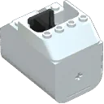
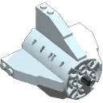
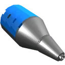
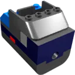
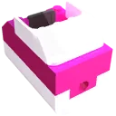
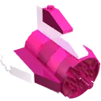
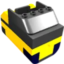
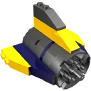

# Loot matrix 590

[Item database](../README.md) | [Methodology](../Methodology.md)

## Sources and mapped locations

| Kind | Source | Location evidence | Conditions |
| --- | --- | --- | --- |
| Drop | [Stromling Mech (LOT 8222)](../sources/object-8222.md) | No matched local placement found | DestructibleComponent 868; static component precedence; Static association, not a live-spawn guarantee |
| Drop | [Hammerhurl Stromling (LOT 8238)](../sources/object-8238.md) | [Return to the Venture Explorer (1001)](../locations/zone-1001.md) | DestructibleComponent 943; static component precedence; Static association, not a live-spawn guarantee |
| Drop | [Hammer Stromling (LOT 12542)](../sources/object-12542.md) | [Return to the Venture Explorer (1001)](../locations/zone-1001.md) | DestructibleComponent 1740; static component precedence; Static association, not a live-spawn guarantee |

## Item candidates

Default vendor-stock probabilities are shown only when this matrix has a registered vendor. Loot probabilities use the generic algorithm, not a guarantee of actual use by every script/activity.

| Item | Modeled loot chance / expected count | Default vendor stock |
| --- | --- | --- |
| { .lu-ti width="24" loading="lazy" } [Notion Potion (LOT 2198)](../2198.md) | 0.05625%; mean 0.0005625 | Not associated with a vendor |
| { .lu-ti width="24" loading="lazy" } [White Baseball Cap (LOT 2587)](../2587.md) | 0.00535714%; mean 0.000053571429 | Not associated with a vendor |
| { .lu-ti width="24" loading="lazy" } [Kettle Helmet (LOT 2624)](../2624.md) | 0.001875%; mean 0.00001875 | Not associated with a vendor |
| { .lu-ti width="24" loading="lazy" } [Healing Cherry (LOT 2994)](../2994.md) | 0.05625%; mean 0.0005625 | Not associated with a vendor |
| { .lu-ti width="24" loading="lazy" } [Healing Apple (LOT 2995)](../2995.md) | 0.05625%; mean 0.0005625 | Not associated with a vendor |
| { .lu-ti width="24" loading="lazy" } [Armor Shine (LOT 2996)](../2996.md) | 0.05625%; mean 0.0005625 | Not associated with a vendor |
| { .lu-ti width="24" loading="lazy" } [Armor Gleam (LOT 2997)](../2997.md) | 0.05625%; mean 0.0005625 | Not associated with a vendor |
| { .lu-ti width="24" loading="lazy" } [Strong Notion Potion (LOT 2998)](../2998.md) | 0.05625%; mean 0.0005625 | Not associated with a vendor |
| { .lu-ti width="24" loading="lazy" } [Super Notion Potion (LOT 2999)](../2999.md) | 0.05625%; mean 0.0005625 | Not associated with a vendor |
| { .lu-ti width="24" loading="lazy" } [Grey Knit Cap (LOT 3013)](../3013.md) | 0.00535714%; mean 0.000053571429 | Not associated with a vendor |
| { .lu-ti width="24" loading="lazy" } [Diver Helmet (LOT 3861)](../3861.md) | 0.001875%; mean 0.00001875 | Not associated with a vendor |
| { .lu-ti width="24" loading="lazy" } [Conductor's Shirt (LOT 3938)](../3938.md) | 0.001875%; mean 0.00001875 | Not associated with a vendor |
| { .lu-ti width="24" loading="lazy" } [Classic Rocket Nose Cone (LOT 4713)](../4713.md) | 0.41666667%; mean 0.0041666667 | Not associated with a vendor |
| { .lu-ti width="24" loading="lazy" } [Classic Rocket Cockpit (LOT 4714)](../4714.md) | 0.41666667%; mean 0.0041666667 | Not associated with a vendor |
| { .lu-ti width="24" loading="lazy" } [Classic Rocket Engine (LOT 4715)](../4715.md) | 0.41666667%; mean 0.0041666667 | Not associated with a vendor |
| { .lu-ti width="24" loading="lazy" } [Nexus Force Healing Kit (LOT 6207)](../6207.md) | 0.05625%; mean 0.0005625 | Not associated with a vendor |
| { .lu-ti width="24" loading="lazy" } [Black Firefighter Helmet (LOT 7133)](../7133.md) | 0.00535714%; mean 0.000053571429 | Not associated with a vendor |
| { .lu-ti width="24" loading="lazy" } [White Cowboy Hat (LOT 8425)](../8425.md) | 0.0025%; mean 0.000025 | Not associated with a vendor |
| { .lu-ti width="24" loading="lazy" } [Tan Cowboy Hat (LOT 8426)](../8426.md) | 0.00535714%; mean 0.000053571429 | Not associated with a vendor |
| Imagination Powerup 3 points (LOT 11910; not an item registration) | 100%; mean 1 | Not associated with a vendor |
| Armor Powerup 2 points (LOT 11912; not an item registration) | 100%; mean 1 | Not associated with a vendor |
| Life Powerup 2 points (LOT 11915; not an item registration) | 50%; mean 0.5 | Not associated with a vendor |
| { .lu-ti width="24" loading="lazy" } [Banneret's Helm (LOT 12308)](../12308.md) | 0.0025%; mean 0.000025 | Not associated with a vendor |
| { .lu-ti width="24" loading="lazy" } [Bowling Shirt (LOT 12311)](../12311.md) | 0.00535714%; mean 0.000053571429 | Not associated with a vendor |
| { .lu-ti width="24" loading="lazy" } [Tie Dye Shirt (LOT 12312)](../12312.md) | 0.00535714%; mean 0.000053571429 | Not associated with a vendor |
| { .lu-ti width="24" loading="lazy" } [Great Crescent Wrench (LOT 12315)](../12315.md) | 0.00535714%; mean 0.000053571429 | Not associated with a vendor |
| { .lu-ti width="24" loading="lazy" } [Cutlass of Blocking (LOT 12316)](../12316.md) | 0.001875%; mean 0.00001875 | Not associated with a vendor |
| { .lu-ti width="24" loading="lazy" } [Classic Blue Rocket Nose Cone (LOT 14444)](../14444.md) | 0.41666667%; mean 0.0041666667 | Not associated with a vendor |
| { .lu-ti width="24" loading="lazy" } [Classic Blue Rocket Cockpit (LOT 14445)](../14445.md) | 0.41666667%; mean 0.0041666667 | Not associated with a vendor |
| { .lu-ti width="24" loading="lazy" } [Classic Blue Rocket Engine (LOT 14446)](../14446.md) | 0.41666667%; mean 0.0041666667 | Not associated with a vendor |
| { .lu-ti width="24" loading="lazy" } [Classic Pink Rocket Nose Cone (LOT 14451)](../14451.md) | 0.41666667%; mean 0.0041666667 | Not associated with a vendor |
| { .lu-ti width="24" loading="lazy" } [Classic Pink Rocket Cockpit (LOT 14452)](../14452.md) | 0.41666667%; mean 0.0041666667 | Not associated with a vendor |
| { .lu-ti width="24" loading="lazy" } [Classic Pink Rocket Engine (LOT 14453)](../14453.md) | 0.41666667%; mean 0.0041666667 | Not associated with a vendor |
| { .lu-ti width="24" loading="lazy" } [Classic Yellow Rocket Nose Cone (LOT 14454)](../14454.md) | 0.41666667%; mean 0.0041666667 | Not associated with a vendor |
| { .lu-ti width="24" loading="lazy" } [Classic Yellow Rocket Cockpit (LOT 14455)](../14455.md) | 0.41666667%; mean 0.0041666667 | Not associated with a vendor |
| { .lu-ti width="24" loading="lazy" } [Classic Yellow Rocket Engine (LOT 14456)](../14456.md) | 0.41666667%; mean 0.0041666667 | Not associated with a vendor |
| { .lu-ti width="24" loading="lazy" } [Med Pack (LOT 14679)](../14679.md) | 0.025%; mean 0.00025 | Not associated with a vendor |
| { .lu-ti width="24" loading="lazy" } [Armor Repair Kit (LOT 14680)](../14680.md) | 0.025%; mean 0.00025 | Not associated with a vendor |

## Raw matrix entries

| Row | Loot table | Rarity table | Trigger | Min | Max | Flag | Gate |
| --- | --- | --- | --- | --- | --- | --- | --- |
| 2069 | 467 | 4 | 0.0005 | 1 | 1 |  |  |
| 2070 | 468 | 4 | 0.005 | 1 | 1 |  |  |
| 2071 | 415 | 29 | 0.5 | 1 | 1 |  |  |
| 2072 | 420 | 29 | 1 | 1 | 1 |  |  |
| 2073 | 423 | 29 | 1 | 1 | 1 |  |  |
| 4391 | 776 | 23 | 0.05 | 1 | 1 |  |  |

[LootMatrix](../../../db/LootMatrix.md), [LootTable](../../../db/LootTable.md), [RarityTable](../../../db/RarityTable.md).
