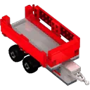

# Loot matrix 601

[Item database](../README.md) | [Methodology](../Methodology.md)

## Sources and mapped locations

| Kind | Source | Location evidence | Conditions |
| --- | --- | --- | --- |
| Package | [Farm Model Pack 1 (LOT 12521)](../sources/object-12521.md) | No matched local placement found | Static association, not a live-spawn guarantee |

## Item candidates

Default vendor-stock probabilities are shown only when this matrix has a registered vendor. Loot probabilities use the generic algorithm, not a guarantee of actual use by every script/activity.

| Item | Modeled loot chance / expected count | Default vendor stock |
| --- | --- | --- |
| { .lu-ti width="24" loading="lazy" } [Farm Garden Model 1 (LOT 11705)](../11705.md) | 100%; mean 4 | Not associated with a vendor |
| { .lu-ti width="24" loading="lazy" } [Farm Garden Model 2 (LOT 11706)](../11706.md) | 100%; mean 4 | Not associated with a vendor |
| { .lu-ti width="24" loading="lazy" } [Farm Silo Model 2 (LOT 11712)](../11712.md) | 0% in the generic loot model | Not associated with a vendor |
| { .lu-ti width="24" loading="lazy" } [Farm Trailer Model (LOT 11714)](../11714.md) | 100%; mean 1 | Not associated with a vendor |
| { .lu-ti width="24" loading="lazy" } [Farm Truck Model (LOT 11715)](../11715.md) | 0% in the generic loot model | Not associated with a vendor |

## Raw matrix entries

| Row | Loot table | Rarity table | Trigger | Min | Max | Flag | Gate |
| --- | --- | --- | --- | --- | --- | --- | --- |
| 2182 | 485 | 23 | 1 | 1 | 1 |  |  |
| 2183 | 486 | 25 | 1 | 1 | 1 |  |  |
| 2184 | 487 | 23 | 1 | 1 | 1 |  |  |
| 2185 | 488 | 25 | 1 | 4 | 4 |  |  |
| 2186 | 489 | 25 | 1 | 4 | 4 |  |  |

[LootMatrix](../../../db/LootMatrix.md), [LootTable](../../../db/LootTable.md), [RarityTable](../../../db/RarityTable.md).
