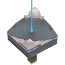
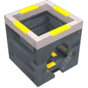
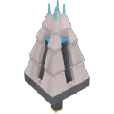
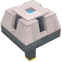
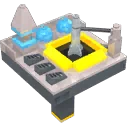
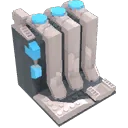
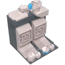

# Loot matrix 607

[Item database](../README.md) | [Methodology](../Methodology.md)

## Sources and mapped locations

| Kind | Source | Location evidence | Conditions |
| --- | --- | --- | --- |
| Package | [Doom Star Model Pack 1 (LOT 12527)](../sources/object-12527.md) | No matched local placement found | Static association, not a live-spawn guarantee |

## Item candidates

Default vendor-stock probabilities are shown only when this matrix has a registered vendor. Loot probabilities use the generic algorithm, not a guarantee of actual use by every script/activity.

| Item | Modeled loot chance / expected count | Default vendor stock |
| --- | --- | --- |
| { .lu-ti width="24" loading="lazy" } [Doom Star Module Model 1 (LOT 11667)](../11667.md) | 100%; mean 1 | Not associated with a vendor |
| { .lu-ti width="24" loading="lazy" } [Doom Star Module Model 2 (LOT 11668)](../11668.md) | 100%; mean 1 | Not associated with a vendor |
| { .lu-ti width="24" loading="lazy" } [Doom Star Module Model 3 (LOT 11669)](../11669.md) | 100%; mean 1 | Not associated with a vendor |
| { .lu-ti width="24" loading="lazy" } [Doom Star Module Model 4 (LOT 11670)](../11670.md) | 100%; mean 1 | Not associated with a vendor |
| { .lu-ti width="24" loading="lazy" } [Doom Star Module Model 5 (LOT 11671)](../11671.md) | 100%; mean 1 | Not associated with a vendor |
| { .lu-ti width="24" loading="lazy" } [Doom Star Module Model 6 (LOT 11672)](../11672.md) | 0% in the generic loot model | Not associated with a vendor |
| { .lu-ti width="24" loading="lazy" } [Doom Star Trench Model 5 (LOT 11687)](../11687.md) | 100%; mean 1 | Not associated with a vendor |
| { .lu-ti width="24" loading="lazy" } [Doom Star Trench Model 6 (LOT 11688)](../11688.md) | 100%; mean 1 | Not associated with a vendor |

## Raw matrix entries

| Row | Loot table | Rarity table | Trigger | Min | Max | Flag | Gate |
| --- | --- | --- | --- | --- | --- | --- | --- |
| 2218 | 521 | 25 | 1 | 1 | 1 |  |  |
| 2219 | 522 | 26 | 1 | 1 | 1 |  |  |
| 2220 | 523 | 26 | 1 | 1 | 1 |  |  |
| 2221 | 524 | 26 | 1 | 1 | 1 |  |  |
| 2222 | 525 | 26 | 1 | 1 | 1 |  |  |
| 2223 | 526 | 25 | 1 | 1 | 1 |  |  |
| 2238 | 541 | 25 | 1 | 1 | 1 |  |  |
| 2239 | 542 | 25 | 1 | 1 | 1 |  |  |

[LootMatrix](../../../db/LootMatrix.md), [LootTable](../../../db/LootTable.md), [RarityTable](../../../db/RarityTable.md).
