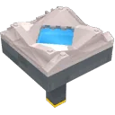
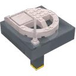
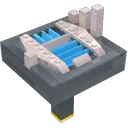
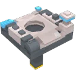
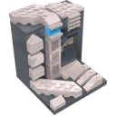
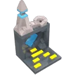

# Loot matrix 608

[Item database](../README.md) | [Methodology](../Methodology.md)

## Sources and mapped locations

| Kind | Source | Location evidence | Conditions |
| --- | --- | --- | --- |
| Package | [Doom Star Model Pack 2 (LOT 12528)](../sources/object-12528.md) | No matched local placement found | Static association, not a live-spawn guarantee |

## Item candidates

Default vendor-stock probabilities are shown only when this matrix has a registered vendor. Loot probabilities use the generic algorithm, not a guarantee of actual use by every script/activity.

| Item | Modeled loot chance / expected count | Default vendor stock |
| --- | --- | --- |
| { .lu-ti width="24" loading="lazy" } [Doom Star Module Model 7 (LOT 11673)](../11673.md) | 100%; mean 1 | Not associated with a vendor |
| { .lu-ti width="24" loading="lazy" } [Doom Star Module Model 8 (LOT 11674)](../11674.md) | 100%; mean 1 | Not associated with a vendor |
| { .lu-ti width="24" loading="lazy" } [Doom Star Module Model 9 (LOT 11675)](../11675.md) | 100%; mean 1 | Not associated with a vendor |
| { .lu-ti width="24" loading="lazy" } [Doom Star Module Model 10 (LOT 11676)](../11676.md) | 100%; mean 1 | Not associated with a vendor |
| { .lu-ti width="24" loading="lazy" } [Doom Star Module Model 11 (LOT 11677)](../11677.md) | 100%; mean 1 | Not associated with a vendor |
| { .lu-ti width="24" loading="lazy" } [Doom Star Module Model 12 (LOT 11678)](../11678.md) | 100%; mean 1 | Not associated with a vendor |
| { .lu-ti width="24" loading="lazy" } [Doom Star Trench Model 7 (LOT 11689)](../11689.md) | 100%; mean 1 | Not associated with a vendor |
| { .lu-ti width="24" loading="lazy" } [Doom Star Trench Model 8 (LOT 11690)](../11690.md) | 100%; mean 1 | Not associated with a vendor |

## Raw matrix entries

| Row | Loot table | Rarity table | Trigger | Min | Max | Flag | Gate |
| --- | --- | --- | --- | --- | --- | --- | --- |
| 2224 | 527 | 25 | 1 | 1 | 1 |  |  |
| 2225 | 528 | 26 | 1 | 1 | 1 |  |  |
| 2226 | 529 | 25 | 1 | 1 | 1 |  |  |
| 2227 | 530 | 25 | 1 | 1 | 1 |  |  |
| 2228 | 531 | 25 | 1 | 1 | 1 |  |  |
| 2229 | 532 | 26 | 1 | 1 | 1 |  |  |
| 2240 | 543 | 26 | 1 | 1 | 1 |  |  |
| 2241 | 544 | 26 | 1 | 1 | 1 |  |  |

[LootMatrix](../../../db/LootMatrix.md), [LootTable](../../../db/LootTable.md), [RarityTable](../../../db/RarityTable.md).
