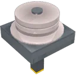
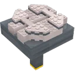
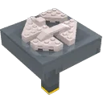
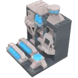
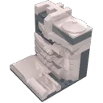
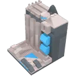
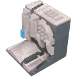
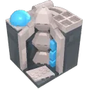

# Loot matrix 609

[Item database](../README.md) | [Methodology](../Methodology.md)

## Sources and mapped locations

| Kind | Source | Location evidence | Conditions |
| --- | --- | --- | --- |
| Package | [Doom Star Model Pack 3 (LOT 12529)](../sources/object-12529.md) | No matched local placement found | Static association, not a live-spawn guarantee |

## Item candidates

Default vendor-stock probabilities are shown only when this matrix has a registered vendor. Loot probabilities use the generic algorithm, not a guarantee of actual use by every script/activity.

| Item | Modeled loot chance / expected count | Default vendor stock |
| --- | --- | --- |
| { .lu-ti width="24" loading="lazy" } [Doom Star Module Model 13 (LOT 11679)](../11679.md) | 100%; mean 1 | Not associated with a vendor |
| { .lu-ti width="24" loading="lazy" } [Doom Star Module Model 14 (LOT 11680)](../11680.md) | 100%; mean 1 | Not associated with a vendor |
| { .lu-ti width="24" loading="lazy" } [Doom Star Module Model 15 (LOT 11681)](../11681.md) | 100%; mean 1 | Not associated with a vendor |
| { .lu-ti width="24" loading="lazy" } [Doom Star Module Model 16 (LOT 11682)](../11682.md) | 100%; mean 1 | Not associated with a vendor |
| { .lu-ti width="24" loading="lazy" } [Doom Star Trench Model 1 (LOT 11683)](../11683.md) | 100%; mean 1 | Not associated with a vendor |
| { .lu-ti width="24" loading="lazy" } [Doom Star Trench Model 2 (LOT 11684)](../11684.md) | 100%; mean 1 | Not associated with a vendor |
| { .lu-ti width="24" loading="lazy" } [Doom Star Trench Model 3 (LOT 11685)](../11685.md) | 100%; mean 1 | Not associated with a vendor |
| { .lu-ti width="24" loading="lazy" } [Doom Star Trench Model 4 (LOT 11686)](../11686.md) | 100%; mean 1 | Not associated with a vendor |
| { .lu-ti width="24" loading="lazy" } [Doom Star Trench Inside Corner Model (LOT 11691)](../11691.md) | 100%; mean 1 | Not associated with a vendor |
| { .lu-ti width="24" loading="lazy" } [Doom Star Trench Outside Corner Model (LOT 11692)](../11692.md) | 100%; mean 1 | Not associated with a vendor |

## Raw matrix entries

| Row | Loot table | Rarity table | Trigger | Min | Max | Flag | Gate |
| --- | --- | --- | --- | --- | --- | --- | --- |
| 2230 | 533 | 25 | 1 | 1 | 1 |  |  |
| 2231 | 534 | 26 | 1 | 1 | 1 |  |  |
| 2232 | 535 | 25 | 1 | 1 | 1 |  |  |
| 2233 | 536 | 25 | 1 | 1 | 1 |  |  |
| 2234 | 537 | 26 | 1 | 1 | 1 |  |  |
| 2235 | 538 | 26 | 1 | 1 | 1 |  |  |
| 2236 | 539 | 26 | 1 | 1 | 1 |  |  |
| 2237 | 540 | 25 | 1 | 1 | 1 |  |  |
| 2242 | 545 | 26 | 1 | 1 | 1 |  |  |
| 2243 | 546 | 25 | 1 | 1 | 1 |  |  |

[LootMatrix](../../../db/LootMatrix.md), [LootTable](../../../db/LootTable.md), [RarityTable](../../../db/RarityTable.md).
