# Loot matrix 620

[Item database](../README.md) | [Methodology](../Methodology.md)

## Sources and mapped locations

| Kind | Source | Location evidence | Conditions |
| --- | --- | --- | --- |
| Drop | [Kinga Hurl - Stromling Ape (LOT 12591)](../sources/object-12591.md) | No matched local placement found | DestructibleComponent 1755; static component precedence; Static association, not a live-spawn guarantee |

## Item candidates

Default vendor-stock probabilities are shown only when this matrix has a registered vendor. Loot probabilities use the generic algorithm, not a guarantee of actual use by every script/activity.

| Item | Modeled loot chance / expected count | Default vendor stock |
| --- | --- | --- |
| { .lu-ti width="24" loading="lazy" } [Hot Chocolate (LOT 1883)](../1883.md) | 10.26939174%; mean 0.10714286 | Not associated with a vendor |
| { .lu-ti width="24" loading="lazy" } [Healing Banana (LOT 1966)](../1966.md) | 10.26939174%; mean 0.10714286 | Not associated with a vendor |
| { .lu-ti width="24" loading="lazy" } [Notion Potion (LOT 2198)](../2198.md) | 10.26939174%; mean 0.10714286 | Not associated with a vendor |
| { .lu-ti width="24" loading="lazy" } [Quicksicle (LOT 2620)](../2620.md) | 10.26939174%; mean 0.10714286 | Not associated with a vendor |
| 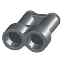{ .lu-ti width="24" loading="lazy" } [Binoculars (LOT 2634)](../2634.md) | 1.36363636%; mean 0.013636364 | Not associated with a vendor |
| { .lu-ti width="24" loading="lazy" } [Exceptional Hatchet (LOT 2643)](../2643.md) | 1.11111111%; mean 0.011111111 | Not associated with a vendor |
| { .lu-ti width="24" loading="lazy" } [Worthy Corseque (LOT 2644)](../2644.md) | 9.375%; mean 0.09375 | Not associated with a vendor |
| { .lu-ti width="24" loading="lazy" } [Black Pirate Ship Shirt (LOT 2954)](../2954.md) | 0.28571429%; mean 0.0028571429 | Not associated with a vendor |
| { .lu-ti width="24" loading="lazy" } [Armor Polish (LOT 2993)](../2993.md) | 10.26939174%; mean 0.10714286 | Not associated with a vendor |
| { .lu-ti width="24" loading="lazy" } [Healing Cherry (LOT 2994)](../2994.md) | 10.26939174%; mean 0.10714286 | Not associated with a vendor |
| { .lu-ti width="24" loading="lazy" } [Healing Apple (LOT 2995)](../2995.md) | 10.26939174%; mean 0.10714286 | Not associated with a vendor |
| { .lu-ti width="24" loading="lazy" } [Armor Shine (LOT 2996)](../2996.md) | 10.26939174%; mean 0.10714286 | Not associated with a vendor |
| { .lu-ti width="24" loading="lazy" } [Armor Gleam (LOT 2997)](../2997.md) | 10.26939174%; mean 0.10714286 | Not associated with a vendor |
| { .lu-ti width="24" loading="lazy" } [Strong Notion Potion (LOT 2998)](../2998.md) | 10.26939174%; mean 0.10714286 | Not associated with a vendor |
| { .lu-ti width="24" loading="lazy" } [Super Notion Potion (LOT 2999)](../2999.md) | 10.26939174%; mean 0.10714286 | Not associated with a vendor |
| { .lu-ti width="24" loading="lazy" } [BBQ Blast Hot Dog (LOT 3011)](../3011.md) | 10.26939174%; mean 0.10714286 | Not associated with a vendor |
| { .lu-ti width="24" loading="lazy" } [Blue Imaginite (LOT 3038)](../3038.md) | 6.23990159%; mean 0.064 | Not associated with a vendor |
| { .lu-ti width="24" loading="lazy" } [Green Imaginite (LOT 3039)](../3039.md) | 10.26939174%; mean 0.10714286 | Not associated with a vendor |
| { .lu-ti width="24" loading="lazy" } [Red Imaginite (LOT 3040)](../3040.md) | 11.44333881%; mean 0.12 | Not associated with a vendor |
| { .lu-ti width="24" loading="lazy" } [Worthy Shovel (LOT 3067)](../3067.md) | 9.375%; mean 0.09375 | Not associated with a vendor |
| { .lu-ti width="24" loading="lazy" } [Amber Gem (LOT 3100)](../3100.md) | 10.26939174%; mean 0.10714286 | Not associated with a vendor |
| { .lu-ti width="24" loading="lazy" } [Hiccup Tablets (LOT 5832)](../5832.md) | 10.26939174%; mean 0.10714286 | Not associated with a vendor |
| { .lu-ti width="24" loading="lazy" } [Brick Booster Pack (LOT 5834)](../5834.md) | 10.26939174%; mean 0.10714286 | Not associated with a vendor |
| { .lu-ti width="24" loading="lazy" } [Super Brick Booster Pack (LOT 5835)](../5835.md) | 11.44333881%; mean 0.12 | Not associated with a vendor |
| { .lu-ti width="24" loading="lazy" } [Picnic Basket (LOT 5836)](../5836.md) | 10.26939174%; mean 0.10714286 | Not associated with a vendor |
| { .lu-ti width="24" loading="lazy" } [Super Picnic Basket (LOT 5837)](../5837.md) | 11.44333881%; mean 0.12 | Not associated with a vendor |
| { .lu-ti width="24" loading="lazy" } [Tiny Mushroom Model (LOT 6027)](../6027.md) | 4.73408341%; mean 0.048076923 | Not associated with a vendor |
| { .lu-ti width="24" loading="lazy" } [Small Mushroom Model (LOT 6028)](../6028.md) | 4.73408341%; mean 0.048076923 | Not associated with a vendor |
| { .lu-ti width="24" loading="lazy" } [Medium Mushroom Model (LOT 6029)](../6029.md) | 4.73408341%; mean 0.048076923 | Not associated with a vendor |
| { .lu-ti width="24" loading="lazy" } [Large Mushroom Model (LOT 6030)](../6030.md) | 4.73408341%; mean 0.048076923 | Not associated with a vendor |
| { .lu-ti width="24" loading="lazy" } [Tiny Crate Model (LOT 6031)](../6031.md) | 1.86377109%; mean 0.01875 | Not associated with a vendor |
| { .lu-ti width="24" loading="lazy" } [Small Crate Model (LOT 6032)](../6032.md) | 1.86377109%; mean 0.01875 | Not associated with a vendor |
| { .lu-ti width="24" loading="lazy" } [Medium Crate Model (LOT 6033)](../6033.md) | 0.71265423%; mean 0.0071428571 | Not associated with a vendor |
| { .lu-ti width="24" loading="lazy" } [Large Crate Model (LOT 6034)](../6034.md) | 0.71265423%; mean 0.0071428571 | Not associated with a vendor |
| { .lu-ti width="24" loading="lazy" } [Wooden Barrel Model (LOT 6035)](../6035.md) | 4.73408341%; mean 0.048076923 | Not associated with a vendor |
| { .lu-ti width="24" loading="lazy" } [Tent Model (LOT 6036)](../6036.md) | 0.71265423%; mean 0.0071428571 | Not associated with a vendor |
| { .lu-ti width="24" loading="lazy" } [Desk Model (LOT 6037)](../6037.md) | 1.86377109%; mean 0.01875 | Not associated with a vendor |
| { .lu-ti width="24" loading="lazy" } [Water Cooler Model (LOT 6039)](../6039.md) | 4.73408341%; mean 0.048076923 | Not associated with a vendor |
| { .lu-ti width="24" loading="lazy" } [Crate of Bananas Model (LOT 6040)](../6040.md) | 4.73408341%; mean 0.048076923 | Not associated with a vendor |
| { .lu-ti width="24" loading="lazy" } [Pirate Lantern Model (LOT 6041)](../6041.md) | 4.73408341%; mean 0.048076923 | Not associated with a vendor |
| { .lu-ti width="24" loading="lazy" } [Timeclock Model (LOT 6043)](../6043.md) | 4.73408341%; mean 0.048076923 | Not associated with a vendor |
| { .lu-ti width="24" loading="lazy" } [Small Table Model (LOT 6044)](../6044.md) | 4.73408341%; mean 0.048076923 | Not associated with a vendor |
| { .lu-ti width="24" loading="lazy" } [Brig Model (LOT 6045)](../6045.md) | 1.86377109%; mean 0.01875 | Not associated with a vendor |
| { .lu-ti width="24" loading="lazy" } [Hat Stand Model 1 (LOT 6053)](../6053.md) | 4.73408341%; mean 0.048076923 | Not associated with a vendor |
| { .lu-ti width="24" loading="lazy" } [Hat Stand Model 2 (LOT 6054)](../6054.md) | 4.73408341%; mean 0.048076923 | Not associated with a vendor |
| { .lu-ti width="24" loading="lazy" } [Hat Stand Model 3 (LOT 6055)](../6055.md) | 4.73408341%; mean 0.048076923 | Not associated with a vendor |
| { .lu-ti width="24" loading="lazy" } [Weapon Rack Model (LOT 6056)](../6056.md) | 1.86377109%; mean 0.01875 | Not associated with a vendor |
| { .lu-ti width="24" loading="lazy" } [Sword Barrel Model (LOT 6058)](../6058.md) | 4.73408341%; mean 0.048076923 | Not associated with a vendor |
| { .lu-ti width="24" loading="lazy" } [Hut Model (LOT 6060)](../6060.md) | 1.86377109%; mean 0.01875 | Not associated with a vendor |
| { .lu-ti width="24" loading="lazy" } [Coffee Table Model (LOT 6064)](../6064.md) | 4.73408341%; mean 0.048076923 | Not associated with a vendor |
| { .lu-ti width="24" loading="lazy" } [Cart Model (LOT 6065)](../6065.md) | 4.73408341%; mean 0.048076923 | Not associated with a vendor |
| 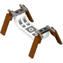{ .lu-ti width="24" loading="lazy" } [Cot Model (LOT 6066)](../6066.md) | 4.73408341%; mean 0.048076923 | Not associated with a vendor |
| { .lu-ti width="24" loading="lazy" } [Raft with Sails Model (LOT 6068)](../6068.md) | 1.86377109%; mean 0.01875 | Not associated with a vendor |
| { .lu-ti width="24" loading="lazy" } [Fence Model (LOT 6071)](../6071.md) | 4.73408341%; mean 0.048076923 | Not associated with a vendor |
| { .lu-ti width="24" loading="lazy" } [Wood Pile Model (LOT 6072)](../6072.md) | 4.73408341%; mean 0.048076923 | Not associated with a vendor |
| { .lu-ti width="24" loading="lazy" } [Maelstrom-Infected Brick (LOT 6194)](../6194.md) | 100%; mean 4 | Not associated with a vendor |
| { .lu-ti width="24" loading="lazy" } [Thirst Quencher (LOT 6201)](../6201.md) | 10.26939174%; mean 0.10714286 | Not associated with a vendor |
| { .lu-ti width="24" loading="lazy" } [Island Jail Model (LOT 6518)](../6518.md) | 0.71265423%; mean 0.0071428571 | Not associated with a vendor |
| { .lu-ti width="24" loading="lazy" } [Lookout Post Model (LOT 6519)](../6519.md) | 1.86377109%; mean 0.01875 | Not associated with a vendor |
| { .lu-ti width="24" loading="lazy" } [Island Fort Model (LOT 6520)](../6520.md) | 0.71265423%; mean 0.0071428571 | Not associated with a vendor |
| { .lu-ti width="24" loading="lazy" } [Mini Raft Model (LOT 6521)](../6521.md) | 1.86377109%; mean 0.01875 | Not associated with a vendor |
| { .lu-ti width="24" loading="lazy" } [Volley Gun Model (LOT 6522)](../6522.md) | 1.86377109%; mean 0.01875 | Not associated with a vendor |
| { .lu-ti width="24" loading="lazy" } [Palm Tree Model (LOT 6523)](../6523.md) | 4.73408341%; mean 0.048076923 | Not associated with a vendor |
| { .lu-ti width="24" loading="lazy" } [Island Plant Model (LOT 6524)](../6524.md) | 4.73408341%; mean 0.048076923 | Not associated with a vendor |
| { .lu-ti width="24" loading="lazy" } [Deluxe Raft Model (LOT 6525)](../6525.md) | 0.71265423%; mean 0.0071428571 | Not associated with a vendor |
| { .lu-ti width="24" loading="lazy" } [Large Cannon Model (LOT 6526)](../6526.md) | 4.73408341%; mean 0.048076923 | Not associated with a vendor |
| 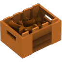{ .lu-ti width="24" loading="lazy" } [Box of Pistols Model (LOT 6774)](../6774.md) | 4.73408341%; mean 0.048076923 | Not associated with a vendor |
| 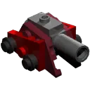{ .lu-ti width="24" loading="lazy" } [Small Cannon Model (LOT 6776)](../6776.md) | 4.73408341%; mean 0.048076923 | Not associated with a vendor |
| { .lu-ti width="24" loading="lazy" } [Box of Cups Model (LOT 6778)](../6778.md) | 4.73408341%; mean 0.048076923 | Not associated with a vendor |
| 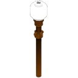{ .lu-ti width="24" loading="lazy" } [Tiki Torch Model (LOT 6779)](../6779.md) | 4.73408341%; mean 0.048076923 | Not associated with a vendor |
| { .lu-ti width="24" loading="lazy" } [Mini Galleon Model (LOT 6781)](../6781.md) | 0.83111296%; mean 0.0083333333 | Not associated with a vendor |
| { .lu-ti width="24" loading="lazy" } [Mini Windrunner Model (LOT 6782)](../6782.md) | 0.71265423%; mean 0.0071428571 | Not associated with a vendor |
| { .lu-ti width="24" loading="lazy" } [Hardtack Biscuit (LOT 6790)](../6790.md) | 10.26939174%; mean 0.10714286 | Not associated with a vendor |
| { .lu-ti width="24" loading="lazy" } [Cat Model (LOT 6840)](../6840.md) | 4.73408341%; mean 0.048076923 | Not associated with a vendor |
| { .lu-ti width="24" loading="lazy" } [Morion Helmet (LOT 6853)](../6853.md) | 1.36363636%; mean 0.013636364 | Not associated with a vendor |
| { .lu-ti width="24" loading="lazy" } [Green Shoulder Parrot (LOT 6854)](../6854.md) | 0.61538462%; mean 0.0061538462 | Not associated with a vendor |
| { .lu-ti width="24" loading="lazy" } [Yellow Shoulder Parrot (LOT 6855)](../6855.md) | 0.61538462%; mean 0.0061538462 | Not associated with a vendor |
| { .lu-ti width="24" loading="lazy" } [Orange Shoulder Parrot (LOT 6856)](../6856.md) | 0.61538462%; mean 0.0061538462 | Not associated with a vendor |
| { .lu-ti width="24" loading="lazy" } [Dark Red Gem (LOT 6862)](../6862.md) | 3.93716467%; mean 0.04 | Not associated with a vendor |
| { .lu-ti width="24" loading="lazy" } [Yellow Gem (LOT 6863)](../6863.md) | 3.93716467%; mean 0.04 | Not associated with a vendor |
| { .lu-ti width="24" loading="lazy" } [Green Gem (LOT 6864)](../6864.md) | 6.23990159%; mean 0.064 | Not associated with a vendor |
| { .lu-ti width="24" loading="lazy" } [Light Blue Gem (LOT 6865)](../6865.md) | 11.44333881%; mean 0.12 | Not associated with a vendor |
| { .lu-ti width="24" loading="lazy" } [Pink Gem (LOT 6866)](../6866.md) | 10.26939174%; mean 0.10714286 | Not associated with a vendor |
| { .lu-ti width="24" loading="lazy" } [Clamshell Model (LOT 6869)](../6869.md) | 4.73408341%; mean 0.048076923 | Not associated with a vendor |
| { .lu-ti width="24" loading="lazy" } [Snake Model (LOT 6870)](../6870.md) | 4.73408341%; mean 0.048076923 | Not associated with a vendor |
| { .lu-ti width="24" loading="lazy" } [Armored Viking Helmet (LOT 6880)](../6880.md) | 0.61538462%; mean 0.0061538462 | Not associated with a vendor |
| { .lu-ti width="24" loading="lazy" } [Flash Bang (LOT 6884)](../6884.md) | 10.26939174%; mean 0.10714286 | Not associated with a vendor |
| { .lu-ti width="24" loading="lazy" } [Stinky Fish (LOT 6885)](../6885.md) | 10.26939174%; mean 0.10714286 | Not associated with a vendor |
| { .lu-ti width="24" loading="lazy" } [Tasty Fish (LOT 6886)](../6886.md) | 10.26939174%; mean 0.10714286 | Not associated with a vendor |
| { .lu-ti width="24" loading="lazy" } [Pirate Duck Model (LOT 6941)](../6941.md) | 0.71265423%; mean 0.0071428571 | Not associated with a vendor |
| 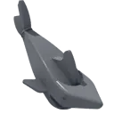{ .lu-ti width="24" loading="lazy" } [Shark Model (LOT 6942)](../6942.md) | 4.73408341%; mean 0.048076923 | Not associated with a vendor |
| Unnamed LOT 6943 (LOT 6943; not an item registration) | 0% in the generic loot model | Not associated with a vendor |
| { .lu-ti width="24" loading="lazy" } [Superior Fish on a Stick (LOT 6973)](../6973.md) | 2.14285714%; mean 0.021428571 | Not associated with a vendor |
| { .lu-ti width="24" loading="lazy" } [Frog Model (LOT 7057)](../7057.md) | 4.73408341%; mean 0.048076923 | Not associated with a vendor |
| { .lu-ti width="24" loading="lazy" } [Starfish Model (LOT 7060)](../7060.md) | 4.73408341%; mean 0.048076923 | Not associated with a vendor |
| { .lu-ti width="24" loading="lazy" } [Worthy Force Blade (LOT 7068)](../7068.md) | 9.375%; mean 0.09375 | Not associated with a vendor |
| 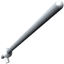{ .lu-ti width="24" loading="lazy" } [Superior Lance (LOT 7070)](../7070.md) | 2.14285714%; mean 0.021428571 | Not associated with a vendor |
| 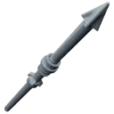{ .lu-ti width="24" loading="lazy" } [Worthy Javelin (LOT 7079)](../7079.md) | 9.375%; mean 0.09375 | Not associated with a vendor |
| { .lu-ti width="24" loading="lazy" } [Boom Trap Kit (LOT 7084)](../7084.md) | 10.26939174%; mean 0.10714286 | Not associated with a vendor |
| { .lu-ti width="24" loading="lazy" } [Candle Holder Model (LOT 7122)](../7122.md) | 4.73408341%; mean 0.048076923 | Not associated with a vendor |
| 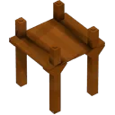{ .lu-ti width="24" loading="lazy" } [Dock Model (LOT 7123)](../7123.md) | 1.86377109%; mean 0.01875 | Not associated with a vendor |
| { .lu-ti width="24" loading="lazy" } [Organ Model (LOT 7124)](../7124.md) | 0.83111296%; mean 0.0083333333 | Not associated with a vendor |
| { .lu-ti width="24" loading="lazy" } [Shack Model (LOT 7125)](../7125.md) | 0.83111296%; mean 0.0083333333 | Not associated with a vendor |
| { .lu-ti width="24" loading="lazy" } [Soda Rack Model (LOT 7126)](../7126.md) | 1.86377109%; mean 0.01875 | Not associated with a vendor |
| { .lu-ti width="24" loading="lazy" } [Treasure Chest Model (LOT 7127)](../7127.md) | 1.86377109%; mean 0.01875 | Not associated with a vendor |
| { .lu-ti width="24" loading="lazy" } [Cabinet Model (LOT 7134)](../7134.md) | 1.86377109%; mean 0.01875 | Not associated with a vendor |
| { .lu-ti width="24" loading="lazy" } [Antique Chair Model (LOT 7135)](../7135.md) | 4.73408341%; mean 0.048076923 | Not associated with a vendor |
| { .lu-ti width="24" loading="lazy" } [Red Shoulder Parrot (LOT 7570)](../7570.md) | 0.28571429%; mean 0.0028571429 | Not associated with a vendor |
| { .lu-ti width="24" loading="lazy" } [Buttery Croissant (LOT 7724)](../7724.md) | 10.26939174%; mean 0.10714286 | Not associated with a vendor |
| { .lu-ti width="24" loading="lazy" } [Healing Drumstick (LOT 7725)](../7725.md) | 10.26939174%; mean 0.10714286 | Not associated with a vendor |
| { .lu-ti width="24" loading="lazy" } [Firecracker (LOT 7778)](../7778.md) | 10.26939174%; mean 0.10714286 | Not associated with a vendor |
| { .lu-ti width="24" loading="lazy" } [Armchair Model (LOT 8051)](../8051.md) | 4.73408341%; mean 0.048076923 | Not associated with a vendor |
| { .lu-ti width="24" loading="lazy" } [Goblet Box Model (LOT 8055)](../8055.md) | 4.73408341%; mean 0.048076923 | Not associated with a vendor |
| { .lu-ti width="24" loading="lazy" } [Red Shako Hat (LOT 8085)](../8085.md) | 0.61538462%; mean 0.0061538462 | Not associated with a vendor |
| { .lu-ti width="24" loading="lazy" } [Blue Imperial Shirt (LOT 8087)](../8087.md) | 1.36363636%; mean 0.013636364 | Not associated with a vendor |
| { .lu-ti width="24" loading="lazy" } [Shield of Blocking (LOT 8333)](../8333.md) | 0.61538462%; mean 0.0061538462 | Not associated with a vendor |
| { .lu-ti width="24" loading="lazy" } [Potion of Shielding (LOT 8365)](../8365.md) | 10.26939174%; mean 0.10714286 | Not associated with a vendor |
| { .lu-ti width="24" loading="lazy" } [Superior Shortsword (LOT 8479)](../8479.md) | 2.14285714%; mean 0.021428571 | Not associated with a vendor |
| 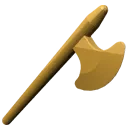{ .lu-ti width="24" loading="lazy" } [Exceptional Axe (LOT 8480)](../8480.md) | 1.11111111%; mean 0.011111111 | Not associated with a vendor |
| { .lu-ti width="24" loading="lazy" } [Worthy Wrench (LOT 8481)](../8481.md) | 9.375%; mean 0.09375 | Not associated with a vendor |
| { .lu-ti width="24" loading="lazy" } [Exceptional Pipe Wrench (LOT 8482)](../8482.md) | 1.11111111%; mean 0.011111111 | Not associated with a vendor |
| 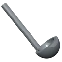{ .lu-ti width="24" loading="lazy" } [Exceptional Ladle (LOT 8483)](../8483.md) | 1.11111111%; mean 0.011111111 | Not associated with a vendor |
| { .lu-ti width="24" loading="lazy" } [Worthy Butterfly Net (LOT 8484)](../8484.md) | 9.375%; mean 0.09375 | Not associated with a vendor |
| { .lu-ti width="24" loading="lazy" } [Superior Huge Axe (LOT 8485)](../8485.md) | 2.14285714%; mean 0.021428571 | Not associated with a vendor |
| { .lu-ti width="24" loading="lazy" } [Exceptional Spear (LOT 8487)](../8487.md) | 1.11111111%; mean 0.011111111 | Not associated with a vendor |
| { .lu-ti width="24" loading="lazy" } [Superior Hammer (LOT 8488)](../8488.md) | 2.14285714%; mean 0.021428571 | Not associated with a vendor |
| { .lu-ti width="24" loading="lazy" } [Worthy Ice Saw (LOT 8489)](../8489.md) | 9.375%; mean 0.09375 | Not associated with a vendor |
| { .lu-ti width="24" loading="lazy" } [Superior Halberd (LOT 8490)](../8490.md) | 2.14285714%; mean 0.021428571 | Not associated with a vendor |
| { .lu-ti width="24" loading="lazy" } [Wand of Knockback (LOT 8491)](../8491.md) | 1.11111111%; mean 0.011111111 | Not associated with a vendor |
| { .lu-ti width="24" loading="lazy" } [Wand of Sleep (LOT 8492)](../8492.md) | 1.11111111%; mean 0.011111111 | Not associated with a vendor |
| { .lu-ti width="24" loading="lazy" } [Superior Katana (LOT 8493)](../8493.md) | 2.14285714%; mean 0.021428571 | Not associated with a vendor |
| { .lu-ti width="24" loading="lazy" } [Exceptional Dagger (LOT 8494)](../8494.md) | 1.11111111%; mean 0.011111111 | Not associated with a vendor |
| { .lu-ti width="24" loading="lazy" } [Exceptional Force Blade (LOT 8495)](../8495.md) | 1.11111111%; mean 0.011111111 | Not associated with a vendor |
| { .lu-ti width="24" loading="lazy" } [Worthy Morning Star (LOT 8496)](../8496.md) | 9.375%; mean 0.09375 | Not associated with a vendor |
| { .lu-ti width="24" loading="lazy" } [Heater Shield (LOT 8531)](../8531.md) | 0.61538462%; mean 0.0061538462 | Not associated with a vendor |
| 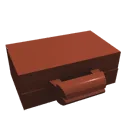{ .lu-ti width="24" loading="lazy" } [Briefcase (LOT 8532)](../8532.md) | 0.28571429%; mean 0.0028571429 | Not associated with a vendor |
| { .lu-ti width="24" loading="lazy" } [Quiver (LOT 8533)](../8533.md) | 0.28571429%; mean 0.0028571429 | Not associated with a vendor |
| { .lu-ti width="24" loading="lazy" } [Utility Harness (LOT 8534)](../8534.md) | 0.28571429%; mean 0.0028571429 | Not associated with a vendor |
| 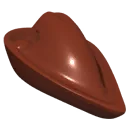{ .lu-ti width="24" loading="lazy" } [Scoundrel Cap (LOT 8547)](../8547.md) | 1.36363636%; mean 0.013636364 | Not associated with a vendor |
| { .lu-ti width="24" loading="lazy" } [Red Uniform (LOT 8603)](../8603.md) | 1.36363636%; mean 0.013636364 | Not associated with a vendor |
| { .lu-ti width="24" loading="lazy" } [Aviator Shirt (LOT 8612)](../8612.md) | 1.36363636%; mean 0.013636364 | Not associated with a vendor |
| { .lu-ti width="24" loading="lazy" } [Cattle Rustler Shirt (LOT 8613)](../8613.md) | 1.36363636%; mean 0.013636364 | Not associated with a vendor |
| { .lu-ti width="24" loading="lazy" } [Inmate Shirt (LOT 8616)](../8616.md) | 0.61538462%; mean 0.0061538462 | Not associated with a vendor |
| { .lu-ti width="24" loading="lazy" } [Retro Daredevil Shirt (LOT 8617)](../8617.md) | 1.36363636%; mean 0.013636364 | Not associated with a vendor |
| { .lu-ti width="24" loading="lazy" } [Pirate Princess Dress (LOT 8626)](../8626.md) | 0.61538462%; mean 0.0061538462 | Not associated with a vendor |
| { .lu-ti width="24" loading="lazy" } [Confederate Shirt (LOT 8631)](../8631.md) | 0.61538462%; mean 0.0061538462 | Not associated with a vendor |
| { .lu-ti width="24" loading="lazy" } [Steel Legs (LOT 8641)](../8641.md) | 1.36363636%; mean 0.013636364 | Not associated with a vendor |
| 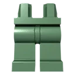{ .lu-ti width="24" loading="lazy" } [Capris (LOT 8643)](../8643.md) | 0.61538462%; mean 0.0061538462 | Not associated with a vendor |
| { .lu-ti width="24" loading="lazy" } [Chaps (LOT 8649)](../8649.md) | 1.36363636%; mean 0.013636364 | Not associated with a vendor |
| 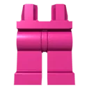{ .lu-ti width="24" loading="lazy" } [Tights (LOT 8650)](../8650.md) | 0.61538462%; mean 0.0061538462 | Not associated with a vendor |
| { .lu-ti width="24" loading="lazy" } [Kettle Helmet (LOT 8673)](../8673.md) | 0.28571429%; mean 0.0028571429 | Not associated with a vendor |
| { .lu-ti width="24" loading="lazy" } [Epaulets of Authority (LOT 8683)](../8683.md) | 0.28571429%; mean 0.0028571429 | Not associated with a vendor |
| { .lu-ti width="24" loading="lazy" } [Sailor Hat (LOT 8685)](../8685.md) | 0.61538462%; mean 0.0061538462 | Not associated with a vendor |
| { .lu-ti width="24" loading="lazy" } [Mushroom Model 5 (LOT 9537)](../9537.md) | 4.73408341%; mean 0.048076923 | Not associated with a vendor |
| 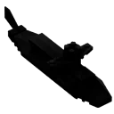{ .lu-ti width="24" loading="lazy" } [Submarine Model (LOT 9565)](../9565.md) | 4.73408341%; mean 0.048076923 | Not associated with a vendor |
| Unnamed LOT 9572 (LOT 9572; not an item registration) | 0% in the generic loot model | Not associated with a vendor |
| { .lu-ti width="24" loading="lazy" } [Shipwreck Hideout Pack (LOT 9603)](../9603.md) | 4.73408341%; mean 0.048076923 | Not associated with a vendor |
| { .lu-ti width="24" loading="lazy" } [Black Aussie Hat (LOT 9615)](../9615.md) | 1.36363636%; mean 0.013636364 | Not associated with a vendor |
| 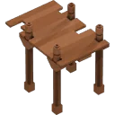{ .lu-ti width="24" loading="lazy" } [Modular Dock Model 1 (LOT 9812)](../9812.md) | 1.86377109%; mean 0.01875 | Not associated with a vendor |
| 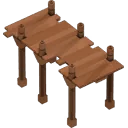{ .lu-ti width="24" loading="lazy" } [Modular Dock Model 2 (LOT 9813)](../9813.md) | 1.86377109%; mean 0.01875 | Not associated with a vendor |
| 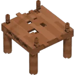{ .lu-ti width="24" loading="lazy" } [Modular Dock Model 3 (LOT 9814)](../9814.md) | 0.71265423%; mean 0.0071428571 | Not associated with a vendor |
| { .lu-ti width="24" loading="lazy" } [Cup of Yo (LOT 10038)](../10038.md) | 6.23990159%; mean 0.064 | Not associated with a vendor |
| { .lu-ti width="24" loading="lazy" } [Pirate Captain's Hut Model (LOT 10069)](../10069.md) | 0.83111296%; mean 0.0083333333 | Not associated with a vendor |
| { .lu-ti width="24" loading="lazy" } [Pirate Tower Model (LOT 10070)](../10070.md) | 0.83111296%; mean 0.0083333333 | Not associated with a vendor |
| { .lu-ti width="24" loading="lazy" } [Pirate Idol Model (LOT 10071)](../10071.md) | 1.86377109%; mean 0.01875 | Not associated with a vendor |
| { .lu-ti width="24" loading="lazy" } [Palm Tree Model 2 (LOT 10072)](../10072.md) | 1.86377109%; mean 0.01875 | Not associated with a vendor |
| { .lu-ti width="24" loading="lazy" } [Pirate Staircase Model (LOT 10073)](../10073.md) | 0.71265423%; mean 0.0071428571 | Not associated with a vendor |
| { .lu-ti width="24" loading="lazy" } [Pirate Gate Model (LOT 10074)](../10074.md) | 0.71265423%; mean 0.0071428571 | Not associated with a vendor |
| { .lu-ti width="24" loading="lazy" } [Pirate Wall Model 1 (LOT 10075)](../10075.md) | 0.71265423%; mean 0.0071428571 | Not associated with a vendor |
| { .lu-ti width="24" loading="lazy" } [Pirate Wall Model 2 (LOT 10076)](../10076.md) | 0.71265423%; mean 0.0071428571 | Not associated with a vendor |
| { .lu-ti width="24" loading="lazy" } [Pirate Wall Model 3 (LOT 10077)](../10077.md) | 0.71265423%; mean 0.0071428571 | Not associated with a vendor |
| { .lu-ti width="24" loading="lazy" } [Pirate Wall End Model (LOT 10078)](../10078.md) | 0.71265423%; mean 0.0071428571 | Not associated with a vendor |
| { .lu-ti width="24" loading="lazy" } [Pirate Wall With Gunport Model (LOT 10079)](../10079.md) | 0.71265423%; mean 0.0071428571 | Not associated with a vendor |
| 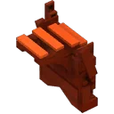{ .lu-ti width="24" loading="lazy" } [Pirate Wall Bridge Model (LOT 10080)](../10080.md) | 0.71265423%; mean 0.0071428571 | Not associated with a vendor |
| { .lu-ti width="24" loading="lazy" } [Pirate Barrel Hut Model 1 (LOT 10081)](../10081.md) | 0.71265423%; mean 0.0071428571 | Not associated with a vendor |
| { .lu-ti width="24" loading="lazy" } [Pirate Barrel Hut Model 2 (LOT 10082)](../10082.md) | 0.71265423%; mean 0.0071428571 | Not associated with a vendor |
| { .lu-ti width="24" loading="lazy" } [Pirate Barrel Hut Model 3 (LOT 10083)](../10083.md) | 0.71265423%; mean 0.0071428571 | Not associated with a vendor |
| { .lu-ti width="24" loading="lazy" } [Pirate Corner Wall Model (LOT 10084)](../10084.md) | 0.71265423%; mean 0.0071428571 | Not associated with a vendor |
| 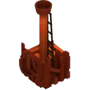{ .lu-ti width="24" loading="lazy" } [Pirate Corner Lookout Model (LOT 10085)](../10085.md) | 0.71265423%; mean 0.0071428571 | Not associated with a vendor |
| { .lu-ti width="24" loading="lazy" } [Pirate Medium Wall Model (LOT 10086)](../10086.md) | 1.86377109%; mean 0.01875 | Not associated with a vendor |
| { .lu-ti width="24" loading="lazy" } [Pirate Small Wall Model (LOT 10087)](../10087.md) | 1.86377109%; mean 0.01875 | Not associated with a vendor |
| { .lu-ti width="24" loading="lazy" } [Pirate T-Wall Model (LOT 10088)](../10088.md) | 0.71265423%; mean 0.0071428571 | Not associated with a vendor |
| { .lu-ti width="24" loading="lazy" } [Pirate T-Wall With Stairs Model (LOT 10089)](../10089.md) | 0.71265423%; mean 0.0071428571 | Not associated with a vendor |
| { .lu-ti width="24" loading="lazy" } [Pirate Ship Model 5 (LOT 10090)](../10090.md) | 0.83111296%; mean 0.0083333333 | Not associated with a vendor |
| { .lu-ti width="24" loading="lazy" } [Pirate Ship Model 1 (LOT 10091)](../10091.md) | 0.71265423%; mean 0.0071428571 | Not associated with a vendor |
| { .lu-ti width="24" loading="lazy" } [Pirate Ship Model 3 (LOT 10092)](../10092.md) | 0.71265423%; mean 0.0071428571 | Not associated with a vendor |
| 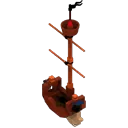{ .lu-ti width="24" loading="lazy" } [Pirate Ship Model 2 (LOT 10093)](../10093.md) | 0.71265423%; mean 0.0071428571 | Not associated with a vendor |
| { .lu-ti width="24" loading="lazy" } [Pirate Ship Model 4 (LOT 10094)](../10094.md) | 0.71265423%; mean 0.0071428571 | Not associated with a vendor |
| 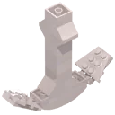{ .lu-ti width="24" loading="lazy" } [Anchors Away (LOT 13426)](../13426.md) | 11.44333881%; mean 0.12 | Not associated with a vendor |
| { .lu-ti width="24" loading="lazy" } [Faction Token Proxy (LOT 13763)](../13763.md) | 100%; mean 6 | Not associated with a vendor |
| { .lu-ti width="24" loading="lazy" } [Med Pack (LOT 14679)](../14679.md) | 6.23990159%; mean 0.064 | Not associated with a vendor |
| { .lu-ti width="24" loading="lazy" } [Armor Repair Kit (LOT 14680)](../14680.md) | 6.23990159%; mean 0.064 | Not associated with a vendor |

## Raw matrix entries

| Row | Loot table | Rarity table | Trigger | Min | Max | Flag | Gate |
| --- | --- | --- | --- | --- | --- | --- | --- |
| 2285 | 88 | 9 | 1 | 4 | 4 |  |  |
| 2286 | 102 | 4 | 1 | 1 | 1 |  |  |
| 2287 | 103 | 4 | 1 | 3 | 5 |  |  |
| 2288 | 104 | 4 | 1 | 1 | 1 |  |  |
| 2289 | 105 | 4 | 1 | 2 | 3 |  |  |
| 2292 | 670 | 23 | 1 | 6 | 6 |  |  |

[LootMatrix](../../../db/LootMatrix.md), [LootTable](../../../db/LootTable.md), [RarityTable](../../../db/RarityTable.md).
