# Loot matrix 622

[Item database](../README.md) | [Methodology](../Methodology.md)

## Sources and mapped locations

No named consumer was resolved in the covered static tables. The presence of this matrix does not prove that a player can invoke it.

## Item candidates

Default vendor-stock probabilities are shown only when this matrix has a registered vendor. Loot probabilities use the generic algorithm, not a guarantee of actual use by every script/activity.

| Item | Modeled loot chance / expected count | Default vendor stock |
| --- | --- | --- |
| { .lu-ti width="24" loading="lazy" } [Healing Banana (LOT 1966)](../1966.md) | 13.5899629%; mean 0.14423077 | Not associated with a vendor |
| { .lu-ti width="24" loading="lazy" } [Notion Potion (LOT 2198)](../2198.md) | 13.5899629%; mean 0.14423077 | Not associated with a vendor |
| { .lu-ti width="24" loading="lazy" } [Great Longsword of Lightning (LOT 2586)](../2586.md) | 1.65779259%; mean 0.016666667 | Not associated with a vendor |
| { .lu-ti width="24" loading="lazy" } [Quicksicle (LOT 2620)](../2620.md) | 13.5899629%; mean 0.14423077 | Not associated with a vendor |
| { .lu-ti width="24" loading="lazy" } [Throwing Star Shirt (LOT 2959)](../2959.md) | 3.37202761%; mean 0.034090909 | Not associated with a vendor |
| { .lu-ti width="24" loading="lazy" } [Armor Polish (LOT 2993)](../2993.md) | 13.5899629%; mean 0.14423077 | Not associated with a vendor |
| { .lu-ti width="24" loading="lazy" } [Healing Cherry (LOT 2994)](../2994.md) | 13.5899629%; mean 0.14423077 | Not associated with a vendor |
| { .lu-ti width="24" loading="lazy" } [Healing Apple (LOT 2995)](../2995.md) | 13.5899629%; mean 0.14423077 | Not associated with a vendor |
| { .lu-ti width="24" loading="lazy" } [Armor Shine (LOT 2996)](../2996.md) | 13.5899629%; mean 0.14423077 | Not associated with a vendor |
| { .lu-ti width="24" loading="lazy" } [Armor Gleam (LOT 2997)](../2997.md) | 13.5899629%; mean 0.14423077 | Not associated with a vendor |
| { .lu-ti width="24" loading="lazy" } [Strong Notion Potion (LOT 2998)](../2998.md) | 13.5899629%; mean 0.14423077 | Not associated with a vendor |
| { .lu-ti width="24" loading="lazy" } [Super Notion Potion (LOT 2999)](../2999.md) | 13.5899629%; mean 0.14423077 | Not associated with a vendor |
| { .lu-ti width="24" loading="lazy" } [Blue Imaginite (LOT 3038)](../3038.md) | 9.59562208%; mean 0.1 | Not associated with a vendor |
| { .lu-ti width="24" loading="lazy" } [Green Imaginite (LOT 3039)](../3039.md) | 13.5899629%; mean 0.14423077 | Not associated with a vendor |
| { .lu-ti width="24" loading="lazy" } [Red Imaginite (LOT 3040)](../3040.md) | 17.35527356%; mean 0.1875 | Not associated with a vendor |
| { .lu-ti width="24" loading="lazy" } [Amber Gem (LOT 3100)](../3100.md) | 13.5899629%; mean 0.14423077 | Not associated with a vendor |
| { .lu-ti width="24" loading="lazy" } [Super Bobbejaan Spanner (LOT 3855)](../3855.md) | 4.11134259%; mean 0.041666667 | Not associated with a vendor |
| 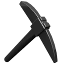{ .lu-ti width="24" loading="lazy" } [Great Mattock (LOT 5696)](../5696.md) | 28.22265625%; mean 0.3125 | Not associated with a vendor |
| { .lu-ti width="24" loading="lazy" } [Brick Booster Pack (LOT 5834)](../5834.md) | 13.5899629%; mean 0.14423077 | Not associated with a vendor |
| { .lu-ti width="24" loading="lazy" } [Super Brick Booster Pack (LOT 5835)](../5835.md) | 17.35527356%; mean 0.1875 | Not associated with a vendor |
| { .lu-ti width="24" loading="lazy" } [Picnic Basket (LOT 5836)](../5836.md) | 13.5899629%; mean 0.14423077 | Not associated with a vendor |
| { .lu-ti width="24" loading="lazy" } [Super Picnic Basket (LOT 5837)](../5837.md) | 17.35527356%; mean 0.1875 | Not associated with a vendor |
| { .lu-ti width="24" loading="lazy" } [Maelstrom-Infected Brick (LOT 6194)](../6194.md) | 100%; mean 8 | Not associated with a vendor |
| { .lu-ti width="24" loading="lazy" } [Thirst Quencher (LOT 6201)](../6201.md) | 13.5899629%; mean 0.14423077 | Not associated with a vendor |
| { .lu-ti width="24" loading="lazy" } [Great Composite Axe (LOT 6852)](../6852.md) | 28.22265625%; mean 0.3125 | Not associated with a vendor |
| { .lu-ti width="24" loading="lazy" } [Dark Red Gem (LOT 6862)](../6862.md) | 4.89779302%; mean 0.05 | Not associated with a vendor |
| { .lu-ti width="24" loading="lazy" } [Yellow Gem (LOT 6863)](../6863.md) | 4.89779302%; mean 0.05 | Not associated with a vendor |
| { .lu-ti width="24" loading="lazy" } [Green Gem (LOT 6864)](../6864.md) | 9.59562208%; mean 0.1 | Not associated with a vendor |
| { .lu-ti width="24" loading="lazy" } [Light Blue Gem (LOT 6865)](../6865.md) | 17.35527356%; mean 0.1875 | Not associated with a vendor |
| { .lu-ti width="24" loading="lazy" } [Pink Gem (LOT 6866)](../6866.md) | 13.5899629%; mean 0.14423077 | Not associated with a vendor |
| { .lu-ti width="24" loading="lazy" } [Flash Bang (LOT 6884)](../6884.md) | 13.5899629%; mean 0.14423077 | Not associated with a vendor |
| { .lu-ti width="24" loading="lazy" } [Great Fang (LOT 7069)](../7069.md) | 28.22265625%; mean 0.3125 | Not associated with a vendor |
| { .lu-ti width="24" loading="lazy" } [Elite Saw of Drowsiness (LOT 7283)](../7283.md) | 1.65779259%; mean 0.016666667 | Not associated with a vendor |
| { .lu-ti width="24" loading="lazy" } [Elite Blade of Knock Down (LOT 7284)](../7284.md) | 1.65779259%; mean 0.016666667 | Not associated with a vendor |
| { .lu-ti width="24" loading="lazy" } [Buttery Croissant (LOT 7724)](../7724.md) | 13.5899629%; mean 0.14423077 | Not associated with a vendor |
| { .lu-ti width="24" loading="lazy" } [Healing Drumstick (LOT 7725)](../7725.md) | 13.5899629%; mean 0.14423077 | Not associated with a vendor |
| { .lu-ti width="24" loading="lazy" } [Firecracker (LOT 7778)](../7778.md) | 13.5899629%; mean 0.14423077 | Not associated with a vendor |
| { .lu-ti width="24" loading="lazy" } [Hat of Sprouting Imagination (LOT 7780)](../7780.md) | 1.65779259%; mean 0.016666667 | Not associated with a vendor |
| { .lu-ti width="24" loading="lazy" } [Lantern Model (LOT 8049)](../8049.md) | 16.58961808%; mean 0.17857143 | Not associated with a vendor |
| { .lu-ti width="24" loading="lazy" } [Small Shrine Model (LOT 8050)](../8050.md) | 4.89779302%; mean 0.05 | Not associated with a vendor |
| { .lu-ti width="24" loading="lazy" } [Exceptional Katana (LOT 8331)](../8331.md) | 28.22265625%; mean 0.3125 | Not associated with a vendor |
| { .lu-ti width="24" loading="lazy" } [Gothic Paradox Shirt (LOT 8357)](../8357.md) | 3.37202761%; mean 0.034090909 | Not associated with a vendor |
| { .lu-ti width="24" loading="lazy" } [Pink Kimono (LOT 8358)](../8358.md) | 1.65779259%; mean 0.016666667 | Not associated with a vendor |
| { .lu-ti width="24" loading="lazy" } [Sensei Shirt (LOT 8360)](../8360.md) | 3.37202761%; mean 0.034090909 | Not associated with a vendor |
| { .lu-ti width="24" loading="lazy" } [Belted Ninja Shirt (LOT 8361)](../8361.md) | 1.65779259%; mean 0.016666667 | Not associated with a vendor |
| { .lu-ti width="24" loading="lazy" } [Bag of Glitter (LOT 8363)](../8363.md) | 13.5899629%; mean 0.14423077 | Not associated with a vendor |
| { .lu-ti width="24" loading="lazy" } [Potion of Shielding (LOT 8365)](../8365.md) | 13.5899629%; mean 0.14423077 | Not associated with a vendor |
| { .lu-ti width="24" loading="lazy" } [Cloud Burst (LOT 8366)](../8366.md) | 13.5899629%; mean 0.14423077 | Not associated with a vendor |
| { .lu-ti width="24" loading="lazy" } [Shuriken (LOT 8371)](../8371.md) | 13.5899629%; mean 0.14423077 | Not associated with a vendor |
| { .lu-ti width="24" loading="lazy" } [Sushi (LOT 8375)](../8375.md) | 13.5899629%; mean 0.14423077 | Not associated with a vendor |
| { .lu-ti width="24" loading="lazy" } [Tough Buff Sauce (LOT 8376)](../8376.md) | 13.5899629%; mean 0.14423077 | Not associated with a vendor |
| { .lu-ti width="24" loading="lazy" } [Elite Oar (LOT 8447)](../8447.md) | 2.20645487%; mean 0.022222222 | Not associated with a vendor |
| { .lu-ti width="24" loading="lazy" } [Super Hatchet (LOT 8448)](../8448.md) | 4.11134259%; mean 0.041666667 | Not associated with a vendor |
| { .lu-ti width="24" loading="lazy" } [Super Shovel (LOT 8449)](../8449.md) | 4.11134259%; mean 0.041666667 | Not associated with a vendor |
| { .lu-ti width="24" loading="lazy" } [Elite Pickaxe (LOT 8450)](../8450.md) | 2.20645487%; mean 0.022222222 | Not associated with a vendor |
| { .lu-ti width="24" loading="lazy" } [Super Shortsword (LOT 8452)](../8452.md) | 4.11134259%; mean 0.041666667 | Not associated with a vendor |
| { .lu-ti width="24" loading="lazy" } [Elite Shortsword (LOT 8453)](../8453.md) | 2.20645487%; mean 0.022222222 | Not associated with a vendor |
| { .lu-ti width="24" loading="lazy" } [Super Hairbrush (LOT 8454)](../8454.md) | 4.11134259%; mean 0.041666667 | Not associated with a vendor |
| { .lu-ti width="24" loading="lazy" } [Great Crescent Wrench (LOT 8455)](../8455.md) | 28.22265625%; mean 0.3125 | Not associated with a vendor |
| { .lu-ti width="24" loading="lazy" } [Super Spear (LOT 8468)](../8468.md) | 4.11134259%; mean 0.041666667 | Not associated with a vendor |
| { .lu-ti width="24" loading="lazy" } [Elite Ice Saw (LOT 8469)](../8469.md) | 2.20645487%; mean 0.022222222 | Not associated with a vendor |
| { .lu-ti width="24" loading="lazy" } [Elite Halberd (LOT 8470)](../8470.md) | 2.20645487%; mean 0.022222222 | Not associated with a vendor |
| { .lu-ti width="24" loading="lazy" } [Elite Katana (LOT 8472)](../8472.md) | 2.20645487%; mean 0.022222222 | Not associated with a vendor |
| { .lu-ti width="24" loading="lazy" } [Elite Scimitar (LOT 8473)](../8473.md) | 2.20645487%; mean 0.022222222 | Not associated with a vendor |
| { .lu-ti width="24" loading="lazy" } [Great Corseque (LOT 8474)](../8474.md) | 28.22265625%; mean 0.3125 | Not associated with a vendor |
| 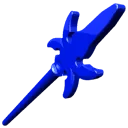{ .lu-ti width="24" loading="lazy" } [Super Corseque (LOT 8475)](../8475.md) | 4.11134259%; mean 0.041666667 | Not associated with a vendor |
| { .lu-ti width="24" loading="lazy" } [Super Dirk (LOT 8477)](../8477.md) | 4.11134259%; mean 0.041666667 | Not associated with a vendor |
| { .lu-ti width="24" loading="lazy" } [Elite Fang (LOT 8478)](../8478.md) | 2.20645487%; mean 0.022222222 | Not associated with a vendor |
| { .lu-ti width="24" loading="lazy" } [Scorpion Shield (LOT 8529)](../8529.md) | 3.37202761%; mean 0.034090909 | Not associated with a vendor |
| 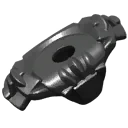{ .lu-ti width="24" loading="lazy" } [Dox Shoulderpads (LOT 8536)](../8536.md) | 3.37202761%; mean 0.034090909 | Not associated with a vendor |
| { .lu-ti width="24" loading="lazy" } [Tech Armor (LOT 8537)](../8537.md) | 3.37202761%; mean 0.034090909 | Not associated with a vendor |
| { .lu-ti width="24" loading="lazy" } [Scutum Shield (LOT 8538)](../8538.md) | 1.65779259%; mean 0.016666667 | Not associated with a vendor |
| { .lu-ti width="24" loading="lazy" } [Messenger Bag (LOT 8539)](../8539.md) | 1.65779259%; mean 0.016666667 | Not associated with a vendor |
| { .lu-ti width="24" loading="lazy" } [King's Crown (LOT 8544)](../8544.md) | 1.65779259%; mean 0.016666667 | Not associated with a vendor |
| { .lu-ti width="24" loading="lazy" } [Shabby Ninja Shirt (LOT 8606)](../8606.md) | 1.65779259%; mean 0.016666667 | Not associated with a vendor |
| { .lu-ti width="24" loading="lazy" } [Ruffled and Striped Shirt (LOT 8607)](../8607.md) | 3.37202761%; mean 0.034090909 | Not associated with a vendor |
| { .lu-ti width="24" loading="lazy" } [Viking Barbarian Shirt (LOT 8620)](../8620.md) | 3.37202761%; mean 0.034090909 | Not associated with a vendor |
| { .lu-ti width="24" loading="lazy" } [Mail Shirt with Gorget (LOT 8621)](../8621.md) | 3.37202761%; mean 0.034090909 | Not associated with a vendor |
| { .lu-ti width="24" loading="lazy" } [Union Shirt (LOT 8630)](../8630.md) | 1.65779259%; mean 0.016666667 | Not associated with a vendor |
| { .lu-ti width="24" loading="lazy" } [Squire's Helm (LOT 8636)](../8636.md) | 1.65779259%; mean 0.016666667 | Not associated with a vendor |
| 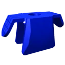{ .lu-ti width="24" loading="lazy" } [Powered Armor (LOT 8638)](../8638.md) | 1.65779259%; mean 0.016666667 | Not associated with a vendor |
| { .lu-ti width="24" loading="lazy" } [Bell Bottoms (LOT 8640)](../8640.md) | 3.37202761%; mean 0.034090909 | Not associated with a vendor |
| { .lu-ti width="24" loading="lazy" } [Gauchos (LOT 8644)](../8644.md) | 1.65779259%; mean 0.016666667 | Not associated with a vendor |
| { .lu-ti width="24" loading="lazy" } [Iron Legs (LOT 8645)](../8645.md) | 1.65779259%; mean 0.016666667 | Not associated with a vendor |
| 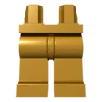{ .lu-ti width="24" loading="lazy" } [Hammer Pants (LOT 8651)](../8651.md) | 3.37202761%; mean 0.034090909 | Not associated with a vendor |
| { .lu-ti width="24" loading="lazy" } [Wrench (LOT 8674)](../8674.md) | 1.65779259%; mean 0.016666667 | Not associated with a vendor |
| 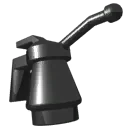{ .lu-ti width="24" loading="lazy" } [Grease Can (LOT 8680)](../8680.md) | 1.65779259%; mean 0.016666667 | Not associated with a vendor |
| { .lu-ti width="24" loading="lazy" } [Super Composite Axe (LOT 9258)](../9258.md) | 4.11134259%; mean 0.041666667 | Not associated with a vendor |
| 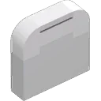{ .lu-ti width="24" loading="lazy" } [Headstone Model 1 (LOT 9485)](../9485.md) | 16.58961808%; mean 0.17857143 | Not associated with a vendor |
| 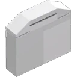{ .lu-ti width="24" loading="lazy" } [Headstone Model 2 (LOT 9486)](../9486.md) | 16.58961808%; mean 0.17857143 | Not associated with a vendor |
| { .lu-ti width="24" loading="lazy" } [Pagoda Model (LOT 9535)](../9535.md) | 0.8304682%; mean 0.0083333333 | Not associated with a vendor |
| { .lu-ti width="24" loading="lazy" } [Small Arch Model (LOT 9538)](../9538.md) | 16.58961808%; mean 0.17857143 | Not associated with a vendor |
| { .lu-ti width="24" loading="lazy" } [Fish Statue Model (LOT 9545)](../9545.md) | 6.48562736%; mean 0.066666667 | Not associated with a vendor |
| { .lu-ti width="24" loading="lazy" } [Red Ninja Fence Model (LOT 9546)](../9546.md) | 16.58961808%; mean 0.17857143 | Not associated with a vendor |
| { .lu-ti width="24" loading="lazy" } [Yellow Ninja Fence Model (LOT 9547)](../9547.md) | 16.58961808%; mean 0.17857143 | Not associated with a vendor |
| 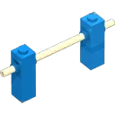{ .lu-ti width="24" loading="lazy" } [Blue Ninja Fence Model (LOT 9548)](../9548.md) | 16.58961808%; mean 0.17857143 | Not associated with a vendor |
| { .lu-ti width="24" loading="lazy" } [Ninja Platform Model (LOT 9549)](../9549.md) | 0.8304682%; mean 0.0083333333 | Not associated with a vendor |
| { .lu-ti width="24" loading="lazy" } [Temple Model 1 (LOT 9550)](../9550.md) | 6.48562736%; mean 0.066666667 | Not associated with a vendor |
| { .lu-ti width="24" loading="lazy" } [Temple Model 2 (LOT 9551)](../9551.md) | 6.48562736%; mean 0.066666667 | Not associated with a vendor |
| 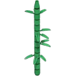{ .lu-ti width="24" loading="lazy" } [Zen Bamboo Large Model (LOT 9552)](../9552.md) | 16.58961808%; mean 0.17857143 | Not associated with a vendor |
| { .lu-ti width="24" loading="lazy" } [Zen Bamboo Medium Model (LOT 9553)](../9553.md) | 16.58961808%; mean 0.17857143 | Not associated with a vendor |
| { .lu-ti width="24" loading="lazy" } [Zen Bamboo Small Model (LOT 9554)](../9554.md) | 16.58961808%; mean 0.17857143 | Not associated with a vendor |
| { .lu-ti width="24" loading="lazy" } [Big Door Model (LOT 9555)](../9555.md) | 0.8304682%; mean 0.0083333333 | Not associated with a vendor |
| { .lu-ti width="24" loading="lazy" } [Mantis Butterfly Model (LOT 9559)](../9559.md) | 16.58961808%; mean 0.17857143 | Not associated with a vendor |
| { .lu-ti width="24" loading="lazy" } [Ninja Gate Model (LOT 9561)](../9561.md) | 0.8304682%; mean 0.0083333333 | Not associated with a vendor |
| 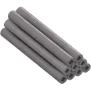{ .lu-ti width="24" loading="lazy" } [Pipestack Model (LOT 9567)](../9567.md) | 6.48562736%; mean 0.066666667 | Not associated with a vendor |
| { .lu-ti width="24" loading="lazy" } [Anvil Model (LOT 9590)](../9590.md) | 16.58961808%; mean 0.17857143 | Not associated with a vendor |
| { .lu-ti width="24" loading="lazy" } [Queen Shirt (LOT 10125)](../10125.md) | 1.65779259%; mean 0.016666667 | Not associated with a vendor |
| { .lu-ti width="24" loading="lazy" } [Elite Battle Axe (LOT 10434)](../10434.md) | 2.20645487%; mean 0.022222222 | Not associated with a vendor |
| { .lu-ti width="24" loading="lazy" } [Fortress Archway Model (LOT 10751)](../10751.md) | 4.89779302%; mean 0.05 | Not associated with a vendor |
| { .lu-ti width="24" loading="lazy" } [Fortress Big Bonsai Model (LOT 10752)](../10752.md) | 4.89779302%; mean 0.05 | Not associated with a vendor |
| { .lu-ti width="24" loading="lazy" } [Fortress Cart Model (LOT 10753)](../10753.md) | 16.58961808%; mean 0.17857143 | Not associated with a vendor |
| 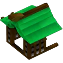{ .lu-ti width="24" loading="lazy" } [Fortress Dojo Part Model (LOT 10754)](../10754.md) | 0.8304682%; mean 0.0083333333 | Not associated with a vendor |
| 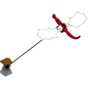{ .lu-ti width="24" loading="lazy" } [Fortress Dragon Kite Model (LOT 10755)](../10755.md) | 16.58961808%; mean 0.17857143 | Not associated with a vendor |
| { .lu-ti width="24" loading="lazy" } [Fortress Dragon Statue Model (LOT 10756)](../10756.md) | 4.89779302%; mean 0.05 | Not associated with a vendor |
| { .lu-ti width="24" loading="lazy" } [Fortress Elevator Model (LOT 10757)](../10757.md) | 16.58961808%; mean 0.17857143 | Not associated with a vendor |
| { .lu-ti width="24" loading="lazy" } [Fortress Gong Model (LOT 10758)](../10758.md) | 16.58961808%; mean 0.17857143 | Not associated with a vendor |
| { .lu-ti width="24" loading="lazy" } [Fortress Inside Corner Model (LOT 10759)](../10759.md) | 0.8304682%; mean 0.0083333333 | Not associated with a vendor |
| { .lu-ti width="24" loading="lazy" } [Fortress Lantern Model (LOT 10760)](../10760.md) | 16.58961808%; mean 0.17857143 | Not associated with a vendor |
| { .lu-ti width="24" loading="lazy" } [Fortress Large Outside Corner Model (LOT 10761)](../10761.md) | 0.8304682%; mean 0.0083333333 | Not associated with a vendor |
| { .lu-ti width="24" loading="lazy" } [Fortress Large Wall Model (LOT 10762)](../10762.md) | 0.8304682%; mean 0.0083333333 | Not associated with a vendor |
| { .lu-ti width="24" loading="lazy" } [Fortress Big Lizard Shrine Model (LOT 10763)](../10763.md) | 16.58961808%; mean 0.17857143 | Not associated with a vendor |
| { .lu-ti width="24" loading="lazy" } [Fortress Pond Model (LOT 10764)](../10764.md) | 0.8304682%; mean 0.0083333333 | Not associated with a vendor |
| { .lu-ti width="24" loading="lazy" } [Fortress Ramp Model (LOT 10765)](../10765.md) | 6.48562736%; mean 0.066666667 | Not associated with a vendor |
| { .lu-ti width="24" loading="lazy" } [Fortress Small Outside Corner Model (LOT 10766)](../10766.md) | 0.8304682%; mean 0.0083333333 | Not associated with a vendor |
| { .lu-ti width="24" loading="lazy" } [Fortress Small Wall Model (LOT 10767)](../10767.md) | 6.48562736%; mean 0.066666667 | Not associated with a vendor |
| { .lu-ti width="24" loading="lazy" } [Fortress Sun Dial Model (LOT 10768)](../10768.md) | 4.89779302%; mean 0.05 | Not associated with a vendor |
| { .lu-ti width="24" loading="lazy" } [Fortress Wall Gate Model (LOT 10769)](../10769.md) | 0.8304682%; mean 0.0083333333 | Not associated with a vendor |
| 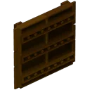{ .lu-ti width="24" loading="lazy" } [Fortress Wall Gate Sliding Door Model (LOT 10770)](../10770.md) | 16.58961808%; mean 0.17857143 | Not associated with a vendor |
| { .lu-ti width="24" loading="lazy" } [Fortress Watch Tower Model (LOT 10771)](../10771.md) | 0.8304682%; mean 0.0083333333 | Not associated with a vendor |
| { .lu-ti width="24" loading="lazy" } [Fortress Zen Garden Model 1 (LOT 10772)](../10772.md) | 4.89779302%; mean 0.05 | Not associated with a vendor |
| { .lu-ti width="24" loading="lazy" } [Fortress Zen Garden Model 2 (LOT 10773)](../10773.md) | 4.89779302%; mean 0.05 | Not associated with a vendor |
| 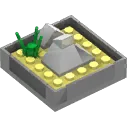{ .lu-ti width="24" loading="lazy" } [Fortress Zen Garden Model 3 (LOT 10774)](../10774.md) | 4.89779302%; mean 0.05 | Not associated with a vendor |
| { .lu-ti width="24" loading="lazy" } [Fortress Zen Garden Model 4 (LOT 10775)](../10775.md) | 16.58961808%; mean 0.17857143 | Not associated with a vendor |
| { .lu-ti width="24" loading="lazy" } [Fortress Zen Garden Model 5 (LOT 10776)](../10776.md) | 4.89779302%; mean 0.05 | Not associated with a vendor |
| { .lu-ti width="24" loading="lazy" } [Fortress Zen Garden Model 6 (LOT 10777)](../10777.md) | 4.89779302%; mean 0.05 | Not associated with a vendor |
| 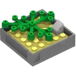{ .lu-ti width="24" loading="lazy" } [Fortress Zen Garden Model 7 (LOT 10778)](../10778.md) | 4.89779302%; mean 0.05 | Not associated with a vendor |
| { .lu-ti width="24" loading="lazy" } [Fortress Zen Garden Model 8 (LOT 10779)](../10779.md) | 4.89779302%; mean 0.05 | Not associated with a vendor |
| { .lu-ti width="24" loading="lazy" } [Fortress Zen Garden Model 9 (LOT 10780)](../10780.md) | 16.58961808%; mean 0.17857143 | Not associated with a vendor |
| { .lu-ti width="24" loading="lazy" } [Toolchest Model 1 (LOT 10781)](../10781.md) | 4.89779302%; mean 0.05 | Not associated with a vendor |
| { .lu-ti width="24" loading="lazy" } [Toolchest Model 2 (LOT 10782)](../10782.md) | 4.89779302%; mean 0.05 | Not associated with a vendor |
| 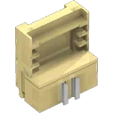{ .lu-ti width="24" loading="lazy" } [Workbench Model (LOT 10783)](../10783.md) | 4.89779302%; mean 0.05 | Not associated with a vendor |
| { .lu-ti width="24" loading="lazy" } [Faction Token Proxy (LOT 13763)](../13763.md) | 100%; mean 15 | Not associated with a vendor |
| { .lu-ti width="24" loading="lazy" } [Med Pack (LOT 14679)](../14679.md) | 9.59562208%; mean 0.1 | Not associated with a vendor |
| { .lu-ti width="24" loading="lazy" } [Armor Repair Kit (LOT 14680)](../14680.md) | 9.59562208%; mean 0.1 | Not associated with a vendor |

## Raw matrix entries

| Row | Loot table | Rarity table | Trigger | Min | Max | Flag | Gate |
| --- | --- | --- | --- | --- | --- | --- | --- |
| 2310 | 88 | 9 | 1 | 8 | 8 |  |  |
| 2313 | 670 | 23 | 1 | 15 | 15 |  |  |
| 2317 | 276 | 4 | 1 | 2 | 3 |  |  |
| 2318 | 277 | 4 | 1 | 4 | 6 |  |  |
| 2319 | 278 | 4 | 1 | 4 | 6 |  |  |
| 2320 | 279 | 4 | 1 | 2 | 3 |  |  |

[LootMatrix](../../../db/LootMatrix.md), [LootTable](../../../db/LootTable.md), [RarityTable](../../../db/RarityTable.md).
