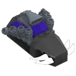
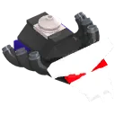

# Loot matrix 626

[Item database](../README.md) | [Methodology](../Methodology.md)

## Sources and mapped locations

| Kind | Source | Location evidence | Conditions |
| --- | --- | --- | --- |
| Package | [Skeleton Rocket Nose Cone Package (LOT 12889)](../sources/object-12889.md) | No matched local placement found | Static association, not a live-spawn guarantee |

## Item candidates

Default vendor-stock probabilities are shown only when this matrix has a registered vendor. Loot probabilities use the generic algorithm, not a guarantee of actual use by every script/activity.

| Item | Modeled loot chance / expected count | Default vendor stock |
| --- | --- | --- |
| { .lu-ti width="24" loading="lazy" } [Morbid Orbit Rocket Nose Cone (LOT 12838)](../12838.md) | 33.33333333%; mean 0.33333333 | Not associated with a vendor |
| { .lu-ti width="24" loading="lazy" } [Starskull Rocket Nose Cone (LOT 12848)](../12848.md) | 33.33333333%; mean 0.33333333 | Not associated with a vendor |
| { .lu-ti width="24" loading="lazy" } [Terror Comet Rocket Nose Cone (LOT 12851)](../12851.md) | 33.33333333%; mean 0.33333333 | Not associated with a vendor |

## Raw matrix entries

| Row | Loot table | Rarity table | Trigger | Min | Max | Flag | Gate |
| --- | --- | --- | --- | --- | --- | --- | --- |
| 2339 | 567 | 24 | 1 | 1 | 1 |  |  |

[LootMatrix](../../../db/LootMatrix.md), [LootTable](../../../db/LootTable.md), [RarityTable](../../../db/RarityTable.md).
