# Loot matrix 629

[Item database](../README.md) | [Methodology](../Methodology.md)

## Sources and mapped locations

| Kind | Source | Location evidence | Conditions |
| --- | --- | --- | --- |
| Activity | NS Racetrack 1st Place - 6 players (activity ID 42, rating threshold 61, reward 51) | Selected only if this is the highest eligible rating threshold; instance zone 1203. | NS Racetrack 1st Place - 6 players (activity ID 42, rating threshold 61, reward 51); Selected only if this is the highest eligible rating threshold; instance zone 1203.; Static association, not a live-spawn guarantee |
| Activity | NS Racetrack 1st Place - 5 players (activity ID 42, rating threshold 51, reward 116) | Selected only if this is the highest eligible rating threshold; instance zone 1203. | NS Racetrack 1st Place - 5 players (activity ID 42, rating threshold 51, reward 116); Selected only if this is the highest eligible rating threshold; instance zone 1203.; Static association, not a live-spawn guarantee |
| Activity | NS Racetrack 1st Place - 4 players (activity ID 42, rating threshold 41, reward 121) | Selected only if this is the highest eligible rating threshold; instance zone 1203. | NS Racetrack 1st Place - 4 players (activity ID 42, rating threshold 41, reward 121); Selected only if this is the highest eligible rating threshold; instance zone 1203.; Static association, not a live-spawn guarantee |

## Item candidates

Default vendor-stock probabilities are shown only when this matrix has a registered vendor. Loot probabilities use the generic algorithm, not a guarantee of actual use by every script/activity.

| Item | Modeled loot chance / expected count | Default vendor stock |
| --- | --- | --- |
| { .lu-ti width="24" loading="lazy" } [Red Racing Helmet (LOT 7730)](../7730.md) | 0% in the generic loot model | Not associated with a vendor |
| { .lu-ti width="24" loading="lazy" } [Workbench with Toolbox Model (LOT 7766)](../7766.md) | 0% in the generic loot model | Not associated with a vendor |
| 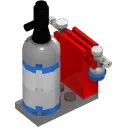{ .lu-ti width="24" loading="lazy" } [Welder Model (LOT 7767)](../7767.md) | 0% in the generic loot model | Not associated with a vendor |
| { .lu-ti width="24" loading="lazy" } [Fire Extinguisher Model (LOT 7768)](../7768.md) | 0% in the generic loot model | Not associated with a vendor |
| 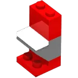{ .lu-ti width="24" loading="lazy" } [Computer Model (LOT 7769)](../7769.md) | 0% in the generic loot model | Not associated with a vendor |
| { .lu-ti width="24" loading="lazy" } [Black Racing Helmet (LOT 7991)](../7991.md) | 0% in the generic loot model | Not associated with a vendor |
| { .lu-ti width="24" loading="lazy" } [Blue Racing Helmet (LOT 7992)](../7992.md) | 0% in the generic loot model | Not associated with a vendor |
| { .lu-ti width="24" loading="lazy" } [Green Racing Helmet (LOT 8037)](../8037.md) | 0% in the generic loot model | Not associated with a vendor |
| 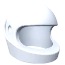{ .lu-ti width="24" loading="lazy" } [White Racing Helmet (LOT 8038)](../8038.md) | 0% in the generic loot model | Not associated with a vendor |
| { .lu-ti width="24" loading="lazy" } [Yellow Racing Helmet (LOT 8039)](../8039.md) | 0% in the generic loot model | Not associated with a vendor |
| { .lu-ti width="24" loading="lazy" } [Dark Grey Racing Helmet (LOT 8040)](../8040.md) | 0% in the generic loot model | Not associated with a vendor |
| { .lu-ti width="24" loading="lazy" } [Light Grey Racing Helmet (LOT 8041)](../8041.md) | 0% in the generic loot model | Not associated with a vendor |
| { .lu-ti width="24" loading="lazy" } [Car Chassis (LOT 8129)](../8129.md) | 0% in the generic loot model | Not associated with a vendor |
| { .lu-ti width="24" loading="lazy" } [Hyperstarter Engine Panel (LOT 8131)](../8131.md) | 0% in the generic loot model | Not associated with a vendor |
| { .lu-ti width="24" loading="lazy" } [Chase Cutter Rear Panel 2 (LOT 8132)](../8132.md) | 0% in the generic loot model | Not associated with a vendor |
| { .lu-ti width="24" loading="lazy" } [Chase Cutter Front Bumper 1 (LOT 8134)](../8134.md) | 0% in the generic loot model | Not associated with a vendor |
| { .lu-ti width="24" loading="lazy" } [Race Ace Shirt (LOT 8614)](../8614.md) | 0% in the generic loot model | Not associated with a vendor |
| { .lu-ti width="24" loading="lazy" } [Checkered Flag Shirt (LOT 8628)](../8628.md) | 0% in the generic loot model | Not associated with a vendor |
| 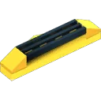{ .lu-ti width="24" loading="lazy" } [Chase Cutter Front Bumper 1 (LOT 9321)](../9321.md) | 0% in the generic loot model | Not associated with a vendor |
| 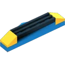{ .lu-ti width="24" loading="lazy" } [Chase Cutter Front Bumper 1 (LOT 9322)](../9322.md) | 0% in the generic loot model | Not associated with a vendor |
| 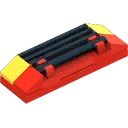{ .lu-ti width="24" loading="lazy" } [Chase Cutter Front Bumper 3 (LOT 9326)](../9326.md) | 0% in the generic loot model | Not associated with a vendor |
| 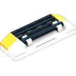{ .lu-ti width="24" loading="lazy" } [Chase Cutter Front Bumper 3 (LOT 9327)](../9327.md) | 0% in the generic loot model | Not associated with a vendor |
| 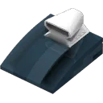{ .lu-ti width="24" loading="lazy" } [Hyperstarter Engine Panel (LOT 9332)](../9332.md) | 0% in the generic loot model | Not associated with a vendor |
| { .lu-ti width="24" loading="lazy" } [Chase Cutter Engine Panel 1 (LOT 9333)](../9333.md) | 0% in the generic loot model | Not associated with a vendor |
| { .lu-ti width="24" loading="lazy" } [Chase Cutter Engine Panel 1 (LOT 9334)](../9334.md) | 0% in the generic loot model | Not associated with a vendor |
| { .lu-ti width="24" loading="lazy" } [Chase Cutter Engine Panel 1 (LOT 9335)](../9335.md) | 0% in the generic loot model | Not associated with a vendor |
| { .lu-ti width="24" loading="lazy" } [Chase Cutter Engine Panel 2 (LOT 9336)](../9336.md) | 10%; mean 0.1 | Not associated with a vendor |
| { .lu-ti width="24" loading="lazy" } [Chase Cutter Engine Panel 2 (LOT 9339)](../9339.md) | 10%; mean 0.1 | Not associated with a vendor |
| { .lu-ti width="24" loading="lazy" } [Hyperstarter Side Panels (LOT 9343)](../9343.md) | 0% in the generic loot model | Not associated with a vendor |
| { .lu-ti width="24" loading="lazy" } [Hyperstarter Side Panels (LOT 9344)](../9344.md) | 0% in the generic loot model | Not associated with a vendor |
| { .lu-ti width="24" loading="lazy" } [Hyperstarter Side Panels (LOT 9345)](../9345.md) | 0% in the generic loot model | Not associated with a vendor |
| { .lu-ti width="24" loading="lazy" } [Chase Cutter Side Panels 1 (LOT 9348)](../9348.md) | 0% in the generic loot model | Not associated with a vendor |
| { .lu-ti width="24" loading="lazy" } [Chase Cutter Side Panels 1 (LOT 9349)](../9349.md) | 0% in the generic loot model | Not associated with a vendor |
| 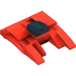{ .lu-ti width="24" loading="lazy" } [Hyperstarter Rear Panel (LOT 9353)](../9353.md) | 0% in the generic loot model | Not associated with a vendor |
| 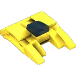{ .lu-ti width="24" loading="lazy" } [Hyperstarter Rear Panel (LOT 9354)](../9354.md) | 0% in the generic loot model | Not associated with a vendor |
| 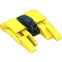{ .lu-ti width="24" loading="lazy" } [Chase Cutter Rear Panel 1 (LOT 9357)](../9357.md) | 0% in the generic loot model | Not associated with a vendor |
| 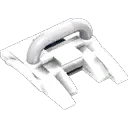{ .lu-ti width="24" loading="lazy" } [Chase Cutter Rear Panel 2 (LOT 9359)](../9359.md) | 0% in the generic loot model | Not associated with a vendor |
| 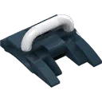{ .lu-ti width="24" loading="lazy" } [Chase Cutter Rear Panel 2 (LOT 9360)](../9360.md) | 0% in the generic loot model | Not associated with a vendor |
| 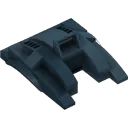{ .lu-ti width="24" loading="lazy" } [Chase Cutter Rear Panel 3 (LOT 9362)](../9362.md) | 10%; mean 0.1 | Not associated with a vendor |
| { .lu-ti width="24" loading="lazy" } [Hyperstarter Rear Bumper (LOT 9363)](../9363.md) | 0% in the generic loot model | Not associated with a vendor |
| { .lu-ti width="24" loading="lazy" } [Hyperstarter Rear Bumper (LOT 9365)](../9365.md) | 0% in the generic loot model | Not associated with a vendor |
| { .lu-ti width="24" loading="lazy" } [Chase Cutter Rear Bumper 1 (LOT 9369)](../9369.md) | 0% in the generic loot model | Not associated with a vendor |
| 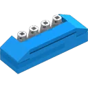{ .lu-ti width="24" loading="lazy" } [Chase Cutter Rear Bumper 2 (LOT 9371)](../9371.md) | 10%; mean 0.1 | Not associated with a vendor |
| 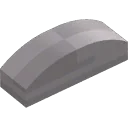{ .lu-ti width="24" loading="lazy" } [Thrust Bucket Front Bumper 1 (LOT 9373)](../9373.md) | 0% in the generic loot model | Not associated with a vendor |
| 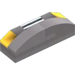{ .lu-ti width="24" loading="lazy" } [Thrust Bucket Front Bumper 2 (LOT 9374)](../9374.md) | 0% in the generic loot model | Not associated with a vendor |
| { .lu-ti width="24" loading="lazy" } [Bolt Ox Front Bumper 2 (LOT 9376)](../9376.md) | 10%; mean 0.1 | Not associated with a vendor |
| 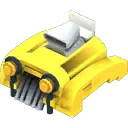{ .lu-ti width="24" loading="lazy" } [Thrust Bucket Engine Panel 1 (LOT 9378)](../9378.md) | 0% in the generic loot model | Not associated with a vendor |
| { .lu-ti width="24" loading="lazy" } [Bolt Ox Engine Panel 1 (LOT 9381)](../9381.md) | 10%; mean 0.1 | Not associated with a vendor |
| { .lu-ti width="24" loading="lazy" } [Bolt Ox Engine Panel 2 (LOT 9384)](../9384.md) | 10%; mean 0.1 | Not associated with a vendor |
| { .lu-ti width="24" loading="lazy" } [Thrust Bucket Side Panels (LOT 9387)](../9387.md) | 0% in the generic loot model | Not associated with a vendor |
| { .lu-ti width="24" loading="lazy" } [Thrust Bucket Side Panels (LOT 9389)](../9389.md) | 0% in the generic loot model | Not associated with a vendor |
| 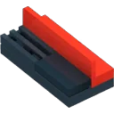{ .lu-ti width="24" loading="lazy" } [Bolt Ox Side Panels 1 (LOT 9391)](../9391.md) | 0% in the generic loot model | Not associated with a vendor |
| 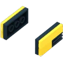{ .lu-ti width="24" loading="lazy" } [Bolt Ox Side Panels 2 (LOT 9394)](../9394.md) | 0% in the generic loot model | Not associated with a vendor |
| 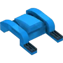{ .lu-ti width="24" loading="lazy" } [Thrust Bucket Rear Panel (LOT 9396)](../9396.md) | 0% in the generic loot model | Not associated with a vendor |
| 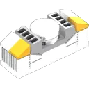{ .lu-ti width="24" loading="lazy" } [Paragon Warp Front Bumper 1 (LOT 9404)](../9404.md) | 10%; mean 0.1 | Not associated with a vendor |
| 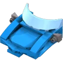{ .lu-ti width="24" loading="lazy" } [Paragon Warp Engine Panel 1 (LOT 9411)](../9411.md) | 0% in the generic loot model | Not associated with a vendor |
| 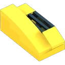{ .lu-ti width="24" loading="lazy" } [Paragon Warp Side Panels 2 (LOT 9419)](../9419.md) | 0% in the generic loot model | Not associated with a vendor |
| 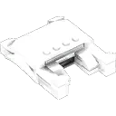{ .lu-ti width="24" loading="lazy" } [Paragon Warp Rear Panel 1 (LOT 9424)](../9424.md) | 10%; mean 0.1 | Not associated with a vendor |
| { .lu-ti width="24" loading="lazy" } [Paragon Warp Rear Panel 2 (LOT 9426)](../9426.md) | 10%; mean 0.1 | Not associated with a vendor |
| { .lu-ti width="24" loading="lazy" } [Paragon Warp Rear Bumper 1 (LOT 9432)](../9432.md) | 0% in the generic loot model | Not associated with a vendor |
| 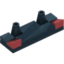{ .lu-ti width="24" loading="lazy" } [Paragon Warp Rear Bumper 2 (LOT 9433)](../9433.md) | 0% in the generic loot model | Not associated with a vendor |
| { .lu-ti width="24" loading="lazy" } [Winged Wrench Shirt (LOT 10127)](../10127.md) | 0% in the generic loot model | Not associated with a vendor |
| { .lu-ti width="24" loading="lazy" } [Faction Token Proxy (LOT 13763)](../13763.md) | 100%; mean 13 | Not associated with a vendor |
| { .lu-ti width="24" loading="lazy" } [Black Shoulder Owl (LOT 14818)](../14818.md) | 0% in the generic loot model | Not associated with a vendor |

## Raw matrix entries

| Row | Loot table | Rarity table | Trigger | Min | Max | Flag | Gate |
| --- | --- | --- | --- | --- | --- | --- | --- |
| 2434 | 188 | 17 | 1 | 1 | 1 |  |  |
| 2435 | 670 | 23 | 1 | 13 | 13 |  |  |

[LootMatrix](../../../db/LootMatrix.md), [LootTable](../../../db/LootTable.md), [RarityTable](../../../db/RarityTable.md).
