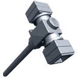
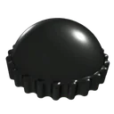
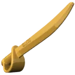
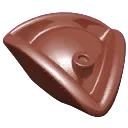
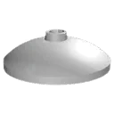

# Loot matrix 65

[Item database](../README.md) | [Methodology](../Methodology.md)

## Sources and mapped locations

| Kind | Source | Location evidence | Conditions |
| --- | --- | --- | --- |
| Drop | [Test Zoo Ninja 2 (LOT 1813)](../sources/object-1813.md) | No matched local placement found | DestructibleComponent 204; static component precedence; Static association, not a live-spawn guarantee |
| Drop | [Test - Always Loot (LOT 3228)](../sources/object-3228.md) | No matched local placement found | DestructibleComponent 246; static component precedence; Static association, not a live-spawn guarantee |
| Package | [Test Package (LOT 5710)](../sources/object-5710.md) | No matched local placement found | Static association, not a live-spawn guarantee |

## Item candidates

Default vendor-stock probabilities are shown only when this matrix has a registered vendor. Loot probabilities use the generic algorithm, not a guarantee of actual use by every script/activity.

| Item | Modeled loot chance / expected count | Default vendor stock |
| --- | --- | --- |
| { .lu-ti width="24" loading="lazy" } [Test Chargeup Spear (LOT 2239)](../2239.md) | 0% in the generic loot model | Not associated with a vendor |
| { .lu-ti width="24" loading="lazy" } [Test Elite Hammer (LOT 2241)](../2241.md) | 0% in the generic loot model | Not associated with a vendor |
| [Test Conical Hat (LOT 2246)](../2246.md) | 0% in the generic loot model | Not associated with a vendor |
| { .lu-ti width="24" loading="lazy" } [Bright Orange Pants (LOT 2509)](../2509.md) | 86.16045436%; mean 2.4375 | Not associated with a vendor |
| { .lu-ti width="24" loading="lazy" } [Wizard Hat (LOT 2623)](../2623.md) | 17.50752505%; mean 0.195 | Not associated with a vendor |
| { .lu-ti width="24" loading="lazy" } [Kettle Helmet (LOT 2624)](../2624.md) | 17.50752505%; mean 0.195 | Not associated with a vendor |
| { .lu-ti width="24" loading="lazy" } [Black Knit Cap (LOT 2627)](../2627.md) | 17.50752505%; mean 0.195 | Not associated with a vendor |
| { .lu-ti width="24" loading="lazy" } [Superior Cutlass (LOT 2630)](../2630.md) | 17.50752505%; mean 0.195 | Not associated with a vendor |
| { .lu-ti width="24" loading="lazy" } [Shiver Me Timbers Axe (LOT 2631)](../2631.md) | 12.09266219%; mean 0.13 | Not associated with a vendor |
| { .lu-ti width="24" loading="lazy" } [Brown Pirate Hat (LOT 2632)](../2632.md) | 22.54195147%; mean 0.26 | Not associated with a vendor |
| { .lu-ti width="24" loading="lazy" } [Exceptional Hatchet (LOT 2643)](../2643.md) | 22.54195147%; mean 0.26 | Not associated with a vendor |
| { .lu-ti width="24" loading="lazy" } [Worthy Corseque (LOT 2644)](../2644.md) | 86.16045436%; mean 2.4375 | Not associated with a vendor |
| { .lu-ti width="24" loading="lazy" } [White Conical Hat (LOT 2647)](../2647.md) | 17.50752505%; mean 0.195 | Not associated with a vendor |

## Raw matrix entries

| Row | Loot table | Rarity table | Trigger | Min | Max | Flag | Gate |
| --- | --- | --- | --- | --- | --- | --- | --- |
| 194 | 54 | 4 | 1 | 1 | 12 |  |  |

[LootMatrix](../../../db/LootMatrix.md), [LootTable](../../../db/LootTable.md), [RarityTable](../../../db/RarityTable.md).
