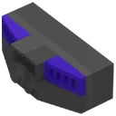
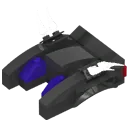

# Loot matrix 657

[Item database](../README.md) | [Methodology](../Methodology.md)

## Sources and mapped locations

| Kind | Source | Location evidence | Conditions |
| --- | --- | --- | --- |
| Package | [Fright Speed Car Part Pack (LOT 13073)](../sources/object-13073.md) | No matched local placement found | Static association, not a live-spawn guarantee |

## Item candidates

Default vendor-stock probabilities are shown only when this matrix has a registered vendor. Loot probabilities use the generic algorithm, not a guarantee of actual use by every script/activity.

| Item | Modeled loot chance / expected count | Default vendor stock |
| --- | --- | --- |
| { .lu-ti width="24" loading="lazy" } [Fright Speed Front Bumper (LOT 13062)](../13062.md) | 20%; mean 0.2 | Not associated with a vendor |
| { .lu-ti width="24" loading="lazy" } [Fright Speed Engine Panel (LOT 13063)](../13063.md) | 20%; mean 0.2 | Not associated with a vendor |
| { .lu-ti width="24" loading="lazy" } [Fright Speed Rear Bumper (LOT 13064)](../13064.md) | 20%; mean 0.2 | Not associated with a vendor |
| { .lu-ti width="24" loading="lazy" } [Fright Speed Rear Panel (LOT 13065)](../13065.md) | 20%; mean 0.2 | Not associated with a vendor |
| { .lu-ti width="24" loading="lazy" } [Fright Speed Side Panels (LOT 13066)](../13066.md) | 20%; mean 0.2 | Not associated with a vendor |

## Raw matrix entries

| Row | Loot table | Rarity table | Trigger | Min | Max | Flag | Gate |
| --- | --- | --- | --- | --- | --- | --- | --- |
| 3503 | 576 | 24 | 1 | 1 | 1 |  |  |

[LootMatrix](../../../db/LootMatrix.md), [LootTable](../../../db/LootTable.md), [RarityTable](../../../db/RarityTable.md).
