# Loot matrix 662

[Item database](../README.md) | [Methodology](../Methodology.md)

## Sources and mapped locations

| Kind | Source | Location evidence | Conditions |
| --- | --- | --- | --- |
| Package | [Premium Surprise Pack (LOT 13097)](../sources/object-13097.md) | No matched local placement found | Static association, not a live-spawn guarantee |

## Item candidates

Default vendor-stock probabilities are shown only when this matrix has a registered vendor. Loot probabilities use the generic algorithm, not a guarantee of actual use by every script/activity.

| Item | Modeled loot chance / expected count | Default vendor stock |
| --- | --- | --- |
| { .lu-ti width="24" loading="lazy" } [Maelstrom-Infected Brick (LOT 6194)](../6194.md) | 50%; mean 2 | Not associated with a vendor |
| { .lu-ti width="24" loading="lazy" } [Dark Red Gem (LOT 6862)](../6862.md) | 0.1%; mean 0.001 | Not associated with a vendor |
| 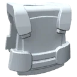{ .lu-ti width="24" loading="lazy" } [Crux Prime Armor (LOT 12095)](../12095.md) | 0.09090909%; mean 0.00090909091 | Not associated with a vendor |
| { .lu-ti width="24" loading="lazy" } [Nexus Airtanks (LOT 12098)](../12098.md) | 6.25%; mean 0.0625 | Not associated with a vendor |
| { .lu-ti width="24" loading="lazy" } [Flogmore's Hat (LOT 12435)](../12435.md) | 0.09090909%; mean 0.00090909091 | Not associated with a vendor |
| { .lu-ti width="24" loading="lazy" } [Explorien Bot Helm (LOT 12472)](../12472.md) | 0.57142857%; mean 0.0057142857 | Not associated with a vendor |
| 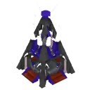{ .lu-ti width="24" loading="lazy" } [Skeleton Ziggurat Model (LOT 12495)](../12495.md) | 0.26646914%; mean 0.0026666667 | Not associated with a vendor |
| { .lu-ti width="24" loading="lazy" } [Skeleton Watchtower Wall Model (LOT 12496)](../12496.md) | 0.26646914%; mean 0.0026666667 | Not associated with a vendor |
| { .lu-ti width="24" loading="lazy" } [Skeleton Corner Wall Model (LOT 12497)](../12497.md) | 2.384%; mean 0.024 | Not associated with a vendor |
| { .lu-ti width="24" loading="lazy" } [Skeleton Wall Model (LOT 12498)](../12498.md) | 2.384%; mean 0.024 | Not associated with a vendor |
| { .lu-ti width="24" loading="lazy" } [Skeleton T-Wall Model (LOT 12499)](../12499.md) | 0.26646914%; mean 0.0026666667 | Not associated with a vendor |
| { .lu-ti width="24" loading="lazy" } [Skeleton Skull Tower Model (LOT 12500)](../12500.md) | 0.26646914%; mean 0.0026666667 | Not associated with a vendor |
| { .lu-ti width="24" loading="lazy" } [Skeleton Short Wall Model (LOT 12501)](../12501.md) | 2.384%; mean 0.024 | Not associated with a vendor |
| { .lu-ti width="24" loading="lazy" } [Skeleton Ribcage Bridge Model (LOT 12502)](../12502.md) | 0.26646914%; mean 0.0026666667 | Not associated with a vendor |
| { .lu-ti width="24" loading="lazy" } [Skeleton Repair Facility Model (LOT 12503)](../12503.md) | 0.26646914%; mean 0.0026666667 | Not associated with a vendor |
| 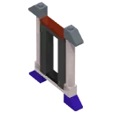{ .lu-ti width="24" loading="lazy" } [Skeleton Wall Pillars Model (LOT 12504)](../12504.md) | 17.1%; mean 0.18 | Not associated with a vendor |
| { .lu-ti width="24" loading="lazy" } [Skeleton Mobile Drilling Rig Model (LOT 12505)](../12505.md) | 0.26646914%; mean 0.0026666667 | Not associated with a vendor |
| { .lu-ti width="24" loading="lazy" } [Skeleton Hover Drone Model (LOT 12506)](../12506.md) | 0.26646914%; mean 0.0026666667 | Not associated with a vendor |
| { .lu-ti width="24" loading="lazy" } [Skeleton Gate Model (LOT 12507)](../12507.md) | 0.26646914%; mean 0.0026666667 | Not associated with a vendor |
| { .lu-ti width="24" loading="lazy" } [Skeleton Elevator Model (LOT 12508)](../12508.md) | 2.384%; mean 0.024 | Not associated with a vendor |
| { .lu-ti width="24" loading="lazy" } [Evergiving Goblet (LOT 12562)](../12562.md) | 1.5%; mean 0.015 | Not associated with a vendor |
| 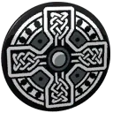{ .lu-ti width="24" loading="lazy" } [Knotwork Shield (LOT 12672)](../12672.md) | 6.25%; mean 0.0625 | Not associated with a vendor |
| { .lu-ti width="24" loading="lazy" } [Wolf Shield (LOT 12677)](../12677.md) | 0.09090909%; mean 0.00090909091 | Not associated with a vendor |
| { .lu-ti width="24" loading="lazy" } [Bat Lord Shield (LOT 12678)](../12678.md) | 0.09090909%; mean 0.00090909091 | Not associated with a vendor |
| { .lu-ti width="24" loading="lazy" } [Bat Lord Shirt (LOT 12686)](../12686.md) | 0.09090909%; mean 0.00090909091 | Not associated with a vendor |
| 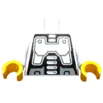{ .lu-ti width="24" loading="lazy" } [Explorien Bot Shirt (LOT 12690)](../12690.md) | 1.5%; mean 0.015 | Not associated with a vendor |
| 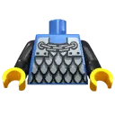{ .lu-ti width="24" loading="lazy" } [Scale Mail Shirt (LOT 12698)](../12698.md) | 0.57142857%; mean 0.0057142857 | Not associated with a vendor |
| { .lu-ti width="24" loading="lazy" } [Denim Shirt (LOT 12700)](../12700.md) | 6.25%; mean 0.0625 | Not associated with a vendor |
| { .lu-ti width="24" loading="lazy" } [Blacktron Shirt (LOT 12707)](../12707.md) | 1.5%; mean 0.015 | Not associated with a vendor |
| 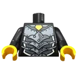{ .lu-ti width="24" loading="lazy" } [Banded Armor (LOT 12708)](../12708.md) | 1.5%; mean 0.015 | Not associated with a vendor |
| { .lu-ti width="24" loading="lazy" } [Paisley Shirt (LOT 12710)](../12710.md) | 6.25%; mean 0.0625 | Not associated with a vendor |
| { .lu-ti width="24" loading="lazy" } [Blocks Shirt (LOT 12711)](../12711.md) | 6.25%; mean 0.0625 | Not associated with a vendor |
| { .lu-ti width="24" loading="lazy" } [Futuron Shirt (LOT 12714)](../12714.md) | 1.5%; mean 0.015 | Not associated with a vendor |
| { .lu-ti width="24" loading="lazy" } [Tiki Batik Shirt (LOT 12715)](../12715.md) | 0.09090909%; mean 0.00090909091 | Not associated with a vendor |
| { .lu-ti width="24" loading="lazy" } [Elite Broadsword (LOT 12718)](../12718.md) | 1.33333333%; mean 0.013333333 | Not associated with a vendor |
| 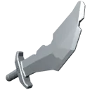{ .lu-ti width="24" loading="lazy" } [Super Cleaver (LOT 12719)](../12719.md) | 1.875%; mean 0.01875 | Not associated with a vendor |
| { .lu-ti width="24" loading="lazy" } [Super Dagger (LOT 12720)](../12720.md) | 1.875%; mean 0.01875 | Not associated with a vendor |
| { .lu-ti width="24" loading="lazy" } [Super Fang (LOT 12721)](../12721.md) | 1.875%; mean 0.01875 | Not associated with a vendor |
| { .lu-ti width="24" loading="lazy" } [Heroic Trident of Lightning (LOT 12722)](../12722.md) | 0.2%; mean 0.002 | Not associated with a vendor |
| { .lu-ti width="24" loading="lazy" } [Super Morning Star (LOT 12724)](../12724.md) | 1.875%; mean 0.01875 | Not associated with a vendor |
| { .lu-ti width="24" loading="lazy" } [Elite Javelin (LOT 12728)](../12728.md) | 1.33333333%; mean 0.013333333 | Not associated with a vendor |
| 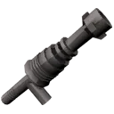{ .lu-ti width="24" loading="lazy" } [Elite Long Barrel Blaster (LOT 12729)](../12729.md) | 0.2%; mean 0.002 | Not associated with a vendor |
| 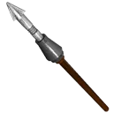{ .lu-ti width="24" loading="lazy" } [Fantastic Pilum (LOT 12730)](../12730.md) | 0.2%; mean 0.002 | Not associated with a vendor |
| { .lu-ti width="24" loading="lazy" } [Spike Hammer (LOT 12731)](../12731.md) | 0.2%; mean 0.002 | Not associated with a vendor |
| { .lu-ti width="24" loading="lazy" } [The Big One! (LOT 12735)](../12735.md) | 0.09090909%; mean 0.00090909091 | Not associated with a vendor |
| { .lu-ti width="24" loading="lazy" } [Bone Suit Shirt (LOT 12758)](../12758.md) | 0.57142857%; mean 0.0057142857 | Not associated with a vendor |
| { .lu-ti width="24" loading="lazy" } [Dancin' Hat (LOT 12779)](../12779.md) | 0.57142857%; mean 0.0057142857 | Not associated with a vendor |
| { .lu-ti width="24" loading="lazy" } [Egyptian Headdress (LOT 12780)](../12780.md) | 0.57142857%; mean 0.0057142857 | Not associated with a vendor |
| { .lu-ti width="24" loading="lazy" } [Eisenhut (LOT 12782)](../12782.md) | 0.57142857%; mean 0.0057142857 | Not associated with a vendor |
| { .lu-ti width="24" loading="lazy" } [Iron Barbute (LOT 12784)](../12784.md) | 6.25%; mean 0.0625 | Not associated with a vendor |
| { .lu-ti width="24" loading="lazy" } [Miners' Helm (LOT 12785)](../12785.md) | 0.57142857%; mean 0.0057142857 | Not associated with a vendor |
| { .lu-ti width="24" loading="lazy" } [Dragon Helm MK III (LOT 12786)](../12786.md) | 0.09090909%; mean 0.00090909091 | Not associated with a vendor |
| 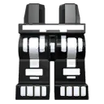{ .lu-ti width="24" loading="lazy" } [Bone Suit Pants (LOT 12798)](../12798.md) | 0.09090909%; mean 0.00090909091 | Not associated with a vendor |
| { .lu-ti width="24" loading="lazy" } [Bat Lord Staff (LOT 12802)](../12802.md) | 0.2%; mean 0.002 | Not associated with a vendor |
| { .lu-ti width="24" loading="lazy" } [Mosaic Jester Cap (LOT 12901)](../12901.md) | 0.09090909%; mean 0.00090909091 | Not associated with a vendor |
| { .lu-ti width="24" loading="lazy" } [Mosaic Wand (LOT 12927)](../12927.md) | 1.33333333%; mean 0.013333333 | Not associated with a vendor |
| 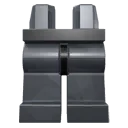{ .lu-ti width="24" loading="lazy" } [Bat Lord Pants (LOT 13000)](../13000.md) | 0.09090909%; mean 0.00090909091 | Not associated with a vendor |
| { .lu-ti width="24" loading="lazy" } [Faction Token Proxy (LOT 13763)](../13763.md) | 100%; mean 3.5 | Not associated with a vendor |

## Raw matrix entries

| Row | Loot table | Rarity table | Trigger | Min | Max | Flag | Gate |
| --- | --- | --- | --- | --- | --- | --- | --- |
| 3530 | 88 | 9 | 0.5 | 1 | 7 |  |  |
| 3532 | 670 | 23 | 1 | 2 | 5 |  |  |
| 3539 | 443 | 4 | 0.5 | 1 | 1 |  |  |
| 3540 | 444 | 4 | 0.5 | 1 | 1 |  |  |
| 3542 | 446 | 4 | 0.8 | 1 | 2 |  |  |
| 3544 | 360 | 26 | 0.001 | 1 | 1 |  |  |

[LootMatrix](../../../db/LootMatrix.md), [LootTable](../../../db/LootTable.md), [RarityTable](../../../db/RarityTable.md).
