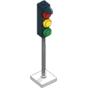

# Loot matrix 664

[Item database](../README.md) | [Methodology](../Methodology.md)

## Sources and mapped locations

| Kind | Source | Location evidence | Conditions |
| --- | --- | --- | --- |
| Package | [Surprise Pack (LOT 13099)](../sources/object-13099.md) | No matched local placement found | Static association, not a live-spawn guarantee |

## Item candidates

Default vendor-stock probabilities are shown only when this matrix has a registered vendor. Loot probabilities use the generic algorithm, not a guarantee of actual use by every script/activity.

| Item | Modeled loot chance / expected count | Default vendor stock |
| --- | --- | --- |
| { .lu-ti width="24" loading="lazy" } [Healing Banana (LOT 1966)](../1966.md) | 2.76315789%; mean 0.027631579 | Not associated with a vendor |
| { .lu-ti width="24" loading="lazy" } [Notion Potion (LOT 2198)](../2198.md) | 2.76315789%; mean 0.027631579 | Not associated with a vendor |
| { .lu-ti width="24" loading="lazy" } [Chef Hat (LOT 2588)](../2588.md) | 0.93188555%; mean 0.009375 | Not associated with a vendor |
| { .lu-ti width="24" loading="lazy" } [Bullhorn (LOT 2617)](../2617.md) | 9.3728%; mean 0.1 | Not associated with a vendor |
| { .lu-ti width="24" loading="lazy" } [Quicksicle (LOT 2620)](../2620.md) | 2.76315789%; mean 0.027631579 | Not associated with a vendor |
| { .lu-ti width="24" loading="lazy" } [Improved Ladle (LOT 2622)](../2622.md) | 0.93188555%; mean 0.009375 | Not associated with a vendor |
| { .lu-ti width="24" loading="lazy" } [Wizard Hat (LOT 2623)](../2623.md) | 0.93188555%; mean 0.009375 | Not associated with a vendor |
| { .lu-ti width="24" loading="lazy" } [Armor Polish (LOT 2993)](../2993.md) | 2.76315789%; mean 0.027631579 | Not associated with a vendor |
| { .lu-ti width="24" loading="lazy" } [Healing Cherry (LOT 2994)](../2994.md) | 2.76315789%; mean 0.027631579 | Not associated with a vendor |
| { .lu-ti width="24" loading="lazy" } [Armor Shine (LOT 2996)](../2996.md) | 2.76315789%; mean 0.027631579 | Not associated with a vendor |
| { .lu-ti width="24" loading="lazy" } [Strong Notion Potion (LOT 2998)](../2998.md) | 2.76315789%; mean 0.027631579 | Not associated with a vendor |
| { .lu-ti width="24" loading="lazy" } [BBQ Blast Hot Dog (LOT 3011)](../3011.md) | 2.76315789%; mean 0.027631579 | Not associated with a vendor |
| { .lu-ti width="24" loading="lazy" } [Green Imaginite (LOT 3039)](../3039.md) | 2.76315789%; mean 0.027631579 | Not associated with a vendor |
| { .lu-ti width="24" loading="lazy" } [Red Imaginite (LOT 3040)](../3040.md) | 4.375%; mean 0.04375 | Not associated with a vendor |
| { .lu-ti width="24" loading="lazy" } [Improved Crescent Wrench (LOT 3077)](../3077.md) | 0.9%; mean 0.009 | Not associated with a vendor |
| { .lu-ti width="24" loading="lazy" } [Amber Gem (LOT 3100)](../3100.md) | 2.76315789%; mean 0.027631579 | Not associated with a vendor |
| { .lu-ti width="24" loading="lazy" } [Witch Hat (LOT 3853)](../3853.md) | 0.93188555%; mean 0.009375 | Not associated with a vendor |
| { .lu-ti width="24" loading="lazy" } [Flower Hat (LOT 3858)](../3858.md) | 0.93188555%; mean 0.009375 | Not associated with a vendor |
| { .lu-ti width="24" loading="lazy" } [Police Hat (LOT 3859)](../3859.md) | 0.93188555%; mean 0.009375 | Not associated with a vendor |
| { .lu-ti width="24" loading="lazy" } [Hard Hat (LOT 3860)](../3860.md) | 0.93188555%; mean 0.009375 | Not associated with a vendor |
| { .lu-ti width="24" loading="lazy" } [Black Baseball Cap (LOT 3868)](../3868.md) | 0.93188555%; mean 0.009375 | Not associated with a vendor |
| { .lu-ti width="24" loading="lazy" } [Orange Baseball Cap (LOT 3869)](../3869.md) | 0.93188555%; mean 0.009375 | Not associated with a vendor |
| { .lu-ti width="24" loading="lazy" } [Improved Witch Broom (LOT 3870)](../3870.md) | 0.93188555%; mean 0.009375 | Not associated with a vendor |
| { .lu-ti width="24" loading="lazy" } [Basic Shovel (LOT 3872)](../3872.md) | 5.625%; mean 0.05625 | Not associated with a vendor |
| { .lu-ti width="24" loading="lazy" } [Improved Firefighter Axe (LOT 4824)](../4824.md) | 0.93188555%; mean 0.009375 | Not associated with a vendor |
| { .lu-ti width="24" loading="lazy" } [Hiccup Tablets (LOT 5832)](../5832.md) | 2.76315789%; mean 0.027631579 | Not associated with a vendor |
| { .lu-ti width="24" loading="lazy" } [Brick Booster Pack (LOT 5834)](../5834.md) | 2.76315789%; mean 0.027631579 | Not associated with a vendor |
| { .lu-ti width="24" loading="lazy" } [Super Brick Booster Pack (LOT 5835)](../5835.md) | 4.375%; mean 0.04375 | Not associated with a vendor |
| { .lu-ti width="24" loading="lazy" } [Picnic Basket (LOT 5836)](../5836.md) | 2.76315789%; mean 0.027631579 | Not associated with a vendor |
| { .lu-ti width="24" loading="lazy" } [Super Picnic Basket (LOT 5837)](../5837.md) | 4.375%; mean 0.04375 | Not associated with a vendor |
| { .lu-ti width="24" loading="lazy" } [Basic Shortsword of Knockback (LOT 5948)](../5948.md) | 0.9%; mean 0.009 | Not associated with a vendor |
| { .lu-ti width="24" loading="lazy" } [Thirst Quencher (LOT 6201)](../6201.md) | 2.76315789%; mean 0.027631579 | Not associated with a vendor |
| { .lu-ti width="24" loading="lazy" } [Basic Spear of Stunning (LOT 6203)](../6203.md) | 0.9%; mean 0.009 | Not associated with a vendor |
| { .lu-ti width="24" loading="lazy" } [Nexus Force Healing Kit (LOT 6207)](../6207.md) | 2.76315789%; mean 0.027631579 | Not associated with a vendor |
| { .lu-ti width="24" loading="lazy" } [Improved Fishing Pole (LOT 6742)](../6742.md) | 0.9%; mean 0.009 | Not associated with a vendor |
| { .lu-ti width="24" loading="lazy" } [Light Blue Gem (LOT 6865)](../6865.md) | 4.375%; mean 0.04375 | Not associated with a vendor |
| { .lu-ti width="24" loading="lazy" } [Pink Gem (LOT 6866)](../6866.md) | 2.76315789%; mean 0.027631579 | Not associated with a vendor |
| { .lu-ti width="24" loading="lazy" } [Improved Composite Axe (LOT 6881)](../6881.md) | 0.9%; mean 0.009 | Not associated with a vendor |
| { .lu-ti width="24" loading="lazy" } [Flash Bang (LOT 6884)](../6884.md) | 2.76315789%; mean 0.027631579 | Not associated with a vendor |
| { .lu-ti width="24" loading="lazy" } [Skater Helmet (LOT 7728)](../7728.md) | 0.93188555%; mean 0.009375 | Not associated with a vendor |
| { .lu-ti width="24" loading="lazy" } [Viking Helm (LOT 7729)](../7729.md) | 0.93188555%; mean 0.009375 | Not associated with a vendor |
| { .lu-ti width="24" loading="lazy" } [Aussie Hat (LOT 7731)](../7731.md) | 0.93188555%; mean 0.009375 | Not associated with a vendor |
| { .lu-ti width="24" loading="lazy" } [Walkie Talkie (LOT 7732)](../7732.md) | 0.93188555%; mean 0.009375 | Not associated with a vendor |
| { .lu-ti width="24" loading="lazy" } [Improved Frying Pan (LOT 7733)](../7733.md) | 0.93188555%; mean 0.009375 | Not associated with a vendor |
| { .lu-ti width="24" loading="lazy" } [Improved Push Broom (LOT 7734)](../7734.md) | 0.93188555%; mean 0.009375 | Not associated with a vendor |
| { .lu-ti width="24" loading="lazy" } [Picnic Table Model (LOT 7758)](../7758.md) | 3.19055899%; mean 0.032608696 | Not associated with a vendor |
| { .lu-ti width="24" loading="lazy" } [Double Trash Can Model (LOT 7759)](../7759.md) | 3.19055899%; mean 0.032608696 | Not associated with a vendor |
| { .lu-ti width="24" loading="lazy" } [Trash Can Model (LOT 7761)](../7761.md) | 3.19055899%; mean 0.032608696 | Not associated with a vendor |
| { .lu-ti width="24" loading="lazy" } [Bench Model (LOT 7770)](../7770.md) | 3.19055899%; mean 0.032608696 | Not associated with a vendor |
| { .lu-ti width="24" loading="lazy" } [Cooler Model (LOT 7771)](../7771.md) | 3.19055899%; mean 0.032608696 | Not associated with a vendor |
| { .lu-ti width="24" loading="lazy" } [Piano Model (LOT 7773)](../7773.md) | 4.83541667%; mean 0.05 | Not associated with a vendor |
| { .lu-ti width="24" loading="lazy" } [Guitar Model (LOT 7774)](../7774.md) | 3.19055899%; mean 0.032608696 | Not associated with a vendor |
| { .lu-ti width="24" loading="lazy" } [Bass Guitar Model (LOT 7775)](../7775.md) | 3.19055899%; mean 0.032608696 | Not associated with a vendor |
| { .lu-ti width="24" loading="lazy" } [Firecracker (LOT 7778)](../7778.md) | 2.76315789%; mean 0.027631579 | Not associated with a vendor |
| { .lu-ti width="24" loading="lazy" } [Grey Kepi Hat (LOT 7793)](../7793.md) | 48.046875%; mean 0.9375 | Not associated with a vendor |
| { .lu-ti width="24" loading="lazy" } [Fire Hydrant Model (LOT 7808)](../7808.md) | 3.19055899%; mean 0.032608696 | Not associated with a vendor |
| { .lu-ti width="24" loading="lazy" } [Drumset Model (LOT 7813)](../7813.md) | 4.83541667%; mean 0.05 | Not associated with a vendor |
| { .lu-ti width="24" loading="lazy" } [Cash Register Model (LOT 7818)](../7818.md) | 3.19055899%; mean 0.032608696 | Not associated with a vendor |
| { .lu-ti width="24" loading="lazy" } [DJ Table Model (LOT 7822)](../7822.md) | 3.19055899%; mean 0.032608696 | Not associated with a vendor |
| { .lu-ti width="24" loading="lazy" } [Tank Pallet Model (LOT 7825)](../7825.md) | 2.94045%; mean 0.03 | Not associated with a vendor |
| { .lu-ti width="24" loading="lazy" } [Oil Drum Model (LOT 7826)](../7826.md) | 3.19055899%; mean 0.032608696 | Not associated with a vendor |
| { .lu-ti width="24" loading="lazy" } [Dolly Model (LOT 7827)](../7827.md) | 3.19055899%; mean 0.032608696 | Not associated with a vendor |
| { .lu-ti width="24" loading="lazy" } [Torch Cart Model (LOT 7828)](../7828.md) | 3.19055899%; mean 0.032608696 | Not associated with a vendor |
| { .lu-ti width="24" loading="lazy" } [Engine Model (LOT 7829)](../7829.md) | 2.94045%; mean 0.03 | Not associated with a vendor |
| { .lu-ti width="24" loading="lazy" } [Pallet Model (LOT 7830)](../7830.md) | 3.19055899%; mean 0.032608696 | Not associated with a vendor |
| { .lu-ti width="24" loading="lazy" } [Vendor Rack Model (LOT 7832)](../7832.md) | 2.94045%; mean 0.03 | Not associated with a vendor |
| { .lu-ti width="24" loading="lazy" } [Blue Kepi Hat (LOT 7990)](../7990.md) | 2.4602%; mean 0.025 | Not associated with a vendor |
| { .lu-ti width="24" loading="lazy" } [Basic Dagger (LOT 8217)](../8217.md) | 5.625%; mean 0.05625 | Not associated with a vendor |
| { .lu-ti width="24" loading="lazy" } [Basic Pickaxe (LOT 8218)](../8218.md) | 5.625%; mean 0.05625 | Not associated with a vendor |
| { .lu-ti width="24" loading="lazy" } [Basic Javelin (LOT 8219)](../8219.md) | 5.625%; mean 0.05625 | Not associated with a vendor |
| { .lu-ti width="24" loading="lazy" } [Double Lamppost Model (LOT 8270)](../8270.md) | 3.19055899%; mean 0.032608696 | Not associated with a vendor |
| { .lu-ti width="24" loading="lazy" } [Cloud Burst (LOT 8366)](../8366.md) | 2.76315789%; mean 0.027631579 | Not associated with a vendor |
| { .lu-ti width="24" loading="lazy" } [Quality Cutlass (LOT 8497)](../8497.md) | 1.5%; mean 0.015 | Not associated with a vendor |
| { .lu-ti width="24" loading="lazy" } [Improved Hatchet (LOT 8498)](../8498.md) | 0.9%; mean 0.009 | Not associated with a vendor |
| { .lu-ti width="24" loading="lazy" } [Quality Woodsman's Axe (LOT 8500)](../8500.md) | 1.5%; mean 0.015 | Not associated with a vendor |
| { .lu-ti width="24" loading="lazy" } [Improved Ice Saw (LOT 8501)](../8501.md) | 0.9%; mean 0.009 | Not associated with a vendor |
| { .lu-ti width="24" loading="lazy" } [Improved Scimitar (LOT 8502)](../8502.md) | 0.9%; mean 0.009 | Not associated with a vendor |
| { .lu-ti width="24" loading="lazy" } [Quality Corseque (LOT 8503)](../8503.md) | 1.5%; mean 0.015 | Not associated with a vendor |
| { .lu-ti width="24" loading="lazy" } [Improved Longsword (LOT 8504)](../8504.md) | 0.9%; mean 0.009 | Not associated with a vendor |
| { .lu-ti width="24" loading="lazy" } [Basic Force Blade (LOT 8505)](../8505.md) | 5.625%; mean 0.05625 | Not associated with a vendor |
| { .lu-ti width="24" loading="lazy" } [Quality Dirk (LOT 8506)](../8506.md) | 1.5%; mean 0.015 | Not associated with a vendor |
| { .lu-ti width="24" loading="lazy" } [Improved Trident (LOT 8509)](../8509.md) | 0.9%; mean 0.009 | Not associated with a vendor |
| { .lu-ti width="24" loading="lazy" } [EMT Shirt (LOT 8615)](../8615.md) | 0.93188555%; mean 0.009375 | Not associated with a vendor |
| { .lu-ti width="24" loading="lazy" } [Garden Shovel (LOT 9259)](../9259.md) | 0.93188555%; mean 0.009375 | Not associated with a vendor |
| { .lu-ti width="24" loading="lazy" } [Improved Crescent Wrench (LOT 9263)](../9263.md) | 0.93188555%; mean 0.009375 | Not associated with a vendor |
| { .lu-ti width="24" loading="lazy" } [Brown Bench Model (LOT 9484)](../9484.md) | 3.19055899%; mean 0.032608696 | Not associated with a vendor |
| { .lu-ti width="24" loading="lazy" } [Hotdog Cart Model (LOT 9491)](../9491.md) | 2.94045%; mean 0.03 | Not associated with a vendor |
| { .lu-ti width="24" loading="lazy" } [Hotdog Stand Model (LOT 9492)](../9492.md) | 3.19055899%; mean 0.032608696 | Not associated with a vendor |
| { .lu-ti width="24" loading="lazy" } [Dustbin Model (LOT 9495)](../9495.md) | 3.19055899%; mean 0.032608696 | Not associated with a vendor |
| { .lu-ti width="24" loading="lazy" } [Sleek Sofa Model (LOT 9496)](../9496.md) | 3.19055899%; mean 0.032608696 | Not associated with a vendor |
| { .lu-ti width="24" loading="lazy" } [Traffic Light Model (LOT 9497)](../9497.md) | 3.19055899%; mean 0.032608696 | Not associated with a vendor |
| { .lu-ti width="24" loading="lazy" } [Wagon Model (LOT 9568)](../9568.md) | 3.19055899%; mean 0.032608696 | Not associated with a vendor |
| { .lu-ti width="24" loading="lazy" } [BBQ Grill Model (LOT 9570)](../9570.md) | 2.94045%; mean 0.03 | Not associated with a vendor |
| { .lu-ti width="24" loading="lazy" } [Mailbox Model (LOT 9574)](../9574.md) | 3.19055899%; mean 0.032608696 | Not associated with a vendor |
| { .lu-ti width="24" loading="lazy" } [Big Red Magnet Model (LOT 9811)](../9811.md) | 3.19055899%; mean 0.032608696 | Not associated with a vendor |
| { .lu-ti width="24" loading="lazy" } [Basic Shortsword (LOT 10431)](../10431.md) | 5.625%; mean 0.05625 | Not associated with a vendor |
| { .lu-ti width="24" loading="lazy" } [Basic Spear (LOT 10432)](../10432.md) | 5.625%; mean 0.05625 | Not associated with a vendor |
| { .lu-ti width="24" loading="lazy" } [Basic Hammer (LOT 10433)](../10433.md) | 5.625%; mean 0.05625 | Not associated with a vendor |

## Raw matrix entries

| Row | Loot table | Rarity table | Trigger | Min | Max | Flag | Gate |
| --- | --- | --- | --- | --- | --- | --- | --- |
| 3546 | 72 | 4 | 0.6 | 1 | 1 |  |  |
| 3547 | 73 | 4 | 0.7 | 1 | 1 |  |  |
| 3548 | 184 | 4 | 0.5 | 1 | 3 |  |  |
| 3549 | 185 | 4 | 0.5 | 2 | 3 |  |  |

[LootMatrix](../../../db/LootMatrix.md), [LootTable](../../../db/LootTable.md), [RarityTable](../../../db/RarityTable.md).
