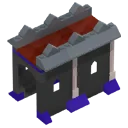

# Loot matrix 673

[Item database](../README.md) | [Methodology](../Methodology.md)

## Sources and mapped locations

| Kind | Source | Location evidence | Conditions |
| --- | --- | --- | --- |
| Package | [Surprise Model Pack (LOT 13117)](../sources/object-13117.md) | No matched local placement found | Static association, not a live-spawn guarantee |

## Item candidates

Default vendor-stock probabilities are shown only when this matrix has a registered vendor. Loot probabilities use the generic algorithm, not a guarantee of actual use by every script/activity.

| Item | Modeled loot chance / expected count | Default vendor stock |
| --- | --- | --- |
| { .lu-ti width="24" loading="lazy" } [Skeleton Ziggurat Model (LOT 12495)](../12495.md) | 17.64609375%; mean 0.1875 | Not associated with a vendor |
| { .lu-ti width="24" loading="lazy" } [Skeleton Watchtower Wall Model (LOT 12496)](../12496.md) | 17.64609375%; mean 0.1875 | Not associated with a vendor |
| { .lu-ti width="24" loading="lazy" } [Skeleton Corner Wall Model (LOT 12497)](../12497.md) | 73.96328125%; mean 1.0625 | Not associated with a vendor |
| { .lu-ti width="24" loading="lazy" } [Skeleton Wall Model (LOT 12498)](../12498.md) | 73.96328125%; mean 1.0625 | Not associated with a vendor |
| { .lu-ti width="24" loading="lazy" } [Skeleton T-Wall Model (LOT 12499)](../12499.md) | 4%; mean 0.04 | Not associated with a vendor |
| { .lu-ti width="24" loading="lazy" } [Skeleton Skull Tower Model (LOT 12500)](../12500.md) | 4%; mean 0.04 | Not associated with a vendor |
| { .lu-ti width="24" loading="lazy" } [Skeleton Short Wall Model (LOT 12501)](../12501.md) | 68%; mean 0.68 | Not associated with a vendor |
| { .lu-ti width="24" loading="lazy" } [Skeleton Ribcage Bridge Model (LOT 12502)](../12502.md) | 4%; mean 0.04 | Not associated with a vendor |
| { .lu-ti width="24" loading="lazy" } [Skeleton Repair Facility Model (LOT 12503)](../12503.md) | 2.25%; mean 0.0225 | Not associated with a vendor |
| { .lu-ti width="24" loading="lazy" } [Skeleton Wall Pillars Model (LOT 12504)](../12504.md) | 25.5%; mean 0.255 | Not associated with a vendor |
| { .lu-ti width="24" loading="lazy" } [Skeleton Mobile Drilling Rig Model (LOT 12505)](../12505.md) | 2.25%; mean 0.0225 | Not associated with a vendor |
| { .lu-ti width="24" loading="lazy" } [Skeleton Gate Model (LOT 12507)](../12507.md) | 1.5%; mean 0.015 | Not associated with a vendor |
| { .lu-ti width="24" loading="lazy" } [Skeleton Elevator Model (LOT 12508)](../12508.md) | 8.5%; mean 0.085 | Not associated with a vendor |

## Raw matrix entries

| Row | Loot table | Rarity table | Trigger | Min | Max | Flag | Gate |
| --- | --- | --- | --- | --- | --- | --- | --- |
| 3582 | 591 | 30 | 1 | 2 | 3 |  |  |
| 3583 | 592 | 30 | 0.8 | 1 | 1 |  |  |
| 3584 | 593 | 30 | 0.3 | 1 | 1 |  |  |
| 3585 | 594 | 30 | 0.1 | 1 | 1 |  |  |

[LootMatrix](../../../db/LootMatrix.md), [LootTable](../../../db/LootTable.md), [RarityTable](../../../db/RarityTable.md).
