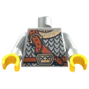
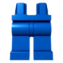

# Loot matrix 686

[Item database](../README.md) | [Methodology](../Methodology.md)

## Sources and mapped locations

| Kind | Source | Location evidence | Conditions |
| --- | --- | --- | --- |
| Package | [Nexus Tower Gift Bag (LOT 13529)](../sources/object-13529.md) | No matched local placement found | Static association, not a live-spawn guarantee |

## Item candidates

Default vendor-stock probabilities are shown only when this matrix has a registered vendor. Loot probabilities use the generic algorithm, not a guarantee of actual use by every script/activity.

| Item | Modeled loot chance / expected count | Default vendor stock |
| --- | --- | --- |
| { .lu-ti width="24" loading="lazy" } [Hot Chocolate (LOT 1883)](../1883.md) | 6.12080892%; mean 0.0625 | Not associated with a vendor |
| { .lu-ti width="24" loading="lazy" } [Healing Banana (LOT 1966)](../1966.md) | 6.12080892%; mean 0.0625 | Not associated with a vendor |
| { .lu-ti width="24" loading="lazy" } [Notion Potion (LOT 2198)](../2198.md) | 6.12080892%; mean 0.0625 | Not associated with a vendor |
| { .lu-ti width="24" loading="lazy" } [Chef Hat (LOT 2588)](../2588.md) | 0.62369893%; mean 0.00625 | Not associated with a vendor |
| { .lu-ti width="24" loading="lazy" } [Worthy Large Axe (LOT 2615)](../2615.md) | 6.12080892%; mean 0.0625 | Not associated with a vendor |
| { .lu-ti width="24" loading="lazy" } [Bullhorn (LOT 2617)](../2617.md) | 1.44750594%; mean 0.014545455 | Not associated with a vendor |
| { .lu-ti width="24" loading="lazy" } [Quicksicle (LOT 2620)](../2620.md) | 6.12080892%; mean 0.0625 | Not associated with a vendor |
| { .lu-ti width="24" loading="lazy" } [Improved Ladle (LOT 2622)](../2622.md) | 0.62369893%; mean 0.00625 | Not associated with a vendor |
| { .lu-ti width="24" loading="lazy" } [Wizard Hat (LOT 2623)](../2623.md) | 0.62369893%; mean 0.00625 | Not associated with a vendor |
| { .lu-ti width="24" loading="lazy" } [Armor Polish (LOT 2993)](../2993.md) | 6.12080892%; mean 0.0625 | Not associated with a vendor |
| { .lu-ti width="24" loading="lazy" } [Healing Cherry (LOT 2994)](../2994.md) | 6.12080892%; mean 0.0625 | Not associated with a vendor |
| { .lu-ti width="24" loading="lazy" } [Armor Shine (LOT 2996)](../2996.md) | 6.12080892%; mean 0.0625 | Not associated with a vendor |
| { .lu-ti width="24" loading="lazy" } [Strong Notion Potion (LOT 2998)](../2998.md) | 6.12080892%; mean 0.0625 | Not associated with a vendor |
| { .lu-ti width="24" loading="lazy" } [Green Imaginite (LOT 3039)](../3039.md) | 6.12080892%; mean 0.0625 | Not associated with a vendor |
| { .lu-ti width="24" loading="lazy" } [Red Imaginite (LOT 3040)](../3040.md) | 0.62369893%; mean 0.00625 | Not associated with a vendor |
| { .lu-ti width="24" loading="lazy" } [Improved Crescent Wrench (LOT 3077)](../3077.md) | 0.62369893%; mean 0.00625 | Not associated with a vendor |
| { .lu-ti width="24" loading="lazy" } [Superior Composite Mace (LOT 3121)](../3121.md) | 0.62369893%; mean 0.00625 | Not associated with a vendor |
| { .lu-ti width="24" loading="lazy" } [Witch Hat (LOT 3853)](../3853.md) | 0.62369893%; mean 0.00625 | Not associated with a vendor |
| { .lu-ti width="24" loading="lazy" } [Flower Hat (LOT 3858)](../3858.md) | 0.62369893%; mean 0.00625 | Not associated with a vendor |
| { .lu-ti width="24" loading="lazy" } [Police Hat (LOT 3859)](../3859.md) | 0.62369893%; mean 0.00625 | Not associated with a vendor |
| { .lu-ti width="24" loading="lazy" } [Hard Hat (LOT 3860)](../3860.md) | 0.62369893%; mean 0.00625 | Not associated with a vendor |
| { .lu-ti width="24" loading="lazy" } [Black Baseball Cap (LOT 3868)](../3868.md) | 0.62369893%; mean 0.00625 | Not associated with a vendor |
| { .lu-ti width="24" loading="lazy" } [Orange Baseball Cap (LOT 3869)](../3869.md) | 0.62369893%; mean 0.00625 | Not associated with a vendor |
| { .lu-ti width="24" loading="lazy" } [Improved Witch Broom (LOT 3870)](../3870.md) | 0.62369893%; mean 0.00625 | Not associated with a vendor |
| { .lu-ti width="24" loading="lazy" } [Basic Shovel (LOT 3872)](../3872.md) | 6.12080892%; mean 0.0625 | Not associated with a vendor |
| { .lu-ti width="24" loading="lazy" } [Improved Firefighter Axe (LOT 4824)](../4824.md) | 0.62369893%; mean 0.00625 | Not associated with a vendor |
| { .lu-ti width="24" loading="lazy" } [Black Neck Scarf (LOT 5682)](../5682.md) | 0.62369893%; mean 0.00625 | Not associated with a vendor |
| { .lu-ti width="24" loading="lazy" } [Basic Shortsword of Knockback (LOT 5948)](../5948.md) | 0.62369893%; mean 0.00625 | Not associated with a vendor |
| { .lu-ti width="24" loading="lazy" } [Maelstrom-Infected Brick (LOT 6194)](../6194.md) | 80%; mean 0.8 | Not associated with a vendor |
| { .lu-ti width="24" loading="lazy" } [Basic Spear of Stunning (LOT 6203)](../6203.md) | 0.62369893%; mean 0.00625 | Not associated with a vendor |
| { .lu-ti width="24" loading="lazy" } [Improved Fishing Pole (LOT 6742)](../6742.md) | 0.62369893%; mean 0.00625 | Not associated with a vendor |
| { .lu-ti width="24" loading="lazy" } [Hardtack Biscuit (LOT 6790)](../6790.md) | 6.12080892%; mean 0.0625 | Not associated with a vendor |
| { .lu-ti width="24" loading="lazy" } [Blue Baseball Cap (LOT 6803)](../6803.md) | 0.62369893%; mean 0.00625 | Not associated with a vendor |
| { .lu-ti width="24" loading="lazy" } [Buckler Shield (LOT 6849)](../6849.md) | 0.62369893%; mean 0.00625 | Not associated with a vendor |
| { .lu-ti width="24" loading="lazy" } [Blue Space Helmet (LOT 6850)](../6850.md) | 0.62369893%; mean 0.00625 | Not associated with a vendor |
| { .lu-ti width="24" loading="lazy" } [Worthy Knife (LOT 6851)](../6851.md) | 6.12080892%; mean 0.0625 | Not associated with a vendor |
| { .lu-ti width="24" loading="lazy" } [Morion Helmet (LOT 6853)](../6853.md) | 0.62369893%; mean 0.00625 | Not associated with a vendor |
| { .lu-ti width="24" loading="lazy" } [Improved Composite Axe (LOT 6881)](../6881.md) | 0.62369893%; mean 0.00625 | Not associated with a vendor |
| { .lu-ti width="24" loading="lazy" } [Flash Bang (LOT 6884)](../6884.md) | 6.12080892%; mean 0.0625 | Not associated with a vendor |
| { .lu-ti width="24" loading="lazy" } [Tasty Fish (LOT 6886)](../6886.md) | 6.12080892%; mean 0.0625 | Not associated with a vendor |
| { .lu-ti width="24" loading="lazy" } [Superior Lance (LOT 7070)](../7070.md) | 0.62369893%; mean 0.00625 | Not associated with a vendor |
| { .lu-ti width="24" loading="lazy" } [Boom Trap Kit (LOT 7084)](../7084.md) | 6.12080892%; mean 0.0625 | Not associated with a vendor |
| { .lu-ti width="24" loading="lazy" } [Skater Helmet (LOT 7728)](../7728.md) | 0.62369893%; mean 0.00625 | Not associated with a vendor |
| { .lu-ti width="24" loading="lazy" } [Viking Helm (LOT 7729)](../7729.md) | 0.62369893%; mean 0.00625 | Not associated with a vendor |
| { .lu-ti width="24" loading="lazy" } [Aussie Hat (LOT 7731)](../7731.md) | 0.62369893%; mean 0.00625 | Not associated with a vendor |
| { .lu-ti width="24" loading="lazy" } [Walkie Talkie (LOT 7732)](../7732.md) | 0.62369893%; mean 0.00625 | Not associated with a vendor |
| { .lu-ti width="24" loading="lazy" } [Improved Frying Pan (LOT 7733)](../7733.md) | 0.62369893%; mean 0.00625 | Not associated with a vendor |
| { .lu-ti width="24" loading="lazy" } [Improved Push Broom (LOT 7734)](../7734.md) | 0.62369893%; mean 0.00625 | Not associated with a vendor |
| { .lu-ti width="24" loading="lazy" } [Grey Kepi Hat (LOT 7793)](../7793.md) | 6.12080892%; mean 0.0625 | Not associated with a vendor |
| { .lu-ti width="24" loading="lazy" } [Blue Kepi Hat (LOT 7990)](../7990.md) | 1.9867%; mean 0.02 | Not associated with a vendor |
| { .lu-ti width="24" loading="lazy" } [Red Shako Hat (LOT 8085)](../8085.md) | 1.44750594%; mean 0.014545455 | Not associated with a vendor |
| { .lu-ti width="24" loading="lazy" } [Basic Dagger (LOT 8217)](../8217.md) | 6.12080892%; mean 0.0625 | Not associated with a vendor |
| { .lu-ti width="24" loading="lazy" } [Basic Pickaxe (LOT 8218)](../8218.md) | 6.12080892%; mean 0.0625 | Not associated with a vendor |
| { .lu-ti width="24" loading="lazy" } [Basic Javelin (LOT 8219)](../8219.md) | 6.12080892%; mean 0.0625 | Not associated with a vendor |
| { .lu-ti width="24" loading="lazy" } [Quality Cutlass (LOT 8497)](../8497.md) | 1.44750594%; mean 0.014545455 | Not associated with a vendor |
| { .lu-ti width="24" loading="lazy" } [Improved Hatchet (LOT 8498)](../8498.md) | 0.62369893%; mean 0.00625 | Not associated with a vendor |
| { .lu-ti width="24" loading="lazy" } [Quality Woodsman's Axe (LOT 8500)](../8500.md) | 1.44750594%; mean 0.014545455 | Not associated with a vendor |
| { .lu-ti width="24" loading="lazy" } [Improved Ice Saw (LOT 8501)](../8501.md) | 0.62369893%; mean 0.00625 | Not associated with a vendor |
| { .lu-ti width="24" loading="lazy" } [Improved Scimitar (LOT 8502)](../8502.md) | 0.62369893%; mean 0.00625 | Not associated with a vendor |
| { .lu-ti width="24" loading="lazy" } [Quality Corseque (LOT 8503)](../8503.md) | 1.44750594%; mean 0.014545455 | Not associated with a vendor |
| { .lu-ti width="24" loading="lazy" } [Improved Longsword (LOT 8504)](../8504.md) | 0.62369893%; mean 0.00625 | Not associated with a vendor |
| { .lu-ti width="24" loading="lazy" } [Basic Force Blade (LOT 8505)](../8505.md) | 6.12080892%; mean 0.0625 | Not associated with a vendor |
| { .lu-ti width="24" loading="lazy" } [Quality Dirk (LOT 8506)](../8506.md) | 1.44750594%; mean 0.014545455 | Not associated with a vendor |
| { .lu-ti width="24" loading="lazy" } [Improved Trident (LOT 8509)](../8509.md) | 0.62369893%; mean 0.00625 | Not associated with a vendor |
| { .lu-ti width="24" loading="lazy" } [Space Headgear (LOT 8546)](../8546.md) | 1.44750594%; mean 0.014545455 | Not associated with a vendor |
| { .lu-ti width="24" loading="lazy" } [Black Soccer Shirt (LOT 8604)](../8604.md) | 0.62369893%; mean 0.00625 | Not associated with a vendor |
| { .lu-ti width="24" loading="lazy" } [EMT Shirt (LOT 8615)](../8615.md) | 0.62369893%; mean 0.00625 | Not associated with a vendor |
| { .lu-ti width="24" loading="lazy" } [Female Pirate Shirt (LOT 8618)](../8618.md) | 0.62369893%; mean 0.00625 | Not associated with a vendor |
| { .lu-ti width="24" loading="lazy" } [Dark Blue Princess Shirt (LOT 8623)](../8623.md) | 0.62369893%; mean 0.00625 | Not associated with a vendor |
| { .lu-ti width="24" loading="lazy" } [Mail Shirt with Belt (LOT 8625)](../8625.md) | 0.62369893%; mean 0.00625 | Not associated with a vendor |
| { .lu-ti width="24" loading="lazy" } [Khakis (LOT 8646)](../8646.md) | 0.62369893%; mean 0.00625 | Not associated with a vendor |
| { .lu-ti width="24" loading="lazy" } [Cargo Pants (LOT 8647)](../8647.md) | 1.44750594%; mean 0.014545455 | Not associated with a vendor |
| { .lu-ti width="24" loading="lazy" } [Jeans (LOT 8648)](../8648.md) | 1.44750594%; mean 0.014545455 | Not associated with a vendor |
| { .lu-ti width="24" loading="lazy" } [Jodhpurs (LOT 8664)](../8664.md) | 0.62369893%; mean 0.00625 | Not associated with a vendor |
| { .lu-ti width="24" loading="lazy" } [Sweat Pants (LOT 8666)](../8666.md) | 0.62369893%; mean 0.00625 | Not associated with a vendor |
| { .lu-ti width="24" loading="lazy" } [Clam Diggers (LOT 8667)](../8667.md) | 0.62369893%; mean 0.00625 | Not associated with a vendor |
| { .lu-ti width="24" loading="lazy" } [Reinforced Pith Helmet (LOT 8675)](../8675.md) | 1.44750594%; mean 0.014545455 | Not associated with a vendor |
| { .lu-ti width="24" loading="lazy" } [Cadet Helm (LOT 8676)](../8676.md) | 1.9867%; mean 0.02 | Not associated with a vendor |
| { .lu-ti width="24" loading="lazy" } [Garden Shovel (LOT 9259)](../9259.md) | 0.62369893%; mean 0.00625 | Not associated with a vendor |
| { .lu-ti width="24" loading="lazy" } [Improved Crescent Wrench (LOT 9263)](../9263.md) | 0.62369893%; mean 0.00625 | Not associated with a vendor |
| { .lu-ti width="24" loading="lazy" } [Cup of Yo (LOT 10038)](../10038.md) | 1.44750594%; mean 0.014545455 | Not associated with a vendor |
| { .lu-ti width="24" loading="lazy" } [Basic Shortsword (LOT 10431)](../10431.md) | 6.12080892%; mean 0.0625 | Not associated with a vendor |
| { .lu-ti width="24" loading="lazy" } [Basic Spear (LOT 10432)](../10432.md) | 6.12080892%; mean 0.0625 | Not associated with a vendor |
| { .lu-ti width="24" loading="lazy" } [Basic Hammer (LOT 10433)](../10433.md) | 6.12080892%; mean 0.0625 | Not associated with a vendor |
| { .lu-ti width="24" loading="lazy" } [Handsome Mug (LOT 11299)](../11299.md) | 0.62369893%; mean 0.00625 | Not associated with a vendor |
| { .lu-ti width="24" loading="lazy" } [Improved Revolver (LOT 11432)](../11432.md) | 0.62369893%; mean 0.00625 | Not associated with a vendor |

## Raw matrix entries

| Row | Loot table | Rarity table | Trigger | Min | Max | Flag | Gate |
| --- | --- | --- | --- | --- | --- | --- | --- |
| 3723 | 88 | 23 | 0.8 | 1 | 1 |  |  |
| 3724 | 575 | 4 | 1 | 1 | 3 |  |  |

[LootMatrix](../../../db/LootMatrix.md), [LootTable](../../../db/LootTable.md), [RarityTable](../../../db/RarityTable.md).
