# Loot matrix 690

[Item database](../README.md) | [Methodology](../Methodology.md)

## Sources and mapped locations

| Kind | Source | Location evidence | Conditions |
| --- | --- | --- | --- |
| Activity | NT Quickbuilds (activity ID 110, rating threshold 1, reward 170) | Selected only if this is the highest eligible rating threshold; instance zone not specified. | NT Quickbuilds (activity ID 110, rating threshold 1, reward 170); Selected only if this is the highest eligible rating threshold; instance zone not specified.; Static association, not a live-spawn guarantee |
| Activity | NT Imagination Collector 1 (activity ID 12408, rating threshold 1, reward 152) | Selected only if this is the highest eligible rating threshold; instance zone not specified. | NT Imagination Collector 1 (activity ID 12408, rating threshold 1, reward 152); Selected only if this is the highest eligible rating threshold; instance zone not specified.; Static association, not a live-spawn guarantee |
| Activity | NT Imagination Collector 2 (activity ID 12409, rating threshold 1, reward 153) | Selected only if this is the highest eligible rating threshold; instance zone not specified. | NT Imagination Collector 2 (activity ID 12409, rating threshold 1, reward 153); Selected only if this is the highest eligible rating threshold; instance zone not specified.; Static association, not a live-spawn guarantee |
| Activity | NT Imagination Collector 3 (activity ID 12410, rating threshold 1, reward 154) | Selected only if this is the highest eligible rating threshold; instance zone not specified. | NT Imagination Collector 3 (activity ID 12410, rating threshold 1, reward 154); Selected only if this is the highest eligible rating threshold; instance zone not specified.; Static association, not a live-spawn guarantee |
| Activity | NT Pipe Rebuild 1 (activity ID 12411, rating threshold 1, reward 151) | Selected only if this is the highest eligible rating threshold; instance zone not specified. | NT Pipe Rebuild 1 (activity ID 12411, rating threshold 1, reward 151); Selected only if this is the highest eligible rating threshold; instance zone not specified.; Static association, not a live-spawn guarantee |
| Activity | NT Pipe Rebuild 2 (activity ID 12412, rating threshold 1, reward 155) | Selected only if this is the highest eligible rating threshold; instance zone not specified. | NT Pipe Rebuild 2 (activity ID 12412, rating threshold 1, reward 155); Selected only if this is the highest eligible rating threshold; instance zone not specified.; Static association, not a live-spawn guarantee |
| Activity | NT Pipe Rebuild 3 (activity ID 12413, rating threshold 1, reward 156) | Selected only if this is the highest eligible rating threshold; instance zone not specified. | NT Pipe Rebuild 3 (activity ID 12413, rating threshold 1, reward 156); Selected only if this is the highest eligible rating threshold; instance zone not specified.; Static association, not a live-spawn guarantee |
| Activity | NT Pipe Rebuild 4 (activity ID 12414, rating threshold 1, reward 157) | Selected only if this is the highest eligible rating threshold; instance zone not specified. | NT Pipe Rebuild 4 (activity ID 12414, rating threshold 1, reward 157); Selected only if this is the highest eligible rating threshold; instance zone not specified.; Static association, not a live-spawn guarantee |
| Activity | NT Pipe Rebuild 5 (activity ID 12415, rating threshold 1, reward 158) | Selected only if this is the highest eligible rating threshold; instance zone not specified. | NT Pipe Rebuild 5 (activity ID 12415, rating threshold 1, reward 158); Selected only if this is the highest eligible rating threshold; instance zone not specified.; Static association, not a live-spawn guarantee |
| Activity | NT Pipe Rebuild 6 (activity ID 12416, rating threshold 1, reward 159) | Selected only if this is the highest eligible rating threshold; instance zone not specified. | NT Pipe Rebuild 6 (activity ID 12416, rating threshold 1, reward 159); Selected only if this is the highest eligible rating threshold; instance zone not specified.; Static association, not a live-spawn guarantee |
| Activity | NT - Parrot Collectable (activity ID 12420, rating threshold 1, reward 160) | Selected only if this is the highest eligible rating threshold; instance zone not specified. | NT - Parrot Collectable (activity ID 12420, rating threshold 1, reward 160); Selected only if this is the highest eligible rating threshold; instance zone not specified.; Static association, not a live-spawn guarantee |

## Item candidates

Default vendor-stock probabilities are shown only when this matrix has a registered vendor. Loot probabilities use the generic algorithm, not a guarantee of actual use by every script/activity.

| Item | Modeled loot chance / expected count | Default vendor stock |
| --- | --- | --- |
| { .lu-ti width="24" loading="lazy" } [Technic Brick 1x4 (LOT 3)](../3.md) | 0.00350877%; mean 0.000035087719 | Not associated with a vendor |
| 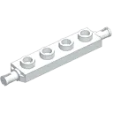{ .lu-ti width="24" loading="lazy" } [Plate 1x4 with 2 Snaps (LOT 28)](../28.md) | 0.002849%; mean 0.000028490028 | Not associated with a vendor |
| { .lu-ti width="24" loading="lazy" } [Brick 2x4 (LOT 29)](../29.md) | 1.81818182%; mean 0.018181818 | Not associated with a vendor |
| { .lu-ti width="24" loading="lazy" } [Brick 2x3 (LOT 30)](../30.md) | 1.81818182%; mean 0.018181818 | Not associated with a vendor |
| { .lu-ti width="24" loading="lazy" } [Brick 2x2 (LOT 31)](../31.md) | 1.81818182%; mean 0.018181818 | Not associated with a vendor |
| { .lu-ti width="24" loading="lazy" } [Brick 1x2 (LOT 32)](../32.md) | 1.81818182%; mean 0.018181818 | Not associated with a vendor |
| { .lu-ti width="24" loading="lazy" } [Brick 1x1 (LOT 33)](../33.md) | 1.81818182%; mean 0.018181818 | Not associated with a vendor |
| { .lu-ti width="24" loading="lazy" } [Brick 2x8 (LOT 35)](../35.md) | 1.81818182%; mean 0.018181818 | Not associated with a vendor |
| { .lu-ti width="24" loading="lazy" } [Brick 1x8 (LOT 36)](../36.md) | 1.81818182%; mean 0.018181818 | Not associated with a vendor |
| { .lu-ti width="24" loading="lazy" } [Brick 1x6 (LOT 37)](../37.md) | 1.81818182%; mean 0.018181818 | Not associated with a vendor |
| { .lu-ti width="24" loading="lazy" } [Brick 1x4 (LOT 38)](../38.md) | 1.81818182%; mean 0.018181818 | Not associated with a vendor |
| { .lu-ti width="24" loading="lazy" } [Plate 2x4 (LOT 39)](../39.md) | 1.81818182%; mean 0.018181818 | Not associated with a vendor |
| { .lu-ti width="24" loading="lazy" } [Plate 2x3 (LOT 40)](../40.md) | 1.81818182%; mean 0.018181818 | Not associated with a vendor |
| { .lu-ti width="24" loading="lazy" } [Plate 1x2 (LOT 41)](../41.md) | 1.81818182%; mean 0.018181818 | Not associated with a vendor |
| { .lu-ti width="24" loading="lazy" } [Plate 1x1 (LOT 42)](../42.md) | 1.81818182%; mean 0.018181818 | Not associated with a vendor |
| { .lu-ti width="24" loading="lazy" } [Plate 1x8 (LOT 58)](../58.md) | 1.81818182%; mean 0.018181818 | Not associated with a vendor |
| { .lu-ti width="24" loading="lazy" } [Brick 1x3 (LOT 59)](../59.md) | 1.81818182%; mean 0.018181818 | Not associated with a vendor |
| { .lu-ti width="24" loading="lazy" } [Plate 1x3 (LOT 60)](../60.md) | 1.81818182%; mean 0.018181818 | Not associated with a vendor |
| { .lu-ti width="24" loading="lazy" } [Plate 1x6 (LOT 62)](../62.md) | 1.81818182%; mean 0.018181818 | Not associated with a vendor |
| 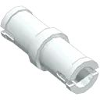{ .lu-ti width="24" loading="lazy" } [Technic Pin (LOT 63)](../63.md) | 0.00350877%; mean 0.000035087719 | Not associated with a vendor |
| 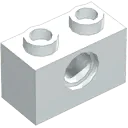{ .lu-ti width="24" loading="lazy" } [Technic Brick 1x2 (LOT 64)](../64.md) | 0.00350877%; mean 0.000035087719 | Not associated with a vendor |
| 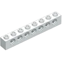{ .lu-ti width="24" loading="lazy" } [Technic Brick 1x8 (LOT 65)](../65.md) | 0.00350877%; mean 0.000035087719 | Not associated with a vendor |
| { .lu-ti width="24" loading="lazy" } [Plate 1x4 (LOT 66)](../66.md) | 1.81818182%; mean 0.018181818 | Not associated with a vendor |
| { .lu-ti width="24" loading="lazy" } [Windscreen 2x4x2 (LOT 67)](../67.md) | 0.002849%; mean 0.000028490028 | Not associated with a vendor |
| { .lu-ti width="24" loading="lazy" } [Panel 1x2x3 (LOT 71)](../71.md) | 0.002849%; mean 0.000028490028 | Not associated with a vendor |
| 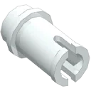{ .lu-ti width="24" loading="lazy" } [Technic Pin 0.5 (LOT 72)](../72.md) | 0.00350877%; mean 0.000035087719 | Not associated with a vendor |
| { .lu-ti width="24" loading="lazy" } [Plate 2x2 with Snap (LOT 74)](../74.md) | 0.002849%; mean 0.000028490028 | Not associated with a vendor |
| { .lu-ti width="24" loading="lazy" } [Rim Ø11 Wide (LOT 78)](../78.md) | 0.002849%; mean 0.000028490028 | Not associated with a vendor |
| 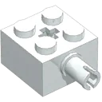{ .lu-ti width="24" loading="lazy" } [Brick 2x2 with Pin (LOT 85)](../85.md) | 0.00350877%; mean 0.000035087719 | Not associated with a vendor |
| { .lu-ti width="24" loading="lazy" } [Rim Ø8 Wide (LOT 87)](../87.md) | 0.002849%; mean 0.000028490028 | Not associated with a vendor |
| 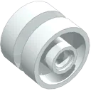{ .lu-ti width="24" loading="lazy" } [Hub Ø17.6 x 14mm (LOT 91)](../91.md) | 0.002849%; mean 0.000028490028 | Not associated with a vendor |
| { .lu-ti width="24" loading="lazy" } [Tire Ø30.4 (LOT 94)](../94.md) | 0.002849%; mean 0.000028490028 | Not associated with a vendor |
| { .lu-ti width="24" loading="lazy" } [Tire Ø24 Wide (LOT 95)](../95.md) | 0.002849%; mean 0.000028490028 | Not associated with a vendor |
| { .lu-ti width="24" loading="lazy" } [Brick 2x6 (LOT 98)](../98.md) | 1.81818182%; mean 0.018181818 | Not associated with a vendor |
| { .lu-ti width="24" loading="lazy" } [Plate 2x2 with Bilateral Wheel Bearings (LOT 102)](../102.md) | 0.002849%; mean 0.000028490028 | Not associated with a vendor |
| { .lu-ti width="24" loading="lazy" } [Rim Ø18 Wide  (LOT 106)](../106.md) | 0.002849%; mean 0.000028490028 | Not associated with a vendor |
| { .lu-ti width="24" loading="lazy" } [Plate 2x2 with 2 Snaps (LOT 116)](../116.md) | 0.002849%; mean 0.000028490028 | Not associated with a vendor |
| 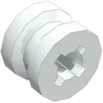{ .lu-ti width="24" loading="lazy" } [Rim Ø8 (LOT 117)](../117.md) | 0.00350877%; mean 0.000035087719 | Not associated with a vendor |
| { .lu-ti width="24" loading="lazy" } [Slope Brick 45° 2x4 Inverted Double with Cut-Out (LOT 119)](../119.md) | 0.002849%; mean 0.000028490028 | Not associated with a vendor |
| 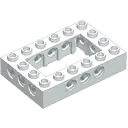{ .lu-ti width="24" loading="lazy" } [Technic Brick Framing 4x6 (LOT 123)](../123.md) | 0.00350877%; mean 0.000035087719 | Not associated with a vendor |
| { .lu-ti width="24" loading="lazy" } [Plate 2x6 (LOT 144)](../144.md) | 1.81818182%; mean 0.018181818 | Not associated with a vendor |
| 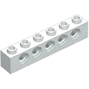{ .lu-ti width="24" loading="lazy" } [Technic Brick 1x6 (LOT 341)](../341.md) | 0.00350877%; mean 0.000035087719 | Not associated with a vendor |
| 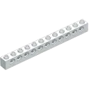{ .lu-ti width="24" loading="lazy" } [Technic Brick 1x12 (LOT 342)](../342.md) | 0.00350877%; mean 0.000035087719 | Not associated with a vendor |
| { .lu-ti width="24" loading="lazy" } [Cone 2x2x2 (LOT 345)](../345.md) | 0.002849%; mean 0.000028490028 | Not associated with a vendor |
| { .lu-ti width="24" loading="lazy" } [Cone 4x4x2 (LOT 346)](../346.md) | 0.002849%; mean 0.000028490028 | Not associated with a vendor |
| { .lu-ti width="24" loading="lazy" } [Bracket Plate 2x2 - 2x2 (LOT 347)](../347.md) | 0.002849%; mean 0.000028490028 | Not associated with a vendor |
| { .lu-ti width="24" loading="lazy" } [Tipper Body 4x6-Base (LOT 356)](../356.md) | 0.002849%; mean 0.000028490028 | Not associated with a vendor |
| 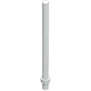{ .lu-ti width="24" loading="lazy" } [Bar 6 with Stop (LOT 359)](../359.md) | 0.00350877%; mean 0.000035087719 | Not associated with a vendor |
| { .lu-ti width="24" loading="lazy" } [Car Chassis Plate 4x10 (LOT 371)](../371.md) | 0.002849%; mean 0.000028490028 | Not associated with a vendor |
| 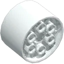{ .lu-ti width="24" loading="lazy" } [Technic Hub 30x20 (LOT 378)](../378.md) | 0.00350877%; mean 0.000035087719 | Not associated with a vendor |
| { .lu-ti width="24" loading="lazy" } [Windscreen 2x4x2 Inverted (LOT 380)](../380.md) | 0.002849%; mean 0.000028490028 | Not associated with a vendor |
| { .lu-ti width="24" loading="lazy" } [Balloon Tire Ø8/Ø21 (LOT 382)](../382.md) | 0.002849%; mean 0.000028490028 | Not associated with a vendor |
| { .lu-ti width="24" loading="lazy" } [Stanchion 2x4x5 Inclined (LOT 389)](../389.md) | 0.002849%; mean 0.000028490028 | Not associated with a vendor |
| { .lu-ti width="24" loading="lazy" } [Wagon Wheel Spoked, Large (LOT 391)](../391.md) | 0.002849%; mean 0.000028490028 | Not associated with a vendor |
| { .lu-ti width="24" loading="lazy" } [Brick 2x2x2 Round with Fins (LOT 402)](../402.md) | 0.002849%; mean 0.000028490028 | Not associated with a vendor |
| { .lu-ti width="24" loading="lazy" } [Windscreen 2x4x2 Vertical (LOT 403)](../403.md) | 0.002849%; mean 0.000028490028 | Not associated with a vendor |
| { .lu-ti width="24" loading="lazy" } [Plate 1x2 with Lattice Strut and End Tube (LOT 405)](../405.md) | 0.002849%; mean 0.000028490028 | Not associated with a vendor |
| { .lu-ti width="24" loading="lazy" } [Cockpit Bottom 6x6x1 1/3 (LOT 406)](../406.md) | 0.002849%; mean 0.000028490028 | Not associated with a vendor |
| 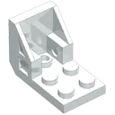{ .lu-ti width="24" loading="lazy" } [Bracket 2x3 - 2x2 (LOT 407)](../407.md) | 0.002849%; mean 0.000028490028 | Not associated with a vendor |
| { .lu-ti width="24" loading="lazy" } [Propeller 3 Blades Ø5.5 (LOT 409)](../409.md) | 0.002849%; mean 0.000028490028 | Not associated with a vendor |
| { .lu-ti width="24" loading="lazy" } [Angle Bracket 2x8 (LOT 413)](../413.md) | 0.002849%; mean 0.000028490028 | Not associated with a vendor |
| { .lu-ti width="24" loading="lazy" } [Cone 4x4x2 Hollow (LOT 416)](../416.md) | 0.002849%; mean 0.000028490028 | Not associated with a vendor |
| { .lu-ti width="24" loading="lazy" } [Slope Brick 45° 4x4 Inverted Double with Cut-Out (LOT 420)](../420.md) | 0.002849%; mean 0.000028490028 | Not associated with a vendor |
| { .lu-ti width="24" loading="lazy" } [Wedge 4x4 Triple, Inverted (LOT 421)](../421.md) | 0.002849%; mean 0.000028490028 | Not associated with a vendor |
| { .lu-ti width="24" loading="lazy" } [Wedge 4x6 Inverted (LOT 422)](../422.md) | 0.002849%; mean 0.000028490028 | Not associated with a vendor |
| { .lu-ti width="24" loading="lazy" } [Wedge 4x4 with Cut-Out (LOT 423)](../423.md) | 0.002849%; mean 0.000028490028 | Not associated with a vendor |
| { .lu-ti width="24" loading="lazy" } [Jet Turbine with 2x2 Base (LOT 429)](../429.md) | 0.002849%; mean 0.000028490028 | Not associated with a vendor |
| { .lu-ti width="24" loading="lazy" } [Blades for Jet Turbine (LOT 430)](../430.md) | 0.002849%; mean 0.000028490028 | Not associated with a vendor |
| { .lu-ti width="24" loading="lazy" } [Plate 2x2 with Landing Gear (LOT 431)](../431.md) | 0.002849%; mean 0.000028490028 | Not associated with a vendor |
| { .lu-ti width="24" loading="lazy" } [Inverted Windscreen 3x4x4 (LOT 432)](../432.md) | 0.002849%; mean 0.000028490028 | Not associated with a vendor |
| { .lu-ti width="24" loading="lazy" } [Shroud, Small (LOT 447)](../447.md) | 0.002849%; mean 0.000028490028 | Not associated with a vendor |
| { .lu-ti width="24" loading="lazy" } [Plate 10x10 Octagonal with Cut-Out (LOT 451)](../451.md) | 0.002849%; mean 0.000028490028 | Not associated with a vendor |
| { .lu-ti width="24" loading="lazy" } [Windscreen 2x5X1 1/3 (LOT 456)](../456.md) | 0.002849%; mean 0.000028490028 | Not associated with a vendor |
| { .lu-ti width="24" loading="lazy" } [Angle Bracket 2x5x2 1/3 (LOT 460)](../460.md) | 0.002849%; mean 0.000028490028 | Not associated with a vendor |
| { .lu-ti width="24" loading="lazy" } [Wheel Hard-Plastic Ø24 Small (LOT 467)](../467.md) | 0.002849%; mean 0.000028490028 | Not associated with a vendor |
| 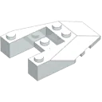{ .lu-ti width="24" loading="lazy" } [Brick 4x6 Wedge with Cut-Out (LOT 472)](../472.md) | 0.002849%; mean 0.000028490028 | Not associated with a vendor |
| { .lu-ti width="24" loading="lazy" } [Plate 2x2 2/3 with 2 Snaps (LOT 473)](../473.md) | 0.002849%; mean 0.000028490028 | Not associated with a vendor |
| 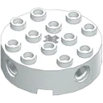{ .lu-ti width="24" loading="lazy" } [Technic Brick 4x4 Round (LOT 486)](../486.md) | 0.00350877%; mean 0.000035087719 | Not associated with a vendor |
| { .lu-ti width="24" loading="lazy" } [Cone 3x3x2 (LOT 488)](../488.md) | 0.002849%; mean 0.000028490028 | Not associated with a vendor |
| { .lu-ti width="24" loading="lazy" } [Tail Fin 2x6x4 (LOT 491)](../491.md) | 0.002849%; mean 0.000028490028 | Not associated with a vendor |
| { .lu-ti width="24" loading="lazy" } [Hub Ø17mm with 4 Studs (LOT 492)](../492.md) | 0.002849%; mean 0.000028490028 | Not associated with a vendor |
| { .lu-ti width="24" loading="lazy" } [Brick 2x4 with 2 Pins (LOT 493)](../493.md) | 0.002849%; mean 0.000028490028 | Not associated with a vendor |
| { .lu-ti width="24" loading="lazy" } [Brick 2x2 with Cross Axle Hole and 2 Pins (LOT 506)](../506.md) | 0.002849%; mean 0.000028490028 | Not associated with a vendor |
| { .lu-ti width="24" loading="lazy" } [Tire Ø14.4 Smooth, Wide (LOT 509)](../509.md) | 0.002849%; mean 0.000028490028 | Not associated with a vendor |
| { .lu-ti width="24" loading="lazy" } [Radiator Grille 1x4x2 (LOT 533)](../533.md) | 0.002849%; mean 0.000028490028 | Not associated with a vendor |
| { .lu-ti width="24" loading="lazy" } [Hub with Spokes Ø17 (LOT 536)](../536.md) | 0.002849%; mean 0.000028490028 | Not associated with a vendor |
| 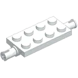{ .lu-ti width="24" loading="lazy" } [Plate 2x4 with 2 Pins (LOT 538)](../538.md) | 0.002849%; mean 0.000028490028 | Not associated with a vendor |
| { .lu-ti width="24" loading="lazy" } [Slope Brick 45° 2x10x2 Double (LOT 540)](../540.md) | 0.002849%; mean 0.000028490028 | Not associated with a vendor |
| { .lu-ti width="24" loading="lazy" } [Motorbike Front Fork (LOT 542)](../542.md) | 0.002849%; mean 0.000028490028 | Not associated with a vendor |
| { .lu-ti width="24" loading="lazy" } [Rim for Motorcycle (LOT 543)](../543.md) | 0.002849%; mean 0.000028490028 | Not associated with a vendor |
| { .lu-ti width="24" loading="lazy" } [Landing Skid 12x6x1 1/3 (LOT 550)](../550.md) | 0.002849%; mean 0.000028490028 | Not associated with a vendor |
| 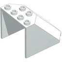{ .lu-ti width="24" loading="lazy" } [Cockpit Glass 4x5x3 (LOT 552)](../552.md) | 0.002849%; mean 0.000028490028 | Not associated with a vendor |
| 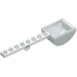{ .lu-ti width="24" loading="lazy" } [Catapult Arm 12 (LOT 554)](../554.md) | 0.002849%; mean 0.000028490028 | Not associated with a vendor |
| { .lu-ti width="24" loading="lazy" } [Catwalk 3x14x2 1/3 (LOT 557)](../557.md) | 0.002849%; mean 0.000028490028 | Not associated with a vendor |
| { .lu-ti width="24" loading="lazy" } [Tipper Bucket 8x12x3 1/3  (LOT 558)](../558.md) | 0.002849%; mean 0.000028490028 | Not associated with a vendor |
| { .lu-ti width="24" loading="lazy" } [Plate 6x6x2/3 Cross with Dome (LOT 559)](../559.md) | 0.002849%; mean 0.000028490028 | Not associated with a vendor |
| 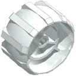{ .lu-ti width="24" loading="lazy" } [Wheel Hard-Plastic Ø43 with Treads (LOT 561)](../561.md) | 0.002849%; mean 0.000028490028 | Not associated with a vendor |
| { .lu-ti width="24" loading="lazy" } [Propeller Ø7 with 3 Blades and Pin Hole (LOT 562)](../562.md) | 0.002849%; mean 0.000028490028 | Not associated with a vendor |
| { .lu-ti width="24" loading="lazy" } [Thruster with Grill on 2x2-Tile (LOT 569)](../569.md) | 0.002849%; mean 0.000028490028 | Not associated with a vendor |
| { .lu-ti width="24" loading="lazy" } [Brick with Shaft 1x8x1 (LOT 570)](../570.md) | 0.002849%; mean 0.000028490028 | Not associated with a vendor |
| { .lu-ti width="24" loading="lazy" } [Windscreen 3x6x5 (LOT 575)](../575.md) | 0.002849%; mean 0.000028490028 | Not associated with a vendor |
| { .lu-ti width="24" loading="lazy" } [Cockpit 4x7x2 Angular with Vertical Fork (LOT 577)](../577.md) | 0.002849%; mean 0.000028490028 | Not associated with a vendor |
| 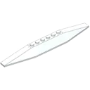{ .lu-ti width="24" loading="lazy" } [Wedge 11° Double 2x16 (LOT 580)](../580.md) | 0.002849%; mean 0.000028490028 | Not associated with a vendor |
| { .lu-ti width="24" loading="lazy" } [Cockpit 19° Bowed Type 2 (LOT 582)](../582.md) | 0.002849%; mean 0.000028490028 | Not associated with a vendor |
| { .lu-ti width="24" loading="lazy" } [Shovel 4x6x2 1/3 with Vertical Fork (LOT 588)](../588.md) | 0.002849%; mean 0.000028490028 | Not associated with a vendor |
| { .lu-ti width="24" loading="lazy" } [Flap 2x8 with Vertical Fork (LOT 589)](../589.md) | 0.002849%; mean 0.000028490028 | Not associated with a vendor |
| { .lu-ti width="24" loading="lazy" } [Engine Block 2x2x2 2/3 Sloped (LOT 605)](../605.md) | 0.002849%; mean 0.000028490028 | Not associated with a vendor |
| { .lu-ti width="24" loading="lazy" } [Bonnet 2x2 Curved (LOT 606)](../606.md) | 0.002849%; mean 0.000028490028 | Not associated with a vendor |
| 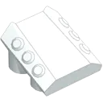{ .lu-ti width="24" loading="lazy" } [Bonnet 2x2 Motor (LOT 607)](../607.md) | 0.002849%; mean 0.000028490028 | Not associated with a vendor |
| { .lu-ti width="24" loading="lazy" } [Rotor 4x16x1 with 2 Blades (LOT 608)](../608.md) | 0.002849%; mean 0.000028490028 | Not associated with a vendor |
| 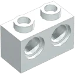{ .lu-ti width="24" loading="lazy" } [Technic Brick 1x2 with 2 Pin Holes (LOT 610)](../610.md) | 0.00350877%; mean 0.000035087719 | Not associated with a vendor |
| 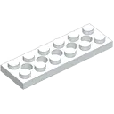{ .lu-ti width="24" loading="lazy" } [Technic Plate 2x6 (LOT 611)](../611.md) | 0.00350877%; mean 0.000035087719 | Not associated with a vendor |
| 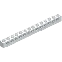{ .lu-ti width="24" loading="lazy" } [Technic Brick 1x14 (LOT 612)](../612.md) | 0.00350877%; mean 0.000035087719 | Not associated with a vendor |
| 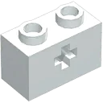{ .lu-ti width="24" loading="lazy" } [Technic Brick 1x2 with Cross Axle Hole (LOT 615)](../615.md) | 0.00350877%; mean 0.000035087719 | Not associated with a vendor |
| 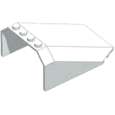{ .lu-ti width="24" loading="lazy" } [Windscreen 6x8x3 (LOT 616)](../616.md) | 0.002849%; mean 0.000028490028 | Not associated with a vendor |
| { .lu-ti width="24" loading="lazy" } [Technic Rotor 3 Blades (LOT 617)](../617.md) | 0.00350877%; mean 0.000035087719 | Not associated with a vendor |
| 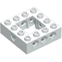{ .lu-ti width="24" loading="lazy" } [Technic Brick Framing 4x4 (LOT 618)](../618.md) | 0.00350877%; mean 0.000035087719 | Not associated with a vendor |
| 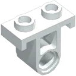{ .lu-ti width="24" loading="lazy" } [Plate 1x2 with Technic Beam (LOT 619)](../619.md) | 0.00350877%; mean 0.000035087719 | Not associated with a vendor |
| 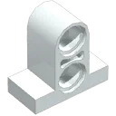{ .lu-ti width="24" loading="lazy" } [Tile 1x2 with Technic Beam (LOT 620)](../620.md) | 0.00350877%; mean 0.000035087719 | Not associated with a vendor |
| 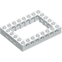{ .lu-ti width="24" loading="lazy" } [Technic Brick Framing 6x8 (LOT 621)](../621.md) | 0.00350877%; mean 0.000035087719 | Not associated with a vendor |
| 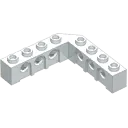{ .lu-ti width="24" loading="lazy" } [Technic Brick Corner 5x5 (LOT 622)](../622.md) | 0.00350877%; mean 0.000035087719 | Not associated with a vendor |
| { .lu-ti width="24" loading="lazy" } [Dinghy 8x18x3 1/3 (LOT 623)](../623.md) | 0.002849%; mean 0.000028490028 | Not associated with a vendor |
| { .lu-ti width="24" loading="lazy" } [Spoked Wheel Ø43 (LOT 624)](../624.md) | 0.002849%; mean 0.000028490028 | Not associated with a vendor |
| 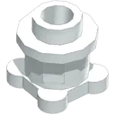{ .lu-ti width="24" loading="lazy" } [2/3 Brick 1x1 Round with Flanges (LOT 626)](../626.md) | 0.00350877%; mean 0.000035087719 | Not associated with a vendor |
| 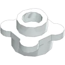{ .lu-ti width="24" loading="lazy" } [Plate 1x1 Round with Flanges (LOT 627)](../627.md) | 0.00350877%; mean 0.000035087719 | Not associated with a vendor |
| 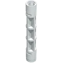{ .lu-ti width="24" loading="lazy" } [Technic Column for Spiral Staircase (LOT 631)](../631.md) | 0.00350877%; mean 0.000035087719 | Not associated with a vendor |
| { .lu-ti width="24" loading="lazy" } [Saw Blade, Round Ø36.7 (LOT 635)](../635.md) | 0.002849%; mean 0.000028490028 | Not associated with a vendor |
| 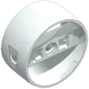{ .lu-ti width="24" loading="lazy" } [Technic 4x4 Connector Ring (LOT 636)](../636.md) | 0.00350877%; mean 0.000035087719 | Not associated with a vendor |
| 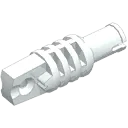{ .lu-ti width="24" loading="lazy" } [1x3 with Pin and Vertical Stub (LOT 637)](../637.md) | 0.00350877%; mean 0.000035087719 | Not associated with a vendor |
| 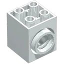{ .lu-ti width="24" loading="lazy" } [Technic Brick 2x2x2 with Click Joint Opening (LOT 638)](../638.md) | 0.00350877%; mean 0.000035087719 | Not associated with a vendor |
| 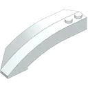{ .lu-ti width="24" loading="lazy" } [Wedge 3x8x2 Curved Right (LOT 643)](../643.md) | 0.002849%; mean 0.000028490028 | Not associated with a vendor |
| { .lu-ti width="24" loading="lazy" } [Wedge 3x8x2 Curved Left (LOT 644)](../644.md) | 0.002849%; mean 0.000028490028 | Not associated with a vendor |
| 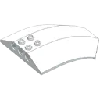{ .lu-ti width="24" loading="lazy" } [Shell 6x8x2 (LOT 645)](../645.md) | 0.002849%; mean 0.000028490028 | Not associated with a vendor |
| { .lu-ti width="24" loading="lazy" } [Shell 6x8x2 Inverted (LOT 646)](../646.md) | 0.002849%; mean 0.000028490028 | Not associated with a vendor |
| { .lu-ti width="24" loading="lazy" } [Plate 2x2 with Wedged Fenders (LOT 655)](../655.md) | 0.002849%; mean 0.000028490028 | Not associated with a vendor |
| { .lu-ti width="24" loading="lazy" } [Bonnet 2x2 (LOT 656)](../656.md) | 0.002849%; mean 0.000028490028 | Not associated with a vendor |
| { .lu-ti width="24" loading="lazy" } [Plate 2x4 with Grille (LOT 657)](../657.md) | 0.002849%; mean 0.000028490028 | Not associated with a vendor |
| { .lu-ti width="24" loading="lazy" } [Cockpit 4x6x2 Curved (LOT 658)](../658.md) | 0.002849%; mean 0.000028490028 | Not associated with a vendor |
| { .lu-ti width="24" loading="lazy" } [Turbine 4x5x3 with 8 Studs (LOT 661)](../661.md) | 0.002849%; mean 0.000028490028 | Not associated with a vendor |
| { .lu-ti width="24" loading="lazy" } [Turbine Wheel with Pin (LOT 662)](../662.md) | 0.002849%; mean 0.000028490028 | Not associated with a vendor |
| { .lu-ti width="24" loading="lazy" } [Wedge 4x6 Inverted (LOT 667)](../667.md) | 0.002849%; mean 0.000028490028 | Not associated with a vendor |
| { .lu-ti width="24" loading="lazy" } [Wedge Plate 4x4 with Cut-Out (LOT 668)](../668.md) | 0.002849%; mean 0.000028490028 | Not associated with a vendor |
| 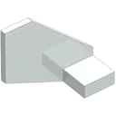{ .lu-ti width="24" loading="lazy" } [Tail Fin 2x3x2 (LOT 684)](../684.md) | 0.002849%; mean 0.000028490028 | Not associated with a vendor |
| { .lu-ti width="24" loading="lazy" } [Plate 1x2 with Racer Mudguards (LOT 685)](../685.md) | 0.002849%; mean 0.000028490028 | Not associated with a vendor |
| { .lu-ti width="24" loading="lazy" } [Front 2x2 with Suction Cup (LOT 686)](../686.md) | 0.002849%; mean 0.000028490028 | Not associated with a vendor |
| { .lu-ti width="24" loading="lazy" } [Banner 2x2 with Vertical Clips, Trapezoid (LOT 687)](../687.md) | 0.002849%; mean 0.000028490028 | Not associated with a vendor |
| { .lu-ti width="24" loading="lazy" } [Wedge 4x16 (LOT 689)](../689.md) | 0.002849%; mean 0.000028490028 | Not associated with a vendor |
| { .lu-ti width="24" loading="lazy" } [Cowl 4x4x2/3 (LOT 690)](../690.md) | 0.002849%; mean 0.000028490028 | Not associated with a vendor |
| { .lu-ti width="24" loading="lazy" } [Shell 6x10x2 (LOT 691)](../691.md) | 0.002849%; mean 0.000028490028 | Not associated with a vendor |
| { .lu-ti width="24" loading="lazy" } [Shell 6x10x2 Inverted (LOT 695)](../695.md) | 0.002849%; mean 0.000028490028 | Not associated with a vendor |
| { .lu-ti width="24" loading="lazy" } [Wedge Plate 6x4 with Cut-Out (LOT 696)](../696.md) | 0.002849%; mean 0.000028490028 | Not associated with a vendor |
| 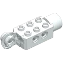{ .lu-ti width="24" loading="lazy" } [Technic Brick 2x3 with Ball Cup Vertical and Cylinder (LOT 697)](../697.md) | 0.00350877%; mean 0.000035087719 | Not associated with a vendor |
| 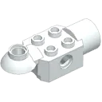{ .lu-ti width="24" loading="lazy" } [Technic Brick 2x2 with Click Joint and Cylinder Joint (LOT 698)](../698.md) | 0.00350877%; mean 0.000035087719 | Not associated with a vendor |
| 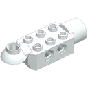{ .lu-ti width="24" loading="lazy" } [Technic Brick 2x3 with Click Joint and Cylinder Joint (LOT 699)](../699.md) | 0.00350877%; mean 0.000035087719 | Not associated with a vendor |
| { .lu-ti width="24" loading="lazy" } [Shovel 4x8x2 2/3 with Vertical Fork (LOT 703)](../703.md) | 0.002849%; mean 0.000028490028 | Not associated with a vendor |
| { .lu-ti width="24" loading="lazy" } [Cone Half 8x4x6 (LOT 704)](../704.md) | 0.002849%; mean 0.000028490028 | Not associated with a vendor |
| { .lu-ti width="24" loading="lazy" } [Wedge 4x4 Curved (LOT 705)](../705.md) | 0.002849%; mean 0.000028490028 | Not associated with a vendor |
| 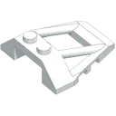{ .lu-ti width="24" loading="lazy" } [Wedge 4x4 Triple, Open with Struts (LOT 706)](../706.md) | 0.002849%; mean 0.000028490028 | Not associated with a vendor |
| { .lu-ti width="24" loading="lazy" } [Wedge 4x2 Triple (LOT 707)](../707.md) | 0.002849%; mean 0.000028490028 | Not associated with a vendor |
| { .lu-ti width="24" loading="lazy" } [Cockpit Frame 4x10x2 with Oval Cut-Out (LOT 708)](../708.md) | 0.002849%; mean 0.000028490028 | Not associated with a vendor |
| 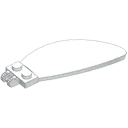{ .lu-ti width="24" loading="lazy" } [Cockpit Oval with Vertical Fork (LOT 709)](../709.md) | 0.002849%; mean 0.000028490028 | Not associated with a vendor |
| { .lu-ti width="24" loading="lazy" } [Cockpit Bottom 4x10x2 (LOT 710)](../710.md) | 0.002849%; mean 0.000028490028 | Not associated with a vendor |
| 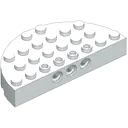{ .lu-ti width="24" loading="lazy" } [Brick 4x8 1/2-Circle (LOT 712)](../712.md) | 0.00350877%; mean 0.000035087719 | Not associated with a vendor |
| { .lu-ti width="24" loading="lazy" } [Lattice 3x28 (LOT 714)](../714.md) | 0.002849%; mean 0.000028490028 | Not associated with a vendor |
| 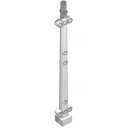{ .lu-ti width="24" loading="lazy" } [Boat Mast 2x2x20 (LOT 715)](../715.md) | 0.002849%; mean 0.000028490028 | Not associated with a vendor |
| { .lu-ti width="24" loading="lazy" } [Mast 2x22 with Platform 4x4 (LOT 716)](../716.md) | 0.002849%; mean 0.000028490028 | Not associated with a vendor |
| 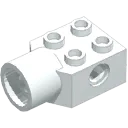{ .lu-ti width="24" loading="lazy" } [Technic Brick 2x2 with Cylinder (LOT 718)](../718.md) | 0.00350877%; mean 0.000035087719 | Not associated with a vendor |
| 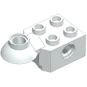{ .lu-ti width="24" loading="lazy" } [Technic Brick 2x2 with Ball Cup Horizontal Snap (LOT 719)](../719.md) | 0.00350877%; mean 0.000035087719 | Not associated with a vendor |
| { .lu-ti width="24" loading="lazy" } [Technic Brick 2x2 with Ball Cup Vertical (LOT 720)](../720.md) | 0.00350877%; mean 0.000035087719 | Not associated with a vendor |
| { .lu-ti width="24" loading="lazy" } [Technic Brick 2x2 with 2 Cylinders (LOT 721)](../721.md) | 0.00350877%; mean 0.000035087719 | Not associated with a vendor |
| { .lu-ti width="24" loading="lazy" } [Wedge Plate 3x4 with Cut-Out (LOT 722)](../722.md) | 0.002849%; mean 0.000028490028 | Not associated with a vendor |
| { .lu-ti width="24" loading="lazy" } [Wedge 4x4 Triple (LOT 725)](../725.md) | 0.002849%; mean 0.000028490028 | Not associated with a vendor |
| { .lu-ti width="24" loading="lazy" } [Boat Bow Plate 6x7 (LOT 727)](../727.md) | 0.002849%; mean 0.000028490028 | Not associated with a vendor |
| { .lu-ti width="24" loading="lazy" } [Wedge 4x4  (LOT 730)](../730.md) | 0.002849%; mean 0.000028490028 | Not associated with a vendor |
| { .lu-ti width="24" loading="lazy" } [Brick 2x2 with Fender (LOT 731)](../731.md) | 0.002849%; mean 0.000028490028 | Not associated with a vendor |
| { .lu-ti width="24" loading="lazy" } [Dome 6x6 with Vertical Fork (LOT 732)](../732.md) | 0.002849%; mean 0.000028490028 | Not associated with a vendor |
| { .lu-ti width="24" loading="lazy" } [Motorbike Chassis (LOT 733)](../733.md) | 0.002849%; mean 0.000028490028 | Not associated with a vendor |
| { .lu-ti width="24" loading="lazy" } [BMX Bike Fairing (LOT 734)](../734.md) | 0.002849%; mean 0.000028490028 | Not associated with a vendor |
| { .lu-ti width="24" loading="lazy" } [Tire Ø20.9 (LOT 735)](../735.md) | 0.002849%; mean 0.000028490028 | Not associated with a vendor |
| { .lu-ti width="24" loading="lazy" } [Rim with Axle Ø14.58 (LOT 736)](../736.md) | 0.002849%; mean 0.000028490028 | Not associated with a vendor |
| { .lu-ti width="24" loading="lazy" } [Engine 2x2x1 1/3 with Air Intake (LOT 737)](../737.md) | 0.002849%; mean 0.000028490028 | Not associated with a vendor |
| { .lu-ti width="24" loading="lazy" } [Plate 1x2 with Radiator (LOT 738)](../738.md) | 0.002849%; mean 0.000028490028 | Not associated with a vendor |
| { .lu-ti width="24" loading="lazy" } [Tile with Cover Curved 1x4.5 (LOT 739)](../739.md) | 0.002849%; mean 0.000028490028 | Not associated with a vendor |
| { .lu-ti width="24" loading="lazy" } [Plate 1x2 with Spoiler (LOT 740)](../740.md) | 0.002849%; mean 0.000028490028 | Not associated with a vendor |
| { .lu-ti width="24" loading="lazy" } [Wedge 3x10 Curved Left (LOT 743)](../743.md) | 0.002849%; mean 0.000028490028 | Not associated with a vendor |
| { .lu-ti width="24" loading="lazy" } [Wedge 3x10 Curved Right (LOT 744)](../744.md) | 0.002849%; mean 0.000028490028 | Not associated with a vendor |
| { .lu-ti width="24" loading="lazy" } [Slope Brick 1x8x1 2/3 Curved with Arch (LOT 745)](../745.md) | 0.002849%; mean 0.000028490028 | Not associated with a vendor |
| { .lu-ti width="24" loading="lazy" } [Flag 5x6 Hexagonal with Horizontal Clips (LOT 747)](../747.md) | 0.002849%; mean 0.000028490028 | Not associated with a vendor |
| { .lu-ti width="24" loading="lazy" } [Cowl 4x6x2/3 (LOT 749)](../749.md) | 0.002849%; mean 0.000028490028 | Not associated with a vendor |
| { .lu-ti width="24" loading="lazy" } [Car Chassis Plate 4x12x2/3 (LOT 751)](../751.md) | 0.002849%; mean 0.000028490028 | Not associated with a vendor |
| { .lu-ti width="24" loading="lazy" } [Slope Brick 45° 1x6 Double Inverted with Cut-Out (LOT 754)](../754.md) | 0.002849%; mean 0.000028490028 | Not associated with a vendor |
| { .lu-ti width="24" loading="lazy" } [Wheel Hard-Plastic with Spokes Ø56x22 (LOT 757)](../757.md) | 0.002849%; mean 0.000028490028 | Not associated with a vendor |
| { .lu-ti width="24" loading="lazy" } [Rim Ø18 (LOT 758)](../758.md) | 0.002849%; mean 0.000028490028 | Not associated with a vendor |
| { .lu-ti width="24" loading="lazy" } [Tipper Body 8x24x5 (LOT 759)](../759.md) | 0.002849%; mean 0.000028490028 | Not associated with a vendor |
| { .lu-ti width="24" loading="lazy" } [Windscreen 4x3x1 1/3 (LOT 760)](../760.md) | 0.002849%; mean 0.000028490028 | Not associated with a vendor |
| { .lu-ti width="24" loading="lazy" } [Flap 3x12 with Vertical Fork (LOT 762)](../762.md) | 0.002849%; mean 0.000028490028 | Not associated with a vendor |
| { .lu-ti width="24" loading="lazy" } [Quarter Circle Brick with Sloped Rim 10x10 (LOT 764)](../764.md) | 0.002849%; mean 0.000028490028 | Not associated with a vendor |
| { .lu-ti width="24" loading="lazy" } [Exhaust Pipe with Pin (LOT 769)](../769.md) | 0.002849%; mean 0.000028490028 | Not associated with a vendor |
| { .lu-ti width="24" loading="lazy" } [Rubber Boat 6x10 (LOT 777)](../777.md) | 0.002849%; mean 0.000028490028 | Not associated with a vendor |
| { .lu-ti width="24" loading="lazy" } [Bay Window 3x8x6 (LOT 778)](../778.md) | 0.002849%; mean 0.000028490028 | Not associated with a vendor |
| { .lu-ti width="24" loading="lazy" } [Trike Chassis (LOT 780)](../780.md) | 0.002849%; mean 0.000028490028 | Not associated with a vendor |
| { .lu-ti width="24" loading="lazy" } [Tail Fin on Tile 1x4 (LOT 788)](../788.md) | 0.002849%; mean 0.000028490028 | Not associated with a vendor |
| { .lu-ti width="24" loading="lazy" } [Tile 2x2 Round with Hanger on Top (LOT 793)](../793.md) | 0.002849%; mean 0.000028490028 | Not associated with a vendor |
| { .lu-ti width="24" loading="lazy" } [Towing Bars with 1x2 and 2x2 Plates (LOT 795)](../795.md) | 0.002849%; mean 0.000028490028 | Not associated with a vendor |
| { .lu-ti width="24" loading="lazy" } [Plate 2x2 with Airplane Landing Gear (LOT 801)](../801.md) | 0.002849%; mean 0.000028490028 | Not associated with a vendor |
| { .lu-ti width="24" loading="lazy" } [Propeller Ø3.5 with 3 Blades (LOT 805)](../805.md) | 0.002849%; mean 0.000028490028 | Not associated with a vendor |
| { .lu-ti width="24" loading="lazy" } [Windscreen 3x4x1/3 (LOT 812)](../812.md) | 0.002849%; mean 0.000028490028 | Not associated with a vendor |
| { .lu-ti width="24" loading="lazy" } [Rowing Boat 5x14x2 1/3 (LOT 839)](../839.md) | 0.002849%; mean 0.000028490028 | Not associated with a vendor |
| { .lu-ti width="24" loading="lazy" } [Antenna 8 (LOT 843)](../843.md) | 0.002849%; mean 0.000028490028 | Not associated with a vendor |
| { .lu-ti width="24" loading="lazy" } [Window for Ship's Bridge (LOT 851)](../851.md) | 0.002849%; mean 0.000028490028 | Not associated with a vendor |
| { .lu-ti width="24" loading="lazy" } [Plate 2x2 Round with Clips for Wheel (LOT 855)](../855.md) | 0.002849%; mean 0.000028490028 | Not associated with a vendor |
| { .lu-ti width="24" loading="lazy" } [Technic Brick 1x10 (LOT 857)](../857.md) | 0.00350877%; mean 0.000035087719 | Not associated with a vendor |
| { .lu-ti width="24" loading="lazy" } [Technic Brick 1x4 with Wing (LOT 858)](../858.md) | 0.00350877%; mean 0.000035087719 | Not associated with a vendor |
| { .lu-ti width="24" loading="lazy" } [Technic Brick 1x6 Sloped (LOT 859)](../859.md) | 0.00350877%; mean 0.000035087719 | Not associated with a vendor |
| { .lu-ti width="24" loading="lazy" } [Technic Bearing Plate 2x2 with 2 Pin Holes (LOT 860)](../860.md) | 0.00350877%; mean 0.000035087719 | Not associated with a vendor |
| { .lu-ti width="24" loading="lazy" } [Train Roof Front 45°/33° 6x6 with Cut-Out (LOT 862)](../862.md) | 0.002849%; mean 0.000028490028 | Not associated with a vendor |
| { .lu-ti width="24" loading="lazy" } [Plate 2x2 (LOT 865)](../865.md) | 1.81818182%; mean 0.018181818 | Not associated with a vendor |
| { .lu-ti width="24" loading="lazy" } [Plate 2x8 (LOT 869)](../869.md) | 1.81818182%; mean 0.018181818 | Not associated with a vendor |
| { .lu-ti width="24" loading="lazy" } [Tipper Bucket Front with Chute (LOT 898)](../898.md) | 0.002849%; mean 0.000028490028 | Not associated with a vendor |
| { .lu-ti width="24" loading="lazy" } [Hub Ø8mm for Fork Bearing (LOT 901)](../901.md) | 0.002849%; mean 0.000028490028 | Not associated with a vendor |
| { .lu-ti width="24" loading="lazy" } [Plate 4x8 Tail Fin (LOT 903)](../903.md) | 0.002849%; mean 0.000028490028 | Not associated with a vendor |
| { .lu-ti width="24" loading="lazy" } [Plate 1x2 with Jet Engine (LOT 904)](../904.md) | 0.002849%; mean 0.000028490028 | Not associated with a vendor |
| { .lu-ti width="24" loading="lazy" } [Tire Ø17 Narrow (LOT 906)](../906.md) | 0.002849%; mean 0.000028490028 | Not associated with a vendor |
| { .lu-ti width="24" loading="lazy" } [Plate 7x12 Right Wing (LOT 909)](../909.md) | 0.002849%; mean 0.000028490028 | Not associated with a vendor |
| { .lu-ti width="24" loading="lazy" } [Plate 7x12 Left Wing (LOT 910)](../910.md) | 0.002849%; mean 0.000028490028 | Not associated with a vendor |
| { .lu-ti width="24" loading="lazy" } [Tail Fin on Plate 2x3 (LOT 911)](../911.md) | 0.002849%; mean 0.000028490028 | Not associated with a vendor |
| { .lu-ti width="24" loading="lazy" } [Tire for Tractor Ø17/Ø43 (LOT 913)](../913.md) | 0.002849%; mean 0.000028490028 | Not associated with a vendor |
| { .lu-ti width="24" loading="lazy" } [Tire Ø15 Narrow (LOT 914)](../914.md) | 0.002849%; mean 0.000028490028 | Not associated with a vendor |
| { .lu-ti width="24" loading="lazy" } [Technic Plate 2x4 (LOT 922)](../922.md) | 0.00350877%; mean 0.000035087719 | Not associated with a vendor |
| { .lu-ti width="24" loading="lazy" } [Technic Plate 2x8 (LOT 923)](../923.md) | 0.00350877%; mean 0.000035087719 | Not associated with a vendor |
| { .lu-ti width="24" loading="lazy" } [Technic Gear Plate 1x4 (LOT 926)](../926.md) | 0.00350877%; mean 0.000035087719 | Not associated with a vendor |
| { .lu-ti width="24" loading="lazy" } [Plate 2x2 with Fenders (LOT 931)](../931.md) | 0.002849%; mean 0.000028490028 | Not associated with a vendor |
| { .lu-ti width="24" loading="lazy" } [Plate 2x4 Mudguard (LOT 932)](../932.md) | 0.002849%; mean 0.000028490028 | Not associated with a vendor |
| { .lu-ti width="24" loading="lazy" } [Steering Nozzle with 2 Studs  (LOT 1200)](../1200.md) | 0.002849%; mean 0.000028490028 | Not associated with a vendor |
| { .lu-ti width="24" loading="lazy" } [Tiny Wheels with Axle (LOT 1211)](../1211.md) | 0.002849%; mean 0.000028490028 | Not associated with a vendor |
| { .lu-ti width="24" loading="lazy" } [Cyborg Arm with Pin Hole (LOT 1228)](../1228.md) | 0.00350877%; mean 0.000035087719 | Not associated with a vendor |
| { .lu-ti width="24" loading="lazy" } [Technic Bumper 1x4x7 (LOT 1233)](../1233.md) | 0.002849%; mean 0.000028490028 | Not associated with a vendor |
| { .lu-ti width="24" loading="lazy" } [Spoiler with Framework and 2 Pins (LOT 1234)](../1234.md) | 0.002849%; mean 0.000028490028 | Not associated with a vendor |
| { .lu-ti width="24" loading="lazy" } [Technic Railing with 2 Pins (LOT 1235)](../1235.md) | 0.002849%; mean 0.000028490028 | Not associated with a vendor |
| { .lu-ti width="24" loading="lazy" } [Technic Air Intake Curved with 2 Pins (LOT 1236)](../1236.md) | 0.002849%; mean 0.000028490028 | Not associated with a vendor |
| { .lu-ti width="24" loading="lazy" } [Technic Ridge Profile with 2 Pins (LOT 1237)](../1237.md) | 0.00350877%; mean 0.000035087719 | Not associated with a vendor |
| { .lu-ti width="24" loading="lazy" } [Technic Pin with Friction (LOT 1238)](../1238.md) | 0.00350877%; mean 0.000035087719 | Not associated with a vendor |
| { .lu-ti width="24" loading="lazy" } [Technic Cross Axle 4 (LOT 1239)](../1239.md) | 0.00350877%; mean 0.000035087719 | Not associated with a vendor |
| { .lu-ti width="24" loading="lazy" } [Technic Cross Axle 6 (LOT 1240)](../1240.md) | 0.00350877%; mean 0.000035087719 | Not associated with a vendor |
| { .lu-ti width="24" loading="lazy" } [Technic Cross Axle 8 (LOT 1241)](../1241.md) | 0.00350877%; mean 0.000035087719 | Not associated with a vendor |
| { .lu-ti width="24" loading="lazy" } [Technic Cross Axle 12 (LOT 1242)](../1242.md) | 0.00350877%; mean 0.000035087719 | Not associated with a vendor |
| { .lu-ti width="24" loading="lazy" } [Technic Cross Axle 10 (LOT 1243)](../1243.md) | 0.00350877%; mean 0.000035087719 | Not associated with a vendor |
| { .lu-ti width="24" loading="lazy" } [Technic Cross Axle 3 (LOT 1244)](../1244.md) | 0.00350877%; mean 0.000035087719 | Not associated with a vendor |
| { .lu-ti width="24" loading="lazy" } [Technic Cross Axle Extension, Rippled (LOT 1245)](../1245.md) | 0.00350877%; mean 0.000035087719 | Not associated with a vendor |
| { .lu-ti width="24" loading="lazy" } [Technic Pin 1.5 with Friction (LOT 1246)](../1246.md) | 0.00350877%; mean 0.000035087719 | Not associated with a vendor |
| { .lu-ti width="24" loading="lazy" } [Technic Pin with Cross Axle (LOT 1247)](../1247.md) | 0.00350877%; mean 0.000035087719 | Not associated with a vendor |
| { .lu-ti width="24" loading="lazy" } [Technic Cross Axle 3 with Stud (LOT 1248)](../1248.md) | 0.00350877%; mean 0.000035087719 | Not associated with a vendor |
| { .lu-ti width="24" loading="lazy" } [Technic Bush (LOT 1249)](../1249.md) | 0.00350877%; mean 0.000035087719 | Not associated with a vendor |
| { .lu-ti width="24" loading="lazy" } [Technic Pin 0.75 (LOT 1250)](../1250.md) | 0.00350877%; mean 0.000035087719 | Not associated with a vendor |
| { .lu-ti width="24" loading="lazy" } [Technic Friction Pin 1.5 with Cross Axle Hole (LOT 1251)](../1251.md) | 0.00350877%; mean 0.000035087719 | Not associated with a vendor |
| { .lu-ti width="24" loading="lazy" } [Technic Axle 2 with Grooves (LOT 1252)](../1252.md) | 0.00350877%; mean 0.000035087719 | Not associated with a vendor |
| { .lu-ti width="24" loading="lazy" } [Technic Cross Axle 5 (LOT 1253)](../1253.md) | 0.00350877%; mean 0.000035087719 | Not associated with a vendor |
| { .lu-ti width="24" loading="lazy" } [1/2 Bush (LOT 1254)](../1254.md) | 0.00350877%; mean 0.000035087719 | Not associated with a vendor |
| { .lu-ti width="24" loading="lazy" } [Technic Pin Double 1.5 with Cross Axle (LOT 1255)](../1255.md) | 0.00350877%; mean 0.000035087719 | Not associated with a vendor |
| { .lu-ti width="24" loading="lazy" } [Technic Beam 3 with 2 Lateral Cross Axle Holes (LOT 1256)](../1256.md) | 0.00350877%; mean 0.000035087719 | Not associated with a vendor |
| { .lu-ti width="24" loading="lazy" } [Technic Pin 1.5 (LOT 1257)](../1257.md) | 0.00350877%; mean 0.000035087719 | Not associated with a vendor |
| { .lu-ti width="24" loading="lazy" } [Technic Pin with Friction and Cross Axle (LOT 1258)](../1258.md) | 0.00350877%; mean 0.000035087719 | Not associated with a vendor |
| { .lu-ti width="24" loading="lazy" } [Technic Cross Axle 7 (LOT 1259)](../1259.md) | 0.00350877%; mean 0.000035087719 | Not associated with a vendor |
| { .lu-ti width="24" loading="lazy" } [Technic Click Joint with Pin (LOT 1260)](../1260.md) | 0.00350877%; mean 0.000035087719 | Not associated with a vendor |
| { .lu-ti width="24" loading="lazy" } [Technic 1x3 Flange with Stub on top and 2 Pins (LOT 1261)](../1261.md) | 0.00350877%; mean 0.000035087719 | Not associated with a vendor |
| { .lu-ti width="24" loading="lazy" } [Technic 1x3 Flange with Hinge and 2 Pins (LOT 1262)](../1262.md) | 0.00350877%; mean 0.000035087719 | Not associated with a vendor |
| { .lu-ti width="24" loading="lazy" } [Technic Bracket Beam with 4 Pins (LOT 1263)](../1263.md) | 0.00350877%; mean 0.000035087719 | Not associated with a vendor |
| { .lu-ti width="24" loading="lazy" } [Technic Tube 2 (LOT 1264)](../1264.md) | 0.00350877%; mean 0.000035087719 | Not associated with a vendor |
| { .lu-ti width="24" loading="lazy" } [Dolly without Wheel (LOT 5036)](../5036.md) | 0.002849%; mean 0.000028490028 | Not associated with a vendor |
| { .lu-ti width="24" loading="lazy" } [Tipper Body 3x4-Base (LOT 5038)](../5038.md) | 0.002849%; mean 0.000028490028 | Not associated with a vendor |
| { .lu-ti width="24" loading="lazy" } [Middle Section Ship 8x16 (LOT 5054)](../5054.md) | 0.002849%; mean 0.000028490028 | Not associated with a vendor |
| { .lu-ti width="24" loading="lazy" } [Technic Hub Ø30 (LOT 5064)](../5064.md) | 0.00350877%; mean 0.000035087719 | Not associated with a vendor |
| { .lu-ti width="24" loading="lazy" } [Tire Ø43.2 (LOT 5065)](../5065.md) | 0.002849%; mean 0.000028490028 | Not associated with a vendor |
| { .lu-ti width="24" loading="lazy" } [Technic Dish Ø24 (LOT 5067)](../5067.md) | 0.00350877%; mean 0.000035087719 | Not associated with a vendor |
| { .lu-ti width="24" loading="lazy" } [Technic Axle 2 with Ball (LOT 5068)](../5068.md) | 0.00350877%; mean 0.000035087719 | Not associated with a vendor |
| { .lu-ti width="24" loading="lazy" } [Pantograph with Vertical Fork (LOT 5071)](../5071.md) | 0.002849%; mean 0.000028490028 | Not associated with a vendor |
| { .lu-ti width="24" loading="lazy" } [Propeller Ø9 with 2 Blades and Pin Hole (LOT 5072)](../5072.md) | 0.002849%; mean 0.000028490028 | Not associated with a vendor |
| { .lu-ti width="24" loading="lazy" } [Semi Trailer Truck Chassis 6x34 (LOT 5073)](../5073.md) | 0.002849%; mean 0.000028490028 | Not associated with a vendor |
| { .lu-ti width="24" loading="lazy" } [Straight Rail (LOT 5075)](../5075.md) | 0.00350877%; mean 0.000035087719 | Not associated with a vendor |
| { .lu-ti width="24" loading="lazy" } [Technic Gear Wheel 8 (LOT 5082)](../5082.md) | 0.00350877%; mean 0.000035087719 | Not associated with a vendor |
| { .lu-ti width="24" loading="lazy" } [Technic Gear Wheel 24 (LOT 5083)](../5083.md) | 0.00350877%; mean 0.000035087719 | Not associated with a vendor |
| { .lu-ti width="24" loading="lazy" } [Technic Crown Gear 24 (LOT 5084)](../5084.md) | 0.00350877%; mean 0.000035087719 | Not associated with a vendor |
| { .lu-ti width="24" loading="lazy" } [Technic Gear Wheel 16 (LOT 5111)](../5111.md) | 0.00350877%; mean 0.000035087719 | Not associated with a vendor |
| { .lu-ti width="24" loading="lazy" } [Train Wagon Chassis 6x28 (LOT 5113)](../5113.md) | 0.002849%; mean 0.000028490028 | Not associated with a vendor |
| { .lu-ti width="24" loading="lazy" } [Car Chassis Plate 4x5 (LOT 5114)](../5114.md) | 0.002849%; mean 0.000028490028 | Not associated with a vendor |
| { .lu-ti width="24" loading="lazy" } [Boat Mast 2x2x3 (LOT 5115)](../5115.md) | 0.002849%; mean 0.000028490028 | Not associated with a vendor |
| { .lu-ti width="24" loading="lazy" } [Windscreen 4x4x1 (LOT 5185)](../5185.md) | 0.002849%; mean 0.000028490028 | Not associated with a vendor |
| { .lu-ti width="24" loading="lazy" } [Technic Beam 2 with Lateral Cross Axle Hole (LOT 5191)](../5191.md) | 0.00350877%; mean 0.000035087719 | Not associated with a vendor |
| { .lu-ti width="24" loading="lazy" } [Train Wagon Chassis 6x24 (LOT 5192)](../5192.md) | 0.002849%; mean 0.000028490028 | Not associated with a vendor |
| { .lu-ti width="24" loading="lazy" } [Technic Pin with Ball (LOT 5193)](../5193.md) | 0.00350877%; mean 0.000035087719 | Not associated with a vendor |
| { .lu-ti width="24" loading="lazy" } [Technic Half Beam 3 (LOT 5194)](../5194.md) | 0.00350877%; mean 0.000035087719 | Not associated with a vendor |
| { .lu-ti width="24" loading="lazy" } [Plate Wing 6x8x2/3 with Lattice (LOT 5199)](../5199.md) | 0.002849%; mean 0.000028490028 | Not associated with a vendor |
| { .lu-ti width="24" loading="lazy" } [Vehicle Cabin 4x5 with 2 seats (LOT 5221)](../5221.md) | 0.002849%; mean 0.000028490028 | Not associated with a vendor |
| { .lu-ti width="24" loading="lazy" } [Slope Brick 45° 4x6 Double Inverted (LOT 5235)](../5235.md) | 0.002849%; mean 0.000028490028 | Not associated with a vendor |
| { .lu-ti width="24" loading="lazy" } [Helicopter Chassis 4x7x3 (LOT 5254)](../5254.md) | 0.002849%; mean 0.000028490028 | Not associated with a vendor |
| { .lu-ti width="24" loading="lazy" } [Hook with Ball 1x3 (LOT 5271)](../5271.md) | 0.002849%; mean 0.000028490028 | Not associated with a vendor |
| { .lu-ti width="24" loading="lazy" } [Ball Coupling with Vertical Fork (LOT 5272)](../5272.md) | 0.002849%; mean 0.000028490028 | Not associated with a vendor |
| { .lu-ti width="24" loading="lazy" } [Technic Brick 1x2 with 2 Pins (LOT 5278)](../5278.md) | 0.00350877%; mean 0.000035087719 | Not associated with a vendor |
| { .lu-ti width="24" loading="lazy" } [Technic Half Beam 4 with Cuff (LOT 5284)](../5284.md) | 0.00350877%; mean 0.000035087719 | Not associated with a vendor |
| { .lu-ti width="24" loading="lazy" } [Sprocket Wheel Ø24 (LOT 5285)](../5285.md) | 0.002849%; mean 0.000028490028 | Not associated with a vendor |
| { .lu-ti width="24" loading="lazy" } [Bobbin (LOT 5286)](../5286.md) | 0.002849%; mean 0.000028490028 | Not associated with a vendor |
| { .lu-ti width="24" loading="lazy" } [Technic Angle Connector 90° (LOT 5287)](../5287.md) | 0.00350877%; mean 0.000035087719 | Not associated with a vendor |
| { .lu-ti width="24" loading="lazy" } [Technic Angle Connector 112.5° (LOT 5288)](../5288.md) | 0.00350877%; mean 0.000035087719 | Not associated with a vendor |
| { .lu-ti width="24" loading="lazy" } [Technic Angle Connector 157.5° (LOT 5289)](../5289.md) | 0.00350877%; mean 0.000035087719 | Not associated with a vendor |
| { .lu-ti width="24" loading="lazy" } [Technic Half Beam 5 (LOT 5290)](../5290.md) | 0.00350877%; mean 0.000035087719 | Not associated with a vendor |
| { .lu-ti width="24" loading="lazy" } [Technic Half Beam 6 (LOT 5291)](../5291.md) | 0.00350877%; mean 0.000035087719 | Not associated with a vendor |
| { .lu-ti width="24" loading="lazy" } [Technic Half Beam 7 (LOT 5292)](../5292.md) | 0.00350877%; mean 0.000035087719 | Not associated with a vendor |
| { .lu-ti width="24" loading="lazy" } [Technic Angular Wheel (LOT 5293)](../5293.md) | 0.00350877%; mean 0.000035087719 | Not associated with a vendor |
| { .lu-ti width="24" loading="lazy" } [Technic Rotor 2 Blades (LOT 5295)](../5295.md) | 0.00350877%; mean 0.000035087719 | Not associated with a vendor |
| { .lu-ti width="24" loading="lazy" } [Technic Bush with Pin Collar (LOT 5296)](../5296.md) | 0.00350877%; mean 0.000035087719 | Not associated with a vendor |
| { .lu-ti width="24" loading="lazy" } [Technic Wheel Hard-Plastic 30.4x14 (LOT 5297)](../5297.md) | 0.00350877%; mean 0.000035087719 | Not associated with a vendor |
| { .lu-ti width="24" loading="lazy" } [Technic Angle Connector 135° (LOT 5298)](../5298.md) | 0.00350877%; mean 0.000035087719 | Not associated with a vendor |
| { .lu-ti width="24" loading="lazy" } [Technic Half Beam 3x5 with Curve (LOT 5299)](../5299.md) | 0.00350877%; mean 0.000035087719 | Not associated with a vendor |
| { .lu-ti width="24" loading="lazy" } [Technic Double Conical Wheel Z20 (LOT 5300)](../5300.md) | 0.00350877%; mean 0.000035087719 | Not associated with a vendor |
| { .lu-ti width="24" loading="lazy" } [Technic Double Conical Wheel Z12 (LOT 5301)](../5301.md) | 0.00350877%; mean 0.000035087719 | Not associated with a vendor |
| { .lu-ti width="24" loading="lazy" } [Technic Angular Beam 45° 3x7 (LOT 5302)](../5302.md) | 0.00350877%; mean 0.000035087719 | Not associated with a vendor |
| { .lu-ti width="24" loading="lazy" } [Technic 1x5x2 2/3 Support Block (LOT 5303)](../5303.md) | 0.00350877%; mean 0.000035087719 | Not associated with a vendor |
| { .lu-ti width="24" loading="lazy" } [Technic Angular Beam 45° 4x4 (LOT 5304)](../5304.md) | 0.00350877%; mean 0.000035087719 | Not associated with a vendor |
| { .lu-ti width="24" loading="lazy" } [Technic Half Beam 1x4 (LOT 5305)](../5305.md) | 0.00350877%; mean 0.000035087719 | Not associated with a vendor |
| { .lu-ti width="24" loading="lazy" } [Technic Ball Joint (LOT 5306)](../5306.md) | 0.00350877%; mean 0.000035087719 | Not associated with a vendor |
| { .lu-ti width="24" loading="lazy" } [Technic Beam 7 (LOT 5307)](../5307.md) | 0.00350877%; mean 0.000035087719 | Not associated with a vendor |
| { .lu-ti width="24" loading="lazy" } [Technic Beam 11 (LOT 5308)](../5308.md) | 0.00350877%; mean 0.000035087719 | Not associated with a vendor |
| { .lu-ti width="24" loading="lazy" } [Technic Cross-Joiner Double 2x1 with Bar 2 (LOT 5309)](../5309.md) | 0.00350877%; mean 0.000035087719 | Not associated with a vendor |
| { .lu-ti width="24" loading="lazy" } [Technic Flex Rod 7 (LOT 5310)](../5310.md) | 0.00350877%; mean 0.000035087719 | Not associated with a vendor |
| { .lu-ti width="24" loading="lazy" } [Exhaust Pipe with Grooves and Pin (LOT 5347)](../5347.md) | 0.002849%; mean 0.000028490028 | Not associated with a vendor |
| { .lu-ti width="24" loading="lazy" } [Technic Beam 13 (LOT 5350)](../5350.md) | 0.00350877%; mean 0.000035087719 | Not associated with a vendor |
| { .lu-ti width="24" loading="lazy" } [BIONICLE Eye (LOT 5352)](../5352.md) | 0.00350877%; mean 0.000035087719 | Not associated with a vendor |
| { .lu-ti width="24" loading="lazy" } [Technic Half Beam 2 (LOT 5353)](../5353.md) | 0.00350877%; mean 0.000035087719 | Not associated with a vendor |
| { .lu-ti width="24" loading="lazy" } [Tire Ø17.6 (LOT 5361)](../5361.md) | 0.002849%; mean 0.000028490028 | Not associated with a vendor |
| { .lu-ti width="24" loading="lazy" } [Technic Beam 2 (LOT 5365)](../5365.md) | 0.00350877%; mean 0.000035087719 | Not associated with a vendor |
| { .lu-ti width="24" loading="lazy" } [Technic Pivot Joint (LOT 5367)](../5367.md) | 0.00350877%; mean 0.000035087719 | Not associated with a vendor |
| { .lu-ti width="24" loading="lazy" } [Snake Body Piece (LOT 5373)](../5373.md) | 0.002849%; mean 0.000028490028 | Not associated with a vendor |
| { .lu-ti width="24" loading="lazy" } [Tire Ø43.2 (LOT 5375)](../5375.md) | 0.002849%; mean 0.000028490028 | Not associated with a vendor |
| { .lu-ti width="24" loading="lazy" } [Wedge 4x4 Triple with Tip (LOT 5385)](../5385.md) | 0.002849%; mean 0.000028490028 | Not associated with a vendor |
| { .lu-ti width="24" loading="lazy" } [Technic Beam 3 with 4 Pins (LOT 5403)](../5403.md) | 0.00350877%; mean 0.000035087719 | Not associated with a vendor |
| { .lu-ti width="24" loading="lazy" } [Train Wheel Ø8.2/14.6 (LOT 5404)](../5404.md) | 0.00350877%; mean 0.000035087719 | Not associated with a vendor |
| { .lu-ti width="24" loading="lazy" } [BIONICLE Claw 4x12 (LOT 5405)](../5405.md) | 0.00350877%; mean 0.000035087719 | Not associated with a vendor |
| { .lu-ti width="24" loading="lazy" } [Rim Ø11.2 (LOT 5406)](../5406.md) | 0.00350877%; mean 0.000035087719 | Not associated with a vendor |
| { .lu-ti width="24" loading="lazy" } [Tire Ø14.58 Narrow (LOT 5407)](../5407.md) | 0.002849%; mean 0.000028490028 | Not associated with a vendor |
| { .lu-ti width="24" loading="lazy" } [Brick 1x4x1 1/3 with Studs on Side (LOT 5417)](../5417.md) | 0.002849%; mean 0.000028490028 | Not associated with a vendor |
| { .lu-ti width="24" loading="lazy" } [Technic Fork 3 with Pin (LOT 5421)](../5421.md) | 0.00350877%; mean 0.000035087719 | Not associated with a vendor |
| { .lu-ti width="24" loading="lazy" } [Jet Hull Top 8x8x2 (LOT 5437)](../5437.md) | 0.002849%; mean 0.000028490028 | Not associated with a vendor |
| { .lu-ti width="24" loading="lazy" } [Airplane Door (LOT 5438)](../5438.md) | 0.002849%; mean 0.000028490028 | Not associated with a vendor |
| { .lu-ti width="24" loading="lazy" } [Technic Cross Axle 8 with End Stop (LOT 5441)](../5441.md) | 0.00350877%; mean 0.000035087719 | Not associated with a vendor |
| { .lu-ti width="24" loading="lazy" } [Train Wheel with Cross Axle (LOT 5452)](../5452.md) | 0.00350877%; mean 0.000035087719 | Not associated with a vendor |
| { .lu-ti width="24" loading="lazy" } [Tire Ø37 Wide (LOT 5453)](../5453.md) | 0.002849%; mean 0.000028490028 | Not associated with a vendor |
| { .lu-ti width="24" loading="lazy" } [Rim Ø18 Wide with Cross Axle Hole (LOT 5454)](../5454.md) | 0.002849%; mean 0.000028490028 | Not associated with a vendor |
| { .lu-ti width="24" loading="lazy" } [Rim 30x20 (LOT 5455)](../5455.md) | 0.002849%; mean 0.000028490028 | Not associated with a vendor |
| { .lu-ti width="24" loading="lazy" } [Balloon Tire Ø24 (LOT 5469)](../5469.md) | 0.002849%; mean 0.000028490028 | Not associated with a vendor |
| { .lu-ti width="24" loading="lazy" } [Balloon Tire Ø37 (LOT 5470)](../5470.md) | 0.002849%; mean 0.000028490028 | Not associated with a vendor |
| { .lu-ti width="24" loading="lazy" } [Technic 3-Branch Cross Axle (LOT 5483)](../5483.md) | 0.00350877%; mean 0.000035087719 | Not associated with a vendor |
| { .lu-ti width="24" loading="lazy" } [Brick 2x2 with 2 Ball Joints (LOT 5484)](../5484.md) | 0.00350877%; mean 0.000035087719 | Not associated with a vendor |
| { .lu-ti width="24" loading="lazy" } [Brick 2x2 Ball Joint (LOT 5485)](../5485.md) | 0.00350877%; mean 0.000035087719 | Not associated with a vendor |
| { .lu-ti width="24" loading="lazy" } [Racing Tire Ø30.4 (LOT 5486)](../5486.md) | 0.002849%; mean 0.000028490028 | Not associated with a vendor |
| { .lu-ti width="24" loading="lazy" } [Technic Cross Axle 5.5 with Stop (LOT 5509)](../5509.md) | 0.00350877%; mean 0.000035087719 | Not associated with a vendor |
| { .lu-ti width="24" loading="lazy" } [Technic Cross Axle Extension, Smooth (LOT 5510)](../5510.md) | 0.00350877%; mean 0.000035087719 | Not associated with a vendor |
| { .lu-ti width="24" loading="lazy" } [Technic Hub Ø31.37 (LOT 5515)](../5515.md) | 0.00350877%; mean 0.000035087719 | Not associated with a vendor |
| { .lu-ti width="24" loading="lazy" } [Slope Brick 45° 4x6 Double Inverted with Cut-Out (LOT 5516)](../5516.md) | 0.002849%; mean 0.000028490028 | Not associated with a vendor |
| { .lu-ti width="24" loading="lazy" } [Technic Beam 2 with Cross Axle Hole (LOT 5525)](../5525.md) | 0.00350877%; mean 0.000035087719 | Not associated with a vendor |
| { .lu-ti width="24" loading="lazy" } [Tire Ø21, Wide (LOT 5545)](../5545.md) | 0.002849%; mean 0.000028490028 | Not associated with a vendor |
| { .lu-ti width="24" loading="lazy" } [Technic Casing with Air Intakes (LOT 5558)](../5558.md) | 0.002849%; mean 0.000028490028 | Not associated with a vendor |
| { .lu-ti width="24" loading="lazy" } [Plate 1x4x2/3 with 2 Protruding Pistons (LOT 5559)](../5559.md) | 0.002849%; mean 0.000028490028 | Not associated with a vendor |
| { .lu-ti width="24" loading="lazy" } [Technic Pin 0.5 with Shaft (LOT 5560)](../5560.md) | 0.00350877%; mean 0.000035087719 | Not associated with a vendor |
| { .lu-ti width="24" loading="lazy" } [Airplane Landing Gear with Pin (LOT 5563)](../5563.md) | 0.00350877%; mean 0.000035087719 | Not associated with a vendor |
| { .lu-ti width="24" loading="lazy" } [Brick 4x4x2 with Bow (LOT 5564)](../5564.md) | 0.002849%; mean 0.000028490028 | Not associated with a vendor |
| { .lu-ti width="24" loading="lazy" } [Spool Ø16 (LOT 5565)](../5565.md) | 0.002849%; mean 0.000028490028 | Not associated with a vendor |
| { .lu-ti width="24" loading="lazy" } [Technic Tube 2 Straight with Slot (LOT 5577)](../5577.md) | 0.00350877%; mean 0.000035087719 | Not associated with a vendor |
| { .lu-ti width="24" loading="lazy" } [Windscreen 8x5x2 Edged (LOT 5579)](../5579.md) | 0.002849%; mean 0.000028490028 | Not associated with a vendor |
| { .lu-ti width="24" loading="lazy" } [Cockpit 6x8x4 with Vertical Fork (LOT 5580)](../5580.md) | 0.002849%; mean 0.000028490028 | Not associated with a vendor |
| { .lu-ti width="24" loading="lazy" } [Hub Cap Ø24 (LOT 5586)](../5586.md) | 0.002849%; mean 0.000028490028 | Not associated with a vendor |
| { .lu-ti width="24" loading="lazy" } [Brick 2x2 with Cup for Ball (LOT 5588)](../5588.md) | 0.00350877%; mean 0.000035087719 | Not associated with a vendor |
| { .lu-ti width="24" loading="lazy" } [Plate 2x16 Rotor Blade (LOT 5589)](../5589.md) | 0.002849%; mean 0.000028490028 | Not associated with a vendor |
| { .lu-ti width="24" loading="lazy" } [Bar 6 with Stop (LOT 5595)](../5595.md) | 0.00350877%; mean 0.000035087719 | Not associated with a vendor |
| { .lu-ti width="24" loading="lazy" } [Corrugated Pipe 16mm (LOT 5609)](../5609.md) | 0.00350877%; mean 0.000035087719 | Not associated with a vendor |
| { .lu-ti width="24" loading="lazy" } [Magnet Cylindrical (LOT 5611)](../5611.md) | 0.002849%; mean 0.000028490028 | Not associated with a vendor |
| { .lu-ti width="24" loading="lazy" } [Train Bearing 3x6 (LOT 5613)](../5613.md) | 0.002849%; mean 0.000028490028 | Not associated with a vendor |
| { .lu-ti width="24" loading="lazy" } [Windscreen 4x3x3 Edged (LOT 5617)](../5617.md) | 0.002849%; mean 0.000028490028 | Not associated with a vendor |
| { .lu-ti width="24" loading="lazy" } [V-Belt Ø15 White (LOT 5619)](../5619.md) | 0.00350877%; mean 0.000035087719 | Not associated with a vendor |
| { .lu-ti width="24" loading="lazy" } [V-Belt Ø24 Red (LOT 5620)](../5620.md) | 0.00350877%; mean 0.000035087719 | Not associated with a vendor |
| { .lu-ti width="24" loading="lazy" } [V-Belt Ø26 Blue (LOT 5621)](../5621.md) | 0.00350877%; mean 0.000035087719 | Not associated with a vendor |
| { .lu-ti width="24" loading="lazy" } [Tile 1x2 with Console (LOT 8789)](../8789.md) | 0.002849%; mean 0.000028490028 | Not associated with a vendor |
| { .lu-ti width="24" loading="lazy" } [Panel 3x6 Angled with Vertical Clips (LOT 8792)](../8792.md) | 0.002849%; mean 0.000028490028 | Not associated with a vendor |
| { .lu-ti width="24" loading="lazy" } [Car Chassis 4x7 (LOT 8793)](../8793.md) | 0.002849%; mean 0.000028490028 | Not associated with a vendor |
| { .lu-ti width="24" loading="lazy" } [Holder for Circular Brush (LOT 8799)](../8799.md) | 0.002849%; mean 0.000028490028 | Not associated with a vendor |
| { .lu-ti width="24" loading="lazy" } [Axle with Hafts (LOT 8801)](../8801.md) | 0.002849%; mean 0.000028490028 | Not associated with a vendor |
| { .lu-ti width="24" loading="lazy" } [Wheel Hard-Plastic Ø56 Large (LOT 8802)](../8802.md) | 0.002849%; mean 0.000028490028 | Not associated with a vendor |
| { .lu-ti width="24" loading="lazy" } [Wheel Hard-Plastic Ø75 Giant (LOT 8808)](../8808.md) | 0.002849%; mean 0.000028490028 | Not associated with a vendor |
| { .lu-ti width="24" loading="lazy" } [Device Shield with Vertical Clips (LOT 8809)](../8809.md) | 0.002849%; mean 0.000028490028 | Not associated with a vendor |
| { .lu-ti width="24" loading="lazy" } [Wheel Hard-Plastic Medium (LOT 8811)](../8811.md) | 0.002849%; mean 0.000028490028 | Not associated with a vendor |
| { .lu-ti width="24" loading="lazy" } [Bow Plate 9x10 (LOT 8812)](../8812.md) | 0.002849%; mean 0.000028490028 | Not associated with a vendor |
| { .lu-ti width="24" loading="lazy" } [Brick Bow 8x10 (LOT 8813)](../8813.md) | 0.002849%; mean 0.000028490028 | Not associated with a vendor |
| { .lu-ti width="24" loading="lazy" } [Boat Bow 6x6 Bottom (LOT 8814)](../8814.md) | 0.002849%; mean 0.000028490028 | Not associated with a vendor |
| { .lu-ti width="24" loading="lazy" } [Belt for Technic Wedge-Belt Wheel  (LOT 8819)](../8819.md) | 0.00350877%; mean 0.000035087719 | Not associated with a vendor |
| { .lu-ti width="24" loading="lazy" } [Technic Fork (LOT 8820)](../8820.md) | 0.00350877%; mean 0.000035087719 | Not associated with a vendor |
| { .lu-ti width="24" loading="lazy" } [Technic Crank (LOT 8821)](../8821.md) | 0.00350877%; mean 0.000035087719 | Not associated with a vendor |
| { .lu-ti width="24" loading="lazy" } [Technic Triangle Half Beam 5x3 (LOT 8823)](../8823.md) | 0.00350877%; mean 0.000035087719 | Not associated with a vendor |
| { .lu-ti width="24" loading="lazy" } [Coupling Lever (LOT 8824)](../8824.md) | 0.00350877%; mean 0.000035087719 | Not associated with a vendor |
| { .lu-ti width="24" loading="lazy" } [Technic Excavator Bucket (LOT 8825)](../8825.md) | 0.002849%; mean 0.000028490028 | Not associated with a vendor |
| { .lu-ti width="24" loading="lazy" } [Tail Fin 4x2x2 (LOT 8835)](../8835.md) | 0.002849%; mean 0.000028490028 | Not associated with a vendor |
| { .lu-ti width="24" loading="lazy" } [Shutter for Window (LOT 8837)](../8837.md) | 0.00350877%; mean 0.000035087719 | Not associated with a vendor |
| { .lu-ti width="24" loading="lazy" } [Technic Gear Wheel 40 (LOT 8842)](../8842.md) | 0.00350877%; mean 0.000035087719 | Not associated with a vendor |
| { .lu-ti width="24" loading="lazy" } [Technic Brick 1x16 (LOT 8843)](../8843.md) | 0.00350877%; mean 0.000035087719 | Not associated with a vendor |
| { .lu-ti width="24" loading="lazy" } [Mini Shield (LOT 8847)](../8847.md) | 0.002849%; mean 0.000028490028 | Not associated with a vendor |
| { .lu-ti width="24" loading="lazy" } [Wheelbarrow (LOT 8849)](../8849.md) | 0.002849%; mean 0.000028490028 | Not associated with a vendor |
| { .lu-ti width="24" loading="lazy" } [Train Buffer (LOT 8850)](../8850.md) | 0.002849%; mean 0.000028490028 | Not associated with a vendor |
| { .lu-ti width="24" loading="lazy" } [Technic Wedge-Belt Wheel Ø24 (LOT 8853)](../8853.md) | 0.00350877%; mean 0.000035087719 | Not associated with a vendor |
| { .lu-ti width="24" loading="lazy" } [Thread Drum (LOT 8854)](../8854.md) | 0.002849%; mean 0.000028490028 | Not associated with a vendor |
| { .lu-ti width="24" loading="lazy" } [Thruster with Grills Below 2x2-Plate (LOT 8856)](../8856.md) | 0.002849%; mean 0.000028490028 | Not associated with a vendor |
| { .lu-ti width="24" loading="lazy" } [Technic Worm Screw (LOT 8862)](../8862.md) | 0.00350877%; mean 0.000035087719 | Not associated with a vendor |
| { .lu-ti width="24" loading="lazy" } [Tail Fin with Rocket Engine (LOT 8865)](../8865.md) | 0.002849%; mean 0.000028490028 | Not associated with a vendor |
| { .lu-ti width="24" loading="lazy" } [Plate 4x4 with Boat Mast Base (LOT 8866)](../8866.md) | 0.002849%; mean 0.000028490028 | Not associated with a vendor |
| { .lu-ti width="24" loading="lazy" } [Canoe (LOT 8868)](../8868.md) | 0.002849%; mean 0.000028490028 | Not associated with a vendor |
| { .lu-ti width="24" loading="lazy" } [Shoulder Jet Pack (LOT 8869)](../8869.md) | 0.002849%; mean 0.000028490028 | Not associated with a vendor |
| { .lu-ti width="24" loading="lazy" } [Propeller Ring-Casing with Fins (LOT 8875)](../8875.md) | 0.002849%; mean 0.000028490028 | Not associated with a vendor |
| { .lu-ti width="24" loading="lazy" } [Ship's Propeller with 3 Blades and Cross Axle Hole (LOT 8876)](../8876.md) | 0.002849%; mean 0.000028490028 | Not associated with a vendor |
| { .lu-ti width="24" loading="lazy" } [Cockpit 4x11x2 2/3 Bottom (LOT 8881)](../8881.md) | 0.002849%; mean 0.000028490028 | Not associated with a vendor |
| { .lu-ti width="24" loading="lazy" } [Windscreen 4x6x1 1/3 (LOT 8891)](../8891.md) | 0.002849%; mean 0.000028490028 | Not associated with a vendor |
| { .lu-ti width="24" loading="lazy" } [Plate Wing 16x14 (LOT 8899)](../8899.md) | 0.002849%; mean 0.000028490028 | Not associated with a vendor |
| { .lu-ti width="24" loading="lazy" } [Technic Driving Ring (LOT 8905)](../8905.md) | 0.00350877%; mean 0.000035087719 | Not associated with a vendor |
| { .lu-ti width="24" loading="lazy" } [Technic Gear Wheel 16 with Pin Hole (LOT 8906)](../8906.md) | 0.00350877%; mean 0.000035087719 | Not associated with a vendor |
| { .lu-ti width="24" loading="lazy" } [Technic Axle 1.5 with Cross Axle Connection Bush (LOT 8907)](../8907.md) | 0.00350877%; mean 0.000035087719 | Not associated with a vendor |
| { .lu-ti width="24" loading="lazy" } [Technic Cam Disc (LOT 8908)](../8908.md) | 0.00350877%; mean 0.000035087719 | Not associated with a vendor |
| { .lu-ti width="24" loading="lazy" } [Technic Wheel Block 4x4 (LOT 8909)](../8909.md) | 0.002849%; mean 0.000028490028 | Not associated with a vendor |
| { .lu-ti width="24" loading="lazy" } [Technic Wheel Z12 (LOT 8910)](../8910.md) | 0.00350877%; mean 0.000035087719 | Not associated with a vendor |
| { .lu-ti width="24" loading="lazy" } [Technic Angular Beam 45° 4x6 (LOT 8911)](../8911.md) | 0.00350877%; mean 0.000035087719 | Not associated with a vendor |
| { .lu-ti width="24" loading="lazy" } [Technic Change-Over Catch (LOT 8912)](../8912.md) | 0.00350877%; mean 0.000035087719 | Not associated with a vendor |
| { .lu-ti width="24" loading="lazy" } [End Piece for Lorry (LOT 8916)](../8916.md) | 0.002849%; mean 0.000028490028 | Not associated with a vendor |
| { .lu-ti width="24" loading="lazy" } [Car Chassis Plate 4x10x2/3 (LOT 8917)](../8917.md) | 0.002849%; mean 0.000028490028 | Not associated with a vendor |
| { .lu-ti width="24" loading="lazy" } [Bowsprit 11 2/3 M (LOT 8922)](../8922.md) | 0.002849%; mean 0.000028490028 | Not associated with a vendor |
| { .lu-ti width="24" loading="lazy" } [1/4-Dish 10x10 Inverted (LOT 8939)](../8939.md) | 0.002849%; mean 0.000028490028 | Not associated with a vendor |
| { .lu-ti width="24" loading="lazy" } [Flat-Bed Platform 6x12 with Vertical Fork (LOT 8945)](../8945.md) | 0.002849%; mean 0.000028490028 | Not associated with a vendor |
| { .lu-ti width="24" loading="lazy" } [1/4-Dish 10x10 Top (LOT 8948)](../8948.md) | 0.002849%; mean 0.000028490028 | Not associated with a vendor |
| { .lu-ti width="24" loading="lazy" } [Connecting Rod 6P (LOT 8953)](../8953.md) | 0.00350877%; mean 0.000035087719 | Not associated with a vendor |
| { .lu-ti width="24" loading="lazy" } [Flipper with Stud (LOT 8954)](../8954.md) | 0.00350877%; mean 0.000035087719 | Not associated with a vendor |
| { .lu-ti width="24" loading="lazy" } [Technic Angular Beam 3x7 45°/90°  (LOT 8955)](../8955.md) | 0.00350877%; mean 0.000035087719 | Not associated with a vendor |
| { .lu-ti width="24" loading="lazy" } [Technic Angle Connector 0° (LOT 8956)](../8956.md) | 0.00350877%; mean 0.000035087719 | Not associated with a vendor |
| { .lu-ti width="24" loading="lazy" } [Tire Ø62.4 (LOT 8957)](../8957.md) | 0.002849%; mean 0.000028490028 | Not associated with a vendor |
| { .lu-ti width="24" loading="lazy" } [Rim Ø43.2 (LOT 8958)](../8958.md) | 0.002849%; mean 0.000028490028 | Not associated with a vendor |
| { .lu-ti width="24" loading="lazy" } [Technic Angle Connector 180° (LOT 8959)](../8959.md) | 0.00350877%; mean 0.000035087719 | Not associated with a vendor |
| { .lu-ti width="24" loading="lazy" } [Technic Bush with Cross Axle Connection Bush (LOT 8960)](../8960.md) | 0.00350877%; mean 0.000035087719 | Not associated with a vendor |
| { .lu-ti width="24" loading="lazy" } [Technic Angular Half-beam 90° 3x3 (LOT 8961)](../8961.md) | 0.00350877%; mean 0.000035087719 | Not associated with a vendor |
| { .lu-ti width="24" loading="lazy" } [Wedge 6x8 with Cut-Out (LOT 8962)](../8962.md) | 0.002849%; mean 0.000028490028 | Not associated with a vendor |
| { .lu-ti width="24" loading="lazy" } [Technic Angular Beam 4x2 90° (LOT 8963)](../8963.md) | 0.00350877%; mean 0.000035087719 | Not associated with a vendor |
| { .lu-ti width="24" loading="lazy" } [Technic Beam 7, Special (LOT 8964)](../8964.md) | 0.00350877%; mean 0.000035087719 | Not associated with a vendor |
| { .lu-ti width="24" loading="lazy" } [Technic Transmission Ring (LOT 8965)](../8965.md) | 0.00350877%; mean 0.000035087719 | Not associated with a vendor |
| { .lu-ti width="24" loading="lazy" } [Technic Bevel Gear Z20 (LOT 8966)](../8966.md) | 0.00350877%; mean 0.000035087719 | Not associated with a vendor |
| { .lu-ti width="24" loading="lazy" } [Technic Flex Rod 11 (LOT 8967)](../8967.md) | 0.00350877%; mean 0.000035087719 | Not associated with a vendor |
| { .lu-ti width="24" loading="lazy" } [Technic Flex Rod 12 (LOT 8968)](../8968.md) | 0.00350877%; mean 0.000035087719 | Not associated with a vendor |
| { .lu-ti width="24" loading="lazy" } [Technic Casing for Worm Screw (LOT 8969)](../8969.md) | 0.00350877%; mean 0.000035087719 | Not associated with a vendor |
| { .lu-ti width="24" loading="lazy" } [Technic Half Beam 3x3 with Curve (LOT 8970)](../8970.md) | 0.00350877%; mean 0.000035087719 | Not associated with a vendor |
| { .lu-ti width="24" loading="lazy" } [Technic Half Beam 5x7 with Curve (LOT 8971)](../8971.md) | 0.00350877%; mean 0.000035087719 | Not associated with a vendor |
| { .lu-ti width="24" loading="lazy" } [Technic Cross-Joiner Double 2x1 (LOT 8972)](../8972.md) | 0.00350877%; mean 0.000035087719 | Not associated with a vendor |
| { .lu-ti width="24" loading="lazy" } [Technic Steering Link (LOT 8973)](../8973.md) | 0.00350877%; mean 0.000035087719 | Not associated with a vendor |
| { .lu-ti width="24" loading="lazy" } [Technic Suspension Arm (LOT 8974)](../8974.md) | 0.00350877%; mean 0.000035087719 | Not associated with a vendor |
| { .lu-ti width="24" loading="lazy" } [BIONICLE Head (LOT 8975)](../8975.md) | 0.00350877%; mean 0.000035087719 | Not associated with a vendor |
| { .lu-ti width="24" loading="lazy" } [Technic Beam 5 (LOT 8976)](../8976.md) | 0.00350877%; mean 0.000035087719 | Not associated with a vendor |
| { .lu-ti width="24" loading="lazy" } [BIONICLE Foot (LOT 8977)](../8977.md) | 0.00350877%; mean 0.000035087719 | Not associated with a vendor |
| { .lu-ti width="24" loading="lazy" } [BIONICLE Arm (LOT 8978)](../8978.md) | 0.00350877%; mean 0.000035087719 | Not associated with a vendor |
| { .lu-ti width="24" loading="lazy" } [Technic Double Conical Wheel Z36 (LOT 8979)](../8979.md) | 0.00350877%; mean 0.000035087719 | Not associated with a vendor |
| { .lu-ti width="24" loading="lazy" } [Technic Beam 3 (LOT 8980)](../8980.md) | 0.00350877%; mean 0.000035087719 | Not associated with a vendor |
| { .lu-ti width="24" loading="lazy" } [Technic Angular Beam 3x5 90° (LOT 8981)](../8981.md) | 0.00350877%; mean 0.000035087719 | Not associated with a vendor |
| { .lu-ti width="24" loading="lazy" } [Technic Panel 5M-5 Right (LOT 8982)](../8982.md) | 0.00350877%; mean 0.000035087719 | Not associated with a vendor |
| { .lu-ti width="24" loading="lazy" } [Technic Panel 5M-6 Left (LOT 8983)](../8983.md) | 0.00350877%; mean 0.000035087719 | Not associated with a vendor |
| { .lu-ti width="24" loading="lazy" } [Technic Panel 10M-7 Right (LOT 8984)](../8984.md) | 0.00350877%; mean 0.000035087719 | Not associated with a vendor |
| { .lu-ti width="24" loading="lazy" } [Technic Panel 10M-8 (LOT 8985)](../8985.md) | 0.00350877%; mean 0.000035087719 | Not associated with a vendor |
| { .lu-ti width="24" loading="lazy" } [Technic Steering Knuckle Arm (LOT 8993)](../8993.md) | 0.00350877%; mean 0.000035087719 | Not associated with a vendor |
| { .lu-ti width="24" loading="lazy" } [Technic Beam 9 (LOT 9001)](../9001.md) | 0.00350877%; mean 0.000035087719 | Not associated with a vendor |
| { .lu-ti width="24" loading="lazy" } [Technic Cross-Joiner Double 2x1 with 2 Half-Beams (LOT 9003)](../9003.md) | 0.00350877%; mean 0.000035087719 | Not associated with a vendor |
| { .lu-ti width="24" loading="lazy" } [Windscreen 6x12x6 (LOT 9005)](../9005.md) | 0.002849%; mean 0.000028490028 | Not associated with a vendor |
| { .lu-ti width="24" loading="lazy" } [Technic Beam 3 with Lateral Cross Axle Hole (LOT 9006)](../9006.md) | 0.00350877%; mean 0.000035087719 | Not associated with a vendor |
| { .lu-ti width="24" loading="lazy" } [BIONICLE Tooth (LOT 9008)](../9008.md) | 0.00350877%; mean 0.000035087719 | Not associated with a vendor |
| { .lu-ti width="24" loading="lazy" } [Casing 6x8x4 (LOT 9009)](../9009.md) | 0.002849%; mean 0.000028490028 | Not associated with a vendor |
| { .lu-ti width="24" loading="lazy" } [Hub Ø11.2 x 7.84mm (LOT 9010)](../9010.md) | 0.002849%; mean 0.000028490028 | Not associated with a vendor |
| { .lu-ti width="24" loading="lazy" } [Crawler Track Rubber 151mm (LOT 9014)](../9014.md) | 0.002849%; mean 0.000028490028 | Not associated with a vendor |
| { .lu-ti width="24" loading="lazy" } [Technic Panel 7M No.22 Right (LOT 9016)](../9016.md) | 0.00350877%; mean 0.000035087719 | Not associated with a vendor |
| { .lu-ti width="24" loading="lazy" } [Technic Panel 7M No.23 Left (LOT 9017)](../9017.md) | 0.00350877%; mean 0.000035087719 | Not associated with a vendor |
| { .lu-ti width="24" loading="lazy" } [Technic Beam 2x2 90° Angle (LOT 9020)](../9020.md) | 0.00350877%; mean 0.000035087719 | Not associated with a vendor |
| { .lu-ti width="24" loading="lazy" } [Cockpit 6x4x3 with Vertical Fork (LOT 9022)](../9022.md) | 0.002849%; mean 0.000028490028 | Not associated with a vendor |
| { .lu-ti width="24" loading="lazy" } [Tank Bottom 8x6x2 (LOT 9023)](../9023.md) | 0.002849%; mean 0.000028490028 | Not associated with a vendor |
| { .lu-ti width="24" loading="lazy" } [Tank Top Part 8x6x2 (LOT 9024)](../9024.md) | 0.002849%; mean 0.000028490028 | Not associated with a vendor |
| { .lu-ti width="24" loading="lazy" } [Technic Flexible Double Bush (LOT 9026)](../9026.md) | 0.00350877%; mean 0.000035087719 | Not associated with a vendor |
| { .lu-ti width="24" loading="lazy" } [Train Buffer with Plough (LOT 9027)](../9027.md) | 0.002849%; mean 0.000028490028 | Not associated with a vendor |
| { .lu-ti width="24" loading="lazy" } [Boat Bow 12x10 (LOT 9029)](../9029.md) | 0.002849%; mean 0.000028490028 | Not associated with a vendor |
| { .lu-ti width="24" loading="lazy" } [Boat Bow Plate 12x8 (LOT 9030)](../9030.md) | 0.002849%; mean 0.000028490028 | Not associated with a vendor |
| { .lu-ti width="24" loading="lazy" } [Sailing Ship Stern Cabin (LOT 9031)](../9031.md) | 0.002849%; mean 0.000028490028 | Not associated with a vendor |
| { .lu-ti width="24" loading="lazy" } [Technic Cross Axle 32 (LOT 9037)](../9037.md) | 0.00350877%; mean 0.000035087719 | Not associated with a vendor |
| { .lu-ti width="24" loading="lazy" } [Technic Beam 2 with Ball (LOT 9039)](../9039.md) | 0.00350877%; mean 0.000035087719 | Not associated with a vendor |
| { .lu-ti width="24" loading="lazy" } [Bonnet 3x4x2/3 Curved with Cut-Out (LOT 9040)](../9040.md) | 0.002849%; mean 0.000028490028 | Not associated with a vendor |
| { .lu-ti width="24" loading="lazy" } [Cockpit 10x4x3 (LOT 9041)](../9041.md) | 0.002849%; mean 0.000028490028 | Not associated with a vendor |
| { .lu-ti width="24" loading="lazy" } [Car Chassis Plate 6x16x2/3 (LOT 9043)](../9043.md) | 0.002849%; mean 0.000028490028 | Not associated with a vendor |
| { .lu-ti width="24" loading="lazy" } [Technic Brick Casing 4x12x3 (LOT 9044)](../9044.md) | 0.00350877%; mean 0.000035087719 | Not associated with a vendor |
| { .lu-ti width="24" loading="lazy" } [Viking Ship Front 16x20x8 (LOT 9045)](../9045.md) | 0.002849%; mean 0.000028490028 | Not associated with a vendor |
| { .lu-ti width="24" loading="lazy" } [Technic Shell 3x5x2 (LOT 9046)](../9046.md) | 0.00350877%; mean 0.000035087719 | Not associated with a vendor |
| { .lu-ti width="24" loading="lazy" } [BIONICLE Ball magazine (LOT 9047)](../9047.md) | 0.00350877%; mean 0.000035087719 | Not associated with a vendor |
| { .lu-ti width="24" loading="lazy" } [Technic Lift Arm, Cylinder (LOT 9048)](../9048.md) | 0.00350877%; mean 0.000035087719 | Not associated with a vendor |
| { .lu-ti width="24" loading="lazy" } [BIONICLE Turbine Wheel (LOT 9049)](../9049.md) | 0.00350877%; mean 0.000035087719 | Not associated with a vendor |
| { .lu-ti width="24" loading="lazy" } [Caterpillar Belt, Rubber (LOT 9050)](../9050.md) | 0.002849%; mean 0.000028490028 | Not associated with a vendor |
| { .lu-ti width="24" loading="lazy" } [Airplane Bottom 8x16x2 (LOT 9051)](../9051.md) | 0.002849%; mean 0.000028490028 | Not associated with a vendor |
| { .lu-ti width="24" loading="lazy" } [Jet Hull Bottom 8x8x2 (LOT 9052)](../9052.md) | 0.002849%; mean 0.000028490028 | Not associated with a vendor |
| { .lu-ti width="24" loading="lazy" } [Plate Wing 54x20x2/3 (LOT 9053)](../9053.md) | 0.002849%; mean 0.000028490028 | Not associated with a vendor |
| { .lu-ti width="24" loading="lazy" } [Tail Fin 2x12x8 (LOT 9054)](../9054.md) | 0.002849%; mean 0.000028490028 | Not associated with a vendor |
| { .lu-ti width="24" loading="lazy" } [Airplane Hull 8x8x5 Top with Door (LOT 9055)](../9055.md) | 0.002849%; mean 0.000028490028 | Not associated with a vendor |
| { .lu-ti width="24" loading="lazy" } [Balloon Tire Ø94.8 (LOT 9056)](../9056.md) | 0.002849%; mean 0.000028490028 | Not associated with a vendor |
| { .lu-ti width="24" loading="lazy" } [BIONICLE Shooter (LOT 9058)](../9058.md) | 0.00350877%; mean 0.000035087719 | Not associated with a vendor |
| { .lu-ti width="24" loading="lazy" } [Airplane End 8x16x7 (LOT 9059)](../9059.md) | 0.002849%; mean 0.000028490028 | Not associated with a vendor |
| { .lu-ti width="24" loading="lazy" } [Turbo Propeller (LOT 9060)](../9060.md) | 0.002849%; mean 0.000028490028 | Not associated with a vendor |
| { .lu-ti width="24" loading="lazy" } [Jet Front 8x16x5 with Cockpit (LOT 9062)](../9062.md) | 0.002849%; mean 0.000028490028 | Not associated with a vendor |
| { .lu-ti width="24" loading="lazy" } [Balloon Tire Ø56 (LOT 9064)](../9064.md) | 0.002849%; mean 0.000028490028 | Not associated with a vendor |
| { .lu-ti width="24" loading="lazy" } [Tire Ø30.4 Narrow (LOT 9066)](../9066.md) | 0.002849%; mean 0.000028490028 | Not associated with a vendor |
| { .lu-ti width="24" loading="lazy" } [Tire Ø43 Narrow (LOT 9067)](../9067.md) | 0.002849%; mean 0.000028490028 | Not associated with a vendor |
| { .lu-ti width="24" loading="lazy" } [Rim Ø30 (LOT 9068)](../9068.md) | 0.002849%; mean 0.000028490028 | Not associated with a vendor |
| { .lu-ti width="24" loading="lazy" } [Crawler Track Element 5x1 (LOT 9070)](../9070.md) | 0.002849%; mean 0.000028490028 | Not associated with a vendor |
| { .lu-ti width="24" loading="lazy" } [Cam Wheel Ø26 (LOT 9071)](../9071.md) | 0.002849%; mean 0.000028490028 | Not associated with a vendor |
| { .lu-ti width="24" loading="lazy" } [Flex Hose 19M with Sticks (LOT 9072)](../9072.md) | 0.00350877%; mean 0.000035087719 | Not associated with a vendor |
| { .lu-ti width="24" loading="lazy" } [Telescopic Arm 2x1 1/3x16 (LOT 9079)](../9079.md) | 0.00350877%; mean 0.000035087719 | Not associated with a vendor |
| { .lu-ti width="24" loading="lazy" } [Cylinder Shell 3x6x10 Conical (LOT 9080)](../9080.md) | 0.002849%; mean 0.000028490028 | Not associated with a vendor |
| { .lu-ti width="24" loading="lazy" } [Technic Horseshoe with Cross Axle (LOT 9082)](../9082.md) | 0.00350877%; mean 0.000035087719 | Not associated with a vendor |
| { .lu-ti width="24" loading="lazy" } [Foam Dart 014.5 - 66mm (LOT 9083)](../9083.md) | 0.00350877%; mean 0.000035087719 | Not associated with a vendor |
| { .lu-ti width="24" loading="lazy" } [BIONICLE Toothed Wheel (LOT 9085)](../9085.md) | 0.00350877%; mean 0.000035087719 | Not associated with a vendor |
| { .lu-ti width="24" loading="lazy" } [Tire Ø14 Smooth (LOT 9087)](../9087.md) | 0.002849%; mean 0.000028490028 | Not associated with a vendor |
| { .lu-ti width="24" loading="lazy" } [Technic Ball Cup (LOT 9090)](../9090.md) | 0.00350877%; mean 0.000035087719 | Not associated with a vendor |
| { .lu-ti width="24" loading="lazy" } [Technic T-Beam 3x3 (LOT 9092)](../9092.md) | 0.00350877%; mean 0.000035087719 | Not associated with a vendor |
| { .lu-ti width="24" loading="lazy" } [Technic Cross Axle 9 (LOT 9093)](../9093.md) | 0.00350877%; mean 0.000035087719 | Not associated with a vendor |
| { .lu-ti width="24" loading="lazy" } [Technic Ball Cup Double 7M (LOT 9099)](../9099.md) | 0.00350877%; mean 0.000035087719 | Not associated with a vendor |
| { .lu-ti width="24" loading="lazy" } [Technic Panel 4x7x4 Right (LOT 9100)](../9100.md) | 0.002849%; mean 0.000028490028 | Not associated with a vendor |
| { .lu-ti width="24" loading="lazy" } [Technic Panel 4x7x4 Left (LOT 9101)](../9101.md) | 0.002849%; mean 0.000028490028 | Not associated with a vendor |
| { .lu-ti width="24" loading="lazy" } [Technic Spoiler 3x11x2 (LOT 9102)](../9102.md) | 0.002849%; mean 0.000028490028 | Not associated with a vendor |
| { .lu-ti width="24" loading="lazy" } [Saw Blade, Round Ø71.32 (LOT 9105)](../9105.md) | 0.002849%; mean 0.000028490028 | Not associated with a vendor |
| { .lu-ti width="24" loading="lazy" } [Balloon Tire Ø43 (LOT 9107)](../9107.md) | 0.002849%; mean 0.000028490028 | Not associated with a vendor |
| { .lu-ti width="24" loading="lazy" } [Bonnet 6x5x2 Curved (LOT 9109)](../9109.md) | 0.002849%; mean 0.000028490028 | Not associated with a vendor |
| { .lu-ti width="24" loading="lazy" } [Technic Connection Element for Hydraulic Cylinder (LOT 9115)](../9115.md) | 0.00350877%; mean 0.000035087719 | Not associated with a vendor |
| { .lu-ti width="24" loading="lazy" } [Technic Connection Block 3x2x3 (LOT 9116)](../9116.md) | 0.00350877%; mean 0.000035087719 | Not associated with a vendor |
| { .lu-ti width="24" loading="lazy" } [Rubber Boat 22x10x3 (LOT 9129)](../9129.md) | 0.002849%; mean 0.000028490028 | Not associated with a vendor |
| { .lu-ti width="24" loading="lazy" } [Wedge 4x3 Curved (LOT 9132)](../9132.md) | 0.002849%; mean 0.000028490028 | Not associated with a vendor |
| { .lu-ti width="24" loading="lazy" } [Technic Panel 3x7 Right (LOT 9136)](../9136.md) | 0.00350877%; mean 0.000035087719 | Not associated with a vendor |
| { .lu-ti width="24" loading="lazy" } [Technic Panel 5x11 Left (LOT 9137)](../9137.md) | 0.00350877%; mean 0.000035087719 | Not associated with a vendor |
| { .lu-ti width="24" loading="lazy" } [Technic Panel 3x11 Right (LOT 9138)](../9138.md) | 0.00350877%; mean 0.000035087719 | Not associated with a vendor |
| { .lu-ti width="24" loading="lazy" } [Technic Angle Beam 4x6 (LOT 9142)](../9142.md) | 0.00350877%; mean 0.000035087719 | Not associated with a vendor |
| { .lu-ti width="24" loading="lazy" } [Technic Rotor 6 Blades with Connecting Beams and Vertical Clips (LOT 9144)](../9144.md) | 0.00350877%; mean 0.000035087719 | Not associated with a vendor |
| { .lu-ti width="24" loading="lazy" } [Technic Panel 3x11 Left (LOT 9147)](../9147.md) | 0.00350877%; mean 0.000035087719 | Not associated with a vendor |
| { .lu-ti width="24" loading="lazy" } [Technic Panel 5x11 Right (LOT 9148)](../9148.md) | 0.00350877%; mean 0.000035087719 | Not associated with a vendor |
| { .lu-ti width="24" loading="lazy" } [Technic Panel 3x7 Left (LOT 9149)](../9149.md) | 0.00350877%; mean 0.000035087719 | Not associated with a vendor |
| { .lu-ti width="24" loading="lazy" } [Technic Wheel Ø62 with Spikes (LOT 9150)](../9150.md) | 0.002849%; mean 0.000028490028 | Not associated with a vendor |
| { .lu-ti width="24" loading="lazy" } [Sprocket Wheel with Spikes Ø62 (LOT 9151)](../9151.md) | 0.002849%; mean 0.000028490028 | Not associated with a vendor |
| { .lu-ti width="24" loading="lazy" } [Conical Drill with Spikes (LOT 9152)](../9152.md) | 0.002849%; mean 0.000028490028 | Not associated with a vendor |
| { .lu-ti width="24" loading="lazy" } [Technic Wall Element 5x11 (LOT 9155)](../9155.md) | 0.002849%; mean 0.000028490028 | Not associated with a vendor |
| { .lu-ti width="24" loading="lazy" } [Wedge 4x4 Triple, Rocky (LOT 9159)](../9159.md) | 0.002849%; mean 0.000028490028 | Not associated with a vendor |
| { .lu-ti width="24" loading="lazy" } [9V Train Engine (LOT 9160)](../9160.md) | 0.002849%; mean 0.000028490028 | Not associated with a vendor |
| { .lu-ti width="24" loading="lazy" } [Caterpillar Belt Element, Rubber (LOT 9163)](../9163.md) | 0.002849%; mean 0.000028490028 | Not associated with a vendor |
| { .lu-ti width="24" loading="lazy" } [Corrugated Pipe 112mm (LOT 9166)](../9166.md) | 0.00350877%; mean 0.000035087719 | Not associated with a vendor |
| { .lu-ti width="24" loading="lazy" } [Corrugated Pipe 88mm (LOT 9167)](../9167.md) | 0.00350877%; mean 0.000035087719 | Not associated with a vendor |
| { .lu-ti width="24" loading="lazy" } [Straight Rail Metalized (LOT 9169)](../9169.md) | 0.002849%; mean 0.000028490028 | Not associated with a vendor |
| { .lu-ti width="24" loading="lazy" } [Curved Rail 22.5 Metalized (LOT 9170)](../9170.md) | 0.002849%; mean 0.000028490028 | Not associated with a vendor |
| { .lu-ti width="24" loading="lazy" } [Railroad Switch Right (LOT 9171)](../9171.md) | 0.002849%; mean 0.000028490028 | Not associated with a vendor |
| { .lu-ti width="24" loading="lazy" } [Railroad Switch Left (LOT 9172)](../9172.md) | 0.002849%; mean 0.000028490028 | Not associated with a vendor |
| { .lu-ti width="24" loading="lazy" } [Slope Brick 45° 4x10x2 Double with Windows (LOT 9173)](../9173.md) | 0.002849%; mean 0.000028490028 | Not associated with a vendor |
| { .lu-ti width="24" loading="lazy" } [V-Belt Ø33 Yellow (LOT 9176)](../9176.md) | 0.00350877%; mean 0.000035087719 | Not associated with a vendor |
| { .lu-ti width="24" loading="lazy" } [Technic Beam 1x2 with Haft (LOT 9177)](../9177.md) | 0.00350877%; mean 0.000035087719 | Not associated with a vendor |
| { .lu-ti width="24" loading="lazy" } [Technic Brick 1x2 with Bars (LOT 9180)](../9180.md) | 0.00350877%; mean 0.000035087719 | Not associated with a vendor |
| { .lu-ti width="24" loading="lazy" } [Cockpit Egg-shaped with Vertical Fork Ø64x48 (LOT 9188)](../9188.md) | 0.002849%; mean 0.000028490028 | Not associated with a vendor |
| { .lu-ti width="24" loading="lazy" } [Slope Brick 1x10 Curved (LOT 9189)](../9189.md) | 0.002849%; mean 0.000028490028 | Not associated with a vendor |
| { .lu-ti width="24" loading="lazy" } [Technic Panel 3x5 Left (LOT 9196)](../9196.md) | 0.002849%; mean 0.000028490028 | Not associated with a vendor |
| { .lu-ti width="24" loading="lazy" } [Technic Pin 1.5 with Hole (LOT 9198)](../9198.md) | 0.00350877%; mean 0.000035087719 | Not associated with a vendor |
| { .lu-ti width="24" loading="lazy" } [Technic Cross Axle 4 with End Stop (LOT 9199)](../9199.md) | 0.00350877%; mean 0.000035087719 | Not associated with a vendor |
| { .lu-ti width="24" loading="lazy" } [Technic Panel 3x5 Right (LOT 9200)](../9200.md) | 0.00350877%; mean 0.000035087719 | Not associated with a vendor |
| { .lu-ti width="24" loading="lazy" } [Bow 6x10x1 Bottom (LOT 9205)](../9205.md) | 0.002849%; mean 0.000028490028 | Not associated with a vendor |
| { .lu-ti width="24" loading="lazy" } [Tail Fin 2x12x5 (LOT 9206)](../9206.md) | 0.002849%; mean 0.000028490028 | Not associated with a vendor |
| { .lu-ti width="24" loading="lazy" } [Airplane Hull 6x10 Front Top with Studs (LOT 9207)](../9207.md) | 0.002849%; mean 0.000028490028 | Not associated with a vendor |
| { .lu-ti width="24" loading="lazy" } [Bow 6x10x4 Base (LOT 9208)](../9208.md) | 0.002849%; mean 0.000028490028 | Not associated with a vendor |
| { .lu-ti width="24" loading="lazy" } [Liftarm Cylinder with Heft (LOT 9209)](../9209.md) | 0.00350877%; mean 0.000035087719 | Not associated with a vendor |
| { .lu-ti width="24" loading="lazy" } [Liftarm Rod with Heft (LOT 9210)](../9210.md) | 0.00350877%; mean 0.000035087719 | Not associated with a vendor |
| { .lu-ti width="24" loading="lazy" } [Key Stone 4x4 Round (LOT 9226)](../9226.md) | 0.002849%; mean 0.000028490028 | Not associated with a vendor |
| { .lu-ti width="24" loading="lazy" } [Ship's Propeller Ø6 with 7 Blades and Pin Hole (LOT 9227)](../9227.md) | 0.002849%; mean 0.000028490028 | Not associated with a vendor |
| { .lu-ti width="24" loading="lazy" } [Cockpit 6x4x2 Oval with Handle (LOT 9228)](../9228.md) | 0.002849%; mean 0.000028490028 | Not associated with a vendor |
| { .lu-ti width="24" loading="lazy" } [Motorcycle Fairing (LOT 9244)](../9244.md) | 0.002849%; mean 0.000028490028 | Not associated with a vendor |
| { .lu-ti width="24" loading="lazy" } [Cockpit 19° Bowed Type 2 (LOT 9245)](../9245.md) | 0.002849%; mean 0.000028490028 | Not associated with a vendor |
| { .lu-ti width="24" loading="lazy" } [Rim Ø56 (LOT 9247)](../9247.md) | 0.002849%; mean 0.000028490028 | Not associated with a vendor |
| { .lu-ti width="24" loading="lazy" } [Forklift with Vertical Fork (LOT 10175)](../10175.md) | 0.002849%; mean 0.000028490028 | Not associated with a vendor |
| { .lu-ti width="24" loading="lazy" } [Technic Turntable (LOT 10176)](../10176.md) | 0.00350877%; mean 0.000035087719 | Not associated with a vendor |
| { .lu-ti width="24" loading="lazy" } [Technic Arrow Gun 6x2x2 (LOT 10177)](../10177.md) | 0.00350877%; mean 0.000035087719 | Not associated with a vendor |
| { .lu-ti width="24" loading="lazy" } [Technic Universal Joint (LOT 10181)](../10181.md) | 0.00350877%; mean 0.000035087719 | Not associated with a vendor |
| { .lu-ti width="24" loading="lazy" } [Mindstorms Linear Actuator 10-15 M (LOT 10182)](../10182.md) | 0.00350877%; mean 0.000035087719 | Not associated with a vendor |
| { .lu-ti width="24" loading="lazy" } [Train Buffer 1 (LOT 10185)](../10185.md) | 0.002849%; mean 0.000028490028 | Not associated with a vendor |
| { .lu-ti width="24" loading="lazy" } [Train Buffer 2 (LOT 10186)](../10186.md) | 0.002849%; mean 0.000028490028 | Not associated with a vendor |
| { .lu-ti width="24" loading="lazy" } [Mini Bicycle (LOT 10191)](../10191.md) | 0.002849%; mean 0.000028490028 | Not associated with a vendor |
| { .lu-ti width="24" loading="lazy" } [Tabletop Soccer Minifigure Socket  (LOT 10201)](../10201.md) | 0.00350877%; mean 0.000035087719 | Not associated with a vendor |
| { .lu-ti width="24" loading="lazy" } [Technic Shock Absorber, Extra Hard (LOT 10203)](../10203.md) | 0.00350877%; mean 0.000035087719 | Not associated with a vendor |
| { .lu-ti width="24" loading="lazy" } [Drum Holder 2x2 (LOT 10228)](../10228.md) | 0.002849%; mean 0.000028490028 | Not associated with a vendor |
| { .lu-ti width="24" loading="lazy" } [Drum Ø11 (LOT 10229)](../10229.md) | 0.002849%; mean 0.000028490028 | Not associated with a vendor |
| { .lu-ti width="24" loading="lazy" } [Tire Ø14 Smooth (LOT 10230)](../10230.md) | 0.002849%; mean 0.000028490028 | Not associated with a vendor |
| { .lu-ti width="24" loading="lazy" } [Cockpit Glass 6x4x2 (LOT 10253)](../10253.md) | 0.002849%; mean 0.000028490028 | Not associated with a vendor |
| { .lu-ti width="24" loading="lazy" } [Window for Plane Front 6x10x4 (LOT 10270)](../10270.md) | 0.002849%; mean 0.000028490028 | Not associated with a vendor |
| { .lu-ti width="24" loading="lazy" } [Plane Front 6x10x4 with Window (LOT 10271)](../10271.md) | 0.002849%; mean 0.000028490028 | Not associated with a vendor |
| { .lu-ti width="24" loading="lazy" } [Technic 15M Beam (LOT 11039)](../11039.md) | 0.00350877%; mean 0.000035087719 | Not associated with a vendor |
| { .lu-ti width="24" loading="lazy" } [Plate 2x4x1 1/3 with Side Bows (LOT 11134)](../11134.md) | 0.002849%; mean 0.000028490028 | Not associated with a vendor |
| { .lu-ti width="24" loading="lazy" } [Tire Ø21x12 Normal, Wide (LOT 11135)](../11135.md) | 0.002849%; mean 0.000028490028 | Not associated with a vendor |
| Imagination Powerup 3 points (LOT 11910; not an item registration) | 100%; mean 2 | Not associated with a vendor |
| Armor Powerup 3 points (LOT 11913; not an item registration) | 50%; mean 0.75 | Not associated with a vendor |
| Life Powerup 3 points (LOT 11916; not an item registration) | 50%; mean 0.75 | Not associated with a vendor |
| { .lu-ti width="24" loading="lazy" } [Faction Token Proxy (LOT 13763)](../13763.md) | 10%; mean 0.1 | Not associated with a vendor |
| { .lu-ti width="24" loading="lazy" } [Telescope, Lever (LOT 16317)](../16317.md) | 0.00350877%; mean 0.000035087719 | Not associated with a vendor |
| { .lu-ti width="24" loading="lazy" } [Wheel with Spokes Ø27.4 (LOT 16322)](../16322.md) | 0.002849%; mean 0.000028490028 | Not associated with a vendor |
| { .lu-ti width="24" loading="lazy" } [Windscreen 3x10x3 (LOT 16328)](../16328.md) | 0.002849%; mean 0.000028490028 | Not associated with a vendor |
| { .lu-ti width="24" loading="lazy" } [Technic Steering Wheel (LOT 16329)](../16329.md) | 0.00350877%; mean 0.000035087719 | Not associated with a vendor |
| { .lu-ti width="24" loading="lazy" } [Plastic Motor, Cylinder (LOT 16330)](../16330.md) | 0.00350877%; mean 0.000035087719 | Not associated with a vendor |
| { .lu-ti width="24" loading="lazy" } [Plastic Motor, Piston (LOT 16331)](../16331.md) | 0.00350877%; mean 0.000035087719 | Not associated with a vendor |
| { .lu-ti width="24" loading="lazy" } [Plastic Motor, Main Pin (LOT 16332)](../16332.md) | 0.00350877%; mean 0.000035087719 | Not associated with a vendor |
| { .lu-ti width="24" loading="lazy" } [Plastic Motor, Crank/Cross (LOT 16333)](../16333.md) | 0.00350877%; mean 0.000035087719 | Not associated with a vendor |
| { .lu-ti width="24" loading="lazy" } [Rim Ø61.6 x 13.6 (LOT 16335)](../16335.md) | 0.00350877%; mean 0.000035087719 | Not associated with a vendor |
| { .lu-ti width="24" loading="lazy" } [Front Fork (LOT 16336)](../16336.md) | 0.00350877%; mean 0.000035087719 | Not associated with a vendor |
| { .lu-ti width="24" loading="lazy" } [Trencher, Shovel (LOT 16337)](../16337.md) | 0.00350877%; mean 0.000035087719 | Not associated with a vendor |
| { .lu-ti width="24" loading="lazy" } [Wing 4x8x3 1/3 2x4 Under (LOT 16339)](../16339.md) | 0.002849%; mean 0.000028490028 | Not associated with a vendor |
| { .lu-ti width="24" loading="lazy" } [Bowed Cockpit 6x8x3 (LOT 16345)](../16345.md) | 0.002849%; mean 0.000028490028 | Not associated with a vendor |
| { .lu-ti width="24" loading="lazy" } [Cockpit 6x12x2 (LOT 16346)](../16346.md) | 0.002849%; mean 0.000028490028 | Not associated with a vendor |
| { .lu-ti width="24" loading="lazy" } [Flex Tube 12 M (LOT 16347)](../16347.md) | 0.00350877%; mean 0.000035087719 | Not associated with a vendor |
| { .lu-ti width="24" loading="lazy" } [Technic Steering-Gear 3M (LOT 16351)](../16351.md) | 0.00350877%; mean 0.000035087719 | Not associated with a vendor |
| { .lu-ti width="24" loading="lazy" } [Technic Steering Gear, Bearing 2M (LOT 16352)](../16352.md) | 0.00350877%; mean 0.000035087719 | Not associated with a vendor |
| { .lu-ti width="24" loading="lazy" } [Flex Rod 14M (LOT 16353)](../16353.md) | 0.00350877%; mean 0.000035087719 | Not associated with a vendor |
| { .lu-ti width="24" loading="lazy" } [Flex Rod 16M (LOT 16354)](../16354.md) | 0.00350877%; mean 0.000035087719 | Not associated with a vendor |
| { .lu-ti width="24" loading="lazy" } [Spoked Wheel Ø56 (LOT 16355)](../16355.md) | 0.002849%; mean 0.000028490028 | Not associated with a vendor |
| { .lu-ti width="24" loading="lazy" } [Steering Wheel/Crank (LOT 16356)](../16356.md) | 0.00350877%; mean 0.000035087719 | Not associated with a vendor |
| { .lu-ti width="24" loading="lazy" } [Plate 2x4 with Snap 4xØ4.85 (LOT 16362)](../16362.md) | 0.00350877%; mean 0.000035087719 | Not associated with a vendor |
| { .lu-ti width="24" loading="lazy" } [Exhaust Pipe, Left (LOT 16367)](../16367.md) | 0.002849%; mean 0.000028490028 | Not associated with a vendor |
| { .lu-ti width="24" loading="lazy" } [Exhaust Pipe, Right (LOT 16368)](../16368.md) | 0.002849%; mean 0.000028490028 | Not associated with a vendor |
| { .lu-ti width="24" loading="lazy" } [Puck Ø16 x 2/3 (LOT 16379)](../16379.md) | 0.00350877%; mean 0.000035087719 | Not associated with a vendor |
| { .lu-ti width="24" loading="lazy" } [Outercable 64mm (LOT 16383)](../16383.md) | 0.00350877%; mean 0.000035087719 | Not associated with a vendor |
| { .lu-ti width="24" loading="lazy" } [Outer Cable 256mm (LOT 16384)](../16384.md) | 0.00350877%; mean 0.000035087719 | Not associated with a vendor |
| { .lu-ti width="24" loading="lazy" } [Sprocket, Ø40.7 (LOT 16385)](../16385.md) | 0.00350877%; mean 0.000035087719 | Not associated with a vendor |
| { .lu-ti width="24" loading="lazy" } [Double Wing 8x8 (LOT 16389)](../16389.md) | 0.002849%; mean 0.000028490028 | Not associated with a vendor |
| { .lu-ti width="24" loading="lazy" } [Cockpit Element 4x8x3 (LOT 16390)](../16390.md) | 0.002849%; mean 0.000028490028 | Not associated with a vendor |
| { .lu-ti width="24" loading="lazy" } [Differential 3M Z 28 (LOT 16394)](../16394.md) | 0.00350877%; mean 0.000035087719 | Not associated with a vendor |
| { .lu-ti width="24" loading="lazy" } [Cross Block 3x2 (LOT 16395)](../16395.md) | 0.00350877%; mean 0.000035087719 | Not associated with a vendor |
| { .lu-ti width="24" loading="lazy" } [Beam R. Frame 5x11 Ø4.85 (LOT 16396)](../16396.md) | 0.00350877%; mean 0.000035087719 | Not associated with a vendor |
| { .lu-ti width="24" loading="lazy" } [Beam Frame 5x7 Ø 4.85 (LOT 16397)](../16397.md) | 0.00350877%; mean 0.000035087719 | Not associated with a vendor |
| { .lu-ti width="24" loading="lazy" } [Beam 2 with Ball Ø 10.2 (LOT 16398)](../16398.md) | 0.00350877%; mean 0.000035087719 | Not associated with a vendor |
| { .lu-ti width="24" loading="lazy" } [7M Double Ball Shell with Cross Hinge (LOT 16400)](../16400.md) | 0.00350877%; mean 0.000035087719 | Not associated with a vendor |
| { .lu-ti width="24" loading="lazy" } [Rack 13 M (LOT 16401)](../16401.md) | 0.00350877%; mean 0.000035087719 | Not associated with a vendor |
| { .lu-ti width="24" loading="lazy" } [Rack with Ball (LOT 16402)](../16402.md) | 0.00350877%; mean 0.000035087719 | Not associated with a vendor |
| { .lu-ti width="24" loading="lazy" } [Toothed Bar 10M (LOT 16403)](../16403.md) | 0.00350877%; mean 0.000035087719 | Not associated with a vendor |
| { .lu-ti width="24" loading="lazy" } [Technic Toothed Bar 8M (LOT 16404)](../16404.md) | 0.00350877%; mean 0.000035087719 | Not associated with a vendor |
| { .lu-ti width="24" loading="lazy" } [Outercable 80mm (LOT 16406)](../16406.md) | 0.00350877%; mean 0.000035087719 | Not associated with a vendor |
| { .lu-ti width="24" loading="lazy" } [Cone Wheel Z20 Ø4.85 (LOT 16407)](../16407.md) | 0.00350877%; mean 0.000035087719 | Not associated with a vendor |
| { .lu-ti width="24" loading="lazy" } [Beam 3M Ø4.85 with Fork (LOT 16408)](../16408.md) | 0.00350877%; mean 0.000035087719 | Not associated with a vendor |
| { .lu-ti width="24" loading="lazy" } [Rack 7 M (LOT 16411)](../16411.md) | 0.00350877%; mean 0.000035087719 | Not associated with a vendor |
| { .lu-ti width="24" loading="lazy" } [Catapult Arm 1x4 (LOT 16413)](../16413.md) | 0.00350877%; mean 0.000035087719 | Not associated with a vendor |
| { .lu-ti width="24" loading="lazy" } [Track Element, 5x1.5 (LOT 16416)](../16416.md) | 0.002849%; mean 0.000028490028 | Not associated with a vendor |
| { .lu-ti width="24" loading="lazy" } [Motorcycle Tire Ø 94.2 (LOT 16417)](../16417.md) | 0.002849%; mean 0.000028490028 | Not associated with a vendor |
| { .lu-ti width="24" loading="lazy" } [Motorcycle Rim Ø 75 (LOT 16419)](../16419.md) | 0.002849%; mean 0.000028490028 | Not associated with a vendor |
| { .lu-ti width="24" loading="lazy" } [Ball Cup Double Ø10.2, 5M (LOT 16422)](../16422.md) | 0.00350877%; mean 0.000035087719 | Not associated with a vendor |
| { .lu-ti width="24" loading="lazy" } [Beam A 7M Ball/Cup Ø10.2 (LOT 16424)](../16424.md) | 0.00350877%; mean 0.000035087719 | Not associated with a vendor |
| { .lu-ti width="24" loading="lazy" } [Beam A 6M Ball/Cup Ø10.2 (LOT 16425)](../16425.md) | 0.00350877%; mean 0.000035087719 | Not associated with a vendor |
| { .lu-ti width="24" loading="lazy" } [Beam A 5M Ball/Cup Ø10.2 (LOT 16426)](../16426.md) | 0.00350877%; mean 0.000035087719 | Not associated with a vendor |
| { .lu-ti width="24" loading="lazy" } [Beam A 4M Ball/Cup Ø10.2 (LOT 16427)](../16427.md) | 0.00350877%; mean 0.000035087719 | Not associated with a vendor |
| { .lu-ti width="24" loading="lazy" } [Beam B 6M Ball/Cup Ø10.2 (LOT 16428)](../16428.md) | 0.00350877%; mean 0.000035087719 | Not associated with a vendor |
| { .lu-ti width="24" loading="lazy" } [Beam B 5M Ball/Cup Ø10.2 (LOT 16429)](../16429.md) | 0.00350877%; mean 0.000035087719 | Not associated with a vendor |
| { .lu-ti width="24" loading="lazy" } [Beam C 5M Cup/Cup Ø10.2 (LOT 16430)](../16430.md) | 0.00350877%; mean 0.000035087719 | Not associated with a vendor |
| { .lu-ti width="24" loading="lazy" } [Beam Torso 9x9 Ball Ø10.2 (LOT 16431)](../16431.md) | 0.00350877%; mean 0.000035087719 | Not associated with a vendor |
| { .lu-ti width="24" loading="lazy" } [Beam Torso 7x9 Ball Ø10.2 (LOT 16432)](../16432.md) | 0.00350877%; mean 0.000035087719 | Not associated with a vendor |
| { .lu-ti width="24" loading="lazy" } [Beam 3M Snap/Ball Ø10.2 (LOT 16433)](../16433.md) | 0.00350877%; mean 0.000035087719 | Not associated with a vendor |
| { .lu-ti width="24" loading="lazy" } [Windscreen 6x3x2 (LOT 16438)](../16438.md) | 0.002849%; mean 0.000028490028 | Not associated with a vendor |
| { .lu-ti width="24" loading="lazy" } [Cross Block/Form 2x2x2 (LOT 16447)](../16447.md) | 0.00350877%; mean 0.000035087719 | Not associated with a vendor |
| { .lu-ti width="24" loading="lazy" } [Hand 2x3x2 Ball Cup Ø10.2 (LOT 16467)](../16467.md) | 0.00350877%; mean 0.000035087719 | Not associated with a vendor |

## Raw matrix entries

| Row | Loot table | Rarity table | Trigger | Min | Max | Flag | Gate |
| --- | --- | --- | --- | --- | --- | --- | --- |
| 3762 | 110 | 18 | 0.4 | 1 | 1 |  |  |
| 3763 | 113 | 18 | 0.01 | 1 | 1 |  |  |
| 3765 | 670 | 23 | 0.1 | 1 | 1 |  |  |
| 3769 | 242 | 18 | 0.01 | 1 | 1 |  |  |
| 3770 | 416 | 4 | 0.5 | 1 | 2 |  |  |
| 3771 | 420 | 4 | 1 | 1 | 3 |  |  |
| 3772 | 424 | 4 | 0.5 | 1 | 2 |  |  |

[LootMatrix](../../../db/LootMatrix.md), [LootTable](../../../db/LootTable.md), [RarityTable](../../../db/RarityTable.md).
