# Loot matrix 691

[Item database](../README.md) | [Methodology](../Methodology.md)

## Sources and mapped locations

| Kind | Source | Location evidence | Conditions |
| --- | --- | --- | --- |
| Vendor | [Nikolai Gammapulse - Sentinel Vendor (LOT 13376)](../sources/object-13376.md) | [Nexus Tower (1900)](../locations/zone-1900.md) | Default inventory; vendorInvOverride can replace it |

**Generic loot probability unavailable:** at least one entry has maxToDrop < minToDrop. Vendor code treats a zero endpoint as “include the full table”; the generic loot code does not define that interpretation. No drop percentage is fabricated for this matrix.

## Item candidates

Default vendor-stock probabilities are shown only when this matrix has a registered vendor. Loot probabilities use the generic algorithm, not a guarantee of actual use by every script/activity.

| Item | Modeled loot chance / expected count | Default vendor stock |
| --- | --- | --- |
| { .lu-ti width="24" loading="lazy" } [Knight Helm 3 (LOT 7360)](../7360.md) | Undefined for generic loot: reversed count range | 100% |
| 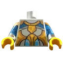{ .lu-ti width="24" loading="lazy" } [Knight Breastplate 3 (LOT 7369)](../7369.md) | Undefined for generic loot: reversed count range | 100% |
| 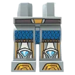{ .lu-ti width="24" loading="lazy" } [Knight Leggings 3 (LOT 7381)](../7381.md) | Undefined for generic loot: reversed count range | 100% |
| 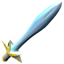{ .lu-ti width="24" loading="lazy" } [Knight Greatsword 3 (LOT 7393)](../7393.md) | Undefined for generic loot: reversed count range | 100% |
| { .lu-ti width="24" loading="lazy" } [Knight Shield 3 (LOT 7404)](../7404.md) | Undefined for generic loot: reversed count range | 100% |
| { .lu-ti width="24" loading="lazy" } [Knight Shoulderpads 3 (LOT 7409)](../7409.md) | Undefined for generic loot: reversed count range | 100% |
| { .lu-ti width="24" loading="lazy" } [Space Ranger Helmet 3 (LOT 7444)](../7444.md) | Undefined for generic loot: reversed count range | 100% |
| { .lu-ti width="24" loading="lazy" } [Samurai Helm 3 (LOT 7447)](../7447.md) | Undefined for generic loot: reversed count range | 100% |
| 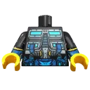{ .lu-ti width="24" loading="lazy" } [Space Ranger Armor 3 (LOT 7468)](../7468.md) | Undefined for generic loot: reversed count range | 100% |
| 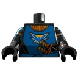{ .lu-ti width="24" loading="lazy" } [Samurai Breastplate 3 (LOT 7471)](../7471.md) | Undefined for generic loot: reversed count range | 100% |
| 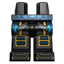{ .lu-ti width="24" loading="lazy" } [Space Ranger Pants 3 (LOT 7492)](../7492.md) | Undefined for generic loot: reversed count range | 100% |
| 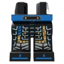{ .lu-ti width="24" loading="lazy" } [Samurai Leggings 3 (LOT 7495)](../7495.md) | Undefined for generic loot: reversed count range | 100% |
| 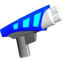{ .lu-ti width="24" loading="lazy" } [Space Ranger Zipgun 3 (LOT 7516)](../7516.md) | Undefined for generic loot: reversed count range | 100% |
| { .lu-ti width="24" loading="lazy" } [Samurai Katana 3 (LOT 7519)](../7519.md) | Undefined for generic loot: reversed count range | 100% |
| 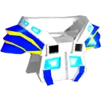{ .lu-ti width="24" loading="lazy" } [Space Ranger Pack 3 (LOT 7538)](../7538.md) | Undefined for generic loot: reversed count range | 100% |
| 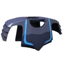{ .lu-ti width="24" loading="lazy" } [Samurai Shoulderpads 3 (LOT 7539)](../7539.md) | Undefined for generic loot: reversed count range | 100% |
| { .lu-ti width="24" loading="lazy" } [Space Ranger Launcher 3 (LOT 7545)](../7545.md) | Undefined for generic loot: reversed count range | 100% |
| 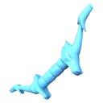{ .lu-ti width="24" loading="lazy" } [Samurai Bow 3 (LOT 7547)](../7547.md) | Undefined for generic loot: reversed count range | 100% |
| 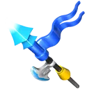{ .lu-ti width="24" loading="lazy" } [The Powerjouster (LOT 12637)](../12637.md) | Undefined for generic loot: reversed count range | 100% |
| { .lu-ti width="24" loading="lazy" } [The Samuraizor (LOT 12642)](../12642.md) | Undefined for generic loot: reversed count range | 100% |
| { .lu-ti width="24" loading="lazy" } [Knight Breastplate 3 (LOT 12950)](../12950.md) | Undefined for generic loot: reversed count range | 100% |
| 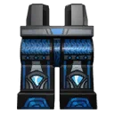{ .lu-ti width="24" loading="lazy" } [Knight Leggings 3 (LOT 12951)](../12951.md) | Undefined for generic loot: reversed count range | 100% |
| { .lu-ti width="24" loading="lazy" } [Samurai Breastplate 3 (LOT 12952)](../12952.md) | Undefined for generic loot: reversed count range | 100% |
| { .lu-ti width="24" loading="lazy" } [Samurai Leggings 3 (LOT 12953)](../12953.md) | Undefined for generic loot: reversed count range | 100% |
| { .lu-ti width="24" loading="lazy" } [Knight Helm 3 (LOT 12966)](../12966.md) | Undefined for generic loot: reversed count range | 100% |
| { .lu-ti width="24" loading="lazy" } [Knight Shoulderpads 3 (LOT 12967)](../12967.md) | Undefined for generic loot: reversed count range | 100% |
| { .lu-ti width="24" loading="lazy" } [Knight Greatsword 3 (LOT 12968)](../12968.md) | Undefined for generic loot: reversed count range | 100% |
| { .lu-ti width="24" loading="lazy" } [Knight Shield 3 (LOT 12969)](../12969.md) | Undefined for generic loot: reversed count range | 100% |
| { .lu-ti width="24" loading="lazy" } [Samurai Helm 3 (LOT 12976)](../12976.md) | Undefined for generic loot: reversed count range | 100% |
| { .lu-ti width="24" loading="lazy" } [Samurai Katana 3 (LOT 12977)](../12977.md) | Undefined for generic loot: reversed count range | 100% |
| 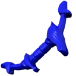{ .lu-ti width="24" loading="lazy" } [Samurai Bow 3 (LOT 12978)](../12978.md) | Undefined for generic loot: reversed count range | 100% |
| 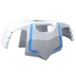{ .lu-ti width="24" loading="lazy" } [Samurai Shoulderpads 3 (LOT 12992)](../12992.md) | Undefined for generic loot: reversed count range | 100% |
| { .lu-ti width="24" loading="lazy" } [Large Bag of Green Imaginite (LOT 13136)](../13136.md) | Undefined for generic loot: reversed count range | 100% |
| { .lu-ti width="24" loading="lazy" } [Medium Bag of Red Imaginite (LOT 13141)](../13141.md) | Undefined for generic loot: reversed count range | 100% |
| { .lu-ti width="24" loading="lazy" } [Small Bag of Blue Imaginite (LOT 13143)](../13143.md) | Undefined for generic loot: reversed count range | 100% |
| { .lu-ti width="24" loading="lazy" } [Sentinel Startalon Rocket Nose Cone (LOT 13261)](../13261.md) | Undefined for generic loot: reversed count range | 100% |
| 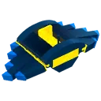{ .lu-ti width="24" loading="lazy" } [Sentinel Startalon Rocket Cockpit (LOT 13262)](../13262.md) | Undefined for generic loot: reversed count range | 100% |
| { .lu-ti width="24" loading="lazy" } [Sentinel Startalon Rocket Engine (LOT 13263)](../13263.md) | Undefined for generic loot: reversed count range | 100% |
| { .lu-ti width="24" loading="lazy" } [Sentinel Stalwart Front Bumper (LOT 13505)](../13505.md) | Undefined for generic loot: reversed count range | 100% |
| 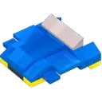{ .lu-ti width="24" loading="lazy" } [Sentinel Stalwart Engine Panel (LOT 13506)](../13506.md) | Undefined for generic loot: reversed count range | 100% |
| 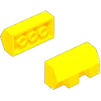{ .lu-ti width="24" loading="lazy" } [Sentinel Stalwart Side Panels (LOT 13507)](../13507.md) | Undefined for generic loot: reversed count range | 100% |
| 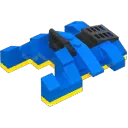{ .lu-ti width="24" loading="lazy" } [Sentinel Stalwart Rear Panel (LOT 13508)](../13508.md) | Undefined for generic loot: reversed count range | 100% |
| { .lu-ti width="24" loading="lazy" } [Sentinel Stalwart Rear Bumper (LOT 13509)](../13509.md) | Undefined for generic loot: reversed count range | 100% |
| { .lu-ti width="24" loading="lazy" } [Sentinel Super Soda 2 (LOT 13574)](../13574.md) | Undefined for generic loot: reversed count range | 100% |
| { .lu-ti width="24" loading="lazy" } [Valiant Knight's Cape (LOT 16179)](../16179.md) | Undefined for generic loot: reversed count range | 100% |
| { .lu-ti width="24" loading="lazy" } [Valiant Samurai's Cape (LOT 16180)](../16180.md) | Undefined for generic loot: reversed count range | 100% |
| { .lu-ti width="24" loading="lazy" } [Valiant Space Ranger's Cape (LOT 16181)](../16181.md) | Undefined for generic loot: reversed count range | 100% |

## Raw matrix entries

| Row | Loot table | Rarity table | Trigger | Min | Max | Flag | Gate |
| --- | --- | --- | --- | --- | --- | --- | --- |
| 3952 | 689 | 22 | 1 | 1 | 0 |  | nexustower |
| 4424 | 793 | 30 | 1 | 1 | 0 |  | levelprogression |
| 4441 | 618 | 22 | 1 | 1 | 0 |  | levelprogression |

[LootMatrix](../../../db/LootMatrix.md), [LootTable](../../../db/LootTable.md), [RarityTable](../../../db/RarityTable.md).
