# Loot matrix 692

[Item database](../README.md) | [Methodology](../Methodology.md)

## Sources and mapped locations

| Kind | Source | Location evidence | Conditions |
| --- | --- | --- | --- |
| Vendor | [Billy Ganges - Venture League Vendor (LOT 13384)](../sources/object-13384.md) | [Nexus Tower (1900)](../locations/zone-1900.md) | Default inventory; vendorInvOverride can replace it |

**Generic loot probability unavailable:** at least one entry has maxToDrop < minToDrop. Vendor code treats a zero endpoint as “include the full table”; the generic loot code does not define that interpretation. No drop percentage is fabricated for this matrix.

## Item candidates

Default vendor-stock probabilities are shown only when this matrix has a registered vendor. Loot probabilities use the generic algorithm, not a guarantee of actual use by every script/activity.

| Item | Modeled loot chance / expected count | Default vendor stock |
| --- | --- | --- |
| { .lu-ti width="24" loading="lazy" } [Buccaneer Hat 3 (LOT 7366)](../7366.md) | Undefined for generic loot: reversed count range | 100% |
| 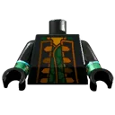{ .lu-ti width="24" loading="lazy" } [Buccaneer Shirt 3 (LOT 7378)](../7378.md) | Undefined for generic loot: reversed count range | 100% |
| 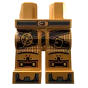{ .lu-ti width="24" loading="lazy" } [Buccaneer Pantaloons 3 (LOT 7390)](../7390.md) | Undefined for generic loot: reversed count range | 100% |
| { .lu-ti width="24" loading="lazy" } [Buccaneer Pistol &amp; Cutlass 3 (LOT 7402)](../7402.md) | Undefined for generic loot: reversed count range | 100% |
| 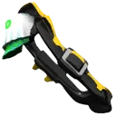{ .lu-ti width="24" loading="lazy" } [Buccaneer Bandolier 3 (LOT 7416)](../7416.md) | Undefined for generic loot: reversed count range | 100% |
| { .lu-ti width="24" loading="lazy" } [Adventurer Hat 3 (LOT 7462)](../7462.md) | Undefined for generic loot: reversed count range | 100% |
| 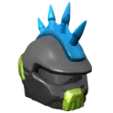{ .lu-ti width="24" loading="lazy" } [Daredevil Helmet 3 (LOT 7465)](../7465.md) | Undefined for generic loot: reversed count range | 100% |
| 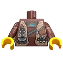{ .lu-ti width="24" loading="lazy" } [Adventurer Coat 3 (LOT 7486)](../7486.md) | Undefined for generic loot: reversed count range | 100% |
| { .lu-ti width="24" loading="lazy" } [Daredevil Jacket 3 (LOT 7489)](../7489.md) | Undefined for generic loot: reversed count range | 100% |
| 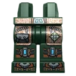{ .lu-ti width="24" loading="lazy" } [Adventurer Pants 3 (LOT 7510)](../7510.md) | Undefined for generic loot: reversed count range | 100% |
| 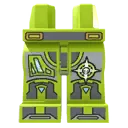{ .lu-ti width="24" loading="lazy" } [Daredevil Pants 3 (LOT 7513)](../7513.md) | Undefined for generic loot: reversed count range | 100% |
| 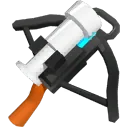{ .lu-ti width="24" loading="lazy" } [Adventurer Crossbow 3 (LOT 7534)](../7534.md) | Undefined for generic loot: reversed count range | 100% |
| 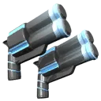{ .lu-ti width="24" loading="lazy" } [Daredevil Flareguns 3 (LOT 7537)](../7537.md) | Undefined for generic loot: reversed count range | 100% |
| { .lu-ti width="24" loading="lazy" } [Daredevil Shoulderpads 3 (LOT 7543)](../7543.md) | Undefined for generic loot: reversed count range | 100% |
| { .lu-ti width="24" loading="lazy" } [Adventurer Backpack 3 (LOT 7558)](../7558.md) | Undefined for generic loot: reversed count range | 100% |
| { .lu-ti width="24" loading="lazy" } [Adventurer Whip 3 (LOT 11459)](../11459.md) | Undefined for generic loot: reversed count range | 100% |
| { .lu-ti width="24" loading="lazy" } [The Broadsider (LOT 12638)](../12638.md) | Undefined for generic loot: reversed count range | 100% |
| { .lu-ti width="24" loading="lazy" } [The Rutcarver (LOT 12647)](../12647.md) | Undefined for generic loot: reversed count range | 100% |
| { .lu-ti width="24" loading="lazy" } [Buccaneer Shirt 3 (LOT 12954)](../12954.md) | Undefined for generic loot: reversed count range | 100% |
| 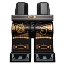{ .lu-ti width="24" loading="lazy" } [Buccaneer Pantaloons 3 (LOT 12955)](../12955.md) | Undefined for generic loot: reversed count range | 100% |
| { .lu-ti width="24" loading="lazy" } [Daredevil Jacket 3 (LOT 12956)](../12956.md) | Undefined for generic loot: reversed count range | 100% |
| 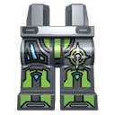{ .lu-ti width="24" loading="lazy" } [Daredevil Pants 3 (LOT 12957)](../12957.md) | Undefined for generic loot: reversed count range | 100% |
| { .lu-ti width="24" loading="lazy" } [Buccaneer Hat 3 (LOT 12981)](../12981.md) | Undefined for generic loot: reversed count range | 100% |
| { .lu-ti width="24" loading="lazy" } [Buccaneer Pistol &amp; Cutlass 3 (LOT 12982)](../12982.md) | Undefined for generic loot: reversed count range | 100% |
| 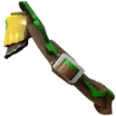{ .lu-ti width="24" loading="lazy" } [Buccaneer Bandolier 3 (LOT 12990)](../12990.md) | Undefined for generic loot: reversed count range | 100% |
| 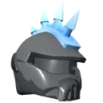{ .lu-ti width="24" loading="lazy" } [Daredevil Helmet 3 (LOT 12993)](../12993.md) | Undefined for generic loot: reversed count range | 100% |
| { .lu-ti width="24" loading="lazy" } [Daredevil Flareguns 3 (LOT 12994)](../12994.md) | Undefined for generic loot: reversed count range | 100% |
| 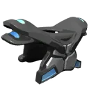{ .lu-ti width="24" loading="lazy" } [Daredevil Shoulderpads 3 (LOT 12995)](../12995.md) | Undefined for generic loot: reversed count range | 100% |
| { .lu-ti width="24" loading="lazy" } [Large Bag of Green Imaginite (LOT 13135)](../13135.md) | Undefined for generic loot: reversed count range | 100% |
| { .lu-ti width="24" loading="lazy" } [Medium Bag of Red Imaginite (LOT 13140)](../13140.md) | Undefined for generic loot: reversed count range | 100% |
| { .lu-ti width="24" loading="lazy" } [Small Bag of Blue Imaginite (LOT 13145)](../13145.md) | Undefined for generic loot: reversed count range | 100% |
| { .lu-ti width="24" loading="lazy" } [Venture League Astroscout Rocket Nose Cone (LOT 13264)](../13264.md) | Undefined for generic loot: reversed count range | 100% |
| 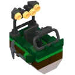{ .lu-ti width="24" loading="lazy" } [Venture League Astroscout Rocket Cockpit (LOT 13265)](../13265.md) | Undefined for generic loot: reversed count range | 100% |
| 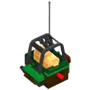{ .lu-ti width="24" loading="lazy" } [Venture League Astroscout Rocket Engine (LOT 13266)](../13266.md) | Undefined for generic loot: reversed count range | 100% |
| { .lu-ti width="24" loading="lazy" } [Venture League Hinterlander Front Bumper (LOT 13517)](../13517.md) | Undefined for generic loot: reversed count range | 100% |
| { .lu-ti width="24" loading="lazy" } [Venture League Hinterlander Engine Panel (LOT 13518)](../13518.md) | Undefined for generic loot: reversed count range | 100% |
| 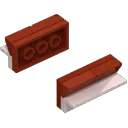{ .lu-ti width="24" loading="lazy" } [Venture League Hinterlander Side Panels (LOT 13519)](../13519.md) | Undefined for generic loot: reversed count range | 100% |
| 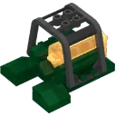{ .lu-ti width="24" loading="lazy" } [Venture League Hinterlander Rear Panel (LOT 13520)](../13520.md) | Undefined for generic loot: reversed count range | 100% |
| 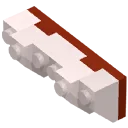{ .lu-ti width="24" loading="lazy" } [Venture League Hinterlander Rear Bumper (LOT 13521)](../13521.md) | Undefined for generic loot: reversed count range | 100% |
| { .lu-ti width="24" loading="lazy" } [Venture Vitality Vial 2 (LOT 13577)](../13577.md) | Undefined for generic loot: reversed count range | 100% |
| 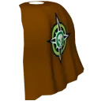{ .lu-ti width="24" loading="lazy" } [Valiant Daredevil's Cape (LOT 16185)](../16185.md) | Undefined for generic loot: reversed count range | 100% |
| { .lu-ti width="24" loading="lazy" } [Valiant Buccaneer's Cape (LOT 16186)](../16186.md) | Undefined for generic loot: reversed count range | 100% |
| { .lu-ti width="24" loading="lazy" } [Valiant Adventurer's Cape (LOT 16187)](../16187.md) | Undefined for generic loot: reversed count range | 100% |

## Raw matrix entries

| Row | Loot table | Rarity table | Trigger | Min | Max | Flag | Gate |
| --- | --- | --- | --- | --- | --- | --- | --- |
| 3955 | 692 | 22 | 1 | 1 | 0 |  | nexustower |
| 4425 | 795 | 30 | 1 | 1 | 0 |  | levelprogression |
| 4448 | 626 | 22 | 1 | 1 | 0 |  | levelprogression |

[LootMatrix](../../../db/LootMatrix.md), [LootTable](../../../db/LootTable.md), [RarityTable](../../../db/RarityTable.md).
