# Loot matrix 693

[Item database](../README.md) | [Methodology](../Methodology.md)

## Sources and mapped locations

| Kind | Source | Location evidence | Conditions |
| --- | --- | --- | --- |
| Vendor | [Sutoro Hatto - Paradox Vendor (LOT 13378)](../sources/object-13378.md) | [Nexus Tower (1900)](../locations/zone-1900.md) | Default inventory; vendorInvOverride can replace it |

**Generic loot probability unavailable:** at least one entry has maxToDrop < minToDrop. Vendor code treats a zero endpoint as “include the full table”; the generic loot code does not define that interpretation. No drop percentage is fabricated for this matrix.

## Item candidates

Default vendor-stock probabilities are shown only when this matrix has a registered vendor. Loot probabilities use the generic algorithm, not a guarantee of actual use by every script/activity.

| Item | Modeled loot chance / expected count | Default vendor stock |
| --- | --- | --- |
| { .lu-ti width="24" loading="lazy" } [Sorcerer Hat 3 (LOT 7362)](../7362.md) | Undefined for generic loot: reversed count range | 100% |
| { .lu-ti width="24" loading="lazy" } [Sorcerer Breastplate 3 (LOT 7375)](../7375.md) | Undefined for generic loot: reversed count range | 100% |
| 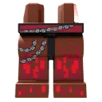{ .lu-ti width="24" loading="lazy" } [Sorcerer Pants 3 (LOT 7387)](../7387.md) | Undefined for generic loot: reversed count range | 100% |
| 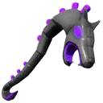{ .lu-ti width="24" loading="lazy" } [Sorcerer Wand 3 (LOT 7399)](../7399.md) | Undefined for generic loot: reversed count range | 100% |
| 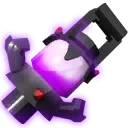{ .lu-ti width="24" loading="lazy" } [Sorcerer Orb 3 (LOT 7408)](../7408.md) | Undefined for generic loot: reversed count range | 100% |
| 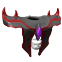{ .lu-ti width="24" loading="lazy" } [Sorcerer Shoulderpads 3 (LOT 7415)](../7415.md) | Undefined for generic loot: reversed count range | 100% |
| { .lu-ti width="24" loading="lazy" } [Space Marauder Helm 3 (LOT 7450)](../7450.md) | Undefined for generic loot: reversed count range | 100% |
| { .lu-ti width="24" loading="lazy" } [Shinobi Hood 3 (LOT 7453)](../7453.md) | Undefined for generic loot: reversed count range | 100% |
| 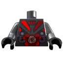{ .lu-ti width="24" loading="lazy" } [Space Marauder Jacket 3 (LOT 7474)](../7474.md) | Undefined for generic loot: reversed count range | 100% |
| { .lu-ti width="24" loading="lazy" } [Shinobi Gi 3 (LOT 7477)](../7477.md) | Undefined for generic loot: reversed count range | 100% |
| 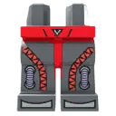{ .lu-ti width="24" loading="lazy" } [Space Marauder Pants 3 (LOT 7498)](../7498.md) | Undefined for generic loot: reversed count range | 100% |
| 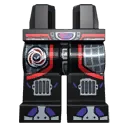{ .lu-ti width="24" loading="lazy" } [Shinobi Leggings 3 (LOT 7501)](../7501.md) | Undefined for generic loot: reversed count range | 100% |
| { .lu-ti width="24" loading="lazy" } [Space Marauder Blaster 3 (LOT 7522)](../7522.md) | Undefined for generic loot: reversed count range | 100% |
| { .lu-ti width="24" loading="lazy" } [Shinobi Katana 3 (LOT 7525)](../7525.md) | Undefined for generic loot: reversed count range | 100% |
| 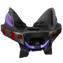{ .lu-ti width="24" loading="lazy" } [Space Marauder Shoulderpads 3 (LOT 7540)](../7540.md) | Undefined for generic loot: reversed count range | 100% |
| 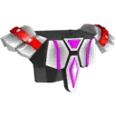{ .lu-ti width="24" loading="lazy" } [Shinobi Shoulderpads 3 (LOT 7541)](../7541.md) | Undefined for generic loot: reversed count range | 100% |
| { .lu-ti width="24" loading="lazy" } [Space Marauder Launcher 3 (LOT 7550)](../7550.md) | Undefined for generic loot: reversed count range | 100% |
| { .lu-ti width="24" loading="lazy" } [The Wormholer (LOT 12809)](../12809.md) | Undefined for generic loot: reversed count range | 100% |
| 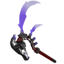{ .lu-ti width="24" loading="lazy" } [The Doomslicer (LOT 12816)](../12816.md) | Undefined for generic loot: reversed count range | 100% |
| 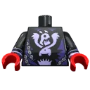{ .lu-ti width="24" loading="lazy" } [Sorcerer Breastplate 3 (LOT 12958)](../12958.md) | Undefined for generic loot: reversed count range | 100% |
| 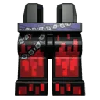{ .lu-ti width="24" loading="lazy" } [Sorcerer Pants 3 (LOT 12959)](../12959.md) | Undefined for generic loot: reversed count range | 100% |
| { .lu-ti width="24" loading="lazy" } [Space Marauder Jacket 3 (LOT 12960)](../12960.md) | Undefined for generic loot: reversed count range | 100% |
| 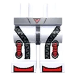{ .lu-ti width="24" loading="lazy" } [Space Marauder Pants 3 (LOT 12961)](../12961.md) | Undefined for generic loot: reversed count range | 100% |
| { .lu-ti width="24" loading="lazy" } [Sorcerer Hat 3 (LOT 12983)](../12983.md) | Undefined for generic loot: reversed count range | 100% |
| { .lu-ti width="24" loading="lazy" } [Sorcerer Wand 3 (LOT 12984)](../12984.md) | Undefined for generic loot: reversed count range | 100% |
| { .lu-ti width="24" loading="lazy" } [Sorcerer Orb 3 (LOT 12985)](../12985.md) | Undefined for generic loot: reversed count range | 100% |
| { .lu-ti width="24" loading="lazy" } [Space Marauder Helm 3 (LOT 12986)](../12986.md) | Undefined for generic loot: reversed count range | 100% |
| { .lu-ti width="24" loading="lazy" } [Space Marauder Blaster 3 (LOT 12987)](../12987.md) | Undefined for generic loot: reversed count range | 100% |
| 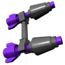{ .lu-ti width="24" loading="lazy" } [Space Marauder Launcher 3 (LOT 12988)](../12988.md) | Undefined for generic loot: reversed count range | 100% |
| { .lu-ti width="24" loading="lazy" } [Sorcerer Shoulderpads 3 (LOT 12989)](../12989.md) | Undefined for generic loot: reversed count range | 100% |
| { .lu-ti width="24" loading="lazy" } [Space Marauder Shoulderpads 3 (LOT 12991)](../12991.md) | Undefined for generic loot: reversed count range | 100% |
| { .lu-ti width="24" loading="lazy" } [Large Bag of Green Imaginite (LOT 13137)](../13137.md) | Undefined for generic loot: reversed count range | 100% |
| { .lu-ti width="24" loading="lazy" } [Medium Bag of Red Imaginite (LOT 13138)](../13138.md) | Undefined for generic loot: reversed count range | 100% |
| { .lu-ti width="24" loading="lazy" } [Small Bag of Blue Imaginite (LOT 13146)](../13146.md) | Undefined for generic loot: reversed count range | 100% |
| 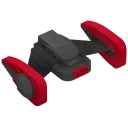{ .lu-ti width="24" loading="lazy" } [Paradox Darkwarp Rocket Nose Cone (LOT 13258)](../13258.md) | Undefined for generic loot: reversed count range | 100% |
| { .lu-ti width="24" loading="lazy" } [Paradox Darkwarp Rocket Cockpit (LOT 13259)](../13259.md) | Undefined for generic loot: reversed count range | 100% |
| 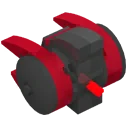{ .lu-ti width="24" loading="lazy" } [Paradox Darkwarp Rocket Engine (LOT 13260)](../13260.md) | Undefined for generic loot: reversed count range | 100% |
| 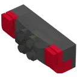{ .lu-ti width="24" loading="lazy" } [Paradox Blindsider Front Bumper (LOT 13500)](../13500.md) | Undefined for generic loot: reversed count range | 100% |
| { .lu-ti width="24" loading="lazy" } [Paradox Blindsider Engine Panel (LOT 13501)](../13501.md) | Undefined for generic loot: reversed count range | 100% |
| 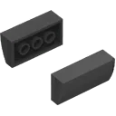{ .lu-ti width="24" loading="lazy" } [Paradox Blindsider Side Panels (LOT 13502)](../13502.md) | Undefined for generic loot: reversed count range | 100% |
| 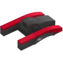{ .lu-ti width="24" loading="lazy" } [Paradox Blindsider Rear Panel (LOT 13503)](../13503.md) | Undefined for generic loot: reversed count range | 100% |
| { .lu-ti width="24" loading="lazy" } [Paradox Blindsider Rear Bumper (LOT 13504)](../13504.md) | Undefined for generic loot: reversed count range | 100% |
| 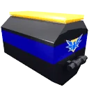{ .lu-ti width="24" loading="lazy" } [Sentinel Box Disguise (LOT 13548)](../13548.md) | Undefined for generic loot: reversed count range | 100% |
| { .lu-ti width="24" loading="lazy" } [Paradox Power Potion 2 (LOT 13576)](../13576.md) | Undefined for generic loot: reversed count range | 100% |
| 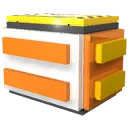{ .lu-ti width="24" loading="lazy" } [Assembly Box Disguise (LOT 13891)](../13891.md) | Undefined for generic loot: reversed count range | 100% |
| 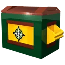{ .lu-ti width="24" loading="lazy" } [Venture League Box Disguise (LOT 13892)](../13892.md) | Undefined for generic loot: reversed count range | 100% |
| { .lu-ti width="24" loading="lazy" } [Valiant Space Marauder's Cape (LOT 16188)](../16188.md) | Undefined for generic loot: reversed count range | 100% |
| { .lu-ti width="24" loading="lazy" } [Valiant Sorcerer's Cape (LOT 16189)](../16189.md) | Undefined for generic loot: reversed count range | 100% |
| { .lu-ti width="24" loading="lazy" } [Valiant Shinobi's Cape (LOT 16190)](../16190.md) | Undefined for generic loot: reversed count range | 100% |

## Raw matrix entries

| Row | Loot table | Rarity table | Trigger | Min | Max | Flag | Gate |
| --- | --- | --- | --- | --- | --- | --- | --- |
| 3954 | 691 | 22 | 1 | 1 | 0 |  | nexustower |
| 4426 | 796 | 30 | 1 | 1 | 0 |  | levelprogression |
| 4443 | 633 | 22 | 1 | 1 | 0 |  | levelprogression |

[LootMatrix](../../../db/LootMatrix.md), [LootTable](../../../db/LootTable.md), [RarityTable](../../../db/RarityTable.md).
