# Loot matrix 694

[Item database](../README.md) | [Methodology](../Methodology.md)

## Sources and mapped locations

| Kind | Source | Location evidence | Conditions |
| --- | --- | --- | --- |
| Vendor | [Torbert Oscillator - Assembly Vendor (LOT 13380)](../sources/object-13380.md) | [Nexus Tower (1900)](../locations/zone-1900.md) | Default inventory; vendorInvOverride can replace it |

**Generic loot probability unavailable:** at least one entry has maxToDrop < minToDrop. Vendor code treats a zero endpoint as “include the full table”; the generic loot code does not define that interpretation. No drop percentage is fabricated for this matrix.

## Item candidates

Default vendor-stock probabilities are shown only when this matrix has a registered vendor. Loot probabilities use the generic algorithm, not a guarantee of actual use by every script/activity.

| Item | Modeled loot chance / expected count | Default vendor stock |
| --- | --- | --- |
| { .lu-ti width="24" loading="lazy" } [Engineer Helmet 3 (LOT 7364)](../7364.md) | Undefined for generic loot: reversed count range | 100% |
| 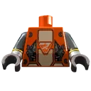{ .lu-ti width="24" loading="lazy" } [Engineer Shirt 3 (LOT 7372)](../7372.md) | Undefined for generic loot: reversed count range | 100% |
| 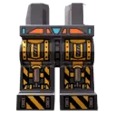{ .lu-ti width="24" loading="lazy" } [Engineer Pants 3 (LOT 7384)](../7384.md) | Undefined for generic loot: reversed count range | 100% |
| 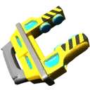{ .lu-ti width="24" loading="lazy" } [Engineer Wrench 3 (LOT 7396)](../7396.md) | Undefined for generic loot: reversed count range | 100% |
| { .lu-ti width="24" loading="lazy" } [Engineer Controller 3 (LOT 7406)](../7406.md) | Undefined for generic loot: reversed count range | 100% |
| { .lu-ti width="24" loading="lazy" } [Engineer Vest 3 (LOT 7417)](../7417.md) | Undefined for generic loot: reversed count range | 100% |
| { .lu-ti width="24" loading="lazy" } [Inventor Goggles 3 (LOT 7456)](../7456.md) | Undefined for generic loot: reversed count range | 100% |
| { .lu-ti width="24" loading="lazy" } [Summoner Hat 3 (LOT 7459)](../7459.md) | Undefined for generic loot: reversed count range | 100% |
| 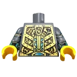{ .lu-ti width="24" loading="lazy" } [Inventor Armor 3 (LOT 7480)](../7480.md) | Undefined for generic loot: reversed count range | 100% |
| { .lu-ti width="24" loading="lazy" } [Summoner Robe 3 (LOT 7483)](../7483.md) | Undefined for generic loot: reversed count range | 100% |
| { .lu-ti width="24" loading="lazy" } [Inventor Pants 3 (LOT 7504)](../7504.md) | Undefined for generic loot: reversed count range | 100% |
| 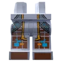{ .lu-ti width="24" loading="lazy" } [Summoner Pants 3 (LOT 7507)](../7507.md) | Undefined for generic loot: reversed count range | 100% |
| { .lu-ti width="24" loading="lazy" } [Inventor Improved Launcher 3 (LOT 7528)](../7528.md) | Undefined for generic loot: reversed count range | 100% |
| { .lu-ti width="24" loading="lazy" } [Summoner Staff 3 (LOT 7531)](../7531.md) | Undefined for generic loot: reversed count range | 100% |
| 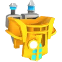{ .lu-ti width="24" loading="lazy" } [Inventor Shoulderpads 3 (LOT 7542)](../7542.md) | Undefined for generic loot: reversed count range | 100% |
| 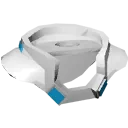{ .lu-ti width="24" loading="lazy" } [Summoner Shoulderpads 3 (LOT 7555)](../7555.md) | Undefined for generic loot: reversed count range | 100% |
| { .lu-ti width="24" loading="lazy" } [Summoner Orb 3 (LOT 7557)](../7557.md) | Undefined for generic loot: reversed count range | 100% |
| { .lu-ti width="24" loading="lazy" } [The Serratorizer (LOT 12636)](../12636.md) | Undefined for generic loot: reversed count range | 100% |
| { .lu-ti width="24" loading="lazy" } [The Wingreaper (LOT 12817)](../12817.md) | Undefined for generic loot: reversed count range | 100% |
| { .lu-ti width="24" loading="lazy" } [Summoner Staff 3 (LOT 12921)](../12921.md) | Undefined for generic loot: reversed count range | 100% |
| { .lu-ti width="24" loading="lazy" } [Summoner Orb 3 (LOT 12922)](../12922.md) | Undefined for generic loot: reversed count range | 100% |
| { .lu-ti width="24" loading="lazy" } [Summoner Shoulderpads 3 (LOT 12923)](../12923.md) | Undefined for generic loot: reversed count range | 100% |
| { .lu-ti width="24" loading="lazy" } [Summoner Hat 3 (LOT 12924)](../12924.md) | Undefined for generic loot: reversed count range | 100% |
| 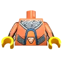{ .lu-ti width="24" loading="lazy" } [Summoner Robe 3 (LOT 12945)](../12945.md) | Undefined for generic loot: reversed count range | 100% |
| 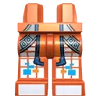{ .lu-ti width="24" loading="lazy" } [Summoner Pants 3 (LOT 12946)](../12946.md) | Undefined for generic loot: reversed count range | 100% |
| 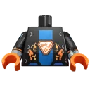{ .lu-ti width="24" loading="lazy" } [Engineer Shirt 3 (LOT 12947)](../12947.md) | Undefined for generic loot: reversed count range | 100% |
| 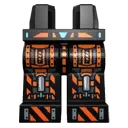{ .lu-ti width="24" loading="lazy" } [Engineer Pants 3 (LOT 12949)](../12949.md) | Undefined for generic loot: reversed count range | 100% |
| 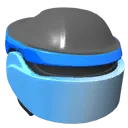{ .lu-ti width="24" loading="lazy" } [Engineer Helmet 3 (LOT 12962)](../12962.md) | Undefined for generic loot: reversed count range | 100% |
| 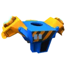{ .lu-ti width="24" loading="lazy" } [Engineer Vest 3 (LOT 12963)](../12963.md) | Undefined for generic loot: reversed count range | 100% |
| 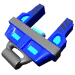{ .lu-ti width="24" loading="lazy" } [Engineer Wrench 3 (LOT 12964)](../12964.md) | Undefined for generic loot: reversed count range | 100% |
| 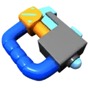{ .lu-ti width="24" loading="lazy" } [Engineer Controller 3 (LOT 12965)](../12965.md) | Undefined for generic loot: reversed count range | 100% |
| { .lu-ti width="24" loading="lazy" } [Large Bag of Green Imaginite (LOT 13134)](../13134.md) | Undefined for generic loot: reversed count range | 100% |
| { .lu-ti width="24" loading="lazy" } [Medium Bag of Red Imaginite (LOT 13139)](../13139.md) | Undefined for generic loot: reversed count range | 100% |
| { .lu-ti width="24" loading="lazy" } [Small Bag of Blue Imaginite (LOT 13144)](../13144.md) | Undefined for generic loot: reversed count range | 100% |
| 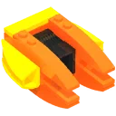{ .lu-ti width="24" loading="lazy" } [Assembly Solarblast Rocket Nose Cone (LOT 13255)](../13255.md) | Undefined for generic loot: reversed count range | 100% |
| 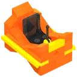{ .lu-ti width="24" loading="lazy" } [Assembly Solarblast Rocket Cockpit (LOT 13256)](../13256.md) | Undefined for generic loot: reversed count range | 100% |
| 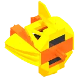{ .lu-ti width="24" loading="lazy" } [Assembly Solarblast Rocket Engine (LOT 13257)](../13257.md) | Undefined for generic loot: reversed count range | 100% |
| 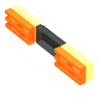{ .lu-ti width="24" loading="lazy" } [Assembly Blockader Front Bumper (LOT 13512)](../13512.md) | Undefined for generic loot: reversed count range | 100% |
| { .lu-ti width="24" loading="lazy" } [Assembly Blockader Engine Panel (LOT 13513)](../13513.md) | Undefined for generic loot: reversed count range | 100% |
| 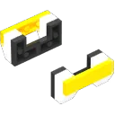{ .lu-ti width="24" loading="lazy" } [Assembly Blockader Side Panels (LOT 13514)](../13514.md) | Undefined for generic loot: reversed count range | 100% |
| 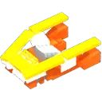{ .lu-ti width="24" loading="lazy" } [Assembly Blockader Rear Panel (LOT 13515)](../13515.md) | Undefined for generic loot: reversed count range | 100% |
| 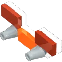{ .lu-ti width="24" loading="lazy" } [Assembly Blockader Rear Bumper (LOT 13516)](../13516.md) | Undefined for generic loot: reversed count range | 100% |
| { .lu-ti width="24" loading="lazy" } [Assembly Awesome-Ade 2 (LOT 13575)](../13575.md) | Undefined for generic loot: reversed count range | 100% |
| { .lu-ti width="24" loading="lazy" } [Valiant Engineer's Cape (LOT 16182)](../16182.md) | Undefined for generic loot: reversed count range | 100% |
| { .lu-ti width="24" loading="lazy" } [Valiant Summoner's Cape (LOT 16183)](../16183.md) | Undefined for generic loot: reversed count range | 100% |
| { .lu-ti width="24" loading="lazy" } [Valiant Inventor's Cape (LOT 16184)](../16184.md) | Undefined for generic loot: reversed count range | 100% |

## Raw matrix entries

| Row | Loot table | Rarity table | Trigger | Min | Max | Flag | Gate |
| --- | --- | --- | --- | --- | --- | --- | --- |
| 3953 | 690 | 22 | 1 | 1 | 0 |  | nexustower |
| 4427 | 794 | 30 | 1 | 1 | 0 |  | levelprogression |
| 4446 | 640 | 22 | 1 | 1 | 0 |  | levelprogression |

[LootMatrix](../../../db/LootMatrix.md), [LootTable](../../../db/LootTable.md), [RarityTable](../../../db/RarityTable.md).
