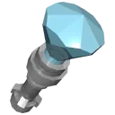

# Loot matrix 703

[Item database](../README.md) | [Methodology](../Methodology.md)

## Sources and mapped locations

| Kind | Source | Location evidence | Conditions |
| --- | --- | --- | --- |
| Vendor | [Mr. Ree - Shady Vendor (LOT 13569)](../sources/object-13569.md) | [Nexus Tower (1900)](../locations/zone-1900.md) | Default inventory; vendorInvOverride can replace it |

## Item candidates

Default vendor-stock probabilities are shown only when this matrix has a registered vendor. Loot probabilities use the generic algorithm, not a guarantee of actual use by every script/activity.

| Item | Modeled loot chance / expected count | Default vendor stock |
| --- | --- | --- |
| { .lu-ti width="24" loading="lazy" } [Juggling Bag (LOT 12116)](../12116.md) | 17.60253906%; mean 0.1875 | 18.75% |
| { .lu-ti width="24" loading="lazy" } [Sapphire Scepter (LOT 12669)](../12669.md) | 17.60253906%; mean 0.1875 | 18.75% |
| { .lu-ti width="24" loading="lazy" } [Fleur-de-Lis Shield (LOT 12675)](../12675.md) | 17.60253906%; mean 0.1875 | 18.75% |
| { .lu-ti width="24" loading="lazy" } [Wand of Repulsion (LOT 12723)](../12723.md) | 17.60253906%; mean 0.1875 | 18.75% |
| { .lu-ti width="24" loading="lazy" } [Double Blaster (LOT 12761)](../12761.md) | 17.60253906%; mean 0.1875 | 18.75% |
| { .lu-ti width="24" loading="lazy" } [Oil Can (LOT 13579)](../13579.md) | 17.60253906%; mean 0.1875 | 18.75% |
| { .lu-ti width="24" loading="lazy" } [Foreman Radio (LOT 13580)](../13580.md) | 17.60253906%; mean 0.1875 | 18.75% |
| { .lu-ti width="24" loading="lazy" } [Skeleton Key (LOT 13581)](../13581.md) | 17.60253906%; mean 0.1875 | 18.75% |
| { .lu-ti width="24" loading="lazy" } [Mole Whacker (LOT 13582)](../13582.md) | 17.60253906%; mean 0.1875 | 18.75% |
| { .lu-ti width="24" loading="lazy" } [Gem Hammer (LOT 13583)](../13583.md) | 17.60253906%; mean 0.1875 | 18.75% |
| { .lu-ti width="24" loading="lazy" } [Overcharged Blaster (LOT 13584)](../13584.md) | 17.60253906%; mean 0.1875 | 18.75% |
| { .lu-ti width="24" loading="lazy" } [Gat Gun Sprayer (LOT 13585)](../13585.md) | 17.60253906%; mean 0.1875 | 18.75% |
| { .lu-ti width="24" loading="lazy" } [Launcher (LOT 13586)](../13586.md) | 17.60253906%; mean 0.1875 | 18.75% |
| { .lu-ti width="24" loading="lazy" } [Shard Armor (LOT 13617)](../13617.md) | 17.60253906%; mean 0.1875 | 18.75% |
| { .lu-ti width="24" loading="lazy" } [White Cape (LOT 14807)](../14807.md) | 17.60253906%; mean 0.1875 | 18.75% |
| { .lu-ti width="24" loading="lazy" } [Black Cape (LOT 14808)](../14808.md) | 17.60253906%; mean 0.1875 | 18.75% |

## Raw matrix entries

| Row | Loot table | Rarity table | Trigger | Min | Max | Flag | Gate |
| --- | --- | --- | --- | --- | --- | --- | --- |
| 3812 | 643 | 26 | 1 | 3 | 3 |  |  |

[LootMatrix](../../../db/LootMatrix.md), [LootTable](../../../db/LootTable.md), [RarityTable](../../../db/RarityTable.md).
