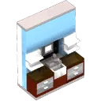
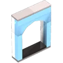

# Loot matrix 705

[Item database](../README.md) | [Methodology](../Methodology.md)

## Sources and mapped locations

| Kind | Source | Location evidence | Conditions |
| --- | --- | --- | --- |
| Package | [Surprise Model Pack (LOT 13604)](../sources/object-13604.md) | No matched local placement found | Static association, not a live-spawn guarantee |

## Item candidates

Default vendor-stock probabilities are shown only when this matrix has a registered vendor. Loot probabilities use the generic algorithm, not a guarantee of actual use by every script/activity.

| Item | Modeled loot chance / expected count | Default vendor stock |
| --- | --- | --- |
| { .lu-ti width="24" loading="lazy" } [Tiny Mushroom Model (LOT 6027)](../6027.md) | 0% in the generic loot model | Not associated with a vendor |
| { .lu-ti width="24" loading="lazy" } [Small Mushroom Model (LOT 6028)](../6028.md) | 0% in the generic loot model | Not associated with a vendor |
| { .lu-ti width="24" loading="lazy" } [Medium Mushroom Model (LOT 6029)](../6029.md) | 0% in the generic loot model | Not associated with a vendor |
| { .lu-ti width="24" loading="lazy" } [Large Mushroom Model (LOT 6030)](../6030.md) | 0% in the generic loot model | Not associated with a vendor |
| { .lu-ti width="24" loading="lazy" } [Tiny Crate Model (LOT 6031)](../6031.md) | 0% in the generic loot model | Not associated with a vendor |
| { .lu-ti width="24" loading="lazy" } [Small Crate Model (LOT 6032)](../6032.md) | 0% in the generic loot model | Not associated with a vendor |
| { .lu-ti width="24" loading="lazy" } [Medium Crate Model (LOT 6033)](../6033.md) | 12.05014096%; mean 0.1275 | Not associated with a vendor |
| { .lu-ti width="24" loading="lazy" } [Large Crate Model (LOT 6034)](../6034.md) | 12.05014096%; mean 0.1275 | Not associated with a vendor |
| { .lu-ti width="24" loading="lazy" } [Wooden Barrel Model (LOT 6035)](../6035.md) | 0% in the generic loot model | Not associated with a vendor |
| { .lu-ti width="24" loading="lazy" } [Tent Model (LOT 6036)](../6036.md) | 12.05014096%; mean 0.1275 | Not associated with a vendor |
| { .lu-ti width="24" loading="lazy" } [Desk Model (LOT 6037)](../6037.md) | 0% in the generic loot model | Not associated with a vendor |
| { .lu-ti width="24" loading="lazy" } [Water Cooler Model (LOT 6039)](../6039.md) | 0% in the generic loot model | Not associated with a vendor |
| { .lu-ti width="24" loading="lazy" } [Small Table Model (LOT 6044)](../6044.md) | 0% in the generic loot model | Not associated with a vendor |
| { .lu-ti width="24" loading="lazy" } [Weapon Rack Model (LOT 6056)](../6056.md) | 0% in the generic loot model | Not associated with a vendor |
| { .lu-ti width="24" loading="lazy" } [Hut Model (LOT 6060)](../6060.md) | 0% in the generic loot model | Not associated with a vendor |
| { .lu-ti width="24" loading="lazy" } [Coffee Table Model (LOT 6064)](../6064.md) | 0% in the generic loot model | Not associated with a vendor |
| { .lu-ti width="24" loading="lazy" } [Cart Model (LOT 6065)](../6065.md) | 0% in the generic loot model | Not associated with a vendor |
| { .lu-ti width="24" loading="lazy" } [Fence Model (LOT 6071)](../6071.md) | 0% in the generic loot model | Not associated with a vendor |
| { .lu-ti width="24" loading="lazy" } [Wood Pile Model (LOT 6072)](../6072.md) | 0% in the generic loot model | Not associated with a vendor |
| { .lu-ti width="24" loading="lazy" } [Box of Cups Model (LOT 6778)](../6778.md) | 0% in the generic loot model | Not associated with a vendor |
| { .lu-ti width="24" loading="lazy" } [Candle Holder Model (LOT 7122)](../7122.md) | 0% in the generic loot model | Not associated with a vendor |
| { .lu-ti width="24" loading="lazy" } [Dock Model (LOT 7123)](../7123.md) | 0% in the generic loot model | Not associated with a vendor |
| { .lu-ti width="24" loading="lazy" } [Cabinet Model (LOT 7134)](../7134.md) | 0% in the generic loot model | Not associated with a vendor |
| { .lu-ti width="24" loading="lazy" } [Antique Chair Model (LOT 7135)](../7135.md) | 0% in the generic loot model | Not associated with a vendor |
| { .lu-ti width="24" loading="lazy" } [Picnic Table Model (LOT 7758)](../7758.md) | 0% in the generic loot model | Not associated with a vendor |
| { .lu-ti width="24" loading="lazy" } [Double Trash Can Model (LOT 7759)](../7759.md) | 0% in the generic loot model | Not associated with a vendor |
| { .lu-ti width="24" loading="lazy" } [Trash Can Model (LOT 7761)](../7761.md) | 0% in the generic loot model | Not associated with a vendor |
| { .lu-ti width="24" loading="lazy" } [Bench Model (LOT 7770)](../7770.md) | 0% in the generic loot model | Not associated with a vendor |
| { .lu-ti width="24" loading="lazy" } [Cooler Model (LOT 7771)](../7771.md) | 0% in the generic loot model | Not associated with a vendor |
| { .lu-ti width="24" loading="lazy" } [Piano Model (LOT 7773)](../7773.md) | 70.83333333%; mean 1 | Not associated with a vendor |
| { .lu-ti width="24" loading="lazy" } [Guitar Model (LOT 7774)](../7774.md) | 0% in the generic loot model | Not associated with a vendor |
| { .lu-ti width="24" loading="lazy" } [Bass Guitar Model (LOT 7775)](../7775.md) | 0% in the generic loot model | Not associated with a vendor |
| { .lu-ti width="24" loading="lazy" } [Fire Hydrant Model (LOT 7808)](../7808.md) | 0% in the generic loot model | Not associated with a vendor |
| { .lu-ti width="24" loading="lazy" } [Drumset Model (LOT 7813)](../7813.md) | 70.83333333%; mean 1 | Not associated with a vendor |
| { .lu-ti width="24" loading="lazy" } [Cash Register Model (LOT 7818)](../7818.md) | 0% in the generic loot model | Not associated with a vendor |
| { .lu-ti width="24" loading="lazy" } [DJ Table Model (LOT 7822)](../7822.md) | 0% in the generic loot model | Not associated with a vendor |
| { .lu-ti width="24" loading="lazy" } [Tank Pallet Model (LOT 7825)](../7825.md) | 0% in the generic loot model | Not associated with a vendor |
| { .lu-ti width="24" loading="lazy" } [Oil Drum Model (LOT 7826)](../7826.md) | 0% in the generic loot model | Not associated with a vendor |
| { .lu-ti width="24" loading="lazy" } [Dolly Model (LOT 7827)](../7827.md) | 0% in the generic loot model | Not associated with a vendor |
| { .lu-ti width="24" loading="lazy" } [Torch Cart Model (LOT 7828)](../7828.md) | 0% in the generic loot model | Not associated with a vendor |
| { .lu-ti width="24" loading="lazy" } [Engine Model (LOT 7829)](../7829.md) | 0% in the generic loot model | Not associated with a vendor |
| { .lu-ti width="24" loading="lazy" } [Pallet Model (LOT 7830)](../7830.md) | 0% in the generic loot model | Not associated with a vendor |
| { .lu-ti width="24" loading="lazy" } [Vendor Rack Model (LOT 7832)](../7832.md) | 0% in the generic loot model | Not associated with a vendor |
| { .lu-ti width="24" loading="lazy" } [Goblet Box Model (LOT 8055)](../8055.md) | 0% in the generic loot model | Not associated with a vendor |
| { .lu-ti width="24" loading="lazy" } [Console Model (LOT 8068)](../8068.md) | 0% in the generic loot model | Not associated with a vendor |
| { .lu-ti width="24" loading="lazy" } [Yellow Barricade Model (LOT 8069)](../8069.md) | 0% in the generic loot model | Not associated with a vendor |
| { .lu-ti width="24" loading="lazy" } [Barricade Model (LOT 8073)](../8073.md) | 0% in the generic loot model | Not associated with a vendor |
| { .lu-ti width="24" loading="lazy" } [Birdhouse Model (LOT 8077)](../8077.md) | 0% in the generic loot model | Not associated with a vendor |
| { .lu-ti width="24" loading="lazy" } [Double Lamppost Model (LOT 8270)](../8270.md) | 0% in the generic loot model | Not associated with a vendor |
| { .lu-ti width="24" loading="lazy" } [Brown Bench Model (LOT 9484)](../9484.md) | 0% in the generic loot model | Not associated with a vendor |
| { .lu-ti width="24" loading="lazy" } [Television Model (LOT 9488)](../9488.md) | 0% in the generic loot model | Not associated with a vendor |
| { .lu-ti width="24" loading="lazy" } [Troll Cart Model (LOT 9490)](../9490.md) | 0% in the generic loot model | Not associated with a vendor |
| { .lu-ti width="24" loading="lazy" } [Hotdog Cart Model (LOT 9491)](../9491.md) | 0% in the generic loot model | Not associated with a vendor |
| { .lu-ti width="24" loading="lazy" } [Hotdog Stand Model (LOT 9492)](../9492.md) | 0% in the generic loot model | Not associated with a vendor |
| { .lu-ti width="24" loading="lazy" } [Castle Weapon Rack Model (LOT 9493)](../9493.md) | 0% in the generic loot model | Not associated with a vendor |
| { .lu-ti width="24" loading="lazy" } [Dustbin Model (LOT 9495)](../9495.md) | 0% in the generic loot model | Not associated with a vendor |
| { .lu-ti width="24" loading="lazy" } [Sleek Sofa Model (LOT 9496)](../9496.md) | 0% in the generic loot model | Not associated with a vendor |
| { .lu-ti width="24" loading="lazy" } [Traffic Light Model (LOT 9497)](../9497.md) | 0% in the generic loot model | Not associated with a vendor |
| { .lu-ti width="24" loading="lazy" } [Wagon Model (LOT 9568)](../9568.md) | 0% in the generic loot model | Not associated with a vendor |
| { .lu-ti width="24" loading="lazy" } [BBQ Grill Model (LOT 9570)](../9570.md) | 0% in the generic loot model | Not associated with a vendor |
| { .lu-ti width="24" loading="lazy" } [Mailbox Model (LOT 9574)](../9574.md) | 0% in the generic loot model | Not associated with a vendor |
| { .lu-ti width="24" loading="lazy" } [Medieval Wagon Model (LOT 9591)](../9591.md) | 0% in the generic loot model | Not associated with a vendor |
| { .lu-ti width="24" loading="lazy" } [Medieval Vendor Model (LOT 9596)](../9596.md) | 0% in the generic loot model | Not associated with a vendor |
| { .lu-ti width="24" loading="lazy" } [Medieval Village Stable Model (LOT 9648)](../9648.md) | 3.16873476%; mean 0.032142857 | Not associated with a vendor |
| { .lu-ti width="24" loading="lazy" } [Medieval Village Forge Model (LOT 9649)](../9649.md) | 3.16873476%; mean 0.032142857 | Not associated with a vendor |
| { .lu-ti width="24" loading="lazy" } [Medieval Village Inn Model (LOT 9650)](../9650.md) | 3.16873476%; mean 0.032142857 | Not associated with a vendor |
| { .lu-ti width="24" loading="lazy" } [Medieval Village House Model (LOT 9651)](../9651.md) | 3.16873476%; mean 0.032142857 | Not associated with a vendor |
| { .lu-ti width="24" loading="lazy" } [Castle Arbalest Model (LOT 9652)](../9652.md) | 0% in the generic loot model | Not associated with a vendor |
| { .lu-ti width="24" loading="lazy" } [Castle Barrel Gun Model (LOT 9653)](../9653.md) | 0% in the generic loot model | Not associated with a vendor |
| { .lu-ti width="24" loading="lazy" } [Castle Catapult Model (LOT 9654)](../9654.md) | 0% in the generic loot model | Not associated with a vendor |
| { .lu-ti width="24" loading="lazy" } [Castle Inner Corner Model (LOT 9656)](../9656.md) | 3.16873476%; mean 0.032142857 | Not associated with a vendor |
| { .lu-ti width="24" loading="lazy" } [Castle Outside Corner Model (LOT 9657)](../9657.md) | 3.16873476%; mean 0.032142857 | Not associated with a vendor |
| { .lu-ti width="24" loading="lazy" } [Castle Small Corner Model (LOT 9658)](../9658.md) | 12.05014096%; mean 0.1275 | Not associated with a vendor |
| { .lu-ti width="24" loading="lazy" } [Castle Crossing Model (LOT 9659)](../9659.md) | 12.05014096%; mean 0.1275 | Not associated with a vendor |
| { .lu-ti width="24" loading="lazy" } [Castle Gate Model (LOT 9660)](../9660.md) | 3.16873476%; mean 0.032142857 | Not associated with a vendor |
| { .lu-ti width="24" loading="lazy" } [Castle Outhouse Model (LOT 9661)](../9661.md) | 12.05014096%; mean 0.1275 | Not associated with a vendor |
| { .lu-ti width="24" loading="lazy" } [Castle Ramp Model (LOT 9662)](../9662.md) | 3.16873476%; mean 0.032142857 | Not associated with a vendor |
| { .lu-ti width="24" loading="lazy" } [Castle Staircase Model (LOT 9663)](../9663.md) | 12.05014096%; mean 0.1275 | Not associated with a vendor |
| { .lu-ti width="24" loading="lazy" } [Castle Tower Model (LOT 9664)](../9664.md) | 3.16873476%; mean 0.032142857 | Not associated with a vendor |
| { .lu-ti width="24" loading="lazy" } [Castle Wall Bridge Model (LOT 9665)](../9665.md) | 3.16873476%; mean 0.032142857 | Not associated with a vendor |
| { .lu-ti width="24" loading="lazy" } [Castle Wall End Model (LOT 9666)](../9666.md) | 12.05014096%; mean 0.1275 | Not associated with a vendor |
| { .lu-ti width="24" loading="lazy" } [Castle Small Wall Model 1 (LOT 9667)](../9667.md) | 0% in the generic loot model | Not associated with a vendor |
| { .lu-ti width="24" loading="lazy" } [Castle Small Wall Model 2 (LOT 9668)](../9668.md) | 0% in the generic loot model | Not associated with a vendor |
| { .lu-ti width="24" loading="lazy" } [Castle Small Wall Model 3 (LOT 9669)](../9669.md) | 0% in the generic loot model | Not associated with a vendor |
| { .lu-ti width="24" loading="lazy" } [Castle Small Wall Model 4 (LOT 9670)](../9670.md) | 0% in the generic loot model | Not associated with a vendor |
| { .lu-ti width="24" loading="lazy" } [Castle Straight Wall Model (LOT 9671)](../9671.md) | 12.05014096%; mean 0.1275 | Not associated with a vendor |
| { .lu-ti width="24" loading="lazy" } [Castle Medium Straight Wall Model (LOT 9672)](../9672.md) | 12.05014096%; mean 0.1275 | Not associated with a vendor |
| { .lu-ti width="24" loading="lazy" } [Castle Medium Spikes Wall Model (LOT 9673)](../9673.md) | 12.05014096%; mean 0.1275 | Not associated with a vendor |
| { .lu-ti width="24" loading="lazy" } [Castle T-Wall Model (LOT 9674)](../9674.md) | 3.16873476%; mean 0.032142857 | Not associated with a vendor |
| { .lu-ti width="24" loading="lazy" } [Castle Tower Wall With No Top Model (LOT 9675)](../9675.md) | 3.16873476%; mean 0.032142857 | Not associated with a vendor |
| { .lu-ti width="24" loading="lazy" } [Castle Tower Wall With Top Model (LOT 9676)](../9676.md) | 3.16873476%; mean 0.032142857 | Not associated with a vendor |
| { .lu-ti width="24" loading="lazy" } [Castle Widening Wall Model (LOT 9677)](../9677.md) | 3.16873476%; mean 0.032142857 | Not associated with a vendor |
| { .lu-ti width="24" loading="lazy" } [Castle Wall With Stairs Model (LOT 9678)](../9678.md) | 12.05014096%; mean 0.1275 | Not associated with a vendor |
| { .lu-ti width="24" loading="lazy" } [Big Red Magnet Model (LOT 9811)](../9811.md) | 0% in the generic loot model | Not associated with a vendor |
| { .lu-ti width="24" loading="lazy" } [House Bathtub Model 1 (LOT 10328)](../10328.md) | 0% in the generic loot model | Not associated with a vendor |
| { .lu-ti width="24" loading="lazy" } [House Bathtub Model 2 (LOT 10329)](../10329.md) | 0% in the generic loot model | Not associated with a vendor |
| { .lu-ti width="24" loading="lazy" } [House Closed Door Model 1 (LOT 10330)](../10330.md) | 0% in the generic loot model | Not associated with a vendor |
| { .lu-ti width="24" loading="lazy" } [House Open Door Model 1 (LOT 10331)](../10331.md) | 0% in the generic loot model | Not associated with a vendor |
| { .lu-ti width="24" loading="lazy" } [House Closed Door Model 2 (LOT 10332)](../10332.md) | 0% in the generic loot model | Not associated with a vendor |
| { .lu-ti width="24" loading="lazy" } [House Open Door Model 2 (LOT 10333)](../10333.md) | 0% in the generic loot model | Not associated with a vendor |
| { .lu-ti width="24" loading="lazy" } [House Closed Door Model 3 (LOT 10334)](../10334.md) | 0% in the generic loot model | Not associated with a vendor |
| { .lu-ti width="24" loading="lazy" } [House Open Door Model 3 (LOT 10335)](../10335.md) | 0% in the generic loot model | Not associated with a vendor |
| { .lu-ti width="24" loading="lazy" } [House Kitchen Model 1 (LOT 10336)](../10336.md) | 12.05014096%; mean 0.1275 | Not associated with a vendor |
| { .lu-ti width="24" loading="lazy" } [House Kitchen Model 2 (LOT 10337)](../10337.md) | 0% in the generic loot model | Not associated with a vendor |
| { .lu-ti width="24" loading="lazy" } [House Kitchen Model 3 (LOT 10338)](../10338.md) | 0% in the generic loot model | Not associated with a vendor |
| { .lu-ti width="24" loading="lazy" } [House Laundry Model 1 (LOT 10339)](../10339.md) | 0% in the generic loot model | Not associated with a vendor |
| { .lu-ti width="24" loading="lazy" } [House Laundry Model 2 (LOT 10340)](../10340.md) | 0% in the generic loot model | Not associated with a vendor |
| { .lu-ti width="24" loading="lazy" } [House Library Model 1 (LOT 10341)](../10341.md) | 12.05014096%; mean 0.1275 | Not associated with a vendor |
| { .lu-ti width="24" loading="lazy" } [House Library Model 2 (LOT 10342)](../10342.md) | 0% in the generic loot model | Not associated with a vendor |
| { .lu-ti width="24" loading="lazy" } [House Library Model 3 (LOT 10343)](../10343.md) | 0% in the generic loot model | Not associated with a vendor |
| { .lu-ti width="24" loading="lazy" } [House Library Model 4 (LOT 10344)](../10344.md) | 0% in the generic loot model | Not associated with a vendor |
| { .lu-ti width="24" loading="lazy" } [House Toilet Model 2 (LOT 10345)](../10345.md) | 0% in the generic loot model | Not associated with a vendor |
| { .lu-ti width="24" loading="lazy" } [House Vanity Model 1 (LOT 10346)](../10346.md) | 0% in the generic loot model | Not associated with a vendor |
| { .lu-ti width="24" loading="lazy" } [House Vanity Model 2 (LOT 10347)](../10347.md) | 0% in the generic loot model | Not associated with a vendor |
| { .lu-ti width="24" loading="lazy" } [House Vanity Model 3 (LOT 10348)](../10348.md) | 12.05014096%; mean 0.1275 | Not associated with a vendor |
| { .lu-ti width="24" loading="lazy" } [House Vanity Model 4 (LOT 10349)](../10349.md) | 0% in the generic loot model | Not associated with a vendor |
| { .lu-ti width="24" loading="lazy" } [House Wall Arch Model (LOT 10350)](../10350.md) | 0% in the generic loot model | Not associated with a vendor |
| { .lu-ti width="24" loading="lazy" } [House Wall Art Model 1 (LOT 10351)](../10351.md) | 0% in the generic loot model | Not associated with a vendor |
| { .lu-ti width="24" loading="lazy" } [House Wall Art Model 2 (LOT 10352)](../10352.md) | 0% in the generic loot model | Not associated with a vendor |
| { .lu-ti width="24" loading="lazy" } [House Wall Blank Model 1 (LOT 10353)](../10353.md) | 0% in the generic loot model | Not associated with a vendor |
| { .lu-ti width="24" loading="lazy" } [House Wall Blank Model 2 (LOT 10354)](../10354.md) | 0% in the generic loot model | Not associated with a vendor |
| { .lu-ti width="24" loading="lazy" } [House Wall Blank Model 3 (LOT 10355)](../10355.md) | 0% in the generic loot model | Not associated with a vendor |
| { .lu-ti width="24" loading="lazy" } [House Wall Corner Model 1 (LOT 10356)](../10356.md) | 0% in the generic loot model | Not associated with a vendor |
| { .lu-ti width="24" loading="lazy" } [House Wall Corner Model 2 (LOT 10357)](../10357.md) | 0% in the generic loot model | Not associated with a vendor |
| { .lu-ti width="24" loading="lazy" } [House Wall Corner Model 3 (LOT 10358)](../10358.md) | 0% in the generic loot model | Not associated with a vendor |
| { .lu-ti width="24" loading="lazy" } [House Wall Fireplace Model 1 (LOT 10359)](../10359.md) | 12.05014096%; mean 0.1275 | Not associated with a vendor |
| { .lu-ti width="24" loading="lazy" } [House Window Model 1 (LOT 10360)](../10360.md) | 0% in the generic loot model | Not associated with a vendor |
| { .lu-ti width="24" loading="lazy" } [House Window Model 2 (LOT 10361)](../10361.md) | 0% in the generic loot model | Not associated with a vendor |
| { .lu-ti width="24" loading="lazy" } [House Window Model 3 (LOT 10362)](../10362.md) | 12.05014096%; mean 0.1275 | Not associated with a vendor |
| { .lu-ti width="24" loading="lazy" } [House Window Model 4 (LOT 10363)](../10363.md) | 12.05014096%; mean 0.1275 | Not associated with a vendor |
| { .lu-ti width="24" loading="lazy" } [House Window Model 5 (LOT 10364)](../10364.md) | 12.05014096%; mean 0.1275 | Not associated with a vendor |
| { .lu-ti width="24" loading="lazy" } [House Window Model 6 (LOT 10365)](../10365.md) | 12.05014096%; mean 0.1275 | Not associated with a vendor |

## Raw matrix entries

| Row | Loot table | Rarity table | Trigger | Min | Max | Flag | Gate |
| --- | --- | --- | --- | --- | --- | --- | --- |
| 3818 | 114 | 30 | 1 | 1 | 5 |  |  |
| 3819 | 184 | 30 | 1 | 1 | 3 |  |  |

[LootMatrix](../../../db/LootMatrix.md), [LootTable](../../../db/LootTable.md), [RarityTable](../../../db/RarityTable.md).
