# Loot matrix 722

[Item database](../README.md) | [Methodology](../Methodology.md)

## Sources and mapped locations

| Kind | Source | Location evidence | Conditions |
| --- | --- | --- | --- |
| Activity | [NT - Interactable Console - Wishing Well (LOT 14086)](../sources/object-14086.md) | [Nexus Tower (1900)](../locations/zone-1900.md) | NT Wishing Well 4 (activity ID 11282, rating threshold 900, reward 170); Selected only if this is the highest eligible rating threshold; instance zone not specified.; Static association, not a live-spawn guarantee |

## Item candidates

Default vendor-stock probabilities are shown only when this matrix has a registered vendor. Loot probabilities use the generic algorithm, not a guarantee of actual use by every script/activity.

| Item | Modeled loot chance / expected count | Default vendor stock |
| --- | --- | --- |
| 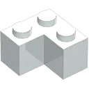{ .lu-ti width="24" loading="lazy" } [Corner Brick 1x2x2 (LOT 16)](../16.md) | 0.81743488%; mean 0.0081967213 | Not associated with a vendor |
| 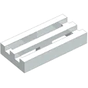{ .lu-ti width="24" loading="lazy" } [Tile 1x2 Grill (LOT 18)](../18.md) | 0.81743488%; mean 0.0081967213 | Not associated with a vendor |
| { .lu-ti width="24" loading="lazy" } [Corner Plate 1x2x2 (LOT 19)](../19.md) | 0.81743488%; mean 0.0081967213 | Not associated with a vendor |
| 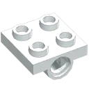{ .lu-ti width="24" loading="lazy" } [Technic Bearing Plate 2x2 with Pin Hole (LOT 23)](../23.md) | 0.81743488%; mean 0.0081967213 | Not associated with a vendor |
| 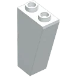{ .lu-ti width="24" loading="lazy" } [Slope Brick 75° 1x2x3 Inverted (LOT 24)](../24.md) | 0.81743488%; mean 0.0081967213 | Not associated with a vendor |
| 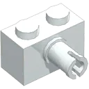{ .lu-ti width="24" loading="lazy" } [Brick 1x2 with Pin (LOT 25)](../25.md) | 2.02696864%; mean 0.020408163 | Not associated with a vendor |
| 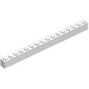{ .lu-ti width="24" loading="lazy" } [Brick 1x16 (LOT 26)](../26.md) | 0.81743488%; mean 0.0081967213 | Not associated with a vendor |
| { .lu-ti width="24" loading="lazy" } [Tile 1x1 with Clip (LOT 27)](../27.md) | 2.02696864%; mean 0.020408163 | Not associated with a vendor |
| 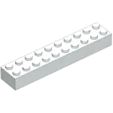{ .lu-ti width="24" loading="lazy" } [Brick 2x10 (LOT 34)](../34.md) | 0.81743488%; mean 0.0081967213 | Not associated with a vendor |
| 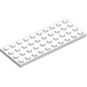{ .lu-ti width="24" loading="lazy" } [Plate 4x10 (LOT 43)](../43.md) | 0.81743488%; mean 0.0081967213 | Not associated with a vendor |
| { .lu-ti width="24" loading="lazy" } [Plate 4x4 (LOT 44)](../44.md) | 0.81743488%; mean 0.0081967213 | Not associated with a vendor |
| 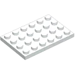{ .lu-ti width="24" loading="lazy" } [Plate 4x6 (LOT 45)](../45.md) | 0.81743488%; mean 0.0081967213 | Not associated with a vendor |
| 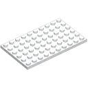{ .lu-ti width="24" loading="lazy" } [Plate 6x10 (LOT 46)](../46.md) | 0.81743488%; mean 0.0081967213 | Not associated with a vendor |
| 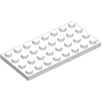{ .lu-ti width="24" loading="lazy" } [Plate 4x8 (LOT 47)](../47.md) | 0.81743488%; mean 0.0081967213 | Not associated with a vendor |
| 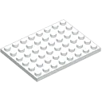{ .lu-ti width="24" loading="lazy" } [Plate 6x8 (LOT 48)](../48.md) | 0.81743488%; mean 0.0081967213 | Not associated with a vendor |
| { .lu-ti width="24" loading="lazy" } [Slope Brick 45° 2x2 (LOT 49)](../49.md) | 0.81743488%; mean 0.0081967213 | Not associated with a vendor |
| { .lu-ti width="24" loading="lazy" } [Slope Brick 45° 1x2 (LOT 50)](../50.md) | 0.81743488%; mean 0.0081967213 | Not associated with a vendor |
| { .lu-ti width="24" loading="lazy" } [Slope Brick 45° 2x2 Outside Corner (LOT 51)](../51.md) | 0.81743488%; mean 0.0081967213 | Not associated with a vendor |
| { .lu-ti width="24" loading="lazy" } [Slope Brick 45° 2x2 Inside Corner (LOT 52)](../52.md) | 0.81743488%; mean 0.0081967213 | Not associated with a vendor |
| { .lu-ti width="24" loading="lazy" } [Brick 1x1 Round (LOT 53)](../53.md) | 0.81743488%; mean 0.0081967213 | Not associated with a vendor |
| 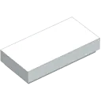{ .lu-ti width="24" loading="lazy" } [Tile 1x2 (LOT 55)](../55.md) | 0.81743488%; mean 0.0081967213 | Not associated with a vendor |
| { .lu-ti width="24" loading="lazy" } [Tile 1x1 (LOT 56)](../56.md) | 0.81743488%; mean 0.0081967213 | Not associated with a vendor |
| { .lu-ti width="24" loading="lazy" } [Plate 1x6 (LOT 62)](../62.md) | 0.81743488%; mean 0.0081967213 | Not associated with a vendor |
| 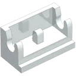{ .lu-ti width="24" loading="lazy" } [Hinge Brick 1x2 Base (LOT 68)](../68.md) | 2.02696864%; mean 0.020408163 | Not associated with a vendor |
| 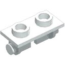{ .lu-ti width="24" loading="lazy" } [Hinge Brick 1x2 Top (LOT 69)](../69.md) | 2.02696864%; mean 0.020408163 | Not associated with a vendor |
| 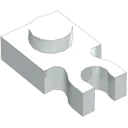{ .lu-ti width="24" loading="lazy" } [Plate 1x1 with Horizontal Clip (LOT 70)](../70.md) | 2.02696864%; mean 0.020408163 | Not associated with a vendor |
| { .lu-ti width="24" loading="lazy" } [Slope Brick 25° 1x3 (LOT 73)](../73.md) | 0.81743488%; mean 0.0081967213 | Not associated with a vendor |
| { .lu-ti width="24" loading="lazy" } [Brick 1x1 with 4 Studs (LOT 76)](../76.md) | 0.81743488%; mean 0.0081967213 | Not associated with a vendor |
| 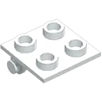{ .lu-ti width="24" loading="lazy" } [Plate 2x2 for Hinge Brick 1x2 (LOT 83)](../83.md) | 2.02696864%; mean 0.020408163 | Not associated with a vendor |
| { .lu-ti width="24" loading="lazy" } [Plate 1x1 Round (LOT 84)](../84.md) | 0.81743488%; mean 0.0081967213 | Not associated with a vendor |
| 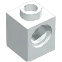{ .lu-ti width="24" loading="lazy" } [Technic Brick 1x1 (LOT 86)](../86.md) | 0.81743488%; mean 0.0081967213 | Not associated with a vendor |
| 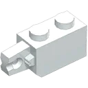{ .lu-ti width="24" loading="lazy" } [Brick 1x2 with Vertical Stub (LOT 92)](../92.md) | 2.02696864%; mean 0.020408163 | Not associated with a vendor |
| 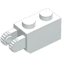{ .lu-ti width="24" loading="lazy" } [Brick 1x2 with Vertical Fork (LOT 93)](../93.md) | 2.02696864%; mean 0.020408163 | Not associated with a vendor |
| 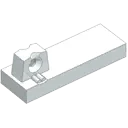{ .lu-ti width="24" loading="lazy" } [Tile 1x3 with Stub on Top (LOT 99)](../99.md) | 2.02696864%; mean 0.020408163 | Not associated with a vendor |
| 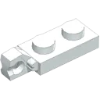{ .lu-ti width="24" loading="lazy" } [Plate 1x2 with Vertical Stub (LOT 100)](../100.md) | 2.02696864%; mean 0.020408163 | Not associated with a vendor |
| 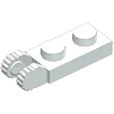{ .lu-ti width="24" loading="lazy" } [Plate 1x2 with Vertical Fork (LOT 101)](../101.md) | 2.02696864%; mean 0.020408163 | Not associated with a vendor |
| 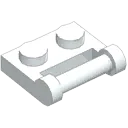{ .lu-ti width="24" loading="lazy" } [Plate 1x2 with Handle Type 2 (LOT 103)](../103.md) | 2.02696864%; mean 0.020408163 | Not associated with a vendor |
| { .lu-ti width="24" loading="lazy" } [Slope Brick 1x1x2/3 (LOT 104)](../104.md) | 0.81743488%; mean 0.0081967213 | Not associated with a vendor |
| { .lu-ti width="24" loading="lazy" } [Washing Machine Brick (LOT 109)](../109.md) | 0.81743488%; mean 0.0081967213 | Not associated with a vendor |
| 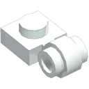{ .lu-ti width="24" loading="lazy" } [Plate 1x1 with Collar and Bilateral Studs (LOT 110)](../110.md) | 0.81743488%; mean 0.0081967213 | Not associated with a vendor |
| { .lu-ti width="24" loading="lazy" } [Slope Brick 45° 1x2 Inverted (LOT 111)](../111.md) | 0.81743488%; mean 0.0081967213 | Not associated with a vendor |
| { .lu-ti width="24" loading="lazy" } [Slope Brick 25° 2x3 (LOT 113)](../113.md) | 0.81743488%; mean 0.0081967213 | Not associated with a vendor |
| { .lu-ti width="24" loading="lazy" } [Slope Brick 25° 1x3 Inverted (LOT 114)](../114.md) | 0.81743488%; mean 0.0081967213 | Not associated with a vendor |
| 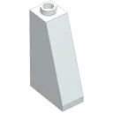{ .lu-ti width="24" loading="lazy" } [Slope Brick 75° 1x2x3 (LOT 115)](../115.md) | 0.81743488%; mean 0.0081967213 | Not associated with a vendor |
| { .lu-ti width="24" loading="lazy" } [Brick 2x2 Round (LOT 120)](../120.md) | 0.81743488%; mean 0.0081967213 | Not associated with a vendor |
| 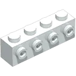{ .lu-ti width="24" loading="lazy" } [Brick 1x4 with Studs on Side (LOT 121)](../121.md) | 0.81743488%; mean 0.0081967213 | Not associated with a vendor |
| 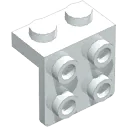{ .lu-ti width="24" loading="lazy" } [Angle Bracket Plate 1x2 / 2x2 (LOT 124)](../124.md) | 0.81743488%; mean 0.0081967213 | Not associated with a vendor |
| { .lu-ti width="24" loading="lazy" } [Slope Brick 25° 3x3 Outside Corner (LOT 141)](../141.md) | 0.81743488%; mean 0.0081967213 | Not associated with a vendor |
| { .lu-ti width="24" loading="lazy" } [Plate 1x2 with Single Stud (LOT 143)](../143.md) | 0.81743488%; mean 0.0081967213 | Not associated with a vendor |
| { .lu-ti width="24" loading="lazy" } [Plate 2x2 Round (LOT 178)](../178.md) | 0.81743488%; mean 0.0081967213 | Not associated with a vendor |
| 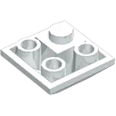{ .lu-ti width="24" loading="lazy" } [Slope Brick 45° 2x2 Corner, Inverted (LOT 179)](../179.md) | 0.81743488%; mean 0.0081967213 | Not associated with a vendor |
| 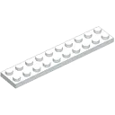{ .lu-ti width="24" loading="lazy" } [Plate 2x10 (LOT 180)](../180.md) | 0.81743488%; mean 0.0081967213 | Not associated with a vendor |
| 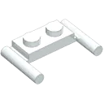{ .lu-ti width="24" loading="lazy" } [Plate 1x2 with Handles (LOT 335)](../335.md) | 0.81743488%; mean 0.0081967213 | Not associated with a vendor |
| { .lu-ti width="24" loading="lazy" } [Windscreen 3x6 25° (LOT 343)](../343.md) | 0.81743488%; mean 0.0081967213 | Not associated with a vendor |
| 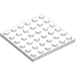{ .lu-ti width="24" loading="lazy" } [Plate 6x6 (LOT 349)](../349.md) | 0.81743488%; mean 0.0081967213 | Not associated with a vendor |
| 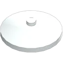{ .lu-ti width="24" loading="lazy" } [Dish 4x4 Inverted (LOT 350)](../350.md) | 0.81743488%; mean 0.0081967213 | Not associated with a vendor |
| 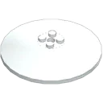{ .lu-ti width="24" loading="lazy" } [Dish 8x8 Inverted (LOT 351)](../351.md) | 0.81743488%; mean 0.0081967213 | Not associated with a vendor |
| 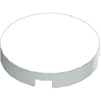{ .lu-ti width="24" loading="lazy" } [Tile 2x2 Round (LOT 362)](../362.md) | 0.81743488%; mean 0.0081967213 | Not associated with a vendor |
| { .lu-ti width="24" loading="lazy" } [Slope Brick 25° 3x3 (LOT 364)](../364.md) | 0.81743488%; mean 0.0081967213 | Not associated with a vendor |
| 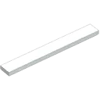{ .lu-ti width="24" loading="lazy" } [Tile 1x8 (LOT 365)](../365.md) | 0.81743488%; mean 0.0081967213 | Not associated with a vendor |
| 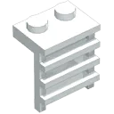{ .lu-ti width="24" loading="lazy" } [Plate 1x2 with Ladder (LOT 366)](../366.md) | 0.81743488%; mean 0.0081967213 | Not associated with a vendor |
| 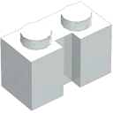{ .lu-ti width="24" loading="lazy" } [Brick 1x2 with Groove (LOT 373)](../373.md) | 0.81743488%; mean 0.0081967213 | Not associated with a vendor |
| 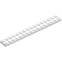{ .lu-ti width="24" loading="lazy" } [Plate 2x16 (LOT 379)](../379.md) | 0.81743488%; mean 0.0081967213 | Not associated with a vendor |
| 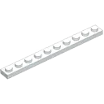{ .lu-ti width="24" loading="lazy" } [Plate 1x10 (LOT 390)](../390.md) | 0.81743488%; mean 0.0081967213 | Not associated with a vendor |
| { .lu-ti width="24" loading="lazy" } [Slope Brick 25° 6x6 Double (LOT 394)](../394.md) | 0.81743488%; mean 0.0081967213 | Not associated with a vendor |
| 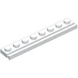{ .lu-ti width="24" loading="lazy" } [Plate 1x8 with Slide (LOT 395)](../395.md) | 0.81743488%; mean 0.0081967213 | Not associated with a vendor |
| { .lu-ti width="24" loading="lazy" } [Slope Brick 6x8 (LOT 396)](../396.md) | 0.81743488%; mean 0.0081967213 | Not associated with a vendor |
| 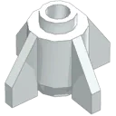{ .lu-ti width="24" loading="lazy" } [Brick 1x1x1 Round with Fins (LOT 400)](../400.md) | 0.81743488%; mean 0.0081967213 | Not associated with a vendor |
| 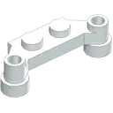{ .lu-ti width="24" loading="lazy" } [Plate 1x4 with Offset Ends (LOT 401)](../401.md) | 0.81743488%; mean 0.0081967213 | Not associated with a vendor |
| 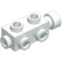{ .lu-ti width="24" loading="lazy" } [Camera Brick 1x2x2/3 (LOT 404)](../404.md) | 0.81743488%; mean 0.0081967213 | Not associated with a vendor |
| 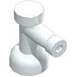{ .lu-ti width="24" loading="lazy" } [Tap 1x1 (LOT 408)](../408.md) | 0.81743488%; mean 0.0081967213 | Not associated with a vendor |
| 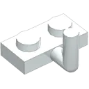{ .lu-ti width="24" loading="lazy" } [Plate 1x2 with Hook (LOT 410)](../410.md) | 2.02696864%; mean 0.020408163 | Not associated with a vendor |
| 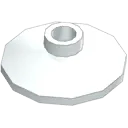{ .lu-ti width="24" loading="lazy" } [Dish 2x2 Inverted (LOT 415)](../415.md) | 0.81743488%; mean 0.0081967213 | Not associated with a vendor |
| { .lu-ti width="24" loading="lazy" } [Slope Brick 25°/45° 4x3 (LOT 424)](../424.md) | 0.81743488%; mean 0.0081967213 | Not associated with a vendor |
| 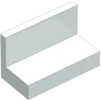{ .lu-ti width="24" loading="lazy" } [Panel 1x2x1 (LOT 428)](../428.md) | 0.81743488%; mean 0.0081967213 | Not associated with a vendor |
| { .lu-ti width="24" loading="lazy" } [Plate 6x6, 1/4-Circle (LOT 434)](../434.md) | 0.81743488%; mean 0.0081967213 | Not associated with a vendor |
| 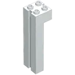{ .lu-ti width="24" loading="lazy" } [Brick 1x2x5 with Groove (LOT 446)](../446.md) | 0.81743488%; mean 0.0081967213 | Not associated with a vendor |
| 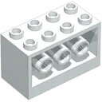{ .lu-ti width="24" loading="lazy" } [Brick 2x4x2 with Bottom Connection on Sides (LOT 450)](../450.md) | 0.81743488%; mean 0.0081967213 | Not associated with a vendor |
| { .lu-ti width="24" loading="lazy" } [Corner Plate 6x6x45° (LOT 462)](../462.md) | 0.81743488%; mean 0.0081967213 | Not associated with a vendor |
| { .lu-ti width="24" loading="lazy" } [Brick 1x10 (LOT 465)](../465.md) | 0.81743488%; mean 0.0081967213 | Not associated with a vendor |
| { .lu-ti width="24" loading="lazy" } [Brick 1x12 (LOT 466)](../466.md) | 0.81743488%; mean 0.0081967213 | Not associated with a vendor |
| { .lu-ti width="24" loading="lazy" } [Tile 8x8 Round with 4 Studs (LOT 474)](../474.md) | 0.81743488%; mean 0.0081967213 | Not associated with a vendor |
| { .lu-ti width="24" loading="lazy" } [Tile 4x4 with 4 Studs (LOT 475)](../475.md) | 0.81743488%; mean 0.0081967213 | Not associated with a vendor |
| { .lu-ti width="24" loading="lazy" } [Tile 4x6 with 12 Studs (LOT 476)](../476.md) | 0.81743488%; mean 0.0081967213 | Not associated with a vendor |
| { .lu-ti width="24" loading="lazy" } [Brick 2x3 with Curved Top (LOT 483)](../483.md) | 0.81743488%; mean 0.0081967213 | Not associated with a vendor |
| { .lu-ti width="24" loading="lazy" } [Panel 1x1x1 Corner (LOT 487)](../487.md) | 0.81743488%; mean 0.0081967213 | Not associated with a vendor |
| { .lu-ti width="24" loading="lazy" } [Wedge Brick 2x3 Right (LOT 499)](../499.md) | 0.81743488%; mean 0.0081967213 | Not associated with a vendor |
| { .lu-ti width="24" loading="lazy" } [Wedge Brick 2x3 Left (LOT 500)](../500.md) | 0.81743488%; mean 0.0081967213 | Not associated with a vendor |
| { .lu-ti width="24" loading="lazy" } [Tile 4x8 with 12 Studs (LOT 501)](../501.md) | 0.81743488%; mean 0.0081967213 | Not associated with a vendor |
| { .lu-ti width="24" loading="lazy" } [Tile 1x6 (LOT 503)](../503.md) | 0.81743488%; mean 0.0081967213 | Not associated with a vendor |
| { .lu-ti width="24" loading="lazy" } [Plate 6x6 Octagonal with Cut-Out (LOT 518)](../518.md) | 0.81743488%; mean 0.0081967213 | Not associated with a vendor |
| { .lu-ti width="24" loading="lazy" } [Dome 2x2x1 2/3 (LOT 535)](../535.md) | 0.81743488%; mean 0.0081967213 | Not associated with a vendor |
| { .lu-ti width="24" loading="lazy" } [Panel 4x6x6 Sloped (LOT 537)](../537.md) | 0.81743488%; mean 0.0081967213 | Not associated with a vendor |
| { .lu-ti width="24" loading="lazy" } [Brick 2x10 with Bay (LOT 541)](../541.md) | 0.81743488%; mean 0.0081967213 | Not associated with a vendor |
| { .lu-ti width="24" loading="lazy" } [Brick 1x2 with Narrow Handle (LOT 546)](../546.md) | 2.02696864%; mean 0.020408163 | Not associated with a vendor |
| { .lu-ti width="24" loading="lazy" } [Brick 1x2 with Horizontal Clip (LOT 547)](../547.md) | 2.02696864%; mean 0.020408163 | Not associated with a vendor |
| { .lu-ti width="24" loading="lazy" } [Slope Brick 55° 1x6x5 (LOT 551)](../551.md) | 0.81743488%; mean 0.0081967213 | Not associated with a vendor |
| { .lu-ti width="24" loading="lazy" } [Tile 2x3 with 2 Horizontal Clips (LOT 565)](../565.md) | 2.02696864%; mean 0.020408163 | Not associated with a vendor |
| { .lu-ti width="24" loading="lazy" } [Wedge Plate 6x12 Left (LOT 566)](../566.md) | 0.81743488%; mean 0.0081967213 | Not associated with a vendor |
| { .lu-ti width="24" loading="lazy" } [Wedge Plate 6x12 Right (LOT 567)](../567.md) | 0.81743488%; mean 0.0081967213 | Not associated with a vendor |
| { .lu-ti width="24" loading="lazy" } [Plate 3x3, 1/4-Circle (LOT 568)](../568.md) | 0.81743488%; mean 0.0081967213 | Not associated with a vendor |
| { .lu-ti width="24" loading="lazy" } [Cylinder Brick 3x6x2 2/3 (LOT 571)](../571.md) | 0.81743488%; mean 0.0081967213 | Not associated with a vendor |
| { .lu-ti width="24" loading="lazy" } [Brick 2x2x2 Round  (LOT 572)](../572.md) | 0.81743488%; mean 0.0081967213 | Not associated with a vendor |
| { .lu-ti width="24" loading="lazy" } [Astromech Robot Leg (LOT 573)](../573.md) | 0.81743488%; mean 0.0081967213 | Not associated with a vendor |
| { .lu-ti width="24" loading="lazy" } [Slope Brick 18° 2x4 (LOT 574)](../574.md) | 0.81743488%; mean 0.0081967213 | Not associated with a vendor |
| { .lu-ti width="24" loading="lazy" } [Brick 2x2 Round with Dome (LOT 576)](../576.md) | 0.81743488%; mean 0.0081967213 | Not associated with a vendor |
| { .lu-ti width="24" loading="lazy" } [Light Sword Blade (LOT 579)](../579.md) | 0.81743488%; mean 0.0081967213 | Not associated with a vendor |
| { .lu-ti width="24" loading="lazy" } [Plate 1x2 with Stub on Top (LOT 581)](../581.md) | 2.02696864%; mean 0.020408163 | Not associated with a vendor |
| { .lu-ti width="24" loading="lazy" } [Brick 1x2 with Vertical Fork and Vertical Stub (LOT 583)](../583.md) | 2.02696864%; mean 0.020408163 | Not associated with a vendor |
| { .lu-ti width="24" loading="lazy" } [Brick 1x4 with Vertical Fork and Vertical Stub (LOT 584)](../584.md) | 2.02696864%; mean 0.020408163 | Not associated with a vendor |
| { .lu-ti width="24" loading="lazy" } [Brick 1x6 with Vertical Fork and Vertical Stub (LOT 585)](../585.md) | 2.02696864%; mean 0.020408163 | Not associated with a vendor |
| { .lu-ti width="24" loading="lazy" } [Brick 2x2 with Vertical Stub (LOT 586)](../586.md) | 2.02696864%; mean 0.020408163 | Not associated with a vendor |
| { .lu-ti width="24" loading="lazy" } [Slope Brick 45° Inverted, Double with 2 Pins (LOT 587)](../587.md) | 2.02696864%; mean 0.020408163 | Not associated with a vendor |
| { .lu-ti width="24" loading="lazy" } [Slope Brick 75° 2x2x3 (LOT 590)](../590.md) | 0.81743488%; mean 0.0081967213 | Not associated with a vendor |
| { .lu-ti width="24" loading="lazy" } [Corner Plate 45° 4x4 (LOT 591)](../591.md) | 0.81743488%; mean 0.0081967213 | Not associated with a vendor |
| { .lu-ti width="24" loading="lazy" } [Corner Plate 45° 8x8 (LOT 592)](../592.md) | 0.81743488%; mean 0.0081967213 | Not associated with a vendor |
| { .lu-ti width="24" loading="lazy" } [Corner Brick 45° 3x3 (LOT 593)](../593.md) | 0.81743488%; mean 0.0081967213 | Not associated with a vendor |
| { .lu-ti width="24" loading="lazy" } [Beam 2x16x1 2/3 with Studs and Lattice (LOT 595)](../595.md) | 0.81743488%; mean 0.0081967213 | Not associated with a vendor |
| { .lu-ti width="24" loading="lazy" } [Screen 4x8x2 Trapezoid Curved with Vertical Fork (LOT 596)](../596.md) | 2.02696864%; mean 0.020408163 | Not associated with a vendor |
| { .lu-ti width="24" loading="lazy" } [Brick 1x2 with Horizontal Fork (LOT 597)](../597.md) | 2.02696864%; mean 0.020408163 | Not associated with a vendor |
| { .lu-ti width="24" loading="lazy" } [Brick 1x2 with Horizontal Stub (LOT 598)](../598.md) | 2.02696864%; mean 0.020408163 | Not associated with a vendor |
| { .lu-ti width="24" loading="lazy" } [Technic Bush with Horizontal Stub (LOT 599)](../599.md) | 2.02696864%; mean 0.020408163 | Not associated with a vendor |
| { .lu-ti width="24" loading="lazy" } [Technic Bush with Horizontal Fork (LOT 600)](../600.md) | 2.02696864%; mean 0.020408163 | Not associated with a vendor |
| { .lu-ti width="24" loading="lazy" } [1x3 with Vertical Fork and Vertical Stub (LOT 601)](../601.md) | 2.02696864%; mean 0.020408163 | Not associated with a vendor |
| { .lu-ti width="24" loading="lazy" } [Plate 4x4 1/4-Circle (LOT 603)](../603.md) | 0.81743488%; mean 0.0081967213 | Not associated with a vendor |
| { .lu-ti width="24" loading="lazy" } [Plate 1x8 with Extended Slide (LOT 604)](../604.md) | 0.81743488%; mean 0.0081967213 | Not associated with a vendor |
| { .lu-ti width="24" loading="lazy" } [Plate 1x2 with Slide (LOT 613)](../613.md) | 0.81743488%; mean 0.0081967213 | Not associated with a vendor |
| { .lu-ti width="24" loading="lazy" } [Wedge Plate 4x6 (LOT 614)](../614.md) | 0.81743488%; mean 0.0081967213 | Not associated with a vendor |
| { .lu-ti width="24" loading="lazy" } [Brick 2x2 with Vertical Fork (LOT 632)](../632.md) | 2.02696864%; mean 0.020408163 | Not associated with a vendor |
| { .lu-ti width="24" loading="lazy" } [Robot Claw with Stud and Vertical Fork (LOT 634)](../634.md) | 2.02696864%; mean 0.020408163 | Not associated with a vendor |
| { .lu-ti width="24" loading="lazy" } [Plate 8x8 (LOT 639)](../639.md) | 0.81743488%; mean 0.0081967213 | Not associated with a vendor |
| { .lu-ti width="24" loading="lazy" } [Wedge 2x6 Curved Right (LOT 641)](../641.md) | 0.81743488%; mean 0.0081967213 | Not associated with a vendor |
| { .lu-ti width="24" loading="lazy" } [Wedge 2x6 Curved Left (LOT 642)](../642.md) | 0.81743488%; mean 0.0081967213 | Not associated with a vendor |
| { .lu-ti width="24" loading="lazy" } [Slope Brick 1x6 Curved (LOT 647)](../647.md) | 0.81743488%; mean 0.0081967213 | Not associated with a vendor |
| { .lu-ti width="24" loading="lazy" } [Slope Brick 1x6 Curved, Inverted (LOT 648)](../648.md) | 0.81743488%; mean 0.0081967213 | Not associated with a vendor |
| { .lu-ti width="24" loading="lazy" } [Wedge 2x6 Curved Inverted Right (LOT 649)](../649.md) | 0.81743488%; mean 0.0081967213 | Not associated with a vendor |
| { .lu-ti width="24" loading="lazy" } [Wedge 2x6 Curved Inverted Left (LOT 650)](../650.md) | 0.81743488%; mean 0.0081967213 | Not associated with a vendor |
| { .lu-ti width="24" loading="lazy" } [Wedge Brick 2x4 Right (LOT 651)](../651.md) | 0.81743488%; mean 0.0081967213 | Not associated with a vendor |
| { .lu-ti width="24" loading="lazy" } [Wedge Brick 2x4 Left (LOT 652)](../652.md) | 0.81743488%; mean 0.0081967213 | Not associated with a vendor |
| { .lu-ti width="24" loading="lazy" } [Wedge Plate 2x4 Right (LOT 653)](../653.md) | 0.81743488%; mean 0.0081967213 | Not associated with a vendor |
| { .lu-ti width="24" loading="lazy" } [Wedge Plate 2x4 Left (LOT 654)](../654.md) | 0.81743488%; mean 0.0081967213 | Not associated with a vendor |
| { .lu-ti width="24" loading="lazy" } [Plate 1x2 with Shaft 12M (LOT 659)](../659.md) | 0.81743488%; mean 0.0081967213 | Not associated with a vendor |
| { .lu-ti width="24" loading="lazy" } [Slope Brick 18° 4x4 Corner (LOT 663)](../663.md) | 0.81743488%; mean 0.0081967213 | Not associated with a vendor |
| { .lu-ti width="24" loading="lazy" } [Wedge 2x4 Triple Left  (LOT 664)](../664.md) | 0.81743488%; mean 0.0081967213 | Not associated with a vendor |
| { .lu-ti width="24" loading="lazy" } [Wedge 2x4 Triple Right (LOT 665)](../665.md) | 0.81743488%; mean 0.0081967213 | Not associated with a vendor |
| { .lu-ti width="24" loading="lazy" } [Wedge 4x6 Curved (LOT 666)](../666.md) | 0.81743488%; mean 0.0081967213 | Not associated with a vendor |
| { .lu-ti width="24" loading="lazy" } [Wedge Brick 2x4 Right Sloped (LOT 669)](../669.md) | 0.81743488%; mean 0.0081967213 | Not associated with a vendor |
| { .lu-ti width="24" loading="lazy" } [Wedge Brick 2x4 Left Sloped (LOT 670)](../670.md) | 0.81743488%; mean 0.0081967213 | Not associated with a vendor |
| { .lu-ti width="24" loading="lazy" } [Wedge Plate 2x3 Right (LOT 671)](../671.md) | 0.81743488%; mean 0.0081967213 | Not associated with a vendor |
| { .lu-ti width="24" loading="lazy" } [Wedge Plate 2x3 Left (LOT 672)](../672.md) | 0.81743488%; mean 0.0081967213 | Not associated with a vendor |
| { .lu-ti width="24" loading="lazy" } [Brick 8x8 (LOT 673)](../673.md) | 0.81743488%; mean 0.0081967213 | Not associated with a vendor |
| { .lu-ti width="24" loading="lazy" } [Dish 3x3 Inverted (LOT 675)](../675.md) | 0.81743488%; mean 0.0081967213 | Not associated with a vendor |
| { .lu-ti width="24" loading="lazy" } [Brick 8x16 (LOT 676)](../676.md) | 0.81743488%; mean 0.0081967213 | Not associated with a vendor |
| { .lu-ti width="24" loading="lazy" } [Dish 6x6 Inverted  (LOT 677)](../677.md) | 0.81743488%; mean 0.0081967213 | Not associated with a vendor |
| { .lu-ti width="24" loading="lazy" } [Plate 1x2 with Vertical Stub (LOT 678)](../678.md) | 2.02696864%; mean 0.020408163 | Not associated with a vendor |
| { .lu-ti width="24" loading="lazy" } [Plate 1x4 with 2 Vertical Stubs (LOT 679)](../679.md) | 2.02696864%; mean 0.020408163 | Not associated with a vendor |
| { .lu-ti width="24" loading="lazy" } [Wagon Side 2x4 with Vertical Fork (LOT 680)](../680.md) | 2.02696864%; mean 0.020408163 | Not associated with a vendor |
| { .lu-ti width="24" loading="lazy" } [Plate 4x4 with Vertical Fork (LOT 681)](../681.md) | 2.02696864%; mean 0.020408163 | Not associated with a vendor |
| { .lu-ti width="24" loading="lazy" } [Slope Brick 45° Double with Vertical Fork (LOT 682)](../682.md) | 2.02696864%; mean 0.020408163 | Not associated with a vendor |
| { .lu-ti width="24" loading="lazy" } [Panel 2x4x3 Curved with Vertical Fork (LOT 683)](../683.md) | 2.02696864%; mean 0.020408163 | Not associated with a vendor |
| { .lu-ti width="24" loading="lazy" } [Tile 1x4 with 2 Stubs on Top (LOT 688)](../688.md) | 2.02696864%; mean 0.020408163 | Not associated with a vendor |
| { .lu-ti width="24" loading="lazy" } [Screen 4x8x2 Curved with Vertical Fork (LOT 692)](../692.md) | 2.02696864%; mean 0.020408163 | Not associated with a vendor |
| { .lu-ti width="24" loading="lazy" } [Wedge Plate 3x12 Left (LOT 693)](../693.md) | 0.81743488%; mean 0.0081967213 | Not associated with a vendor |
| { .lu-ti width="24" loading="lazy" } [Wedge Plate 3x12 Right (LOT 694)](../694.md) | 0.81743488%; mean 0.0081967213 | Not associated with a vendor |
| { .lu-ti width="24" loading="lazy" } [Bonnet 2x3x2/3 Curved with Flap and 2 Studs (LOT 700)](../700.md) | 0.81743488%; mean 0.0081967213 | Not associated with a vendor |
| { .lu-ti width="24" loading="lazy" } [Bonnet 2x2x2/3 Curved with 2 Studs (LOT 701)](../701.md) | 0.81743488%; mean 0.0081967213 | Not associated with a vendor |
| { .lu-ti width="24" loading="lazy" } [Bonnet 1x2x2/3 Curved with Flap (LOT 702)](../702.md) | 0.81743488%; mean 0.0081967213 | Not associated with a vendor |
| { .lu-ti width="24" loading="lazy" } [Brick 1x1 with 2 Studs (LOT 711)](../711.md) | 0.81743488%; mean 0.0081967213 | Not associated with a vendor |
| { .lu-ti width="24" loading="lazy" } [Brick 1x2 with Horizontal Fork and Vertical Stub (LOT 713)](../713.md) | 2.02696864%; mean 0.020408163 | Not associated with a vendor |
| { .lu-ti width="24" loading="lazy" } [Plate 1x1 with Tooth (LOT 726)](../726.md) | 0.81743488%; mean 0.0081967213 | Not associated with a vendor |
| { .lu-ti width="24" loading="lazy" } [Wedge Plate 3x8 Right (LOT 728)](../728.md) | 0.81743488%; mean 0.0081967213 | Not associated with a vendor |
| { .lu-ti width="24" loading="lazy" } [Wedge Plate 3x8 Left (LOT 729)](../729.md) | 0.81743488%; mean 0.0081967213 | Not associated with a vendor |
| { .lu-ti width="24" loading="lazy" } [Dish 10x10 (LOT 746)](../746.md) | 0.81743488%; mean 0.0081967213 | Not associated with a vendor |
| { .lu-ti width="24" loading="lazy" } [Wedge Plate 2x4 (LOT 748)](../748.md) | 0.81743488%; mean 0.0081967213 | Not associated with a vendor |
| { .lu-ti width="24" loading="lazy" } [Brick 12x12 0 4.85 Combo (LOT 752)](../752.md) | 0.81743488%; mean 0.0081967213 | Not associated with a vendor |
| { .lu-ti width="24" loading="lazy" } [Brick 1x2 with 4 Studs (LOT 753)](../753.md) | 0.81743488%; mean 0.0081967213 | Not associated with a vendor |
| { .lu-ti width="24" loading="lazy" } [Wedge Plate 3x6 Right (LOT 755)](../755.md) | 0.81743488%; mean 0.0081967213 | Not associated with a vendor |
| { .lu-ti width="24" loading="lazy" } [Wedge Plate 3x6 Left (LOT 756)](../756.md) | 0.81743488%; mean 0.0081967213 | Not associated with a vendor |
| { .lu-ti width="24" loading="lazy" } [Tube Straight 2 with Stud (LOT 766)](../766.md) | 0.81743488%; mean 0.0081967213 | Not associated with a vendor |
| { .lu-ti width="24" loading="lazy" } [Tube Curved 2x2 (LOT 767)](../767.md) | 0.81743488%; mean 0.0081967213 | Not associated with a vendor |
| { .lu-ti width="24" loading="lazy" } [Slope Brick 1x3 45° Inverted Double (LOT 789)](../789.md) | 0.81743488%; mean 0.0081967213 | Not associated with a vendor |
| { .lu-ti width="24" loading="lazy" } [Corner Plate 10x10 45° (LOT 797)](../797.md) | 0.81743488%; mean 0.0081967213 | Not associated with a vendor |
| { .lu-ti width="24" loading="lazy" } [Airplane Wing 4x9 (LOT 800)](../800.md) | 0.81743488%; mean 0.0081967213 | Not associated with a vendor |
| { .lu-ti width="24" loading="lazy" } [Corner Plate 3x6 Double 45° (LOT 804)](../804.md) | 0.81743488%; mean 0.0081967213 | Not associated with a vendor |
| { .lu-ti width="24" loading="lazy" } [Tile 1x4 (LOT 807)](../807.md) | 0.81743488%; mean 0.0081967213 | Not associated with a vendor |
| { .lu-ti width="24" loading="lazy" } [Tile 1x2 with Handle (LOT 808)](../808.md) | 2.02696864%; mean 0.020408163 | Not associated with a vendor |
| { .lu-ti width="24" loading="lazy" } [Brick 2x4x2 with Studs on Sides (LOT 809)](../809.md) | 0.81743488%; mean 0.0081967213 | Not associated with a vendor |
| { .lu-ti width="24" loading="lazy" } [Angle Bracket Plate 1x2 / 1x4 (LOT 811)](../811.md) | 0.81743488%; mean 0.0081967213 | Not associated with a vendor |
| { .lu-ti width="24" loading="lazy" } [Plate 2x12 (LOT 814)](../814.md) | 0.81743488%; mean 0.0081967213 | Not associated with a vendor |
| { .lu-ti width="24" loading="lazy" } [Corner Plate 45° 3x3 (LOT 815)](../815.md) | 0.81743488%; mean 0.0081967213 | Not associated with a vendor |
| { .lu-ti width="24" loading="lazy" } [Brick 1x1x5 (LOT 816)](../816.md) | 0.81743488%; mean 0.0081967213 | Not associated with a vendor |
| { .lu-ti width="24" loading="lazy" } [Brick 1x2x5 (LOT 817)](../817.md) | 0.81743488%; mean 0.0081967213 | Not associated with a vendor |
| { .lu-ti width="24" loading="lazy" } [Tile 2x2 with Pin on Top (LOT 818)](../818.md) | 2.02696864%; mean 0.020408163 | Not associated with a vendor |
| { .lu-ti width="24" loading="lazy" } [Plate 2x2 with Pin Underneath (LOT 826)](../826.md) | 2.02696864%; mean 0.020408163 | Not associated with a vendor |
| { .lu-ti width="24" loading="lazy" } [Propeller 5x5 with 4 Blades (LOT 827)](../827.md) | 2.02696864%; mean 0.020408163 | Not associated with a vendor |
| { .lu-ti width="24" loading="lazy" } [Boat Mast Platform Octagonal with Horizontal Clips (LOT 836)](../836.md) | 2.02696864%; mean 0.020408163 | Not associated with a vendor |
| { .lu-ti width="24" loading="lazy" } [Plate 1x2 with Handle Type 1 (LOT 837)](../837.md) | 2.02696864%; mean 0.020408163 | Not associated with a vendor |
| { .lu-ti width="24" loading="lazy" } [Brick 4x4 ¼-Circle (LOT 846)](../846.md) | 0.81743488%; mean 0.0081967213 | Not associated with a vendor |
| { .lu-ti width="24" loading="lazy" } [Corner Plate 2x4x4 (LOT 852)](../852.md) | 0.81743488%; mean 0.0081967213 | Not associated with a vendor |
| { .lu-ti width="24" loading="lazy" } [Slide Shoe Round 2x2 (LOT 854)](../854.md) | 0.81743488%; mean 0.0081967213 | Not associated with a vendor |
| { .lu-ti width="24" loading="lazy" } [Train Roof 45° 2x6 with Cut-Out (LOT 861)](../861.md) | 0.81743488%; mean 0.0081967213 | Not associated with a vendor |
| { .lu-ti width="24" loading="lazy" } [Profile Brick 1x2 (LOT 863)](../863.md) | 0.81743488%; mean 0.0081967213 | Not associated with a vendor |
| { .lu-ti width="24" loading="lazy" } [Brick 1x1 with Handle (LOT 864)](../864.md) | 2.02696864%; mean 0.020408163 | Not associated with a vendor |
| { .lu-ti width="24" loading="lazy" } [Plate 6x16 (LOT 866)](../866.md) | 0.81743488%; mean 0.0081967213 | Not associated with a vendor |
| { .lu-ti width="24" loading="lazy" } [Plate 6x12 (LOT 867)](../867.md) | 0.81743488%; mean 0.0081967213 | Not associated with a vendor |
| { .lu-ti width="24" loading="lazy" } [Plate 4x12 (LOT 868)](../868.md) | 0.81743488%; mean 0.0081967213 | Not associated with a vendor |
| { .lu-ti width="24" loading="lazy" } [Slope Brick 45° 4x2 (LOT 870)](../870.md) | 0.81743488%; mean 0.0081967213 | Not associated with a vendor |
| { .lu-ti width="24" loading="lazy" } [Slope Brick 45° 3x2 (LOT 871)](../871.md) | 0.81743488%; mean 0.0081967213 | Not associated with a vendor |
| { .lu-ti width="24" loading="lazy" } [Slope Brick 45° Ridged 2x4 (LOT 872)](../872.md) | 0.81743488%; mean 0.0081967213 | Not associated with a vendor |
| { .lu-ti width="24" loading="lazy" } [Slope Brick 45° Ridged 2x2 (LOT 873)](../873.md) | 0.81743488%; mean 0.0081967213 | Not associated with a vendor |
| { .lu-ti width="24" loading="lazy" } [Slope Brick 45° Ridged 1x2 (LOT 874)](../874.md) | 0.81743488%; mean 0.0081967213 | Not associated with a vendor |
| { .lu-ti width="24" loading="lazy" } [Slope Brick 45° Triple Ridged 1x2 (LOT 875)](../875.md) | 0.81743488%; mean 0.0081967213 | Not associated with a vendor |
| { .lu-ti width="24" loading="lazy" } [Slope Brick 45° 1x2 Top, with Inverted Connection (LOT 876)](../876.md) | 0.81743488%; mean 0.0081967213 | Not associated with a vendor |
| { .lu-ti width="24" loading="lazy" } [Flat Tile 2x2 (LOT 877)](../877.md) | 0.81743488%; mean 0.0081967213 | Not associated with a vendor |
| { .lu-ti width="24" loading="lazy" } [Plate 2x3 Semi-Round with Eye (LOT 878)](../878.md) | 0.81743488%; mean 0.0081967213 | Not associated with a vendor |
| { .lu-ti width="24" loading="lazy" } [Brick 1x2x2 (LOT 890)](../890.md) | 0.81743488%; mean 0.0081967213 | Not associated with a vendor |
| { .lu-ti width="24" loading="lazy" } [Slope Brick 25° 4x3 (LOT 891)](../891.md) | 0.81743488%; mean 0.0081967213 | Not associated with a vendor |
| { .lu-ti width="24" loading="lazy" } [Slope Brick 25° Ridged 2x4 (LOT 892)](../892.md) | 0.81743488%; mean 0.0081967213 | Not associated with a vendor |
| { .lu-ti width="24" loading="lazy" } [Slope Brick 25° Ridged 2x2 (LOT 893)](../893.md) | 0.81743488%; mean 0.0081967213 | Not associated with a vendor |
| { .lu-ti width="24" loading="lazy" } [Plate 6x14 (LOT 900)](../900.md) | 0.81743488%; mean 0.0081967213 | Not associated with a vendor |
| { .lu-ti width="24" loading="lazy" } [Slope Brick 45° 2x2 Inverted (LOT 916)](../916.md) | 0.81743488%; mean 0.0081967213 | Not associated with a vendor |
| { .lu-ti width="24" loading="lazy" } [Slope Brick 65° 2x2x2 (LOT 917)](../917.md) | 0.81743488%; mean 0.0081967213 | Not associated with a vendor |
| { .lu-ti width="24" loading="lazy" } [Slope Brick 75° 2x2x3 Corner (LOT 919)](../919.md) | 0.81743488%; mean 0.0081967213 | Not associated with a vendor |
| { .lu-ti width="24" loading="lazy" } [Slope Brick 73° 2x2x2 Pyramid (LOT 920)](../920.md) | 0.81743488%; mean 0.0081967213 | Not associated with a vendor |
| { .lu-ti width="24" loading="lazy" } [Slope Brick 25° 2x3 Inverted (LOT 927)](../927.md) | 0.81743488%; mean 0.0081967213 | Not associated with a vendor |
| { .lu-ti width="24" loading="lazy" } [Brick 2x2 with Bow and Studs (LOT 1199)](../1199.md) | 0.81743488%; mean 0.0081967213 | Not associated with a vendor |
| { .lu-ti width="24" loading="lazy" } [Robot Arm with Stud and Clip (LOT 1218)](../1218.md) | 0.81743488%; mean 0.0081967213 | Not associated with a vendor |
| { .lu-ti width="24" loading="lazy" } [Rippled Bar on Stud Socket with 2 Clips (LOT 1226)](../1226.md) | 2.02696864%; mean 0.020408163 | Not associated with a vendor |
| { .lu-ti width="24" loading="lazy" } [Pneumatic T-Piece (LOT 1265)](../1265.md) | 0.81743488%; mean 0.0081967213 | Not associated with a vendor |
| { .lu-ti width="24" loading="lazy" } [Healing Banana (LOT 1966)](../1966.md) | 3.26086957%; mean 0.032608696 | Not associated with a vendor |
| { .lu-ti width="24" loading="lazy" } [Notion Potion (LOT 2198)](../2198.md) | 3.26086957%; mean 0.032608696 | Not associated with a vendor |
| { .lu-ti width="24" loading="lazy" } [Chef Hat (LOT 2588)](../2588.md) | 0.1375%; mean 0.001375 | Not associated with a vendor |
| { .lu-ti width="24" loading="lazy" } [Bullhorn (LOT 2617)](../2617.md) | 0% in the generic loot model | Not associated with a vendor |
| { .lu-ti width="24" loading="lazy" } [Quicksicle (LOT 2620)](../2620.md) | 3.26086957%; mean 0.032608696 | Not associated with a vendor |
| { .lu-ti width="24" loading="lazy" } [Improved Ladle (LOT 2622)](../2622.md) | 0.1375%; mean 0.001375 | Not associated with a vendor |
| { .lu-ti width="24" loading="lazy" } [Wizard Hat (LOT 2623)](../2623.md) | 0.1375%; mean 0.001375 | Not associated with a vendor |
| { .lu-ti width="24" loading="lazy" } [Armor Polish (LOT 2993)](../2993.md) | 3.26086957%; mean 0.032608696 | Not associated with a vendor |
| { .lu-ti width="24" loading="lazy" } [Healing Cherry (LOT 2994)](../2994.md) | 3.26086957%; mean 0.032608696 | Not associated with a vendor |
| { .lu-ti width="24" loading="lazy" } [Armor Shine (LOT 2996)](../2996.md) | 3.26086957%; mean 0.032608696 | Not associated with a vendor |
| { .lu-ti width="24" loading="lazy" } [Strong Notion Potion (LOT 2998)](../2998.md) | 3.26086957%; mean 0.032608696 | Not associated with a vendor |
| { .lu-ti width="24" loading="lazy" } [BBQ Blast Hot Dog (LOT 3011)](../3011.md) | 3.26086957%; mean 0.032608696 | Not associated with a vendor |
| { .lu-ti width="24" loading="lazy" } [Green Imaginite (LOT 3039)](../3039.md) | 3.26086957%; mean 0.032608696 | Not associated with a vendor |
| { .lu-ti width="24" loading="lazy" } [Red Imaginite (LOT 3040)](../3040.md) | 5%; mean 0.05 | Not associated with a vendor |
| { .lu-ti width="24" loading="lazy" } [Improved Crescent Wrench (LOT 3077)](../3077.md) | 0.275%; mean 0.00275 | Not associated with a vendor |
| { .lu-ti width="24" loading="lazy" } [Amber Gem (LOT 3100)](../3100.md) | 3.26086957%; mean 0.032608696 | Not associated with a vendor |
| { .lu-ti width="24" loading="lazy" } [Witch Hat (LOT 3853)](../3853.md) | 0.1375%; mean 0.001375 | Not associated with a vendor |
| { .lu-ti width="24" loading="lazy" } [Flower Hat (LOT 3858)](../3858.md) | 0.1375%; mean 0.001375 | Not associated with a vendor |
| { .lu-ti width="24" loading="lazy" } [Police Hat (LOT 3859)](../3859.md) | 0.1375%; mean 0.001375 | Not associated with a vendor |
| { .lu-ti width="24" loading="lazy" } [Hard Hat (LOT 3860)](../3860.md) | 0.1375%; mean 0.001375 | Not associated with a vendor |
| { .lu-ti width="24" loading="lazy" } [Black Baseball Cap (LOT 3868)](../3868.md) | 0.1375%; mean 0.001375 | Not associated with a vendor |
| { .lu-ti width="24" loading="lazy" } [Orange Baseball Cap (LOT 3869)](../3869.md) | 0.1375%; mean 0.001375 | Not associated with a vendor |
| { .lu-ti width="24" loading="lazy" } [Improved Witch Broom (LOT 3870)](../3870.md) | 0.1375%; mean 0.001375 | Not associated with a vendor |
| { .lu-ti width="24" loading="lazy" } [Basic Shovel (LOT 3872)](../3872.md) | 1.03125%; mean 0.0103125 | Not associated with a vendor |
| { .lu-ti width="24" loading="lazy" } [Improved Firefighter Axe (LOT 4824)](../4824.md) | 0.1375%; mean 0.001375 | Not associated with a vendor |
| { .lu-ti width="24" loading="lazy" } [Plate 1x2 with Tow Bar and Ball (LOT 5037)](../5037.md) | 2.02696864%; mean 0.020408163 | Not associated with a vendor |
| { .lu-ti width="24" loading="lazy" } [Brick 1x2 Hollow (LOT 5074)](../5074.md) | 0.81743488%; mean 0.0081967213 | Not associated with a vendor |
| { .lu-ti width="24" loading="lazy" } [Plate 2x4 Cross Coupling (LOT 5080)](../5080.md) | 2.02696864%; mean 0.020408163 | Not associated with a vendor |
| { .lu-ti width="24" loading="lazy" } [Plate 2x4 Across Hinge (LOT 5081)](../5081.md) | 2.02696864%; mean 0.020408163 | Not associated with a vendor |
| { .lu-ti width="24" loading="lazy" } [Plate 2x2 with Coupling Ball (LOT 5086)](../5086.md) | 2.02696864%; mean 0.020408163 | Not associated with a vendor |
| { .lu-ti width="24" loading="lazy" } [Train Bogie Plate 4x6 (LOT 5112)](../5112.md) | 0.81743488%; mean 0.0081967213 | Not associated with a vendor |
| { .lu-ti width="24" loading="lazy" } [Slope Brick 45° 8x2 (LOT 5127)](../5127.md) | 0.81743488%; mean 0.0081967213 | Not associated with a vendor |
| { .lu-ti width="24" loading="lazy" } [Brick 2x2 with Pin on Top (LOT 5149)](../5149.md) | 2.02696864%; mean 0.020408163 | Not associated with a vendor |
| { .lu-ti width="24" loading="lazy" } [Element Separator (LOT 5152)](../5152.md) | 0.81743488%; mean 0.0081967213 | Not associated with a vendor |
| { .lu-ti width="24" loading="lazy" } [Brick 12x12 1/4-Circle (LOT 5176)](../5176.md) | 0.81743488%; mean 0.0081967213 | Not associated with a vendor |
| { .lu-ti width="24" loading="lazy" } [Tile 6x12 with 22 Studs (LOT 5179)](../5179.md) | 0.81743488%; mean 0.0081967213 | Not associated with a vendor |
| { .lu-ti width="24" loading="lazy" } [Cone 1x1 (LOT 5180)](../5180.md) | 0.81743488%; mean 0.0081967213 | Not associated with a vendor |
| { .lu-ti width="24" loading="lazy" } [Brick 4X10 (LOT 5182)](../5182.md) | 0.81743488%; mean 0.0081967213 | Not associated with a vendor |
| { .lu-ti width="24" loading="lazy" } [Plate 1x4 with Lateral Reversed Hook (LOT 5200)](../5200.md) | 2.02696864%; mean 0.020408163 | Not associated with a vendor |
| { .lu-ti width="24" loading="lazy" } [Brick 2x2x3 (LOT 5219)](../5219.md) | 0.81743488%; mean 0.0081967213 | Not associated with a vendor |
| { .lu-ti width="24" loading="lazy" } [Panel 1x4x1 (LOT 5274)](../5274.md) | 0.81743488%; mean 0.0081967213 | Not associated with a vendor |
| { .lu-ti width="24" loading="lazy" } [Slope Brick 45° 4x6 Double (LOT 5294)](../5294.md) | 0.81743488%; mean 0.0081967213 | Not associated with a vendor |
| { .lu-ti width="24" loading="lazy" } [Wedge 3x12 Curved Right (LOT 5355)](../5355.md) | 0.81743488%; mean 0.0081967213 | Not associated with a vendor |
| { .lu-ti width="24" loading="lazy" } [Wedge 3x12 Curved Left (LOT 5356)](../5356.md) | 0.81743488%; mean 0.0081967213 | Not associated with a vendor |
| { .lu-ti width="24" loading="lazy" } [Tile 8x16 (LOT 5390)](../5390.md) | 0.81743488%; mean 0.0081967213 | Not associated with a vendor |
| { .lu-ti width="24" loading="lazy" } [Technic Hub with 4 Sticks (LOT 5400)](../5400.md) | 0.81743488%; mean 0.0081967213 | Not associated with a vendor |
| { .lu-ti width="24" loading="lazy" } [Windscreen 3x6 25° (LOT 5489)](../5489.md) | 0.81743488%; mean 0.0081967213 | Not associated with a vendor |
| { .lu-ti width="24" loading="lazy" } [Plate 1x2 with 2 Horizontal Clips (LOT 5517)](../5517.md) | 2.02696864%; mean 0.020408163 | Not associated with a vendor |
| { .lu-ti width="24" loading="lazy" } [Plate 1x2 with Vertical Fork (LOT 5518)](../5518.md) | 2.02696864%; mean 0.020408163 | Not associated with a vendor |
| { .lu-ti width="24" loading="lazy" } [Plate 4x4 Round with Pin Hole (LOT 5519)](../5519.md) | 0.81743488%; mean 0.0081967213 | Not associated with a vendor |
| { .lu-ti width="24" loading="lazy" } [Brick 1x1 with Horizontal Clip (LOT 5520)](../5520.md) | 2.02696864%; mean 0.020408163 | Not associated with a vendor |
| { .lu-ti width="24" loading="lazy" } [Slope Brick 18° 1x4 (LOT 5521)](../5521.md) | 0.81743488%; mean 0.0081967213 | Not associated with a vendor |
| { .lu-ti width="24" loading="lazy" } [Plate 1x2 with Hinge End (LOT 5522)](../5522.md) | 2.02696864%; mean 0.020408163 | Not associated with a vendor |
| { .lu-ti width="24" loading="lazy" } [Plate 1x12 (LOT 5523)](../5523.md) | 0.81743488%; mean 0.0081967213 | Not associated with a vendor |
| { .lu-ti width="24" loading="lazy" } [Slope Brick 65° 2x1x2 (LOT 5524)](../5524.md) | 0.81743488%; mean 0.0081967213 | Not associated with a vendor |
| { .lu-ti width="24" loading="lazy" } [Plate 2x2 with Ball Socket and Cross Axle Hole (LOT 5593)](../5593.md) | 2.02696864%; mean 0.020408163 | Not associated with a vendor |
| { .lu-ti width="24" loading="lazy" } [Brick 1x2 with Stub on Top (LOT 5616)](../5616.md) | 2.02696864%; mean 0.020408163 | Not associated with a vendor |
| { .lu-ti width="24" loading="lazy" } [Hiccup Tablets (LOT 5832)](../5832.md) | 3.26086957%; mean 0.032608696 | Not associated with a vendor |
| { .lu-ti width="24" loading="lazy" } [Brick Booster Pack (LOT 5834)](../5834.md) | 3.26086957%; mean 0.032608696 | Not associated with a vendor |
| { .lu-ti width="24" loading="lazy" } [Super Brick Booster Pack (LOT 5835)](../5835.md) | 5%; mean 0.05 | Not associated with a vendor |
| { .lu-ti width="24" loading="lazy" } [Picnic Basket (LOT 5836)](../5836.md) | 3.26086957%; mean 0.032608696 | Not associated with a vendor |
| { .lu-ti width="24" loading="lazy" } [Super Picnic Basket (LOT 5837)](../5837.md) | 5%; mean 0.05 | Not associated with a vendor |
| { .lu-ti width="24" loading="lazy" } [Basic Shortsword of Knockback (LOT 5948)](../5948.md) | 0.275%; mean 0.00275 | Not associated with a vendor |
| { .lu-ti width="24" loading="lazy" } [Maelstrom-Infected Brick (LOT 6194)](../6194.md) | 75.5%; mean 1.1325 | Not associated with a vendor |
| { .lu-ti width="24" loading="lazy" } [Thirst Quencher (LOT 6201)](../6201.md) | 3.26086957%; mean 0.032608696 | Not associated with a vendor |
| { .lu-ti width="24" loading="lazy" } [Basic Spear of Stunning (LOT 6203)](../6203.md) | 0.275%; mean 0.00275 | Not associated with a vendor |
| { .lu-ti width="24" loading="lazy" } [Nexus Force Healing Kit (LOT 6207)](../6207.md) | 3.26086957%; mean 0.032608696 | Not associated with a vendor |
| { .lu-ti width="24" loading="lazy" } [Improved Fishing Pole (LOT 6742)](../6742.md) | 0.275%; mean 0.00275 | Not associated with a vendor |
| { .lu-ti width="24" loading="lazy" } [Pink Gem (LOT 6866)](../6866.md) | 3.26086957%; mean 0.032608696 | Not associated with a vendor |
| { .lu-ti width="24" loading="lazy" } [Improved Composite Axe (LOT 6881)](../6881.md) | 0.275%; mean 0.00275 | Not associated with a vendor |
| { .lu-ti width="24" loading="lazy" } [Flash Bang (LOT 6884)](../6884.md) | 3.26086957%; mean 0.032608696 | Not associated with a vendor |
| { .lu-ti width="24" loading="lazy" } [Buttery Croissant (LOT 7724)](../7724.md) | 3.26086957%; mean 0.032608696 | Not associated with a vendor |
| { .lu-ti width="24" loading="lazy" } [Healing Drumstick (LOT 7725)](../7725.md) | 3.26086957%; mean 0.032608696 | Not associated with a vendor |
| { .lu-ti width="24" loading="lazy" } [Skater Helmet (LOT 7728)](../7728.md) | 0.1375%; mean 0.001375 | Not associated with a vendor |
| { .lu-ti width="24" loading="lazy" } [Viking Helm (LOT 7729)](../7729.md) | 0.1375%; mean 0.001375 | Not associated with a vendor |
| { .lu-ti width="24" loading="lazy" } [Aussie Hat (LOT 7731)](../7731.md) | 0.1375%; mean 0.001375 | Not associated with a vendor |
| { .lu-ti width="24" loading="lazy" } [Walkie Talkie (LOT 7732)](../7732.md) | 0.1375%; mean 0.001375 | Not associated with a vendor |
| { .lu-ti width="24" loading="lazy" } [Improved Frying Pan (LOT 7733)](../7733.md) | 0.1375%; mean 0.001375 | Not associated with a vendor |
| { .lu-ti width="24" loading="lazy" } [Improved Push Broom (LOT 7734)](../7734.md) | 0.1375%; mean 0.001375 | Not associated with a vendor |
| { .lu-ti width="24" loading="lazy" } [Picnic Table Model (LOT 7758)](../7758.md) | 0.83152174%; mean 0.0083152174 | Not associated with a vendor |
| { .lu-ti width="24" loading="lazy" } [Double Trash Can Model (LOT 7759)](../7759.md) | 0.83152174%; mean 0.0083152174 | Not associated with a vendor |
| { .lu-ti width="24" loading="lazy" } [Trash Can Model (LOT 7761)](../7761.md) | 0.83152174%; mean 0.0083152174 | Not associated with a vendor |
| { .lu-ti width="24" loading="lazy" } [Bench Model (LOT 7770)](../7770.md) | 0.83152174%; mean 0.0083152174 | Not associated with a vendor |
| { .lu-ti width="24" loading="lazy" } [Cooler Model (LOT 7771)](../7771.md) | 0.83152174%; mean 0.0083152174 | Not associated with a vendor |
| { .lu-ti width="24" loading="lazy" } [Piano Model (LOT 7773)](../7773.md) | 1.275%; mean 0.01275 | Not associated with a vendor |
| { .lu-ti width="24" loading="lazy" } [Guitar Model (LOT 7774)](../7774.md) | 0.83152174%; mean 0.0083152174 | Not associated with a vendor |
| { .lu-ti width="24" loading="lazy" } [Bass Guitar Model (LOT 7775)](../7775.md) | 0.83152174%; mean 0.0083152174 | Not associated with a vendor |
| { .lu-ti width="24" loading="lazy" } [Firecracker (LOT 7778)](../7778.md) | 3.26086957%; mean 0.032608696 | Not associated with a vendor |
| { .lu-ti width="24" loading="lazy" } [Grey Kepi Hat (LOT 7793)](../7793.md) | 8.25%; mean 0.0825 | Not associated with a vendor |
| { .lu-ti width="24" loading="lazy" } [Fire Hydrant Model (LOT 7808)](../7808.md) | 0.83152174%; mean 0.0083152174 | Not associated with a vendor |
| { .lu-ti width="24" loading="lazy" } [Drumset Model (LOT 7813)](../7813.md) | 1.275%; mean 0.01275 | Not associated with a vendor |
| { .lu-ti width="24" loading="lazy" } [Cash Register Model (LOT 7818)](../7818.md) | 0.83152174%; mean 0.0083152174 | Not associated with a vendor |
| { .lu-ti width="24" loading="lazy" } [DJ Table Model (LOT 7822)](../7822.md) | 0.83152174%; mean 0.0083152174 | Not associated with a vendor |
| { .lu-ti width="24" loading="lazy" } [Tank Pallet Model (LOT 7825)](../7825.md) | 0.765%; mean 0.00765 | Not associated with a vendor |
| { .lu-ti width="24" loading="lazy" } [Oil Drum Model (LOT 7826)](../7826.md) | 0.83152174%; mean 0.0083152174 | Not associated with a vendor |
| { .lu-ti width="24" loading="lazy" } [Dolly Model (LOT 7827)](../7827.md) | 0.83152174%; mean 0.0083152174 | Not associated with a vendor |
| { .lu-ti width="24" loading="lazy" } [Torch Cart Model (LOT 7828)](../7828.md) | 0.83152174%; mean 0.0083152174 | Not associated with a vendor |
| { .lu-ti width="24" loading="lazy" } [Engine Model (LOT 7829)](../7829.md) | 0.765%; mean 0.00765 | Not associated with a vendor |
| { .lu-ti width="24" loading="lazy" } [Pallet Model (LOT 7830)](../7830.md) | 0.83152174%; mean 0.0083152174 | Not associated with a vendor |
| { .lu-ti width="24" loading="lazy" } [Vendor Rack Model (LOT 7832)](../7832.md) | 0.765%; mean 0.00765 | Not associated with a vendor |
| { .lu-ti width="24" loading="lazy" } [Blue Kepi Hat (LOT 7990)](../7990.md) | 0% in the generic loot model | Not associated with a vendor |
| { .lu-ti width="24" loading="lazy" } [Basic Dagger (LOT 8217)](../8217.md) | 1.03125%; mean 0.0103125 | Not associated with a vendor |
| { .lu-ti width="24" loading="lazy" } [Basic Pickaxe (LOT 8218)](../8218.md) | 1.03125%; mean 0.0103125 | Not associated with a vendor |
| { .lu-ti width="24" loading="lazy" } [Basic Javelin (LOT 8219)](../8219.md) | 1.03125%; mean 0.0103125 | Not associated with a vendor |
| { .lu-ti width="24" loading="lazy" } [Double Lamppost Model (LOT 8270)](../8270.md) | 0.83152174%; mean 0.0083152174 | Not associated with a vendor |
| { .lu-ti width="24" loading="lazy" } [Bag of Glitter (LOT 8363)](../8363.md) | 3.26086957%; mean 0.032608696 | Not associated with a vendor |
| { .lu-ti width="24" loading="lazy" } [Cloud Burst (LOT 8366)](../8366.md) | 3.26086957%; mean 0.032608696 | Not associated with a vendor |
| { .lu-ti width="24" loading="lazy" } [Quality Cutlass (LOT 8497)](../8497.md) | 0% in the generic loot model | Not associated with a vendor |
| { .lu-ti width="24" loading="lazy" } [Improved Hatchet (LOT 8498)](../8498.md) | 0.275%; mean 0.00275 | Not associated with a vendor |
| { .lu-ti width="24" loading="lazy" } [Quality Woodsman's Axe (LOT 8500)](../8500.md) | 0% in the generic loot model | Not associated with a vendor |
| { .lu-ti width="24" loading="lazy" } [Improved Ice Saw (LOT 8501)](../8501.md) | 0.275%; mean 0.00275 | Not associated with a vendor |
| { .lu-ti width="24" loading="lazy" } [Improved Scimitar (LOT 8502)](../8502.md) | 0.275%; mean 0.00275 | Not associated with a vendor |
| { .lu-ti width="24" loading="lazy" } [Quality Corseque (LOT 8503)](../8503.md) | 0% in the generic loot model | Not associated with a vendor |
| { .lu-ti width="24" loading="lazy" } [Improved Longsword (LOT 8504)](../8504.md) | 0.275%; mean 0.00275 | Not associated with a vendor |
| { .lu-ti width="24" loading="lazy" } [Basic Force Blade (LOT 8505)](../8505.md) | 1.03125%; mean 0.0103125 | Not associated with a vendor |
| { .lu-ti width="24" loading="lazy" } [Quality Dirk (LOT 8506)](../8506.md) | 0% in the generic loot model | Not associated with a vendor |
| { .lu-ti width="24" loading="lazy" } [Improved Trident (LOT 8509)](../8509.md) | 0.275%; mean 0.00275 | Not associated with a vendor |
| { .lu-ti width="24" loading="lazy" } [EMT Shirt (LOT 8615)](../8615.md) | 0.1375%; mean 0.001375 | Not associated with a vendor |
| { .lu-ti width="24" loading="lazy" } [Scooter Chassis 2x6 with Lateral Studs (LOT 8788)](../8788.md) | 0.81743488%; mean 0.0081967213 | Not associated with a vendor |
| { .lu-ti width="24" loading="lazy" } [Frame with Hinge for Windscreen 6x6 Octagonal (LOT 8794)](../8794.md) | 2.02696864%; mean 0.020408163 | Not associated with a vendor |
| { .lu-ti width="24" loading="lazy" } [Plate 6x24 (LOT 8826)](../8826.md) | 0.81743488%; mean 0.0081967213 | Not associated with a vendor |
| { .lu-ti width="24" loading="lazy" } [Brick 1x4 Hollow (LOT 8827)](../8827.md) | 0.81743488%; mean 0.0081967213 | Not associated with a vendor |
| { .lu-ti width="24" loading="lazy" } [Plate 1x4 with Coupling Cup (LOT 8828)](../8828.md) | 2.02696864%; mean 0.020408163 | Not associated with a vendor |
| { .lu-ti width="24" loading="lazy" } [Plate 1x4 with Coupling Ball (LOT 8829)](../8829.md) | 2.02696864%; mean 0.020408163 | Not associated with a vendor |
| { .lu-ti width="24" loading="lazy" } [Tile 1x4 with Hinge for Fence Gate (LOT 8831)](../8831.md) | 0.81743488%; mean 0.0081967213 | Not associated with a vendor |
| { .lu-ti width="24" loading="lazy" } [Plate 1x1 Round with Ball (LOT 8838)](../8838.md) | 2.02696864%; mean 0.020408163 | Not associated with a vendor |
| { .lu-ti width="24" loading="lazy" } [Plate 2x2 with Ball Socket (LOT 8844)](../8844.md) | 2.02696864%; mean 0.020408163 | Not associated with a vendor |
| { .lu-ti width="24" loading="lazy" } [Garrison Cap (LOT 8852)](../8852.md) | 0.81743488%; mean 0.0081967213 | Not associated with a vendor |
| { .lu-ti width="24" loading="lazy" } [Slope Brick 53° 1x3x3 1/3 with Studs (LOT 8879)](../8879.md) | 0.81743488%; mean 0.0081967213 | Not associated with a vendor |
| { .lu-ti width="24" loading="lazy" } [Tile 6x16 with 26 Studs (LOT 8895)](../8895.md) | 0.81743488%; mean 0.0081967213 | Not associated with a vendor |
| { .lu-ti width="24" loading="lazy" } [Spiral Tube with Flanges (LOT 8896)](../8896.md) | 0.81743488%; mean 0.0081967213 | Not associated with a vendor |
| { .lu-ti width="24" loading="lazy" } [Brick 2x6x3 (LOT 8897)](../8897.md) | 0.81743488%; mean 0.0081967213 | Not associated with a vendor |
| { .lu-ti width="24" loading="lazy" } [Panel 2x4x4 1/2-Circle (LOT 8898)](../8898.md) | 0.81743488%; mean 0.0081967213 | Not associated with a vendor |
| { .lu-ti width="24" loading="lazy" } [Tile 6x6 (LOT 8913)](../8913.md) | 0.81743488%; mean 0.0081967213 | Not associated with a vendor |
| { .lu-ti width="24" loading="lazy" } [Ball Ø52mm (LOT 8914)](../8914.md) | 0.81743488%; mean 0.0081967213 | Not associated with a vendor |
| { .lu-ti width="24" loading="lazy" } [Brick 2x4x3 (LOT 8937)](../8937.md) | 0.81743488%; mean 0.0081967213 | Not associated with a vendor |
| { .lu-ti width="24" loading="lazy" } [Dome 4x4 Faceted (LOT 8941)](../8941.md) | 0.81743488%; mean 0.0081967213 | Not associated with a vendor |
| { .lu-ti width="24" loading="lazy" } [Brick 4x18 (LOT 8950)](../8950.md) | 0.81743488%; mean 0.0081967213 | Not associated with a vendor |
| { .lu-ti width="24" loading="lazy" } [Plate 2x4 / 2x2x1 with Pin on Top (LOT 8952)](../8952.md) | 2.02696864%; mean 0.020408163 | Not associated with a vendor |
| { .lu-ti width="24" loading="lazy" } [Slope Brick 2x6 Curved (LOT 9015)](../9015.md) | 0.81743488%; mean 0.0081967213 | Not associated with a vendor |
| { .lu-ti width="24" loading="lazy" } [Basket 2x3x2 with Vertical Fork (LOT 9042)](../9042.md) | 2.02696864%; mean 0.020408163 | Not associated with a vendor |
| { .lu-ti width="24" loading="lazy" } [Tile 1x2 Engraved  (LOT 9084)](../9084.md) | 0.81743488%; mean 0.0081967213 | Not associated with a vendor |
| { .lu-ti width="24" loading="lazy" } [Technic Crane Arm 16 (LOT 9086)](../9086.md) | 0.81743488%; mean 0.0081967213 | Not associated with a vendor |
| { .lu-ti width="24" loading="lazy" } [Brick 4x12 (LOT 9088)](../9088.md) | 0.81743488%; mean 0.0081967213 | Not associated with a vendor |
| { .lu-ti width="24" loading="lazy" } [Brick 1x1 with Vertical Clip (LOT 9091)](../9091.md) | 2.02696864%; mean 0.020408163 | Not associated with a vendor |
| { .lu-ti width="24" loading="lazy" } [Brick 1x1x3 with 2 Horizontal Clips (LOT 9094)](../9094.md) | 2.02696864%; mean 0.020408163 | Not associated with a vendor |
| { .lu-ti width="24" loading="lazy" } [Plate 1x1 with Horizontal Clip (LOT 9098)](../9098.md) | 2.02696864%; mean 0.020408163 | Not associated with a vendor |
| { .lu-ti width="24" loading="lazy" } [Plate 1x1 with Vertical Clip (LOT 9103)](../9103.md) | 2.02696864%; mean 0.020408163 | Not associated with a vendor |
| { .lu-ti width="24" loading="lazy" } [Spike 2x8 (Flexible) with 2 Studs (LOT 9106)](../9106.md) | 0.81743488%; mean 0.0081967213 | Not associated with a vendor |
| { .lu-ti width="24" loading="lazy" } [Tile 1x3 (LOT 9130)](../9130.md) | 0.81743488%; mean 0.0081967213 | Not associated with a vendor |
| { .lu-ti width="24" loading="lazy" } [Plate 1x2 with Horizontal Clip (LOT 9131)](../9131.md) | 2.02696864%; mean 0.020408163 | Not associated with a vendor |
| { .lu-ti width="24" loading="lazy" } [Frame Plate 4x4 (LOT 9157)](../9157.md) | 0.81743488%; mean 0.0081967213 | Not associated with a vendor |
| { .lu-ti width="24" loading="lazy" } [Slope Brick 1x2x2/3 (LOT 9192)](../9192.md) | 0.81743488%; mean 0.0081967213 | Not associated with a vendor |
| { .lu-ti width="24" loading="lazy" } [Space Blaster, Smooth (LOT 9193)](../9193.md) | 0.81743488%; mean 0.0081967213 | Not associated with a vendor |
| { .lu-ti width="24" loading="lazy" } [Dome 4x4 Smooth Ø32 (LOT 9194)](../9194.md) | 0.81743488%; mean 0.0081967213 | Not associated with a vendor |
| { .lu-ti width="24" loading="lazy" } [Tile 2x4 (LOT 9195)](../9195.md) | 0.81743488%; mean 0.0081967213 | Not associated with a vendor |
| { .lu-ti width="24" loading="lazy" } [Brick 4x4 Round with Pin Hole (LOT 9197)](../9197.md) | 0.81743488%; mean 0.0081967213 | Not associated with a vendor |
| { .lu-ti width="24" loading="lazy" } [Brick 1x1 with 1 Stud on Side (LOT 9201)](../9201.md) | 0.81743488%; mean 0.0081967213 | Not associated with a vendor |
| { .lu-ti width="24" loading="lazy" } [Plate 2x2 with 1 Stud (LOT 9203)](../9203.md) | 0.81743488%; mean 0.0081967213 | Not associated with a vendor |
| { .lu-ti width="24" loading="lazy" } [Plate 2x6x2/3 with 4 Horizontal Studs (LOT 9204)](../9204.md) | 0.81743488%; mean 0.0081967213 | Not associated with a vendor |
| { .lu-ti width="24" loading="lazy" } [Tile 2x6 with Holder (LOT 9237)](../9237.md) | 0.81743488%; mean 0.0081967213 | Not associated with a vendor |
| { .lu-ti width="24" loading="lazy" } [Garden Shovel (LOT 9259)](../9259.md) | 0.1375%; mean 0.001375 | Not associated with a vendor |
| { .lu-ti width="24" loading="lazy" } [Improved Crescent Wrench (LOT 9263)](../9263.md) | 0.1375%; mean 0.001375 | Not associated with a vendor |
| { .lu-ti width="24" loading="lazy" } [Brown Bench Model (LOT 9484)](../9484.md) | 0.83152174%; mean 0.0083152174 | Not associated with a vendor |
| { .lu-ti width="24" loading="lazy" } [Hotdog Cart Model (LOT 9491)](../9491.md) | 0.765%; mean 0.00765 | Not associated with a vendor |
| { .lu-ti width="24" loading="lazy" } [Hotdog Stand Model (LOT 9492)](../9492.md) | 0.83152174%; mean 0.0083152174 | Not associated with a vendor |
| { .lu-ti width="24" loading="lazy" } [Dustbin Model (LOT 9495)](../9495.md) | 0.83152174%; mean 0.0083152174 | Not associated with a vendor |
| { .lu-ti width="24" loading="lazy" } [Sleek Sofa Model (LOT 9496)](../9496.md) | 0.83152174%; mean 0.0083152174 | Not associated with a vendor |
| { .lu-ti width="24" loading="lazy" } [Traffic Light Model (LOT 9497)](../9497.md) | 0.83152174%; mean 0.0083152174 | Not associated with a vendor |
| { .lu-ti width="24" loading="lazy" } [Wagon Model (LOT 9568)](../9568.md) | 0.83152174%; mean 0.0083152174 | Not associated with a vendor |
| { .lu-ti width="24" loading="lazy" } [BBQ Grill Model (LOT 9570)](../9570.md) | 0.765%; mean 0.00765 | Not associated with a vendor |
| { .lu-ti width="24" loading="lazy" } [Mailbox Model (LOT 9574)](../9574.md) | 0.83152174%; mean 0.0083152174 | Not associated with a vendor |
| { .lu-ti width="24" loading="lazy" } [Big Red Magnet Model (LOT 9811)](../9811.md) | 0.83152174%; mean 0.0083152174 | Not associated with a vendor |
| { .lu-ti width="24" loading="lazy" } [Un-Stink Potion (LOT 10021)](../10021.md) | 3.26086957%; mean 0.032608696 | Not associated with a vendor |
| { .lu-ti width="24" loading="lazy" } [Turntable 4x4 (LOT 10193)](../10193.md) | 2.02696864%; mean 0.020408163 | Not associated with a vendor |
| { .lu-ti width="24" loading="lazy" } [Hinge Plate 1x2 1x2 Complete (LOT 10194)](../10194.md) | 2.02696864%; mean 0.020408163 | Not associated with a vendor |
| { .lu-ti width="24" loading="lazy" } [Turntable 2x2 (LOT 10195)](../10195.md) | 0.81743488%; mean 0.0081967213 | Not associated with a vendor |
| { .lu-ti width="24" loading="lazy" } [Click-Turntable 4x4 with Sliding Block (LOT 10202)](../10202.md) | 2.02696864%; mean 0.020408163 | Not associated with a vendor |
| { .lu-ti width="24" loading="lazy" } [Brick 1x2 with Vertical Pin Top Part (LOT 10231)](../10231.md) | 2.02696864%; mean 0.020408163 | Not associated with a vendor |
| { .lu-ti width="24" loading="lazy" } [Brick 1x2 with Vertical Pin Hole Bottom Part (LOT 10232)](../10232.md) | 2.02696864%; mean 0.020408163 | Not associated with a vendor |
| { .lu-ti width="24" loading="lazy" } [Turntable 4x4 Bottom Part (LOT 10264)](../10264.md) | 2.02696864%; mean 0.020408163 | Not associated with a vendor |
| { .lu-ti width="24" loading="lazy" } [Basic Shortsword (LOT 10431)](../10431.md) | 1.03125%; mean 0.0103125 | Not associated with a vendor |
| { .lu-ti width="24" loading="lazy" } [Basic Spear (LOT 10432)](../10432.md) | 1.03125%; mean 0.0103125 | Not associated with a vendor |
| { .lu-ti width="24" loading="lazy" } [Basic Hammer (LOT 10433)](../10433.md) | 1.03125%; mean 0.0103125 | Not associated with a vendor |
| { .lu-ti width="24" loading="lazy" } [Faction Token Proxy (LOT 13763)](../13763.md) | 52%; mean 0.78 | Not associated with a vendor |
| { .lu-ti width="24" loading="lazy" } [Med Pack (LOT 14679)](../14679.md) | 5%; mean 0.05 | Not associated with a vendor |
| { .lu-ti width="24" loading="lazy" } [Armor Repair Kit (LOT 14680)](../14680.md) | 5%; mean 0.05 | Not associated with a vendor |
| { .lu-ti width="24" loading="lazy" } [Steering Lever (LOT 16320)](../16320.md) | 2.02696864%; mean 0.020408163 | Not associated with a vendor |
| { .lu-ti width="24" loading="lazy" } [Plate 1x2 with Hinge (LOT 16321)](../16321.md) | 2.02696864%; mean 0.020408163 | Not associated with a vendor |
| { .lu-ti width="24" loading="lazy" } [Cockpit 4x4x4 (LOT 16323)](../16323.md) | 0.81743488%; mean 0.0081967213 | Not associated with a vendor |
| { .lu-ti width="24" loading="lazy" } [Windscreen 4x4x3 (LOT 16326)](../16326.md) | 2.02696864%; mean 0.020408163 | Not associated with a vendor |
| { .lu-ti width="24" loading="lazy" } [Sideboard 2x4 (LOT 16334)](../16334.md) | 2.02696864%; mean 0.020408163 | Not associated with a vendor |
| { .lu-ti width="24" loading="lazy" } [Windscreen 1x4x1 1/3 (LOT 16340)](../16340.md) | 2.02696864%; mean 0.020408163 | Not associated with a vendor |
| { .lu-ti width="24" loading="lazy" } [Banner with 3.18 Stick 3x8 (LOT 16343)](../16343.md) | 0.81743488%; mean 0.0081967213 | Not associated with a vendor |
| { .lu-ti width="24" loading="lazy" } [Windscreen 6x4x4 (LOT 16348)](../16348.md) | 2.02696864%; mean 0.020408163 | Not associated with a vendor |
| { .lu-ti width="24" loading="lazy" } [Cockpit 4x8x4 (LOT 16349)](../16349.md) | 2.02696864%; mean 0.020408163 | Not associated with a vendor |
| { .lu-ti width="24" loading="lazy" } [Roof 4x4 with Hinge (LOT 16358)](../16358.md) | 2.02696864%; mean 0.020408163 | Not associated with a vendor |
| { .lu-ti width="24" loading="lazy" } [Link for Grab (LOT 16359)](../16359.md) | 2.02696864%; mean 0.020408163 | Not associated with a vendor |
| { .lu-ti width="24" loading="lazy" } [Grab for Link (LOT 16360)](../16360.md) | 2.02696864%; mean 0.020408163 | Not associated with a vendor |
| { .lu-ti width="24" loading="lazy" } [Cockpit 6x8x4 (LOT 16361)](../16361.md) | 2.02696864%; mean 0.020408163 | Not associated with a vendor |
| { .lu-ti width="24" loading="lazy" } [Hinge Plate 1x2 1/2 (LOT 16363)](../16363.md) | 2.02696864%; mean 0.020408163 | Not associated with a vendor |
| { .lu-ti width="24" loading="lazy" } [Hinge Plate 1x2 1/2 (LOT 16364)](../16364.md) | 2.02696864%; mean 0.020408163 | Not associated with a vendor |
| { .lu-ti width="24" loading="lazy" } [Hinge Plate 1x4 (LOT 16365)](../16365.md) | 2.02696864%; mean 0.020408163 | Not associated with a vendor |
| { .lu-ti width="24" loading="lazy" } [Brick 4x6 (LOT 16366)](../16366.md) | 0.81743488%; mean 0.0081967213 | Not associated with a vendor |
| { .lu-ti width="24" loading="lazy" } [Hinge Plate 1x2.5 without Knob (LOT 16371)](../16371.md) | 2.02696864%; mean 0.020408163 | Not associated with a vendor |
| { .lu-ti width="24" loading="lazy" } [Plate 1x4 Vertical Hinge (LOT 16372)](../16372.md) | 2.02696864%; mean 0.020408163 | Not associated with a vendor |
| { .lu-ti width="24" loading="lazy" } [Holder with Cross Axle and Knob (LOT 16374)](../16374.md) | 0.81743488%; mean 0.0081967213 | Not associated with a vendor |
| { .lu-ti width="24" loading="lazy" } [Brick 6x6x2 W. Ø4.85 (LOT 16375)](../16375.md) | 0.81743488%; mean 0.0081967213 | Not associated with a vendor |
| { .lu-ti width="24" loading="lazy" } [Roof Tile 4x4/45° with Hinge (LOT 16381)](../16381.md) | 2.02696864%; mean 0.020408163 | Not associated with a vendor |
| { .lu-ti width="24" loading="lazy" } [Link with Snap with Fork (LOT 16386)](../16386.md) | 2.02696864%; mean 0.020408163 | Not associated with a vendor |
| { .lu-ti width="24" loading="lazy" } [Link with Snap with Friction (LOT 16387)](../16387.md) | 2.02696864%; mean 0.020408163 | Not associated with a vendor |
| { .lu-ti width="24" loading="lazy" } [Connecting Link (LOT 16388)](../16388.md) | 2.02696864%; mean 0.020408163 | Not associated with a vendor |
| { .lu-ti width="24" loading="lazy" } [Wall Hinge 45° (LOT 16391)](../16391.md) | 2.02696864%; mean 0.020408163 | Not associated with a vendor |
| { .lu-ti width="24" loading="lazy" } [Lamp Shade (LOT 16405)](../16405.md) | 0.81743488%; mean 0.0081967213 | Not associated with a vendor |
| { .lu-ti width="24" loading="lazy" } [Front 4x6x1 2/3 (LOT 16410)](../16410.md) | 0.81743488%; mean 0.0081967213 | Not associated with a vendor |
| { .lu-ti width="24" loading="lazy" } [Brick 2x2 with Groove (LOT 16423)](../16423.md) | 0.81743488%; mean 0.0081967213 | Not associated with a vendor |
| { .lu-ti width="24" loading="lazy" } [Round Wall 3x6x10 (LOT 16442)](../16442.md) | 0.81743488%; mean 0.0081967213 | Not associated with a vendor |
| { .lu-ti width="24" loading="lazy" } [Plate 1x4 with 2 Knobs (LOT 16443)](../16443.md) | 0.81743488%; mean 0.0081967213 | Not associated with a vendor |

## Raw matrix entries

| Row | Loot table | Rarity table | Trigger | Min | Max | Flag | Gate |
| --- | --- | --- | --- | --- | --- | --- | --- |
| 3900 | 72 | 29 | 0.11 | 1 | 1 |  | nexustower |
| 3901 | 88 | 9 | 0.755 | 1 | 2 |  | nexustower |
| 3902 | 111 | 19 | 1 | 1 | 3 |  | nexustower |
| 3903 | 112 | 19 | 1 | 1 | 3 |  | nexustower |
| 3904 | 184 | 4 | 0.255 | 1 | 1 |  | nexustower |
| 3905 | 185 | 29 | 0.11 | 1 | 1 |  | nexustower |
| 3906 | 186 | 4 | 1 | 1 | 1 |  | nexustower |
| 3907 | 670 | 23 | 0.52 | 1 | 2 |  | nexustower |

[LootMatrix](../../../db/LootMatrix.md), [LootTable](../../../db/LootTable.md), [RarityTable](../../../db/RarityTable.md).
